# YOLOv8 Pose

Purpose: independent `ModelKitYOLOPose` implementation of PoseCapability using the [hugging-mac Core ML export](https://huggingface.co/hugging-mac/yolov8-pose-coreml). Design goals: local inference, bounded postprocessing and existing ModelResource lifecycle ownership.

## Artifacts and use

Run `python3 scripts/download-yolov8-pose.py`. The profile pins revision `8d8d85e2b40d1474607651f25d9f870968debf31` and installs the n variant under Resources/Models/YOLOPose. Weights are ignored by Git. The source model card declares AGPL-3.0, inherited from Ultralytics; distribution must account for those terms. No upstream SDK source or new dependency is copied.

Defaults registers `yolov8n-pose` with `.pose` and releaseWhenIdle. App supplies the resource root; callers obtain `manager.get(.pose)` and inject PoseCapability. No pose model is loaded by the voice startup sequence. The physical App resource whitelist ships YOLOPose; camera perception acquires .pose lazily on its first admitted frame.

The adapter accepts `yolov8n-pose.mlmodelc` or the downloaded `.mlpackage`. Core ML compiles a package locally on first load, loads the result and removes the temporary compiled directory. This is platform compilation of an already converted graph, not model conversion or a network download. Compiled artifacts are preferred for deployment.

## Algorithm and capacity

```mermaid
flowchart LR
    Image[Upright RGB8 ImageFrame] --> Lease[Exclusive ModelResource lease]
    Lease --> Resize[Bilinear aspect-fit resize and centered 114 padding]
    Resize --> Graph[CoreMLImageGraph: image 640 x 640]
    Graph --> Tensor[predictions 1 x 56 x 8400]
    Tensor --> Filter[Score >= 0.25; top 300 candidates]
    Filter --> NMS[Greedy NMS IoU 0.45; at most 100 people]
    NMS --> Restore[Undo actual rounded resize and padding]
    Restore --> Result[Original-pixel boxes and 17 joints]
```

Input is bounded to 4,194,304 pixels and 4096 pixels per dimension. EXIF orientation and mirroring must be resolved by the caller. RGB scaling uses half-pixel bilinear interpolation, rounded resized dimensions and integer centered padding. Output coordinates are not clipped; off-image joints remain distinguishable. Joint order follows BodyJoint / COCO. There is no tracking ID or temporal smoothing.

Raw predictions have center-x/center-y/width/height, person confidence, then 17 x/y/confidence triples. Decode rejects wrong shape, non-finite values and invalid selected-joint confidence. Sorting is stable by original candidate index on tied scores; NMS retains at most 100 poses from the top 300 scored candidates. Truncation is a documented detection budget, not an action queue.

One lease covers preprocessing, native prediction and decoding. Busy calls fail without a queue. Caller cancellation and manager shutdown cancel the worker; the lease remains held until native work and cleanup finish. Synchronous Core ML prediction cannot be forcibly interrupted. Unload waits; retained capability handles reload on reuse.

✅ Image preparation, Core ML prediction, bounded decoding, default registration, cancellation and lifecycle integration.
✅ Deterministic preprocessing/NMS/coordinate tests and opt-in real model smoke test (`YOLO_POSE_MODEL_ROOT`).
❌ s/m variants, human-image accuracy acceptance and iPhone latency/thermal measurements. A blank-image smoke test does not establish pose accuracy.

Validation (2026-09-26): `scripts/check.sh` passed with full Xcode selected and YOLO_POSE_MODEL_ROOT enabled, including all four YOLO tests and default pose binding coverage. `scripts/build-ios.sh` passed all four simulator schemes. Real model smoke exercised blank-image inference, unload/reload and shutdown rejection on Mac; human-image accuracy and iPhone runtime remain unverified. Other existing opt-in model evaluations remained skipped.

✅ Photographer consumes the existing shared .pose capability; physical App staging now includes the pinned YOLOPose package. Model lifecycle and one-inference admission are unchanged.
