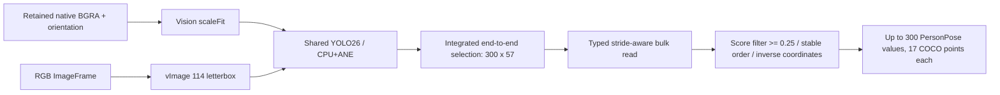

# YOLO26 Pose

Purpose: independent PoseCapability backed by the official Ultralytics YOLO26n-Pose INT8 Core ML artifact. Design goals: native Vision input, shared single-model lifetime, bounded end-to-end decoding and no business dependencies.

## Provisioning and contract

Run `python3 scripts/download-yolo26-pose.py`. `Resources/Models/yolo26-pose.download.json` pins release v8.3.0 asset 487599229 by archive and per-file SHA-256; the release tag alone is not treated as immutable. ZIP digest: `a809a889f1d324299090c6d9f4211ddd3588cc525f5f78d79691de45bd12f042`. Weights remain ignored. The model metadata declares AGPL-3.0; the existing license is staged with the App.

Defaults registers only `yolo26n-pose`. YOLOPose accepts the new `.mlmodelc` or `.mlpackage`, with no old-model fallback. Package compilation is local preparation, not PyTorch conversion. App supplies resources and obtains the shared `.pose` capability. One lease covers preparation, prediction and decoding; shutdown/cancellation joins native work, and unload waits.

Inspected artifact: image input 640×640, head=Pose26, end2end=True, quantize=8; output `var_1566`, Float32 [1,300,57]. The graph discovers the sole output name and validates shape. Each row is x1/y1/x2/y2/confidence/class_id followed by 17 x/y/confidence triples. Class 0 is person. This is an end-to-end one-to-one head: do not run legacy NMS again.

✅ Native input avoids full-frame camera RGB conversion. Vision preprocessing is included in its request interval; CPU+ANE is the model default, with `.all` available for backend comparisons. It does not prove actual ANE placement or constrain Vision's own processing devices.
✅ RGB/custom input retains vImage. Native Vision uses continuous aspect-fit offsets; vImage uses rounded dimensions and opaque RGB 114 padding. Vision padding is framework-controlled, not assumed pixel-identical.
✅ Decode rejects malformed shapes/nonfinite values, invalid scores/classes/joints, skips degenerate boxes and preserves off-image coordinates. Overlapping end-to-end detections are not suppressed. Agent separately limits display to six people; there is no temporal tracking.
✅ Tests exercise both real model paths, all four native orientations, stride/type extraction and overlapping-person/no-NMS behavior.
❌ Human-image/device accuracy, sustained thermal/pool pressure, s/m variants and multi-model sharing remain unverified. Historical YOLOv8 timings do not apply to this model.

References: [official model download script](https://github.com/ultralytics/yolo-ios-app/blob/main/scripts/download-models.sh), [official output layout](https://github.com/ultralytics/yolo-ios-app/blob/main/Sources/UltralyticsYOLO/PoseEstimator.swift). No upstream SDK implementation is copied or linked.
