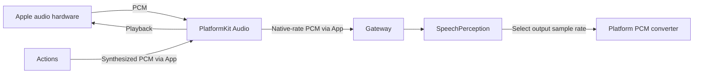
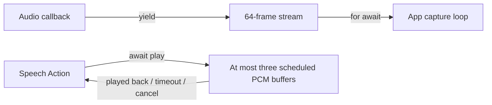
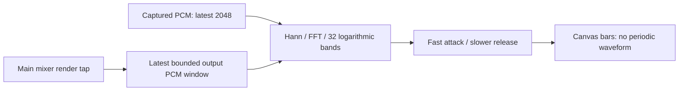

# Audio — Platform Audio IO

Purpose: capture and play audio through public Apple APIs and convert capture PCM continuously. No model inference or Agent decisions belong here.

- ✅ AppleAudioIO: bounded capture bridge, playback, interruption and route handling.
- ✅ MicrophoneFrame: capture samples, format, sequence, duration and RMS level.
- ✅ StreamingMonoPCMResampler: converter state across packets, format validation, packet sequence, reset and explicit conversion errors.
- ✅ SpeechPerception owns VAD/segmentation policy and consumes ModelKit capabilities; PlatformKit supplies PCM only.
- ❌ Additional audio routes and hardware acceptance beyond the documented voice validation scope.

Keep this README and stream continuity tests current when changing audio code. Cancellation must not deliver stale audio. Real microphone/playback validation requires a device.

## Queue and asynchronous processing contract

The AVAudioEngine tap produces microphone frames into a 64-element `AsyncThrowingStream` using `bufferingOldest`; the App capture task consumes them. Tap requests are 1024 samples, but actual callback size is validated separately (1...8192 samples). Sequence numbers are allocated under a mutex. When yield reports a dropped frame, the stream finishes with `AudioIOError.overflow`; the pipeline must stop rather than continue with an unnoticed gap. This stream is not a fixed-duration buffer because hardware sample rate/frame size vary. `stopCapture` removes the tap, stops the engine and finishes the stream.

Playback admits one active stream, with at most three scheduled buffers of up to 262,144 mono samples each. Capacity suspension supplies backpressure; final completion awaits all dataPlayedBack callbacks. Tokens fence stale callbacks, cancellation wakes capacity/drain waiters, and queued-duration-plus-three-second watchdogs bound missing hardware completion. This watchdog starts when a PCM buffer is scheduled; it does not time an empty upstream PCM read. There is no audio mixing or simultaneous playback of different Actions.

✅ The algorithm above describes the current implementation.

Maintenance: update this contract when changing producers, consumers, limits, ordering, cancellation or completion semantics.

Audio is the platform capability domain for microphone and speaker I/O. AppleAudioIO currently owns both operations and shared AVAudioSession setup; do not create independent session owners solely to match device filenames. Keep domain files flat until actual complexity requires device subdirectories. Recognition, synthesis and neural VAD belong to ModelKit/Speech; conversation policy belongs to Agents.

## Measured spectrum telemetry

✅ AudioSpectrum measures the latest 2048 mono samples, removes DC, applies a Hann window and radix-2 FFT, and sums power into 32 logarithmic bands (80 Hz to min(8 kHz, Nyquist)). Fixed −66…−6 dB mapping preserves level differences; there is no per-frame auto normalization. Invalid samples become zero. Attack/release smoothing is deterministic and settles to silence. This is device-level metering, not model inference.

✅ AppleAudioIO.playStream schedules up to three bounded mono PCM buffers continuously. Each is at most 262,144 samples; producer awaits capacity, final completion awaits dataPlayedBack for all buffers. The node is not stopped between packets or same-format Actions. Format changes reconnect only after drain; cancellation/timeout stops the node and resolves capacity/drain waiters. Each buffer has a watchdog allowing queued duration plus 3 seconds. Diagnostics also use playStream; there is no separate single-buffer compatibility API.

❌ The render cursor is not an acoustic measurement at the speaker; Bluetooth/output-route latency and device power require physical validation. See ADR 0045.

✅ The mixer tap retains at most 2048 mono samples; App samples playbackSpectrum every 33 ms for the lifetime of a speech Action. This represents rendered audio, not synthesis progress, and does not toggle UI state for each PCM packet. Physical output latency remains device-dependent (❌).

✅ All AVAudioEngine taps explicitly use `@Sendable` closures. The mixer tap captures only mutex-protected telemetry, never MainActor state. This prevents Swift 6 executor assertions on the audio callback queue; playback completion hops explicitly to MainActor. Device regression uses MOSS diagnostics with `-moss-autorun -moss-playback` through the production AppleAudioIO.

✅ Responsibility audit: audio capture, device playback/drain, PCM conversion and measured spectrum remain device capabilities. No speech Action, Agent inference or conversation choreography lives here. Presentation and speech sequencing belong to their owning modules.

✅ MicrophoneFrame is defined in PlatformKit, retaining samples/rate/sequence, duration and RMS behavior. StreamingMonoPCMResampler requires an explicit outputSampleRate (8–192 kHz); reset clears converter, source rate and sequence. SpeechPerception selects 16 kHz, rather than App or the device SDK imposing an ASR format.

## Spatial microphone capture

✅ AppleAudioIO.startCapture(preferSpatial:) asynchronously chooses an audio-only SpatialAudioCapture backend on a built-in route supporting firstOrderAmbisonics, otherwise the existing mono AVAudioEngine. Spatial capture uses AVCaptureAudioDataOutput with HOA_ACN_SN3D|4 and verifies actual layout, native PCM format and capture PTS. No video input or second concurrent microphone engine is opened. Four channels are converted to interleaved Float32 without localization or activity classification. MicrophoneFrame carries native layout, PTS and monotonic capturedAt; mono initializer defaults remain available. Metering uses omnidirectional W, and the generic resampler rejects multichannel input until its caller extracts mono.

✅ Spatial callbacks are serial and bridge to a 64-packet bufferingOldest stream. Native callbacks are limited to 8192 sample frames and split into at most 4000 frames/16000 scalar samples per transport packet. Overflow fails explicitly. AVFoundation may drop sufficiently late callbacks; PTS continuity checks detect gaps beyond two samples and fail with overflow. Unexpected layouts/formats, interruptions and runtime errors fail an admitted capture rather than silently downgrading. Unsupported graph/mode or a failed first-frame startup returns mono fallback after spatial shutdown. stopCapture/stop are async and join spatial callbacks before replacement; cancellation fences an in-flight startup.

✅ AudioSampleBufferReader queries CoreMedia's required AudioBufferList size before extraction and passes that exact size, bounded to storage for four buffers. Interleaved FOA contains four channels in one buffer; planar FOA contains four buffers. Channel count is not buffer count. The retained CMBlockBuffer stays alive throughout the synchronous reader closure, including thrown-error cleanup. Native query/extraction OSStatus is preserved; oversized lists fail before invoking the reader. SpatialAudioReceiver retains its strict layout/PCM/continuity checks and performs no hardware/backend substitution inside the callback.

✅ AudioCaptureReadiness separates native session startup from actual PCM delivery. Both backends wait for their first validated/enqueued frame, with one waiter, one terminal result and one cancellable 3-second startup timer; silence is valid PCM and does not block startup. Stop/cancellation resolves the waiter immediately. No stream is returned to App before this gate completes. FOA lets AVCaptureSession configure its microphone path; the prior default-mode AVAudioSession configuration alone did not establish FOA readiness. Failed FOA startup is logged, closed and retried as the existing mono engine before admitting any layout; mono failure propagates to App. Running streams never change layout in place.

```mermaid
flowchart LR
    Capability[Built-in route / runtime FOA support] --> Select[AppleAudioIO]
    Select --> FOA[SpatialAudioCapture: serial AVCaptureSession]
    FOA --> Buffers[Query native buffer-list size / at most four buffers]
    Buffers --> Check[First validated PCM / 3-second startup gate]
    Check -->|Ready| Frames[64 bounded native PCM packets]
    Check -->|Startup failure: stop and join| Mono[Existing AVAudioEngine mono fallback]
    Select --> Mono
    Mono --> MonoCheck[First validated mono PCM / startup gate]
    MonoCheck --> Frames
    Frames --> App[App input adapter]
```

❌ Additional devices, actual channel axes, late-drop tolerance, camera/playback coexistence and external-route behavior require device acceptance. No angle estimate belongs to PlatformKit. Recorded iPhone 17 Pro capture/observation evidence belongs in [validation history](../../../docs/Validation-History.md#2026-10-05--open-issue-supported-iphone-foa-capture-falls-back-to-mono).

## Capture selection facts

✅ AudioCaptureContext exposes native input category, runtime FOA capability and pre-admission fallback reason (unsupported/current input/startup timeout/startup failure). Capability support is distinct from the actual frame layout; MicrophoneFrame remains the authoritative received format. Context is refreshed per capture attempt, including mono startup failure. The public captureTimeout error reports a failed first-PCM readiness deadline without exposing the internal readiness helper. No localized strings or direction algorithm live in the SDK.

❌ Physical route/capability and FOA startup coexistence acceptance remains pending.

✅ Spatial startup diagnostics log graph rejection, session running/interrupted state, native runtime-error domain/code and interruption reason. Each receiver logs first-frame ASBD/layout metadata once and the first PCM rejection stage once, using mutex-protected flags. Logs contain format/error metadata, never samples, recordings or transcripts. This distinguishes supported hardware from native-session and received-format failures without pausing the capture callback in a debugger.
