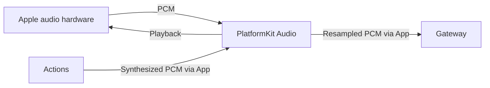
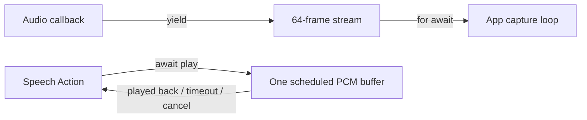

# Audio — Platform Audio IO

Purpose: capture and play audio through public Apple APIs and convert capture PCM continuously. No model inference or Agent decisions belong here.

- ✅ AppleAudioIO: bounded capture bridge, playback, interruption and route handling.
- ✅ MicrophoneFrame: capture samples, format, sequence, duration and RMS level.
- ✅ StreamingMonoPCMResampler: converter state across packets, format validation, packet sequence, reset and explicit conversion errors.
- ✅ Obsolete energy VAD and whole-utterance resampler removed; Gateway owns VAD policy.
- ❌ Additional audio routes and hardware acceptance beyond the documented voice validation scope.

Keep this README and stream continuity tests current when changing audio code. Cancellation must not deliver stale audio. Real microphone/playback validation requires a device.

## Queue and asynchronous processing contract

The AVAudioEngine tap produces microphone frames into a 64-element `AsyncThrowingStream` using `bufferingOldest`; the App capture task consumes them. Tap requests are 1024 samples, but actual callback size is validated separately (1...8192 samples). Sequence numbers are allocated under a mutex. When yield reports a dropped frame, the stream finishes with `AudioIOError.overflow`; the pipeline must stop rather than continue with an unnoticed gap. This stream is not a fixed-duration buffer because hardware sample rate/frame size vary. `stopCapture` removes the tap, stops the engine and finishes the stream.

Playback does not accumulate an application FIFO. `play` admits only one outstanding waiter, accepts at most 262,144 mono samples, schedules one AVAudioPlayerNode buffer and suspends until its `dataPlayedBack` completion. The caller therefore supplies playback backpressure. A token prevents stale callbacks from completing a newer play. Cancellation/stop halts playback and resumes the waiter with failure; a duration-plus-3-second deadline prevents an indefinite wait. There is no application-level mixing or parallel playback queue.

✅ The algorithm above describes the current implementation.

Maintenance: update this contract when changing producers, consumers, limits, ordering, cancellation or completion semantics.

Audio is the platform capability domain for microphone and speaker I/O. AppleAudioIO currently owns both operations and shared AVAudioSession setup; do not create independent session owners solely to match device filenames. Keep domain files flat until actual complexity requires device subdirectories. Recognition, synthesis and neural VAD belong to ModelKit/Speech; conversation policy belongs to Agents.
