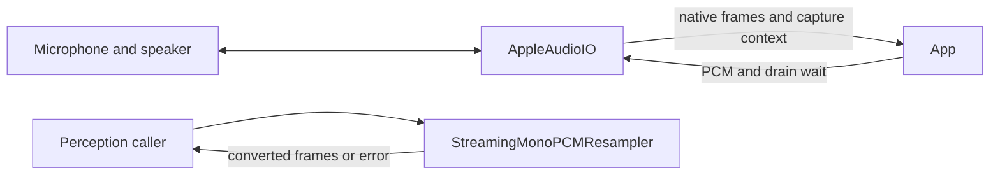

# Platform Audio I/O

## Summary

Capture native PCM, convert mono streams, play continuous PCM and measure spectra with public Apple APIs.

## Ownership and boundaries

`AppleAudioIO` owns device/session I/O. Model selection, VAD, speech-turn policy and presentation belong to callers. `MicrophoneFrame` owns native layout/rate/sequence/media time and monotonic capture time.

## External relationships and data flow

Runtime arrows show data or capability calls; dashed arrows show injection.

## Capture and startup

`startCapture(preferSpatial:)` selects audio-only FOA capture on a supported built-in route, otherwise mono AVAudioEngine. Each backend waits for one validated, enqueued frame through a cancellable readiness gate; silence is valid. Native callbacks, errors and cancellation complete this gate, without a fabricated first-frame timeout fallback. A caller may declare its own finite Action budget. Spatial startup failure closes/joins that backend before trying mono. Once admitted, invalid format, interruption or continuity failure terminates the stream; it never changes layout in place. `AudioCaptureContext` distinguishes native input, capability support and pre-admission fallback reason from actual received layout.

Both streams hold 64 packets with `bufferingOldest`; a dropped yield fails with `overflow`. Mono requests 1024 samples and validates callbacks of 1…8192 samples. Spatial validates four-channel ACN/SN3D PCM, media PTS continuity within two samples, and native callbacks up to 8192 frames; transport packets contain at most 4000 frames/16000 scalar samples. Metering uses W. `AudioSampleBufferReader` queries the exact native buffer-list size, limits it to four buffers, preserves OSStatus and holds CMBlockBuffer through synchronous extraction.

`stopCapture` fences startup and joins spatial shutdown/callback ownership. Sendable callbacks use mutex-protected state, without MainActor captures. Startup logs contain graph/layout/error metadata only.

## Conversion

`StreamingMonoPCMResampler` is an actor with continuous AVAudioConverter state. Input must be mono, with finite samples and supported 8…192 kHz rates; the caller selects output rate. Format changes recreate conversion state; `reset` clears converter/rate/sequence. Multichannel callers must extract mono first. Conversion failure propagates instead of fabricating PCM.

## Playback and completion

One playback stream schedules at most three buffers, each up to 262144 finite mono samples. Producers suspend for capacity. Final success awaits every `dataPlayedBack` callback; cancellation/token fencing stops old work and wakes capacity/drain waiters. Scheduled buffers wait for dataPlayedBack/error or cancellation without a watchdog. Same-format packets do not restart the player; format changes wait for drain. Render completion does not measure acoustic arrival at a remote speaker.

## Spectrum

`AudioSpectrum` uses the latest 2048 samples, removes DC, applies Hann/FFT and aggregates 32 logarithmic bands from 80 Hz to min(8 kHz, Nyquist). Invalid samples become zero; fixed −66…−6 dB mapping preserves level differences. Attack/release factors are 0.78/0.32. The mixer tap retains at most 2048 samples; callers sample telemetry rather than retaining audio.

✅ Bounded native capture, pre-admission fallback, streaming conversion, continuous playback and numeric spectrum telemetry.

Physical route, FOA and coexistence evidence belongs in [validation history](../../../docs/validation/Validation-History.md).

## Related design

[Parent design](../README.md)

✅ 音频完成等待使用原生回调、实际错误及作用域取消，不设置 ASR/TTS 收尾、PCM 首帧或播放 buffer 兜底计时器；移除相应不存在的 timeout/fallback 展示分支，完成仍须真实完成回调，不能伪造成功。

✅ Implemented: playClip(PlaybackPCM) rejects capture/playback overlap with busy, validates a single bounded finite PCM clip before session changes, configures public playAndRecord speaker/HFP routing, and awaits native dataPlayedBack using playStream. All exit paths stop/reset the clip graph and deactivate its unused session, without touching a replacement capture/playback owner; cancellation retains token fencing. Primary and cleanup errors remain separately retained. It has no queue, synthesized sound or capture admission policy.

✅ Implemented: PCM continuity validation reports a typed timestamp/rate discontinuity with measured gap instead of overflow. Existing 64-packet queue overflow remains fatal/explicit. A portable continuity state in MicrophoneFrame.swift is tested for contiguous callbacks, gaps, rate changes and reset. AppleAudioIO.stopPlayback stops the player graph and wakes native playback waits independently of capture; the caller owns async handler join; playStream configures speaker/HFP output when no capture is running.

✅ Implemented: NativeHapticFeedback.swift accepts five generic impact styles, finite intensity, up to three pulses and bounded intervals; rejects concurrent calls and unsupported hardware, honors cancellation between pulses and has no pending queue. UIKit only confirms request issuance. Audio session setup allows haptics during recording; PCM/startup ownership stays unchanged.

✅ Implemented: PCMClipEncoding.wav16(samples:sampleRate:) is portable and rejects invalid inputs with its own invalidFormat failure. It validates mono finite samples, 8…192 kHz, <=192000 samples and <=1 s; emits bounded PCM16 WAV. NativeCuePlayback owns one AVAudioPlayer/delegate wait with a per-operation ID captured by a retained immutable delegate, so late callbacks cannot complete a replacement clip. It rejects overlap, joins cancellation by stopping only its own player, propagates decode/start/completion failure, and does not explicitly reconfigure or deactivate AVAudioSession. Native completion does not prove perceived volume.

✅ Implemented: playClip/playStream accept an optional MainActor onStarted callback, fired once after the first buffer is successfully scheduled and the player started. No callback on setup failure or empty streams; it acknowledges native admission rather than audible hardware time. Existing bounded buffering, drain, cancellation and cleanup remain unchanged.

✅ Implemented: AppleAudioIO.prepareClip validates bounded PCM, connects/prepares/starts only its output graph and retains one prepared sample-rate marker. Successful warm playback skips repeated category/session activation; playStream reuses a running graph. discardPreparedClip affects only an unconsumed warm marker with no capture/playback owner. Stop/cleanup clear the marker; failed preparation rolls back and propagates cleanup errors. No recording/buffer scheduling/sound occurs during prewarm.
