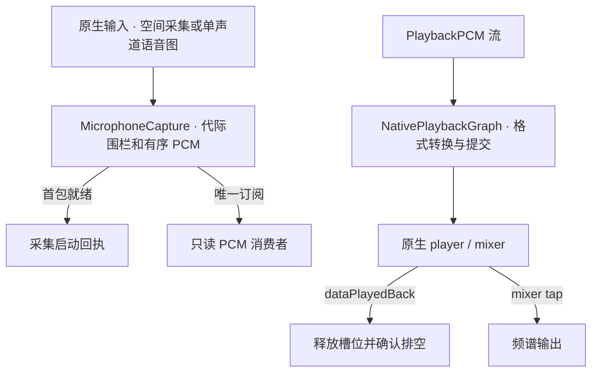

# Audio — 原生音频、反馈与数值能力

## 职责与公开协议

AudioContainer 按有限命名作用域缓存原生实现，对外返回 AudioInputOutput、CuePlaying、HapticFeedbackProviding。AppleAudioIO／NativeCuePlayback／NativeHapticFeedback 实现这些端口；业务只注入需要的协议，SDK 不依赖其他项目模块。

协议覆盖权限、原生PCM／事件订阅、播放／频谱、运行事实及停止／加入；便利重载只转发明确参数，不替代驱动、不伪造成功。样式、PCM、错误和设备事实均为 SDK 自有值；业务角色直接消费，不生成外部 Signal。

## 源码与所有者

| 文件／类型 | 职责 |
| --- | --- |
| AudioContainer | 有限作用域、实例缓存、原生会话互斥和根停止 |
| AppleAudioIO / AudioInputOutput | 捕获／播放接纳，原生完成及清理 |
| SpatialAudioCapture / AudioSampleBufferReader | 空间采集、格式／连续性及原生buffer读取 |
| MicrophoneFrame / AudioCaptureContext | 原生PCM、布局、输入／支持／回退事实 |
| AudioCaptureReadiness | 首个有效帧的可取消就绪门 |
| AudioSpectrum / StreamingMonoPCMResampler | 有界频谱计算、持续单声道转换 |
| NativeCuePlayback / CuePlaying | 单次原生PCM反馈播放 |
| NativeHapticFeedback / HapticFeedbackProviding | 有界触觉、预备生成器和取消 |
| ListeningCaptureWorkflow | 单worker、最新原生启停意图的取消加入 |

## 录音与输入

startCapture 仅在调用方明确 preferSpatial 时尝试 FOA；对话路径优先系统回声消除输入，其次共享语音处理图。空间后端启动失败必须加入清理再尝试单声道；已经接纳的流不改变布局。

两后端都在首个有效入队PCM后返回就绪，静音也有效，不伪造首帧超时回退。mono请求1024样本，回调验证1…8192帧；FOA为四声道ACN/SN3D，时间连续误差不超过两样本，每传输包最多4000帧／16000标量。

startCapture 只确认首帧就绪；subscribeCapture 将当前代的唯一原生 64 包有序源交给只读消费者，不经过 MainActor 逐包中转。重复消费者明确 busy，无活动捕获明确 unavailable；原生溢出保留已接纳包并以 overflow 终止。MicrophoneCapture 关闭围栏后迟到回调不能污染新流。stopCapture 关闭接纳并加入空间后端／原生回调。

AudioCaptureContext 区分输入、空间支持和接纳前回退；原生读buffer受声道／格式边界约束，保留OSStatus及CMBlockBuffer至同步提取完成。

## 播放与完成

NativePlaybackGraph 私有actor拥有输出引擎、播放器、格式、mixer tap及原生连接／启动／PCM提交／停止，避免这些同步原生调用阻塞MainActor。AppleAudioIO只持有主线程接纳、token和完成等待。

最多三个已调度PCM buffer、一个串行提交；单包非空、最多262144样本、有限数值、8…192kHz、mono。消费端保持同一次流的采样率，真实dataPlayedBack回调释放容量并确认排空。onStarted仅在首块提交且player启动成功后回调，不代表声音已到达用户。

stopPlayback同步失效token并唤醒等待，单个清理任务加入原生停止；waitForPlaybackStop、根stop及下一次播放加入清理。旧取消不能停止新播放，未完成原生调用返回前不伪造停机。

playClip拒绝捕获／播放冲突，复用同一播放端口；主因和清理错误分别保留，释放不触碰替代会话。引擎内部可复用健康连接，不提供无人使用的独立预热／播放游标API。

### 采集与播放的数据流

## 频谱、转换与反馈

AudioSpectrum 每次最多2048样本，measureOffMain 在通用执行器运行、前后可取消；同步计算保留供明确调用。播放频谱只在MainActor取tap快照和token，计算后复核同一播放；取消／替换返回nil，无播放返回静音。

StreamingMonoPCMResampler 持有连续AVAudioConverter，输入为有限mono、8…192kHz；格式变化重建转换器，reset清状态。多声道提取和VAD／ASR策略属于调用者，不在转换失败后伪造PCM。

CuePlaying使用一个AVAudioPlayer／delegate，重叠明确busy，取消停止并加入自己的播放器，不主动重配共享AVAudioSession。PCMClipEncoding只编码有界、最多1秒／192000样本的PCM16 WAV。

HapticFeedbackProviding使用公开支持检查、缓存生成器和一个有主人的operation；最多三次触觉、间隔40…250ms，取消和停止加入，UIKit只确认请求发出。触觉预备不承诺实际产生反馈。

NativeHapticFeedback.perform在每次实际impact前重新设置共享AVAudioSession允许录音时触觉，再prepare并发出impact；不能把录音启动前的设置或生成器预备视为持续有效。只修改该触觉开关，不重配category／mode／route、不停录音；取消／根接纳检查先于设置，设置失败原样抛出并沿既有Platform报告链传播。缓存生成器与可重复operation保留，单次及多次请求均按每个pulse处理。

## 原生事件、错误与约束

空间采集的通知桥绑定单个 AVCaptureSession 和采集代际。runtimeError 保留原生 NSError 及其 domain/code/userInfo；无原生错误时为 runtimeFailed，原生中断为 interrupted，无法启动为 startFailed。首个终止事件同时结束首帧等待和 PCM 源并报告 PlatformFailure，后续通知不能改写主因；首帧已就绪后的失败仍终止 PCM 源。启动返回前再次检查已收到的原生失败。停止先关闭通知接纳和 PCM 源，再停止并加入回调，清理期间通知不新增故障。只有真实 PCM 验证失败使用 invalidFormat。

NativeAudioEvent 是事实而非Error。路由按前后输入／输出portType+UID比较，categoryChange/override及同设备重配不打断流；实际设备变化、不可用路由和缺少旧快照保守投递routeChanged，不直接上报容器故障。

中断仅在began且实例有活动采集／播放时报告AudioIOError.interrupted；ended不重复终止。格式、连续性、overflow、执行和清理失败保留原throw及注入报告。事件三个worker由原生所有者取消并加入，不由页面持有。

[PlatformKit](../README.md) · [Core](../Core/README.md) · [语音验收](../../../docs/validation/Voice.md)

AudioContainer停止聚合使用PlatformFailure：首个失败为underlying，其余按顺序保留在cleanupErrors，分类为cleanup.failed；不以取消／设备不可用掩盖未完成清理。

采集和播放共用同步 AVAudioSession 配置函数，各自在自己的隔离域执行。空间 AVCaptureSession 仅在请求录音时随后端实例创建，start/stopRunning 在后端 actor 执行。首 PCM 确认前不报告收音成功；空间启动失败必须加入清理，再按原支持条件回退 mono，token 围栏防止旧失败影响新捕获。容器 boot 不打开设备，不保留异步会话配置 preparation Task。

## Direct container contract

Native data/observation capabilities remain independent of business and transport modules. Capture control stays with execution owners; read-only observation never requests permission or opens a device. Current cross-module ownership is defined by the [overall design](../../README.md).

## 唯一 PCM 源

MicrophoneFrame.swift 定义跨平台 AudioCaptureObserving、带原生 generation 的 MicrophoneCaptureInput 及 SDK 私有 MicrophoneCapture；后者直接持有唯一 64 包源、一次性订阅和原生回调围栏。AppleAudioIO／SpatialAudioCapture 直接写入该源。startCapture 仅等待首有效 PCM 并返回完成，subscribeCapture 取得当前源而不启动硬件；重复订阅拒绝。停止、溢出或原生失败保留已接纳包并结束当前源，迟到回调不能写入替代源。

跨平台 AudioCaptureControlling 明确权限、采集、事件和停止的执行端口；AudioInputOutput 继承它并保留 iOS 播放能力。Agent 仍只接收 AudioCaptureObserving。Actions 音频检测可用替身验证实际取消加入，不依赖原生硬件。

## Passive application audio facts

NativeAudioState is owned by AudioContainer and observed only during the Platform root's active lifetime. The root collection samples AVAudioSession input/output port types and AVAudioApplication input mute at start and native change events without activating a session or changing category/mode. Native port names and UIDs are excluded. Microphone authorization is seeded without requesting permission, then refreshed after native permission completion and foreground reconciliation. AudioContainer State reads that same resident permission sample, returning unknown before start or after invalidation.

Three NotificationCenter observers synchronously update one generation-fenced interruption value: begin=true, end=false, and media-service loss/reset=unknown. Before an observed event and after suspension/replacement, interruption is unknown rather than an assumed normal state. No per-notification Task or event queue is added. Invalidation clears the generation before removing observers; old callbacks cannot affect the next lifetime. These facts do not claim listening intent, capture readiness, audible playback or reply ownership, which remain with their existing owners.

## Passive state observation

The owning stateSnapshot entry point reads current local business/capability values and runtime admission/work facts in the owner's isolation domain. It performs no action, acquisition or device activation. The module root composes the explicitly selected fields; unknown diagnostic coverage is not healthy evidence. Domain-specific completion and failure contracts above remain authoritative.

State classifies microphone authorization as Business; scope owner/counts and admission as Runtime.

Permission State projections read cached observations only. Unavailable owner scope remains unknown; an admitted cached-source/schema failure propagates through the standard throwing snapshot method instead of being converted to unknown.

The Runtime scope owner is encoded using Scope.rawValue with a finite descriptor vocabulary (voice, diagnostic, detection, camera), independently of debug descriptions.

## Camera audio reservation

PlatformContainer injects AudioContainer's native owner fence into VisionContainer/AppleCamera. acquireCameraRecording requires no current owner and reserves camera scope; voice, diagnostic and detection I/O then reject busy. Native movie finalization removes its microphone and releases that reservation. The shared synchronous AVAudioSession setup is reused within PlatformKit; it permits native system sounds while recording. This module does not decide whether listening should resume; Actions owns that intent and generation fence.

完整 AppleAudioIO.stop 在加入采集与播放清理后替换 mono AVAudioEngine，并在 NativePlaybackGraph actor 内释放 mixer tap、引擎、player 和格式连接；下一次启动重新配置 AVAudioSession 并创建新图。健康的单次 stopPlayback 仍复用图。媒体服务 reset 观察保留 AVFoundation 原生错误，结束 PCM/首帧等待和播放等待，并投递 mediaServicesReset 事实；不在 PlatformKit 决定业务恢复或重放效果。被动 NativeAudioState 与主动事件契约独立。

## 语音处理采播图

AppleAudioIO 的单声道语音路径在同一 NativePlaybackGraph 中连接输入、mixer 和 player。优先设置 playAndRecord/default，检测 isEchoCancelledInputAvailable，启用并在激活后确认 isEchoCancelledInputEnabled；不支持、未启用或失败时，回退 voiceChat/voice processing，明确关闭 bypass 并核对输入/输出节点。两个处理器不叠加，配置失败通过原生报告端口保留。I/O 模式配置先于 mixer tap 的安装。采集时固定输出24000Hz，其他 TTS 采样率先转换，播放启停不重建正在采集的图。首个真实PCM确认就绪；输入/输出停止分别加入，完整stop关闭共享图。

AudioCaptureContext.echoCancellation 记录 systemInput/voiceProcessing/unavailable（未采样默认 unknown）。supportsFullDuplex 只来自确认启用的实际能力；无法启用时返回受限采集，业务暂停播放期间的识别。启动、首 PCM 完成与采集中每次播放提交前复核 session/图状态；丢失 AEC 明确失败。原生路由通知即使是 categoryChange/override，也先确认 AEC 仍有效，丢失时发送 routeChanged 以关闭旧代。开启 AEC 的事实不等于已测量实际回声抑制效果。路由变化终止旧捕获代并重新获取能力。startCapture 默认不请求空间后端；明确 preferSpatial 的调用仍可使用既有FOA路径，不能同时宣称FOA与回声处理能力。
