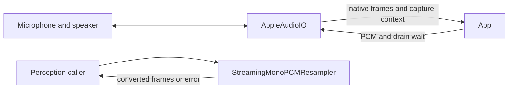

# Platform Audio I/O

## Summary

Capture native PCM, convert mono streams, play continuous PCM and measure spectra with public Apple APIs.

## Ownership and boundaries

`AppleAudioIO` owns device/session I/O. Model selection, VAD, speech-turn policy and presentation belong to callers. `MicrophoneFrame` owns native layout/rate/sequence/media time and monotonic capture time.

## External relationships and data flow

Runtime arrows show data or capability calls; dashed arrows show injection.

## Capture and startup

`startCapture(preferSpatial:)` selects audio-only FOA capture on a supported built-in route, otherwise mono AVAudioEngine. Each backend waits for one validated, enqueued frame through a cancellable three-second readiness gate; silence is valid. Spatial startup failure closes/joins that backend before trying mono. Once admitted, invalid format, interruption or continuity failure terminates the stream; it never changes layout in place. `AudioCaptureContext` distinguishes native input, capability support and pre-admission fallback reason from actual received layout.

Both streams hold 64 packets with `bufferingOldest`; a dropped yield fails with `overflow`. Mono requests 1024 samples and validates callbacks of 1…8192 samples. Spatial validates four-channel ACN/SN3D PCM, media PTS continuity within two samples, and native callbacks up to 8192 frames; transport packets contain at most 4000 frames/16000 scalar samples. Metering uses W. `AudioSampleBufferReader` queries the exact native buffer-list size, limits it to four buffers, preserves OSStatus and holds CMBlockBuffer through synchronous extraction.

`stopCapture` fences startup and joins spatial shutdown/callback ownership. Sendable callbacks use mutex-protected state, without MainActor captures. Startup logs contain graph/layout/error metadata only.

## Conversion

`StreamingMonoPCMResampler` is an actor with continuous AVAudioConverter state. Input must be mono, with finite samples and supported 8…192 kHz rates; the caller selects output rate. Format changes recreate conversion state; `reset` clears converter/rate/sequence. Multichannel callers must extract mono first. Conversion failure propagates instead of fabricating PCM.

## Playback and completion

One playback stream schedules at most three buffers, each up to 262144 finite mono samples. Producers suspend for capacity. Final success awaits every `dataPlayedBack` callback; cancellation/token fencing stops old work and wakes capacity/drain waiters. Each scheduled buffer has a queued-duration-plus-three-second watchdog. That timer does not time an empty upstream read. Same-format packets do not restart the player; format changes wait for drain. Render completion does not measure acoustic arrival at a remote speaker.

## Spectrum

`AudioSpectrum` uses the latest 2048 samples, removes DC, applies Hann/FFT and aggregates 32 logarithmic bands from 80 Hz to min(8 kHz, Nyquist). Invalid samples become zero; fixed −66…−6 dB mapping preserves level differences. Attack/release factors are 0.78/0.32. The mixer tap retains at most 2048 samples; callers sample telemetry rather than retaining audio.

✅ Bounded native capture, pre-admission fallback, streaming conversion, continuous playback and numeric spectrum telemetry.

Physical route, FOA and coexistence evidence belongs in [validation history](../../../docs/Validation-History.md).

## Related design

[Parent design](../README.md)
