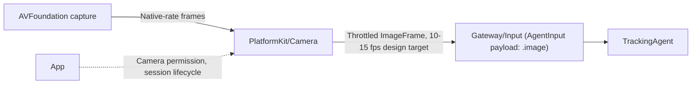

# Camera — Frame Capture for the Tracking Agent (Design Only)

Purpose: capture the phone's own camera feed and hand bounded, throttled frames to Gateway/Input, without performing detection or any Agent business logic here. Design goals match `PlatformKit/Audio`'s existing split: platform capture is a thin, Sendable-safe producer; the consumer (Gateway, then `TrackingAgent`) owns everything downstream. See [ADR 0035](../../../docs/adr/0035-tracking-agent-and-robot-actions.md).

- ❌ Nothing in this directory is implemented.

## Why capture throttles before Gateway, not after

The phone's native capture rate (commonly 30–60 fps) is higher than `TrackingAgent`'s design target of 10–15 fps (per `Agents/Tracking/README.md`). Throttling belongs here, in the platform-facing producer, rather than in Gateway or the Agent, for the same reason `PlatformKit/Audio/MicrophoneFrame.swift` is the point where continuous hardware callbacks become bounded application data: dropping excess frames at the earliest possible point avoids doing any downstream work (detection, control math) on data that will never be used, and keeps `AgentInput` admission bounded by frame arrival rate rather than raw camera callback rate.

## Planned data contract: `ImageFrame`

`ModelKit/README.md` already reserves this: "Core also owns future shared image/video data contracts." A validated `ImageFrame` (in `ModelKit/Core`, mirroring `AudioFrame`'s pattern — bounded byte size, finite timestamp, explicit format) is the type this module would produce and `ModelKit/Vision`'s `PersonDetectionCapability` would consume. Designing `ImageFrame`'s exact encoding (raw BGRA8 plane vs. bounded-size compressed buffer) is deferred to when this directory is actually implemented, alongside `ModelKit/Vision` — the two must agree on one contract, so neither should be designed in isolation from the other.

## Planned relationship

`InputKind.image` already exists in `AgentCore/InputKind.swift` (currently unused); `InputPayload.image` is the additive case this pipeline needs (see ADR 0035 decision 7), rather than the larger generic `Signal`/`SignalType`/`SignalAdapter` migration tracked as ❌ in `Gateway/Input/README.md`.

## Explicitly out of scope

Multiple simultaneous camera consumers (e.g. a live preview UI alongside tracking), photo/video capture Actions (`Actions.Camera.capturePhoto`, listed as a target in architecture section 28 but unrelated to this tracking pipeline), and any recording pipeline. Those are separate future designs.

## Maintenance

Keep this README synchronized with implementation as soon as any file in this directory stops being documentation-only, following `PlatformKit/README.md`'s ✅/❌ convention. Update the root `PlatformKit/README.md` implementation-status list and directory table when a concrete capture adapter lands, and use public `AVFoundation` APIs with just-in-time camera permission requests per `PlatformKit/Device/DeviceCapability.swift`'s existing pattern.
