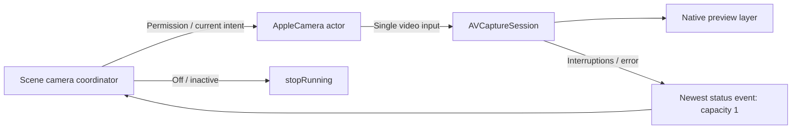

# Camera preview

Purpose: acquire a foreground camera for local preview and bounded RGB frame delivery. Design goals: actor-owned hardware state, public AVFoundation APIs, explicit authorization and no audio-session interference.

✅ AppleCamera configures one wide-angle front/back input at up to 720p. Session start, stop and configuration run on its actor, never MainActor. Switching restores the old input if replacement cannot be added; the caller stops the session on failure. No microphone input or photo/movie output is added, and application audio-session auto-configuration is disabled.

✅ CameraPreviewSource is a narrowly scoped Sendable bridge: its private session is mutated exclusively by AppleCamera, while MainActor only attaches it to AVCaptureVideoPreviewLayer. Preview connection mirroring and rotation are presentation concerns. The wrapper does not expose session mutation to consumers. Native preview does not create an application frame queue.

## Lifecycle and bounds

The App coordinator admits one hardware transition at a time and coalesces pending UI preferences to the latest desired state; this is not an Agent command queue. Three notification observers feed one newest-status stream (capacity 1, older status notifications replaced). Interruption end requests reconciliation; runtime failures expose an explicit retry. Scene exit joins stop. AVFoundation owns native buffers; immutable RGB samples leave through the bounded frame stream.

✅ Camera authorization, unavailable-device failures, start/stop, front/back switching and interruption reporting.
❌ Recording, background capture and physical-device continuous camera/audio acceptance.

Implementation reference: [Apple AVCam](https://developer.apple.com/documentation/avfoundation/avcam-building-a-camera-app) for actor-isolated capture and native preview, and [RotationCoordinator](https://developer.apple.com/documentation/avfoundation/avcapturedevice/rotationcoordinator) for preview orientation.

## RGB capture for perception

✅ AVCaptureVideoDataOutput uses BGRA, native unmirrored sensor orientation, one serial delegate queue and alwaysDiscardsLateVideoFrames. The delegate creates upright unmirrored RGB (max 640 pixels per dimension), rotating by the capture RotationCoordinator's nearest quarter turn. A lock protects only the stream continuation/sequence/rotation snapshot; conversion occurs outside it. One callback plus one newest pending CameraFrame is retained. No task per frame; native pixel buffers never escape the callback.

✅ Stop closes the stream; restart stops capture and drains the delegate queue before installing a new stream, preventing old-lens buffers entering the new session. Sequence starts at one per stream, timestamps are native monotonic capture time. Rotation/crop/mirror metadata is preserved for UI projection. Preview mirroring never alters model pixels.
❌ Arbitrary-angle resampling, recorded media, hardware tracking IDs and physical-device inference/audio coexistence acceptance.

✅ Stream cancellation clears the receiver continuation only for its matching generation, so failed/cancelled analysis stops RGB conversion while live preview can continue. A late termination from an old session cannot close a replacement stream.
