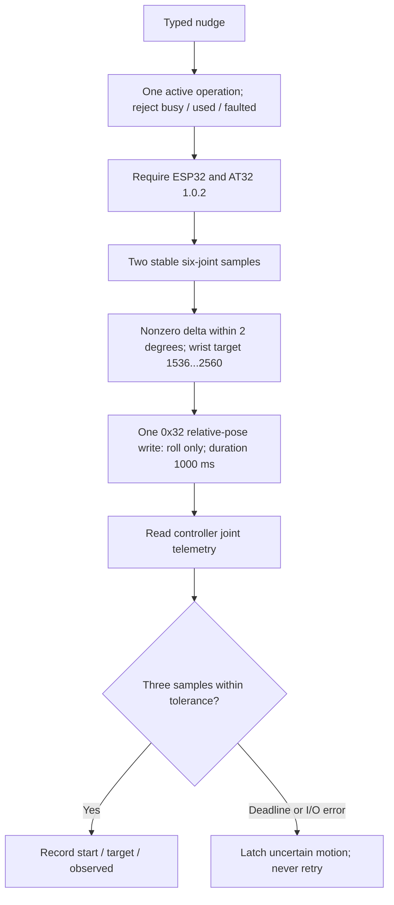
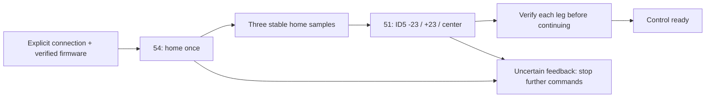
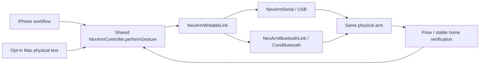
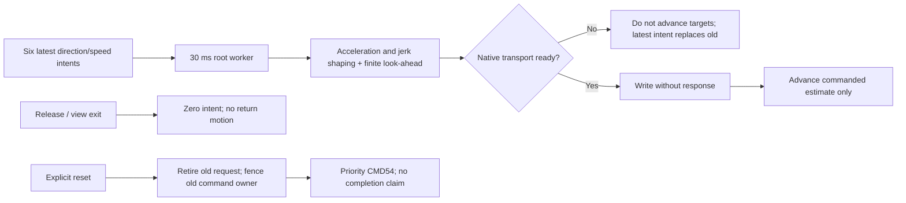
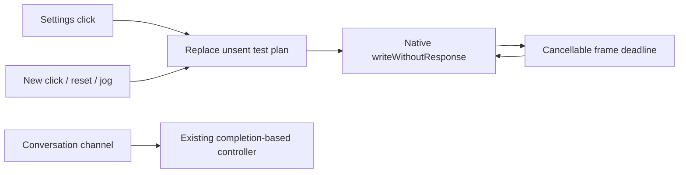
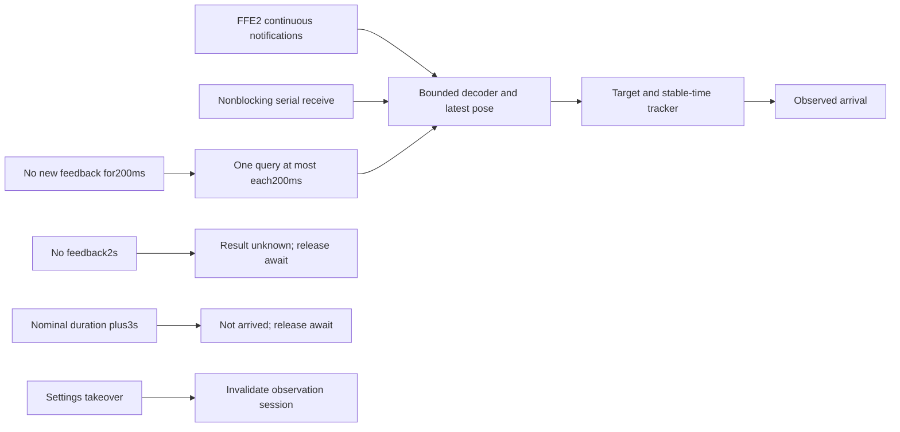
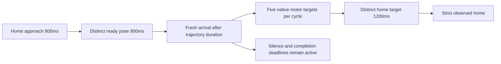
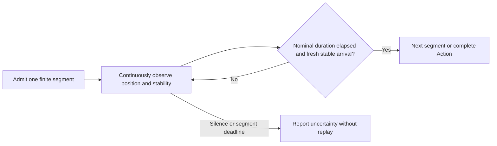
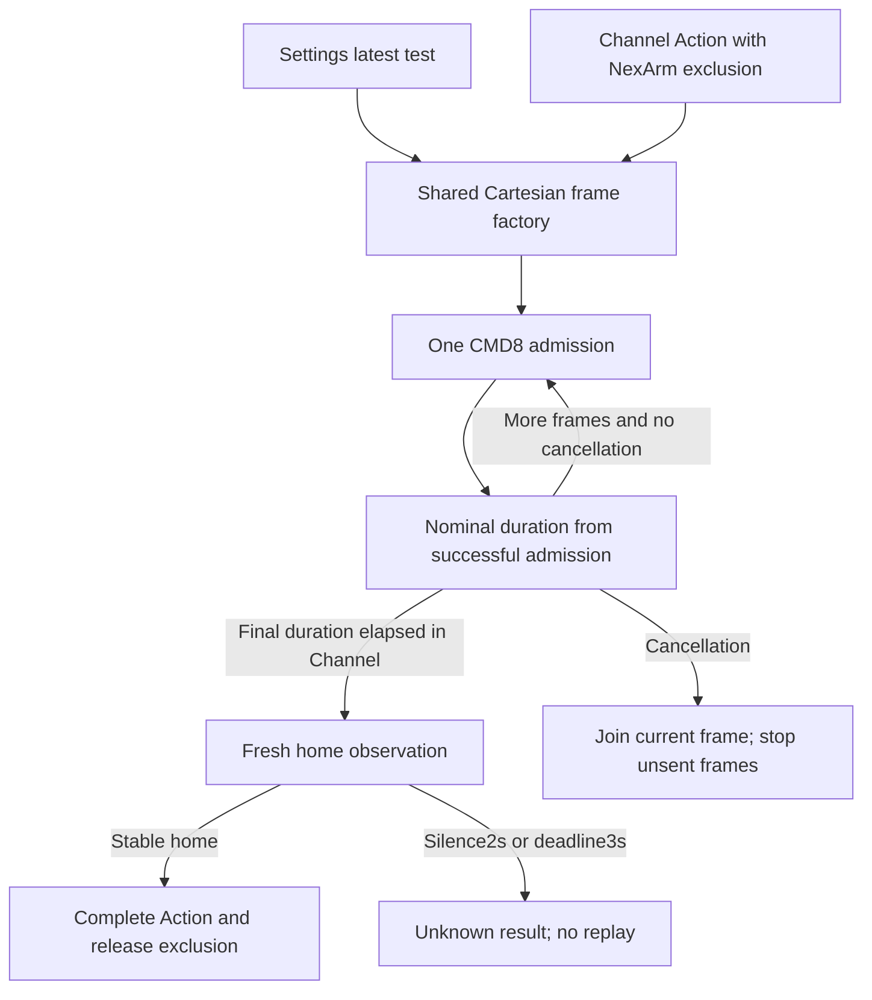
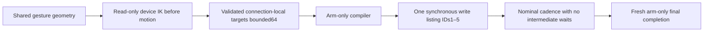

# NexArm connectivity

> Current outbound contract (ADR0090): all arm actions and home write only explicitly listed motors1–5. Older CMD8/CMD54 descriptions below are historical; geometry intents must be compiled before transport. The gripper is excluded from both commands and completion.

> Current status (2026-09-30): Cartesian conversation gestures share Settings packets/cadence and verify final home only; see the current playback contract below. Head gestures retain calibrated per-segment observation. The user reports the phone symptom resolved; supervised USB dance comparisons isolate intermediate stability waits as sufficient to reproduce jitter and timeout. Endurance and underlying holding-loop causes remain unverified.


Purpose: communicate with the connected NexArm from macOS and verify supervised wrist/base motion. Design goals: public POSIX serial APIs, actor-owned lifetime, bounded parsing, no dependencies and motion through production Actions, user-requested controls or explicitly enabled controller diagnostic tests.

✅ `NexArmPacket` / `NexArmDecoder`: FF FF ID LEN CMD PAYLOAD CHECK framing; wrapping inverse-sum checksum; little-endian payloads. Decoder tolerates fragmented/coalesced packets and interleaved ESP32 text logs. RX buffer limit 4096 bytes, exchange input budget 16384 bytes; overflow throws. Maximum payload 253 bytes. Invalid frames/log noise are skipped; incomplete frames are retained. No device action is discarded or replayed.



✅ `NexArmSerial` exists only on macOS. It opens an explicit `/dev/cu.usbserial-*` or `/dev/tty.usbserial-*` path exclusively at 1,000,000 baud, 8N1, nonblocking/no flow control; does not deliberately toggle DTR/RTS or set HUPCL. It uses Darwin's IOSSIOSPEED ioctl for the nonstandard baud rate. Serial opening can still have hardware-specific reset behavior. `close` releases the descriptor. Host owns and closes it after joined work.

Each exchange has a one-second deadline, 10 ms polling, one write without retries and one active request; concurrent calls fail. Stale RX telemetry is flushed before sending, not outgoing actions. Reply ID, command, payload length and checksum must match. The documented serial format contains no request sequence ID; 0x0B can also be unsolicited. Success is based on observed convergence, not strict request/reply correlation.

✅ `NexArmController` checks two all-joint samples within two counts, 150 ms apart. It sends a 0x32 relative-pose command changing only wrist roll, at most two degrees, with 1000 ms device interpolation; XYZ, pitch and claw deltas are zero. Current wrist and estimated encoder target must be within 1536...2560. It never changes torque or calibration. One committed motion per owner lifetime. After writing it consumes controller 0x0B telemetry (24 bytes: pose then six joint positions), then seeks three consecutive readings within six counts of the encoder target estimate and one degree of the requested roll, 100 ms apart, under a three-second settling deadline (an in-flight one-second exchange can extend this). Other joints must remain within eight counts. Encoder target is estimated from the start plus degrees × 4096/360; tolerance accounts for whole-degree pose quantization. Completion is reported convergence, not a velocity/physical-stop acknowledgment.

The current device accepts version/voltage/coordinate queries but did not return direct servo-register reads during the preflight. Therefore this implementation uses the controller's reported positions. It does not infer velocity or independent physical clearance from them. A valid telemetry packet after writing is not a write acknowledgment; only target convergence completes the Action.

Cancellation before commitment makes no write. A single retained Task joins the finite committed movement despite caller cancellation; it is always awaited, never detached or left running after handler return. Failure after a possible write latches faulted; caller must inspect the device before a new owner is created. Closing the port cannot stop a physical motor. This adapter intentionally does not conform to `ExternalDeviceTransport`, whose emergency-stop contract it cannot truthfully provide.

❌ Autonomous operation, production resource takeover, physical emergency stop/watchdog validation, TCP, iPhone USB support, automatic reconnect/retry and arbitrary motion sequences remain unimplemented. BLE is implemented below. The one-shot bounded target is a diagnostic constraint, not a certified safety system.

Sources: [NexArm motion protocol](https://wiki.hiwonder.com/projects/NexArm/en/esp32-version/docs/3_Motion_Control.html), [external controller integration](https://wiki.hiwonder.com/projects/NexArm/en/esp32-version/docs/6_External_Controller_Integration.html).

## Reproduce

Default checks never move hardware. With the arm stationary and wrist clear, explicitly select the connected port and run the opt-in test:

```sh
NEXARM_MOTION_TEST=1 NEXARM_PORT=/dev/cu.usbserial-110 swift test --filter nexArmUSBPhysicalWristDiagnostic
```

This directly invokes the controller without an Agent or diagnostic Action. It executes one +1-degree wrist nudge, leaves the reached position in place and closes USB. Do not repeatedly rerun it as an automatic retry. Use a full Xcode toolchain for the root package's unrelated model dependencies.

## Hardware validation — 2026-09-29

✅ The final Swift integration test passed through InputGateway → OutputGateway → Action scheduler → NexArm Action → USB, with ESP32/AT32 1.0.2. One +1-degree relative-roll command: start 2036, estimated target 2047, observed completion 2043 counts; three readings met the configured tolerance. The observed shift is seven counts (~0.62 degrees), so this is protocol/telemetry acceptance, not proof of exactly one degree of physical travel. No other joint exceeded the eight-count deviation limit. The port was closed afterward.

Earlier diagnostics: a harness finish-token error exited before motion commitment; after correcting the harness, a direct-register motion failed the deadline and was not retried. The operator saw no movement. Read-only inspection and the documented AT32 limitations motivated replacement with 0x32. The final implementation uses only the relative-pose command. No firmware, torque or calibration changes were made.

✅ Repository checks passed with the full Xcode Swift 6.4 toolchain. The Command Line Tools-only attempt could not build the unrelated MLX Metal dependency; selecting Xcode per command resolved it without changing global tool settings. ❌ Independent visual accuracy, wireless and hardware-stop validation remain pending.

✅ Final `scripts/build-ios.sh` passed all four unsigned simulator schemes. Default `scripts/check.sh` passed, including 177 IntegrationTests; hardware motion ran only in the separately enabled test.

## Bounded base sweep

✅ `shakeBase(cycles:)` accepts 1...3, shares capacity-one admission and fault state with wrist motion, and verifies firmware plus two stationary samples before movement. It rotates the original reported XY around the vertical axis by +2°, -2°, 0° per cycle; Z/pitch/roll/claw deltas remain zero. The known-working 0x32 IK command is used, so this is a base yaw trajectory with possible small corrections to other joints, not a direct servo-register command.

Preflight requires XY radius 100...350 mm and base encoder 1580...2516. Per-leg relative X/Y is at most 26 mm each, with 1500 ms device interpolation. After waiting that duration, three samples 100 ms apart must be within 2 mm of target XY and within two reported units of unchanged remaining pose fields. Base endpoints must deviate 12...34 counts from origin; return must be within six counts. Base may never exceed 40 counts from origin and other joints may not exceed 16 counts in checked telemetry. The settling deadline is three seconds plus an in-flight exchange. Results retain at most nine base samples, replaced each call; there is no pending device queue.

Every target is derived from the original XY to avoid accumulating cycle drift. Cancellation joins the committed finite leg, then exits before another write; it can leave the arm at a side endpoint. Failure latches uncertain state, with no retries or cleanup motion. Host close is not an emergency stop. ❌ No independent physical-clearance or zero-velocity proof.

Mac USB test through real Assistant/parser/Gateways/Action (deterministic test model, no external model call):

```sh
DEVELOPER_DIR=/Applications/Xcode.app/Contents/Developer \
NEXARM_BASE_TEST=1 NEXARM_PORT=/dev/cu.usbserial-110 NEXARM_CYCLES=1 \
swift test --filter nexArmUSBPhysicalBaseAction
```

Change only NEXARM_CYCLES to 1, 2 or 3. Default checks never enable either hardware test. Keep the arm supervised and space clear for the small sweep; no iOS background execution is involved.

✅ Base hardware validation (2026-09-29): one complete cycle, base encoder 2114 → 2092 → 2133 → 2117, real USB and successful ActionResult delivered to Assistant. The operator observed rotation. An earlier attempt timed out and latched failure; no automatic retry occurred. After read-only stable-pose inspection, an instrumented supervised run passed without relaxing any bound/tolerance. The original timeout cause remains unknown. Bounded diagnostics retain only baseline (12 integers), target (6), latest observation (12), and completed-leg count. Model generation was a deterministic fixture, not a live model.

✅ Base extension final validation: scripts/check.sh passed (182 IntegrationTests, hardware tests skipped by default), and scripts/build-ios.sh passed all four unsigned simulator schemes with full Xcode. Physical acceptance ran separately and the USB port was closed.

## iPhone and Mac BLE transport

✅ `NexArmBluetooth` implements the same actor `NexArmLink` with CoreBluetooth. Its native delegate owns every CB object on MainActor; callers receive only Sendable snapshots, packets and errors. Bluetooth permission is requested only on explicit scan/connect. Discovery filters service FFE0 and NexArm names; the connected profile must expose writable FFE1 and notifying FFE2. Full UUIDs use the standard `0000xxxx-0000-1000-8000-00805F9B34FB` base. These characteristics and version/pose queries were verified against the real ESP32/AT32 1.0.2 arm from Swift on Mac.

```mermaid
sequenceDiagram
    participant Settings as App BluetoothWorkflow
    participant Link as NexArmBluetooth actor
    participant BLE as MainActor CoreBluetooth delegate
    participant Arm as NexArm
    Settings->>Link: Scan / explicitly connect selected identifier
    Link->>BLE: Permission / discovery / connect
    BLE->>Arm: Discover FFE0, FFE1, FFE2; enable notifications
    Arm-->>BLE: Notification subscription acknowledged
    BLE-->>Settings: GATT connected (not yet motion-ready)
    Settings->>Link: Version and pose queries
    Link->>BLE: Single packet exchange
    BLE->>Arm: FFE1 write with response
    Arm-->>BLE: Write ACK + framed FFE2 response
    BLE-->>Settings: Validated packet / failure
    Settings->>Settings: Firmware and pose validation; enable Action binding
```

Bounds: up to 32 discovered devices (extra devices rejected with visible limit flag), 15-second scan, one connection attempt with 15-second deadline, one packet exchange with 5-second deadline and no pending request queue. Concurrent exchanges reject busy. Writes must fit `maximumWriteValueLength(.withResponse)`; no assumed MTU or unverified fragmentation. Decoder is bounded to 4096 bytes and one exchange to 16384 RX bytes. Both ATT write ACK and matching packet ID/command/length are required; neither is physical completion. Unsolicited telemetry outside a request is discarded, not saved as a reply for a later query.

Snapshots use bufferingNewest(1), explicitly replacing presentation state only. Requests and terminal results use individually retained continuations, never that replaceable stream. Failure/cancellation/timeout closes the BLE connection, preventing ambiguous late replies from satisfying a new transaction. No automatic reconnect or command replay. Disconnect joins for up to three seconds, but keeps connection admission closed until CoreBluetooth confirms closure; a missing acknowledgment leaves an explicit disconnecting state. Bluetooth transport close cannot stop physical motion.

✅ `NexArmBLEReply` has ACK/response ordering, fragmented frame, wrong identity and overflow tests. The app binds its root-owned workflow to the existing base Action; the USB diagnostic remains available.

❌ TCP, general servo motion, independent stop/watchdog proof and continuous background robot control remain unsupported. iPhone runtime acceptance is recorded separately from Mac BLE communication and simulator builds.

Validation (2026-09-29): `scripts/check.sh` passed (188 IntegrationTests; physical tests opt-in), and `scripts/build-ios.sh` passed all four simulator schemes. A signed Debug build installed and launched on the connected iPhone 17 Pro. The production BLE adapter read version/pose and disconnected on Mac; an earlier query attempt timed out, so repeated-radio stability is not established. iPhone settings interaction and real spoken-model-to-motion acceptance remain pending.

✅ Connection errors retain the failing stage (connection, services, characteristics, notification setup, write acknowledgment or device reply), including through disconnect cleanup. OSLog diagnostics contain stage/error codes, not frame payloads or user content. ❌ The iPhone connection failure is under investigation; Mac success does not establish iPhone compatibility.

✅ Mac BLE hardware diagnosis (2026-09-30): GATT connection/notifications worked, but a version query's ATT ACK and reply arrived after ~3 seconds. Official Nex_Arm source (`Ble_Ctrl.cpp`, `system_task_handle.cpp`, `AT32_OTA.cpp`, obtained via the linked vendor tutorial) executes the version handler in the BLE write callback and performs up to three internal UART reads with 50/500/300 ms waits. Its zero AT32 bytes mean query failure, not confirmed firmware 0.0.0. Competing UART readers are a possible explanation, not yet proven on the installed firmware.

BLE exchange timeout is now five seconds. `verifyFirmware()` admits at most four read-only queries only for the exact `[1,0,2,0,0,0]` response; actual `[1,0,2,1,0,2]` is still required. Unknown versions fail immediately, transport errors are not retried, and no motion is repeated. Successful validation is retained only within the controller's live connection; hosts must discard the controller on disconnect. Exhaustion is reported separately as firmwareUnavailable.

Physical base trace: first +2° leg moved from 2050 to 2027 counts, but pitch changed from 5 to 0 tenths of a degree, exceeding existing convergence tolerance. The Action faulted and issued no reverse/return leg. Full sweep acceptance remains pending; limits were not relaxed.

Mac single-step diagnostic (2026-09-30, user explicitly requested larger movement): one 5° XY yaw command over BLE, duration 2000 ms. Start base 2027, final 1971 (~4.92°), three identical settled readings; other joints changed at most one count. Target XY [128,15], observed [129,15], Z/pitch/roll/claw unchanged. Disconnected afterward. This manual diagnostic bound the same Mac-local peripheral to its actually verified firmware earlier in the session; it did not change App firmware admission, production ±2° Action limits, or automatically repeat a motion. Two preceding attempts sent only version queries and no motion because current AT32 version was unavailable. This is single-step acceptance, not full sweep or iPhone acceptance.

✅ User-requested connection indication uses `NexArmWritableLink.write` for ATT acknowledgment only; it does not fabricate a device completion reply. The connection owner calls `indicateConnection()` once after actual firmware validation. Vendor command 54 resets the whole arm to pose [200,0,200,0,0,0] over 2000 ms; this is not factory reset. After three stable home samples, command 51 addresses only ID5 at home−23, home+23, home encoder counts (about ±2°), using the vendor parameter 200 which `move_servo` converts to speed 100, not a guaranteed 200 ms duration. Each leg waits one second and then up to three seconds for three feedback samples within six counts; other joints must stay within eight counts. Each in-flight BLE request can extend settlement by up to five seconds. The controller rejects overlap and duplicate indication, faults on uncertain writes/settlement and joins committed legs on cancellation without sending an automatic rollback.



❌ Physical reset clearance, ID5 direction from the user's viewing position, servo response timing and iPhone motion acceptance remain unverified. This indication changes the whole-arm pose and must be done with clear space; no firmware admission is bypassed.

## Current BLE compatibility policy (supersedes earlier strict-only BLE admission)

✅ Physical USB/BLE/USB comparison confirmed actual firmware ESP32/AT32 1.0.2, ~52 ms USB version response versus BLE returning missing AT32 after ~2.7 s, with working BLE pose queries. A user-observed single +10° BLE base command settled at about 9.6°. Based on this evidence and the user's request to bring it to iPhone, the explicit `nexArm102BLE` policy accepts only exact [1,0,2,0,0,0] as the known missing-version case. Two valid stationary pose samples 200 ms apart are required: joints 0...4095 with ≤2-count drift, XY radius ≤450 mm, Z 50...600 mm, pitch within ±1800 tenths and roll/claw within ±180 degrees. It reports `ble102WithUnavailableAT32`, not a verified AT32 version. Unknown/nonzero unsupported versions and transport failures still reject. The default controller policy remains strict actual firmware verification. Compatibility is scoped to the live controller and discarded at disconnect; no cross-device version cache.

✅ `verifyCompatibility()` distinguishes full firmware verification from the known BLE compatibility profile. App further requires persistence/current-link checks, stationary preflight and complete connection-indication feedback before marking ready. All existing Action posture/settlement limits remain. The requested ID5 indication now uses home−91 / home+91 / home counts (about ±8°), targets within 1536...2560 and maximum observed deviation 110 counts; other joints must stay within eight counts. Reset still occurs once; no retry of uncertain motion. This supersedes the earlier ±2° indication; the separate base Action remains ±2°.

❌ Compatibility checks do not prove the unavailable AT32 version or collision clearance. Reset/ID5 and iPhone end-to-end physical acceptance remain pending; the earlier observed Mac single step does not establish these.

Physical connection-indication validation (2026-09-30): the original home test used a uniform two-unit tolerance, mixing mm and tenths of degrees. Actual stable home was [200,1,197,-12,0,0], so that test stopped before ID5. Home convergence now uses XYZ within 5 mm, pitch within 20 tenths (2°), roll/claw within 2°, plus three consecutive stable joint samples (≤2-count change). A fresh preflight and complete run then verified reset, ID5 −8°/+8°/center with stable feedback; final wrist 2053 versus baseline 2052. No in-session motion retry or automatic fault recovery was added. The first failed run remained faulted and disconnected. iPhone execution still requires separate acceptance.

## Current discovery and connection contract (2026-09-30 UX revision)

✅ Discovery now uses `scanForPeripherals(withServices: nil)` and no name filter. Retain up to 128 device objects/rows per 15-second scan, reject excess with a visible limit notice; no pending command is discarded. NexArm-like names sort first, then RSSI and stable UUID. Renamed, unrelated and unnamed BLE advertisements remain visible. This covers discoverable BLE peripherals, not every Bluetooth Classic device. FFE0/FFE1/FFE2 are verified after selection, followed by validated NexArm pose packets; the service UUID/name alone is not a robot-type guarantee.

✅ App selects `nexArmBLEProtocol`. It does not send the broken command-1 firmware query at all: two bounded stationary pose samples establish protocol compatibility, then explicit manual connection completes reset/ID5 feedback before ready. Unknown or missing firmware versions are no longer part of BLE admission or UI. The separate strict controller policy remains available for USB diagnostics. Current pose bounds, gesture limits, failure latching and bounded committed-leg joins remain unchanged.

❌ Broad BLE discovery cannot guarantee that a peripheral advertises its name/services or that iOS discovers every nearby Bluetooth device; unsupported profiles remain rejected. OS background radio availability is not guaranteed.

## NexArm entertainment skills — calibrated pose path (current)

✅ All phone performance actions, including base sway, use fixed Cartesian home [200,0,200,0,0,0], ready [200,0,240,0,0,0], body and home ending. Units are XYZ millimetres, pitch tenths of a degree, roll/claw degrees. Base sway yaw ±30°, look-around ±35°, wave/tilt roll ±40°, celebration roll up to45° and height220...270mm, dance yaw ±30°/roll ±40° and height220...260mm. Repeat only the body, at most22 targets. Home/ready/ending are independent of previous manual posture.

✅ Current preset transport is native absolute CMD8, the command used internally by vendor reset/move. Wire order: pitch, X, Y, Z, roll, claw, duration (seven little-endian Int16 values). Body transitions800ms, initial approach1200...3000ms and final home1200ms. The firmware's CMD50 increments its internal commanded pose; adding host-measured deltas caused drift and is no longer used for fixed presets. The older supervised USB ±2° diagnostic retains its historical CMD50 path; phone base sway uses `.baseSway`.

✅ USB physical evidence established raised-pose errors of9–11mm and2.2–2.9° during diagnosis. Performance waypoints now accept XYZ≤15mm, pitch≤4°, roll/claw≤2°; final home remains XYZ≤5mm and all angles≤2°, plus three stable joint observations (≤2-count drift). This is performance-level arrival, not precision positioning. No corrective replay follows failure. Pose validity, one-owner admission and reset fencing remain.

✅ `NexArmSerial` and `NexArmBluetoothLink` both implement `NexArmWritableLink`; the same `NexArmController.performGesture` builds packets and verifies completion. Serial `write` means all bytes accepted locally, BLE means ATT admission/acknowledgment; neither claims physical completion. Serial is exclusive, has no queue/retry, and rejects partial writes. No Mac-specific motion algorithm exists.



✅ All seven production presets passed on the connected USB arm using the shared function on2026-09-30, in60.024s total; wrist wave reached−40°/+40°, base sway−30.0°/+29.7°, look-around−34.8°/+34.8°. Final XYZ was [200,±1,197...198]mm. See [physical acceptance record](../../../../docs/NexArm_Physical_Acceptance.md) for limits and reproduction. ❌ This does not validate iPhone BLE latency, subjective visual fluidity, collision clearance or an emergency-stop/watchdog guarantee.

## Explicit peripheral controls

✅ readState returns six measured encoders and six pose fields. resetPosition reuses the existing CMD54 home settlement without the connection wrist gesture and can be explicitly repeated. moveMotor accepts IDs 1...6, absolute targets 1536...2560 and at most 91 counts from a fresh stationary sample; fixed speed parameter 200. It verifies unchanged other joints (≤8 counts), a moving-joint envelope ≤110 counts, target tolerance ≤6 counts and three stable samples. A committed leg uses the existing one-second wait / three-second settlement deadline plus bounded transport exchanges. Failed writes/settlement latch uncertainty, and cancellation joins the committed leg without rollback.

❌ These conservative software bounds are not calibrated per-motor mechanical limits or collision protection; physical six-motor acceptance and device-side watchdog remain outstanding. No full-travel slider is exposed.

## Read-only recovery of uncertain completion

✅ recoverState reserves the existing capacity-one controller slot. After uncertain motion it requires three valid pose/joint samples, 150 ms apart, with every joint within two counts of the first sample, before clearing the motion fault. Invalid pose, movement, cancellation and transport errors leave the fault set. Recovery sends only position queries, never motion, reset or rollback. Ordinary direct motion methods still reject a fault until this explicit recovery succeeds; BLE workflow invokes it on refresh/next user operation.

❌ Stationary feedback does not retroactively establish the prior target was reached. Physical clearance and hardware emergency stop are unchanged limitations.

## Discovery and forget lifecycle (current)

✅ Discovery normalizes advertised/cached names and drops empty/placeholder names before retaining peripherals; named devices retain the existing NexArm-first ordering and 128-device bound. Connection captures its selected peripheral, stops the native scan and clears discovered rows/references. clearDiscovery resets rows, overflow state and retained discoveries without breaking the active peripheral. forgetDevice requires confirmed disconnection, then clears selected identity and native failure state as well. Late discovery callbacks are rejected after scanning stops.

✅ Request timeout still closes the transport: this protocol has no transaction identifiers, so reusing it could accept late replies for a new request. Native error messages describe the failed step without unconditionally prescribing manual reconnection. The App layer owns one read-only reconnect attempt, never command replay.

❌ App forget cannot erase iOS-managed pairing keys or the operating system's CoreBluetooth cache; system accessory unpairing remains in Settings → Bluetooth. No private APIs are used.

## Live servo streaming (current)

✅ NexArmJogPlanner retains vendor joint ranges and a 4% dead zone. At a 30 ms nominal cadence it shapes squared stick displacement into velocity (maximum 600 encoder counts/s), acceleration (1800 counts/s²) and jerk (12000 counts/s³). Integration uses elapsed time capped at 60 ms, with finite 60 ms look-ahead goals. Duplicate integer goals are omitted while fractional integration continues. Release clears velocity and retains the last finite target; no automatic home movement. These are command estimates, not measured positions.

✅ Live packets use the vendor HX_30HM `write_pos_ex` format: servo ID 1...6, command 3, registers starting at 41, acceleration setting 30, position, zero PWM, speed 1...600. CMD51 previously ran whole-arm `update_status` on every small movement and commanded twice the integration speed, causing repeated arrival/stopping and unnecessary telemetry. Native live admission allows only this position-write shape and reset; arbitrary configuration writes remain rejected.

✅ BLE live sessions require the characteristic's writeWithoutResponse property and check canSendWriteWithoutResponse plus native MTU. No application/ATT response or arrival is awaited; admission is not completion. One UUID session fences stale senders. Ordinary requests are fenced while streaming; takeover retires an existing request continuation/timer without closing BLE, ignores old data and consumes any retired ATT write acknowledgment separately. On exit, a 150 ms quiet interval drains unsolicited stream feedback before ordinary request/observation work resumes. The wire format has no transaction ID; telemetry remains sampled observation, not causal proof of a particular command. Actual transport failures still terminate the link.



Implementation was checked against the downloaded official Nex_Arm archive: system_task_handle.cpp PS3_SERVO_MIN/MAX/HOME and PS3_SERVO_REPEAT_INTERVAL, Robot_Arm.cpp move_servo, and Ble_Ctrl.cpp PROPERTY_WRITE_NR. The chassis motor-stop opcode does not stop these six servos and is intentionally not used. ✅ All six motors passed shared-planner USB motion/hold checks (see docs/NexArm_Physical_Acceptance.md). ❌ No emergency-stop ACK, device watchdog or BLE physical cadence acceptance; release stops future finite targets, not an already committed physical movement.

✅ Left/right tilt uses the arm’s own frame (stand behind the arm facing its forward direction): left is yaw +12° / roll +40°, right is yaw −12° / roll −40°. Both retain ready height240mm and fixed start/end poses. UI and conversation share this mapping; raw motor sliders remain signed joint controls. ❌ Physical directional naming is based on user correction; no new visual acceptance is claimed.

✅ Explicit NexArm preset requests are independent of prior unconfirmed motion: no recovery/stationary-feedback gate before an already validated connection starts its fixed 3000ms approach. A failed segment stops only that invocation; subsequent user requests can start. Current-request completion feedback, exclusive ownership, reset preemption and connection validation remain. Regression tests cover missing old feedback and a later successful request. ❌ No claim that ignoring an old result physically stops servo holding or repairs transport loss.

✅ Tilt presets keep the ready height240mm while yaw/roll change, removing the extra260mm lift that could miss the15mm XYZ arrival threshold and prevent the ending from running. Arrival tolerances are unchanged; unconfirmed motion still does not claim completion. ❌ USB acceptance cannot establish concurrent phone-control behavior.

## Settings test control (current)

✅ Settings Play uses native CMD8 writeWithoutResponse without telemetry/ATT completion waits. Fixed ready400ms → body800ms per frame → home600ms, maximum8 frames. These are cancellable playback deadlines, not arrival gates. One latest test slot replaces all unsent old frames; no command backlog. New Play/reset/jog can take over within the30ms worker cadence (subject to native transport admission). Buttons remain enabled while connected. Native congestion retains only the latest request, fails visibly after2s, and never replays skipped old frames. Page exit/background/disconnect discard unsent test frames. UI says sent, never physically completed. Conversation/channel performGesture retains its existing feedback-based contract.



❌ Wireless delivery and physical arrival are not established by local send admission. Optional NEXARM_SETTINGS_TEST validates the shared frame plan on USB, separate from default tests.

## Observed head segments and earlier Cartesian watchdog

✅ BLE continuously decodes FFE2 notifications even without a pending request; a bounded4096-byte decoder and one latest valid24-byte pose replace old telemetry. Serial observation sessions drain incoming bytes without waiting for replies (16KiB per drain). `NexArmObservableLink` fences each segment; live settings takeover or disconnect invalidates the owner. Both transports use the same controller arrival tracker.

✅ Channel motion is admitted without a response wait (bounded1s backpressure admission), then observations begin immediately. Arrival cannot release the next segment before a fresh converged sample at or after the nominal motion duration. Push updates are preferred;200ms of silence triggers a query, no more than one per200ms. No response continuation or accumulating query queue. Two seconds without valid feedback returns feedbackTimeout; every segment also has a hard nominal-duration+3s deadline. Target convergence and encoder stability must span200ms (body) /300ms (final), with unchanged pose tolerances. Single samples, wall-clock waiting alone and bursts of same-time packets cannot complete an action. Completed pose feeds UI directly without an extra blocking query. No automatic motion replay.



❌ These are host watchdogs, not firmware safety watchdogs or stop acknowledgments. The protocol has no action ID or device sample sequence/timestamp: receipt freshness and observed convergence cannot prove strict causal completion or distinguish repeated cached device samples. Generic legacy links retain bounded exchange fallback; production BLE/USB implement observation sessions. Settings open-loop timing remains unchanged.

✅ The fixed whole-action deadline equals the sum of each segment’s nominal duration plus its3s settling/observation allowance; starting later segments cannot extend it. Dance has10 segments and a40.6s upper bound, while2s silence and nominal+3s per-segment failures still exit earlier. A single3s allowance for the entire sequence previously cut dance at leg8 before its return frames. This bounds the complete channel await as well as each segment.

## Head gestures

✅ Head gestures establish fixed Cartesian home and a distinct ready pose, then command only motor4 (nod, ±380 counts≈33°) or motor5 (shake, ±500 counts≈44°), with two sweeps and center per cycle. Native CMD3 register41 uses acceleration30, speed1400counts/s. Channel control derives the center from measured ready pose, checks all six encoders within16counts and stable fresh feedback, and finishes with strict Cartesian home verification; the existing silence/segment/action watchdogs remain. Settings uses nominal home centers after a finite home approach and sends the same bounded body packets without feedback waits. These nominal targets are not reported as calibration measurements. Both serial and BLE observation allow only the bounded head-motor packet shape in addition to existing CMD8/11. ❌ Settings from unusual starting poses and visual fluidity require physical acceptance.

## Head preparation gate correction

✅ Head preparation now uses the same intermediate arrival contract as all other presets (XYZ15mm, pitch4deg, roll/claw2deg, fresh stable feedback for200ms). Previously it incorrectly selected final-home tolerances before sending any motor4/5 body command. A stationary approach within the normal intermediate envelope could therefore time out without visible movement. Encoder-based body completion and strict final home (XYZ5mm, pitch/roll/claw2deg,300ms fresh stability) remain unchanged. Regression fixtures reproduce a Z-10mm/pitch-3deg preparation and require both gestures to execute; the same error at the ending must still fail. ❌ This fixture establishes the code-path defect, not the exact physical measurements of the reported phone run.

## Cartesian-to-servo handoff (physical correction)

✅ Head channel sequences now use home800ms → ready800ms → native motor sweeps/center → home1200ms. The ready-to-servo transition requires fresh converged telemetry received after the commanded800ms trajectory duration, while continuing observation and both watchdogs. It does not sleep blindly or relax encoder/pose thresholds. Timing starts at the successful transport admission attempt, preserving telemetry received synchronously during that write. The distinct ready target also makes the ending home a new Cartesian target after native servo writes. Settings remains send-only.

USB experiments reproduced the original failure: home3000ms was declared arrived after≈0.38s, and the next motor4 target857 remained at1237 until timeout. Delaying the native handoff made all five motor segments execute, but an identical Cartesian home target did not correct the ending pose. The new home→ready→native→home plan passed all16 segments across nod and shake; see [physical evidence](../../../../docs/NexArm_Physical_Acceptance.md). These observations support retained Cartesian trajectory/target state in firmware; firmware internals were not inspected.



❌ iPhone BLE conversation acceptance remains separate from USB acceptance.

## Earlier all-segment trajectory handoff

✅ The arrival tracker enforces the nominal duration for every conversation segment, including Cartesian preparation/body/ending and native head sweeps. An optional minimum observation interval can lengthen this gate but cannot shorten it. Early target/stable samples still feed observation and watchdogs; elapsed wall time alone cannot complete a segment. Fresh convergence after the gate and the existing 200/300 ms encoder-stability window are both required. The capacity-one controller, bounded latest telemetry, query policy, timeout budgets, cancellation join and independent new-request policy remain unchanged.



❌ The user's reported celebration/dance stall and apparent motor2 oscillation still require iPhone BLE verification. Regression telemetry intentionally reaches targets early to catch overlapping trajectory writes; it does not simulate mechanics or prove the physical root cause. No servo speed, torque, pose tolerance or settings playback changes.

## Settings-matched Cartesian Channel playback (current)

### Ownership and regression traps

✅ PlatformKit owns frame construction, transport admission, nominal timing, observation sessions, query fallback and physical completion interpretation. Actions validate typed requests and await the injected whole-operation callback; their registration metadata describes the result. App owns bindings/lifecycle and Gateway owns Channel/module exclusion. See [Action authoring pitfalls](../../../Actions/NexArm/README.md#authoring-nexarm-actions-avoid-these-patterns).

Do not reintroduce intermediate `awaitArrival` calls or fixed settling pauses into continuous Cartesian playback. USB single-factor dance trials reproduced motor2 hunting and timeout with stability waits and **zero motion-time queries**; query-only and extra-frame-only trials were smooth. The wait prolongs holding at a hunting pose and can prevent progression; it does not issue alternating targets. This evidence does not identify the underlying servo/firmware/load cause. Do not remove the whole-Action await, final-home gate, or native head calibration/handoff gates as a workaround.

During Cartesian playback, BLE notifications continue updating the bounded latest-telemetry cache, but the controller does not inspect intermediate convergence or actively query; an observation session is ownership fencing, not a continuous arrival watchdog. After the final nominal duration, exclude older feedback and require fresh stable home. Query only when fresh notifications are quiet for200ms, after the initial200ms grace, at most5Hz. Preserve final silence2s and observation3s bounds. The normal controller has no diagnostic20ms sampler; that sampler belongs only to the supervised USB causal test. Query restoration is not required by the causal result and must not create a second owner or unbounded polling work.

✅ The user reports the installed phone repair resolved the symptom; [supervised USB evidence](../../../../docs/NexArm_Physical_Acceptance.md#motor2-jitter-supervised-single-factor-usb-comparison) separates waits, queries and extra frames. ❌ Isolated celebration, endurance and the underlying holding-loop cause remain unverified. No PID, deceleration, torque or filter change was tested.

Purpose: preserve the Settings motion sequence that the user reports is smooth during repeated celebration/dance, while retaining whole-Action scheduling and honest completion. This section supersedes earlier per-waypoint observation and home→ready→body→ready→home contracts **for Cartesian presets only**. No cause of motor2 oscillation is asserted from simulated tests.

✅ `settingsTestFrames()` and Channel `performGesture()` use one `cartesianPlaybackFrames(repetitions:)` factory for base sway, wave, tilt, look-around, celebrate and dance. Single-cycle CMD8 packets are byte-identical: ready400ms, body800ms each, home600ms. Channel repetitions repeat only the body1...3 times (tilt once); maximum20 frames. Controller actor admits one operation and rejects overlap; the plan is immutable, with no additional queue. Settings retains its latest-request replacement; Channel never silently replaces admitted Actions.



✅ Production BLE/USB retain a single observation session across the plan, fencing Settings takeover/disconnect. Motion sends use the same native no-response transport as Settings on BLE. There are **no position queries, telemetry-based corrections or intermediate arrival waits during playback**, including the final600ms home movement. One admitted motion is never resent. Backpressure retries only an unadmitted packet every25ms for at most1s. A late admission delays the following frame's deadline rather than causing a burst of overdue targets. Compatibility validation still occurs once per controller before motion.

Final observation begins after the final nominal duration. Pre-observation telemetry is excluded, and fresh push updates get200ms before CMD11 query fallback at most5Hz. Success requires home XYZ within5mm, pitch/roll within2°, and arm encoders1–5 within2counts of an anchor over300ms of received feedback; claw completion is excluded. Final silence2s and observation3s remain independent deadlines; the fixed total budget is the sum of nominal frame durations plus1s admission per frame plus3s final observation (single dance:16.8s; maximum three-cycle dance:38.4s). Host wakeup delays can extend practical timing; generic legacy links also retain bounded in-flight write/exchange delays.

Cancellation is checked between frames; a retained task joins the in-flight frame's bounded admission/duration and final observation if entered, then no remaining frame is sent. Cancellation never issues an automatic rollback or torque command. Send/observation errors release the session and report uncertainty; new explicit requests retain ADR0080 admission policy. Completion means submitted playback plus observed home, **not proof of intermediate waypoint arrival or a physical stop**. No physical safety claim depends on iOS staying active.

✅ Nod/shake retain their calibrated home/ready/native/home path and per-segment observation, because native servo centers and Cartesian handoff need measured preparation. Tests compare exact Cartesian packet arrays and cadence, prohibit queries before final duration, reject cached-only completion and blocked admission, and hold another scheduled NexArm Action until final home is confirmed across different Channels.

❌ Repeated-cycle BLE endurance and device-side emergency-stop/watchdog validation remain outstanding. User-reported phone smoothness and the USB comparisons above do not establish every intermediate trajectory or firmware control-loop behavior. See [ADR0088](../../../../docs/adr/0088-nexarm-settings-matched-playback.md).

## Arm-only performance arrival (2026-10-01)

✅ `NexArmArrivalTracker` retains strict six-axis behavior by default. Only the performance controller selects `includeClaw: false`: Cartesian pose gates still check XYZ/pitch/roll; native head targets and stability check motors1–5. Claw angle and motor6 stability cannot block these arm gestures. All six feedback values remain decoded/validated and exposed; outbound packets, gripper targets, nominal timing, calibrated head handoff, arm thresholds and deadlines are unchanged. Earlier all-six-encoder performance text is superseded by this scope.

USB reproduced a celebration that sent all six frames and reached arm home but timed out with claw−6° against the unrelated0°±2° predicate. The same predicate can reject head preparation before its native sweeps. See [ADR0089](../../../../docs/adr/0089-nexarm-arm-completion-scope.md). ✅ Regression tests distinguish default strict behavior, arm-only Cartesian/native completion and retained arm stability/deadline gates. ❌ No gripper calibration/obstruction diagnosis or verified grasp completion is claimed.

## Arm-only packets (current, supersedes outbound CMD8/CMD54 descriptions above)

Purpose: arm gestures and home must not control the gripper. ✅ `NexArmArmPlan` prepares bounded device IK (CMD7, at most64 entries per connection), validates returned arm targets, and compiles Settings/Channel geometry into one48-byte synchronous packet listing only motors1–5. Native head/wrist/base diagnostics address their selected arm motor. Reset and connection home use this compiler; no whole-device reset is sent. Speeds are bounded1...1400 with acceleration30. This changes Cartesian interpolation to joint-space endpoint movement; nominal cadence and final observation remain as documented.

✅ Live/observed allowlists reject CMD8/CMD54 and malformed or motor6-containing sync packets. `settingsTestFrames()` returns geometry intents: **always compile before sending**. Never “preserve” the gripper by copying its current angle into a six-axis command. Only the explicit manual motor6 control may address it. Preparation happens before live playback; failed IK/MTU validation cannot fall back to whole-device motion. Connection readiness, reset and action completion ignore motor6 stability while retaining full feedback validation. Settings estimates preserve its encoder value and remain distinct from measured feedback.



✅ USB home/celebration/dance acceptance and unit regressions; see [ADR0090](../../../../docs/adr/0090-nexarm-arm-only-motion-packets.md). ❌ BLE endurance and load-dependent trajectory quality still require acceptance.
