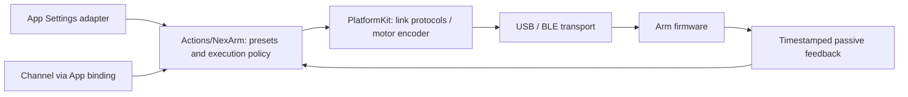
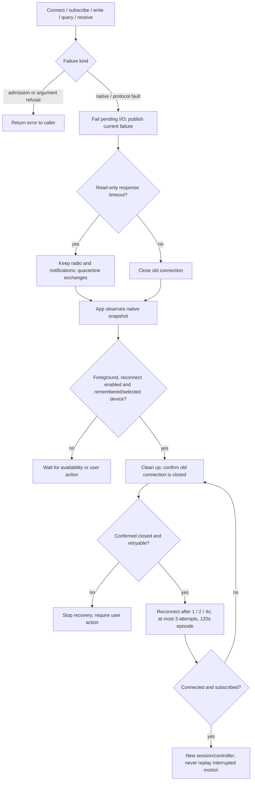
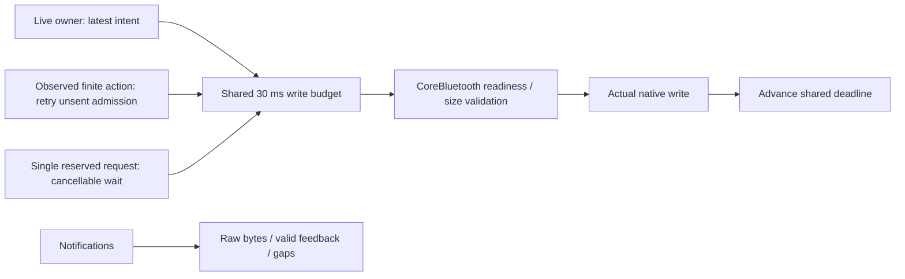
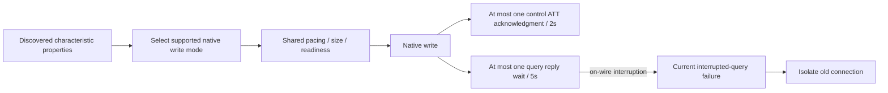

# NexArm connectivity and protocol SDK

✅ Serial observation-session invalidation/close reports `NexArmError.disconnected`, matching the SDK session contract. `latestObservation` checks caller cancellation independently; a native closed session never fabricates `CancellationError`. Opt-in read-only serial preflight verifies closed-session read/write failures without sending another device command. SDK retains no Action/Tool scheduling or recovery policy.

Purpose: provide reusable NexArm USB/BLE connection, framing, native motor commands and feedback. Design goals: no business gesture catalog, no Action or Channel dependency, bounded transport state and explicit failures.

✅ `NexArmProtocol.swift` owns packets, decoding, link capabilities, timestamped telemetry and connection feedback health. Packet properties describe single/synchronous position writes and motor targets without head/gesture terminology. `NexArmBluetooth.swift` and `NexArmSerial.swift` implement transports and observation sessions. Admission, disconnect and manual takeover fence old sessions; failed motion commands are never automatically replayed.

✅ `NexArmMotorCommands.swift` encodes native single-motor position writes and simultaneous addressed writes. Speed1…1400 and acceleration1…254 use native register units. Hardware position limits belong to the encoder. The SDK exposes no reset/home wrapper or joystick planner: these are Action-side behavior.

✅ This target has zero project dependencies and owns its device values. Actions consumes its link protocols through injected connections; PlatformKit never imports Actions, enumerates gestures, supplies localized action names or decides an Action result. The boundary check rejects reverse imports and reintroduced action policy types.

Manual jog shaping, reset wrappers, arrival/stability thresholds, gesture geometry, own-motor preparation/reset and child-error aggregation belong to [Actions/NexArm](../../../Actions/NexArm/README.md), specifically its [Support](../../../Actions/NexArm/Support/README.md) implementation.

Developer rules: add protocol operations here only when they are reusable device capabilities. Put nod/dance/celebration, localized names, beats and business completion rules in Actions. Never make a transport enumerate all Actions or choose which gesture follows connection. Stationary read-only queries remain available; production Actions observe unsolicited feedback without polling fallback. Live and observed position writes share the same native per-motor limits; the former full-encoder-range fallback is removed. Packet admission validates addressing and bounds; it is not physical obstacle detection.

❌ No autonomous safety controller, physical emergency-stop proof, firmware calibration, arbitrary register configuration or guaranteed background execution. BLE/USB transport checks do not establish physical clearance or gesture quality.

✅ BLE failures carry typed step/cause/native domain/code data. Device snapshots contain transport facts; App owns name-priority ordering, placeholder filtering, localized text and recovery advice. Protocol names are bounded and normalized without localized placeholder interpretation.

## Bluetooth errors and recovery

The SDK returns original I/O errors and publishes only the latest revisioned connection/power/failure, query quarantine, feedback health and bounded traffic counters. It retains no exception history or Action/Tool/Agent/resource metadata. Admission refusal is not automatically a native fault. App owns localization and recovery; [Actions](../../../Actions/NexArm/README.md#execution-errors-and-handling) owns motion completion and reports.

| Error / snapshot failure | Trigger | SDK handling / App policy |
|---|---|---|
| `disconnected` | Closed link, missing connected characteristics, invalid observation session or disconnect callback | Fail pending I/O and fence old sessions; App may reconnect |
| `timeout` / `timeout(step)` | Connection setup exceeds 12s, request exceeds 5s (including pacing), or acknowledged control write exceeds 2s | Close failed link; eligible for bounded recovery |
| `responseTimeout(command, expectedBytes, receivedBytes)` | Response-stage deadline expires without a complete expected reply | Read-only queries keep link but quarantine exchanges until reconnect; other requests close link; no request replay |
| `sendBlocked` | Native admission remains blocked for 2s | Fail native I/O and close link; App recovers as congestion |
| `requestInterrupted(command)` | Caller cancels an already transmitted request | Return cancellation, publish interruption and close link to isolate late replies; cancellation before transmission leaves link intact |
| `invalidPacket` / `protocolViolation(.invalidPacket)` | Invalid received frame/decoder data; invalid control packet can also be rejected before sending | Receive faults close link and may recover; local rejection alone does not justify recovery |
| `overflow` / `protocolViolation(.receiveOverflow)` | Receive decoder/buffer bound exceeded; reply bytes exceed 16,384 | Close link; retry only when snapshot identifies a protocol violation |
| `native(step, domain, code)`; `io(code)` | CoreBluetooth callback or native I/O failure | Preserve producer error; close faulted link. Untyped system errors are retryable only when domain/code matches the snapshot fault |
| `unavailable` | Bluetooth off/resetting/unknown, unauthorized or unsupported | App waits for temporary availability; unauthorized/unsupported stops automatic recovery |
| `unknownDevice` | Requested device cannot be resolved | Reject connection; no automatic retry |
| `incompatibleService` / `incompatibleService(step)` | Required service, characteristic, notifications or supported write mode missing | Fail connection; no automatic retry |
| `packetTooLarge` | Packet exceeds selected mode's maximum write length or reply length is invalid | Reject request; no automatic retry |
| `busy`, `sessionReplaced` | Occupied connection/request/control slot, or live control replaces a pending request | Reject/end the affected operation; no native fault or automatic retry solely from this error |
| `invalidMotion` | Native motor addressing/options/hardware limits fail validation | Reject command; no connection recovery |
| `disconnectUnconfirmed` | Native disconnect remains unconfirmed after the bounded 3s join | Keep admission fenced; App stops reconnecting |
| App `episodeTimeout`, `notRetryable` | Recovery exceeds 120s or error fails retry classification | Set recovery failed; require manual intervention |

Sources: [NexArmError](NexArmProtocol.swift), [BLE driver and failure values](NexArmBluetooth.swift), [App recovery policy](../../../App/Workflows/Bluetooth/BluetoothRecovery.swift), [App workflow](../../../App/Workflows/Bluetooth/BluetoothWorkflow.swift).

App recovery requires confirmed old-link closure and never cancels a finite Action merely to recover: the closed session naturally fails its I/O, while Runtime records the Action result. Foreground/availability suspension does not refill attempts; 30s of stable readiness resets the attempt budget. Successful reconnection establishes connectivity, not physical arrival or validated motion. Passive feedback silence updates health only; it neither disconnects nor initiates recovery. Action feedback deadlines are independently owned.

## Shared BLE pacing and diagnostics — ADR0123

✅ One connection-wide admission budget spaces actual writes by at least 30 ms (about 33 packets/s, burst capacity one). Observed writes, live writes and acknowledged requests share it; CoreBluetooth writeWithoutResponse readiness and packet-size checks still apply. This is a conservative initial transport ceiling, not a measured firmware limit. Reconnection resets the budget; observation/manual takeover does not refill it. Idle time never accumulates credits.

✅ Streaming retains no packet queue: `false` means not sent, so the owner retains/recomputes its latest intent. A finite request reserves the existing capacity-one request slot before a cancellable pacing wait; a concurrent request fails busy. Takeover/disconnect cancels that unsent request task. Only a request actually written can leave an outstanding ATT acknowledgment. No command is silently dropped or automatically replayed. The five-second request deadline includes pacing; the independent passive-feedback health window is two seconds.

✅ `status().traffic` exposes fixed-size, connection-local saturating counters for admitted packets/bytes, pacing and system deferrals, readiness callbacks, raw notification bytes and valid feedback samples, plus current/maximum notification and feedback gaps. OSLog emits a summary every approximately five seconds and on feedback-health transitions. Raw notification traffic is counted before decoding, so unrelated/malformed data is distinct from valid pose receipts. No media or packet payload is retained in diagnostics.

❌ Physical BLE rate/MTU/firmware endurance calibration and device-side queue instrumentation remain pending. Native multi-motor packing is available but streaming does not assume a negotiated MTU can fit a combined packet. No claim of solved wireless interference or firmware starvation.

✅ Snapshots expose query quarantine and monotonically versioned native facts. App (ADR0125) now closes/reconnects abnormal connected sessions through its bounded recovery policy; PlatformKit still does not decide retries, Action replay or UI state. Reconnect clears query quarantine, telemetry/session decoder state and the flow budget only after a new native connection is established.

## Passive BLE connection — ADR0130

✅ Native connection/subscription completion exposes controls without pose/version/IK probes, stationary validation or indication motion. App presents unsolicited telemetry; refresh reads cached receipts. Feedback silence does not disable manual commands. Motion planning, reference homes and segment completion remain in Actions/App.

✅ Native disconnect invalidates requests/live/observation sessions with `NexArmError.disconnected`; caller cancellation remains `CancellationError`. Session IDs fence stale writes across reconnect. SDK query admission uses `busy`, replacement uses `sessionReplaced`, and firmware business policy is outside this SDK (ADR0129–ADR0134).

❌ Physical parser/radio endurance, notification cadence and takeover acceptance remain pending. Historical Bluetooth storage is outside the current scope; passive connectivity does not prove physical clearance or target arrival.

## Native write capability and query interruption — ADR0133

✅ Discovery accepts either native write capability. Live/observed control prefers writeWithoutResponse; queries prefer writeWithResponse; each falls back to the characteristic's available capability and validates that mode's maximum length. Both modes share the 30 ms budget. A response-writing control packet reserves one ATT acknowledgment slot with a two-second deadline; new submissions return false while occupied, without accumulating packets. The slot survives writer replacement until its acknowledgment or native connection cleanup, so late acknowledgments cannot complete a new packet. Query admission remains capacity one and excludes a pending control acknowledgment. Unacknowledged queries await only the protocol reply; an ATT acknowledgment is never presented as motor arrival.

✅ Interruption of an already transmitted query sets the current typed failure `requestInterrupted(command:)`, then closes the old link to prevent ambiguous late replies. The caller still receives cancellation according to its execution policy. Cancellation before transmission leaves the link intact and creates no fault. No Action name, resource, task or recovery episode enters native state. App controls reconnect and presentation.

❌ Actual characteristic properties, notification cadence and firmware endurance still require device acceptance.
