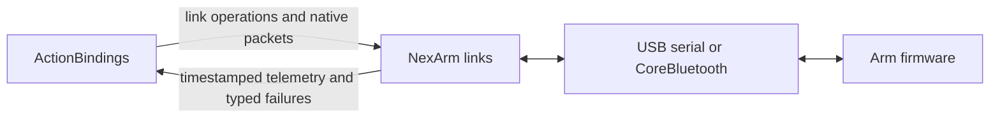

# NexArm Protocol and Transports

## Summary

Reusable USB/BLE links, native motor packets, passive telemetry and bounded connection diagnostics.

## Ownership and boundaries

The SDK validates hardware addressing/register limits and transports bytes. Actions owns gesture geometry/arrival policy; module bindings own localization/reconnection. Native I/O outcomes never constitute an Action report.

## External relationships and data flow

Runtime arrows show data or capability calls; dashed arrows show injection.

## Protocol

`NexArmLink`, `NexArmWritableLink` and `NexArmObservableLink` expose exchange, writes and session-scoped passive observation. CMD3 encodes one motor; CMD131 packs 1…6 distinct addressed motors. Options require speed 1…1400 and acceleration 1…254. Position limits for motors 1…6 are respectively 210…3826, 200…3800, 968…3200, 728…3218, 908…3128 and 1118…2828. These are encoder bounds, not obstacle detection.

`NexArmDecoder` limits buffered bytes to 4096 and validates frame/header/checksum. Replies/consumed serial bytes are bounded to 16384. Unsolicited CMD11 telemetry validates six motor positions and carries sequence/receipt time. Feedback health uses a two-second window; silence alone neither disables control nor reconnects.

## BLE admission and lifecycle

FFE0 service uses FFE1 transmit and FFE2 notifications. Connection/subscription completes without version/pose/IK queries. Discovery retains at most 128 peripherals; snapshots are revisioned newest-one values. Names are bounded native facts; placeholder/order/localization policy is module-owned.

One connection-wide 30 ms write budget has burst capacity one. Live/observed writes return `false` when unsent; no packet queue exists. Finite requests reserve one request slot before pacing and reject concurrent requests with busy. Readiness/MTU checks still apply. Controls prefer writeWithoutResponse, queries prefer writeWithResponse, with capability fallback. Response-writing control uses one ATT acknowledgment slot and a two-second deadline.

Request deadline is five seconds including pacing; connect/setup is twelve seconds; blocked send is two seconds; disconnect join is three seconds. Cancelling before transmission leaves the link intact. Interruption after transmission closes/fences the old session to prevent late reply contamination. Read-only response timeout quarantines exchanges while retaining notifications; other native/protocol faults close the link. Reconnect resets sessions/decoder/budget; observation takeover does not refill pacing credit. Failed motion is never replayed.

USB serial uses exclusive native access, explicit OS errors, a one-second exchange deadline and session checks. Closed observation operations report disconnected; caller cancellation is checked independently.

## Failure taxonomy

| Error / snapshot failure | Trigger | Handling and caller policy reference |
|---|---|---|
| `disconnected` | Closed link, missing connected characteristics, invalid observation session or disconnect callback | Fail pending I/O and fence old sessions; the owning service may reconnect |
| `timeout` / `timeout(step)` | Connection setup exceeds 12s, request exceeds 5s (including pacing), or acknowledged control write exceeds 2s | Close failed link; eligible for bounded recovery |
| `responseTimeout(command, expectedBytes, receivedBytes)` | Response-stage deadline expires without a complete expected reply | Read-only queries keep link but quarantine exchanges until reconnect; other requests close link; no request replay |
| `sendBlocked` | Native admission remains blocked for 2s | Fail native I/O and close link; the owning service recovers as congestion |
| `requestInterrupted(command)` | Caller cancels an already transmitted request | Return cancellation, publish interruption and close link to isolate late replies; cancellation before transmission leaves link intact |
| `invalidPacket` / `protocolViolation(.invalidPacket)` | Invalid received frame/decoder data; invalid control packet can also be rejected before sending | Receive faults close link and may recover; local rejection alone does not justify recovery |
| `overflow` / `protocolViolation(.receiveOverflow)` | Receive decoder/buffer bound exceeded; reply bytes exceed 16,384 | Close link; retry only when snapshot identifies a protocol violation |
| `native(step, domain, code)`; `io(code)` | CoreBluetooth callback or native I/O failure | Preserve producer error; close faulted link. Untyped system errors are retryable only when domain/code matches the snapshot fault |
| `unavailable` | Bluetooth off/resetting/unknown, unauthorized or unsupported | the owning service waits for temporary availability; unauthorized/unsupported stops automatic recovery |
| `unknownDevice` | Requested device cannot be resolved | Reject connection; no automatic retry |
| `incompatibleService` / `incompatibleService(step)` | Required service, characteristic, notifications or supported write mode missing | Fail connection; no automatic retry |
| `packetTooLarge` | Packet exceeds selected mode's maximum write length or reply length is invalid | Reject request; no automatic retry |
| `busy`, `sessionReplaced` | Occupied connection/request/control slot, or live control replaces a pending request | Reject/end the affected operation; no native fault or automatic retry solely from this error |
| `invalidMotion` | Native motor addressing/options/hardware limits fail validation | Reject command; no connection recovery |
| `disconnectUnconfirmed` | Native disconnect remains unconfirmed after the bounded 3s join | Keep admission fenced; the owning service stops reconnecting |

The table references host recovery consequences; retry classification and episodes are implemented only in [NexArm connection service](../../../Actions/NexArm/Support/README.md). [Actions NexArm](../../../Actions/NexArm/README.md) owns physical completion and report detail.

## Diagnostics

Fixed-size saturating traffic counters distinguish actual writes, pacing/system deferrals, raw notification bytes and valid feedback/gaps. Snapshots contain only latest native state, quarantine and failure; there is no exception history, business metadata or packet payload log. Native domain/code and operation step are preserved.

Framing, hardware limits, passive telemetry, shared pacing, session fencing and USB/BLE I/O.

## Related design

[Parent design](../README.md)

## 待实现

- Autonomous safety control and arbitrary register configuration. Physical endurance/calibration evidence belongs in [validation history](../../../../docs/validation/Validation-History.md).

✅ 原生 BLE driver 按首次能力使用创建，关闭未创建的链路不初始化 CoreBluetooth；根 admission 关闭后拒绝新的设备写入和连接。

显式 disconnect 先取消并最终加入扫描、连接/请求/控制 deadline、发送与反馈 worker，再确认原生断开；原生断开未确认继续保留围栏和 failure，不把取消当成物理停机。

## 统一容器异常通道

✅ BLE 原生快照从无故障到故障或故障变化时直接报告；串口公开失败保留并报告。通知不依赖 UI/BluetoothWorkflow 是否消费流，不把断开请求当作物理完成。
