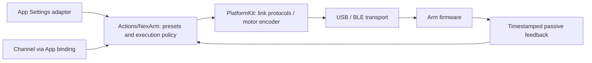

# NexArm connectivity and protocol SDK

Purpose: provide reusable NexArm USB/BLE connection, framing, native motor commands and feedback. Design goals: no business gesture catalog, no Action or Channel dependency, bounded transport state and explicit failures.

✅ `NexArmProtocol.swift` owns packets, decoding, link capabilities, timestamped telemetry and connection feedback health. Packet properties describe single/synchronous position writes and motor targets without head/gesture terminology. `NexArmBluetooth.swift` and `NexArmSerial.swift` implement transports and observation sessions. Admission, disconnect and manual takeover fence old sessions; failed motion commands are never automatically replayed.

✅ `NexArmMotorCommands.swift` encodes native single-motor position writes and simultaneous addressed writes. Speed1…1400 and acceleration1…254 use native register units. Hardware position limits belong to the encoder. The SDK exposes no reset/home wrapper or joystick planner: these are Action-side behavior.

✅ This target has zero project dependencies and owns its device values. Actions consumes its link protocols through injected connections; PlatformKit never imports Actions, enumerates gestures, supplies localized action names or decides an Action result. The boundary check rejects reverse imports and reintroduced action policy types.

Manual jog shaping, reset wrappers, arrival/stability thresholds, gesture geometry, own-motor preparation/reset, child-error aggregation and connection indication belong to [Actions/NexArm](../../../Actions/NexArm/README.md), specifically its [Support](../../../Actions/NexArm/Support/README.md) implementation.

Developer rules: add protocol operations here only when they are reusable device capabilities. Put nod/dance/celebration, localized names, beats and business completion rules in Actions. Never make a transport enumerate all Actions or choose which gesture follows connection. Stationary read-only queries remain available; production Actions observe unsolicited feedback without polling fallback. Live and observed position writes share the same native per-motor limits; the former full-encoder-range fallback is removed. Packet admission validates addressing and bounds; it is not physical obstacle detection.

❌ No autonomous safety controller, physical emergency-stop proof, firmware calibration, arbitrary register configuration or guaranteed background execution. BLE/USB transport checks do not establish physical clearance or gesture quality.

✅ BLE failures carry typed step/cause/native domain/code data. Device snapshots contain transport facts; App owns name-priority ordering, placeholder filtering, localized text and recovery advice. Protocol names are bounded and normalized without localized placeholder interpretation.

✅ BLE reply timeouts retain expected command/payload length and total received notification bytes before pending state is cleared. Zero notifications and unmatched data can be distinguished. The SDK never replays a request; read-only response timeouts preserve the link with quarantined exchanges, while write/native transport failures disconnect. App owns localized labels.

✅ Read-only response timeout keeps the radio and notifications connected but quarantines exchanges until reconnect; feedback/control health stays false. This preserves connection truth without allowing a late response to satisfy a new request. Write/native transport failures still disconnect. No motion retry is introduced.
