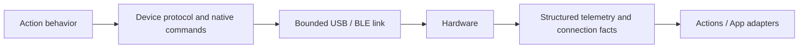

# Connectivity — External Device Communication

Purpose: implement bounded transport and protocol capabilities for external hardware. Design goals: explicit admission, observable connection state, structured diagnostics and no action/presentation policy.

✅ [NexArm](NexArm/README.md) implements USB/BLE links, framing, native motor register encoding, hardware position limits, timestamped feedback and connection-health tracking. Device SDKs may know vendor commands and limits; they must not know application gestures, home/reset behavior, motion recipes, localized UI text or preferred discovery ordering.

✅ Connections use the concrete NexArm link capabilities. The unused generic transport/emergency-stop placeholder has been removed; no implemented emergency-stop capability is claimed. App supplies persisted selection, foreground/reconnection lifetime and UI mappings. Actions owns all action behavior and wrappers.

❌ General network transports, device-side watchdog validation and independently confirmed physical emergency stop remain unimplemented. iOS process lifetime is not a hardware safety mechanism.

## Passive BLE connection — ADR0130

✅ Native connection/subscription completion makes Settings controls available immediately. App performs no connection pose/version/IK probe, stationary validation or indication movement. It listens to unsolicited position packets and publishes measured state; refresh reads the latest received packet only. Feedback silence remains visible but does not disable manual commands, disconnect or start recovery. Native write/connection failures remain explicit. Actions uses passive BLE compatibility for this App connection; recipe IK resolution is deferred to an explicit preset request, not connection verification. Manual jog can start from the existing configured reference when no sample has arrived; that reference is not measured telemetry. Segment arrival observation and cancellable replacement remain in Actions/App.

❌ Physical feedback cadence, preset IK availability and sustained manual takeover require real-device acceptance. Passive connection does not establish physical clearance or target arrival.

✅ ADR0129: NexArm native session closure exposes device disconnection errors to existing callers; explicit Task cancellation retains cancellation semantics. No business queue or Agent lifetime policy enters connectivity.

✅ ADR0134: Bluetooth exception history is removed at SDK/App/UI layers. Latest native connection, communication issue and recovery state alone appear in Settings; healthy snapshots/new connections replace prior faults. ADR0138 uses one row to connect while unconnected or open detail when already connected; connection success stays on the list, disconnect appears only when connected, and remembered devices remain forgettable; an already-open disconnected detail disables actions/motor gestures. Execution results/home issues and bounded automatic recovery remain independently owned. ❌ Physical BLE/navigation/touch acceptance remains pending.
