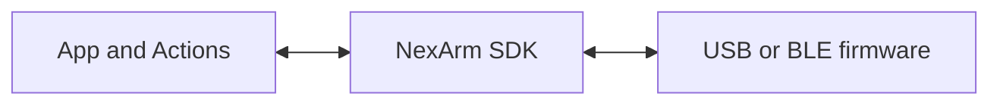

# External Device Connectivity

## Summary

Transport and protocol capabilities for external hardware; the current implementation is NexArm USB/BLE.

## Ownership and boundaries

No gesture catalog, presentation, Agent admission or recovery policy. NexArm owns bounded framing, native session fencing and connection facts; callers own what commands mean.

## External relationships and data flow

Runtime arrows show data or capability calls; dashed arrows show injection.

## Structure and contract

[NexArm](NexArm/README.md) owns the link protocols, packet encoder/decoder, timestamped telemetry, USB serial and CoreBluetooth implementations. Connection/subscription success exposes a usable transport without pose probes or indication motion. Motion arrival is a caller-owned interpretation of feedback.

Discrete operations reject excess work explicitly. Live control returns whether a packet was actually admitted; the caller owns its latest intent. Disconnect invalidates old observation/control sessions, and no failed command is replayed.

NexArm transports and protocol values.

## Related design

[Parent design](../README.md) · [NexArm](NexArm/README.md)

## 待实现

- 暂无本目录独立的实现待办；跨模块及实际模型/设备验收见所属模块说明。
