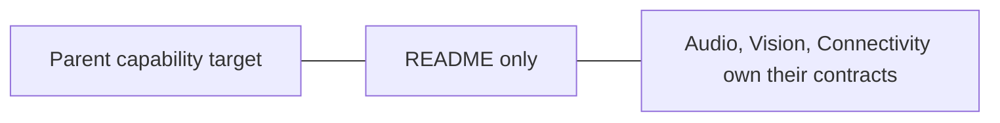

# Platform Core Boundary

## Summary

This directory has no Swift sources and contributes no compiled implementation.

## Ownership and boundaries

Reserved documentation boundary for genuinely shared platform contracts. Existing device values remain owned by Audio, Vision or Connectivity; there is no generic device orchestrator.

## External relationships and data flow

Runtime arrows show data or capability calls; dashed arrows show injection.

## Current design

No interfaces, queues or runtime lifecycle exist here. A shared abstraction requires concrete cross-domain consumers and must remain independent of application policy.

❌ Shared Core capability implementation.

## Related design

[Parent design](../README.md)
