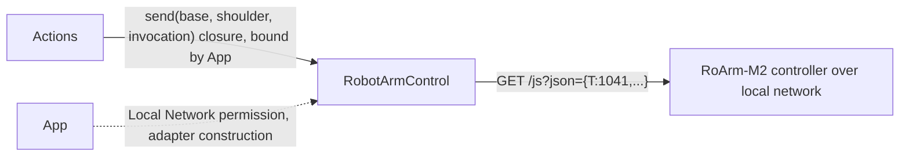

# ExternalDevice — Transport Contracts for External Hardware

Purpose: abstract device transports without Agent business semantics, per architecture section 34. Design goals: keep the byte-oriented stream contract usable for genuinely persistent-connection hardware (serial, BLE), and give hardware with a different connection shape (request/response over local network) its own, equally thin abstraction rather than forcing a mismatched fit. See [ADR 0037](../../../docs/adr/0037-photographer-aim.md). Camera capture is already implemented under `PlatformKit/Camera` and is not part of this contract.

- ✅ `ExternalDeviceTransport.swift`: `connect`/`send([UInt8])`/`emergencyStop`/`disconnect` contract for persistent stream transports (serial, BLE). Implemented as a protocol only; no concrete adapter exists yet.
- ❌ `RobotArmControl` (design only, this record): unified logical-angle control surface for the tracking rig's arm. Not built on `ExternalDeviceTransport` — see rationale below.
- ❌ Concrete RoArm‑M2 WiFi/HTTP adapter. Blocked on confirming whether the final hardware is the full 4-axis arm or the 3-axis variant with the wrist/hand joint removed (see `arm/smart_capture.md` section 5.1/5.4 for why that distinction changes the adapter's internal math, not the protocol shape).
- ❌ Any BLE/serial robot adapter, IoT adapter.

## Why `RobotArmControl` is a separate protocol, not a `ExternalDeviceTransport` use case

`ExternalDeviceTransport.send(_ bytes: [UInt8])` models a persistent connection where the caller pushes bytes and the device does not synchronously answer each one — the right shape for serial or BLE. RoArm‑M2's actual control surface for this project is `GET http://<arm-ip>/js?json={"T":...}` (confirmed against `arm/roarm_m2-main/RoArm-M2_python/http_simple_ctrl.py`): a request/response call over the local network, matching `PlatformKit/Device/DeviceCapability.swift`'s existing `.localNetwork` case. Forcing that into `send([UInt8])` would either discard the response or require a second out-of-band channel to correlate it — worse than defining the narrow contract the domain actually needs. `ExternalDeviceTransport` is unchanged and remains the right contract for a future serial/BLE device.

## Planned `RobotArmControl` contract

```swift
/// Logical control surface for one arm; concrete adapters own translating (base, shoulder) into
/// whatever the confirmed hardware variant actually needs (firmware Cartesian IK, or direct joint
/// angles with adapter-owned calibration — see ADR 0037).
public protocol RobotArmControl: Actor {
    var isConnected: Bool { get }
    /// Best-known logical angles, radians. Read-only; not guaranteed to reflect an in-flight aim
    /// command that has not yet been acknowledged by the arm controller.
    var baseAngle: Double { get }
    var shoulderAngle: Double { get }

    func connect() async throws
    /// Non-blocking: returns once the controller acknowledges receipt, not once physically settled.
    func aim(base: Double, shoulder: Double) async throws
    func home() async throws
    /// Independent of Channel scheduling and of any Agent decision; must not depend on iOS
    /// background execution remaining active.
    func emergencyStop() async
    func disconnect() async
}
```

This is illustrative only — not an existing Swift API. The concrete RoArm adapter (WiFi/HTTP) is deferred until the axis-count question is resolved; per ADR 0037, only the adapter's internals change between the two hardware variants, not this protocol.

## Direct relationships (planned)



`Actions/Robot` never imports this protocol directly (see that module's README) — App's composition root is the only place that references both `Actions.Robot.aim`'s closure parameter and a concrete `RobotArmControl` instance.

## Maintenance

Keep this README synchronized with implementation as soon as any file in this directory stops being documentation-only, following `PlatformKit/README.md`'s ✅/❌ convention. Update the root `PlatformKit/README.md` implementation-status list when a concrete adapter lands.
