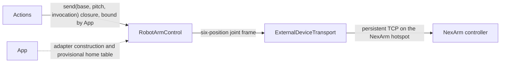

# ExternalDevice — Transport Contracts for External Hardware

Purpose: abstract device transports without Agent business semantics, per architecture section 34. Design goals: keep `ExternalDeviceTransport` as the byte pipe, and put NexArm framing plus the logical aim mapping in `RobotArmControl`. See [ADR 0037](../../../docs/adr/0037-photographer-aim.md). Camera capture is already implemented under `PlatformKit/Camera` and is not part of this contract.

- ✅ `ExternalDeviceTransport.swift`: `connect`/`send([UInt8])`/`emergencyStop`/`disconnect` contract for persistent stream transports (serial, BLE). Implemented as a protocol only; no concrete adapter exists yet.
- ✅ `NexArmJointCommand` maps logical `base` / `pitch` to six raw positions and builds the position-write frame (command 97, little-endian, checksum). Provisional home is raw 2048. `base` changes `shoulder_pan`; `pitch` changes `wrist_flex`.
- ✅ `NexArmController` sends that frame on an injected `ExternalDeviceTransport`. `home()` throws `provisionalHome` and does not move hardware.
- ❌ Concrete Wi-Fi socket. The intended endpoint is `192.168.4.1:8080` on hotspot `NexArm`. The camera session does not connect. Wrist-travel recovery stays off.
- ❌ Any other BLE/serial robot adapter or IoT adapter.

## Why both protocols exist

`ExternalDeviceTransport.send(_ bytes: [UInt8])` is the persistent byte pipe. The NexArm tracking command is one such frame: command 97 writes six little-endian positions and does not wait for a reply. `NexArmJointCommand` owns that framing. `NexArmController` sends it. `Actions/Robot` sees only the injected `(base, pitch)` closure.

Factory Cartesian command `0x08` is a different controller mode. Tracking does not use it.

## Planned `RobotArmControl` contract

```swift
/// Logical aim for the phone on a NexArm. The adapter writes six raw positions on every call:
/// base → shoulder_pan, pitch → wrist_flex, and the home table for the other four.
/// Until a read-back replaces it, every home entry is raw 2048.
public protocol RobotArmControl: Actor {
    var isConnected: Bool { get }
    /// Last logical angles this adapter sent, radians. Not a read-back of physical joint position.
    var baseAngle: Double { get }
    var pitchAngle: Double { get }

    func connect() async throws
    /// Returns once the byte transport accepts the six-position frame, not once the arm settles.
    func aim(base: Double, pitch: Double) async throws
    func home() async throws
    /// Torque off. Independent of Channel scheduling and of any Agent decision. Must not depend
    /// on iOS background execution remaining active.
    func emergencyStop() async
    func disconnect() async
}
```

This is illustrative only — not an existing Swift API.

On each `aim`, the adapter:

1. Converts `base` and `pitch` with the provisional scale: logical 0 is raw 2048, positive, `4096 / 2π` counts per radian. A hardware read-back replaces the center, sign, and scale.
2. Clamps `shoulder_pan` and `wrist_flex` to 0–4095 until measured travel replaces that range.
3. Fills `shoulder_lift`, `elbow_flex`, `wrist_roll`, and `gripper` from the home table. The provisional table is raw 2048 for every joint.
4. Writes all six positions in one frame.

Wrist-travel recovery is specified and starts disabled. When enabled, a `wrist_flex` target inside the end margin shifts `shoulder_lift` and `elbow_flex` by opposite amounts that keep the phone's world pitch, and pulls `wrist_flex` back toward mid-travel by the same amount. The Agent still sends only `base` and `pitch`.

`home()` writes the six home positions once. Tracking does not call it when the person leaves the frame. On hardware, `home()` waits until the provisional 2048 table has been replaced.

## Direct relationships (planned)



`Actions/Robot` never imports this protocol directly. App's composition root is the only place that references both `Actions.Robot.aim`'s closure and a concrete `RobotArmControl` instance.

## Maintenance

Keep this README synchronized with implementation as soon as any file in this directory stops being documentation-only, following `PlatformKit/README.md`'s ✅/❌ convention. Update the root `PlatformKit/README.md` implementation-status list when a concrete adapter lands.
