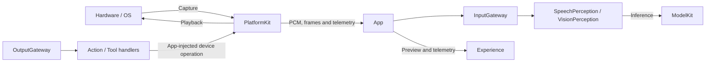
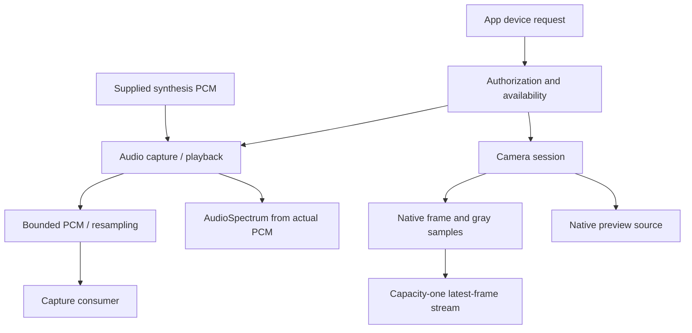

# PlatformKit — Device Input and Output

Owns hardware and operating-system I/O through public APIs. The goal is permission-aware device lifecycles and bounded data delivery. PlatformKit has no project-target dependency; ModelKit processes supplied data separately.

## Directory structure

```text
PlatformKit/
├── Audio/
│   ├── AppleAudioIO.swift                 # Capture, playback and audio-session setup
│   ├── MicrophoneFrame.swift              # Bounded captured PCM
│   ├── StreamingMonoPCMResampler.swift     # Continuous format conversion
│   └── AudioSpectrum.swift                # FFT telemetry for captured/played PCM
├── Vision/
│   ├── AppleCamera.swift                  # Camera lifecycle and preview source
│   ├── CameraFrame.swift                  # Native frame and orientation metadata
│   └── CameraGraySampler.swift            # Compact luminance samples
├── Core/DeviceCapability.swift            # Shared availability/authorization contract
├── Connectivity/ExternalDeviceTransport.swift # External-device transport contract
└── README.md                              # Device boundary and status
```

Group implementations by capability domain. Core holds shared contracts; add device subdirectories only when actual implementations need them.

## Upstream and downstream

Arrows show data flow through App adapters, not imports between the two Kits.



## Internal structure and data flow



Audio and camera own their devices and cleanup. Capture delivery is bounded; audio overflow is explicit, while the camera stream replaces its pending frame with the newest one. Playback waits for device completion and supports cancellation. FFT is device telemetry, not model inference or an Agent-selected UI command. See [Audio](Audio/README.md) and [Vision](Vision/README.md) for capacities and lifecycle rules.

## Feature status

- ✅ Microphone capture, speaker playback, PCM conversion and spectrum analysis.
- ✅ Foreground camera capture, front/back selection, native preview and compact gray samples.
- ✅ Shared permission contracts and an external-device transport interface.
- ❌ Concrete BLE/network/robot transports, recording and additional hardware domains.

## Issue record

| Status | Issue / next step |
| --- | --- |
| Open | Measure camera/audio coexistence, route-dependent playback latency and sustained thermal/power behavior on device. |
| Open | Robot control requires device-side limits, stop acknowledgement and disconnect protection; iOS background execution cannot provide safety. |
