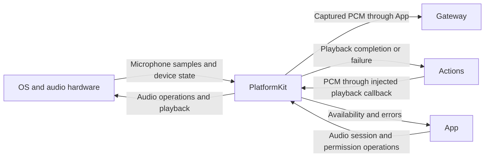

# PlatformKit — OS and Device Primitives

PlatformKit abstracts operating-system services, audio hardware, permissions, and external-device transport. Architecture section 34 defines its target coverage. It acquires input and performs device operations without Agent business semantics or model reasoning.

## Direct relationships

The current App supplies the wiring between PlatformKit and consumers. Arrows show logical data and operations, not direct module imports.

## Implementation status

- ✅ `Audio/AppleAudioIO.swift`: Apple audio capture, playback, and platform operations.
- ✅ `Audio/StreamingMonoPCMResampler.swift`: continuous mono PCM conversion with stream-local filter state and conversion errors.
- ✅ `Audio/MicrophoneFrame.swift`: shared captured PCM and level measurements. Segmentation is owned by Gateway using VAD probabilities; the obsolete energy segmenter and batch resampler have been removed.
- ✅ `Device/DeviceCapability.swift`: capability, authorization, and permission interfaces.
- ✅ `ExternalDevice/ExternalDeviceTransport.swift`: connect, send, emergency-stop, and disconnect contracts.
- ❌ Concrete Camera, Sensors, Storage, Network, BLE, robot, and IoT adapters.
- ❌ Real robot integration and hardware safety validation; transport protocols alone do not establish either.
- ❌ [`ExternalDevice`](ExternalDevice/README.md) planned `RobotArmControl` unified abstraction and RoArm‑M2 WiFi/HTTP adapter, and [`Camera`](Camera/README.md) planned frame capture for the tracking pipeline; see [ADR 0035](../../docs/adr/0035-tracking-agent-and-robot-actions.md). Design only, blocked on hardware axis-count confirmation for the arm adapter.

External input enters through InputGateway; Agent device actions must pass through OutputGateway and runtime execution. Use public APIs and validate capabilities and permissions. Robot emergency-stop and disconnect protection must be enforced by the device, without relying on iOS background execution.

## Maintenance

Keep this README synchronized with changes to responsibilities, files, interfaces, and implementation status. ✅ means implemented; ❌ means planned or incomplete. Do not create unused placeholder modules. The [technical architecture](../README.md) defines the target; the [layout audit](../../docs/Repository-Structure.md) records implementation exceptions.
