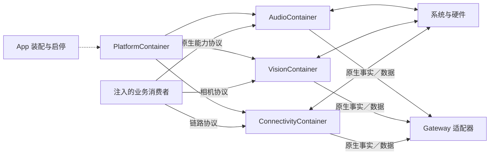

# PlatformKit — 原生设备能力

## 职责与边界

PlatformKit 是不依赖其他项目模块的基础 SDK，只使用系统框架。提供原生设备能力、有限缓冲的输入、运行事实和执行错误；不认识 Signal、Agent、Action、UI 或 FactoryKit。

App 创建根并管理生命周期，业务拥有同意、资源租约、动作含义和感知策略。模块内部只创建／持有原生驱动，对外按能力协议接入。

## 上下游与内部结构

箭头到 Gateway 表示消费数据，不构成 SDK 编译依赖；Signal 的载荷、来源、会话和传输适配均在 Gateway。

## 子能力接口

| 子能力 | 对外接口 | 完成与所有权 |
| --- | --- | --- |
| Audio | AudioInputOutput、CuePlaying、HapticFeedbackProviding | 首个有效PCM后就绪；播放等待真实dataPlayedBack；停止可加入 |
| Vision | CameraCapturing，受控JPEG相册导入 | 相机actor管理图；独立最新帧；单次照片回调加入 |
| Connectivity | NexArmBluetoothLink、NexArmObservableLink | 原生读写及观察；写入成功不代表物理到达 |
| Core | 有界广播、单代输入围栏、采样与OS清理额度 | 不选择业务反应，不授予设备后台执行资格 |

Audio 的 voice/diagnostic/detection/camera 是有限原生作用域，作用域内实例缓存一致，共享会话互斥。原生实现的构造／配置留在子容器；协议参数只包含 SDK／系统值。

## 根生命周期

✅ 构造和 start 不请求权限、不打开设备、不扫描；start 开放同步 admission。invalidate 同步关门并请求原生停止，setForeground(false)/stop 加入实际停止；重复停止共享结果。失败保留，已停止根不可重用；消费者先停止，再释放根。

Audio/Vision/Connectivity 独立管理自己的取消、原生回调和清理。恢复／重建由拥有者明确决定，不自动重放设备动作；物理安全不依赖后台调度。

## 数据、事件与失败

原生PCM保持有序、满载明确失败；相机／状态使用最新值替换。缓冲上限、单消费者／独立观察者及清理规则见各能力 README。

NativeAudioEvent／CameraEvent 是 String/Sendable 原生事实，不采用 Error。实际设备失败使用 SDK 错误或原系统错误，事件编码留给 Gateway。PlatformAdmission 同步调用注入的非阻塞错误报告回调，保留原 throw／真实清理结果；正常取消和有意关闭不升级为设备故障。

公开错误和值属于本 SDK，不生成业务提示或应用身份。SDK日志仅保留有界原生格式／交通／错误事实，不记录媒体或业务上下文。

## 源码风格与待完成

✅ 根及相关 Audio/Vision 能力使用统一声明／导入格式；能力协议与实现同目录，具体驱动不进入业务成员类型。无调用的PCM预热／游标接口不属于当前公开端口，实际播放actor隔离和停止加入保持。

❌ 视频录制、自主硬件安全控制器及完整原生／物理验收仍待完成。协议化、编译和替身测试不等于真实设备验收。

[总体设计](../README.md) · [Audio](Audio/README.md) · [Vision](Vision/README.md) · [Connectivity](Connectivity/README.md) · [Core](Core/README.md)

✅ 已实现：PlatformAdmission 不再过滤取消／关闭错误，原始 Error 完整交给宿主统一报告端口；生命周期控制事件的广播抑制由宿主／Gateway 完成，不改变类型化 throw。
