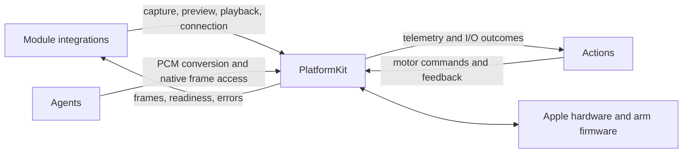
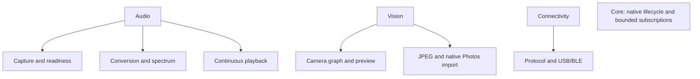

# PlatformKit — Native Device Capabilities

## Summary

Public Apple device I/O and bounded NexArm transports. The SDK exposes native values, readiness and failures to its callers.

## Ownership and boundaries

Foundation capability module with no cross-module dependencies. App manages root lifetime; module-owned services implement recovery; Actions owns motion semantics; Agents owns perception and inference policy. No Agent, Gateway, UI or business-function types enter this target.

## External relationships and data flow

Runtime arrows show data or capability calls; dashed arrows show injection.

## Internal structure

## Capability contracts

| Domain | Interface and completion boundary |
| --- | --- |
| Audio | `AppleAudioIO`: first validated PCM before capture admission; playback completion after native buffer drain |
| Vision | `AppleCamera`: actor-owned graph, native preview and newest frame; one bounded JPEG capture |
| Connectivity | NexArm link protocols, native command encoding, passive telemetry and session-fenced transports |
| Core | Generic native lifecycle and bounded subscription mechanisms |

Capture layout is fixed for an admitted audio stream. Spatial-to-mono fallback is allowed only before admission and after spatial shutdown. Discrete PCM overflow fails; replaceable camera/status values explicitly use newest-one buffers. Native write completion does not prove physical arrival.

Callbacks use serial native queues or short mutex sections, never UI state. module-owned services implement foreground fences and join teardown; physical safety cannot rely on background scheduling. SDK diagnostics retain bounded format/traffic/error facts, not media or business context.

Audio capture/playback/conversion, camera/photo/library capabilities and USB/BLE transports.

Device acceptance evidence is recorded in [validation history](../../docs/validation/Validation-History.md).

## Related design

[Parent design](../README.md) · [Audio](Audio/README.md) · [Connectivity](Connectivity/README.md) · [Core](Core/README.md) · [Vision](Vision/README.md)

AppleAudioIO exposes generic playClip for bounded PCM before capture, reusing the existing native drain/cancellation implementation. No app chime/music or presentation policy enters PlatformKit.

native PCM continuity evidence is distinguished from bounded queue overflow; stopPlayback cancels/wakes the owned native playback operation without stopping capture. Upper-layer consent/reply policy belongs to Agents and its integration.

Audio owns generic NativeHapticFeedback with public UIKit/CoreHaptics support checks, one bounded operation, cached prepared generators and explicit busy/unavailable/invalid-request failures. It owns no listening policy or cue selection. AppleAudioIO enables supported haptics during recording through the public AVAudioSession API.

Audio adds generic bounded PCMClipEncoding and one NativeCuePlayback using public AVAudioPlayer. It plays alongside existing audio under the current session, without reconfiguring/deactivating AVAudioSession or touching another player/capture owner. One active clip; overlap fails; callbacks/errors/cancellation complete its wait.

## Native image preparation

Vision adds NativeImageCompression, a generic caller-configured JPEG downsampling/encoding capability using public Image I/O. It has no model, Agent or persistence policy. One detached native operation per invocation is cancelled and joined by its caller; no retained queue/cache or UI lifetime. Callers select dimension/pixel/byte limits; malformed input, invalid limits, decoding, encoding and exhausted size budgets fail explicitly.

## 通用根级运行机制

Core/ResourceObservationWorkflow 提供注入的 read/deliver/invalidate 单 worker 采样，不知道资源、模型、Agent 或 UI；消息/指纹容量和取消语义保持不变。Core/NativeBackgroundAllowance 提供一个可替换、可结束的 OS 准备额度，期限由调用方指定，不授权设备后台执行。

Audio/ListeningCaptureWorkflow 串行加入原生 start/stop，Vision/CameraVisionRestartWorkflow 加入旧管线后启动最新意图。它们只接收闭包/中立泛型数据，业务同意、感知选择和 UI 状态属于上层；没有新增项目依赖。

## 待实现

- Movie recording and an autonomous hardware safety controller.

## Platform 根、设备接入与同帧呈现

✅ PlatformContainer 是 MainActor 根，组合 AudioContainer、VisionContainer、ConnectivityContainer。构造/start 不请求权限、打开设备或扫描；根 start 开放 admission。invalidate 同步关门，并行请求原生停止；setForeground(false)/stop 加入停止；重复停止共享结果，错误保留，已停止根不能重用。App 持有根，消费者只获得子能力或端口。

Audio 管理有限命名原生作用域与会话互斥；Vision 管理相机/照片导入；Connectivity 管理 BLE 和一个显式打开的 macOS serial。原生值与失败通过公开接口暴露给 Gateway；SDK 不知道 Signal、Agent、UI 或 FactoryKit。业务策略与设备完成仍是独立边界。

✅ 根构造允许以共享 admission 注入 Connectivity 工厂；子容器使用 NexArmBluetoothLink 公共端口，测试可验证真实断开失败被根保留、重复停止不重试，不创建原生驱动。

## 录音容器化回归修复

✅ 移除主录音路径新增的 MainActor PCM 转发任务与第二级订阅 FIFO，startCapture 直接返回原生容量 64 的有序源流。可选订阅改为在原生回调交付阶段独立广播，不经主线程中转；保持每订阅 64、慢观察者局部 overflow、容量上限 16，不丢弃或扩大主录音队列来掩盖堵塞。原生停机前关闭观察代次并加入原生回调，旧回调不能污染新录音；原生错误结束对应观察流。

## UI 容器与相机能力注入

✅ Vision 提供 CameraCapturing 原生相机能力接口，由 AppleCamera 实现；接口不导入 UI/Actions，App 注入该能力，权限请求与拍照方向读取也经过接口。
