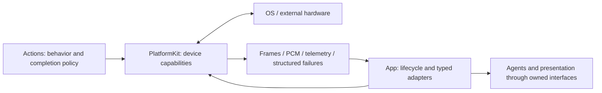

# PlatformKit — Device Input and Output

Purpose: provide reusable hardware and operating-system I/O through public APIs. Design goals: permission-aware device lifetimes, bounded data/command admission, explicit cleanup and an independent foundational SDK. PlatformKit depends only on shared AudioTypes values; it has no business or model dependency.

| Directory | Owns | Must not own |
|---|---|---|
| [Core](Core/README.md) | Documentation for future shared contracts; no compiled implementation | Business decisions or device workflow orchestration |
| [Audio](Audio/README.md) | Capture, PCM conversion, native playback, measured spectrum | Speech Actions, model inference, conversation policy or UI animation choices |
| [Vision](Vision/README.md) | Camera lifecycle, native preview binding, bounded frames and orientation-aware samples | Gesture/pose decisions, model inference, overlay content or preview cropping policy |
| [Connectivity](Connectivity/README.md) | Links, device protocols, native command encoding, telemetry and connection diagnostics | Action wrappers, reset/home choices, motion recipes, preferred device ordering or localized UI messages |

✅ Audio capture/playback, stream resampling and FFT metering; foreground camera capture/preview and bounded native-frame delivery; adapter-owned authorization; NexArm USB/BLE and protocol support are implemented. Playback drain and transport admission describe device operations, not a business Action result. Fixed buffer capacities and hardware register ranges are capability constraints, not application choreography.

✅ The 2026-10-01 audit moved NexArm manual jog/reset behavior to Actions, Bluetooth ordering/localization to AppWorkflows, and preview fill selection to App/Adapters. Gestures, completion policies and Action errors were already moved to Actions. Source/target checks reject reverse dependencies, known Action-policy types, localized presentation strings and business presentation APIs in this SDK.

❌ Additional device domains, general network transport, recording, sustained physical audio/camera acceptance and independently confirmed robot emergency stopping remain open. App background execution cannot establish physical safety.

Developer rule: determine the owning directory before adding code. Device-specific protocol knowledge is valid here; a reusable-looking wrapper that chooses an application action is not. Put action functions and composition in Actions, application connection/lifecycle policy in App, and display choices in App/UI. Keep each directory README aligned with its actual responsibility.
