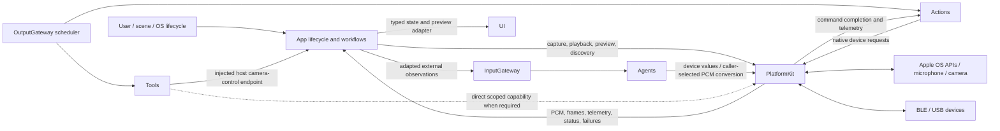
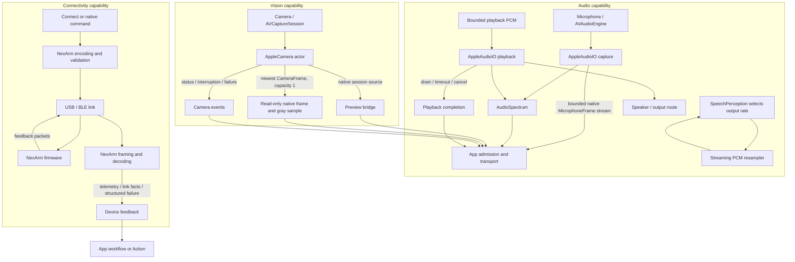

# PlatformKit — Device Input and Output

Provides reusable hardware and operating-system capabilities through public APIs. Its design goals are permission-aware lifetimes, bounded media and command admission, explicit cancellation/cleanup and neutral device facts. PlatformKit has no project or third-party target dependencies; it has no Agent, Gateway, ActionRuntime, ToolRuntime, ModelKit, UI or business-workflow dependency.

## Directory and ownership

| Directory | Owns | Must not own |
|---|---|---|
| [Core](Core/README.md) | Boundary for future contracts shared by multiple hardware domains; currently documentation only | Placeholder abstractions without real consumers or application policy |
| [Audio](Audio/README.md) | Microphone capture, native playback, streaming PCM conversion and measured spectrum | Speech Actions, inference, conversation sequencing or presentation choices |
| [Vision](Vision/README.md) | Camera authorization/lifecycle, native preview source, bounded frames and orientation-aware sampling | Pose decisions, inference, overlay content or preview layout policy |
| [Connectivity](Connectivity/README.md) | Device discovery/link state, protocol framing, native command encoding, hardware limits and telemetry | Gestures, reset/home policy, motion recipes, preferred-device ordering or localized messages |

## External upstream and downstream

App owns device and scene lifetime, creates concrete PlatformKit services and adapts their values to feature workflows, Gateway inputs and presentation endpoints. Actions call injected device capabilities when executing observable behavior. Agents and Tools may receive a narrowly scoped PlatformKit capability when a concrete implementation needs one, but they do not locate services through App or a global container.

Solid arrows below are implemented relationships. Dashed arrows are allowed injection points that currently have no concrete dependency.

The current App target uses audio, camera and connectivity capabilities; the current Actions target uses NexArm protocol/link capabilities. Current Camera Tools reach the App-owned camera coordinator through an injected `CameraControlCapability`; Tools still does not import PlatformKit or own the device session. VisionPerception consumes CameraFrame and SpeechPerception consumes caller-configured PCM conversion through PlatformKit. ModelKit does not call PlatformKit: App transports captured data, and each calling Agent builds its model input. UI receives state and typed operations rather than native services.

## Internal capability flow

PlatformKit is one target organized into three implemented device domains. Each domain owns its native adapter and bounds at the hardware boundary; App or Actions owns the policy that connects those facts to the rest of the product.

Audio capture exposes a 64-frame bounded stream and fails on overflow; playback admits one active stream with at most three scheduled buffers and completes after hardware drain. Camera delivery keeps only the newest native frame while preview uses the native session independently. Connectivity validates native packet and hardware bounds, never silently replays failed motion commands, and reports structured link/device facts. Child directory READMEs own the exact limits, concurrency and cancellation contracts.

## Ownership boundary and delivery state

Manual jog/reset behavior, gestures, motion composition and completion policy belong to Actions/NexArm. App workflows own Bluetooth selection/order/localization and foreground connection lifetime; App adapters own preview layout and media-to-Agent adaptation. PlatformKit exposes native capabilities and device facts without selecting business behavior.

- ✅ Audio capture/playback, stream resampling and FFT metering.
- ✅ Foreground camera capture, native preview and bounded native-frame delivery.
- ✅ NexArm USB/BLE links, protocol encoding, hardware bounds and feedback.
- ❌ Additional device domains, general network transport, recording and a confirmed independent robot emergency-stop mechanism.

Playback drain and transport admission describe device operations, not a business Action result. Fixed buffer capacities and hardware register ranges are capability constraints, not application choreography. Physical safety cannot depend on App background execution.

## Passive BLE connection — ADR0130

✅ Native connection/subscription completion makes Settings controls available immediately. App performs no connection pose/version/IK probe, stationary validation or indication movement. It listens to unsolicited position packets and publishes measured state; refresh reads the latest received packet only. Feedback silence remains visible but does not disable manual commands, disconnect or start recovery. Native write/connection failures remain explicit. Actions uses passive BLE compatibility for this App connection; recipe IK resolution is deferred to an explicit preset request, not connection verification. Manual jog can start from the existing configured reference when no sample has arrived; that reference is not measured telemetry. Segment arrival observation and cancellable replacement remain in Actions/App.

❌ Physical feedback cadence, preset IK availability and sustained manual takeover require real-device acceptance. Passive connection does not establish physical clearance or target arrival.

✅ ADR0129: native NexArm disconnect/session invalidation returns device failures without cancelling business tasks. Action/Tool results and Channel queue policy remain consumer-owned.

✅ ADR0134: Bluetooth exception history is removed at SDK/App/UI layers. Latest native connection, communication issue and recovery state alone appear in Settings; healthy snapshots/new connections replace prior faults. ADR0138 uses one row to connect while unconnected or open detail when already connected; connection success stays on the list, disconnect appears only when connected, and remembered devices remain forgettable; an already-open disconnected detail disables actions/motor gestures. Execution results/home issues and bounded automatic recovery remain independently owned. ❌ Physical BLE/navigation/touch acceptance remains pending.
