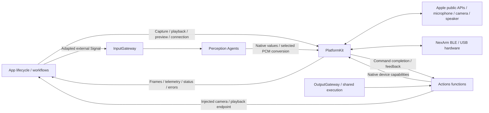

# PlatformKit — Native Device Capabilities

PlatformKit supplies native capture, playback, connectivity, command encoding and device feedback through public platform APIs. It is a foundational SDK: callers supply business intent and own application/device workflows; the SDK returns facts and explicit technical outcomes.

Design goals: capability/permission validation, bounded native streams and commands, hardware-limit validation and joined cleanup without business or presentation policy.

## Upstream and downstream

Arrows show runtime capability use and native feedback. App owns services and adapts external facts to Signals; no Gateway, UI or model dependency is introduced into PlatformKit.

Agents currently consume device values and conversion support; observable Agent-selected device operations remain registered calls through OutputGateway. ModelKit uses its own inputs and performs no device I/O. UI receives host state and preview content rather than native services.

## Internal structure

Arrows show native processing. Hardware domains share a target, but own separate value contracts and bounds.

```mermaid
flowchart TB
    subgraph Audio[Audio]
        Mic[AVAudioEngine microphone] --> Capture[AppleAudioIO / readiness / spatial or mono capture]
        Capture --> Frames[Bounded MicrophoneFrame stream]
        Frames --> Resample[Caller-configured streaming PCM resampler]
        PCM[Supplied playback PCM] --> Player[Native playback / drain / cancellation]
        Player --> Speaker[Speaker]
        Capture --> Spectrum[Measured spectrum]
        Player --> Spectrum
    end
    subgraph Vision[Vision]
        Camera[AVCaptureSession] --> Native[AppleCamera authorization / lifecycle]
        Native --> Frame[Newest CameraFrame: capacity one]
        Native --> Preview[Native preview source]
        Frame --> Sampling[Orientation-aware gray sampling]
    end
    subgraph Connectivity[Connectivity]
        Command[Native command] --> Encode[Protocol encoding / hardware limits]
        Encode --> Link[BLE / serial transport]
        Link <--> Device[NexArm firmware]
        Link --> Decode[Framing / telemetry decoding]
        Decode --> Feedback[Measured state / link status / neutral failure]
    end
```

## Design principles and core mechanisms

**Native facts are not business policy.** PlatformKit validates permissions, formats, native command ranges and hardware limits. Actions owns target choice, gesture shaping and arrival/completion policy; App owns foreground eligibility and connection/recovery workflows. A received packet or silent link is evidence for those owners, not an implicit application action.

| Domain | Key mechanism | Meaning of completion |
| --- | --- | --- |
| Audio capture | Startup waits for first validated PCM under a cancellable three-second gate; spatial startup can stop/join and retry mono before admission | Actual PCM readiness; silence is valid data, not a startup failure |
| PCM conversion | Stateful streaming conversion with a caller-selected output rate; native layout/rate/timing stay in capture values | Converted samples, not ASR or sound-direction interpretation |
| Playback | At most three scheduled bounded buffers; producer waits for capacity and final playback awaits drain | Native player drain, not acoustic arrival at a remote output device |
| Camera | Native frames and preview source; newest-frame capacity one replaces obsolete visual state | Capture/preview readiness, not model/pose readiness |
| Connectivity | Encoded commands, framing, native writes/subscriptions and decoded telemetry | Native operation outcome; physical target arrival requires separate feedback interpretation |

Running audio streams retain their admitted layout; startup fallback is not an in-flight format switch. Overflow/failure remains explicit for discrete PCM/command work. Audio callbacks use Sendable/native synchronization boundaries and do not capture MainActor presentation state. Camera freshness and native timestamps are preserved for callers; a newest-frame policy is allowed because it is explicitly replaceable observation data.

Hardware constraints and feedback provide inputs to safety decisions, but software cancellation or a successful native write cannot prove physical stop or clearance.

## Ownership and boundaries

- [Audio](Audio/README.md): microphone capture, PCM conversion, playback and spectrum; no ASR/VAD business logic or speech Actions.
- [Vision](Vision/README.md): camera lifecycle, native frames/preview and sampling; no pose inference, target selection or overlay policy.
- [Connectivity](Connectivity/README.md): discovery/link facts, protocol commands, hardware limits and telemetry; no gestures, home/reset choice, motion recipes or preferred-device ordering.
- [Core](Core/README.md) documents potential shared hardware contracts; it contains no placeholder runtime implementation.
- PlatformKit has no project or third-party target dependencies. SDK values belong here; callers convert to AgentCore, ModelKit, storage or UI contracts. Errors are technical, with localization/recovery policy outside the SDK.

Native streams and command paths have domain-specific capacities and explicit overflow/cancellation policies. Feedback silence is a fact, not a business command to disconnect, recover or stop. Connection/subscription completion does not prove physical arrival or clearance.

## Implementation status

✅ Public Apple audio/camera adapters, permission/readiness checks, bounded media, streaming conversion, native NexArm BLE/serial framing and measured feedback. Protocol validation remains separate from Actions motion/completion policy.

❌ Broader device integrations and sustained physical capture/coordinate/transport acceptance remain outstanding. Software cleanup cannot prove a physical robot stop, and physical safety cannot depend on iOS background execution.

See [Actions/NexArm](../Actions/NexArm/README.md) and [App Bluetooth workflow](../App/Workflows/Bluetooth/README.md) for business behavior, recovery and manual-interaction policy.
