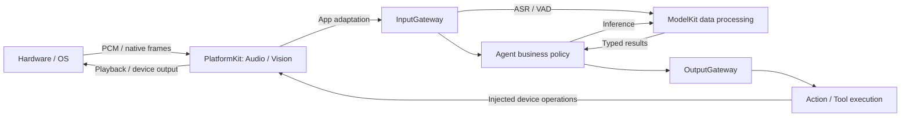

# PlatformKit — Device Input and Output Capabilities

Purpose: expose operating-system and hardware capabilities through public platform APIs. Design goals: organize by capability domain, own device lifecycles and permissions, and deliver bounded input/output without model inference or Agent business decisions.

## Directory rules

Both PlatformKit and ModelKit organize domain capabilities beneath their own layer. PlatformKit owns device input/output; ModelKit transforms data through model capabilities. Domain names describe each layer's scope: PlatformKit Audio includes microphone and speaker I/O, while ModelKit Speech includes ASR/TTS/VAD. Matching principles do not require identical directory names or dependencies between the layers.

| Directory | Current ownership |
| --- | --- |
| [Audio](Audio/README.md) | Microphone capture, speaker playback, shared audio-session setup and continuous PCM conversion |
| [Vision](Vision/README.md) | Camera acquisition, preview source, native image frames and gray sampling |
| [Connectivity](Connectivity/README.md) | External-device transport contract; no concrete transport yet |
| [Core](Core/README.md) | Cross-domain capability and authorization contracts |

Core is the explicit shared-contract exception to domain grouping, like ModelKit/Core. Keep small domains flat; introduce device subdirectories only when actual implementations need them. Do not mix individual devices such as Camera or Microphone with domain directories at the top level. Keep existing implementation names such as AppleAudioIO and AppleCamera; directory grouping does not require artificial device wrappers.

## Data and dependency boundaries

The arrows show logical data flow, not imports. App supplies adapters and callbacks; ModelKit and PlatformKit do not depend on each other.

External inputs and tool results enter InputGateway; Agent outputs pass through OutputGateway. Device authorization and availability are checked at execution. Robot safety requires device-side enforcement, independent of iOS background execution.

## Implementation status

- ✅ Audio capture/playback and continuous PCM conversion with explicit stream and playback bounds.
- ✅ Vision capture, front/back switching, native preview and capacity-one latest-frame delivery with gray64 samples.
- ✅ Core permission interfaces and Connectivity transport interface retained without API changes.
- ❌ Concrete BLE/network/robot adapters, recording and sustained physical-device acceptance.

Maintain each domain README when changing ownership, lifecycle, bounds or directory layout. See [technical architecture](../README.md) and [layout audit](../../docs/Repository-Structure.md).
