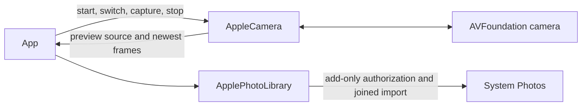

# Platform Camera and Photo I/O

## Summary

Acquire camera preview, transport immutable native frames, capture one JPEG and import bounded JPEG data into Photos.

## Ownership and boundaries

AppleCamera owns AVCaptureSession mutation on its actor. App owns foreground intent, preview geometry and failure presentation. This directory performs no model inference, pose policy or audio capture.

## External relationships and data flow

Runtime arrows show data or capability calls; dashed arrows show injection.

## Graph and preview

The graph has one front/back wide-angle input, up to 720p video and one JPEG output. It has no microphone/movie output and disables application audio-session auto-configuration. `CameraPreviewSource` exposes attachment to a native preview layer, without session mutation. App selects aspect-fill, mirroring and display rotation.

A healthy `switchCamera(facing:)` replaces only the input inside begin/commit configuration, restores the old input on admission failure, drains/renews the frame stream and reapplies unmirrored sensor settings. It does not restart the session. Permission, running state and no photo in flight are required. Stop closes frames; interruption/error notifications use newest-one status storage.

## Frame contract

Serial AVCaptureVideoDataOutput discards late frames. `CameraFrame` retains private read-only BGRA pixels, upright dimensions, rotation quarter-turn, sequence, media time, monotonic callback instant and a 64×64 gray sample. Consumers use synchronous `withPixelBuffer`; pointers must not escape or mutate storage. The unchecked Sendable wrapper protects lifetime, not arbitrary mutation.

The capacity-one newest stream replaces obsolete observations. A mutex fences stream generation; cancellation affects only its matching generation, and replacement drains the delegate queue. Frames beyond 4096 per side or 4194304 pixels fail. `CameraGraySampler` samples through inverse rotation directly from native pixels, without full-frame rotation/resize or a task per frame. Callback-to-result latency excludes sensor exposure latency.

## Photo lifecycle

One active photo delegate has a ten-second terminal bound. Cancellation checks occur again before native request. Native callbacks are joined before delegate release; old callbacks cannot complete a new photo. Nonempty JPEG is limited to 4 MiB; native shutter behavior is preserved.

`ApplePhotoLibrary.saveJPEG` performs add-only authorization and bounded PHAsset creation. It checks cancellation before authorization and commit. Once issued, import is joined and cannot be rolled back by caller cancellation. It returns technical permission/image failures; photo selection/export receipts belong to App.

✅ Foreground camera, native preview/frame transport, healthy input switch, JPEG capture and Photos import.

❌ Movie recording and background capture. Physical camera/permission/latency evidence is tracked in [validation history](../../../docs/Validation-History.md).

## Related design

[Parent design](../README.md)
