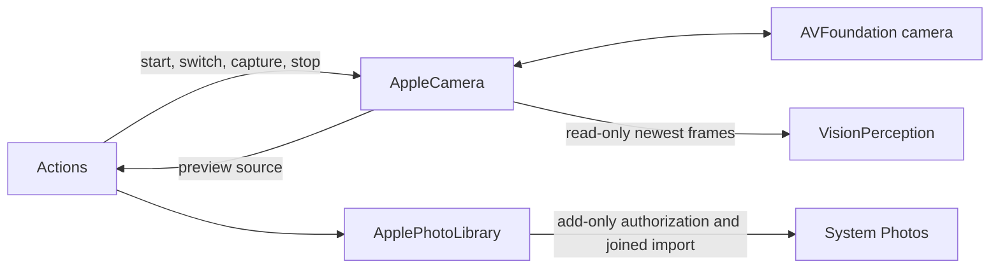

# Platform Camera and Photo I/O

## Summary

Acquire camera preview, transport immutable native frames, capture one JPEG and export bounded photo resources into Photos.

## Ownership and boundaries

Photo capture uses AVCapturePhotoOutput's built-in shutter sound with its default suppression disabled. No synthetic sound is layered over it; audibility remains subject to system sound/silent settings. The shared audio setup permits system sounds during microphone recording. This is not an assertion that a particular device produced audible feedback. See Apple's [recording sound policy](https://developer.apple.com/documentation/avfaudio/avaudiosession/setallowhapticsandsystemsoundsduringrecording(_:)).

AppleCamera owns AVCaptureSession mutation on its actor. Actions owns foreground capture demand and failure policy; UI owns display projection. This directory performs no model inference, pose policy or audio capture.

## External relationships and data flow

Runtime arrows show data or capability calls; dashed arrows show injection.

## Graph and preview

The graph has one front/back wide-angle input, the photo session preset, bounded preview video and one JPEG output. It has no microphone/movie output and disables application audio-session auto-configuration. CameraCaptureOrientation supplies capture rotation independently of UI. UI owns image/pose crop and mirroring in the same render pass.

A healthy `switchCamera(facing:)` replaces only the input inside begin/commit configuration, restores the old input on admission failure, drains/renews the frame stream and reapplies unmirrored sensor settings. It does not restart the session. Permission, running state and no photo in flight are required. Stop closes frames; interruption/error notifications use newest-one status storage.

## Frame contract

Serial AVCaptureVideoDataOutput discards late frames. `CameraFrame` retains private read-only BGRA pixels, upright dimensions, rotation quarter-turn, sequence, media time, monotonic callback instant and a 64×64 gray sample. Consumers use synchronous `withPixelBuffer`; pointers must not escape or mutate storage. The unchecked Sendable wrapper protects lifetime, not arbitrary mutation.

The capacity-one newest stream replaces obsolete observations. A mutex fences stream generation; cancellation affects only its matching generation, and replacement drains the delegate queue. Frames beyond 4096 per side or 4194304 pixels fail. `CameraGraySampler` samples through inverse rotation directly from native pixels, without full-frame rotation/resize or a task per frame. Callback-to-result latency excludes sensor exposure latency.

## Photo lifecycle

One active photo operation owns native capture and any required encoding. The native delegate has a ten-second terminal bound; processing and terminal errors retain their original error identity, and only the terminal callback resumes the caller. Cancellation checks occur again before native request. Native callbacks are joined before delegate release; old callbacks cannot complete a new photo. After native completion, a JPEG within 4 MiB is returned unchanged. A larger JPEG is accepted only up to 32 MiB, 4096 per side and 16777216 pixels, then prepared through the same bounded Image I/O encoder to at most 4 MiB. This is one shutter operation; there is no retry capture. Oversized preparation normalizes EXIF orientation without cropping, trying quality adjustments before reducing dimensions. Unchanged originals retain metadata; re-encoded images retain the displayed image but do not copy source metadata. The encoding worker stays inside photoTask and is cancelled and joined. The native capture deadline does not stop a completed capture during encoding; cancellation in that phase does not stop shared preview. Explicit stopAndWait still stops the device and joins the entire operation.

`ApplePhotoLibrary.savePhoto` validates JPEG/HEIC/PNG up to 32 MiB/100 million pixels, then performs add-only authorization and PHAsset creation with the actual file format. `saveJPEG` retains its 4 MiB compatibility bound. It checks cancellation before authorization and commit. Once issued, import is joined and cannot be rolled back by caller cancellation. It returns technical permission/image failures; photo selection/export receipts belong to Actions.

Foreground camera, native preview/frame transport, healthy input switch, JPEG capture and Photos import.

## Related design

[Parent design](../README.md)

## Native image compression

NativeImageCompression.swift exposes async jpeg(from:limits:) and caller-owned dimension/pixel/byte limits. Image I/O creates a transformed thumbnail directly from encoded data with source caching disabled, then encodes JPEG from the reduced CGImage. This avoids a full-size UIImage decode/redraw and keeps output oriented, aspect-preserving and unscaled above source size. One detached task runs outside MainActor; cancellation is checked before/after native work and between bounded attempts, and the parent always joins it. There is no queue or persistent cache.

Input is one JPEG/PNG with explicit InputLimits: the default remains 4 MiB, 65535 per side and 268435456 pixels; explicit requests may admit at most 32 MiB and tighten the dimension/pixel limits. Camera uses 32 MiB, 4096 per side and 16777216 pixels for its native encoded output only; other callers retain their existing input budgets. Upright JPEG data already within all budgets is reused without decoding/re-encoding; output uses at most four descending thumbnail sizes and three quality attempts per size (initial quality then bounded lower qualities). Native failures and exhausted byte budgets throw; preparation errors never fall back to oversized/untransformed originals. Each attempt releases intermediate allocations through autoreleasepool. Pixels/bytes must satisfy the caller budget. Original input Data is immutable and never written.

[Apple memory guidance](https://developer.apple.com/documentation/xcode/making-changes-to-reduce-memory-use) recommends Image I/O transforms to minimize image memory impact; [thumbnail API](https://developer.apple.com/documentation/imageio/cgimagesourcecreatethumbnailatindex(_:_:_:)) supports bounded native downsampling/orientation, and [destination API](https://developer.apple.com/library/archive/documentation/GraphicsImaging/Conceptual/ImageIOGuide/ikpg_dest/ikpg_dest.html) supports JPEG quality selection. No claim that JPEG encoding always runs on a GPU or is the fastest on every device; native latency/quality acceptance remains separate.

✅ CameraVisionRestartWorkflow 是泛型的最新意图替换工具：一个 pending 值、一个切换 worker、一个活跃任务；替换取消旧任务并加入后启动最新意图。stop 清空 pending、取消并加入旧任务；不选择摄像头、感知模型或业务反馈。

## 待实现

- Movie recording and background capture. Physical camera/permission/latency evidence is tracked in [validation history](../../../docs/validation/Validation-History.md).

## UI 容器与相机能力注入

✅ 新增跨平台可替身的 CameraCapturing 原生接口与相机枚举/错误；AppleCamera 实现权限、帧订阅、启停、切换、照片、状态、事件和拍照方向能力。接口无 UI/业务依赖，静态权限方法保留原有原生入口，Coordinator 使用实例接口。

## Direct container contract

Native data/observation capabilities remain independent of business and transport modules. Capture control stays with execution owners; read-only observation never requests permission or opens a device. Current cross-module ownership is defined by the [overall design](../../README.md).

## 基础相册实施契约

✅ 提供有界原生照片检查、缩略图和格式保持的Photos资源导出；JPEG／HEIC／PNG，32MiB／100百万像素，add-only权限，提交后等待真实完成。

## Passive native authorization facts

NativeVisionAuthorization queries camera and Photos add-only/read-write statuses without requesting permission, starting a camera or presenting a picker. PlatformContainer collects these with the other permission facts at start, permission-operation completion and foreground resume. VisionContainer and the native State port read that shared resident sample; they do not query authorization while serializing State. Denied/restricted/notDetermined/limited are observed values; they do not become a business execution grant. Each actual camera/photo operation continues to enforce current platform permissions under its own lifecycle.

## Passive state observation

The owning stateSnapshot entry point reads current local business/capability values and runtime admission/work facts in the owner's isolation domain. It performs no action, acquisition or device activation. The module root composes the explicitly selected fields; unknown diagnostic coverage is not healthy evidence. Domain-specific completion and failure contracts above remain authoritative.

State classifies authorization as Business; camera allocation, import task existence and admission as Runtime.

Permission State projections read cached observations only. Unavailable owner scope remains unknown; an admitted cached-source/schema failure propagates through the standard throwing snapshot method instead of being converted to unknown.

## Capture and preview orientation

CameraFrame.rotation/width/height and gray64 describe the gravity-upright observation used by perception. JPEG capture retains the precise horizon-level capture angle. During native camera graph configuration on iOS 27, RotationCoordinator.videoRotationAngleRelative(toDeviceOrientation: .portrait) supplies a separate sensor-to-portrait quarter-turn reference, published as optional CameraFrame.portraitRotation alongside the existing immutable frame. The reference is captured under the same frame-state mutex/generation as rotation, never inferred from the device's current physical pose. This avoids treating gravity-level capture as fixed-interface preview geometry. Lens changes bind the new camera reference before starting the replacement stream. Older SDK clients without the static API publish nil and retain their original upright-frame contract; the complete app requires iOS 27. No pixel copy, capture connection rotation, second stream or per-frame Task is added. UI owns the interface-to-preview transform.

## Native geometry and authoritative Camera facts

AppleCamera configures unrotated, unmirrored video and explicitly enables native preview-sized buffers after disabling automatic buffer-size configuration. It requests BGRA without custom width/height keys: AVFoundation owns preview downscaling and its active-format/orientation constraints. It reads the resulting native preview and source dimensions after configuration, using dynamicDimensions for formats supporting dynamic aspect ratio and formatDescription otherwise; CameraOutputDimensions requires positive dimensions, matching source aspect up to the native output’s quarter-turn orientation, at most 4096 per preview side and 4194304 preview pixels. Photo dimensions select the smallest supported size with that aspect and no side above 4096. Missing dimensions, incompatible aspect or exceeded budgets fail configuration explicitly. Start and healthy lens switch use the same configuration path. Preview stabilization is disabled to avoid a video-only field-of-view crop. JPEG uses the selected maxPhotoDimensions, native capture rotation and front-lens mirroring, retaining the 4 MiB output limit. No full-resolution continuous BGRA or synthetic image stretching is used.

CameraHardwareSnapshot is resident native state protected by a mutex. Graph operations and native interruption/error callbacks update phase, actual running, actual input facing and selected photo dimensions. VisionContainer.cameraStateSnapshot projects this into platform.vision.camera without creating AppleCamera, querying hardware or performing effects. An uncreated camera is stopped with unknown facing/dimensions. platform.vision indexes the child; PlatformContainer registers its exact reader. UI/Actions intent does not determine these facts.

One capture receiver broadcasts immutable frames to independent read-only subscribers, while the primary stream feeds presentation. Stopping a subscriber does not stop the device; only explicit native control does. Business demand and lens priority remain outside this module.

Photo settings request native JPEG quality 0.85 using AVVideoCompressionPropertiesKey/AVVideoQualityKey, as supported by the SDK's AVCapturePhotoSettings format contract. The 4 MiB returned-image bound remains strict. Native codec quality is not a byte-size guarantee, so cameraPhotoJPEG performs bounded preparation when the native image exceeds that bound; invalid input or exhausted encoding budgets fail explicitly.

The native preview configuration follows [Apple preview-buffer documentation](https://developer.apple.com/documentation/avfoundation/avcapturevideodataoutput/deliverspreviewsizedoutputbuffers) and [videoSettings constraints](https://developer.apple.com/documentation/avfoundation/avcapturevideodataoutput/videosettings). Invalid custom width/height can throw an Objective-C exception outside Swift error handling; the capability does not pass those keys. Frame admission independently enforces the same preview pixel budget.

In -direct-input-diagnostics mode, photo callbacks report processing/terminal error domains and codes, dimensions, and input/output byte counts only. Photos are never written or logged by this diagnostic path.
