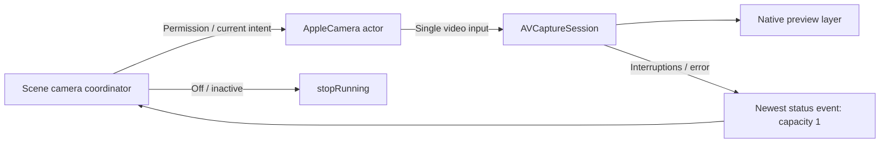

# Vision — Platform Visual Input and Output

Purpose: acquire a foreground camera for local preview and bounded native frame delivery. Design goals: actor-owned hardware state, public AVFoundation APIs, explicit authorization and no audio-session interference.

✅ AppleCamera configures one wide-angle front/back input at up to 720p. Session start, stop and configuration run on its actor, never MainActor. Switching restores the old input if replacement cannot be added; the caller stops the session on failure. No microphone input or photo/movie output is added, and application audio-session auto-configuration is disabled.

✅ CameraPreviewSource is a narrowly scoped Sendable bridge: its private session is mutated exclusively by AppleCamera, while MainActor only attaches it to AVCaptureVideoPreviewLayer. Preview connection mirroring and rotation are presentation concerns. The wrapper does not expose session mutation to consumers. Native preview does not create an application frame queue.

## Lifecycle and bounds

The App coordinator admits one hardware transition at a time and coalesces pending UI preferences to the latest desired state; this is not an Agent command queue. Three notification observers feed one newest-status stream (capacity 1, older status notifications replaced). Interruption end requests reconciliation; runtime failures expose an explicit retry. Scene exit joins stop. AVFoundation owns native buffers; retained read-only native samples leave through the bounded frame stream.

✅ Camera authorization, unavailable-device failures, start/stop, front/back switching and interruption reporting.
❌ Recording, background capture and physical-device continuous camera/audio acceptance.

Implementation reference: [Apple AVCam](https://developer.apple.com/documentation/avfoundation/avcam-building-a-camera-app) for actor-isolated capture and native preview, and [RotationCoordinator](https://developer.apple.com/documentation/avfoundation/avcapturedevice/rotationcoordinator) for preview orientation.

## Native frame delivery for perception

✅ AVCaptureVideoDataOutput supplies unmirrored sensor-orientation BGRA buffers on a serial delegate queue, with alwaysDiscardsLateVideoFrames. CameraFrame retains the native buffer read-only and carries width/height in upright coordinates, a rotation quarter-turn, sequence/time and a 64×64 gray sample. CameraGraySampler samples directly from the original buffer using inverse rotation and the same integer RGB luminance weights. No full-frame resize, rotation or RGB materialization is performed in the camera callback.

✅ A short lock owns continuation/sequence/generation. Native frame references are retained in the capacity-one newest stream and bounded downstream inputs/actions; replacement and teardown release references. AVFoundation cannot recycle a retained buffer. Consumers must not mutate it or retain mutable pointers. The narrowly scoped unchecked Sendable wrapper exposes synchronous read-only access; native storage lifetime is explicitly longer than the callback now.

✅ Stop closes the stream, restart drains the delegate queue before replacing it, and cancellation clears only the matching stream generation. No task per camera frame. Frames over 4 megapixels / 4096 per side fail explicitly. No unbounded native-buffer cache is introduced.

❌ Sustained camera-buffer pool pressure, thermal behavior and device alignment after Vision migration remain acceptance work. Grayscale values can differ from the former resize-then-sample pipeline even though thresholds/baseline rules are unchanged.

The Vision directory is a capability domain, distinct from Apple’s Vision framework. It owns camera I/O and frame adaptation; model preprocessing/inference belongs to ModelKit/Vision and its backends, frame-change admission and pose decisions belong to VisionPerception. future camera-motion policy is a [Photographer proposal](../../../docs/Photographer-Proposal.md). Camera files remain flat until multiple device implementations justify subdirectories.

✅ Responsibility audit: native preview binding remains here, while resizeAspectFill is selected by App/Adapters/CameraPreviewAdapter. Camera capture/frame conversion are device capabilities; overlay content, view layout and perception decisions are outside PlatformKit.

✅ CameraFrame carries a ContinuousClock capture-callback instant alongside its unchanged media presentation timestamp. It measures callback-to-consumer latency without assuming media and host clocks share an epoch. ❌ Sensor exposure latency is not measured.

✅ CameraFrame retains private native pixel storage and an internal device-side initializer; consumers use withPixelBuffer. VisionPerception builds ModelKit input after admission, while App transports the capture without inference conversion. ❌ No ModelKit or Types dependency is introduced.
