# MobileHarness Technical Design

MobileHarness is an Apple-native multimodal Agent system organized around **Signal → Cognition → Action**. Devices provide signals, Agents interpret them with model capabilities, and validated Actions or Tools produce observable effects.

This document is the project-level technical plan. It owns three views of the current system:

1. the overall architecture, dependency graph and source layout;
2. each module's responsibility and boundary;
3. cross-module protocols and end-to-end technical flows.

Module READMEs own implementation details, algorithms and local limits. Requirements, decisions, validation evidence and future work live under [`docs/`](../docs/README.md). This document describes only the latest technical design: update the existing section or add a responsibility-based subsection within Part I, II or III. Do not append ADR summaries, migration notes, change records or acceptance evidence here.

- [Part I — Overall Architecture](#part-i--overall-architecture)
- [Part II — Module Responsibilities](#part-ii--module-responsibilities)
- [Part III — Cross-module Technical Design](#part-iii--cross-module-technical-design)

## Part I — Overall Architecture

### System architecture

The system is divided into four groups. App is the composition root and lifetime owner; the other code modules remain independently testable and depend only toward lower-level contracts.

| Group | Modules | System role |
| --- | --- | --- |
| Host and interaction | App, UI | Assemble the process, own application/session lifetime and present state. |
| Cognition and coordination | Agents, AgentCore, Gateway | Interpret signals, retain cognitive state and validate communication/execution. |
| Behavior execution | Actions, Tools, ActionRuntime, ToolRuntime | Define concrete skills and execute trusted invocations. |
| Foundations | ModelKit, PlatformKit, Storage, Resources | Supply processing, device I/O, retained data and packaged artifacts. |

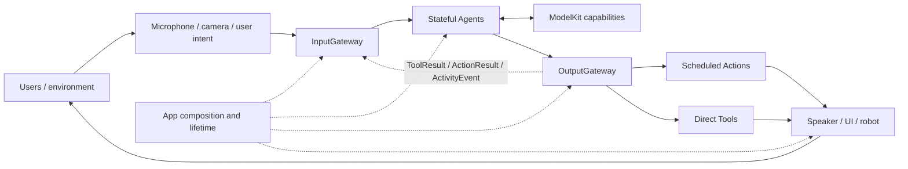

App assembles concrete implementations but is not a service locator. Long-lived owners receive role-specific dependencies. UI receives observable state and typed operations. Agents receive model/storage capabilities and bound Gateway ports. Actions and Tools receive only the capabilities required by their registered handlers.

### Coordination ownership

| Owner | Governing question | Responsibility |
| --- | --- | --- |
| App | What runs, and for how long? | Assemble, start, stop and clean up application/session scopes and their resources. |
| Agents | What should happen next, and why? | Interpret signals, retain cognitive state and express messages or permitted behavior. |
| Gateway | How may accepted work communicate and execute? | Enforce identity, permission, admission, ordering, wait, feedback and resource rules. |

Semantic fusion belongs to Agents. Gateway carries identities, contracts and destinations without interpreting observations or choosing business behavior.

### Composition and mediation boundaries

App composes the running system; Agents generate task behavior; Actions and Tools execute it; Gateway mediates Agent communication and execution. ModelKit and PlatformKit are foundational capability SDKs that may be injected into Agents, Actions or Tools when a concrete implementation requires them. The diagram expresses this allowed capability model; the compilation graph in the next section records the dependencies used by the current implementation.

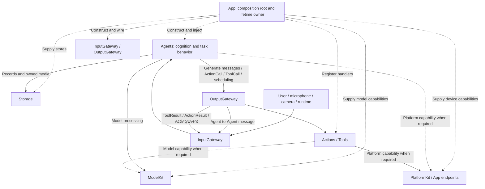

- **App assembles and owns lifetime.** It constructs Agents, Gateways, behavior registries, workflows and shared services, then injects role-specific interfaces. It does not become a global container that modules query at runtime.
- **Agents generate behavior.** They interpret input, use injected foundational capabilities and emit resolved Agent messages, `ActionCall`, `ToolCall` and scheduling controls through OutputGateway. The current Agents target uses ModelKit and StorageAudio/StorageChat; the architecture also permits a scoped PlatformKit capability when an Agent has a concrete need.
- **Actions and Tools execute behavior.** Either may use injected ModelKit or PlatformKit capabilities required by its contract. Current Actions uses PlatformKit; current Tools uses neither SDK and operates through App-bound endpoints. Adding a dependency requires a concrete implementation need and must preserve the Runtime targets' independence.
- **Gateway mediates Agent boundaries.** External input, Agent-to-Agent messages, generated Action/Tool calls, Tool results and Action/runtime feedback cross Gateway validation. Gateway does not mediate ordinary ModelKit, PlatformKit or Storage capability calls, nor App/UI feature-workflow operations.
- **Observable Agent-selected effects remain explicit.** An Agent may use foundational capabilities internally, but device commands, presentation changes and other complete business effects selected by the Agent are emitted as permitted Actions or Tools. App lifecycle code may use PlatformKit directly for host-owned capture, preview and connection workflows.

### Compilation dependencies

The graph below shows the principal project targets. System frameworks, concrete model backends and the `BehaviorDefinitions` compiler plugin are condensed for readability.

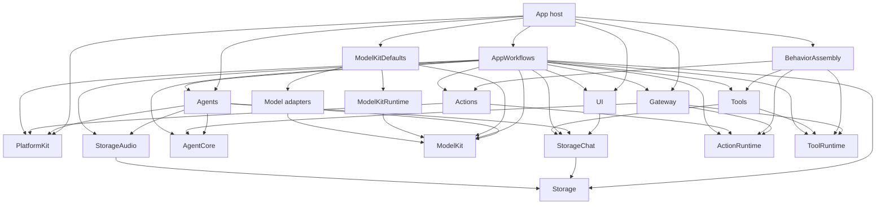

The `AppWorkflows` node is a facade over six independent feature targets; its summarized arrows are the union of those targets. `ActionRuntime`, `ToolRuntime`, `Storage` and `AgentCore` have no project dependencies. Gateway depends on execution contracts, never concrete Actions or Tools. Base ModelKit and PlatformKit have no project dependencies and own their input/output types. Agents adapts across their boundaries.

<a id="37-project-structure"></a>
<a id="project-structure"></a>

### Source structure and compilation map

```text
MobileHarness/
├── App/                         # Host composition, lifecycle and adaptation
│   ├── Composition/             # AppAssembly and runtime/model assembly
│   │   └── Behaviors/           # Independent BehaviorAssembly target
│   ├── Lifecycle/               # Voice/camera/application lifetime owners
│   ├── Workflows/               # State-free facade plus feature workflow targets
│   │   ├── Settings/
│   │   ├── History/
│   │   ├── Bluetooth/
│   │   ├── Speech/
│   │   ├── Presentation/
│   │   └── Diagnostics/
│   └── Adapters/                # Presentation, media and native preview bridges
├── UI/                          # Independent MainActor state, pages and controls
├── Agents/
│   ├── Communication/          # Domain message schemas and built-in identities
│   ├── Core/                    # Independent AgentCore target
│   │   ├── Input/               # Generic audio/image input transport
│   │   ├── Runtime/             # Registry, manager and lifecycle contracts
│   │   ├── Capability/          # JSON declarations and permissions
│   │   ├── Generation/          # Function Token, Channel/wait and Tool parsers
│   │   ├── Output/              # Resolved calls and trusted envelopes
│   │   └── Communication/       # Typed messages and routing contracts
│   ├── ConversationMemory/      # Structured history refresh
│   ├── Assistant/
│   ├── SpeechPerception/
│   ├── SpeechSynthesis/
│   ├── VisionPerception/
│   └── Photographer/
├── Gateway/
│   ├── Input/                   # External/internal admission and delivery
│   └── Output/                  # Validation, routing, scheduling, results/resources
├── Actions/
│   ├── Runtime/                 # Independent ActionRuntime and Contracts
│   ├── NexArm/
│   ├── Speech/
│   └── UI/
├── Tools/
│   ├── Runtime/                 # Independent ToolRuntime and Contracts
│   ├── History/                 # Read-only paged conversation queries
│   ├── System/
│   ├── Camera/
│   ├── Robot/
│   └── UI/
├── Storage/
│   ├── Audio/                   # StorageAudio: transient PCM ownership
│   └── Chat/                    # StorageChat: conversation journal
├── ModelKit/
│   ├── Core/                    # Capability and media contracts
│   ├── Management/              # ModelKitRuntime
│   ├── Defaults/                # ModelKitDefaults assembly
│   ├── Language/                 # Language capability and adapters
│   ├── Speech/                   # Speech capabilities and adapters
│   ├── Vision/                   # Vision capability and adapters
│   └── Backends/                # Engine and resource acquisition targets
│       └── HuggingFace/         # ModelKitHub: concrete Hub SDK adapter
├── PlatformKit/
│   ├── Core/                    # Boundary documentation; no compiled placeholder
│   ├── Audio/                   # OS audio capture and output
│   ├── Vision/                  # Camera capture and native preview
│   └── Connectivity/            # Links, protocols and device feedback
└── Resources/                   # Privacy, assets and local model profiles

Tests/                           # Root module and integration tests
Package.swift                    # Shared-source target map
Config/                          # Shared build configuration
scripts/                         # Checks, builds and provisioning
MobileHarness.xcodeproj/         # App/framework schemes and navigation
```

Directory nesting expresses ownership; `Package.swift` defines the actual compilation boundaries. Shared source has one owner and is not duplicated into another package tree.

### Target map

| Source path | Target | Direct project dependencies |
| --- | --- | --- |
| `App/` excluding package-owned subtrees | Xcode App targets | Host composition, adapters and lifecycle dependencies |
| `App/Composition/Behaviors/` | BehaviorAssembly | Actions, Tools, ActionRuntime, ToolRuntime |
| `App/Workflows/` facade | AppWorkflows | Six feature workflow targets |
| `App/Workflows/Settings/` | AppSettingsWorkflow | UI, Storage |
| `App/Workflows/History/` | AppHistoryWorkflow | UI, StorageChat, AgentCore, Agents, Gateway, Tools, ToolRuntime (staged intent transport) |
| `App/Workflows/Bluetooth/` | AppBluetoothWorkflow | UI, AgentCore, Storage, Actions, ActionRuntime, PlatformKit |
| `App/Workflows/Speech/` | AppSpeechPlayback | ActionRuntime, StorageAudio |
| `App/Workflows/Presentation/` | AppPresentationWorkflow | UI, AgentCore, ActionRuntime, ToolRuntime |
| `App/Workflows/Diagnostics/` | AppDiagnosticWorkflow | UI, ModelKit, PlatformKit |
| `UI/` | UI | StorageChat |
| `Agents/Core/` | AgentCore | None |
| `Agents/` excluding `Core/` | Agents | AgentCore, ModelKit, PlatformKit, StorageChat, StorageAudio |
| `Gateway/` | Gateway | AgentCore, ActionRuntime, ToolRuntime |
| `Actions/Runtime/` | ActionRuntime | None |
| `Actions/` excluding `Runtime/` | Actions | ActionRuntime, PlatformKit, BehaviorDefinitions |
| `Tools/Runtime/` | ToolRuntime | None |
| `Tools/` excluding `Runtime/` | Tools | ToolRuntime, BehaviorDefinitions, StorageChat |
| `Storage/` core | Storage | None |
| `Storage/Chat/` | StorageChat | Storage |
| `Storage/Audio/` | StorageAudio | Storage |
| `PlatformKit/` | PlatformKit | None |
| ModelKit shared capability sources | ModelKit | None |
| `ModelKit/Management/` | ModelKitRuntime | ModelKit |
| `ModelKit/Defaults/` | ModelKitDefaults | ModelKit, ModelKitRuntime, registered adapters |
| `ModelKit/Speech/VAD/Energy/` | ModelKitEnergy | ModelKit |
| `ModelKit/Backends/HuggingFace/` | ModelKitHub | ModelKitRuntime, HuggingFace product |
| ModelKit adapters/backends | Separate targets | ModelKit or engine-specific backend targets |

### Architectural boundaries

- App owns concrete assembly, adaptation and application/session lifetime. Feature workflows expose typed operations and retain no global container access.
- UI imports only StorageChat domain values and owns presentation values. It does not import App, Agents, Gateway, Actions, Tools, ModelKit or PlatformKit.
- AgentCore is independent of concrete Agents, UI, model engines and device adapters.
- All external inputs, Tool results and Action/runtime feedback enter through InputGateway; all Agent messages and executable outputs leave through OutputGateway.
- Actions owns business behavior, motion shaping, composition and completion policy. PlatformKit owns native I/O, protocol encoding, hardware limits and device feedback.
- ActionRuntime and ToolRuntime own neutral execution contracts. Gateway owns scheduling, admission, result routing and shared resource coordination.
- ModelKit is a capability SDK. Provider registration/default selection belongs to ModelKitDefaults; process-wide model ownership belongs to ModelKitRuntime.
- AgentCore/Input owns generic input transport; UI owns presentation values. Storage owns lifetime and retention, not inference or business policy.

✅ The current source graph implements the independent runtime, workflow, UI, AgentCore, ModelKit, PlatformKit, Storage boundaries shown above.

❌ Unimplemented architecture extensions and physical acceptance work are tracked in the [Roadmap](../docs/Roadmap.md).

## Part II — Module Responsibilities

This section is an architectural directory. It describes why each module exists and where its responsibility ends; linked module documents contain local structure and implementation details.

| Module | Responsibility | Boundary | Biological analogy |
| --- | --- | --- | --- |
| [App](App/README.md) | Assemble concrete capabilities and coordinate application, voice and camera lifetime. | Adapts modules and owns workflows; does not absorb Agent, Action or device business rules. | The organism coordinating its organs. |
| [UI](UI/README.md) | Render conversation, camera, settings and diagnostics; convert gestures into typed operations. | MainActor presentation only; pages do not own long-lived model/device sessions. | Face and interaction surface. |
| [Agents](Agents/README.md) | Interpret observations, use processing/storage capabilities and select permitted outputs. | Cognitive state and policy; executable effects always cross OutputGateway. | Specialized brain regions. |
| [AgentCore](Agents/Core/README.md) | Define Agent identity, input/output, capability, communication and lifecycle contracts. | Stable independent vocabulary; no concrete cognition or host services. | Organization of the nervous system. |
| [Gateway](Gateway/README.md) | Validate input/output, route messages, schedule Actions and coordinate results/resources. | Coordination only; no inference or domain behavior implementation. | Neural pathways and motor coordination. |
| [Actions](Actions/README.md) | Implement scheduled speech, expression and NexArm behavior. | Owns business parameters and completion policy; consumes injected native capabilities. | Learned motor skills. |
| [ActionRuntime](Actions/Runtime/README.md) | Register and execute trusted Action invocations. | Neutral execution contracts; Channel/wait policy remains in Gateway. | Motor execution machinery. |
| [Tools](Tools/README.md) | Implement direct System/UI/Camera/Robot functions with declared result semantics. | Current domains use injected endpoints and have no UI or PlatformKit import. | Immediate reflexes and focused functions. |
| [ToolRuntime](Tools/Runtime/README.md) | Register and execute trusted Tool invocations. | No concrete Tool domain, Agent, UI or hardware dependency. | Direct function execution machinery. |
| [ModelKit](ModelKit/README.md) | Expose typed speech, language and vision processing capabilities. | Base SDK knows neither Agent policy nor device I/O; engines live in adapters/backends. | Recognition and generation machinery. |
| [PlatformKit](PlatformKit/README.md) | Capture/output media, manage links and expose native commands/feedback. | Device SDK only; no gestures, model inference, localization or workflow policy. | Sensory organs and effectors. |
| [Storage](Storage/README.md) | Provide bounded transient storage and durable local records. | StorageAudio owns PCM handles; StorageChat owns conversation records; no routing or inference. | Short- and long-term retained material. |
| [Resources](Resources/README.md) | Hold privacy declarations, assets and local model profiles/artifacts. | Packaging input supplied by App; no runtime ownership. | Materials consumed by the organism. |

### Key internal module groups

**App.** [Composition](App/Composition/README.md) builds the graph and validates registrations. [Lifecycle](App/Lifecycle/README.md) owns long-running voice/camera work and cleanup. [Workflows](App/Workflows/README.md) is a state-free facade over independent Settings, History, Bluetooth, Speech, Presentation and Diagnostics targets. [Adapters](App/Adapters/README.md) translate module contracts to host capabilities.

**Agents.** AgentCore supplies the common runtime and protocol vocabulary. Assistant owns conversation and response policy; SpeechPerception owns VAD/ASR interpretation; SpeechSynthesis owns directed text-to-PCM work; VisionPerception owns pose interpretation and its bounded latest-state presentation outputs. Each Agent's JSON v5 file declares model-callable capabilities and communication permissions.

**Behavior.** Actions are scheduled, ordered skills with a completion boundary. Tools are direct calls with either a returned value or completion-only semantics. Their independent Runtime targets keep Gateway free from concrete behavior catalogs. BehaviorAssembly binds explicit domain modules without importing AgentCore.

**Foundations.** ModelKit separates capability contracts, process-wide management, default assembly and engine adapters. PlatformKit separates native I/O from business behavior. Storage separates reusable mechanisms from Chat and Audio domains. ModelKit, PlatformKit and StorageAudio own their separate capability/storage contracts.

<a id="part-iii--key-techniques"></a>

## Part III — Cross-module Technical Design

This section owns the system-wide contracts that cannot be explained by one module alone.

### Composition, startup and lifetime

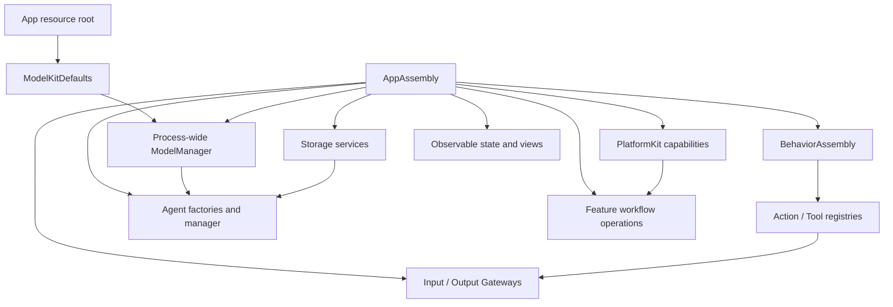

Composition resolves configuration and registration errors before producers start. Gateway validates that every declared internal or model-callable Action/Tool has a concrete implementation. Production uses one process-wide ModelManager and shared stores where identity must cross modules.

Voice and camera have independent App-owned sessions. A stop closes producer admission, cancels and joins capture/perception, sends explicit Agent cancellation, retires owned media and Actions, and only then releases resources. Page navigation does not define runtime lifetime. Session IDs, Agent incarnations, turns and monotonic sequences fence stale input, feedback and presentation.

### Signal and media representation

Signal is the conceptual input abstraction; `AgentInput` is its implemented envelope. It separates payload from trusted source, contract/version, session, turn, sequence, capture time, incarnation, causal root/parent and admission deadline. Media streams are successive typed inputs rather than a second transport protocol. JSON v5 configures Agent capabilities and communication permissions; it is not the audio or image format.

| Payload | Meaning |
| --- | --- |
| Text / runtime event | User text or an explicit runtime control input. |
| Audio / image | Bounded PCM or an App-owned native-image attachment. |
| Perception observation | Typed transcript, speech phase or pose without the original media. |
| ToolResult | A returned Tool value correlated to its originating call and session. |
| ActionResult / ActivityEvent | Terminal execution feedback or a later activity observation with trusted ownership. |

App adapters bridge PlatformKit frames into AgentCore values/attachments without adding ModelKit or PlatformKit dependencies to AgentCore. Payload bounds and attachment lifetimes remain in the InputGateway and AgentCore communication contracts.

<a id="32-internal-agent-communication"></a>
<a id="communication-framework"></a>

### Input and Agent communication

Communication covers external input, Agent publications and directed messages, returning Tool results, and Action/runtime feedback.


JSON declares supported inputs, exact subscriptions, publications and directed sends. Supporting a contract does not create a subscription. Broadcast target selection uses subscriptions; directed delivery still validates source, target, contract and session. There are no dynamic listeners, wildcards or implicit fallback recipients.

Gateways perform bounded structured admission and metadata validation; their cross-actor calls are asynchronous and await per-target admission. Agent inboxes own pending work. Gateway has no independent message bus, persistent worker or delivery FIFO. A delivery receipt means the target accepted the input, not that inference or an effect completed. Discrete messages and device Actions are never silently replaced; only explicitly declared latest-state paths may coalesce.

#### Current signal routes

| Source | Contract | Receiver or observer |
| --- | --- | --- |
| `phone.microphone` | `media.audio` | SpeechPerception subscription |
| `phone.camera` | `media.image` | VisionPerception subscription |
| `user` | `user.text` | Assistant subscription; the current production UI has no text-entry field |
| `speechPerception` | `speech.final`, `speech.phase` | Assistant subscription |
| `speechPerception` | `speech.partial`, `speech.final`, `speech.phase` | Registered runtime observer for admission/lifecycle coordination, without UI mutation |
| `visionPerception` | `vision.pose` | Declared business subscribers; gaze and skeleton presentation use independent Tools |
| `runtime` | `tool.result`, `action.result`, `activity.event`, `runtime.event` (`assistant.cancel`) | Original or explicitly selected Agent/session |

Assistant sends directed `speech.synthesize` and `speech.cancel` messages to SpeechSynthesis. A publication with no Agent recipient fails unless a registered runtime observer accepts that contract. Agent messaging, Tool return and runtime Action feedback all re-enter through validated InputGateway paths, while retaining their distinct permissions and completion semantics.

### Communication and execution contract ownership

Domain ownership: Agents/Communication owns PoseObservation, SpeechPhase and SpeechSynthesisInput, Agents owns built-in identity constants, and Assistant owns automatic speech prompt policy. AgentCore has zero project dependencies; scheduler source identity is explicit. The communication contract provides generic message/schema registration. The business catalog owns domain expiry; App owns device-source/media expiry; VisionPerception owns sampling.

Core communication has one generic typed-message container and one immutable schema registry. Application schemas/identities are grouped in Agents/Communication/AgentContracts.swift, Agent-domain speech/pose values in Agents/Communication and image inputs in Agents/Core/Input/ImageInput.swift and presentation values in UI/Camera/PoseOverlay.swift, and native source/deadline conversion in App/Adapters/MediaInputAdapter.swift. AgentTurn is a generic interaction identity.

Neutral contract boundary: concrete resource names belong to App; reports carry bounded producer-owned details/error identifiers; text soft limits belong to the consuming Agent.

Execution Runtime owns generic bounded resources and failure/report identifiers only; NexArm and Bluetooth producers own domain vocabulary and classification.

### Capability declaration and output resolution


Model-callable Actions are grouped by Channel in JSON; native Tools use function declarations. Fixed internal behavior and permissions live in Agent code. Aliases are local to one Agent and resolve before Gateway admission. Gateway accepts only resolved paths and typed scheduling controls. App binds handlers explicitly; invalid configuration has no fallback registration.

Function Token is the Assistant's streaming mixture of natural text and restricted XML:

```xml
<express emotion="smile"/>
Hello.
<wait>
  <express emotion="thinking"/>
  Let me think.
</wait>
```

Natural text, Action tags, Channel scopes and nested wait groups are parsed incrementally. Text boundaries may create code-owned speech/caption calls; explicit tags resolve only through the declared catalog. Raw markup, incomplete structures and unresolved aliases never reach Gateway. Native Tool calls use the separate ToolCall parser.

### Action and Tool execution

| Dimension | ActionCall | ToolCall |
| --- | --- | --- |
| Resolution | Action path, arguments and effective Channel | Tool path and arguments |
| Dispatch | OutputGateway → ChannelScheduler → ActionRuntime | OutputGateway → ToolRuntime |
| Ordering | Task-local Channel FIFO and nested wait groups | Direct awaited execution; no Channel queue |
| Completion | Registered handler boundary plus task finish barrier | Returned value or completion-only, fixed at registration |
| Feedback | Optional correlated ActionResult and ActivityEvent | Returning ToolResult re-enters InputGateway |

Both may produce side effects and both can declare shared resources. Their difference is scheduling and feedback semantics.

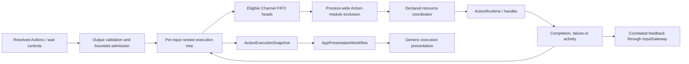

Each input owns a scheduling tree. Channels order work within that tree; equal names in other tasks do not create a global FIFO. A wait group joins its parent's preceding work and all children before releasing the continuation. Module exclusion is process-wide. Resource leases/fences coordinate Actions, Tools and App-owned paths across module boundaries. Capacity exhaustion rejects explicitly, and cancellation joins cooperative handlers.

Gateway reserves bounded terminal-feedback capacity before admitting an Action that requests feedback. `ActionResult` is correlated to the originating Agent incarnation/session and describes the handler's declared completion boundary; `ActivityEvent` reports later ongoing activity. Retrying feedback never repeats the effect. Separately, the scheduler publishes payload-free `ActionExecutionSnapshot` values for App/UI observation. Their display name comes from validated Action metadata, while raw arguments, device telemetry and permission decisions are excluded.

### Call failure and deadline semantics

Agents resolve model aliases. Unknown calls and invalid invocation parameters emit non-executable rejectedCall outputs and count against the 120-call bound; structural parsing failures and limits still terminate generation. Gateway retains these failures in its 256-entry output history without admitting rejected Actions to the scheduler.

Action handler reports preserve completed child entries and attach later exceptions/cancellation as an execution-level issue. Invocation lookup, argument and resource availability rejection remain local. Permission rejection, all ActionSchedulingError cases (including capacity/limits), communication identity failure and actual task cancellation still close the owning Action tree; execute records ordinary failures without automatically stopping the producer.

ToolExecutor converts ordinary exceptions and operation-local cancellation into ToolResponse errors. Function-defined Tool timeouts take precedence over the 30-second Runtime fallback; registration validates them in (0,86400] seconds. Action function budget resolvers likewise override a 30-second Runtime fallback, preserving NexArm dynamic estimates. Invalid explicit declarations fail rather than falling back. Timeout cancels and joins cleanup before returning; cancellation of the calling task propagates. Returning Tool feedback failures preserve value/isError/callID and add a bounded deliveryFailure copied into output.failure. Completion-only Tools never inject ToolResult input events.

Assistant records rejected native Tools when possible; failure to write that outcome produces a separate assistant.historyError result and preserves the original rejection. Conversation admission, raw history and terminal durability remain strict. See [result fields and failure boundaries](Gateway/Output/Results/README.md#outcome-fields-and-failure-boundaries).

### Resource control ownership and cleanup

ResourceCoordinator owns control rather than device health, with unlocked/locked(owner) snapshots from one holding index. Transient writers and persistent leases share ownership semantics; internal handoff is bounded. Stop errors after joined work unlock; timeout fails that request and actual late completion automatically unlocks, without replay. Revocable execution permits prevent stale held-context bypass at App entries. Cancelled cleanup still waits independently of its caller. Camera cleanup uses joined resource release. Action/Tool outcomes, Channel queues and Bluetooth recovery remain separate.

### Voice, cognition and presentation

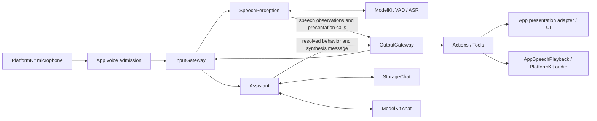

SpeechPerception converts admitted PCM into phase and transcript observations. Its Agent actor owns admission, utterance identity, phase transitions and reply gating; VoiceActivitySegmenter adapts VAD scores, SpeechBoundaryPolicy owns sample-count boundaries, internal SpeechRecognitionTurn owns ASR sessions, and internal TranscriptAccumulator owns revision merging.  Assistant reads bounded conversation context, streams chat generation, resolves behavior and persists completed turns. Recognition UI, reply UI and speech playback all use permitted outputs; runtime observers do not mutate presentation on an Agent's behalf.

`AgentTurn` and trusted output sequences travel through input, observations, calls and returned results. AppPresentationWorkflow admits only the active session/turn/sequence. Recognition previews may be replaced within their declared latest-state path; reply chunks and discrete behavior are preserved. Playback state reflects actual audio output rather than model generation completion.

### Speech capability selection and recognition

Nemotron recognition uses the shared multilingual/2240ms Core ML export through Management → Hub → App storage. The receipt fixes the installed revision; stale revisions prompt explicit deletion. ModelKitFluidAudio preloads shared graphs, the ASR adapter obtains a fresh recurrent session under one lease, ordered 16 kHz PCM produces bounded revisions, and finish/cancel drains native work before release. macOS and iOS use the same files.

Speech resource workflow: restore independent useCustomRecognition/useCustomSynthesis (defaults false; persisted choices require installation validation) → Defaults stable capability facades → installed/available local Nemotron/MOSS/Silero or Apple SpeechAnalyzer/AVSpeechSynthesizer/energy VAD → existing SpeechPerception endpoint → normal conversation. Disabled ASR/TTS choices select Apple speech independently and preserve weights; VAD selects installed available Silero regardless of those choices, otherwise Energy; Gemma 4 E2B/YOLO retain independent model selection. App stops voice before policy changes. Apple language assets are system-managed and may download during first warmup. ModelKitEnergy is the independent ModelKit-only VAD adapter; SpeechFallback.swift belongs to Defaults, not Management.

### Sound source direction and capture readiness

PlatformKit preserves native mono or ACN/SN3D FOA PCM and hardware capture time. App passes channel layout and PCM through the generic AudioInput; SpeechPerception alone calculates dominant acoustic direction and extracts W for 16 kHz ASR. sound.source/1 is a 500 ms latest-state observation through OutputGateway→InputGateway. It uses captured sound-field coordinates and contains no motor/camera command. Mono remains available for ASR; direction is unavailable there. Reply admission is independent of direction publication, and Photographer does not subscribe.

Native capture startup is committed by first validated PCM delivery. FOA uses AVCaptureSession microphone configuration; unsupported or failed startup closes the spatial graph before mono retry, with a 3-second first-frame bound for each backend. No running stream silently changes channel layout. The host shows listening after readiness and clears that phase/spectrum on capture failure.

PlatformKit queries the native AudioBufferList size before extracting PCM, within storage for at most four buffers; four interleaved FOA channels occupy one buffer. Retained block storage lives through synchronous conversion, and native query/extraction failures preserve OSStatus. Native layout, PCM format and timeline validation still precede App/Gateway admission.

### Session, turn and UI boundaries

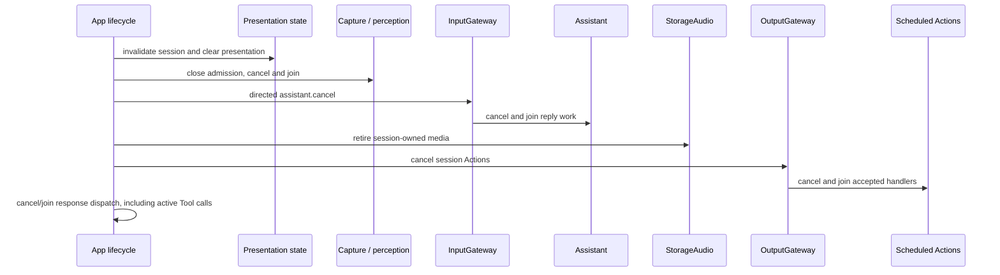

| Boundary | Recognition caption | Reply / expression |
| --- | --- | --- |
| Confirmed new utterance | Latest partial replaces the preview | Assistant clears once through `beginReplyTurn` |
| Endpoint reached, ASR pending | Preserve the preview | Await the reply |
| Final or empty recognition | `finishTranscript` clears and seals | Produce a reply or return to listening |
| Response and playback | Remains sealed | Append reply; speaking follows actual playback |
| Reply completed | Empty | Retain until the next utterance |
| Stop, background or failure | Clear and invalidate the session | Clear and invalidate the session |

SpeechPerception owns recognition captions and voice phase presentation; Assistant owns reply captions, expression and atomic reply-turn start; VisionPerception owns pose/gaze presentation requests. All Agent-selected changes use permitted Actions or Tools. App may reset state for user/OS lifecycle and may present actual device telemetry through its adapters.

### Expression transactions

Expression behavior follows Actions Perform/Set: UI.express is finite and awaits enter/restore transaction acknowledgments; UI.setExpression is state and commits the persistent base (clear resets it). App adapts session/turn ownership with one pending acknowledgment; UI supplies display-only callbacks. Cancellation/new-turn teardown invalidates old callbacks.

### Synthesis and playback ownership

Speech synthesis and playback are separate, correlated paths. The originating Agent sends a directed `speech.synthesize(audioID, text, locale)` message and schedules `Speech.speak(audioID)` on its chosen Channel.

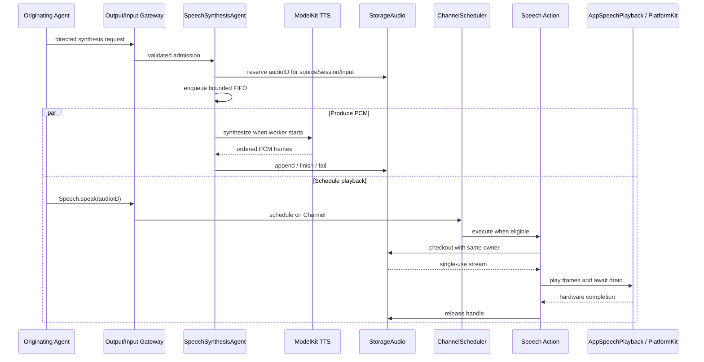

Admission of the synthesis request does not mean synthesis completed. SpeechSynthesis owns a serial bounded FIFO and a per-job execution deadline; it does not inspect Action Channels. Playback can consume frames while synthesis continues. StorageAudio validates ownership and provides a single-use, reply-owned handle with no pending/ready expiry timer. Reply completion or session cleanup retires unused handles. Successful `Speech.speak` completion means platform playback drained and the lease was released. SpeechSynthesisError carries producer timeout/invalid-output failures through StorageAudio unchanged; neutral PCM/cache errors remain storage-owned. App maps known failures to user wording after playback cleanup.

### Camera perception and UI projection

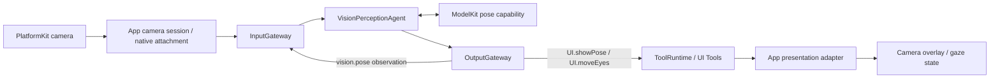

App owns capture, the persistent camera resource lease and native-image resolution. VisionPerception owns frame selection, pose interpretation and replaceable display/gaze outputs. Model inference, observation publication and presentation acceptance have separate completion boundaries. App rejects stale session/frame updates before UI mutation.

### Adaptive vision cadence and projection

VisionPerception retains every valid newest capture in its capacity-one slot. The worker consumes the newest slot at start, with expiry validation and adaptive cadence (initial 100ms, default bounds 0...250ms). Native clocked inputs also enforce the monotonic inter-start gap. Frame selection uses latest-frame admission and adaptive cadence; model calls never overlap.

YOLO diagnostics share the bounded UI.showPose payload: callback-to-model wait, capability-call time, callback-to-result latency, one-second-window successful FPS and replacement count. App converts Tool values to UI/Camera presentation values; UI displays these without runtime dependencies. Capture timing uses ContinuousClock, not assumptions about media timestamp epochs.

VisionPerception owns bounded latest-image motion, pose-motion/confidence/loss feedback and inference/total-latency budgeting for adaptive cadence. At most six skeleton snapshots are retained; fast changes accelerate immediately, stable targets relax gradually, and empty scenes retain periodic search. App injects bounds; next-interval statistics travel with pose through UI.showPose.

FrameMotionAnalyzer stays within Agents/VisionPerception: one sampled inferred-frame reference, one padded six-person ROI union, bounded exposure/noise compensation and continuous urgency. FrameCadence fuses those signals with pose reliability and compute/freshness budgets. Frame cadence has no eligibility-filtered queue or PlatformKit/ModelKit/UI policy dependency; stale results cannot mutate presentation.

Urgent YOLO detection permits a zero scheduling interval. The single inference worker processes only the newest pending capture after the active call completes. Normal inference duration adds no scheduling floor; compute-dominated freshness pressure can temporarily impose a bounded cost floor. Camera close clears skeleton and its statistics.

UI/Camera owns PoseOverlay and display statistics. VisionPerception owns its Encodable PoseOverlayPayload; ToolPoseOverlay remains the independently validated Tool contract. App maps Tool values into UI values. UI depends only on StorageChat; AgentCore has zero project dependencies.

### Photographer tracking and control handoff

Photographer consumes validated `vision.pose` through InputGateway and emits internal `Robot.aim` through OutputGateway. Its JSON v5 contains the subscription and empty model-callable catalogs; fixed internal permission and target-selection policy stay in Agent code. The output buffer holds eight calls and fails explicitly on overflow.

RobotTools validates intent arguments; Gateway authorizes source/session and Tool permission. The App worker holds motors1–4 through ResourceCoordinator, with monotonic usable-pose freshness from Photographer; one second without fresh input joins/releases the writer. App groups all six motors under nexarm.writer and explicitly allows Assistant to preempt Photographer after joined cleanup, including disjoint motor5/6 actions. Queued same-owner Actions survive the takeover gate; no scheduler/session cancellation or radio recovery occurs. VisionSession camera closure removes its owned work; old targets never replay. Actions owns mapping/motion, PlatformKit native encoding; return is target admission, not physical arrival.

Vision and Photographer outputs have independent failure scopes: offline tracking is reported without stopping pose/skeleton effects. BLE connected state is distinct from verified control availability. Read-only query timeouts keep the link connected and quarantine further exchanges until App reconnects the link. Final App resource validation requires all six Agent JSON files.

Agent fault isolation: ordinary messaging and behavior execution failures are outcomes, never a reason to terminate sibling Agents. Photographer owns offline command suppression; Gateway retains bounded output/Action diagnostics. Startup configuration validation and explicit cancellation remain strict.

### Robot behavior and device feedback

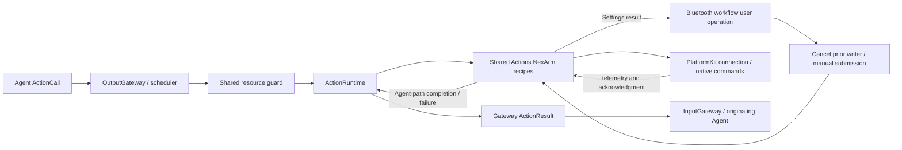

Agent-selected and Settings-initiated movement reuse the same Actions recipes and encoders. Settings enters App directly, cancels old writers and uses background segment-feedback execution without Gateway resource admission. Agent-selected execution retains OutputGateway authorization, resource arbitration and its declared completion policy. Actions owns gesture composition, limits within business policy, home/reset selection and completion rules. PlatformKit owns discovery, connection, protocol encoding, native hardware limits and structured feedback. A transport write is not automatically an Action success; each Action documents the acknowledgment that completes its effect.

Bluetooth discovery/connection is an App workflow because preferred-device ordering, explicit user intent and presentation belong to the application. Physical safety requires device-side protection and cannot rely on iOS background execution. App distinguishes inactive from actual background. Background stops and joins control effects but retains healthy native connectivity; return verifies the current link after cleanup before reuse or reconnection. Each eligible foreground return grants a fresh three-attempt episode, actual connection initiation consumes an attempt, and connection success clears the budget. Manual disconnect/forget disables automatic reconnection. Native cleanup/isolation remains required when the link is unhealthy; no old movement replays. Bluetooth background execution and state restoration are not configured.

### Robot motion admission and home selection

Actions tracking converges the last two counts at low speed, committing only after native admission; this never establishes physical arrival.

Ordinary passive-link reset uses the legacy five-arm-axis reference; tracking rest remains separate. Actions owns target selection, shared Settings/Agent execution and configured motor-home precedence; PlatformKit remains a native SDK.

### Bluetooth connection, recovery and presentation

PlatformKit spaces all BLE writes by at least 30 ms under one connection-wide budget; streaming admission returns false without queuing, and acknowledged requests reserve one cancellable slot. Actions retains proposal/finite-step semantics; App snapshots aim round-robin iteration and owns recovery. Fixed-size transport diagnostics distinguish notification traffic from valid feedback.

Transport recovery and Agent scheduling are independent. Bluetooth closes native I/O sessions, resets connection-local state and reconnects; it never cancels/removes accepted Actions or suspends scheduler admission. Current operations fail through Action/Tool results; queued work executes normally against the state available at execution. No global voice cleanup or automatic replay of failed native commands.

Native connection/subscription completion makes Settings controls available immediately. App performs no connection pose/version/IK probe, stationary validation or indication movement. It listens to unsolicited position packets and publishes measured state; refresh reads the latest received packet only. Feedback silence remains visible but does not disable manual commands, disconnect or start recovery. Native write/connection failures remain explicit. Actions uses passive BLE compatibility for this App connection; recipe IK resolution is deferred to an explicit preset request, not connection verification. Manual jog can start from the existing configured reference when no sample has arrived; that reference is not measured telemetry. Segment arrival observation and cancellable replacement remain in Actions/App.

Actions prepares only requested Cartesian poses; passive simple/reset commands require no IK queries. PlatformKit selects supported native write capability with shared pacing and a capacity-one acknowledged-control window, publishes current interrupted-reply failures, and App reports restored connectivity without claiming motion validation. Runtime/Gateway preserve terminal failure entries and descriptions.

Bluetooth presentation retains current state only. Latest native connection, communication issue and recovery state alone appear in Settings; healthy snapshots/new connections replace prior faults. The device list uses one row to connect while unconnected or open detail when already connected; connection success stays on the list, disconnect appears only when connected, and remembered devices remain forgettable; an already-open disconnected detail disables actions/motor gestures. Execution results/home issues and bounded automatic recovery remain independently owned.

### Settings, history and feature workflows

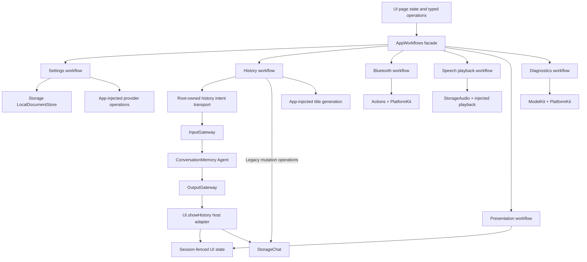

The facade holds no mutable feature state. Each feature target owns its effects and depends only on the values/services needed by that feature. UI owns editable presentation state; workflows own persistence, validation and asynchronous operation boundaries. Credentials use the Keychain through App-supplied operations, while non-secret settings and conversation records use local document storage.

Conversation history keeps one current conversation and archived records. Starting a new conversation archives the current record before optional title generation. History browsing is data access and does not replay Actions or Tool effects. Assistant JSON also declares History.list/read; Tools projects read-only paged previews from the same injected journal, returns at most 1800 UTF-8 bytes with explicit truncation, and routes results through InputGateway. UI load/refresh emits a structured user intent through InputGateway to root-owned ConversationMemory, whose internal UI.showHistory call crosses OutputGateway. One active refresh rejects overlap and joins cancellation cleanup; the scoped host adapter reads raw records into UI state. Archive/delete/title remain existing feature operations, and Tool feedback does not yet continue model inference. Assistant and the History workflow share the same injected journal service. Assistant selects ten completed rounds and assembles the exact model request. StorageChat readCurrent supplies records and an opaque process-local token; begin persists the request only with a current token. Successful mutations and terminal recovery invalidate it; conflicts fail before model inference without retry. UI owns title selection/default wording; on-disk records remain unchanged.

<a id="391-platformkit-versus-modelkit"></a>

### Conversation Tool diagnostics

Existing history records retain actual request Tool declarations, complete native calls and runtime-correlated Gateway outcomes, independently of generation completion. App adapts execution into StorageChat values; UI displays/exports these values without importing Gateway or ModelKit. Optional input/generated/total usage comes from cloud providers or the local backend. History omits max-token display; normal Assistant requests omit that option. Storage writes use a bounded 16-waiter FIFO so output outcomes and generation fragments cannot overwrite one another.

### Settings audio detection

音频识别 includes an explicit 10-second microphone/spatial diagnostic. PlatformKit exposes native input/capability/fallback facts; App Lifecycle owns an isolated capture and source-only SpeechPerception session through both Gateways; AppDiagnosticWorkflow owns admission, freshness/deadline monitoring and joined cleanup; UI owns simple result presentation. Actual received layout distinguishes four-channel capture from mono fallback. No model warmup, conversation, Photographer consumer or robot action is added.

### PlatformKit versus ModelKit

| Concern | PlatformKit: device and OS I/O | ModelKit: model processing |
| --- | --- | --- |
| Audio input | Microphone → PCM | PCM → VAD score or transcript |
| Audio output | Supplied PCM → speaker | Text → synthesized PCM |
| Vision | Camera → native frame and preview | Supplied image → pose/model result |
| Adaptation | Capture format and device orientation | Model resize, normalization and result decoding |
| Owned resources | Device sessions, links and I/O buffers | Weights, graphs, providers and operation leases |

App packages device output for input transport; the calling Agent converts it into ModelKit processing input. Agents decide when and why to process or act; Gateway validates and routes without performing inference. Neither SDK owns Agent policy, presentation or conversation state.

### Model lifecycle and processing boundary

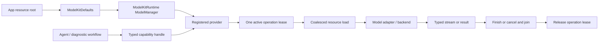

Base ModelKit has no project dependencies and owns all capability values. ModelKitDefaults registers concrete providers and default bindings; ModelKitRuntime owns the process-wide manager, provider identity and load/unload/shutdown. Consumers receive capability protocols rather than concrete engines. Each model permits one active operation; overlapping work fails explicitly instead of entering an implicit inference queue. Cleanup retains the operation lease until the backend has actually finished.

Stopping a voice session cancels its model work without automatically unloading weights. Explicit unload waits for active use; manager shutdown is terminal and cancels/joins owned work. Capability availability and resource residency are separate policies. App forwards coalesced memory-pressure handling, while manager construction/registration remains restricted to ModelAssembly SPI and isolated tests.

### Local chat capability

ModelKitGemma4 provides local Gemma 4 E2B QAT chat; Backends/CoreAI owns native graph and language execution. Gemma4 is the installed resource directory and gemma4-e2b the catalog ID. A pinned CoreAILM fork supplies the static-buffer pipeline; consumers retain ChatCapability. The shared package dependency floor is iOS/macOS 26; execution requires OS 27.

### Local model resource acquisition and removal

The App bundles schema-v2 source metadata/licenses, with no weights. App composes one Defaults manager, the generic Storage bridge and the independent ModelKitHub adapter. Management owns admission/state/install/delete; the adapter owns concrete HF SDK calls. Runtime retains its ModelKit-only dependency. ModelKitHub is a separate concrete resource-acquisition adapter target.

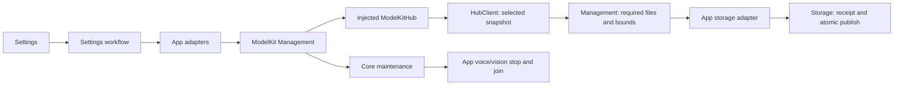

Startup reads compact repository/archive declarations and restores requests. Explicit download resolves files through HF SDK → stages selected assets → validates key files/tree bounds → writes actual file/size receipt → atomically publishes → refreshes availability. No provider is registered by JSON and no inference starts automatically. Settings/history remain usable without weights.

Deletion closes every associated resource's admission, stops related App work, drains/unloads, cancels/joins transfers and removes the installed tree before releasing maintenance. Source settings support official HF, hf-mirror.com and custom HTTPS hosts; source edits automatically persist and all system-permitted networks are allowed. Installed sizes come from receipts; pre-download sizes are estimates. Receipt paths normalize filesystem aliases before deriving confined relative paths. Receipt repair requires identity/revision, required-file and size validation. Installation publication and transfer-record persistence have separate outcomes: bookkeeping failure cannot undo a valid installation. App atomically replaces its authoritative task snapshot with afterFirstUnlock protection; other document clients retain revision-checked writes and their existing protection. HF has three native file tasks per package, two active packages/eight pending requests; overflow rejects. HF background tasks survive suspension and restore persisted generations/completed files on relaunch, with available system resume data; ZIP transport retains OS background reassociation.

### Cross-module concurrency and completion

SwiftUI state is MainActor-isolated. Runtime services, Agents, stores, managers and coordinators use actor isolation. Cross-module completion is always defined at the owning boundary:

| Boundary | Completion means |
| --- | --- |
| Input delivery | Target Agent accepted or rejected the input. |
| Model operation | Adapter finished or cancellation cleanup joined. |
| Tool call | Handler returned; returning results were admitted when required. |
| Action call | Registered handler reached its declared effect/acknowledgment boundary. |
| Speech playback | Platform output drained and the audio lease was released. |
| Session stop | Producers, Agent work, response dispatch, owned media and scheduled Actions were cancelled and joined. |
| UI update | App accepted state for the active identity; rendered-frame acknowledgment is not implied. |

Every queue or active-call pool has an explicit capacity and overflow rule in its owning module README. Cancellation is cooperative and propagates through structured tasks. Detached work, guessed success, silent device-action loss and unbounded retries are outside the architecture.

Tools/Camera follows the domain root + Support layout and binds Camera.open/close/flip through a required CameraControlCapability. App validates the active Assistant session and retains single-owner permission/foreground/capture-lease policy; completion confirms capture reconciliation or close cleanup, not pose readiness. Camera control completion is independent of native model Tool event transport.

### Cloud native Tool generation

Cloud ChatRequest carries JSON v5 Tools separately from the Action prompt. The cloud adapter assembles bounded indexed SSE tool_calls, maps provider-safe names back to declarations, and emits complete ChatEvent.toolCall values. Assistant resolves them with AgentCore ToolCallParser and emits ToolCall through OutputGateway. Tool-only turns complete normally; ToolResult retains existing feedback behavior. Local Gemma 4 E2B and automatic result-driven continuation remain unsupported.
