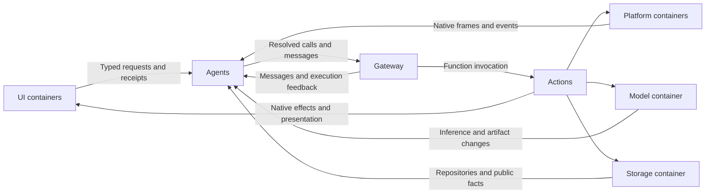

# MobileHarness Technical Design

## Overall architecture

Agents own interpretation, goals, inference policy and coordination. Actions own callable business operations, their native execution and presentation. UI, PlatformKit, ModelKit and Storage are independent foundational modules. App creates their unique roots, injects narrow public capabilities and orders lifecycle operations.

Agents depend only on the foundational capabilities needed by each role, rather than injecting all four roots into every Agent. UI owns neutral typed request sources; Agents subscribe and consume them. UI never imports, calls or controls an Agent. Arrows from UI to Agents below show data flow, not a reverse module dependency.

Local external inputs do not enter the Signal transport. UI containers supply typed requests; perception Agents consume native frame streams; device/resource/failure observers call the responsible role directly. Signals carry Agent communication and execution feedback only. All business effects still cross Gateway authorization and Actions execution.

### Ownership and compilation

| Module / target | Responsibility and direct dependencies |
| --- | --- |
| App / AppStorage / AppLifecycle | Unique roots, explicit factories, startup/foreground/shutdown ordering; AppLifecycle is independent. AppStorage owns dependency registration. |
| Agents | Role policy, typed container consumers, processing context, role execution sessions and output/completion ownership; depends on foundation ports, Actions and Gateway public interfaces. |
| AgentCore | Foundation-only identities, processing context, generic input values, communication, permissions, context, parsing and output contracts. |
| Actions | Business functions, resource demands, validation, native execution services and presentation; depends on foundational ports, AgentCore neutral identities, FunctionContracts, ExecutionRuntime and CallRuntime. No Agents/Gateway implementation dependency. |
| FunctionContracts | Independent business function inputs, declarations, reports and completion contracts. |
| Gateway | Bound Agent communication, execution authorization, resources, scheduling, cancellation and feedback; depends only on AgentCore and function/execution/call contracts. |
| ExecutionRuntime / CallRuntime | Shared lifetime/reporting mechanisms and protocol-neutral registration/call projections. |
| UI | Zero project dependencies; eight subcontainers own UI values, typed requests, presentation state, renderers and native completion receipts. |
| PlatformKit | Zero project dependencies; audio, camera, connectivity and bounded native observation. |
| ModelKit SDK targets | Independent processing and model/artifact lifecycle; the entire dependency closure stays inside the SDK and approved third-party/system SDKs. |
| Storage targets | Independent state/cache/file/database capabilities and domain repositories. Only StorageSQLite owns GRDB; only application construction selects the backend. |

Agents and Actions each compile their owning directory, with AgentCore and FunctionContracts excluded into independent leaf targets. There are no separate binding targets or mutually exclusive integration source lists. Runtime services retain their actual domain responsibilities inside their owning module; App performs no domain conversion or per-function registration.

### Foundational roots

| Root | Public subcapabilities | Typed root failure |
| --- | --- | --- |
| ModelContainer | language, speech, vision, artifacts | ModelFailure |
| PlatformContainer | audio, vision, connectivity | PlatformFailure |
| StorageContainer | state, cache, files, database | StorageFailure |
| UIContainer | home, camera, settings, modelResources, navigation, history, devices, diagnostics | UIFailure |

Roots create stable instance-local capabilities. Construction/start does not implicitly request permission, open capture, run inference or scan devices. Consumers receive required interfaces through initializers, never discover roots through IoC or create native owners. Foundation modules do not import business or transport modules.

### Business root

✅ App caches one AgentContainer per registry scope. Its stable assistant, applicationControl, memory, photographer, speechPerception, speechSynthesis and visionPerception capabilities own role sessions and joined work. AgentRuntime assembles shared communication/execution facilities; Support holds reusable mechanisms, while each role interprets its own inputs and session policy. Actions assembles explicit camera, speech, presentation and task execution ports. See [Agents](Agents/README.md#agent-container) and [Actions](Actions/README.md) for local contracts.

## Modules and internal structure

- [Agents](Agents/README.md): Assistant, Photographer, Memory, ApplicationControl, SpeechPerception, SpeechSynthesis, VisionPerception and shared Core/Chat/Context support.
- [Actions](Actions/README.md): Camera, History, NexArm, Speech, System and UI domains; shared contracts and function catalog assembly.
- [Gateway](Gateway/README.md): communication admission, bound output consumers, execution runtime, resources and scheduling.
- [UI](UI/README.md): UI-owned inputs, rendering and presentation completion.
- [PlatformKit](PlatformKit/README.md): native capabilities and device generations.
- [ModelKit](ModelKit/README.md): inference contracts, concrete providers and lifecycle/artifact management.
- [Storage](Storage/README.md): public facts, private cache/files and durable domain records.
- [App](App/README.md): composition and lifecycle graph.

## Cross-module flows

### UI requests and business execution

Each participating UI subcontainer owns its typed request/reply capability. The responsible Agent receives the subcontainer in its constructor and owns its consumeUI subscription, typed handler and joined lifecycle independently of pages. Local form/navigation mechanics remain UI-owned. Submit rejects unavailable consumers and capacity overflow; acceptance and actual completion are different boundaries. UI request values never contain Agent identities, executable paths or task grants.

Local processing uses ProcessingContext for request/session/generation/turn/causality. AgentInput can represent a private local processing value with origin `local`; it is not published as a Signal and Gateway rejects local provenance. OutputEnvelope is constructed from ProcessingContext and explicit task authorization. Gateway binds the actual registered producer/incarnation and validates every executable output.

User gestures and model decisions select the same registered Actions. Actions validate arguments and ownership, use injected capability ports, and return actual completion or failures. Local input does not bypass Channel ordering, leases, resource conflicts, output cancellation or feedback fences. UI completion is tied to a request generation and is separate from native animation/GPU/physical completion.

### Camera, vision and photography

CameraCoordinator in Actions owns enabled intent, native capture, permissions, capture leases, preview and photo execution. VisionPerception receives a read-only camera observation capability and subscribes directly for its capture generation. No camera frame travels through InputGateway. The native latest slot and the role's single active inference/newest pending frame remain bounded.

Native preview remains independent of pose inference. VisionPerception emits the existing gaze/pose internal calls and publishes typed pose observations through Agent communication. Same-frame presentation uses a generic opaque attachment; Gateway checks sequence/freshness without importing PlatformKit, and the Action endpoint validates the native frame and UI generation.

Photographer owns camera commands, pose tracking and tracking freshness. Assistant can call photography functions without creating a Task; actual captured media and model image support determine subsequent photo observation. Original storage/Photos import and bounded model JPEG preparation remain separate. [Camera execution](Actions/Camera/README.md), [vision policy](Agents/VisionPerception/README.md) and [photographer policy](Agents/Photographer/README.md) own local details.

### Speech, listening and playback

SpeechPerception directly consumes native MicrophoneFrame values, retaining immutable Float storage without a byte encode/decode round trip. Layout/sample rate/sequence/time validation and model conversion belong to the role. Native PCM remains ordered and overflow explicitly fails; capture generations and half-duplex admission prevent late audio from entering a new session.

The resident listening role owns listening consent/policy and reply occupancy. Its actual start/stop/playback effects execute through Actions. Actions/Speech VoiceSessionCoordinator owns native voice lifetime, permission/capture readiness, playback barriers and voice presentation. Agents SpeechPerceptionContainer and SpeechSynthesisContainer independently own role registration and bound work; VoiceAgentSession only connects their execution ports. Both join their own cleanup. Final transcription is an Agent message through Gateway; partial updates do not independently submit user decisions. SpeechSynthesis owns generation, while native playback waits for real drain. [Speech perception](Agents/SpeechPerception/README.md) and [speech execution](Actions/Speech/Support/README.md) define details.

### State, devices, resources and faults

StateContainer stores bounded public facts with one owning Writer and generation-scoped readers. It contains no raw media, request queues, complete AgentContext or execution authority. Role-private context and durable business records retain their existing owners; Skill useState freezes only the selected public facts for each model request.

Camera UI facts, connection/recovery facts and artifact revisions are observed directly. Native latest-value notifications wake the consumer without JSON fingerprints or periodic input publication. Resource observers re-read current facts through registered business operations; they do not replay mutations. Artifact progress callbacks coalesce synchronously into a bounded revision stream.

ContainerFailureChannel belongs to Agents and preserves original Error objects, cleanup errors, bounded summaries, deduplication and cancellation suppression. ApplicationControl consumes faults directly and selects diagnostic presentation through Actions; Assistant can retain passive evidence. Runtime execution failures follow the same presentation policy. App retains startup-failure fallback before roles are available. Failures in diagnostic delivery do not recursively report themselves.

### Tasks, model decisions and history

Assistant owns one foreground Task, dynamic Skill ownership and Chat/ReACT. Request catalogs and Skill revisions freeze per model request. Result-driven continuation uses actual business values/failures and execution/reply barriers; Agent/Provider/parse failures do not automatically retry side effects. Agent-to-Agent background work retains explicit grants, receipts and completion contracts. [Chat](Agents/Support/Chat/README.md), [Context](Agents/Support/Context/README.md) and [communication](Agents/Support/Core/Communication/README.md) own bounds and algorithms.

SQLite records durable dialog/message/task/media/device facts. Runtime queues, deltas and full private contexts remain in memory. Exact model messages and terminal results commit at their owning boundaries; restart marks unfinished records interrupted and never replays device effects. History requests go directly from the UI request capability to Memory; execution and real query completion remain separately owned.

### Lifecycle, cancellation and safety

App registers diagnostics → storage → model, diagnostics → platform/UI, all four foundation roots → agents → homePreparation. It manages one Agent lifecycle node; the business root coordinates its internal native and role owners. App starts dependency roots before consumers and stops consumers before releasing roots. Background invalidation immediately closes native/UI admission; asynchronous cleanup then cancels and joins actual work. Native physical safety never waits for model reasoning or depends on background execution.

The home renderer stays mounted outside navigation. Settings/history navigation preserves root listening; camera capture and pose processing require foreground plus the home route, retaining enabled intent across navigation. Explicit session interruption differs from session closure: interruption preserves Task/Skill ownership and does not replay a model decision on resume.

UI/request generations, capture generations, Agent incarnation/session, task grants and resource leases are independent fences. Cancelling a request cannot turn an uncertain or partial effect into success, and late work cannot be inherited by a replacement owner. [App lifecycle](App/Lifecycle/README.md), [Gateway execution](Gateway/Output/README.md) and owning module READMEs define completion details.

## Validation and remaining work

Automated checks, iOS compilation, real models, native UI and physical-device acceptance are separate evidence categories. Direct-input migration acceptance and remaining device/performance work are tracked in [the requirement](../docs/requirements/technical/Direct-Container-Input-Plan.md) and [validation](../docs/validation/Direct-Container-Input.md). No performance magnitude is asserted without comparable device measurements.

Agent container implementation and outstanding acceptance are tracked in [the plan](../docs/requirements/technical/Agent-Containers-Plan.md) and [validation](../docs/validation/Agent-Containers.md).
