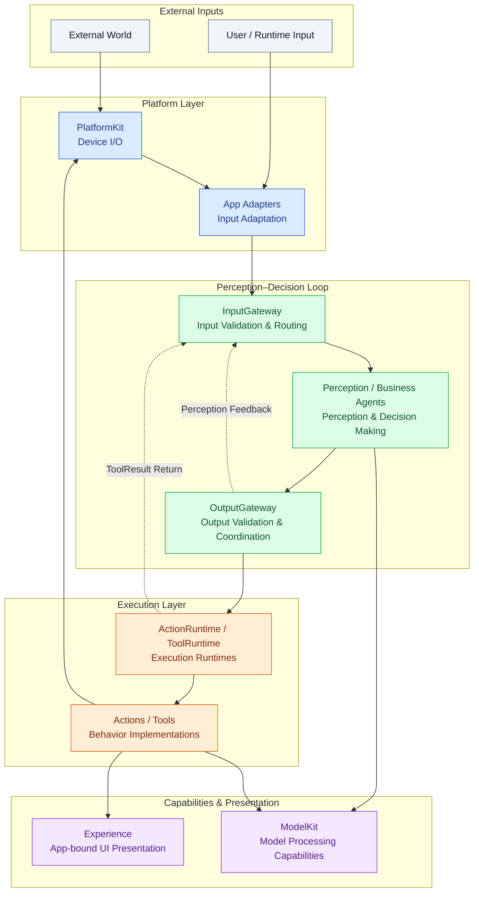
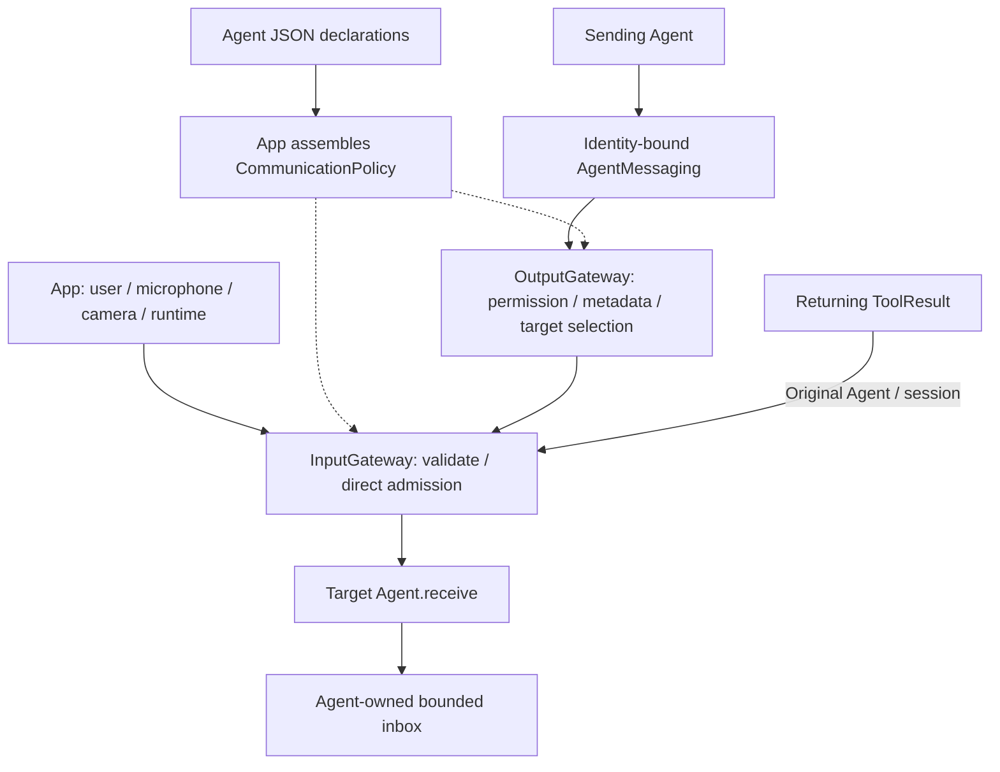
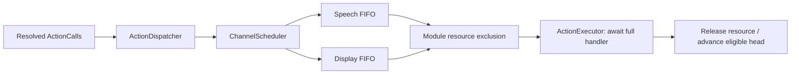
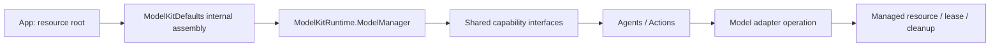

# MobileHarness Technical Design

## Overview

**MobileHarness** is a multimodal, multi-agent, bio-inspired harness for mobile and embodied AI systems.
Its architecture follows a continuous information-processing loop inspired by biological nervous systems:

**Signal → Cognition → Action**

The system is organized around three major functional domains:

- **Input Gateway** — validates protocol envelopes and routes multimodal inputs by static subscription or explicit destination.
- **Agent Core / Agents** — independent, stateful cognitive units that process signals and generate executable outputs.
- **Output Gateway** — validates Agent event publication and directed sending, exposes validated runtime observations, and schedules fully resolved Action Calls and Tool Calls.

Two capability layers support this loop: **PlatformKit handles data input/output through devices and operating-system services; ModelKit processes data through models.** Gateway coordinates signals, Agents decide what to do, and Actions/Tools execute the requested behavior. Their boundaries are compared under [PlatformKit versus ModelKit](#platformkit-versus-modelkit).

The architecture is designed around four core properties:

- **Multimodal** — text, audio, image, video, sensor, physical, and system signals.
- **Multi-Agent** — multiple specialized Agents run independently and concurrently.
- **Bio-inspired** — signal input, specialized cognition, centralized action coordination, and continuous feedback loops.
- **Streaming & Stateful** — signals, model generation, Function Tokens, Tool Calls, and execution may operate continuously instead of following request-response semantics.

This document is the target technical plan: it describes the project architecture, module responsibilities and key cross-module techniques. Module READMEs are the single current source for detailed algorithms, queue limits and API contracts. The [docs index](../docs/README.md) owns requirements, public explanations, change history, evidence and future proposals; those documents link to module READMEs instead of repeating current implementation specifications. [Repository Structure](../docs/Repository-Structure.md) tracks layout exceptions, [Architecture](../docs/Architecture.md) records current cross-module scope, and [Roadmap](../docs/Roadmap.md) tracks delivery. The original `docs/Technical_Design.docx` remains preserved.

- [Part I — Architectural Framework](#part-i--architectural-framework): architecture, annotated directory structure and basic data flows.
- [Part II — Module Design](#part-ii--module-design): each top-level source directory and its subdesigns.
- [Part III — Key Techniques](#part-iii--key-techniques): protocols, communication, scheduling, lifecycle and presentation.
- [Summary](#summary): invariants and implemented versus outstanding scope.

## Part I — Architectural Framework

### Architecture



Arrows describe runtime flow, not Swift imports. External inputs enter InputGateway directly; internal Agent events reach it through OutputGateway, without an intermediate Bus. Agents make decisions, Gateway validates and routes, runtimes execute registered behavior, ModelKit processes supplied data, and PlatformKit performs device I/O. App connects these responsibilities through adapters and injected services.

The dependency boundaries keep these responsibilities independently testable:

| Module                      | Allowed foundation / responsibility boundary                                                               |
| --------------------------- | ---------------------------------------------------------------------------------------------------------- |
| AgentCore                   | Foundation and shared contracts; no UI, concrete Agents, models or device adapters                         |
| Storage                     | Foundation-only bounded memory streams and handles, with a separate PCM adapter; persistence is planned   |
| Gateway                     | AgentCore, ActionRuntime and ToolRuntime; no ModelKit, PlatformKit or business Agents                      |
| Agents                      | AgentCore and model capability protocols; no direct calls to other Agents or executable behavior libraries |
| Actions / Tools             | Shared contracts and injected services; concrete behavior is registered by App                             |
| ActionRuntime / ToolRuntime | AgentCore; resolve registered handlers without owning business policy                                      |
| ModelKit                    | Independent capability SDK; no AgentCore or business/platform dependency                                   |
| ModelKitRuntime / adapters  | Separate targets for management and concrete SDKs; management depends only on ModelKit                     |
| PlatformKit                 | Public device/OS APIs and capability contracts; independent of ModelKit                                    |
| App / Experience            | App assembles dependencies; Experience presents state and forwards user intent                             |

<a id="37-project-structure"></a>

### Project Structure

This is the current source layout and the successor to the former section 37. Future domains are added when implemented; this tree does not require placeholder files. Root `Package.swift` maps shared source directories into independent targets without copying sources or recreating `Packages/HarnessKit/Sources`.

```text
MobileHarness/
├── App/                    # Composition, capability injection and scene/session lifecycle
├── Experience/             # MainActor SwiftUI presentation and user intent
│   ├── Conversation/       # Conversation view and presentation model
│   ├── Components/         # Reusable visual components
│   ├── Camera/             # Native preview, controls and skeleton overlay
│   └── Diagnostics/        # Explicit model validation interfaces
├── Gateway/                # Admission, routing and output coordination
│   ├── Input/              # External routing and internal delivery validation
│   └── Output/             # Validation, Routing, Dispatch and Scheduling
├── AgentCore/              # Shared Agent/input contracts, independent of implementations
│   ├── Runtime/            # Registry, manager, identity and lifecycle
│   ├── Capability/         # JSON configuration, aliases, schemas and context generation
│   ├── Generation/         # Function Token / Tool parsers and text mapping
│   ├── Output/             # Resolved calls, ToolResult and trusted output context
│   └── Communication/      # Typed messaging contracts and static routing policy
├── Agents/                 # Business actors and versioned Agent JSON declarations
│   ├── Assistant/          # Conversation generation from text and final speech
│   ├── SpeechPerception/   # Shared VAD/ASR, segmentation and speech observations
│   ├── SpeechSynthesis/    # Directed FIFO text-to-audio synthesis
│   ├── VisionPerception/   # Frame selection, pose inference and skeleton output
│   └── Photographer/      # Design only; future camera-motion policy
├── Actions/                # Channel-scheduled behavior implementations
│   ├── Speech/             # Audio-ID playback and awaited completion
│   └── UI/                 # Captions, voice state, expressions and turn boundaries
├── ActionRuntime/          # ActionRegistry and ActionExecutor
├── Tools/                  # Direct callable behavior implementations
│   ├── System/             # Fixed runtime configuration information
│   └── UI/                 # Completion-only skeleton display
├── ToolRuntime/            # ToolRegistry and ToolExecutor
├── Storage/                # Shared bounded memory and Audio PCM adapter; persistence planned
├── ModelKit/               # Capability SDK plus separately compiled support targets
│   ├── Core/               # Media values, sessions and resource contracts
│   ├── Speech/             # ASR, TTS and VAD capabilities / adapters
│   ├── Language/           # Language capabilities and Qwen adapter
│   ├── Vision/             # Pose capability and YOLO adapter
│   ├── Defaults/           # Internal provider assembly and default bindings
│   ├── Management/         # ModelKitRuntime shared ModelManager
│   └── Backends/           # CoreML, CoreAI and MLX engine integration
├── PlatformKit/            # Device and operating-system I/O
│   ├── Audio/              # Capture, playback, resampling and audio telemetry
│   ├── Vision/             # Camera lifecycle, frames and compact gray sampling
│   ├── Connectivity/       # External-device transport contracts
│   └── Core/               # Shared capability and permission contracts
└── Resources/              # Privacy declarations, model profiles and local artifacts

Tests/                      # Root module tests and integration/model evaluations
Config/                     # Shared build configuration; local signing is ignored
scripts/                    # Checks, builds and model provisioning
MobileHarness.xcodeproj/    # App and framework schemes
```

A physical parent directory does not imply one Swift target: ModelKit excludes Defaults, Management, adapters and backends from its foundation SDK. `Storage/` contains the Foundation-only `Storage` target and the separate `StorageAudio` PCM adapter target. Tests stay under root `Tests/`. [Repository Structure](../docs/Repository-Structure.md) records detailed target mappings and outstanding modules.

### Basic Data Flows

| Flow                  | Current path                                                                                               | Result                                                   |
| --------------------- | ---------------------------------------------------------------------------------------------------------- | -------------------------------------------------------- |
| Voice perception      | Microphone → PlatformKit → App → InputGateway → SpeechPerception → ModelKit VAD/ASR                   | Typed partial/final transcript and speech phase          |
| Conversation          | SpeechPerception → OutputGateway → InputGateway → Assistant → ChatCapability                    | Resolved speech, caption and expression Actions          |
| Spoken output         | Assistant → directed SpeechSynthesisAgent → StorageAudio audio ID; Speech Action → injected playback | Completion includes actual playback                      |
| Camera perception     | Camera → PlatformKit → App → InputGateway → VisionPerception → PoseCapability                         | Shared pose observation and independent UI.showPose Tool |
| Skeleton presentation | VisionPerception → OutputGateway → ToolRuntime → UI.showPose → App handler → Experience               | Awaited state update, without ToolResult                 |
| Returning Tool        | Agent → OutputGateway → ToolRuntime → handler → ToolResult → InputGateway → original Agent/session   | Correlated result available for further processing       |

Raw media reaches perception Agents before inference. The App does not resubmit final speech as a second user-text input. Camera preview is independent of inference and voice model readiness. User text has a configured route, but the current conversation UI has no text-entry control.

## Part II — Module Design

### App

[App](App/README.md) is the composition root. `AppContainer` prepares capabilities and platform services; `ApplicationRuntime` in `AgentBootstrap` assembles the shared AgentManager, immutable communication policy, gateways and explicit implementation handlers. Production registration lists come from Agent JSON, not duplicate Swift declarations.

Voice and camera coordinators own separate sessions and scene intent. App supplies ModelKit's resource root and gets capability interfaces from the process-wide manager. It adapts transport/media values and binds presentation callbacks, while startup, completion and cancellation remain runtime responsibilities.

✅ Shared assembly, independent camera/voice sessions and explicit handlers. ❌ Persistent background supervision and independent multi-window Agent namespaces.

### Experience

[Experience](Experience/README.md) contains MainActor presentation. `Conversation` owns view/state, `Components` owns reusable visuals, `Camera` bridges preview and overlay, and `Diagnostics` exposes explicit validation tools. Views forward user intent through App coordination and do not construct Agents or model providers.

Agent-selected UI changes arrive through registered Actions or Tools. Device audio telemetry and user/OS lifecycle resets are App-owned presentation inputs. Expressions use semantic emotion values mapped to procedural eyes; they are not emoji commands.

✅ Conversation, camera controls, captions, eye expressions and audio spectrum presentation. ❌ Physical-device visual/latency acceptance; Debug simulations must remain labeled.

### Gateway

[Gateway](Gateway/README.md) owns protocol admission and coordinated output. It imports neither model capabilities nor device adapters and performs no perception inference.

- **Input:** validate external inputs, select static subscribers or explicit targets, and validate internal deliveries before `Agent.receive`. Production uses CommunicationPolicy; publish requires configured subscriptions and send requires an explicit target. No default-Agent routing fallback exists.
- **Output/Validation:** recheck resolved executable calls and event permissions.
- **Output/Routing and Dispatch:** classify outputs, dispatch Actions/Tools, and return data Tool results through InputGateway.
- **Output/Scheduling:** bound Action queues, serialize by Channel and coordinate module exclusion, completion and cancellation.
- **Internal messaging:** bind sender identity, select recipients and directly hand validated events to InputGateway; registered runtime observers do not create implicit Agent subscriptions.

✅ Static publish/send, output validation and execution coordination. ❌ Dynamic subscriptions and model-assisted routing; any future model routing decision belongs in an Agent.

### AgentCore

[AgentCore](AgentCore/README.md) defines the reusable contracts and mechanisms without business policy. Root contracts describe Agents, identity, descriptors, input payloads and errors. `Runtime` manages instances and lifecycle; `Capability` validates configuration and local names; `Generation` parses generated output; `Output` defines resolved calls and context; `Communication` defines messaging contracts, receipts and shared communication policy.

An Agent is an actor with a descriptor, lifecycle operations, a `receive(_ input: AgentInput) async throws` entry and an output stream. Concrete Agents own their bounded inboxes and domain state. Shared ToolResult belongs here to avoid a dependency cycle with ToolRuntime.

✅ Actor contracts, lifecycle, configuration, generation and event transport. ❌ Generic AgentContext/AgentRuntime/StateStore, general restart/health supervision and request/reply infrastructure.

### Agents

[Agents](Agents/README.md) implements domain actors. Each versioned `<AgentName>.agent.json` declares Actions, Tools, Channels, text mappings and communication permissions. Each Agent resolves its own aliases before output and uses only injected model capability protocols.

| Agent            | Basic design and subdesigns                                                                                                                                                                   |
| ---------------- | --------------------------------------------------------------------------------------------------------------------------------------------------------------------------------------------- |
| Assistant        | Bounded input/history; consumes user text, final speech, phase and Tool results; streams chat through shared generation parsers into resolved calls                                           |
| SpeechPerception | Bounded PCM admission; LiveSpeechInput and VoiceActivitySegmenter own VAD/ASR sessions, segmentation/merging and partial/final observations; explicit UI Actions own recognition presentation |
| VisionPerception | FrameChangeFilter selects frames; shared pose inference feeds independently bounded observation publication and latest skeleton Tool / eye gaze Action output                                                   |
| Photographer     | Reserved camera-motion policy design; no active runtime or display responsibility                                                                                                             |

✅ Shared speech/vision perception and conversational Assistant. ❌ Photographer motion policy, ReflexAgent and additional task Agents. Perception freshness does not establish robot safety or sampling guarantees.

### Actions

[Actions](Actions/README.md) implements behavior that uses Channel scheduling. `Speech.speak(audioID)` consumes shared StorageAudio PCM prepared by the independent SpeechSynthesisAgent, while its scheduled handler still awaits actual playback completion. `UI` implements caption, expression, voice-state and turn-boundary operations through App-bound MainActor services.

Actions own behavior and parameter validation; Agent JSON owns available aliases/default Channels and App owns explicit implementation bindings. Shared physical resources must have coherent ownership across behavior functions.

✅ Speech and UI behaviors, including `UI.express(emotion:)`. ❌ Photo-capture, robot, media and other device Actions; no separate smile Action is introduced.

### ActionRuntime

[ActionRuntime](ActionRuntime/README.md) separates registered executable handlers from Agent declarations. ActionRegistry supplies explicit path bindings; ActionExecutor invokes a validated handler and propagates completion, failure and cancellation. Gateway owns scheduling; the runtime does not parse markup, infer aliases or decide business policy.

✅ Explicit registration and awaited execution. ❌ General ActionResult feedback and additional resource arbitration. Current Action completion uses scheduling barriers, not an automatic result Signal for every Action.

### Tools

[Tools](Tools/README.md) provides direct callable functions. `System.runtimeInfo` returns fixed configuration text, not live health. `UI.showPose` validates a bounded skeleton projection and awaits an injected display update; it may have a presentation side effect despite being a Tool.

✅ System information and skeleton display. ❌ Search, storage, network, memory and additional model/device tools.

### ToolRuntime

[ToolRuntime](ToolRuntime/README.md) provides ToolRegistry and ToolExecutor. App registers either a data-returning handler or a completion-only Void handler. Tool execution bypasses ChannelScheduler; the registration determines feedback semantics, never model arguments.

Data-returning calls produce correlated ToolResult through Gateway. Void calls complete without feedback; failure propagates to the caller. Awaiting display-state acceptance does not guarantee the screen has rendered a frame.

✅ Both handler modes and correlated data feedback. ❌ General Tool timeout/retry supervision and durable execution.

### Storage

[Storage](Storage/README.md) provides Foundation-only bounded memory streams and single-checkout handles. [StorageAudio](Storage/Audio/README.md) adapts ModelKit PCM frames and Agent identity to those primitives; App injects the shared audio store into synthesis and playback. Storage core remains independent of ModelKit and SwiftUI. Reclaimable caches and persistent records/files are later stages.

✅ Both Storage targets are registered and the production PCM cache uses them, preserving playback, failure, cancellation and expiry contracts. ❌ Persistent media, disk cache and memory records remain future work.

### ModelKit

[ModelKit](ModelKit/README.md) is an independent capability SDK for model-driven data processing. `Speech`, `Language` and `Vision` expose typed capabilities; `Core` supplies media/session/resource contracts. Concrete model SDKs live in separate adapter targets, and `Backends` encapsulates engines.

`Defaults` owns internal providers/default bindings. `Management` compiles as ModelKitRuntime and supplies ModelManager lifecycle and acquisition. Production uses one process-wide manager; consumers receive capability protocols only. App provides resources but does not register concrete providers. Construction/registration require ModelAssembly SPI; model management remains independent of Agents and UI.

✅ ASR/TTS/VAD/chat/pose integration, shared lifecycle, AudioFrame/ImageFrame and separate backend targets. ❌ General video sessions, further model capabilities, cross-model scheduling and independent SDK distribution.

### PlatformKit

[PlatformKit](PlatformKit/README.md) owns device/OS data I/O through public APIs with capability and permission validation. `Audio` owns microphone/speaker lifecycle, conversion and telemetry; `Vision` owns camera sessions, frames and gray sampling; `Connectivity` declares external-device transport; `Core` holds cross-domain contracts.

Small capability domains remain flat until concrete implementations justify subdirectories. App bridges PlatformKit media into AgentCore transport and ModelKit values; the two Kits do not depend on each other.

✅ Foreground audio and camera I/O. ❌ Concrete external-device transports and robot control. Physical safety cannot rely on iOS background execution.

### Resources

[Resources](Resources/README.md) contains privacy declarations, model provisioning profiles and ignored local artifacts. App supplies the resource root; providers load their configured model files. Platform/backend selection is explicit, and unavailable models report errors rather than silently falling back.

✅ Local artifact provisioning and packaged resource selection. ❌ Broader model distribution and physical-device acceptance. Secrets, local signing settings, model weights and user media must not be committed.

## Part III — Key Techniques

### Signal and Media Representation

Signal is the conceptual input abstraction; `AgentInput` is its implemented type. There is no second parallel Signal type. Payload is separate from source, contract/version, session, turn, sequence, capture time, incarnation, causal root/parent and monotonic admission deadline.

| Payload                | Meaning                                                       |
| ---------------------- | ------------------------------------------------------------- |
| Text / runtime event   | User text or explicit runtime input                           |
| Audio / image          | Bounded PCM or image data / controlled in-process attachment  |
| Perception observation | Typed transcript, speech phase or pose without original media |
| ToolResult             | Result correlated with its originating call and session       |

Media streams are successive typed inputs. JSON v4 configures Agents; it is not the audio/image transport format. App-owned attachments bridge native frames without making AgentCore depend on model/platform frameworks. Remote serialization, compressed video and additional physical sensors remain future work. Bounds and value contracts live in [Input](Gateway/Input/README.md) and [Communication](AgentCore/Communication/README.md).

### Capability Declaration and Resolution


Action and Tool aliases are unique within one Agent; different Agents may reuse a name. An alias such as `say` resolves to `Speech.speak`, not a reflected Swift method. Context generation exposes declared schemas and descriptions; hidden capabilities remain registered but are omitted from model-facing instructions. App explicitly binds implementations. Invalid configuration propagates without `try!` or fallback registrations.

### Function Token Protocol

Function Token is a streaming mixture of natural text and restricted XML. A parsed FunctionToken is not a model tokenizer token. Shared parsers live in AgentCore/Generation, while parser instances and alias resolution belong to each Agent.

```xml
<express emotion="smile"/>
Hello.
<channel.main>
  <express emotion="thinking"/>
  Let me think.
</channel.main>
```

The three forms are natural text, self-closing Action tags and paired Channel tags. FunctionTokenParser handles fragment boundaries; ChannelParser tracks scope; SentenceFunctionBuffer groups text; AgentGenerator resolves calls. Assistant maps natural text to both `say` and `print` through JSON `textActions`. Explicit Action tags do not implicitly duplicate that mapping.

Completed Actions can be emitted before a Channel closes. Tag/scope boundaries flush preceding text; normal completion flushes remaining valid text, while cancellation discards incomplete state. Raw markup and unresolved aliases never reach Gateway. Native Tool calls use the separate ToolCallParser; production incremental native Tool deltas are still outstanding.

Syntax, escaping, nesting, bounds and malformed-stream behavior are defined in [Generation](AgentCore/Generation/README.md).

### ActionCall versus ToolCall

| Dimension         | ActionCall                                                | ToolCall                                                 |
| ----------------- | --------------------------------------------------------- | -------------------------------------------------------- |
| Agent generation  | Function Token interpretation or explicit Agent logic     | Separate native Tool parsing or explicit Agent logic     |
| Resolved identity | ActionPath, parameters and effective Channel              | ToolPath and arguments                                   |
| Execution         | OutputGateway → ChannelScheduler → ActionRuntime        | OutputGateway → ToolRuntime directly                    |
| Ordering          | Serial within Channel; resource exclusion across Channels | Caller awaits handler; no Channel queue                  |
| Completion        | Handler completion and per-input finish barrier           | Value feedback or Void completion, fixed by registration |
| Current examples  | Speech.speak, UI.print, UI.express                        | System.runtimeInfo, UI.showPose                          |

Both are validated executable outputs, and either may have side effects. Their distinction is execution/feedback semantics, not simply “write versus read.” Returning Tools re-enter InputGateway with ToolResult; Void Tools do not. General ActionResult feedback is not implemented. Typed internal observations use a separate messaging port, not either generation protocol.

<a id="32-internal-agent-communication"></a>

### Communication Framework

Communication covers external input, internal Agent observations and Tool-result return. **Gateways perform intermediate validation, metadata construction and routing. Agent inboxes own pending messages. There is no independent message Bus.**



#### Subscription ownership and target selection

Each Agent JSON declares `inputs` (supported contract/version/kind), `subscriptions` (exact contract/source/topic), `publications` (publishable contracts) and `sends` (allowed contract/target pairs). App validates these into an immutable policy. Agents do not register listeners dynamically. Topic currently equals contract; there are no wildcards or implicit fallback recipients.

External publish/send selects targets in InputGateway. Internal publish/send selects targets in OutputGateway after outbound permission checks. Supporting an input is distinct from subscribing to it: directed sends bypass subscription matching but preserve supported-contract validation.

OutputGateway binds source identity/incarnation, sequence, session, turn and causal parent into the envelope. It resolves live target identities and directly invokes the module-internal InputGateway entry. Public external entry points reject forged internal incarnations. Child deadlines cannot outlive their parent.

#### Direct admission, lifetime and ownership

InputGateway uses structured per-target tasks and a common capacity boundary for external and internal admission. It checks source/target identity, session, supported payload, cancellation and message expiry before `receive`. One rejected destination does not suppress successful peers, but the aggregate report awaits all targets.

Ordinary `receive` must promptly validate and enqueue or reject; it must not await inference or inbox space. Cross-actor calls still use await. Explicit cancellation controls may join cleanup. Neither Gateway has a pending-message queue, persistent worker or independent delivery lifecycle. There is no communication FIFO guarantee across concurrent calls and no automatic duplicate suppression or state replacement.

InputGateway and OutputGateway enforce explicit active-call bounds; full admission rejects immediately and structured calls release their reservations on completion. These are active-call bounds, not queues. Current values and release behavior belong in the [Gateway Input](Gateway/Input/README.md) and [Gateway Output](Gateway/Output/README.md) READMEs.

A message deadline is a freshness check, not a timer racing receive. Cancelling the caller propagates through structured admission calls; already accepted work belongs to the Agent. App stops producers and coordinates Agent/runtime cleanup. No Bus session registry, timeout tasks, retained operation registry or shutdown barrier remains. Action Channels remain separate execution queues.

| Concern | External input | Internal Agent event |
| --- | --- | --- |
| Target selection | InputGateway subscription lookup or explicit target | OutputGateway permission check and target selection |
| Admission | Shared InputGateway bounded task group | Same InputGateway bounded task group |
| Queue / processing | Agent inbox | Agent inbox |
| Lifecycle | Caller, App and Agent/runtime ownership | Same; source incarnation and causal context are also checked |
| Receipt | Per-target admission, not processing completion | Same |

Detailed diagrams: [external input](Gateway/Input/README.md#external-input-admission-and-delivery) and [internal direct delivery](AgentCore/Communication/README.md#target-selection-and-per-agent-delivery).

#### Current routes and future scope

| Source | Input | Receiver |
| --- | --- | --- |
| phone.microphone | media.audio | SpeechPerception subscription |
| phone.camera | media.image | VisionPerception subscription |
| user | user.text | Assistant subscription; no current text-entry UI |
| speechPerception | speech.final / speech.phase | Assistant subscription |
| speechPerception | speech.partial / final / phase | Registered runtime observer for admission/logging, without UI mutation |
| visionPerception | vision.pose | Declared business subscribers; skeleton output is an independent Tool |
| runtime | ToolResult / assistant.cancel | Original or explicitly selected Agent/session |

The three production Agent configurations have empty sends lists: Agent direct send is available but currently unused in production. Zero recipients fails unless a registered publication observer handles the contract. Ordinary discrete events and physical actions must not be silently coalesced; Agent-local latest-state policies are explicit.

✅ Static subscriptions, direct delivery and correlated Tool return. ❌ Dynamic subscriptions, request/reply, remote transport, persistence and retry. Remote Agents may use a transport adapter; they do not inherently require a Bus or broker. See [ADR 0048](../docs/adr/0048-direct-signal-admission.md).

### Multi-Channel Action Scheduling

A Channel is an ordered Action execution scope. Every Action registration supplies a default; an explicit `<channel.name>` scope overrides it. Closing an inner scope restores the parent; closing the outermost restores each Action's default. Only permitted Channels may be selected.

With Assistant's default mapping, natural text produces speech on `Speech` and captions on `Display`. They may progress concurrently. Grouping the same text inside `<channel.main>` puts both calls in one serial lane. `main` is an ordinary Channel, not a global barrier, and scope closure does not cancel or flush already scheduled jobs.



Channel names identify shared process-local lanes across Agents. Same-Channel Actions execute serially; different Channels may execute concurrently only when their modules are available. Module exclusion prevents conflicting Actions across Channels. Completion/failure tracks the originating Agent/input; finish seals that input and waits for all accepted Actions. Cancel/failure removes pending work and joins cooperative active work. Already performed effects cannot be rolled back.

✅ Bounded FIFO, module exclusion, completion and cancellation barriers. ❌ Priority, preemption, dependency graphs and general resource arbitration. Limits and the ready-head algorithm belong in [Scheduling](Gateway/Output/Scheduling/README.md).

<a id="201-channel-lock--exclusive-agent-control"></a>

#### Channel ownership and takeover — planned

Future control takeover must validate permission, atomically gate the channel group, cancel queued work, stop active control and await cleanup before granting a finite owner lease. Signals may communicate observations or advice but never transfer ownership. All alternate Action and Tool routes to protected hardware must share enforcement; uncertain cleanup leaves the domain gated.

Only ownership metadata exists today and Channels remain unlocked. Runtime acquire/renew/release, notifications and device enforcement are unimplemented. See [Channel Lock Design](Gateway/Output/Scheduling/README.md#channel-lock-design).

<a id="391-platformkit-versus-modelkit"></a>

### PlatformKit versus ModelKit

| Concern             | PlatformKit: device/OS I/O                                     | ModelKit: model processing                                  |
| ------------------- | -------------------------------------------------------------- | ----------------------------------------------------------- |
| Audio input         | Microphone → PCM                                              | PCM → transcript or VAD score                              |
| Audio output        | Supplied PCM → speaker                                        | Text → synthesized PCM                                     |
| Vision              | Camera → frame and preview                                    | Supplied image → pose/model results                        |
| Adaptation          | Capture format, orientation, compact gray sampling             | Model resize/normalization, tensor decoding and coordinates |
| Resources           | Device sessions, engines, connections and I/O buffers          | Weights, graphs, model instances and operation leases       |
| Policy outside both | App bridges data; Agents choose when and why to process or act | Gateway validates and routes without inference              |

“Processing” means model capability processing, not all computation. VisionPerception compares gray samples as perception policy, asks ModelKit for poses, then emits observations and a display Tool. Model synthesis produces PCM; playback is a separate platform operation owned by the Speech behavior. Neither Kit owns Agent business decisions.

### Shared Model Lifecycle

ModelKitDefaults supplies the process-wide ModelManager and internal provider bindings; conflicting resource roots fail. `ModelManager.get` is the capability acquisition API. Shared construction/loading is coalesced, while each model admits only one active operation and rejects overlap rather than creating an inference queue.



Stopping a conversation cancels work without automatically unloading weights. Explicit unload waits for usage to end; shutdown cancels and joins active work. Residency policy is distinct from capability availability; memory warnings are coalesced and forwarded by App. Registration and construction require assembly SPI, and management uses its designated SPI rather than business access to backend resources.

✅ Shared lifecycle, bounded load/acquisition and explicit memory policy. ❌ Timed idle eviction, measured cross-model budgets and sustained physical-device pressure/retry acceptance. Details: [Management](ModelKit/Management/README.md), [Core](ModelKit/Core/README.md), [ADR 0032](../docs/adr/0032-modelkit-admission-and-memory-policy.md).

### Session, Turn and Presentation Boundaries

Runtime lifecycle is separate from business state. AgentManager controls registration and running instances; each Agent owns domain state and bounded input processing. Voice and camera share infrastructure but close their own sessions independently. Stop first prevents producer admission, cancels and joins perception/transport work, then cancels consumers and Actions. Incarnations fence old instances from replacements.

The current voice stop and interruption chain is coordinated by App: stop producers, send assistant.cancel through InputGateway, then cancel session Actions through OutputGateway. Tool cancellation follows the active dispatch task. See [Voice interruption and cancellation](App/README.md#voice-interruption-and-cancellation) for the flowchart, cleanup order and implemented boundaries.

Agent-selected presentation uses JSON-declared, resolved Actions/Tools through OutputGateway. SpeechPerception owns recognition captions and phase presentation; Assistant owns reply captions, expressions and atomic beginReplyTurn; VisionPerception owns UI.showPose and UI.moveEyes. Signal observers only coordinate capture admission/logging. App may reset state for user/OS lifecycle and present actual device telemetry.

ConversationTurn carries an ID and session-local ordinal through input, observations, output and Tool return. A long utterance retains its turn across segments. Trusted output sequences and turn checks reject stale UI updates; model parameters cannot override this identity.

| Boundary                    | Recognition caption               | Reply / expression                                   |
| --------------------------- | --------------------------------- | ---------------------------------------------------- |
| Confirmed new utterance     | Latest partial replaces preview   | Assistant clears once through beginReplyTurn         |
| Endpoint, ASR pending       | Preserve preview                  | Await reply                                          |
| Final or empty recognition  | finishTranscript clears and seals | Reply or return to listening                         |
| Response and playback       | Remains sealed                    | Append reply; speaking state follows actual playback |
| Reply completed             | Empty                             | Retain until next utterance                          |
| Stop / background / failure | Clear and invalidate session      | Clear and invalidate session                         |

Vision freshness uses separate bounded inference, publication and display paths, allowing a slow subscriber to coexist with fresh local visualization. The configured maximum refresh interval avoids change-filter starvation when new frames exist; it does not guarantee inference FPS. Details: [App](App/README.md), [ADR 0043](../docs/adr/0043-conversation-turn-presentation.md) and [VisionPerception](Agents/VisionPerception/README.md).

### Concurrency and Validation

Swift 6 language mode and Swift 6.4+ tooling are required. SwiftUI presentation is MainActor-isolated; runtime mutable state belongs to actors or explicitly owned synchronization. Every queue has a bound and overflow policy; device actions and discrete events cannot be silently discarded. Admission, handler completion and physical/rendered completion are different milestones.

#### Concurrency documentation standard

Every directory implementing queues, asynchronous workers or producer/consumer processing must describe its current algorithm in its local README. Keep these descriptions synchronized with code; use English for new documentation. Include:

1. Producer, consumer, payload and state owner (actor, MainActor or lock).
2. Queue/buffer capacities and units, whether running work counts, per-item and total limits, and where limits are enforced.
3. Admission and full-buffer behavior: wait, reject or explicit failure; never imply backpressure when the producer actually receives an error.
4. Drain algorithm, FIFO/ordering scope, concurrency, resource exclusion and the meaning of completion.
5. Normal finish, cancellation, timeout, failure propagation, cleanup/join behavior and handling of already executed work.
6. A Mermaid flow/sequence diagram for tooling and nontrivial producer/consumer modules, plus ✅ implemented and ❌ outstanding items.

Distinguish work queues, framing buffers, terminal signals and busy-reject admission. Actor isolation alone does not guarantee FIFO completion across suspension points. Document opaque third-party buffering as a limitation. Documentation changes alone do not alter runtime contracts.

Current detailed contracts: [Agent inbox/output](Agents/Assistant/README.md), [speech perception](Agents/SpeechPerception/README.md), [Action scheduling](Gateway/Output/Scheduling/README.md), [model streams and leases](ModelKit/Core/README.md), [audio capture/playback](PlatformKit/Audio/README.md), and [App task coordination](App/README.md). [Storage](Storage/README.md) owns the shared memory boundary and [StorageAudio](Storage/Audio/README.md) owns the live PCM contract. Model adapters and streaming parsers carry their own local descriptions.

Run `./scripts/check.sh` for format, tests and configuration/boundary validation, and `./scripts/build-ios.sh` when full Xcode is available. Report unavailable checks and distinguish successful builds from physical-device acceptance. No third-party dependency is added without a concrete integration need.

## Summary

MobileHarness connects **Signal → Cognition → Action** through explicit boundaries: App assembles services, Gateway validates and routes, Agents reason, runtimes execute declared behavior, ModelKit processes data and PlatformKit performs I/O. External input and internal events use direct admission; Agents own the pending-message queues, with no independent Bus lifecycle. Executable Action Channels remain separate from Agent inboxes.

✅ Current implementation includes shared speech/vision perception, a conversational Assistant, static subscription and directed delivery, Function Token generation, bounded Action scheduling, direct Tools and shared model lifecycle.

❌ Dynamic subscriptions, general request/reply, persistent/retried messaging, native Tool streaming, Channel takeover, robot behavior and sustained physical-device acceptance remain outstanding. New domains are introduced in stages without unused placeholder implementations.

Keep this document focused on framework and module design. Maintain detailed algorithms in the owning directory README, runtime-contract changes in architecture decisions and the roadmap, and original design sources unchanged.

✅ Perception-driven eye gaze reuses YOLO facial landmarks, JSON-declared UI.moveEyes and camera-owned session state. Bounded presentation replacement and per-Action completion are specified in [ADR 0049](../docs/adr/0049-perception-eye-gaze.md). ❌ Physical-device smoothness and crossing-face acceptance remain pending.


✅ ADR 0055 adds shared audio handles and Agents/SpeechSynthesis (directed serial synthesis); ADR 0056 moves the cache into StorageAudio. Semantic segmentation stays in the original Agent; the [StorageAudio README](Storage/Audio/README.md) owns the playback wait and cache limits. ❌ Persistence/replay and physical-device acceptance remain pending.
