# MobileHarness Technical Design

MobileHarness is an Apple-native multimodal Agent system organized around **Signal → Cognition → Action**. Devices provide signals, Agents interpret them with model capabilities, and validated Actions or Tools produce observable effects.

This document is the project-level technical plan. It owns three views of the current system:

1. the overall architecture, dependency graph and source layout;
2. each module's responsibility and boundary;
3. cross-module protocols and end-to-end technical flows.

Module READMEs own implementation details, algorithms and local limits. Requirements, decisions, validation evidence and future work live under [`docs/`](../docs/README.md). This document describes only the latest technical design: update the existing section or add a responsibility-based subsection within Part I, II or III. Do not append ADR summaries, migration notes, change records or acceptance evidence here.

- [Part I — Overall Architecture](#part-i--overall-architecture)
- [Part II — Module Responsibilities](#part-ii--module-responsibilities)
- [Part III — Cross-module Technical Design](#part-iii--cross-module-technical-design)

Key contracts: [Signals](#unified-signal-contract), [callable functions and protocol bindings](#canonical-functions-and-protocol-bindings), [feedback causality](#execution-feedback-causality), [six interaction scenarios](#signal-and-effect-scenarios), and [implementation coverage](#implementation-coverage).

## Part I — Overall Architecture

### System architecture

Build an application whose business processing is driven by Agents. Agents own data-processing strategies, business decisions and task coordination. Human interaction, physical-world observations, system events, Agent messages and execution feedback enter as Signals through InputGateway. External inputs pass through App adapters; Agent communication and execution feedback follow their validated Gateway paths.

Direct interaction and LLM-selected behavior use the same Agent-owned business flows, shared capabilities and actual execution results. An Agent may handle explicit intent deterministically or use a model to decide its next step. It drives operations and presentation through OutputGateway and registered Actions/Tools, then uses returning Signals to continue, complete or cancel work.

UI, ModelKit, PlatformKit and Storage provide foundational presentation, inference, native I/O and persistence capabilities. App hosts and assembles the system, adapts external inputs and owns application lifecycle. UI renders Agent-driven state, captures human intent and retains local presentation state. The design supports direct interaction and conversation over the same permissions and execution contracts; current coverage is listed separately.

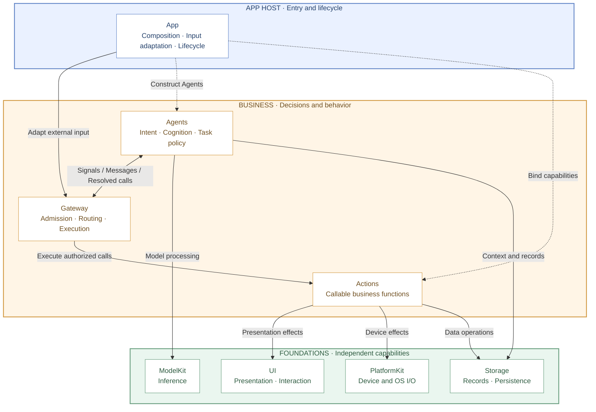

Read top to bottom: App Host → business modules → foundational capabilities. Nodes represent first-level modules under MobileHarness; Resources is packaging input and is shown in the source map rather than the runtime layers. Solid arrows show input, business communication or capability use; dashed arrows show host assembly. These are module relationships, not Swift import dependencies. App also supplies foundation instances and forwards UI/native input through its adapters; the detailed flows below show those paths.

Gateway contains InputGateway, OutputGateway and shared execution. ActionCall and ToolCall are call protocols over the same Actions functions, not separate top-level modules. UI captures intent and presents state; ModelKit, PlatformKit and Storage supply processing, native I/O and persistence.

### Coordination ownership

| Owner | Governing question | Responsibility |
| --- | --- | --- |
| App | What runs, and for how long? | Assemble, start, stop and clean up application/session scopes and their resources. |
| Agents | What should happen next, and why? | Interpret signals, retain cognitive state and express messages or permitted behavior. |
| Gateway | How may accepted work communicate and execute? | Enforce identity, permission, admission, ordering, wait, feedback and resource rules. |

Semantic fusion belongs to Agents. Gateway carries identities, contracts and destinations without interpreting observations or choosing business behavior.

### Composition and mediation boundaries

App composes the running system; Agents generate task behavior; Actions implements callable behavior; Gateway mediates Agent communication and execution. ModelKit and PlatformKit are foundational capability SDKs that may be injected into Agents or callable functions when a concrete implementation requires them. The diagram expresses this allowed capability model; the compilation graph in the next section records the dependencies used by the current implementation.

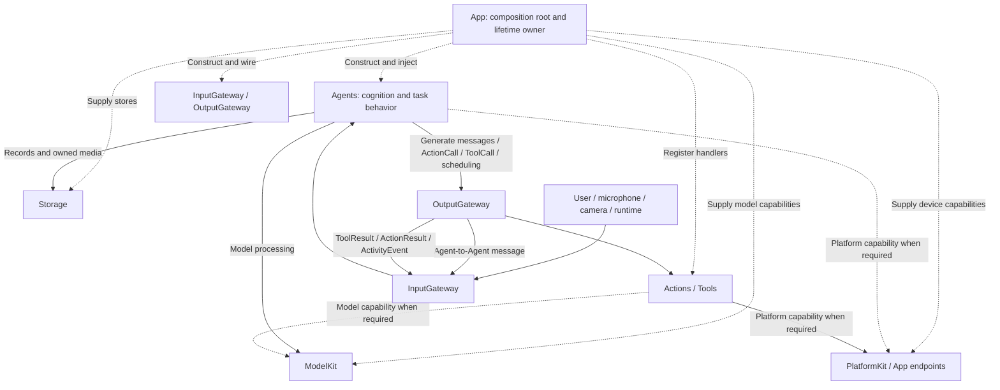

- **App assembles and owns lifetime.** It constructs Agents, Gateways, behavior registries, workflows and shared services, then injects role-specific interfaces. It does not become a global container that modules query at runtime.
- **Agents generate behavior.** They interpret input, use injected foundational capabilities and emit resolved Agent messages, `ActionCall`, `ToolCall` and scheduling controls through OutputGateway. The Agents target uses ModelKit, PlatformKit and StorageAudio/StorageChat; the architecture also permits a scoped PlatformKit capability when an Agent has a concrete need.
- **Actions implement behavior.** Canonical functions use injected capabilities and are registered for scheduled ActionCall or native ToolCall through Gateway. Current Actions uses PlatformKit and App-bound endpoints. Adding a dependency requires a concrete implementation need and must preserve execution SDK independence.
- **Gateway mediates Agent boundaries.** External input, Agent-to-Agent messages, generated Action/Tool calls, Tool results and Action/runtime feedback cross Gateway validation. Gateway does not mediate ordinary ModelKit, PlatformKit or Storage capability calls, or the host-owned feature operations listed under implementation coverage.
- **Observable Agent-selected effects remain explicit.** An Agent may use foundational capabilities internally, but device commands, presentation changes and other complete business effects selected by the Agent are emitted as permitted Actions or Tools. App lifecycle code may use PlatformKit directly for host-owned capture, preview and connection workflows.

### Compilation dependencies

The graph below shows the principal project targets. System frameworks, concrete model backends and the `BehaviorDefinitions` compiler plugin are condensed for readability.

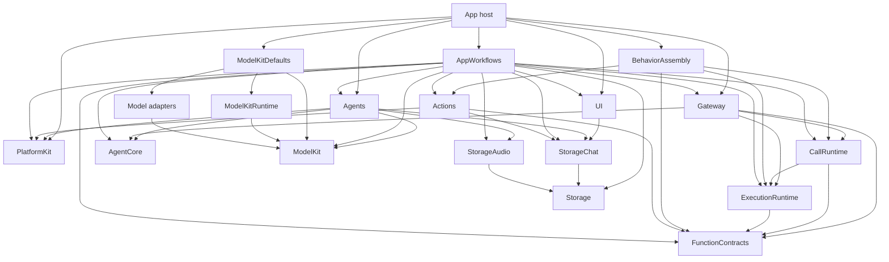

The `AppWorkflows` node is a facade over six independent feature targets; its summarized arrows are the union of those targets. `FunctionContracts`, `Storage` and `AgentCore` have no project dependencies. FunctionContracts is the independent function-contract leaf; ExecutionRuntime owns shared execution, and CallRuntime owns registration and call adapters. Gateway depends on execution contracts, never concrete Actions or Tools. Base ModelKit and PlatformKit have no project dependencies and own their input/output types. Agents adapts across their boundaries.

<a id="37-project-structure"></a>
<a id="project-structure"></a>

### Source structure and compilation map

```text
MobileHarness/
├── App/                         # Host composition, lifecycle and adaptation
│   ├── Composition/             # AppAssembly and runtime/model assembly
│   │   └── Behaviors/           # Independent BehaviorAssembly target
│   ├── Lifecycle/               # Voice/camera/application lifetime owners
│   ├── Workflows/               # State-free facade plus feature workflow targets
│   │   ├── Settings/
│   │   ├── History/
│   │   ├── Bluetooth/
│   │   ├── Speech/
│   │   ├── Presentation/
│   │   └── Diagnostics/
│   └── Adapters/                # Presentation, media and native preview bridges
├── UI/                          # Independent MainActor state, pages and controls
├── Agents/
│   ├── Communication/          # Domain message schemas and built-in identities
│   ├── Core/                    # Independent AgentCore target
│   │   ├── Input/               # Generic audio/image input transport
│   │   ├── Runtime/             # Registry, manager and lifecycle contracts
│   │   ├── Capability/          # JSON declarations and permissions
│   │   ├── Generation/          # Function Token, Channel/wait and Tool parsers
│   │   ├── Output/              # Resolved calls and trusted envelopes
│   │   └── Communication/       # Typed messages and routing contracts
│   ├── ConversationMemory/      # Typed history refresh, deletion and cancellation
│   ├── Assistant/
│   ├── SpeechPerception/
│   ├── SpeechSynthesis/
│   ├── VisionPerception/
│   └── Photographer/
├── Gateway/
│   ├── Runtime/                 # ExecutionRuntime: common function execution
│   ├── Input/                   # External/internal admission and delivery
│   └── Output/                  # Validation, routing, scheduling, results/resources
├── Actions/
│   ├── Contracts/               # FunctionContracts: protocol-neutral function interfaces
│   ├── NexArm/
│   ├── Speech/
│   ├── History/
│   ├── System/
│   ├── Camera/
│   └── UI/
├── Storage/
│   ├── Audio/                   # StorageAudio: transient PCM ownership
│   └── Chat/                    # StorageChat: conversation journal
├── ModelKit/
│   ├── Core/                    # Capability and media contracts
│   ├── Management/              # ModelKitRuntime
│   ├── Defaults/                # ModelKitDefaults assembly
│   ├── Language/                 # Language capability and adapters
│   ├── Speech/                   # Speech capabilities and adapters
│   ├── Vision/                   # Vision capability and adapters
│   └── Backends/                # Engine and resource acquisition targets
│       └── HuggingFace/         # ModelKitHub: concrete Hub SDK adapter
├── PlatformKit/
│   ├── Core/                    # Boundary documentation; no compiled placeholder
│   ├── Audio/                   # OS audio capture and output
│   ├── Vision/                  # Camera capture and native preview
│   └── Connectivity/            # Links, protocols and device feedback
└── Resources/                   # Privacy, assets and local model profiles

Tests/                           # Root module and integration tests
Package.swift                    # Shared-source target map
Config/                          # Shared build configuration
scripts/                         # Checks, builds and provisioning
MobileHarness.xcodeproj/         # App/framework schemes and navigation
```

Directory nesting expresses ownership; `Package.swift` defines the actual compilation boundaries. Shared source has one owner and is not duplicated into another package tree.

### Target map

| Source path | Target | Direct project dependencies |
| --- | --- | --- |
| `App/` excluding package-owned subtrees | Xcode App targets | Host composition, adapters and lifecycle dependencies |
| `App/Composition/Behaviors/` | BehaviorAssembly | Actions, FunctionContracts, ExecutionRuntime, CallRuntime |
| `App/Workflows/` facade | AppWorkflows | Six feature workflow targets |
| `App/Workflows/Settings/` | AppSettingsWorkflow | UI, Storage |
| `App/Workflows/History/` | AppHistoryWorkflow | UI, StorageChat, AgentCore, Agents, Gateway, Actions, FunctionContracts, ExecutionRuntime, CallRuntime (staged intent transport) |
| `App/Workflows/Bluetooth/` | AppBluetoothWorkflow | UI, AgentCore, Storage, Actions, FunctionContracts, ExecutionRuntime, CallRuntime, PlatformKit |
| `App/Workflows/Speech/` | AppSpeechPlayback | FunctionContracts, StorageAudio |
| `App/Workflows/Presentation/` | AppPresentationWorkflow | UI, AgentCore, FunctionContracts |
| `App/Workflows/Diagnostics/` | AppDiagnosticWorkflow | UI, ModelKit, PlatformKit |
| `UI/` | UI | StorageChat |
| `Agents/Core/` | AgentCore | None |
| `Agents/` excluding `Core/` | Agents | AgentCore, ModelKit, PlatformKit, StorageChat, StorageAudio |
| `Gateway/` excluding Runtime/Registration/Protocols | Gateway | AgentCore, FunctionContracts, ExecutionRuntime, CallRuntime |
| `Actions/Contracts/` | FunctionContracts | None |
| `Gateway/Runtime/` | ExecutionRuntime | FunctionContracts |
| `Gateway/Output/Registration/` and `Protocols/` | CallRuntime | FunctionContracts, ExecutionRuntime |
| `Actions/` excluding `Contracts/` | Actions | FunctionContracts, PlatformKit, BehaviorDefinitions, StorageChat |
| `Storage/` core | Storage | None |
| `Storage/Chat/` | StorageChat | Storage |
| `Storage/Audio/` | StorageAudio | Storage |
| `PlatformKit/` | PlatformKit | None |
| ModelKit shared capability sources | ModelKit | None |
| `ModelKit/Management/` | ModelKitRuntime | ModelKit |
| `ModelKit/Defaults/` | ModelKitDefaults | ModelKit, ModelKitRuntime, registered adapters |
| `ModelKit/Speech/VAD/Energy/` | ModelKitEnergy | ModelKit |
| `ModelKit/Backends/HuggingFace/` | ModelKitHub | ModelKitRuntime, HuggingFace product |
| ModelKit adapters/backends | Separate targets | ModelKit or engine-specific backend targets |

### Module README contract

Every direct-child module README keeps this minimum order: **title → summary/design goals → upstream/downstream diagram → internal structure diagram**. Diagrams identify whether arrows mean runtime flow, injection or compile dependencies. Quote node labels containing Mermaid control characters (for example `@Action`). Avoid literal semicolons inside sequence messages/notes; use a sentence break or `<br/>`. Validate diagrams with a Mermaid parser, not only Markdown fence checks.

After that core structure, explain the module's essential principles, rationale and technical mechanisms: ownership, contracts, state/lifetime, ordering, bounds/overflow, completion/failure and cancellation where applicable. Use a short comparison table or an additional flow/state/sequence diagram when it clarifies a real distinction. Keep detailed algorithms in owning subdirectory READMEs and link to them; do not replace important contracts with diagrams alone.

Describe implemented behavior separately from migration targets using ✅/❌. Update the README when contracts or ownership change, and remove superseded claims rather than accumulating contradictory checkpoints. The architecture must not imply that every staged host workflow already enters Agents.

### Architectural boundaries

- App owns concrete assembly, adaptation and application/session lifetime. Feature workflows expose typed operations and retain no global container access.
- UI owns presentation values. The current compilation target imports StorageChat domain values; eliminating this cross-foundation dependency remains outstanding under the repository independence principle. It does not import App, Agents, Gateway, Actions, Tools, ModelKit or PlatformKit.
- AgentCore is independent of concrete Agents, UI, model engines and device adapters.
- All external inputs, Tool results and Action/runtime feedback enter through InputGateway; all Agent messages and executable outputs leave through OutputGateway.
- Actions owns business behavior, motion shaping, composition and completion policy. PlatformKit owns native I/O, protocol encoding, hardware limits and device feedback.
- FunctionContracts owns standard callable input/output and ActionFunction metadata only. Gateway/Runtime (ExecutionRuntime) owns shared function registration/execution; Gateway/Output registration/protocol adapters (CallRuntime) own ActionBinding and calling policies. Gateway orchestration owns scheduling, admission, feedback and shared resource coordination.
- ModelKit is a capability SDK. Provider registration/default selection belongs to ModelKitDefaults; process-wide model ownership belongs to ModelKitRuntime.
- AgentCore/Input owns generic input transport; UI owns presentation values. Storage owns lifetime and retention, not inference or business policy.

✅ AgentCore, FunctionContracts, base ModelKit, PlatformKit and Storage are independent targets. Execution, call adaptation and feature workflows have the compilation boundaries shown above.

❌ UI independence and remaining Agent-driven business routes are listed under [implementation coverage](#implementation-coverage); delivery priorities and acceptance work live in the [Roadmap](../docs/Roadmap.md).

## Part II — Module Responsibilities

This section is an architectural directory. It describes why each module exists and where its responsibility ends; linked module documents contain local structure and implementation details.

| Module | Responsibility | Boundary | Biological analogy |
| --- | --- | --- | --- |
| [App](App/README.md) | Assemble concrete capabilities and coordinate application, voice and camera lifetime. | Adapts modules and owns workflows; does not absorb Agent, Action or device business rules. | The organism coordinating its organs. |
| [UI](UI/README.md) | Render conversation, camera, settings and diagnostics; convert gestures into typed operations. | MainActor presentation only; pages do not own long-lived model/device sessions. | Face and interaction surface. |
| [Agents](Agents/README.md) | Interpret observations, use processing/storage capabilities and select permitted outputs. | Cognitive state and policy; executable effects always cross OutputGateway. | Specialized brain regions. |
| [AgentCore](Agents/Core/README.md) | Define Agent identity, input/output, capability, communication and lifecycle contracts. | Stable independent vocabulary; no concrete cognition or host services. | Organization of the nervous system. |
| [Gateway](Gateway/README.md) | Validate input/output, route messages, schedule Actions and coordinate results/resources. | Coordination only; no inference or domain behavior implementation. | Neural pathways and motor coordination. |
| [Actions](Actions/README.md) | Implement callable UI, speech, camera, history, system and NexArm behavior. | Owns business parameters and completion policy; knows no calling protocol and consumes foundational/injected capabilities. | Learned behavior. |
| [FunctionContracts](Actions/Contracts/README.md) | Define standard function inputs, outputs and constraints. | No runtime, Channel or calling protocol dependency. | Shared function contracts. |
| [ExecutionRuntime](Gateway/Runtime/README.md) | Store and execute canonical functions. | Depends only on FunctionContracts; joined deadlines and cancellation. | Shared execution machinery. |
| [CallRuntime](Gateway/Output/Registration/README.md) | Bind and adapt scheduled/native calls. | Depends on FunctionContracts and ExecutionRuntime; no AgentCore. | Calling protocol views. |
| [ModelKit](ModelKit/README.md) | Expose typed speech, language and vision processing capabilities. | Base SDK knows neither Agent policy nor device I/O; engines live in adapters/backends. | Recognition and generation machinery. |
| [PlatformKit](PlatformKit/README.md) | Capture/output media, manage links and expose native commands/feedback. | Device SDK only; no gestures, model inference, localization or workflow policy. | Sensory organs and effectors. |
| [Storage](Storage/README.md) | Provide bounded transient storage and durable local records. | StorageAudio owns PCM handles; StorageChat owns conversation records; no routing or inference. | Short- and long-term retained material. |
| [Resources](Resources/README.md) | Hold privacy declarations, assets and local model profiles/artifacts. | Packaging input supplied by App; no runtime ownership. | Materials consumed by the organism. |

### Key internal module groups

**App.** [Composition](App/Composition/README.md) builds the graph and validates registrations. [Lifecycle](App/Lifecycle/README.md) owns long-running voice/camera work and cleanup. [Workflows](App/Workflows/README.md) is a state-free facade over independent Settings, History, Bluetooth, Speech, Presentation and Diagnostics targets. [Adapters](App/Adapters/README.md) translate module contracts to host capabilities.

**Agents.** AgentCore supplies the common runtime and protocol vocabulary. Assistant owns conversation and response policy; SpeechPerception owns VAD/ASR interpretation; SpeechSynthesis owns directed text-to-PCM work; VisionPerception owns pose interpretation and its bounded latest-state presentation outputs; Photographer owns tracking policy; ConversationMemory owns deterministic history intent and result-driven deletion. Each Agent's JSON v6 file declares model-callable capabilities and communication permissions.

**Behavior.** Actions owns protocol-neutral callable functions. FunctionContracts defines their inputs/outcomes; Gateway owns independent ExecutionRuntime and CallRuntime. ActionCall follows Channel scheduling; ToolCall follows its binding's direct or scheduled policy. BehaviorAssembly freezes one canonical function store and explicit host bindings without importing AgentCore. [Protocol routing](Gateway/Output/Protocols/README.md) explains registration, Agent transport/parsing and shared execution/feedback.

**Foundations.** ModelKit separates capability contracts, process-wide management, default assembly and engine adapters. PlatformKit separates native I/O from business behavior. Storage separates reusable mechanisms from Chat and Audio domains. ModelKit, PlatformKit and StorageAudio own their separate capability/storage contracts.

<a id="part-iii--key-techniques"></a>

## Part III — Cross-module Technical Design

This section owns the system-wide contracts that cannot be explained by one module alone.

### Composition, startup and lifetime

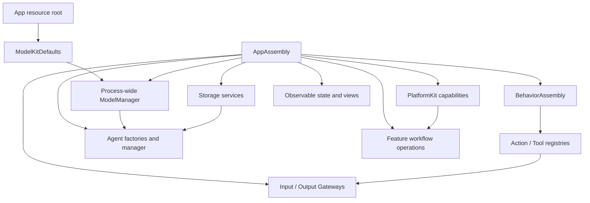

Composition resolves configuration and registration errors before producers start. Gateway validates that every declared internal or model-callable Action/Tool has a concrete implementation. Production uses one process-wide ModelManager and shared stores where identity must cross modules.

Voice and camera have independent App-owned sessions. A stop closes producer admission, cancels and joins capture/perception, sends explicit Agent cancellation, retires owned media and Actions, and only then releases resources. Page navigation does not define runtime lifetime. Session IDs, Agent incarnations, turns and monotonic sequences fence stale input, feedback and presentation.

### Unified Signal Contract

A **Signal** is immutable information admitted to an Agent: human intent, a captured physical observation, another Agent's message, or execution feedback. Signal is the architectural concept; **`AgentInput` is its canonical in-process envelope**. Keep one envelope rather than introducing a parallel `Signal` type. Payloads retain domain-specific types and validation.

An Agent's registered Action/Tool call is an execution request in `OutputEnvelope`, not an input Signal. Its returning feedback becomes a Signal. Model inference returns and private intermediate computations remain local capability results unless explicitly communicated to another Agent. UI drafts, scrolling and expansion remain local presentation state.

#### External and internal origin

Origin and payload meaning are independent dimensions. All origins share the `AgentInput` envelope; intent, observation and feedback remain domain semantics rather than inheritance branches.

| Origin | Examples | Authority |
| --- | --- | --- |
| External | Human interaction, native capture/device facts, OS lifecycle and permission changes, future remote inputs | App adapters bind source identity and adapt validated native inputs. |
| Internal / Agent | Published observations, directed commands and declared domain replies | Identity-bound AgentMessaging binds a live Agent source through both Gateways. |
| Internal / Runtime | Actual execution feedback, task progress/cancellation and future declared runtime timer triggers | The owning execution/runtime producer binds operation identity and feedback authority. |

“External” means outside the Agent system, even when UI or a native SDK runs in the same process. A hardware notification is an external fact; the executor's correlated interpretation of an operation outcome is internal feedback. Both can exist, with distinct contracts and deduplication rules. Model inference returns stay local unless explicitly communicated.

The design uses composition of common envelope, typed origin and domain payload rather than a class hierarchy. Origin must be bound by the producing adapter or runtime, not asserted by payload content. Neither payload kind nor a missing incarnation identifies origin, and an internal label grants no permission. Current typed-origin coverage and remaining host-control paths are listed under [implementation coverage](#implementation-coverage).

#### Envelope and payload

| Contract element | Canonical structure / rule |
| --- | --- |
| Identity and scope | `AgentInput.id`, `sessionID`, optional `AgentTurn`; distinguish delivery identity, session and interaction. |
| Schema | `InputMetadata.contract` and `version` identify payload semantics; `topic` currently equals contract. Agent configuration JSON v6 is a separate format version. |
| Producer | `source` and optional `incarnation`; App input adapters assign external sources, and the runtime binds Agent identity. Model text cannot assign trusted identity or permissions. |
| Time and order | `capturedAt` uses process uptime; `sequence` is producer-scoped; `deadline` uses `ContinuousClock`. These are process-local values, not wall-clock timestamps or a remote wire format. |
| Causality | `rootID`, optional `parentID`, `hops`; forwarded messages preserve their root and identify their parent. Execution feedback also preserves its call/execution correlation and owning session. |
| Content | `InputPayload` selects typed text, event, audio, image, Agent message, Tool result, Action result or activity feedback. A kind declaration alone does not implement a payload or adapter. |
| Domain message | `AgentMessage` carries immutable `Encodable & Sendable` content. Domain-owned schemas validate concrete type, fields, units, encoded size and freshness through `CommunicationContracts`. |

#### Payload meaning

Origin describes who produced a Signal; the following categories describe what it means. They do not introduce a second transport enum:

| Category | Producers and examples | Current representation |
| --- | --- | --- |
| Intent / command | Human clicks, text requests, Agent-generated synthesis or cancellation | `.text`, `.event`, or registered `.observation(AgentMessage)` with command semantics |
| Observation | Microphone/camera capture, perceived transcript, pose or sound direction; future device discovery facts | `.audio`, `.image`, registered `.observation(AgentMessage)` |
| Execution feedback | Actual Tool/Action outcomes and activity lifecycle updates | `.toolResult`, `.actionResult`, `.activityEvent` |

The existing name `observation` is a generic domain-message carrier and currently includes commands. `CommunicationContract.startsNewWork` distinguishes generated work from forwarded observations. New business intents must use domain-owned typed contracts registered through this mechanism; do not expand string-encoded `runtime.event` commands. History refresh, delete and cancel use typed `history.intent/1`; legacy history strings reject. Remaining host control strings are outstanding typed-contract work. Payload types belong to their domain, generic envelope/routing types to AgentCore, and native SDK values are converted by App adapters.

App adapters bridge PlatformKit frames into AgentCore values and native-image attachments without adding model or device dependencies to AgentCore. Media are successive bounded inputs; attachment lifetime belongs to the capture/session owner.

<a id="32-internal-agent-communication"></a>
<a id="communication-framework"></a>

### Input and Agent communication

Communication covers external input, Agent publications and directed messages, returning Tool results, and Action/runtime feedback.

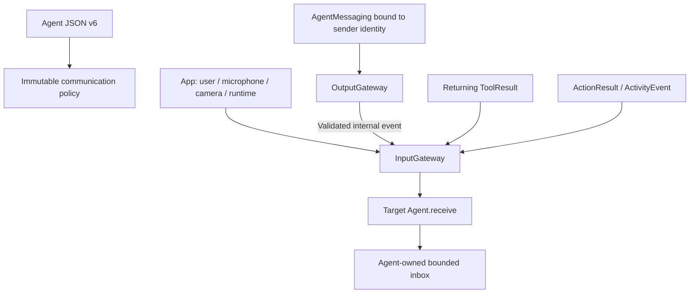

JSON declares supported inputs, exact subscriptions, publications and directed sends. Supporting a contract does not create a subscription. Broadcast target selection uses subscriptions; directed delivery still validates source, target, contract and session. There are no dynamic listeners, wildcards or implicit fallback recipients.

Gateways perform bounded structured admission and metadata validation; their cross-actor calls are asynchronous and await per-target admission. Agent inboxes own pending work. Gateway has no independent message bus, persistent worker or delivery FIFO. A delivery receipt means the target accepted the input, not that inference or an effect completed. Discrete messages and device Actions are never silently replaced; only explicitly declared latest-state paths may coalesce.

#### Current signal routes

| Source | Contract | Receiver or observer |
| --- | --- | --- |
| `phone.microphone` | `media.audio` | SpeechPerception subscription |
| `phone.camera` | `media.image` | VisionPerception subscription |
| `user` | `user.text` | Assistant subscription; the current production UI has no text-entry field |
| `speechPerception` | `speech.final`, `speech.phase` | Assistant subscription |
| `speechPerception` | `speech.partial`, `speech.final`, `speech.phase` | Registered runtime observer for admission/lifecycle coordination, without UI mutation |
| `visionPerception` | `vision.pose` | Declared business subscribers; gaze and skeleton presentation use independent Tools |
| `user` / trusted host runtime source | `history.intent/1` | ConversationMemory: typed refresh/delete/cancel |
| `runtime` | `tool.result`, `action.result`, `activity.event`, `runtime.event` (`assistant.cancel`) | Original or explicitly selected Agent/session |

Assistant sends directed `speech.synthesize` and `speech.cancel` messages to SpeechSynthesis. A publication with no Agent recipient fails unless a registered runtime observer accepts that contract. Agent messaging, Tool return and runtime Action feedback all re-enter through validated InputGateway paths, while retaining their distinct permissions and completion semantics.

### Communication and execution contract ownership

Domain ownership: Agents/Communication owns PoseObservation, SpeechPhase, SpeechSynthesisInput and ConversationMemoryIntent, Agents owns built-in identity constants, and Assistant owns automatic speech prompt policy. AgentCore has zero project dependencies; scheduler source identity is explicit. The communication contract provides generic message/schema registration. The business catalog owns domain expiry; App owns device-source/media expiry; VisionPerception owns sampling.

Core communication has one generic typed-message container and one immutable schema registry. Application schemas/identities are grouped in Agents/Communication/AgentContracts.swift, Agent-domain speech/pose values in Agents/Communication and image inputs in Agents/Core/Input/ImageInput.swift and presentation values in UI/Camera/PoseOverlay.swift, and native source/deadline conversion in App/Adapters/MediaInputAdapter.swift. AgentTurn is a generic interaction identity.

Neutral contract boundary: concrete resource names belong to App; reports carry bounded producer-owned details/error identifiers; text soft limits belong to the consuming Agent.

Execution Runtime owns generic bounded resources and failure/report identifiers only; NexArm and Bluetooth producers own domain vocabulary and classification.

### Routing, Authorization and Feedback

#### Routing and authorization

External Signals enter through App → InputGateway. Agent messages use AgentMessaging → OutputGateway → InputGateway. Agent-driven business effects, including UI changes, use Agent → OutputGateway → registered Action/Tool → capability endpoint; actual returning feedback enters InputGateway again.

Each Agent declares model-callable Actions/Tools and communication permissions in JSON v6. Fixed internal behavior and output permissions belong to Agent code. App binds concrete handlers; Gateway validates coverage and authorization. Runtime control notices describe protocol completion/failure, not unregistered business effects.

1. Contracts and permissions are explicit: validate payload/schema, allowed source, live identity, session, deadline and capacity before admission. Publish selects exact static subscriptions; send selects an explicit recipient. Unknown contracts and incompatible versions reject, with no fallback recipient.
2. Admission means accepted for processing. It does not imply inference, rendering or physical completion. Returning Tools provide correlated results; completion-only Tools return execution outcomes without injecting a ToolResult. Actions retain their execution/lifecycle semantics.
3. Forwarded observations cannot extend the parent's deadline. Registered newly generated work receives a fresh bounded admission deadline while retaining causal association. Runtime result/cancellation producers follow their explicitly owned feedback contracts. Admission expiry is not an execution timeout or a hardware stop guarantee.
4. Agents fence feedback by session and call/execution identity before continuation. Failed delivery is separate from failed execution; delivery retry must not repeat a completed effect. Cancellation uses the owning execution protocol and joins cleanup; a durable effect remains committed.
5. Every admission, inbox and output buffer has an explicit bound and overflow policy. Gateway has bounded active admission and no waiting Signal queue or FIFO guarantee. Only explicitly declared latest-state observations may coalesce; intents, results and device actions must have explicit rejection/retry/failure handling rather than silent replacement.

#### Result semantics and presentation

| Event or result | Agent responsibility | Observable effect |
| --- | --- | --- |
| Input admission | Await actual processing/execution; handle rejection at the producer | No implied operation success or completed UI effect |
| Data or successful execution feedback | Validate correlation, update task state and choose the next step | A new authorized Action/Tool may present results or perform another operation |
| Progress / physical observation | Interpret domain facts under freshness and operation scope | Explicit presentation or behavior output; only declared latest-state inputs may coalesce |
| Failure / cancellation | Stop or continue according to task policy; retain committed effects and join owned cleanup | Explicit status presentation where registered; no automatic effect replay |
| UI endpoint completion | Respect the endpoint's declared completion semantics | State acceptance does not prove animation completion, audio drain or physical arrival |
| New selection / changed environment | Treat as a fresh scoped input linked to its relevant task | Re-enter through InputGateway when business processing is required |

Presentation endpoints fence session/request/turn identity before applying a business update, so late feedback cannot overwrite newer state.

Rendering a state change does not automatically produce a new Signal. Only meaningful user, system or domain feedback re-enters the input boundary. This keeps the feedback loop explicit and avoids self-triggered presentation loops. Endpoint failures remain execution outcomes; completion-only UI Tools do not manufacture returning ToolResult Signals.

### Capability declaration and output resolution

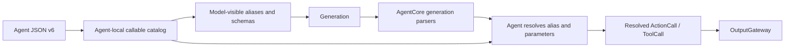

Model-callable Actions are grouped by Channel in JSON; native Tools use function declarations. Fixed internal behavior and permissions live in Agent code. Aliases are local to one Agent and resolve before Gateway admission. Gateway accepts only resolved paths and typed scheduling controls. App binds handlers explicitly; invalid configuration has no fallback registration.

Function Token is the Assistant's streaming mixture of natural text and restricted XML:

```xml
<express emotion="smile"/>
Hello.
<wait>
  <express emotion="thinking"/>
  Let me think.
</wait>
```

Natural text, Action tags, Channel scopes and nested wait groups are parsed incrementally. Text boundaries may create code-owned speech/caption calls; explicit tags resolve only through the declared catalog. Raw markup, incomplete structures and unresolved aliases never reach Gateway. Native Tool calls use the separate ToolCall parser.

### Canonical Functions and Protocol Bindings

Actions owns six business domains: UI, Speech, Camera, History, System and NexArm. Queries and effects are both callable business functions. A capability address is exactly `Domain.Module.function`: the domain identifies its directory, the module identifies a cohesive entry file, and the function identifies the operation. Channels, serialization keys, resources and call protocols are separate properties.

| Domain | Module | Canonical functions |
| --- | --- | --- |
| UI | Expression | express, setExpression |
| UI | Gaze | moveEyes |
| UI | Caption | print, setTranscript, finishTranscript, beginReplyTurn |
| UI | VoiceState | setVoiceState |
| UI | Pose | showPose |
| UI | HistoryPresentation | showHistory |
| Speech | Playback | speak |
| Camera | Capture | open, close, flip |
| History | Conversation | list, read, delete |
| System | Runtime | runtimeInfo |
| NexArm | Motion | moveMotor, resetMotor, reset, shakeBase |
| NexArm | Gesture | nodHead, shakeHead, waveWrist, tiltWrist, lookAround, celebrate, dance |
| NexArm | Tracking | aim |

`@Action` produces one protocol-neutral `ActionFunction` with a `FunctionInput` handler, completion metadata, serialization key, resources and static/dynamic execution budgets. `ActionCompletion` carries its value, bounded child report and terminal issue. FunctionRequest contains canonical address and parameters, without Channel, wait membership or a protocol discriminator. Opaque execution context and a host-supplied report sink preserve correlation without granting permission.

App freezes one validated catalog (at most 32 domains and 256 functions) and creates `ActionBinding` values. Bindings independently select protocol availability, native direct/scheduled execution and native feedback policy. Unknown modules, duplicate addresses and invalid metadata fail startup. Neither protocol projection nor an Agent argument may weaken intrinsic constraints. Registration availability does not grant Agent permission.

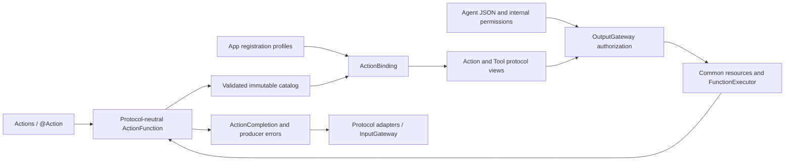

FunctionContracts under Actions/Contracts is the independent input/metadata/outcome leaf. Gateway/Runtime compiles as ExecutionRuntime and owns FunctionRegistry, FunctionExecutor, bounded report storage, deadlines and joined cleanup. Gateway/Output/Registration and Protocols compile as CallRuntime and own bindings and request/result adapters. Gateway orchestration adds AgentCore ownership, authorization, scheduling and feedback. Business Actions imports no Gateway execution or call-protocol types; BehaviorAssembly imports no AgentCore.

| Layer | Shared contract | Protocol-specific concern |
| --- | --- | --- |
| Business implementation | FunctionInput, ActionExecutionContext, ActionFunction, ActionCompletion | None |
| Agent declaration | Canonical address and independent grants | Text aliases/default Channels versus native names/schemas |
| Model input | Selected capabilities | Action catalog in context prompt versus declarations in ChatRequest.tools |
| Output parsing | Canonical address and validated parameters | Text tags become ActionCall; native events become ToolCall |
| Execution | Resources, budgets, reports and joined cleanup | Channel/wait scheduling versus binding-selected direct/scheduled native policy |
| Feedback | Actual outcome and causal context | ActionResult versus ToolResponse/ToolResult and declared feedback policy |

Agent JSON v6 uses three-field Action paths and native declarations shaped as `{path: {domain, module, function}, definition: ...}`. Only the native definition reaches the provider; its name is an Agent-local alias. Incompatible configuration versions fail explicitly. Text deltas pass through AgentGenerator and native events through ToolCallParser; both resolve inside Agents. Tool results never implicitly become executable markup. Unsupported providers receive no native declarations.

Returned values are limited to 64 KiB UTF-8 and reject explicitly before delivery. Structured report limits are independent; oversize values are not silently truncated or replayed.

`System.Runtime.runtimeInfo` currently returns fixed informational text; it is not a live diagnostic capability.

### Action and Tool execution

| Dimension | ActionCall | ToolCall |
| --- | --- | --- |
| Resolution | Action path, arguments and effective Channel | Tool path and arguments |
| Dispatch | OutputGateway → ChannelScheduler → CallRuntime → ExecutionRuntime | OutputGateway → ToolDispatcher → direct ToolExecutor or scheduled native projection → ExecutionRuntime |
| Ordering | Task-local Channel FIFO and nested wait groups | Binding selects direct execution or an isolated scheduled child on its declared Channel |
| Completion | Registered handler boundary plus task finish barrier | Returned value or completion-only, fixed at registration |
| Feedback | Optional correlated ActionResult and ActivityEvent | Returning ToolResult re-enters InputGateway |

Both protocols execute the same function and preserve its resources, budgets and cleanup. A scheduled native call uses one isolated child scope outside model XML waits, with one admitted job and one bounded result receipt. Cancellation joins that child; native feedback produces one ToolResult and no duplicate ActionResult.

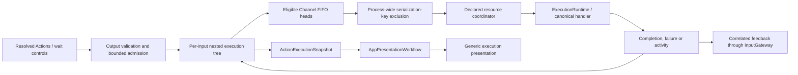

Each input owns a scheduling tree. Channels order work within that tree; equal names in other tasks do not create a global FIFO. A wait group joins its parent's preceding work and all children before releasing the continuation. Serialization-key exclusion is process-wide and independent of canonical path and Channel. Production scheduled UI, Speech and NexArm functions declare their exclusion keys explicitly; the key remains held until handler cleanup joins. Resource leases/fences coordinate Actions, Tools and App-owned paths across module boundaries. Capacity exhaustion rejects explicitly, and cancellation joins cooperative handlers.

Gateway reserves bounded terminal-feedback capacity before admitting an Action that requests feedback. `ActionResult` is correlated to the originating Agent incarnation/session and describes the handler's declared completion boundary; `ActivityEvent` reports later ongoing activity. Retrying feedback never repeats the effect. Separately, the scheduler publishes payload-free `ActionExecutionSnapshot` values for App/UI observation. Their display name comes from validated Action metadata, while raw arguments, device telemetry and permission decisions are excluded.

### Call failure and deadline semantics

Agents resolve model aliases. Unknown calls and invalid invocation parameters emit non-executable rejectedCall outputs and count against the 120-call bound; structural parsing failures and limits still terminate generation. Gateway retains these failures in its 256-entry output history without admitting rejected Actions to the scheduler.

Action handler reports preserve completed child entries and attach later exceptions/cancellation as an execution-level issue. Invocation lookup, argument and resource availability rejection remain local. Permission rejection, all ActionSchedulingError cases (including capacity/limits), communication identity failure and actual task cancellation still close the owning Action tree; execute records ordinary failures without automatically stopping the producer.

ToolExecutor converts ordinary exceptions and operation-local cancellation into ToolResponse errors. Function-defined Tool timeouts take precedence over the 30-second Runtime fallback; registration validates them in (0,86400] seconds. Action function budget resolvers likewise override a 30-second Runtime fallback, preserving NexArm dynamic estimates. Invalid explicit declarations fail rather than falling back. Timeout cancels and joins cleanup before returning; cancellation of the calling task propagates. Returning Tool feedback failures preserve value/isError/callID and add a bounded deliveryFailure copied into output.failure. Completion-only Tools never inject ToolResult input events.

Assistant records rejected native Tools when possible; failure to write that outcome produces a separate assistant.historyError result and preserves the original rejection. Conversation admission, raw history and terminal durability remain strict. See [result fields and failure boundaries](Gateway/Output/Results/README.md#outcome-fields-and-failure-boundaries).

### Execution Feedback Causality

`SignalCausality` captures immutable inputID, rootID, hops, turn and sequence from the initiating OutputEnvelope. ActionResult and ActivityEvent require that context. InputGateway preserves the original root, uses the initiating inputID as parent, increments hops once and creates a fresh bounded feedback admission deadline. Returning Tool feedback follows the same causal rules. Invalid/exhausted hops or a stale Agent incarnation/session close delivery without replaying the effect.

Action terminal feedback reserves capacity before effects. Its bounded outbox retries delivery of the same result and execution identity; it never re-executes the operation. Execution outcome and delivery outcome remain distinct. Host-originated camera activity has an explicit lease-scoped causal root. AgentInput remains an in-process contract, not a remote authentication or durable transport format.

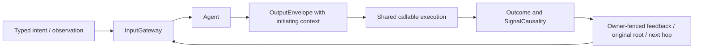

### Resource control ownership and cleanup

ResourceCoordinator owns control rather than device health, with unlocked/locked(owner) snapshots from one holding index. Transient writers and persistent leases share ownership semantics; internal handoff is bounded. Stop errors after joined work unlock; timeout fails that request and actual late completion automatically unlocks, without replay. Revocable execution permits prevent stale held-context bypass at App entries. Cancelled cleanup still waits independently of its caller. Camera cleanup uses joined resource release. Action/Tool outcomes, Channel queues and Bluetooth recovery remain separate.

### Voice, cognition and presentation

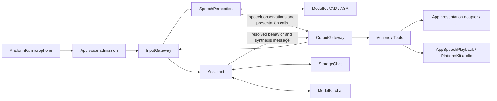

SpeechPerception converts admitted PCM into phase and transcript observations. Its Agent actor owns admission, utterance identity, phase transitions and reply gating; VoiceActivitySegmenter adapts VAD scores, SpeechBoundaryPolicy owns sample-count boundaries, internal SpeechRecognitionTurn owns ASR sessions, and internal TranscriptAccumulator owns revision merging.  Assistant reads bounded conversation context, streams chat generation, resolves behavior and persists completed turns. Recognition UI, reply UI and speech playback all use permitted outputs; runtime observers do not mutate presentation on an Agent's behalf.

`AgentTurn` and trusted output sequences travel through input, observations, calls and returned results. AppPresentationWorkflow admits only the active session/turn/sequence. Recognition previews may be replaced within their declared latest-state path; reply chunks and discrete behavior are preserved. Playback state reflects actual audio output rather than model generation completion.

### Speech capability selection and recognition

Nemotron recognition uses the shared multilingual/2240ms Core ML export through Management → Hub → App storage. The receipt fixes the installed revision; stale revisions prompt explicit deletion. ModelKitFluidAudio preloads shared graphs, the ASR adapter obtains a fresh recurrent session under one lease, ordered 16 kHz PCM produces bounded revisions, and finish/cancel drains native work before release. macOS and iOS use the same files.

Speech resource workflow: restore independent useCustomRecognition/useCustomSynthesis (defaults false; persisted choices require installation validation) → Defaults stable capability facades → installed/available local Nemotron/MOSS/Silero or Apple SpeechAnalyzer/AVSpeechSynthesizer/energy VAD → existing SpeechPerception endpoint → normal conversation. Disabled ASR/TTS choices select Apple speech independently and preserve weights; VAD selects installed available Silero regardless of those choices, otherwise Energy; Gemma 4 E2B/YOLO retain independent model selection. App stops voice before policy changes. Apple language assets are system-managed and may download during first warmup. ModelKitEnergy is the independent ModelKit-only VAD adapter; SpeechFallback.swift belongs to Defaults, not Management.

### Sound source direction and capture readiness

PlatformKit preserves native mono or ACN/SN3D FOA PCM and hardware capture time. App passes channel layout and PCM through the generic AudioInput; SpeechPerception alone calculates dominant acoustic direction and extracts W for 16 kHz ASR. sound.source/1 is a 500 ms latest-state observation through OutputGateway→InputGateway. It uses captured sound-field coordinates and contains no motor/camera command. Mono remains available for ASR; direction is unavailable there. Reply admission is independent of direction publication, and Photographer does not subscribe.

Native capture startup is committed by first validated PCM delivery. FOA uses AVCaptureSession microphone configuration; unsupported or failed startup closes the spatial graph before mono retry, with a 3-second first-frame bound for each backend. No running stream silently changes channel layout. The host shows listening after readiness and clears that phase/spectrum on capture failure.

PlatformKit queries the native AudioBufferList size before extracting PCM, within storage for at most four buffers; four interleaved FOA channels occupy one buffer. Retained block storage lives through synchronous conversion, and native query/extraction failures preserve OSStatus. Native layout, PCM format and timeline validation still precede App/Gateway admission.

### Session, turn and UI boundaries

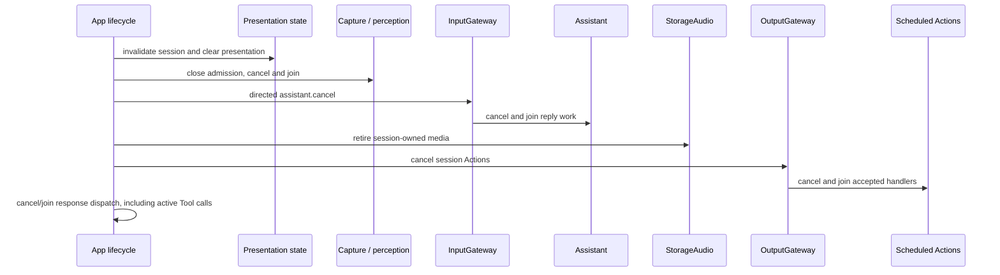

| Boundary | Recognition caption | Reply / expression |
| --- | --- | --- |
| Confirmed new utterance | Latest partial replaces the preview | Assistant clears once through `beginReplyTurn` |
| Endpoint reached, ASR pending | Preserve the preview | Await the reply |
| Final or empty recognition | `finishTranscript` clears and seals | Produce a reply or return to listening |
| Response and playback | Remains sealed | Append reply; speaking follows actual playback |
| Reply completed | Empty | Retain until the next utterance |
| Stop, background or failure | Clear and invalidate the session | Clear and invalidate the session |

SpeechPerception owns recognition captions and voice phase presentation; Assistant owns reply captions, expression and atomic reply-turn start; VisionPerception owns pose/gaze presentation requests. All Agent-selected changes use permitted Actions or Tools. App may reset state for user/OS lifecycle and may present actual device telemetry through its adapters.

### Expression transactions

Expression behavior follows Actions Perform/Set: UI.Expression.express is finite and awaits enter/restore transaction acknowledgments; UI.Expression.setExpression is state and commits the persistent base (clear resets it). App adapts session/turn ownership with one pending acknowledgment; UI supplies display-only callbacks. Cancellation/new-turn teardown invalidates old callbacks.

### Synthesis and playback ownership

Speech synthesis and playback are separate, correlated paths. The originating Agent sends a directed `speech.synthesize(audioID, text, locale)` message and schedules `Speech.Playback.speak(audioID)` on its chosen Channel.

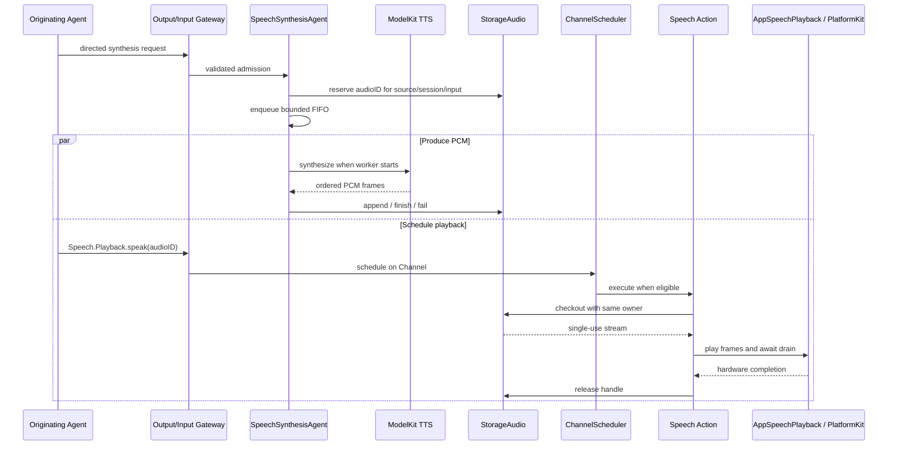

Admission of the synthesis request does not mean synthesis completed. SpeechSynthesis owns a serial bounded FIFO and a per-job execution deadline; it does not inspect Action Channels. Playback can consume frames while synthesis continues. StorageAudio validates ownership and provides a single-use, reply-owned handle with no pending/ready expiry timer. Reply completion or session cleanup retires unused handles. Successful `Speech.Playback.speak` completion means platform playback drained and the lease was released. SpeechSynthesisError carries producer timeout/invalid-output failures through StorageAudio unchanged; neutral PCM/cache errors remain storage-owned. App maps known failures to user wording after playback cleanup.

### Camera perception and UI projection

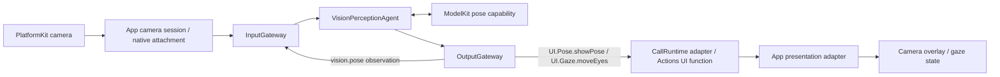

App owns capture, the persistent camera resource lease and native-image resolution. VisionPerception owns frame selection, pose interpretation and replaceable display/gaze outputs. Model inference, observation publication and presentation acceptance have separate completion boundaries. App rejects stale session/frame updates before UI mutation.

### Adaptive vision cadence and projection

VisionPerception retains every valid newest capture in its capacity-one slot. The worker consumes the newest slot at start, with expiry validation and adaptive cadence (initial 100ms, default bounds 0...250ms). Native clocked inputs also enforce the monotonic inter-start gap. Frame selection uses latest-frame admission and adaptive cadence; model calls never overlap.

YOLO diagnostics share the bounded UI.Pose.showPose payload: callback-to-model wait, capability-call time, callback-to-result latency, one-second-window successful FPS and replacement count. App converts Tool values to UI/Camera presentation values; UI displays these without runtime dependencies. Capture timing uses ContinuousClock, not assumptions about media timestamp epochs.

VisionPerception owns bounded latest-image motion, pose-motion/confidence/loss feedback and inference/total-latency budgeting for adaptive cadence. At most six skeleton snapshots are retained; fast changes accelerate immediately, stable targets relax gradually, and empty scenes retain periodic search. App injects bounds; next-interval statistics travel with pose through UI.Pose.showPose.

FrameMotionAnalyzer stays within Agents/VisionPerception: one sampled inferred-frame reference, one padded six-person ROI union, bounded exposure/noise compensation and continuous urgency. FrameCadence fuses those signals with pose reliability and compute/freshness budgets. Frame cadence has no eligibility-filtered queue or PlatformKit/ModelKit/UI policy dependency; stale results cannot mutate presentation.

Urgent YOLO detection permits a zero scheduling interval. The single inference worker processes only the newest pending capture after the active call completes. Normal inference duration adds no scheduling floor; compute-dominated freshness pressure can temporarily impose a bounded cost floor. Camera close clears skeleton and its statistics.

UI/Camera owns PoseOverlay and display statistics. VisionPerception owns its Encodable PoseOverlayPayload; PoseOverlay remains the independently validated callable-function payload. App maps callable outcome values into UI values. UI depends only on StorageChat; AgentCore has zero project dependencies.

### Photographer tracking and control handoff

Photographer consumes validated `vision.pose` through InputGateway and emits internal `NexArm.Tracking.aim` through OutputGateway. Its JSON v6 contains the subscription and empty model-callable catalogs; fixed internal permission and target-selection policy stay in Agent code. The output buffer holds eight calls and fails explicitly on overflow.

NexArmActions validates intent arguments; Gateway authorizes source/session and Tool permission. The App worker holds motors1–4 through ResourceCoordinator, with monotonic usable-pose freshness from Photographer; one second without fresh input joins/releases the writer. App groups all six motors under nexarm.writer and explicitly allows Assistant to preempt Photographer after joined cleanup, including disjoint motor5/6 actions. Queued same-owner Actions survive the takeover gate; no scheduler/session cancellation or radio recovery occurs. VisionSession camera closure removes its owned work; old targets never replay. Actions owns mapping/motion, PlatformKit native encoding; return is target admission, not physical arrival.

Vision and Photographer outputs have independent failure scopes: offline tracking is reported without stopping pose/skeleton effects. BLE connected state is distinct from verified control availability. Read-only query timeouts keep the link connected and quarantine further exchanges until App reconnects the link. Final App resource validation requires all six Agent JSON files.

Agent fault isolation: ordinary messaging and behavior execution failures are outcomes, never a reason to terminate sibling Agents. Photographer owns offline command suppression; Gateway retains bounded output/Action diagnostics. Startup configuration validation and explicit cancellation remain strict.

### Robot behavior and device feedback

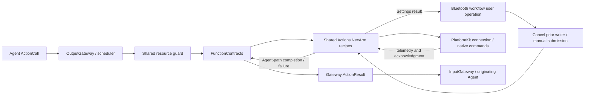

Agent-selected and Settings-initiated movement reuse the same Actions recipes and encoders. Settings enters App directly, cancels old writers and uses background segment-feedback execution without Gateway resource admission. Agent-selected execution retains OutputGateway authorization, resource arbitration and its declared completion policy. Actions owns gesture composition, limits within business policy, home/reset selection and completion rules. PlatformKit owns discovery, connection, protocol encoding, native hardware limits and structured feedback. A transport write is not automatically an Action success; each Action documents the acknowledgment that completes its effect.

Bluetooth discovery/connection is an App workflow because preferred-device ordering, explicit user intent and presentation belong to the application. Physical safety requires device-side protection and cannot rely on iOS background execution. App distinguishes inactive from actual background. Background stops and joins control effects but retains healthy native connectivity; return verifies the current link after cleanup before reuse or reconnection. Each eligible foreground return grants a fresh three-attempt episode, actual connection initiation consumes an attempt, and connection success clears the budget. Manual disconnect/forget disables automatic reconnection. Native cleanup/isolation remains required when the link is unhealthy; no old movement replays. Bluetooth background execution and state restoration are not configured.

### Robot motion admission and home selection

Actions tracking converges the last two counts at low speed, committing only after native admission; this never establishes physical arrival.

Ordinary passive-link reset uses the configured five-arm-axis reference; tracking rest remains separate. Actions owns target selection, shared Settings/Agent execution and configured motor-home precedence; PlatformKit remains a native SDK.

### Bluetooth connection, recovery and presentation

PlatformKit spaces all BLE writes by at least 30 ms under one connection-wide budget; streaming admission returns false without queuing, and acknowledged requests reserve one cancellable slot. Actions retains proposal/finite-step semantics; App snapshots aim round-robin iteration and owns recovery. Fixed-size transport diagnostics distinguish notification traffic from valid feedback.

Transport recovery and Agent scheduling are independent. Bluetooth closes native I/O sessions, resets connection-local state and reconnects; it never cancels/removes accepted Actions or suspends scheduler admission. Current operations fail through Action/Tool results; queued work executes normally against the state available at execution. No global voice cleanup or automatic replay of failed native commands.

Native connection/subscription completion makes Settings controls available immediately. App performs no connection pose/version/IK probe, stationary validation or indication movement. It listens to unsolicited position packets and publishes measured state; refresh reads the latest received packet only. Feedback silence remains visible but does not disable manual commands, disconnect or start recovery. Native write/connection failures remain explicit. Actions uses passive BLE compatibility for this App connection; recipe IK resolution is deferred to an explicit preset request, not connection verification. Manual jog can start from the existing configured reference when no sample has arrived; that reference is not measured telemetry. Segment arrival observation and cancellable replacement remain in Actions/App.

Actions prepares only requested Cartesian poses; passive simple/reset commands require no IK queries. PlatformKit selects supported native write capability with shared pacing and a capacity-one acknowledged-control window, publishes current interrupted-reply failures, and App reports restored connectivity without claiming motion validation. Runtime/Gateway preserve terminal failure entries and descriptions.

Bluetooth presentation retains current state only. Latest native connection, communication issue and recovery state alone appear in Settings; healthy snapshots/new connections replace prior faults. The device list uses one row to connect while unconnected or open detail when already connected; connection success stays on the list, disconnect appears only when connected, and remembered devices remain forgettable; an already-open disconnected detail disables actions/motor gestures. Execution results/home issues and bounded automatic recovery remain independently owned.

### Settings, history and feature workflows

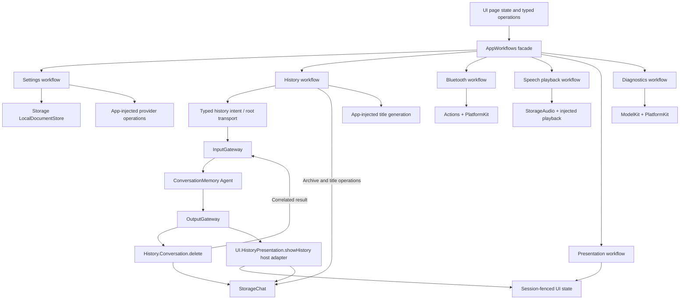

The facade holds no mutable feature state. Each feature target owns its effects and depends only on the values/services needed by that feature. UI owns editable presentation state; workflows own persistence, validation and asynchronous operation boundaries. Credentials use the Keychain through App-supplied operations, while non-secret settings and conversation records use local document storage.

Conversation history keeps one current conversation and archived records. Assistant and history operations share the injected journal. Assistant selects ten completed rounds and assembles the exact request; StorageChat supplies an opaque process-local read token and admits persistence only while that token remains current. Mutation and terminal recovery invalidate the token; conflicts fail before inference without implicit retry. UI owns display-title defaults. Browsing records does not replay effects.

History.Conversation.list/read return bounded paged previews (at most 1800 UTF-8 bytes with explicit truncation) through InputGateway. Native Tool declarations and outcomes are persisted independently of generation completion. Assistant does not automatically start another model turn after ToolResult.

### Deterministic History Mutation Contract

Refresh, confirmed archive deletion and cancellation use typed `ConversationMemoryIntent` under `history.intent/1`, carried by AgentMessage. Legacy string history commands reject. User-source refresh/delete and trusted host runtime-source cancel remain external-origin input, not forged runtime execution feedback.

ConversationMemory interprets intent without inference or I/O. Refresh emits UI.HistoryPresentation.showHistory; deletion emits History.Conversation.delete and waits for runtime feedback matching session and callID before requesting presentation. Actions/History validates archive-only deletion and invokes the atomic Storage transaction. App composes the journal and carries intents/results without selecting the next business call.

One pending mutation and one root request reject overlap without backlog. Root transport executes at most two business calls. Cancellation joins execution, sends the typed cancellation input and drains at most eight buffered outputs until a non-business acknowledgment crosses OutputGateway. Cancelled presentation is retired before retry. A committed deletion survives later cancellation or presentation failure; missing/current archive IDs fail explicitly. There is no automatic deletion retry.

HistoryPresentationAdapter validates root session/source, reads actual records and applies scoped MainActor state. Completion means accepted state, not rendering. Archive/title and preview operations currently belong to feature workflows; their Agent routes are outstanding. ModelResourceInteractionWorkflow owns 32-slot reject-on-overflow admission, source persistence before download, cancel-after-admission ordering and independent voice-preference rollback; App retains host effects and root lifetime.

<a id="391-platformkit-versus-modelkit"></a>

### Conversation Tool diagnostics

Existing history records retain actual request Tool declarations, complete native calls and runtime-correlated Gateway outcomes, independently of generation completion. App adapts execution into StorageChat values; UI displays/exports these values without importing Gateway or ModelKit. Optional input/generated/total usage comes from cloud providers or the local backend. History omits max-token display; normal Assistant requests omit that option. Storage writes use a bounded 16-waiter FIFO so output outcomes and generation fragments cannot overwrite one another.

### Settings audio detection

音频识别 includes an explicit 10-second microphone/spatial diagnostic. PlatformKit exposes native input/capability/fallback facts; App Lifecycle owns an isolated capture and source-only SpeechPerception session through both Gateways; AppDiagnosticWorkflow owns admission, freshness/deadline monitoring and joined cleanup; UI owns simple result presentation. Actual received layout distinguishes four-channel capture from mono fallback. The diagnostic session performs no model warmup and starts no conversation, Photographer consumer or robot action. Retry becomes available only after endpoint/monitor cleanup joins and the operation slot is released.

### PlatformKit versus ModelKit

| Concern | PlatformKit: device and OS I/O | ModelKit: model processing |
| --- | --- | --- |
| Audio input | Microphone → PCM | PCM → VAD score or transcript |
| Audio output | Supplied PCM → speaker | Text → synthesized PCM |
| Vision | Camera → native frame and preview | Supplied image → pose/model result |
| Adaptation | Capture format and device orientation | Model resize, normalization and result decoding |
| Owned resources | Device sessions, links and I/O buffers | Weights, graphs, providers and operation leases |

App packages device output for input transport; the calling Agent converts it into ModelKit processing input. Agents decide when and why to process or act; Gateway validates and routes without performing inference. Neither SDK owns Agent policy, presentation or conversation state.

### Model lifecycle and processing boundary

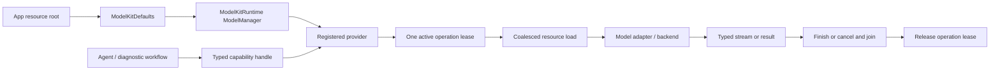

Base ModelKit has no project dependencies and owns all capability values. ModelKitDefaults registers concrete providers and default bindings; ModelKitRuntime owns the process-wide manager, provider identity and load/unload/shutdown. Consumers receive capability protocols rather than concrete engines. Each model permits one active operation; overlapping work fails explicitly instead of entering an implicit inference queue. Cleanup retains the operation lease until the backend has actually finished.

Stopping a voice session cancels its model work without automatically unloading weights. Explicit unload waits for active use; manager shutdown is terminal and cancels/joins owned work. Capability availability and resource residency are separate policies. App forwards coalesced memory-pressure handling, while manager construction/registration remains restricted to ModelAssembly SPI and isolated tests.

### Local chat capability

ModelKitGemma4 provides local Gemma 4 E2B QAT chat; Backends/CoreAI owns native graph and language execution. Gemma4 is the installed resource directory and gemma4-e2b the catalog ID. A pinned CoreAILM fork supplies the static-buffer pipeline; consumers retain ChatCapability. The shared package dependency floor is iOS/macOS 26; execution requires OS 27.

### Local model resource acquisition and removal

The App bundles schema-v2 source metadata/licenses, with no weights. App composes one Defaults manager, the generic Storage bridge and the independent ModelKitHub adapter. Management owns admission/state/install/delete; the adapter owns concrete HF SDK calls. Runtime retains its ModelKit-only dependency. ModelKitHub is a separate concrete resource-acquisition adapter target.

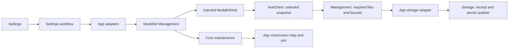

Startup reads compact repository/archive declarations and restores requests. Explicit download resolves files through HF SDK → stages selected assets → validates key files/tree bounds → writes actual file/size receipt → atomically publishes → refreshes availability. No provider is registered by JSON and no inference starts automatically. Settings/history remain usable without weights.

Deletion closes every associated resource's admission, stops related App work, drains/unloads, cancels/joins transfers and removes the installed tree before releasing maintenance. Source settings support official HF, hf-mirror.com and custom HTTPS hosts; source edits automatically persist and all system-permitted networks are allowed. Installed sizes come from receipts; pre-download sizes are estimates. Receipt paths normalize filesystem aliases before deriving confined relative paths. Receipt repair requires identity/revision, required-file and size validation. Installation publication and transfer-record persistence have separate outcomes: bookkeeping failure cannot undo a valid installation. App atomically replaces its authoritative task snapshot with afterFirstUnlock protection; other document clients retain revision-checked writes and their existing protection. HF has three native file tasks per package, two active packages/eight pending requests; overflow rejects. HF background tasks survive suspension and restore persisted generations/completed files on relaunch, with available system resume data; ZIP transport retains OS background reassociation.

### Cross-module concurrency and completion

SwiftUI state is MainActor-isolated. Runtime services, Agents, stores, managers and coordinators use actor isolation. Cross-module completion is always defined at the owning boundary:

| Boundary | Completion means |
| --- | --- |
| Input delivery | Target Agent accepted or rejected the input. |
| Model operation | Adapter finished or cancellation cleanup joined. |
| Tool call | Handler returned; returning results were admitted when required. |
| Action call | Registered handler reached its declared effect/acknowledgment boundary. |
| Speech playback | Platform output drained and the audio lease was released. |
| Session stop | Producers, Agent work, response dispatch, owned media and scheduled Actions were cancelled and joined. |
| UI update | App accepted state for the active identity; rendered-frame acknowledgment is not implied. |

Every queue or active-call pool has an explicit capacity and overflow rule in its owning module README. Cancellation is cooperative and propagates through structured tasks. Detached work, guessed success, silent device-action loss and unbounded retries are outside the architecture.

Actions/Camera follows the domain root + Support layout and binds Camera.Capture.open/close/flip through a required CameraControlCapability. App validates the active Assistant session and retains single-owner permission/foreground/capture-lease policy; completion confirms capture reconciliation or close cleanup, not pose readiness. Camera control completion is independent of native model Tool event transport.

### Cloud native Tool generation

Cloud ChatRequest carries JSON v6 Tools separately from the Action prompt. The cloud adapter assembles bounded indexed SSE tool_calls, maps provider-safe names back to declarations, and emits complete ChatEvent.toolCall values. Assistant resolves them with AgentCore ToolCallParser and emits ToolCall through OutputGateway. Tool-only turns complete normally; Returning ToolResult enters InputGateway under the captured owner and causal context. Local Gemma 4 E2B and automatic result-driven continuation remain unsupported.

### Signal and Effect Scenarios

These flows apply the common contracts above. A task can cross several scenarios; the categories are not separate Signal types. App adapts input and forwards output without selecting business operations. Diagrams describe the architecture; actual coverage and staged exceptions are recorded under [implementation coverage](#implementation-coverage).

#### Scenario coverage

Six categories cover human intent, Agent collaboration, independent observations, host facts and execution feedback:

| Scenario | Input / origin | Business processing and effects |
| --- | --- | --- |
| 1. Direct UI interaction | External intent | Agent selects an operation and presentation; local drafts/scroll remain in UI. |
| 2. Conversation | External text/audio, followed by internal perception messages | Business Agent interprets intent and handles actual results; inference itself is local computation. |
| 3. Agent collaboration | Internal Agent message | Receiver processes content, optionally replies or emits registered effects. |
| 4. Physical-world observation | External capture/native fact, optionally followed by internal perception messages | Agent may react without a new human request, within an enabled task and declared permissions. |
| 5. System and capability event | External lifecycle, permission, route or availability fact | Host handles immediate lifecycle mechanisms; Agents decide scoped business reactions. |
| 6. Execution lifecycle | Internal runtime feedback | Agent interprets progress, actual completion, failure or cancellation and chooses continuation/presentation. |

#### 1. Human interaction with UI

Preserve familiar mobile interactions—taps, gestures, forms, navigation and confirmation—to support existing user habits and direct, precise control. An Agent-driven app still offers these interactions alongside conversation.

The difference is the business path: UI emits explicit intent instead of implementing business processing or directly coordinating services. The responsible Agent handles that intent, selects registered Actions/Tools through OutputGateway, processes actual feedback through InputGateway and requests the resulting presentation. Direct UI intent can be handled deterministically without invoking an LLM; conversational intent uses the same business capabilities, permissions and execution contracts. UI retains rendering and local interaction state.

The implemented deletion flow below shows the shared intent/effect boundary and explicit user confirmation. Outstanding routes are listed under implementation coverage.

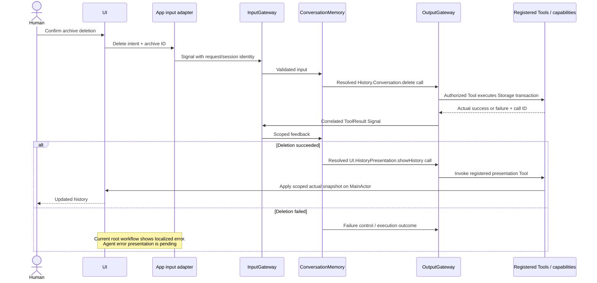

The target failure path is also Agent → OutputGateway → registered status-presentation Action/Tool → UI. Failure presentation currently belongs to the root history workflow; its registered Agent presentation route is outstanding.

UI-local scrolling, expansion, focus and unsubmitted drafts stay in UI. Business gestures and submitted forms emit intent; continuous controls require explicit cadence and overflow policy.

#### 2. Conversation

After InputGateway admission, typed text reaches the business Agent; speech reaches a perception Agent first. Recognized content becomes a typed Agent message through both Gateways. Model inference remains an injected computation inside the Agent's decision process.

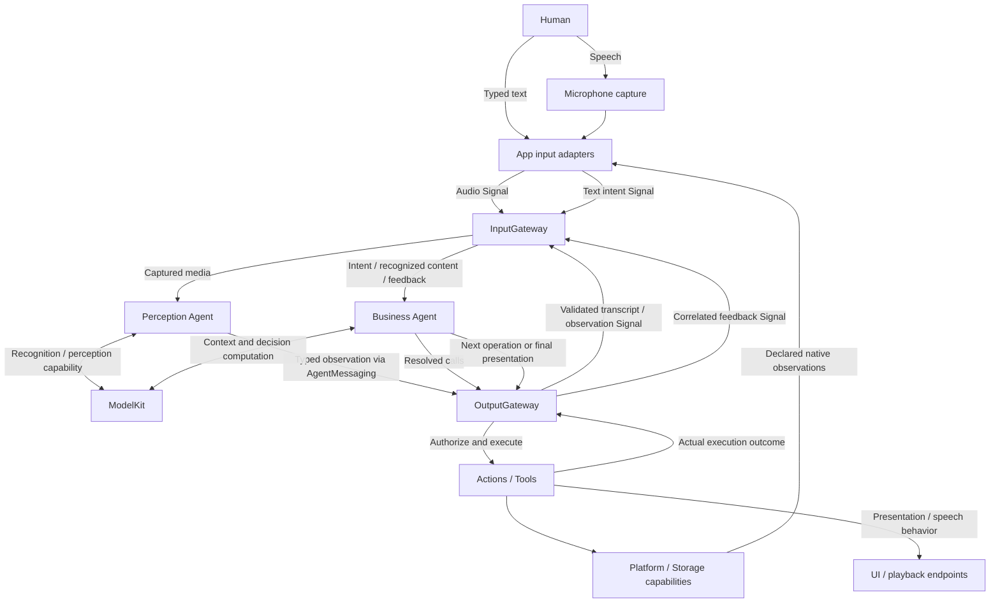

For the planned conversational “scan nearby devices” route, the business Agent selects a registered discovery capability; it reports actual devices or failure and requests their display through registered UI behavior. Starting discovery, observing a device and completing a scan are distinct events. Device effects can change later observations; those measured facts enter as new Signals rather than being inferred from the issued command. If discovery is asynchronous, native facts arrive through App input adapters under a declared session/operation contract; returning feedback must match the operation's registered result semantics.

Result-driven model continuation requires a finite step budget, execution deadline and cancellation owner per task. LLM predictions never stand in for execution success; current Assistant continuation and discovery limitations are listed under implementation status.

#### 3. Agent-to-Agent collaboration

Agents exchange domain messages through both Gateways. They do not call each other's business methods or use UI updates as a communication channel. A receiver decides whether a message requires further processing, a reply or a registered effect.

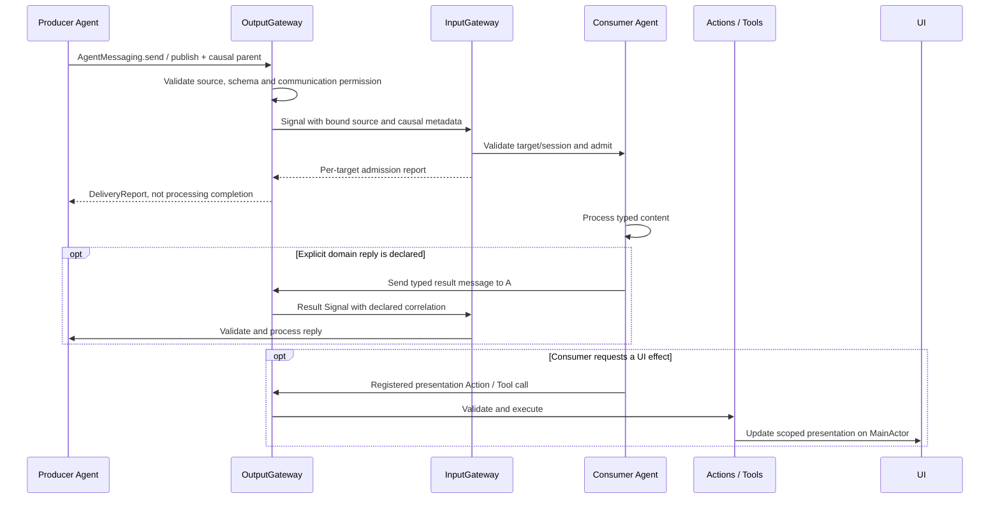

`send` chooses one permitted target; `publish` selects declared subscribers. The root and parent identify causality, not a generic request/reply service. A domain needing a reply must declare its payload, request correlation, pending-work bound, timeout and cancellation behavior before implementation. Such a reply is a new message with its own permission checks. A directed message alone does not create an automatic request/reply service.

#### 4. Physical-world observation without a new user request

An enabled camera/tracking task, device discovery or sensor monitor can receive new facts independently of a click or conversation. App adapts capture/native events into Signals; a perception Agent is optional for already-structured device facts.

```mermaid
flowchart LR
    World[Physical change] --> Capture[Platform capture / native feedback]
    Capture --> App[App input adapter]
    App --> Input[InputGateway]
    Input --> Agent[Perception / business Agents]
    Agent -->|Messages / resolved calls| Output[OutputGateway]
    Output --> Effect[Actions / Tools]
    Effect --> UI[UI presentation]
    Effect --> Platform[Platform effect]
    Platform -->|Changes subsequently observed| World
    Effect -->|Actual outcome via runtime| Output
    Output -->|Messages / feedback Signals| Input
```

Observation is evidence, not authorization to start arbitrary behavior. The enabled task owns its scope, cadence, freshness and resource use. Only declared latest-state observations may coalesce; discrete device facts need an explicit delivery policy. Issuing a command does not prove the resulting physical state.

#### 5. System and capability events

Foreground/background changes, permission changes, audio-route interruption and model/device availability changes can alter what a task may do. The target business path is **OS/native fact → App adapter → InputGateway → responsible Agent → OutputGateway → registered reaction**.

App remains responsible for immediate lifecycle mechanisms: suspending capture, joining owned execution, releasing resources and starting/stopping runtime scopes. Those mechanisms cannot depend on a delayed Agent response or inference. Publish business-relevant lifecycle facts only into valid scopes; an unavailable Agent/session cannot be assumed to receive a shutdown event. Permission denial and unavailable capability must not become fabricated success.

Foreground return does not automatically replay prior device effects.

#### 6. Execution lifecycle and long-running work

A returning Tool can finish in one result; discovery, downloads, playback or motion may have separate admission, progress and terminal outcomes. Declare each operation's feedback channel, owner, correlation and completion semantics before implementation.

```mermaid
sequenceDiagram
    participant Agent
    participant Output as OutputGateway / execution runtime
    participant Operation as Action / Tool and capability
    participant Input as InputGateway
    Agent->>Output: Authorized operation call
    Output->>Operation: Start under execution ownership
    opt Declared bounded progress feedback
        Operation-->>Output: Actual progress + operation identity
        Output->>Input: Runtime feedback Signal
        Input->>Agent: Validate owner/session and interpret
    end
    alt Completed or failed
        Operation-->>Output: Actual terminal outcome
        Output->>Input: Declared correlated result Signal
        Input->>Agent: Choose continuation or status presentation
    else Cancellation requested
        Note over Agent,Input: Human cancellation first enters through App and InputGateway
        Agent->>Output: Registered cancellation behavior, if supported
        Output->>Operation: Cancel and join owned cleanup
        Operation-->>Output: Actual terminal cancellation / partial effects
        Output->>Input: Declared correlated feedback Signal
        Input->>Agent: Reconcile committed effects and finish
    end
```

This is a target lifecycle pattern for contracts that return feedback, not a generic progress/cancellation API implemented by every Tool. Native asynchronous facts still use the external adapter paths in scenarios 4 and 5. Completion-only Tools retain execution outcomes without a new ToolResult. Runtime control notices cannot encode unregistered business cancellation.

### Cross-cutting Task Contracts

| Case | Required contract |
| --- | --- |
| User decision during a task | Picker selection, confirmation or clarification returns as a scoped external Signal through App → InputGateway, distinct from successful prompt presentation. Declare pending-task bounds, response correlation, timeout and cancellation; opening the prompt is not the user's decision. |
| Concurrent inputs / multiple views | Define explicit task/session ownership, overlap rejection/queueing and resource arbitration. Human and model requests share authorization; manual priority exists only where policy declares it. Fence late presentation by its intended scope. |
| Scheduled or periodic trigger | Declare whether an OS trigger is external or an owned runtime timer is internal. Bound timers/work, supply scope and deadlines, and prevent feedback-driven recurrence. Do not imply background execution guarantees. |
| Restart / reconnect / recovery | Restore durable records through Storage capabilities, reconcile actual native state and create fresh live scopes. Persisted data is not automatically a Signal; never replay stale requests or completed effects by default. |
| Future remote integration | Reuse the envelope concept only through an explicit adapter with authentication, codecs, version and replay policy. Authentication/admission alone does not grant internal execution authority; remote transport remains unimplemented. |

System permission prompts still require user interaction. Presenting a picker does not grant unrestricted library access. Physical robot safety cannot depend on iOS background execution.

### Implementation Coverage

✅ marks implemented contracts; ❌ marks outstanding design or integration. Detailed delivery priorities and acceptance evidence belong in docs/.

| Area | Implemented | Outstanding |
| --- | --- | --- |
| Signal envelope and contracts | ✅ AgentInput, metadata/payload, domain-message schemas, JSON permissions and both Gateway paths; supported input contract version 1; typed SignalOrigin, owner-fenced returning Tool admission, typed history.intent and Action/activity causal transport | ❌ Other typed host control producers. Video/binary kinds have no payload cases. |
| Executable capabilities | ✅ One definition/outcome/execution core, three-level addresses, v6 explicit bindings, dual protocol projections, scheduled native adaptation | ❌ Additional capability exposure and physical acceptance |
| UI and history | ✅ ConversationMemory refresh and confirmed archive deletion through both Gateways; returning History.list/read Tools | ❌ Remaining direct controls, archive/title policy, general navigation/picker/device intent routes and registered failure presentation |
| Conversation and collaboration | ✅ Registered perception/synthesis/pose messages and current Assistant Tool feedback | ❌ Automatic model continuation, conversational BLE discovery and generic request/reply |
| Physical and host events | ✅ Existing perception/tracking pipelines and App-owned lifecycle/cleanup | ❌ General sensor/native fact coverage and unified lifecycle/capability business Signals |
| Execution lifecycle | ✅ Specific ActionResult/ActivityEvent contracts, role-owned cancellation and history cancellation cleanup | ❌ Common long-task Agent progress/cancellation contract and remaining feature routes |
| Model resources | ✅ Passive UI state with interaction/admission policy moved into independent AppSettingsWorkflow | ❌ Agent/Gateway resource controls, remaining UI policy and native transfer acceptance |
| Foundational independence | ✅ Base ModelKit, PlatformKit and Storage have no project dependencies | ❌ UI imports StorageChat domain values; full foundational independence remains outstanding |
| Transport evolution | ✅ Process-local admission and bounded domain content encoding | ❌ Contract-version migration, whole-envelope remote codecs/authentication, durable/replay delivery and dynamic subscriptions |

Current Gateway limits include 128 active admissions, 16 recipients per operation, 256 active branches, 8 MiB observation reservations and at most 8 causal hops. Agent inbox/output limits are role-specific. See [InputGateway](Gateway/Input/README.md) and [communication policy](Agents/Core/Communication/README.md). AgentMessage encoding is not serialization of the whole Signal envelope.
