# MobileHarness Technical Design

This document defines the current framework architecture, module responsibilities, cross-module flows and key technical contracts.

This technical document has three parts:

1. [Overall Architecture](#part-i--overall-architecture)
2. [Module Responsibilities](#part-ii--module-responsibilities)
3. [Cross-module Technical Design](#part-iii--cross-module-technical-design)

## Part I — Overall Architecture

### System architecture

Agents own input interpretation, business decisions and task coordination. Human intent, physical observations, system events, Agent messages and declared execution feedback enter as Signals through InputGateway. App adapts external inputs; Agent communication and execution feedback use identity-bound Gateway paths.

Direct interaction and model decisions share Agent-owned business flows and registered functions. An Agent handles typed intent deterministically or uses a model, emits calls through OutputGateway, and uses declared feedback to continue, complete or cancel work.

App assembles the system and owns application lifetime and immediate native safety/cleanup. UI, ModelKit, PlatformKit and Storage provide independent presentation, inference, native I/O and persistence capabilities. Submitted history, settings, resource, provider, device and camera requests reach their owning Agents; local UI state stays in UI. [Implementation coverage](#implementation-coverage) distinguishes current routes from absent integration.

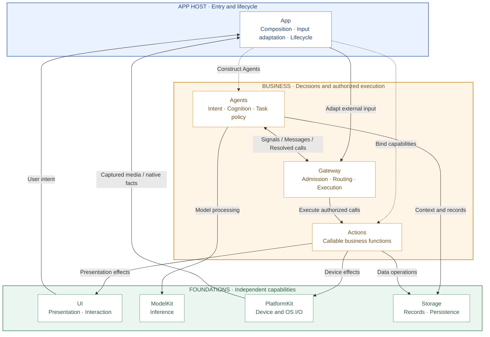

Read top to bottom: App Host → business modules → foundational capabilities. Nodes represent first-level modules under MobileHarness; Resources is packaging input and is shown in the source map rather than the runtime layers. Solid arrows show input, business communication or capability use; dashed arrows show host assembly. These are module relationships, not Swift import dependencies. App also supplies foundation instances and forwards UI/native input through its adapters; the detailed flows below show those paths.

Gateway contains InputGateway, OutputGateway and shared execution. ActionCall and ToolCall are call protocols over the same Actions functions, not separate top-level modules. UI captures intent and presents state; ModelKit, PlatformKit and Storage supply processing, native I/O and persistence.

### Coordination ownership

| Owner | Governing question | Responsibility |
| --- | --- | --- |
| App | What runs, and for how long? | Assemble, start, stop and clean up application/session scopes and their resources. |
| Agents | What should happen next, and why? | Interpret signals, retain cognitive state and express messages or permitted behavior. |
| Gateway | How may accepted work communicate and execute? | Enforce identity, permission, admission, ordering, wait, feedback and resource rules. |

Semantic fusion belongs to Agents. Gateway carries identities, contracts and destinations without interpreting observations or choosing business behavior.

### Composition and mediation boundaries

This diagram shows assembly, runtime communication and allowed capability use. The [compilation graph](#compilation-dependencies) separately records actual target dependencies.

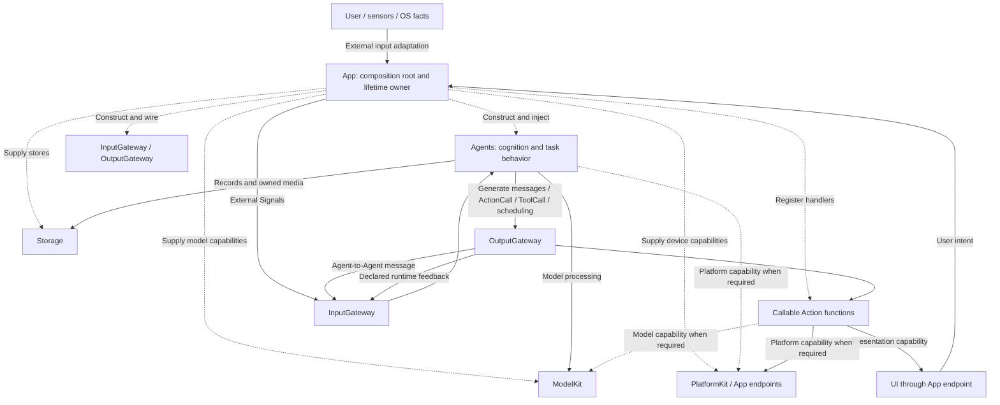

- **App** constructs the graph and injects scoped interfaces; consumers do not query a global container.
- **Agents** interpret inputs and emit resolved messages, ActionCall/ToolCall and scheduling controls through OutputGateway.
- **Actions** implements canonical functions using foundational capabilities and App-bound endpoints.
- **Gateway** validates Agent transport and executable outputs; ordinary capability calls remain local to their owner.
- **Effects and host mechanisms** have distinct boundaries, defined [below](#computation-effects-and-host-mechanisms).

### Computation, effects and host mechanisms

Agents choose business policy; Actions implements the callable operations selected by that policy. Using a foundational capability does not by itself create a Signal or authorize a business effect.

| Work | Boundary | Current rule |
| --- | --- | --- |
| Internal inference, context selection and scoped cache/journal access | Agent → injected ModelKit/Storage capability | Local computation/data access; communicate results as Signals only when a declared consumer needs them. |
| Exposed history operations, presentation or device commands | Agent → OutputGateway → Action function → capability | Explicit registered business effect with authorization and completion policy, shared by human and model entry points. |
| Capture admission, immediate stop, permission enforcement and cleanup | App lifetime owner → scoped native/runtime capability | Immediate host mechanisms must not await inference; business-relevant facts use declared Signals in live scopes. |
| Scrolling, focus and unsubmitted drafts | UI-local presentation | No business Signal until a submitted operation or declared business gesture. |

The target does not permit Agents to import UI or mutate its state. App supplies presentation endpoints to Actions. Local frontend interactions and immediate native lifecycle cleanup are intentional host/UI routes; backend data requests subscribe directly at the owning Agent.

### Compilation dependencies

The graph below shows the principal project targets. System frameworks, concrete model backends and the `BehaviorDefinitions` compiler plugin are condensed for readability.

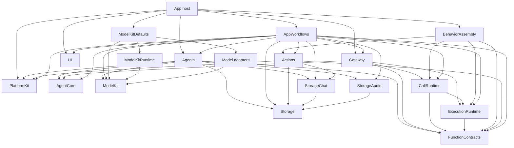

The `AppWorkflows` node is a facade over six independent feature targets; its summarized arrows are the union of those targets. `FunctionContracts`, `Storage` and `AgentCore` have no project dependencies. FunctionContracts is the independent function-contract leaf; ExecutionRuntime owns shared execution, and CallRuntime owns registration and call adapters. Gateway depends on execution contracts, never concrete Actions or Tools. Base ModelKit and PlatformKit have no project dependencies and own their input/output types. Agents adapts across their boundaries. The complete ModelKit SDK, including Runtime, Defaults, download adapters and concrete providers, may depend only on its own targets, approved third-party SDKs and system frameworks. Its direct and transitive target dependencies must never reach another project module; host adapters implement ModelKit-owned protocols.

<a id="37-project-structure"></a>
<a id="project-structure"></a>

### Source structure and compilation map

```text
MobileHarness/
├── App/                         # Host composition, lifecycle and adaptation
│   ├── Composition/             # AppAssembly and runtime/model assembly
│   │   └── Behaviors/           # Independent BehaviorAssembly target
│   ├── Lifecycle/               # Voice/camera/application lifetime owners
│   ├── Workflows/               # State-free facade plus feature workflow targets
│   │   ├── Settings/
│   │   ├── History/
│   │   ├── Bluetooth/
│   │   ├── Speech/
│   │   ├── Presentation/
│   │   └── Diagnostics/
│   └── Adapters/                # Presentation, media and native preview bridges
├── UI/                          # Independent MainActor state, pages and controls
├── Agents/
│   ├── ApplicationControl/       # Root application operations and configuration
│   ├── Support/
│   │   ├── Core/                # Independent AgentCore target
│   │   │   ├── Input/           # Generic audio/image input transport
│   │   │   ├── Runtime/         # Registry, manager and lifecycle contracts
│   │   │   ├── Capability/      # JSON declarations and permissions
│   │   │   ├── Generation/      # Function Token, Channel/wait and Tool parsers
│   │   │   ├── Output/          # Resolved calls and trusted envelopes
│   │   │   └── Communication/   # Typed messages and routing contracts
│   │   ├── Communication/      # Domain schemas and built-in identities
│   │   ├── Chat/               # Shared bounded decision mechanics
│   │   └── Context/            # Atomic role repositories and recovery
│   ├── Memory/                  # History workflow and title computation; richer memory pending
│   ├── Assistant/
│   ├── SpeechPerception/
│   ├── SpeechSynthesis/
│   ├── VisionPerception/
│   └── Photographer/
├── Gateway/
│   ├── Runtime/                 # ExecutionRuntime: common function execution
│   ├── Input/                   # External/internal admission and delivery
│   └── Output/                  # Validation, routing, scheduling, results/resources
├── Actions/
│   ├── Support/                 # Shared macro declarations and production catalog composition
│   │   └── Contracts/           # FunctionContracts: independent protocol-neutral interfaces
│   ├── NexArm/
│   ├── Speech/
│   ├── History/
│   ├── System/
│   ├── Camera/
│   └── UI/
├── Storage/
│   ├── Audio/                   # StorageAudio: transient PCM ownership
│   └── Chat/                    # StorageChat: conversation journal
├── ModelKit/
│   ├── Support/
│   │   ├── Core/                # Capability/media/concurrency mechanisms
│   │   ├── Backends/            # Generic CoreAI/CoreML graph execution
│   │   ├── Management/          # Separate Runtime/Defaults source ownership
│   │   │   └── HuggingFace/     # ModelKitHub: injected artifact transfer
│   │   └── Speech/Apple/        # Shared Apple ASR/TTS PCM conversion
│   ├── Language/                # Capability contracts and model-owned engines
│   ├── Speech/                  # ASR/TTS/VAD contracts and model implementations
│   └── Vision/                  # Capability contracts and YOLO image/pose pipeline
├── PlatformKit/
│   ├── Core/                    # Boundary documentation; no compiled placeholder
│   ├── Audio/                   # OS audio capture and output
│   ├── Vision/                  # Camera capture and native preview
│   └── Connectivity/            # Links, protocols and device feedback
└── Resources/                   # Agent/Skill configuration, privacy, assets and model profiles

Tests/                           # Root module and integration tests
Package.swift                    # Shared-source target map
Config/                          # Shared build configuration
scripts/                         # Checks, builds and provisioning
MobileHarness.xcodeproj/         # App/framework schemes and navigation
```

Directory nesting expresses ownership; `Package.swift` defines the actual compilation boundaries. Shared source has one owner and is not duplicated into another package tree.

### Target map

| Source path | Target | Direct dependencies |
| --- | --- | --- |
| `App/` excluding package-owned subtrees | Xcode App targets | Host composition, adapters and lifecycle dependencies |
| `App/Composition/Behaviors/` | BehaviorAssembly | Actions, FunctionContracts, ExecutionRuntime, CallRuntime |
| `App/Workflows/` facade | AppWorkflows | Six feature workflow targets |
| `App/Workflows/Settings/` | AppSettingsWorkflow | UI, AgentCore, Agents, Gateway, AppPresentationWorkflow |
| `App/Workflows/History/` | AppHistoryWorkflow | UI, StorageChat, AgentCore, Agents, Gateway, Actions, AppPresentationWorkflow, FunctionContracts, ExecutionRuntime, CallRuntime |
| `App/Workflows/Bluetooth/` | AppBluetoothWorkflow | UI, AgentCore, Storage, Actions, FunctionContracts, ExecutionRuntime, CallRuntime, PlatformKit |
| `App/Workflows/Speech/` | AppSpeechPlayback | FunctionContracts, StorageAudio, Actions, ExecutionRuntime |
| `App/Workflows/Presentation/` | AppPresentationWorkflow | UI, AgentCore, FunctionContracts |
| `App/Workflows/Diagnostics/` | AppDiagnosticWorkflow | UI, ModelKit, PlatformKit |
| `UI/` | UI | None |
| `Agents/Support/Core/` | AgentCore | None |
| `Agents/` excluding `Support/Core/` | Agents | AgentCore, ModelKit, PlatformKit, Storage, StorageChat, StorageAudio, FunctionContracts |
| `Gateway/` excluding Runtime/Registration/Protocols | Gateway | AgentCore, FunctionContracts, ExecutionRuntime, CallRuntime |
| `Actions/Support/Contracts/` | FunctionContracts | None |
| `Gateway/Runtime/` | ExecutionRuntime | FunctionContracts |
| `Gateway/Output/Registration/` and `Protocols/` | CallRuntime | FunctionContracts, ExecutionRuntime |
| `Actions/` excluding `Support/Contracts/` | Actions | FunctionContracts, PlatformKit, BehaviorDefinitions, StorageChat, Storage |
| `Storage/` core | Storage | None |
| `Storage/Chat/` | StorageChat | Storage |
| `Storage/Audio/` | StorageAudio | Storage |
| `PlatformKit/` | PlatformKit | None |
| ModelKit shared capability sources | ModelKit | None |
| `ModelKit/Support/Management/` (runtime source list) | ModelKitRuntime | ModelKit |
| `ModelKit/Support/Management/` (assembly source list) | ModelKitDefaults | ModelKit, ModelKitRuntime, registered adapters |
| `ModelKit/Speech/VAD/Energy/` | ModelKitEnergy | ModelKit |
| `ModelKit/Support/Management/HuggingFace/` | ModelKitHub | ModelKitRuntime, HuggingFace product |
| `Macros/BehaviorDefinitions/` | BehaviorDefinitions | SwiftCompilerPlugin, SwiftSyntax, SwiftSyntaxBuilder, SwiftSyntaxMacros products |
| `ModelKit/Language/LLM/OpenAI/` | ModelKitOpenAI | ModelKit |
| `ModelKit/Speech/ASR/Apple/`, `TTS/Apple/`, `ModelKit/Support/Speech/Apple/` | ModelKitAppleSpeech | ModelKit |
| `ModelKit/Vision/YOLO/` | ModelKitYOLOPose | ModelKit, ModelKitCoreML |
| `ModelKit/Support/Backends/CoreML/` | ModelKitCoreML | None |
| `ModelKit/Speech/VAD/Silero/` | ModelKitSilero | ModelKit, ModelKitCoreML |
| `ModelKit/Support/Backends/CoreAI/` | ModelKitCoreAI | None |
| `ModelKit/Speech/ASR/Nemotron/` | ModelKitNemotron | ModelKit, FluidAudio product |
| `ModelKit/Speech/TTS/MossNano/` | ModelKitMossNano | ModelKit |
| `ModelKit/Speech/TTS/Kokoro/` | ModelKitKokoro | ModelKit, FluidAudio product |
| `ModelKit/Language/LLM/Gemma4/` | ModelKitGemma4 | ModelKit, CoreAILM and Tokenizers products |

### Module README contract

Module READMEs define responsibility, boundaries, direct external data flow and internal submodule relationships. Diagrams distinguish runtime flow, injection and compilation dependencies. Nested READMEs own detailed interfaces, algorithms, state/lifetime, ordering, capacity/overflow, completion, failure and cancellation contracts.

Current designs use ✅ for implemented behavior, ❗ for confirmed bugs and ❌ for absent implementation. History and validation evidence belong in [docs](../docs/README.md).

### Architectural boundaries

- App owns concrete assembly, adaptation and application/session lifetime. Feature workflows expose typed operations and retain no global container access.
- UI owns presentation values. The compilation target has no project dependencies; App adapts storage records into UI-owned view values. It does not import App, Agents, Gateway, Actions, Tools, ModelKit or PlatformKit.
- AgentCore is independent of concrete Agents, UI, model engines and device adapters.
- All Agent-driven external inputs and declared execution feedback enter through InputGateway; all Agent messages and executable outputs leave through OutputGateway. Submitted business routes use their owning Agents; immediate host mechanisms retain their explicit scopes.
- Actions owns business behavior, motion shaping, composition and completion policy. PlatformKit owns native I/O, protocol encoding, hardware limits and device feedback.
- FunctionContracts owns standard callable input/output and ActionFunction metadata only. Gateway/Runtime (ExecutionRuntime) owns shared function registration/execution; Gateway/Output registration/protocol adapters (CallRuntime) own ActionBinding and calling policies. Gateway orchestration owns scheduling, admission, feedback and shared resource coordination.
- ModelKit is a capability SDK. Provider registration/default selection belongs to ModelKitDefaults; process-wide model ownership belongs to ModelKitRuntime.
- AgentCore/Input owns generic input transport; UI owns presentation values. Storage owns lifetime and retention, not inference or business policy.

✅ AgentCore, FunctionContracts, base ModelKit, PlatformKit and Storage are independent targets. Execution, call adaptation and feature workflows have the compilation boundaries shown above.

Current route coverage and remaining product extensions are listed under [implementation coverage](#implementation-coverage); delivery priorities and acceptance work live in the [Roadmap](../docs/Roadmap.md).

<a id="responsibilities-and-boundaries"></a>

## Part II — Module Responsibilities

This section is an architectural directory. It describes why each module exists and where its responsibility ends; linked module documents contain local structure and implementation details.

| Module | Responsibility | Boundary | Biological analogy |
| --- | --- | --- | --- |
| [App](App/README.md) | Assemble concrete capabilities and coordinate application, voice and camera lifetime. | Adapts modules and owns workflows; does not absorb Agent, Action or device business rules. | The organism coordinating its organs. |
| [UI](UI/README.md) | Render conversation, camera, settings and diagnostics; convert gestures into typed operations. | MainActor presentation only; pages do not own long-lived model/device sessions. | Face and interaction surface. |
| [Agents](Agents/README.md) | Interpret observations, use processing/storage capabilities and select permitted outputs. | Cognitive state and policy; executable effects always cross OutputGateway. | Specialized brain regions. |
| [AgentCore](Agents/Support/Core/README.md) | Define Agent identity, input/output, capability, communication and lifecycle contracts. | Stable independent vocabulary; no concrete cognition or host services. | Organization of the nervous system. |
| [Gateway](Gateway/README.md) | Validate input/output, route messages, schedule Actions and coordinate results/resources. | Coordination only; no inference or domain behavior implementation. | Neural pathways and motor coordination. |
| [Actions](Actions/README.md) | Implement callable UI, speech, camera, history, system and NexArm behavior. | Owns business parameters and completion policy; knows no calling protocol and consumes foundational/injected capabilities. | Learned behavior. |
| [FunctionContracts](Actions/Support/Contracts/README.md) | Define standard function inputs, outputs and constraints. | No runtime, Channel or calling protocol dependency. | Shared function contracts. |
| [ExecutionRuntime](Gateway/Runtime/README.md) | Store and execute canonical functions. | Depends only on FunctionContracts; joined deadlines and cancellation. | Shared execution machinery. |
| [CallRuntime](Gateway/Output/Registration/README.md) | Bind and adapt scheduled/native calls. | Depends on FunctionContracts and ExecutionRuntime; no AgentCore. | Calling protocol views. |
| [ModelKit](ModelKit/README.md) | Expose typed speech, language and vision processing capabilities. | Base SDK knows neither Agent policy nor device I/O; engines live in adapters/backends. | Recognition and generation machinery. |
| [PlatformKit](PlatformKit/README.md) | Capture/output media, manage links and expose native commands/feedback. | Device SDK only; no gestures, model inference, localization or workflow policy. | Sensory organs and effectors. |
| [Storage](Storage/README.md) | Provide bounded transient storage and durable local records. | StorageAudio owns PCM handles; StorageChat owns conversation records; no routing or inference. | Short- and long-term retained material. |
| [Resources](Resources/README.md) | Hold privacy declarations, assets and local model profiles/artifacts. | Packaging input supplied by App; no runtime ownership. | Materials consumed by the organism. |

### Key internal module groups

**App.** [Composition](App/Composition/README.md) builds the graph and validates registrations. [Lifecycle](App/Lifecycle/README.md) owns long-running voice/camera work and cleanup. [Workflows](App/Workflows/README.md) is a state-free facade over independent Settings, History, Bluetooth, Speech, Presentation and Diagnostics targets. [Adapters](App/Adapters/README.md) translate module contracts to host capabilities.

**Agents.** Assistant owns all user conversation, dynamic bundled Skills, one foreground goal-based Task and ReACT. Photographer owns deterministic camera/tracking workflows; Memory owns history/title transactions; ApplicationControl owns configuration/device/environment transactions. Media Agents retain VAD/ASR, synthesis and visual inference. Resources catalog contains v7 Agent fixed-function declarations and v1 Skill configuration. Functions remain in Actions; neutral metadata is supplied through FunctionContracts. Effective catalogs are frozen per model request and checked by Gateway. Independent background work can still use directed send; ordinary photography stays in Assistant.

**Behavior.** Actions owns protocol-neutral callable functions. ✅ Shared contracts live in Actions/Support/Contracts; ActionMacro and CapabilityModules live directly in Actions/Support. FunctionContracts remains an independent target, while the macro declarations and catalog composition compile in Actions. FunctionContracts defines their inputs/outcomes; Gateway owns independent ExecutionRuntime and CallRuntime. ActionCall follows Channel scheduling; ToolCall executes directly outside Channel/wait. BehaviorAssembly freezes one canonical function store and explicit host bindings without importing AgentCore. [Protocol routing](Gateway/Output/Protocols/README.md) explains registration, Agent transport/parsing and shared execution/feedback.

**Foundations.** ModelKit separates capability contracts, process-wide management, default assembly and engine adapters. PlatformKit separates native I/O from business behavior. Storage separates reusable mechanisms from Chat and Audio domains. ModelKit, PlatformKit and StorageAudio own their separate capability/storage contracts.

<a id="part-iii--key-techniques"></a>

**Shared Agent mechanisms.** Support/Core remains the independent AgentCore target; Support root owns immutable resource/catalog helpers; Support/Communication owns application message schemas, Support/Chat owns role-neutral bounded decisions and Support/Context owns task/Skill state, fixed-task coordination and atomic role repositories. Each role supplies State, SignalPreprocessor, ContextBuilder, grants and completion policy; conversational prompts/Skills belong to MobileHarness/Resources.

MobileHarness/Resources owns pure Agent identity, Skill workflows and conversation template assets; Memory has separate title-only templates. AgentCore owns reusable Function Token grammar and Channel/wait rules. Protocol rendering precedes identity, Skill overview, background Agent capabilities, mode and loaded instructions, then the effective Action catalog; native Tools use the same immutable catalog. Runtime/user facts are data messages, never trusted policy. Strict single-pass rendering rejects missing variables and oversized output.

## Part III — Cross-module Technical Design

This section owns the system-wide contracts that cannot be explained by one module alone.

### Composition, startup and lifetime

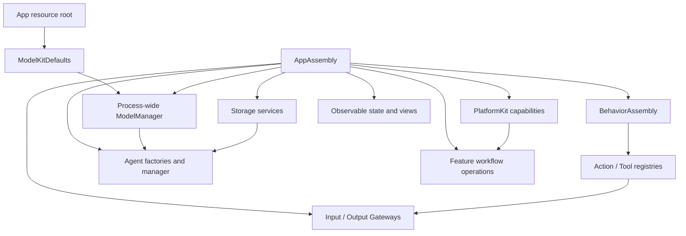

Composition resolves configuration and registration errors before producers start. Gateway validates that every declared internal or model-callable Action/Tool has a concrete implementation. Production uses one process-wide ModelManager and shared stores where identity must cross modules.

Voice and camera have independent App-owned scopes. Scope shutdown closes admission, cancels and joins owned producers/processing/dispatch, retires owned media and Actions, and only then releases resources. Withdrawing listening consent stops capture without transferring ownership of an independently submitted reply; vision detach joins tracking without stopping resident Photographer. Page navigation does not define runtime lifetime. Session IDs, Agent incarnations, turns and monotonic sequences fence stale input, feedback and presentation.

| Identity or scope | Meaning | Lifetime boundary |
| --- | --- | --- |
| Agent ID | Logical role | Configuration/catalog identity |
| Incarnation | Actual registered role instance | Replacement/removal fences old outputs/results |
| Root interaction session | Stable application interaction scope | Root-owner shutdown/replacement |
| Capture session/epoch | Native microphone or vision generation | Native close/replacement; stale media is rejected |
| Input ID | Admitted unit of processing | Owner completion/cancellation |
| AgentTurn | Producer-assigned session-local interaction ordinal | Stable across one recognized utterance and its model-sized ASR segments |
| AgentTaskScope | Requester/executor business delegation | Explicit progress/result/cancel or interrupted recovery |
| Round ID | One model invocation and its emitted calls | Seal, execution/delivery join and continuation decision |
| Call ID | Individual resolved function or communication correlation | Terminal effect and separately retained delivery outcome |
| Resource token/permit | Live write authority | Release, revocation, expiry or joined handoff |

Task requester and executing Agent are different identities. Parent display focus never transfers a child's grants, results, speech ownership or private history. Session IDs alone cannot authorize a replaced incarnation.

**Processing pipeline.**

```mermaid
flowchart LR
 Signal[Admitted Signal] --> Preprocess[Role SignalPreprocessor]
 Preprocess --> Batch[Validated SignalBatch and role-state update]
 Batch --> Commit[Atomic role context commit]
 Commit --> Snapshot[Immutable selected snapshot]
 Snapshot --> Builder[Role ContextBuilder and grant projection]
 Builder --> Decide[Fixed workflow or ChatCapability]
 Decide --> Evidence[Persist exact request and received evidence]
 Evidence --> Output[Resolved calls and communication]
 Output --> Feedback[Owner-directed feedback]
 Feedback --> Preprocess
```

State, selection and completion are role-owned. Fixed camera/history/settings transactions do not load a model to interpret a known typed intent. Model decisions receive an immutable current projection and explicit effective grants. Durable evidence is written before dependent outputs; persistence failure stops those effects rather than inventing a snapshot or retrying a device action.

**Atomic context contract.**

`AgentContext<State>` records version/Agent/scope/revision, bounded work/task state, role state, evidence and consumed batches. Schema validation precedes use. The generic context permits 256 work records, 8192 evidence records and 8192 batches, with individual evidence data at most 512 KiB; role retention may be smaller. New work may evict only the oldest terminal work record; capacity otherwise rejects. Streaming roles retain 256 summaries with eviction counts.

AgentContextRepository serializes copy-before-commit updates with sixteen commit waiters. Persistent contexts use a 64 MiB LocalDocumentStore. Storage CAS token and logical revision must both match. In-memory state is published only after atomic persistence. No model/native await holds the repository write slot.

Initial load validates identity/schema, marks unfinished work interrupted, advances revision and commits recovery before exposure. It never replays effects. Current histories read the Assistant repository; invalid context state fails explicitly. No separate history-file import is performed.

**Work and task states.**

Processing work moves among queued, running, awaitingFeedback and continuation before completed/failed/cancelled/interrupted. Delegated task state additionally distinguishes requested, accepted and cancelling. Model termination, call termination and business-owner termination are separate records.

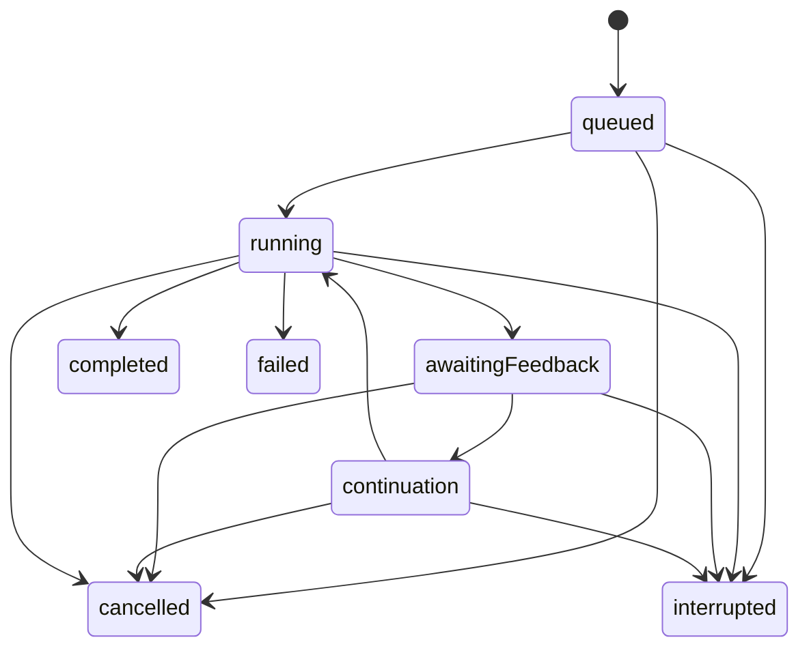

This is the normal processing path, not a transition matrix enforced by AgentContext. `transitionWork` rejects unknown or terminal work; role handlers select nonterminal transitions. Recovery marks unfinished work interrupted without replay.

**Shared chat decision budget.**

The shared context builder selects up to ten completed request blocks in date order, preserving native call/result pairing, then appends the current input. A block with received-but-unfinished calls is excluded; completed legacy turns supply compatible blocks.

| Boundary | Limit and overflow policy |
| --- | --- |
| Worker | One inference worker per role |
| Inbox | 32 FIFO inputs plus one reserved continuation; excess rejects |
| Output | 256 envelopes; excess fails owned processing |
| Requests | Four model invocations per admitted input and its continuation chain, including retries |
| Calls | 120 generated calls and sixteen native calls cumulatively in that chain, including rejections |
| Feedback / request | Separate 64 KiB execution-feedback and request-text bounds; see [ReACT limits](#react-limits-and-time-ownership) |
| Lifetime | No Agent generation, queue or round-barrier timer; owner cancellation and terminal state govern lifetime |
| Communication relay | Sixteen pending outputs, four live runtime deliveries |

Every continuation selects a fresh role context projection and stores the exact immutable request. Action-only roles project old native call/result pairs as inert evidence rather than re-enabling Tools. Native consumers retain complete request-local pairing. Unknown/invalid calls can produce bounded observation continuation; successful send admission is completion evidence without business output. Uncertain output delivery ends processing without repeating a delegation.

Pause cancels/joins current model work; resume admits future inputs without replay. Stop joins model/relay/output cleanup and clears occupancy. ApplicationControl continues accepting environment facts and matching feedback while paused; fresh business requests still require running.

<a id="canonical-functions-and-protocol-bindings"></a>

### Unified Signal Contract

A **Signal** is immutable information admitted to an Agent: human intent, a captured physical observation, another Agent's message, or execution feedback. Signal is the architectural concept; **`AgentInput` is its canonical in-process envelope**. Keep one envelope rather than introducing a parallel `Signal` type. Payloads retain domain-specific types and validation.

An Agent's registered Action/Tool call is an execution request in `OutputEnvelope`, not an input Signal. Its returning feedback becomes a Signal. Model inference returns and private intermediate computations remain local capability results unless explicitly communicated to another Agent. UI drafts, scrolling and expansion remain local presentation state.

#### External and internal origin

Origin and payload meaning are independent dimensions. All origins share the `AgentInput` envelope; intent, observation and feedback remain domain semantics rather than inheritance branches.

| Origin | Examples | Authority |
| --- | --- | --- |
| External | Human interaction, native capture/device facts, OS lifecycle and permission changes, future remote inputs | App adapters bind source identity and adapt validated native inputs. |
| Internal / Agent | Published observations, directed commands and declared domain replies | CommunicationAction travels through an output consumer bound to the actual Agent actor/incarnation and both Gateways. |
| Internal / Runtime | Actual execution/round feedback and explicitly owned task termination; undeclared timer/progress contracts remain absent | The owning execution/runtime producer binds operation identity and feedback authority. |

“External” means outside the Agent system, even when UI or a native SDK runs in the same process. A hardware notification is an external fact; the executor's correlated interpretation of an operation outcome is internal feedback. Both can exist, with distinct contracts and deduplication rules. Model inference returns stay local unless explicitly communicated.

`InputMetadata.origin` is `SignalOrigin.external`, `.agent` or `.runtime`, independent of payload kind. The producer binds provenance; payload content, source strings and missing incarnations grant no authority. [Implementation coverage](#implementation-coverage) lists remaining integrations.

#### Envelope and payload

| Contract element | Canonical structure / rule |
| --- | --- |
| Identity and scope | `AgentInput.id`, `sessionID`, optional `AgentTurn`; distinguish delivery identity, session and interaction. |
| Schema | `InputMetadata.contract` and `version` identify payload semantics; `topic` currently equals contract. Agent configuration JSON v7 is a separate format version. |
| Producer | `source` and optional `incarnation`; App input adapters assign external sources, and the runtime binds Agent identity. Model text cannot assign trusted identity or permissions. |
| Time and order | `capturedAt` uses process uptime; `sequence` is producer-scoped; `deadline` uses `ContinuousClock`. These are process-local values, not wall-clock timestamps or a remote wire format. |
| Causality | `rootID`, optional `parentID`, `hops`; forwarded messages preserve their root and identify their parent. Execution feedback also preserves its call/execution correlation and owning session. |
| Content | `InputPayload` selects typed text, event, audio, image, Agent message, Tool result, Action result, generation-round result or activity feedback. A kind declaration alone does not implement a payload or adapter. |
| Domain message | `AgentMessage` carries immutable `Encodable & Sendable` content. Domain-owned schemas validate concrete type, fields, units, encoded size and freshness through `CommunicationContracts`. |

#### Payload meaning

Origin describes who produced a Signal; the following categories describe what it means. They do not introduce a second transport enum:

| Category | Producers and examples | Current representation |
| --- | --- | --- |
| Intent / command | Human clicks, text requests, Agent-generated synthesis or cancellation | `.text`, `.event`, or registered `.observation(AgentMessage)` with command semantics |
| Observation | Microphone/camera capture, perceived transcript, pose or sound direction; future device discovery facts | `.audio`, `.image`, registered `.observation(AgentMessage)` |
| Admission receipt | Runtime report for a directed Agent send | `.communicationReceipt`; accepted delivery is not task completion |
| Execution feedback | Actual Tool/Action outcomes, generation-round completion and activity lifecycle updates | `.toolResult`, `.actionResult`, `.roundResult`, `.activityEvent` |

The existing name `observation` is a generic domain-message carrier and currently includes commands. `CommunicationContract.startsNewWork` distinguishes generated work from forwarded observations. New business intents must use domain-owned typed contracts registered through this mechanism; do not expand string-encoded `runtime.event` commands. History refresh, delete and cancel use typed `history.intent/1`; legacy history strings reject. Assistant cancellation uses typed `assistant.control/1`; `app.environment/1` carries scene, device, navigation and capability facts. Payload types belong to their domain, generic envelope/routing types to AgentCore, and native SDK values are converted by App adapters.

#### Implemented payload types and origins

[AgentInput.swift](Agents/Support/Core/AgentInput.swift) defines ten payload cases:

| Payload | Meaning / contract | Current origin |
| --- | --- | --- |
| `.communicationReceipt(CommunicationReceipt)` | Directed target admission | Internal Runtime; not processing/effect/task completion |
| `.text(String)` | User text, `user.text` | External; supported input, but no production text-entry field |
| `.event(String)` | Legacy host event, `runtime.event` | External; new business intents use typed messages |
| `.audio(AudioInput)` | Captured microphone audio, `media.audio` | External |
| `.image(ImageInput)` | Captured camera image, `media.image` | External |
| `.observation(AgentMessage)` | Typed user/host intent, native fact, Agent observation or command; domain contract identifies meaning | External or internal Agent |
| `.toolResult(ToolResult)` | Actual returning Tool outcome, `tool.result` | Internal Runtime |
| `.actionResult(ActionResult)` | Actual Action outcome, `action.result` | Internal Runtime |
| `.roundResult(GenerationRoundResult)` | Sealed generation-round completion, `generation.round.result` | Internal Runtime; current generation-round implementation |
| `.activityEvent(ActivityEvent)` | Persistent activity lifecycle, `activity.event` | Internal Runtime admission supported; camera events remain local |

`InputKind` also declares `video` and `binary`, but `InputPayload` has no corresponding cases or codecs. These are outstanding input kinds, not implemented Signal payloads. Public external admission rejects runtime feedback payloads; internal messages and feedback require their identity-bound Gateway paths. A source string such as `runtime` does not confer Runtime origin or execution authority.

#### User clicks and business intent

A business click becomes an External Signal when App converts it into a typed intent: **click → App intent adapter → InputGateway → owning Agent**. The Signal describes the requested operation, not the button or touch coordinates. There is no separate `.click` payload; intents use `.observation(AgentMessage)`.

| Interaction | Signal representation | Owner |
| --- | --- | --- |
| History refresh, confirmed deletion, new conversation or summarization | `history.intent/1` | Memory |
| Model download/removal, source/preferences submission, provider discovery/save | `model.resource.intent/1`, `provider.discovery/1`, `provider.settings/1` | ApplicationControl |
| Device operation or application navigation | `app.interaction/1` | ApplicationControl |
| Camera open/close, explicit facing switch or retry | `photography.camera/1` | Photographer |
| Expand a row, scroll or edit an unsubmitted form draft | No Signal; local UI state | UI |

Native permission dialogs, immediate safety fences and host lifecycle cleanup retain their own ownership. An OS or device notification becomes an External Signal only when an adapter actually admits it; not every native callback or UI change is an Agent input.

#### Activity feedback and its producer

`ActionResult` reports the completion boundary of one invocation. `ActivityEvent` reports a later lifecycle change of a continuing activity. It contains `activityID`, execution owner, causal identity, monotonic sequence and one of `started`, `stopped`, `failed` or `revoked` (activity authority revoked). It is not a generic progress percentage or a new user intent.

For example, a camera-start invocation can finish once capture is running, while the capture activity continues. A later stop, capture failure or loss of its resource lease can produce a separate activity event. The lifecycle owner creates the event; the Gateway does not infer it from images or generate it automatically.

✅ [CameraCoordinator.recordCapture](App/Lifecycle/CameraCoordinator.swift) currently creates and retains camera activity events, using the capture lease ID and a lease-scoped causal root. [InputGateway.deliverActivityEvent](Gateway/Input/InputGateway.swift) can wrap an event as Runtime-origin input and validate its owner, live Agent/session, contract and causal hop before delivery.

❌ CameraCoordinator does not currently call that delivery API: its events remain local records, not delivered Agent Signals. Generic activity subscriptions, automatic producers and shared retry/progress transport remain outstanding. Completion-only presentation calls likewise do not automatically inject a returning Signal.

App adapters bridge PlatformKit frames into AgentCore values and native-image attachments without adding model or device dependencies to AgentCore. Media are successive bounded inputs; attachment lifetime belongs to the capture/session owner.

<a id="32-internal-agent-communication"></a>
<a id="communication-framework"></a>

### Input and Agent communication

Communication covers external input, Agent publications and directed messages, returning Tool results, and Action/runtime feedback.

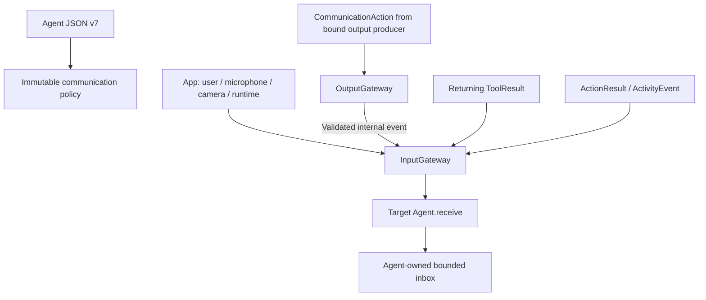

JSON declares supported inputs, exact subscriptions, publications and directed sends. Supporting a contract does not create a subscription. Broadcast target selection uses subscriptions; directed delivery still validates source, target, contract and session. There are no dynamic listeners, wildcards or implicit fallback recipients.

Gateways validate metadata and bound transport. publish submits one-way fan-out and never waits for per-target acknowledgment; no subscribers or overflow may lose the Signal, with failures reported independently. Gateway owns and joins bounded publication tasks but has no independent bus, retry or delivery FIFO. Internal send returns an admission receipt, separate from task/effect completion. Agents own business ordering/fusion/replacement and errors; device Action failures remain explicit.

#### Current signal routes

| Source | Origin | Contract | Receiver or observer |
| --- | --- | --- | --- |
| `phone.microphone` | External | `media.audio` | SpeechPerception subscription |
| `user` | External | `speech.listening/1` | Resident SpeechPerception listening-consent input |
| `phone.microphone` | External | `speech.captureEnded/1` | SpeechPerception current-revision capture-termination fact |
| `phone.camera` | External | `media.image` | VisionPerception subscription |
| `phone.camera` | External | `camera.state/1` | Assistant and Photographer passive camera/native state |
| `user` | External | `user.text` | Assistant subscription; the current production UI has no text-entry field |
| `user` | External | `agent.userInput/1` | Assistant scoped answer/confirmation input; forwarded as task input where applicable |
| `speechPerception` | Agent | `speech.final`, `speech.phase` | Assistant subscription |
| `speechPerception` | Agent | `speech.partial`, `speech.final`, `speech.phase` | Runtime observer for admission/lifecycle coordination, without business UI mutation |
| `visionPerception` | Agent | `vision.pose` | Photographer subscription; independent native presentation calls carry gaze/skeleton updates |
| `user` / trusted host `runtime` | External | `history.intent/1` | Direct Memory subscription; host cancellation retains the same owner |
| `speechPerception` | Agent | `sound.source/1` | Declared Agent subscribers or registered runtime observers; source facts are Agent-generated |
| `assistant`, `photographer`, `memory`, `applicationControl` | Agent | `speech.synthesize/1`, `speech.cancel/1` | SpeechSynthesis directed input under actual reply owner |
| `assistant`, `photographer`, `memory`, `applicationControl` | Agent | `interaction.replyActivity/1` | SpeechPerception source/incarnation-fenced reply occupancy |
| `user` / trusted host `runtime` | External | `model.resource.intent/1` | Direct ApplicationControl subscription; host retirement retains the same owner |
| `model.resources` | External | `model.resource.state/1` | ApplicationControl sampled native resource invalidations |
| `app.resources` | External | `model.resource.hostFailure/1` | ApplicationControl host admission/dispatch failure facts |
| `user` | External | `provider.discovery/1`, `provider.settings/1`, `app.interaction/1` | Direct ApplicationControl subscription |
| `app.environment` | External | `app.environment/1` | ApplicationControl sequenced scene/device/navigation/capability facts |
| `user` / trusted host `runtime` | External | `photography.camera/1` | Direct Photographer subscription; host cancellation retains the same owner |
| `assistant` | Agent | `task.request/1`, `task.input/1`, `task.cancel/1` | Explicit Photographer/Memory/ApplicationControl scoped task |
| `photographer`, `memory`, `applicationControl` | Agent | `task.progress/1`, `task.result/1` | Requesting Assistant and matching task scope |
| `runtime` | External host command | `assistant.control/1` (`cancelSession`) | Selected Assistant/session; typed host control |
| `runtime` | Runtime feedback | `communication.receipt`, `tool.result`, `action.result`, `generation.round.result` | Bound send/execution owner through dedicated feedback admission |
| `runtime` | Runtime feedback API | `activity.event` | Supported owner-fenced admission; production camera currently retains local activity records |

The literal source name `runtime` does not establish Runtime origin or feedback authority. Public host admission and dedicated execution-feedback admission enforce different permissions.

Conversational roles send directed `speech.synthesize` and `speech.cancel` messages to SpeechSynthesis under their own execution identity. A publication without Agent recipients is ordinary loss and never creates a receipt. Agent messaging, Tool return and runtime Action feedback all re-enter through validated InputGateway paths, while retaining their distinct permissions and completion semantics.

Authorized `send` selects one live target and returns a CommunicationReceipt correlated with admission. Models invoke task sends as Actions through the shared XML communication catalog, not an automatically added Tool. Fixed speech synthesis/cancel and task protocol sends remain code-owned authorized communication.

`AgentTaskSignal` carries request/input/progress/result/cancel, immutable scope and optional terminal status. businessContract is nonempty and at most 64 UTF-8 bytes; content is at most 64 KiB, with a 128 KiB encoded-message bound. Request/input/cancel targets the executor; progress/result targets the requester. Only a result carries terminal succeeded/failed/cancelled status. Runtime termination can explicitly interrupt/cancel failed scopes without impersonating another business role.

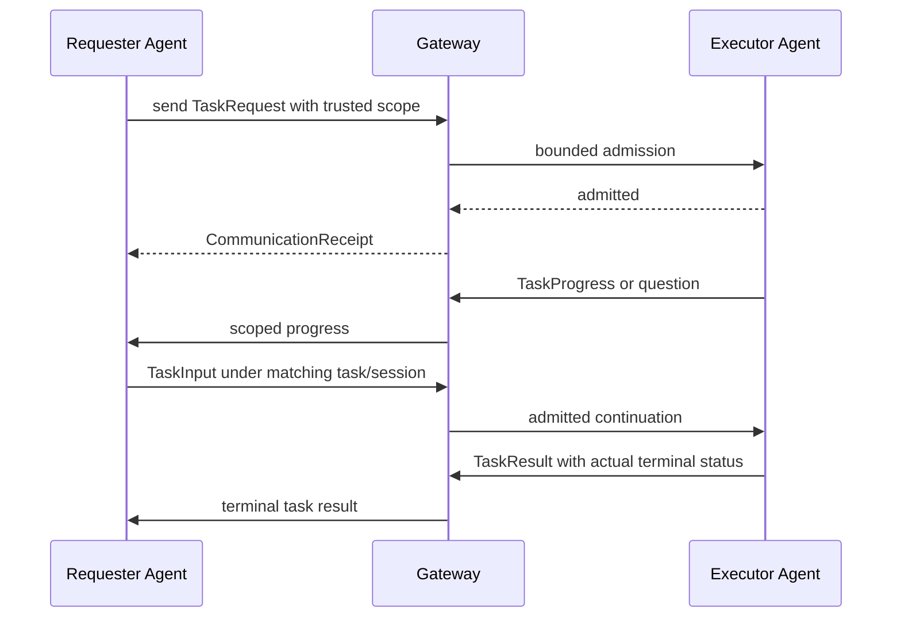

The registry retains 256 identities and at most 128 accepted Signal IDs per task. Wrong scope, duplicates, post-terminal input and reports for retired identities reject. At capacity only terminal identities can be retired. A late admission receipt cannot overwrite an already true terminal result. Role task views separately allow at most 32 live tasks.

Assistant owns one foreground question plus bounded pending task questions. Scoped answers retain task/session/question/artifact identity. Waiting-user releases reply occupancy only after the renderer/reply terminal fact; explicit task terminal state releases remaining holds. A question's presentation is not a user answer.

Assistant owns one local foreground conversational task. waitingUser retains its independent history and Skills; another specialized task requires explicit completion/cancellation. finish/cancel joins the current round and accepted replies before restoring default. Task outcomes become concise default-context summaries. Background fixed tasks keep explicit requester/executor scopes and never copy private contexts.

### Communication and execution contract ownership

- **AgentCore** owns AgentInput/AgentTurn, the generic message container and immutable communication policy; it has no project dependencies.
- **Agents/Support/Communication** owns domain schemas, identities and expiry rules; each role owns prompts and business interpretation.
- **App/Adapters** owns native-source conversion and media deadlines; VisionPerception owns sampling. UI owns independent presentation values.
- **FunctionContracts** owns neutral resource identifiers and bounded report/error values. ExecutionRuntime consumes them; Gateway coordinates resource leases. App defines concrete resources, and NexArm/Bluetooth producers classify their own failures.

See [communication contracts](Agents/Support/Communication/README.md) and [media adaptation](App/Adapters/README.md) for source-level interfaces.

### Routing, Authorization and Feedback

#### Routing and authorization

External Signals enter through App → InputGateway. Agent messages use outputs CommunicationAction → bound consumer → OutputGateway → InputGateway. Agent-driven business effects, including UI changes, use Agent → OutputGateway → registered Action/Tool → capability endpoint; actual returning feedback enters InputGateway again.

Each Agent declares model-callable Actions/Tools and communication permissions in JSON v7. Fixed internal behavior and output permissions belong to Agent code. App binds concrete handlers; Gateway validates coverage and authorization. Runtime control notices describe protocol completion/failure, not unregistered business effects.

1. Contracts and permissions are explicit: validate payload/schema, allowed source, live identity, session, deadline and capacity before admission. Publish selects exact static subscriptions; send selects an explicit recipient. Unknown contracts and incompatible versions reject, with no fallback recipient.
2. Admission means accepted for processing. It does not imply inference, rendering or physical completion. Returning Tools provide correlated results; completion-only Tools return execution outcomes without injecting a ToolResult. Actions retain their execution/lifecycle semantics.
3. Signals have no implicit TTL. Explicit producer freshness/expiry remains part of its declared contract; forwarding preserves that constraint rather than extending it. Runtime results retain causal association and owner-fenced delivery. Provider/Action timeouts are independent of Agent lifetime and do not guarantee physical stop.
4. Agents fence feedback by session and call/execution identity before continuation. Failed delivery is separate from failed execution; delivery retry must not repeat a completed effect. Cancellation uses the owning execution protocol and joins cleanup; a durable effect remains committed.
5. Every admission, inbox and output buffer has an explicit bound and overflow policy. Gateway has bounded active admission and no waiting Signal queue or FIFO guarantee. Only explicitly declared latest-state observations may coalesce; intents, results and device actions must have explicit rejection/retry/failure handling rather than silent replacement.

#### Result semantics and presentation

| Event or result | Agent responsibility | Observable effect |
| --- | --- | --- |
| Input admission | Await actual processing/execution; handle rejection at the producer | No implied operation success or completed UI effect |
| Data or successful execution feedback | Validate correlation, update task state and choose the next step | A new authorized Action/Tool may present results or perform another operation |
| Progress / physical observation | Interpret domain facts under freshness and operation scope | Explicit presentation or behavior output; only declared latest-state inputs may coalesce |
| Failure / cancellation | Stop or continue according to task policy; retain committed effects and join owned cleanup | Explicit status presentation where registered; no automatic effect replay |
| UI endpoint completion | Respect the endpoint's declared completion semantics | State acceptance does not prove animation completion, audio drain or physical arrival |
| New selection / changed environment | Treat as a fresh scoped input linked to its relevant task | Re-enter through InputGateway when business processing is required |

Presentation endpoints fence session/request/turn identity before applying a business update, so late feedback cannot overwrite newer state.

Typed `assistant.control/1` (`cancelSession`) is an external, host-bound Signal through InputGateway. Assistant validates domain content and host provenance before bypassing its inbox and joining only the selected session worker. Arbitrary event strings are not business input; the role has no runtime.event permission. Cancellation does not roll back committed effects.

Rendering a state change does not automatically produce a new Signal. Only meaningful user, system or domain feedback re-enters the input boundary. This keeps the feedback loop explicit and avoids self-triggered presentation loops. Endpoint failures remain execution outcomes; completion-only UI Tools do not manufacture returning ToolResult Signals.

### Capability declaration and output resolution


Model-callable Actions are grouped by Channel in JSON; native Tools use function declarations. Fixed internal behavior and permissions live in Agent code. Aliases are local to one Agent and resolve before Gateway admission. Gateway accepts only resolved paths and typed scheduling controls. App binds handlers explicitly; invalid configuration has no fallback registration.

Function Token is the Assistant's streaming mixture of natural text and restricted XML:

```xml
<express emotion="smile"/>
Hello.
<wait>
  <express emotion="thinking"/>
  Let me think.
</wait>
```

Natural text, Action tags, Channel scopes and nested wait groups are parsed incrementally. Text boundaries may create code-owned speech/caption calls; explicit tags resolve only through the declared catalog. Raw markup, incomplete structures and unresolved aliases never reach Gateway. Native Tool calls use the separate ToolCall parser.

Aliases and parameters must exist in the role's grant. Closing an inner Channel restores its parent; leaving the outer scope restores per-function defaults. Channel and wait boundaries flush preceding text. Completed calls can emit before scope closure, so parser completion does not mean effects have completed.

Literal `<` and `&` are escaped. Quoted attributes support five predefined entities and valid numeric references; escaped markup is never reparsed. Duplicate attributes, paired Action bodies, self-closing Channel/wait, crossing scopes, comments, DOCTYPE, CDATA and processing instructions reject.

| Parser boundary | Current bound |
| --- | --- |
| Generation input | 65536 UTF-8 bytes |
| Tag size / count | 4096 bytes / 1024 |
| Attributes / incomplete entity | 32 / sixteen characters |
| Combined Channel/wait nesting | Eight |
| Wait groups | 32 |
| Pending sentence buffer | 2000 UTF-8 bytes |
| Optional text soft limits | 1…2000 Characters, preserving safe word/sentence boundaries |
| Text mapping | Up to eight ordered outputs per chunk |
| Native argument JSON | 4096 bytes, string values |

Unknown aliases/invalid parameters produce ordered non-executable CallRejection and count toward the call budget. Structural syntax/limit failure terminates the parser instance; failed/cancelled generation does not flush partial syntax. Already executed prefixes cannot be rolled back. GenerationTrace is non-executing bounded evidence (256 KiB/8192 raw fragments), not a retry or dispatch service.

Native ToolCallParser consumes complete provider-native calls independently of XML/Channel/wait. Partial native calls are not executed. Provider aliases map consistently across declarations and native history before canonical resolution.

### Canonical Functions and Protocol Bindings

Actions owns six business domains: UI, Speech, Camera, History, System and NexArm. Queries and effects are both callable business functions. A capability address is exactly `Domain.Module.function`: the domain identifies its directory, the module identifies a cohesive entry file, and the function identifies the operation. Channels, resources and call protocols are separate properties.

| Domain | Module | Canonical functions |
| --- | --- | --- |
| UI | Expression | express, setExpression |
| UI | Gaze | moveEyes |
| UI | Caption | print, setTranscript, finishTranscript, beginReplyTurn |
| UI | VoiceState | setVoiceState |
| UI | Pose | showPose |
| UI | HistoryPresentation | showHistory |
| UI | Navigation | open |
| UI | ResourcePresentation | showResources, showResourceFailure, showResourceOperationFailure, showResourcePreferenceFailure, showProviderResult |
| Speech | Playback | speak |
| Speech | Listening | update |
| Camera | Capture | open, close, flip, retry, takePhoto, savePhoto, ignorePhoto |
| History | Conversation | list, read, delete, startNew, summarize |
| System | Runtime | runtimeInfo |
| System | ModelResources | snapshotResources, restoreSource, saveSource, configureSpeech, download, cancel, remove |
| System | Provider | discoverModels, restoreSettings, saveSettings, readSettings |
| System | Device | control, readEnvironment, readStatus |
| NexArm | Motion | moveMotor, resetMotor, reset, shakeBase |
| NexArm | Gesture | nodHead, shakeHead, waveWrist, tiltWrist, lookAround, celebrate, dance |
| NexArm | Tracking | aim |

`System.Runtime.runtimeInfo` currently returns fixed descriptive text, not live diagnostics or verified model/device availability. Current state reads use explicit System.Device, System.Provider and System.ModelResources functions.

`@Action` produces one protocol-neutral `ActionFunction` with a `FunctionInput` handler, completion metadata, resources and static/dynamic execution budgets. `ActionCompletion` carries a value, structured child report/terminal issue or declared completion/activity identity. FunctionRequest contains canonical address and parameters, without Channel, wait membership or a protocol discriminator. Opaque execution context and a host-supplied report sink preserve correlation without granting permission.

App freezes one validated catalog (at most 32 supplied catalog modules and 256 functions) and creates `ActionBinding` values. Bindings independently select protocol availability, direct native execution and fixed-caller result delivery. Unknown modules, duplicate addresses and invalid metadata fail startup. Neither protocol projection nor an Agent argument may weaken intrinsic constraints. Registration availability does not grant Agent permission.

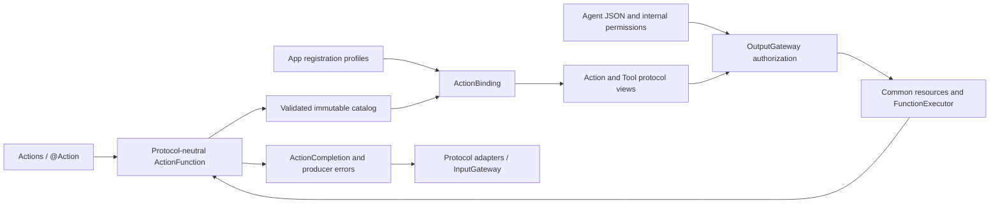

The [target map](#target-map) separates FunctionContracts, ExecutionRuntime, CallRuntime and Gateway. FunctionRegistry/FunctionExecutor own canonical execution; call adapters own protocol views, and Gateway adds Agent ownership, authorization, scheduling and feedback. Actions and BehaviorAssembly remain independent of AgentCore.

| Layer | Shared contract | Protocol-specific concern |
| --- | --- | --- |
| Business implementation | FunctionInput, ActionExecutionContext, ActionFunction, ActionCompletion | None |
| Agent declaration | Canonical address and independent grants | Text aliases/default Channels versus native names/schemas |
| Model input | Selected capabilities | Action catalog in context prompt versus declarations in ChatRequest.tools |
| Output parsing | Canonical address and validated parameters | Text tags become ActionCall; native events become ToolCall |
| Execution | Resources, budgets, reports and joined cleanup | Channel/wait scheduling versus direct native execution |
| Feedback | Actual outcome and causal context | ActionResult versus ToolResponse/ToolResult and actual business output or failure |

Agent JSON v7 uses three-field Action paths and native declarations shaped as `{path: {domain, module, function}, definition: ...}`. Only the native definition reaches the provider; its name is an Agent-local alias. Incompatible configuration versions fail explicitly. Text deltas pass through AgentGenerator and native events through ToolCallParser; both resolve inside Agents. Tool results never implicitly become executable markup. Unsupported providers receive no native declarations.

Returned values are limited to 64 KiB UTF-8 and reject explicitly before delivery. Structured report limits are independent; oversize values are not silently truncated or replayed.

The matrix follows [BehaviorProtocolBindings](App/Composition/Behaviors/BehaviorProtocolBindings.swift). It describes available host projections; each role has a narrower effective grant set.

| Canonical group | Host projections | Direct result / reasoning policy |
| --- | --- | --- |
| Camera.Capture; UI.Navigation; System.Device.readEnvironment | Action and direct Tool | Returning direct result; observation |
| UI.Caption.print / beginReplyTurn | Action and direct Tool | Fixed caption/reply maintenance projection |
| UI.Expression/Feedback; Speech.Playback; Speech.Listening; NexArm.Motion/Gesture | Action | Scheduled business/state effect contract |
| History.Conversation; System.Runtime/ModelResources/Provider; UI.ResourcePresentation; other System.Device | Direct Tool | Returning result; observation |
| UI.Gaze/VoiceState/Pose/HistoryPresentation; remaining UI.Caption; NexArm.Tracking | Direct Tool | Fixed completion-only projection |

A canonical implementation may be registered by multiple Agents or support both host protocols. A role's model catalog must not expose the same address as both model Action and model Tool. Code-owned internal reuse is separate and permitted. Assistant default mode uses Actions; dynamically loaded history-query exposes native read-only Tools. Skills reference canonical metadata without redefining parameter contracts. Specialist Agent JSON describes fixed function declarations and workflows, not conversational model exposure. The Resources catalog is the sole active configuration source.

### Action and Tool execution

| Dimension | ActionCall | ToolCall |
| --- | --- | --- |
| Resolution | Action path, arguments and effective Channel | Tool path and arguments |
| Dispatch | OutputGateway → ChannelScheduler → CallRuntime → ExecutionRuntime | OutputGateway → ToolDispatcher → direct ToolExecutor → ExecutionRuntime |
| Ordering | Task-local Channel FIFO and nested wait groups | Direct execution outside XML Channel/wait; shared host output consumer bounds concurrency |
| Completion | Registered handler boundary plus task finish barrier | Returned value or completion-only, fixed at registration |
| Feedback | Declared ActionResult; ActivityEvent has a separate producer-owned lifecycle | Returning ToolResult re-enters InputGateway |

Both protocols execute the same function and preserve resources, budgets and cleanup. Native calls bypass Channel/wait; Action and Tool terminal results remain separate until the Agent merges a sealed round.

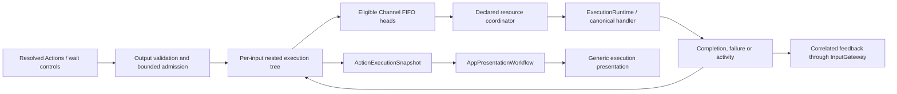

Each input owns a scheduling tree. Channels order work within that tree; equal names in other tasks do not create a global FIFO. A wait group joins its parent's preceding work and all children before releasing the continuation. Different Channels and tasks may run concurrently. Unconfigured resource conflicts fail explicitly rather than queue; configured takeover joins old cleanup before execution. Resource leases/fences coordinate Actions, Tools and App-owned paths across module boundaries. Capacity exhaustion rejects explicitly, and cancellation joins cooperative handlers.

Action feedback follows the reservation and causality contract [below](#execution-feedback-causality). Separately, the scheduler publishes payload-free `ActionExecutionSnapshot` values for App/UI diagnostics. Display names come from validated metadata; raw arguments, device telemetry and permission decisions are excluded.

App's generation transport drains Tool and Action/control branches independently. Tools have 128 queued envelopes and at most four concurrent executions; Actions/control retain 256 ordered envelopes. The current reader and accepted child tasks remain owned so a handler failure wakes processing even when the output stream has no next element.

No native Tool enters a Channel or wait tree. roundFinished seals both branches, joins accepted work and scoped feedback, then acknowledges the merge barrier. Final completion uses the same drain. Input-local error/cancellation joins only that input; it does not terminate unrelated role admission or silently drop device work.

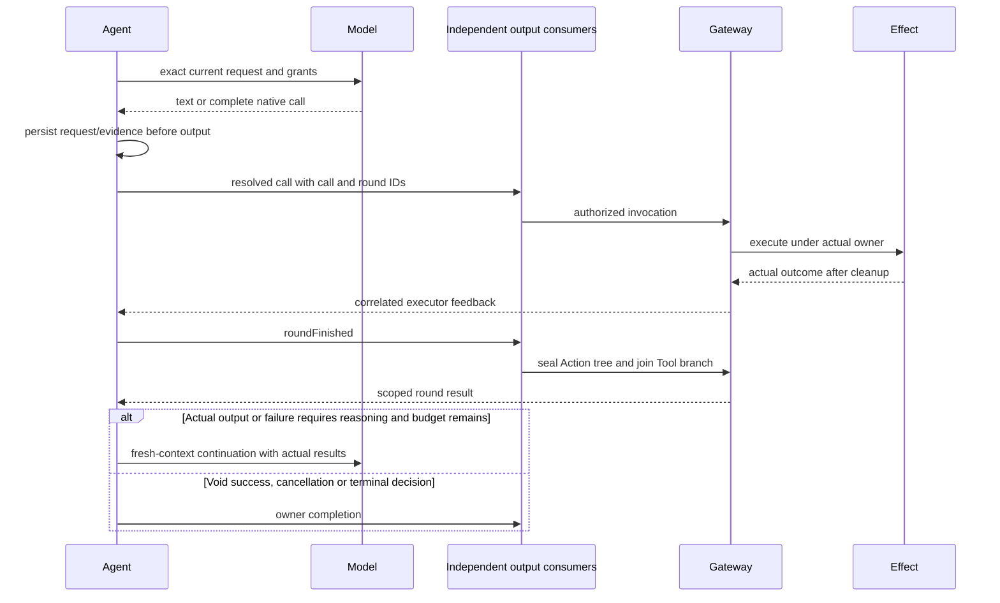

ReACT follows actual outcomes: successful business output and execution failures enable another model request after every accepted call joins. Successful completion without business output remains terminal history/barrier evidence. Explicit values (including empty strings) are business output; successful execution reports, activity handles, completed and admission receipts are completion evidence only. Function failure becomes actual model evidence rather than automatic replay. Model terminal state does not declare its emitted functions successful, and a business task can continue after one model invocation ends.

### ReACT continuation and Agent recovery

✅ 2026-10-13 clarification implemented: successful reports and lifecycle handles are no longer classified as business output. Explicit values and actual business failures continue. Pure cancellation and Agent-internal failures never request another model round.

✅ Shared Chat implements result-driven reasoning → call → joined result → reasoning. [AgentChatWorker](Agents/Support/Chat/AgentChatWorker.swift) owns requests, context refresh, history and continuation admission. Foundation-only [AgentRoundCoordinator](Agents/Support/Core/Runtime/AgentRoundCoordinator.swift) owns the sealed/all-results barrier; [ToolResult](Agents/Support/Core/Output/ToolResult.swift) derives `requiresReasoning` from actual outcomes. Gateway owns authorization, Channel/wait scheduling, resources and result delivery. ModelKit supplies inference events and provider diagnostics. Registration attributes, role defaults and App policy tables no longer select ReACT.

Agent-internal errors terminate the input. Otherwise the decision is `roundCoordinator.needsReasoning`, after sealing, execution/delivery join, result verification and durable round evidence. `needsReasoning` requires an uncancelled sealed round with every registered call terminal and at least one failed result or business output. Continuation also requires a live owner, remaining cumulative budget and a valid next request.

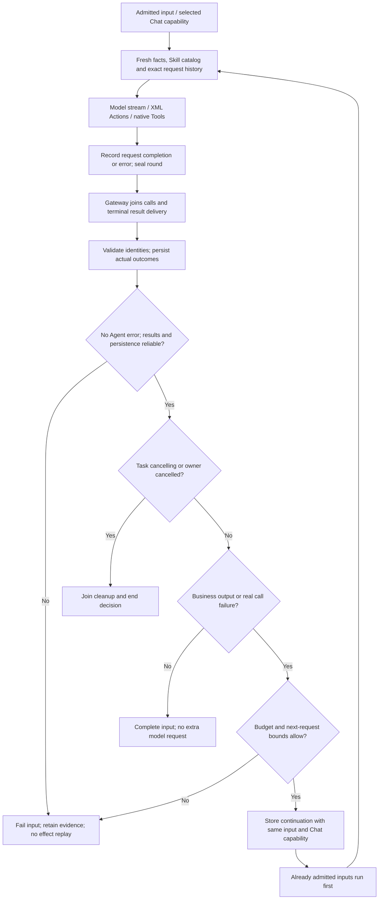

#### All continuation triggers

| Actual condition | ReACT / recovery behavior |
| --- | --- |
| Successful `.value`, including `""` | Business output; continue after the full barrier. Empty string is an explicit value, not absence of a value. |
| Successful `.report`, empty or nonempty | Execution evidence only; keep all steps/details/history and join the barrier, without requesting ReACT. A report is not a business value. |
| Successful `.activityStarted` / `.activityStopped` | Lifecycle acknowledgment only; the identity does not independently request ReACT. Business data must be returned explicitly as `.value`. Later activity events have no generic automatic continuation integration. |
| Legacy native ToolResult with `value` and no `completion` | Preserve value semantics and continue, including an empty value. Legacy ActionResult without completion is normalized to `.completed`. |
| Failed/partially failed Action invocation | Preserve actual failures/effects and continue while the input owner remains live. |
| Cancelled Action/Tool invocation | Preserve cancelled evidence; no incident or ReACT. Independent real failures in a mixed report remain failures. |
| Tool `isError`, nonnil non-cancellation `failureCode`, failed report | Real failure takes precedence over absence of business output; continue. |
| Unknown Action/Tool alias or invalid parameters | Parser-local rejection becomes a correlated error result (`invalidInvocation` or `communicationRejected`), without executing the call. Forbidden Channel/malformed markup ends the generation as a real Agent failure. |
| Handler exception, Action timeout, resource/permission/admission rejection with reliable terminal feedback | Continue from the real failure. A closed scheduling tree alone does not authorize continuation: call results and the round receipt must remain reliable. |
| Failed model communication | Continue from the error. Successful send/publish admission is a `.completed` acknowledgment. Background progress/results update state without independently invoking Chat. |
| Chat request/stream/consumer failure within `collect` | Record the failed attempt, join admitted effects and terminate the decision. Includes HTTP/network/provider errors, output parsing, unsupported output and per-request limits. No automatic Agent retry. |
| Observation/image enrichment construction failure | Terminate the decision with the real error and retained execution evidence; never fabricate an image or repeat capture. |
| Round closure failure with a prior generation error and every call result already present | Retain both causes and terminate the input; round closure/delivery uncertainty never authorizes a retry. |

Success with `.completed`, any successful execution report, activity handles, execution IDs, acknowledgments, normal speech/playback completion or presentation completion alone does not continue. In a mixed round, one qualifying result is sufficient, but every accepted call must join. Native call/result pairs remain complete even for void successes when another result continues the round; ordinary Action acknowledgments remain history/barrier evidence.

Model finish reasons (`stop`, `toolCalls`, `lengthLimit`) record provider termination; none independently requests ReACT. Length-limited incomplete markup terminates the generation; complete void-success output can finish normally. An active Task, passive camera/environment facts or a waiting-user prompt does not start a polling loop. New user input starts a new decision chain; scoped foreground task requests/questions can admit new input through explicit routing.

#### Context, evidence and Task boundaries

History v2 explicitly separates immutable request-start decisionMetadata from request historyTaskID. The startTask-producing request is assigned to the new Task in the same transaction. Terminal Task status and a conversation-owned compression (stable input/request source IDs, goal, reported summary and real failure) commit together after barriers. Model, UI and query projections replace only those indexed sources at their first historyOrder; current/ordinary/raw execution evidence remains durable. New inputs and same-input Task-boundary continuations share this projection. App exclusively opens assistant.history-v2.context.json; previous Assistant contexts are unused without decoding/import/migration. Compression is derived from existing finish/cancel summary plus host terminal facts, without extra inference.

Continuation retains the original input/session, request options, cumulative budget and selected ChatCapability, then rejoins FIFO behind admitted inputs. Resumption rebuilds the effective Skill system prompt/native definitions, refreshes facts/task reports and incorporates eligible intervening completed requests. Facts remain user-role data before the current input or the complete native-call/result group. A request catalog is immutable during its invocation; `loadSkills`/`startTask` can expose new functions only in later requests.

The next request includes assistant output, every native call/result pair, qualifying Action observations and optional owned photo attachments. Failed Agent attempts retain error text, partial output and actual call/effect evidence in history and terminate the chain. No automatic effect replay occurs; the model chooses a new authorized action, asks the user or stops. History preserves the failed input and allows a fresh user input; journals store derived `requiresReasoning` rather than configurable policy.

✅ `finishTask` joins work/reply cleanup and commits closure/default Skill restoration before allowing result-driven continuation for remaining goals in the same input. It does not reopen the completed Task. `cancelTask` commits cancellation and ends the chain. `startTask` cannot overwrite a running/waiting/finishing Task. Closure failures are reported. Completing an input after void success does not itself declare an active Task goal complete.

#### ReACT limits and time ownership

`AgentTaskBudget` is initialized per new admitted input and restored across that input's continuations. A later human input in the same foreground Task gets a new decision budget. Production uses the defaults below; there is no separate user-configured ReACT policy. Optional caller budgets validate explicit bounds; production defaults impose no cumulative request/native-call stop. Completion, cancellation, genuine failure and lack of progress own the decision lifetime.

| Scope | Current bound and consequence |
| --- | --- |
| Decision-chain requests | **No fixed count cap**. Continue after joined business output/failure until completion/cancellation. Repeated identical generation failure without a successful business output ends with the actual error. |
| Decision-chain native calls | **No cumulative cap** by default. Optional explicitly supplied Core budgets remain supported; production does not supply one. |
| Each generation generated calls | **120 per round**, including natural-text mappings, rejected calls and internal reply-start calls; each round coordinator holds at most 120 calls. Scheduling boundaries have separate parser/output capacity. |
| Each generation feedback | **65,536 UTF-8 bytes** of serialized results plus new error/partial-output text. Error/partial-output fields each retain at most **2,048 Characters**. This counter excludes image bytes and is separate from the whole-request bound. Overflow terminates without replaying effects. |
| Each constructed ChatRequest | **64 messages / 65,536 text and native-ID/name/argument bytes**, complete unique native call/result pairing. The Agent projection retires oldest complete call/result blocks while preserving system/current intent/latest round and reserving fresh facts. Durable history is unchanged. A malformed or individually unrepresentable current payload still fails explicitly. |
| Request images / Tool definitions | **4 images**, **4 MiB each / 16 MiB total**; **128 unique Tool definitions / 64 KiB total declarations**, each declaration ≤64 KiB. |
| Each Chat text stream | **64 KiB text / 8,192 fragments**; text/native event queues hold **8,192/128** elements. Overflow is `GenerationError.limitExceeded`; per-request recovery retains actual execution evidence. |
| XML/parser | **64 KiB input**, **4 KiB/tag**, **1,024 tags**, **32 attributes/tag**, **16 Characters/incomplete entity**, **8 combined Channel/wait levels / 32 waits**. Sentence buffer: **2,000 UTF-8 bytes**; one text mapping: **8 events**. Native argument JSON: **4 KiB**. |
| Admission / scheduling | Text input ≤**4 KiB**; one Chat worker; **32 queued inputs plus one continuation slot / 256 output envelopes**. Output consumption: **128 pending / 4 concurrent** native deliveries. ChannelScheduler defaults: **32/channel, 16 channels, 64 tracked inputs**. Overflow explicitly rejects/fails; continuation requires reliable feedback. |
| Action terminal delivery | Reserve before effects: **512 pending/reserved results** by default (configurable 1…1024), one active callback. `.retry` resends the same result with 100 ms increments capped at 1 second; **no retry-count limit or expiry**. Acceptance or owner/scope closure ends delivery. Tool delivery makes one admission attempt. Transport retry is separate from model ReACT and effect replay. |
| Agent lifetime | **No generation deadline, cumulative elapsed deadline, queue TTL or result-barrier timeout.** Completion, explicit cancellation, failure or scope closure ends work. A blocked producer/admission can keep a barrier pending; request limits are not elapsed-time bounds. |
| Action execution | FunctionContracts default: **30 seconds per execution**, dynamic before static budget; declaration range `(0, 86,400]` seconds. UI commonly uses 5 seconds, playback 300 seconds; compound budgets compose separately. Timeout joins cleanup and returns failure; it does not prove physical stop. Queueing is excluded. |
| Providers | OpenAI HTTP timeout defaults to **60 seconds** (configuration 1…600), independent of Agent lifetime. Responses SSE: **8 MiB total / 64 KiB line or event**, native arguments ≤4 KiB. Explicit `maximumOutputTokens` ≤**32,768**, otherwise omitted. Gemma: **4,096-token prompt + output** context; images/native Tools are rejected. |

Exact lower-layer contracts: [Generation](Agents/Support/Core/Generation/README.md#bounds-and-errors), [ChatCapability](ModelKit/Language/LLM/ChatCapability.swift), [scheduling](Gateway/Output/Scheduling/README.md) and [delivery ledger](Gateway/Output/Results/ActionResultLedger.swift). Provider and Action limits must not be described as an Agent-wide ReACT timer.

#### Recovery stop conditions and current limits

✅ Owner/input/session cancellation and lifecycle closure join cleanup without requesting another model response; `cancelTask` ends its chain. Missing/mismatched/closed feedback, unsafe round completion, aggregate overflow, invalid next-request construction or failed durable context/history commits terminate explicitly. Startup/provider-selection/context/prompt failures outside `collect` and observation-construction recovery also terminate; not every Agent exception is retried.

✅ The three-result strategy, joined barrier, evidence-preserving recovery, FIFO continuation, catalog refresh, native pairing and cumulative bounds are implemented. Fixtures cover Action/Tool/mixed results, rejection, cancellation, delivery failure, request/native limits, malformed/partial/HTTP failures, admitted-input priority and no automatic effect replay. Live/device evidence remains in [validation history](../docs/Validation-History.md), separate from these fixtures.

❌ Recovery does not classify transient/permanent provider errors, apply HTTP Retry-After/backoff, switch providers or shrink an oversized request automatically. Repeated permanent errors can consume all four attempts. HTTP retains status only; network errors become `transport`; bounded valid SSE error codes are preserved as `providerCode`, without raw bodies or credential-bearing diagnostics. Error/partial-output fields are truncated. Generic activity/progress-driven Chat continuation is absent. These are explicit limits of completeness rather than additional implemented recovery mechanisms.

### Call failure and deadline semantics

Agents resolve model aliases. Unknown calls and invalid invocation parameters emit non-executable rejectedCall outputs and count against the 120-call bound; structural parsing failures and limits still terminate generation. Gateway retains these failures in its 256-entry output history without admitting rejected Actions to the scheduler.

Action handler reports preserve completed child entries and attach later exceptions/cancellation as an execution-level issue. Invocation lookup, argument and resource availability rejection remain local. Permission rejection, all ActionSchedulingError cases (including capacity/limits), communication identity failure and actual task cancellation still close the owning Action tree; execute records ordinary failures without automatically stopping the producer.

ToolExecutor converts ordinary exceptions and operation-local cancellation into ToolResponse errors; caller cancellation propagates. Both protocols use dynamicTimeout before static timeout, with the mandatory thirty-second default owned by FunctionContracts. Static timeouts must be in (0,86400] seconds; invalid declarations fail, and NexArm retains request-dependent estimates. Timeout cancels and joins cleanup before returning. [Feedback causality](#execution-feedback-causality) defines separate delivery failures and completion-only behavior.

The executing conversational role records rejected calls when possible; failure to write that outcome produces a separate agent.historyError result and preserves the original rejection. Conversation admission, raw history and terminal durability remain strict. See [result fields and failure boundaries](Gateway/Output/Results/README.md#effect-and-failure-evidence).

| Failure scope | Outcome and continuation |
| --- | --- |
| Ordinary handler/producer exception | End only that invocation, preserve bounded child outcomes and terminal cause; unrelated jobs and the runtime continue. |
| Lookup, argument or resource availability rejection | Reject the call without fabricating an effect. |
| Permission/identity rejection, structural scheduling or scheduling capacity error | Current policy closes the owning Action tree; it does not stop the process-wide runtime. |
| Explicit owner/session cancellation | Cancel that scope and join cleanup before releasing its resources. |
| Feedback admission/delivery failure | Retain the execution outcome; follow the declared bounded delivery policy and never replay the effect. |

### Execution Feedback Causality

`SignalCausality` captures immutable inputID, rootID, hops, turn and sequence from the initiating OutputEnvelope. ActionResult and ActivityEvent require that context. InputGateway preserves the original root, uses the initiating inputID as parent and increments hops once; framework feedback has no implicit admission TTL. Returning Tool feedback follows the same causal rules. Invalid/exhausted hops or a stale Agent incarnation/session close delivery without replaying the effect.

Action terminal feedback reserves capacity before effects. Its bounded outbox retries delivery of the same result and execution identity; it never re-executes the operation. Execution outcome and delivery outcome remain distinct. Host-originated camera activity has an explicit lease-scoped causal root. AgentInput remains an in-process contract, not a remote authentication or durable transport format.

Feedback availability is separate from feature integration: ActionResult has a bounded outbox; returning Tool feedback makes one admission attempt and records delivery failure separately. ActivityEvent has owner-fenced transport but no automatic producer, subscription or shared retry loop. CameraCoordinator currently records lease activity locally; routing those facts to an Agent and generic long-task progress/cancellation remain outstanding.

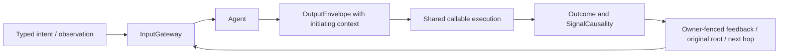

Action delivery policies are none/failuresOnly/terminal; these govern transport, not model ReACT. Ordinary production defaults to failuresOnly; generated rounds request terminal evidence. Reserve capacity before effects. Successful failuresOnly releases the reservation without delivery. Terminal feedback has no implicit expiry and remains owned until admission or scope closure.

The Action result ledger defaults to 512 reserved/pending entries (configurable 1…1024). One worker has at most one active callback and joins it during cancellation. Accepted means admission; retry means temporary capacity rejection and schedules the same result again, with 100 ms increments capped at one second and no count/deadline cutoff; closed means the owner/scope/contract no longer exists. Scoped round completion waits for admission and fails on closed delivery. This transport retry never re-executes the effect or independently invokes a model.

Tool value/isError/call ID/original code survives a separate deliveryFailure, also copied into output.failure. Cancellation before execution is notStarted; failure/cancellation after start conservatively has unknown effects; success is contractCompleted at the function's declared boundary. Activity start confirms only started activity.

### Resource control ownership and cleanup

ResourceCoordinator owns control rather than device health, with unlocked/locked(owner) snapshots from one holding index. Transient writers and persistent leases share ownership semantics; internal handoff is bounded. Stop errors after joined work unlock; timeout fails that request and actual late completion automatically unlocks, without replay. Revocable execution permits prevent stale held-context bypass at App entries. Cancelled cleanup still waits independently of its caller. Camera cleanup uses joined resource release. Action/Tool outcomes, Channel queues and Bluetooth recovery remain separate.

A nil owner in locked(ExecutionOwner?) represents a host use. Resource definitions declare valid owners, lease requirements, execution groups, preemption and stop callbacks.

`run` reserves a live writer before its task starts and binds owner/held IDs/ResourceExecutionPermit. Inherited permits authorize child calls only while live. Ended, revoked or handoff-context effects reject at App/native entries. A lease-bound effect additionally checks the current lease and deadline. One finite lease-bound call ending does not release its persistent lease.

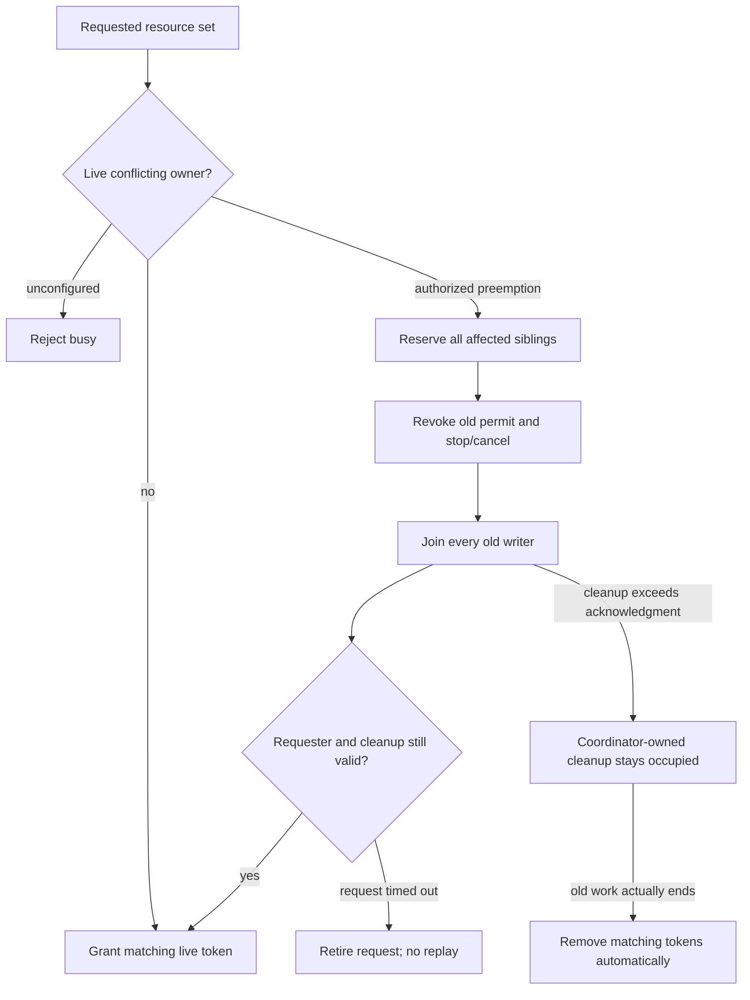

Reserve all intersecting execution-group siblings before awaiting cleanup. A successful handoff stays reserved until the exact requester grants or retires it. Timeout fails the requester while coordinator-owned cleanup continues. Late cleanup never grants timed-out work; stop error after joined cleanup unlocks and propagates. Token matching prevents an old completion from unlocking a new holder.

| Resource boundary | Limit |
| --- | --- |
| Definitions / owners per definition | 64 / 128 |
| Requested set / live leases | Eight / 32 |
| Active uses / cleanup attempts | 256 / 32 |
| Cleanup subscribers | Eight newest-one streams |
| Lease duration | Positive through sixty seconds, explicit renewal |
| Cleanup acknowledgment | Default five seconds, positive through thirty seconds |
| Waiting queue | None; conflicts/capacity fail explicitly |

Production camera.capture uses a persistent host-owned lease. The six NexArm motors share a writer group; App composes authorized takeover, while Settings manual control is an explicit host policy bypass. Uncooperative writers remain occupied. Software cleanup does not prove motor stop, stationary hold or physical clearance.

### Voice, cognition and presentation

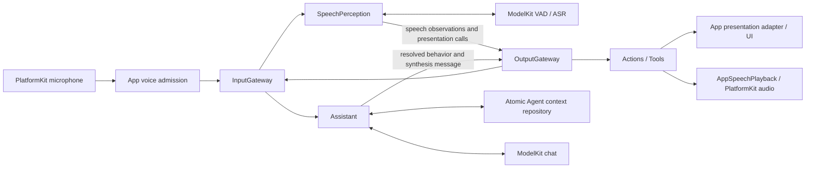

SpeechPerception converts admitted PCM into phase and transcript observations. Its Agent actor owns admission, utterance identity, phase transitions and reply gating; VoiceActivitySegmenter adapts VAD scores, SpeechBoundaryPolicy owns sample-count boundaries, internal SpeechRecognitionTurn owns ASR sessions, and internal TranscriptAccumulator owns revision merging.  Assistant selects immutable context, persists exact request/effect evidence, streams chat generation and resolves behavior. Its repository commits before dependent outputs. Recognition UI, reply UI and speech playback all use permitted outputs; runtime observers do not select business presentation on an Agent's behalf. App observers may render bounded execution diagnostics and actual host/device telemetry under their declared ownership.

`AgentTurn` and trusted output sequences travel through input, observations, calls and returned results. AppPresentationWorkflow admits only the active session/turn/sequence. Recognition previews may be replaced within their declared latest-state path; reply chunks and discrete behavior are preserved. Playback state reflects actual audio output rather than model generation completion.

SpeechPerception owns session-only consent and revisioned reply occupancy. Assistant reports complete interaction.replyActivity snapshots; deterministic specialists have no conversation worker but have no listening grant. Four source/incarnation-fenced occupancy snapshots and one pending final root suppress new utterance admission. Final recognition closes admission before publication; matching reply acknowledgment transfers that hold to actual occupancy.

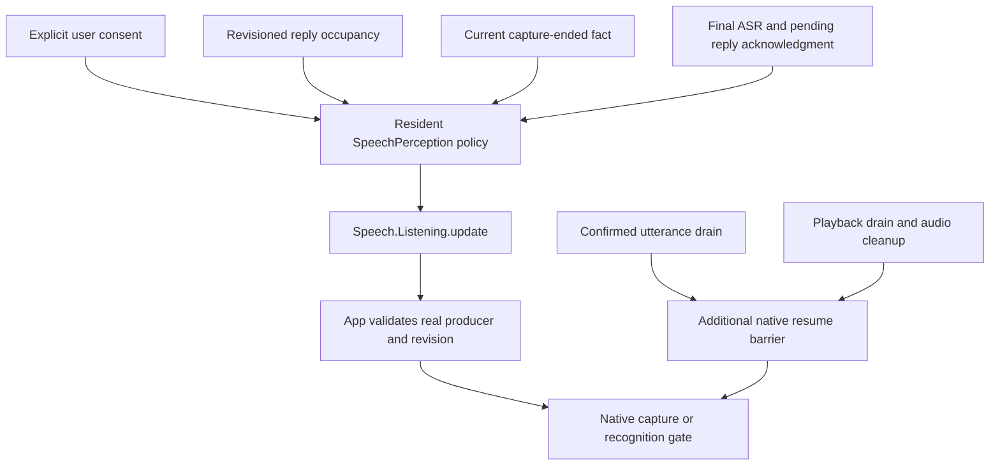

User-off stops physical capture and cancels the current Assistant reply. Policy pause preserves consent while stopping native capture after confirmed utterance completion. App additionally joins confirmed utterance completion and actual playback/audio cleanup, then immediately restores capture when the listening policy permits; no fixed post-playback delay exists. Occupancy is released by matching terminal/lifecycle facts or explicit user cancellation; there is no recovery timer. Restart does not restore consent or replay speech.

### Speech capability selection and recognition

Nemotron recognition uses the shared multilingual/2240ms Core ML export through Management → Hub → App storage. The receipt fixes the installed revision; stale revisions prompt explicit deletion. Nemotron-owned LocalNemotronEngine preloads shared graphs, the ASR adapter obtains a fresh recurrent session under one lease, ordered 16 kHz PCM produces bounded revisions, and finish/cancel drains native work before release. macOS and iOS use the same files.

Speech resource workflow: restore independent useCustomRecognition/useCustomSynthesis (defaults false; persisted choices require installation validation) → Defaults stable capability facades → installed/available local Nemotron/MOSS/Silero or Apple SpeechAnalyzer/AVSpeechSynthesizer/energy VAD → existing SpeechPerception endpoint → normal conversation. Disabled ASR/TTS choices select Apple speech independently and preserve weights; VAD selects installed available Silero regardless of those choices, otherwise Energy; Gemma 4 E2B/YOLO retain independent model selection. App stops voice before policy changes. Apple language assets are system-managed and may download during first warmup. ModelKitEnergy is the independent ModelKit-only VAD adapter; SpeechFallback.swift belongs to Defaults, not Management.

SpeechPerception holds 128 packets/64000 scalar samples; control facts bypass audio capacity. VoiceActivitySegmenter requires ordered contiguous 16 kHz mono Float32, at most 16000 samples per process frame, 32000 pending samples and 64 scores. Probability threshold defaults to 0.5 (valid 0.05…0.95).

Segmentation uses sample counts: onset 1536 (96 ms), pre-roll 4096 (256 ms), endpoint silence 12800 (800 ms), endpoint padding 3072 (192 ms) and model-sized segment 192000 (12 s). In-sentence silence is retained; endpoint tail is trimmed by whole VAD windows. A maximum-duration segment retains speaking/hysteresis and the same utterance identity. A turn has no elapsed-time limit; the ASR queue remains bounded to 128 events/64000 mono samples.

Recognition merges revisions within its real segment. Partial/final observations are distinct: partial encoded size at most 16 KiB and two-second validity; final nonblank text at most 4096 UTF-8 bytes and ten-second validity, published once. Empty final seals the caption but does not invent user content. Recoverable recognition/queue failures reset only the damaged utterance and surface agent.error; native capture termination is a separate current-revision fact.

Apple recognition owns one transcriber/detector/analyzer request, bounded native input and cancellation-aware finalization without a watchdog. Normal native detector activity callbacks are not assumed to supply the endpoint; external VAD remains the silence source. Nemotron's model window is not a promise of end-to-end conversation latency.

### Sound source direction and capture readiness

PlatformKit preserves native mono or ACN/SN3D FOA PCM and hardware capture time. App passes channel layout and PCM through the generic AudioInput; SpeechPerception alone calculates dominant acoustic direction and extracts W for 16 kHz ASR. sound.source/1 is a 500 ms latest-state observation through OutputGateway→InputGateway. It uses captured sound-field coordinates and contains no motor/camera command. Mono remains available for ASR; direction is unavailable there. Reply admission is independent of direction publication, and Photographer does not subscribe.

Native capture startup is committed by first validated PCM delivery. FOA uses AVCaptureSession microphone configuration; unsupported or failed startup closes the spatial graph before mono retry, with a 3-second first-frame bound for each backend. No running stream silently changes channel layout. The host shows listening after readiness and clears that phase/spectrum on capture failure.

PlatformKit queries the native AudioBufferList size before extracting PCM, within storage for at most four buffers; four interleaved FOA channels occupy one buffer. Retained block storage lives through synchronous conversion, and native query/extraction failures preserve OSStatus. Native layout, PCM format and timeline validation still precede App/Gateway admission.

FOA sound direction is perception, not SDK policy. SoundSourceEstimator correlates W with Y/Z/X over one 100 ms native-rate window (rounding at most 101 ms). Captured X is front, Y left, Z up; azimuth/elevation are radians. RMS threshold is −50 dBFS and correlation quality 0.6. This is heuristic evidence, not calibrated probability, distance or person identity.

Quiet evidence clears direction and becomes inactive after 200 ms. Mono reports unavailable once per format/listening epoch while preserving recognition. One publisher retains one latest pending observation, at most 10 Hz and 500 ms window-end freshness. Reply pause/reset clears directional state; stale facts never become robot coordinates.

### Session, turn and UI boundaries

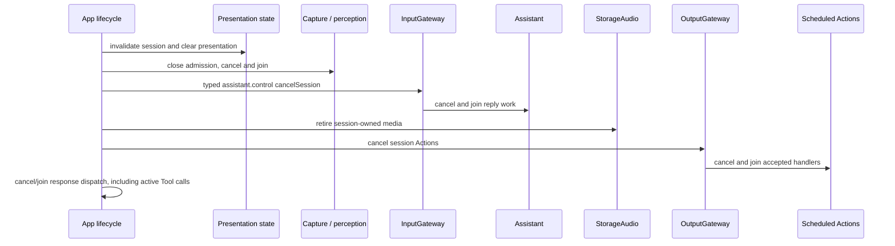

| Boundary | Recognition caption | Reply / expression |
| --- | --- | --- |
| Confirmed new utterance | Clear the preceding user caption on an accepted newer turn, then display partials below eyes | Clear preceding reply on the same accepted newer turn; beginReplyTurn starts this reply once |
| Endpoint reached, ASR pending | Preserve the preview | Await the reply |
| Final or empty recognition | Final setTranscript replaces text; finishTranscript seals it. Nonempty text moves above eyes; empty text clears | Produce a reply below eyes or return to listening |
| Response and playback | Retain sealed user text above eyes in cyan | Append lavender reply below eyes; speaking follows actual playback |
| Reply completed | Retain until next utterance | Retain until next utterance |
| Stop, background or failure | Retain displayed text and invalidate session updates | Retain displayed text and invalidate session updates |

SpeechPerception owns recognition captions and voice phase presentation; each conversational executor owns its reply captions, expression and atomic reply-turn start; VisionPerception owns pose/gaze presentation requests. All Agent-selected changes use permitted Actions or Tools. App may reset state for user/OS lifecycle and may present actual device telemetry through its adapters.

### Expression transactions

Expression behavior follows Actions Perform/Set: UI.Expression.express is finite and awaits enter/restore transaction acknowledgments; UI.Expression.setExpression is state and commits the persistent base (clear resets it). App adapts session/turn ownership with one pending acknowledgment; UI supplies display-only callbacks. Cancellation/new-turn teardown invalidates old callbacks.

NativeCompanionSurface preserves eye path topology and uses explicit Core Animation interpolation. Normal expression uses a 0.65-second eased layer transition; reduced motion uses a 0.2-second acknowledgment transaction. Repeating the base still produces a finite performance; clear applies only to setExpression. App invalidates the pending continuation on renderer disappearance/inactivity or session/turn reset.

### Synthesis and playback ownership

Speech synthesis and playback are separate, correlated paths. Shared Chat segments the first reply text at 20 Han/60 other Characters and later text at 60/120, preserving sentence/word boundaries; no timed text flush exists. The originating Agent sends a directed `speech.synthesize(audioID, text, locale)` message and schedules `Speech.Playback.speak(audioID)` on its chosen Channel.

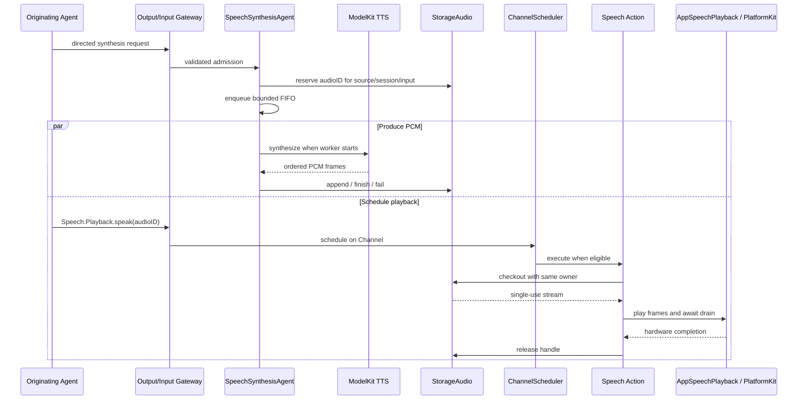

Admission of the synthesis request does not mean synthesis completed. SpeechSynthesis owns a serial bounded FIFO and waits for provider termination or owner cancellation; it does not inspect Action Channels. Playback can consume frames while synthesis continues. StorageAudio validates ownership and provides a single-use, reply-owned handle with no pending/ready expiry timer. Reply completion or session cleanup retires unused handles. Successful `Speech.Playback.speak` completion means platform playback drained and the lease was released. App joins immediate listening restoration after playback/audio cleanup when the SpeechPerception policy permits. There is no acoustic idle timer. Restoration is joined even after caller cancellation; original playback failures remain primary and additional restoration failures are logged explicitly. Apple emits initial PCM immediately and reuses one request-fenced synthesizer. SpeechSynthesisError carries invalid-output failures through StorageAudio unchanged; neutral PCM/cache errors remain storage-owned. App maps known failures to user wording after playback cleanup.

SpeechSynthesis admits thirty-two queued/live jobs, reserves a unique handle before receipt and executes serially. Text is nonblank, at most 2000 UTF-8 bytes with supported locale. It requires mono Float32, stable format, increasing sequence, nonempty audio, explicit finished and at most 8 MiB output. No Agent timer ends synthesis.

StorageAudio permits thirty-two handles and per-stream 8 MiB/2048 items. It rejects excess writes, provides one exact-owner checkout and retains terminal errors in at most 128 tombstones until owner cleanup or bounded metadata eviction. Queued/ready PCM has no automatic expiry or empty-read timeout: the input/session owner must retire it. Producer finish is not player drain.

AppleAudioIO schedules at most three finite mono buffers, each at most 262144 samples. Capacity suspends the player; final completion waits for dataPlayedBack. Native callback, actual error or scope cancellation completes each scheduled buffer; no playback-completion fallback fabricates success. Cancellation stops the node and wakes waiters; already audible samples cannot be retracted. Output-route acoustic latency is outside render completion.

### Camera perception and UI projection

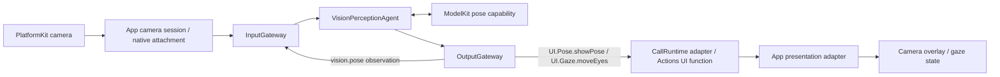

App owns capture, the persistent camera resource lease and native-image resolution. VisionPerception owns frame selection, pose interpretation and replaceable display/gaze outputs. Model inference, observation publication and presentation acceptance have separate completion boundaries. App rejects stale session/frame updates before UI mutation.

CameraCoordinator owns native capture/permission/foreground revision, persistent camera.capture lease, preview and photo/export state. AppleCamera owns graph mutation on its actor. Assistant photography Skills and fixed Photographer workflows select camera operations; VisionPerception owns inference admission. Opening camera confirms native capture, not pose-model readiness.

```mermaid
sequenceDiagram
 participant UI
 participant Photo as Photographer
 participant Gateway
 participant Camera as CameraCoordinator
 participant Native as AppleCamera
 participant Vision as Vision replacement owner
 UI->>Photo: typed camera command via owner publication
 Photo->>Gateway: canonical Camera.Capture.flip
 Gateway->>Camera: validated actual Photographer scope
 Camera->>Native: replace explicit target input on running graph
 Native-->>Camera: native switch outcome
 Camera->>Vision: retire old display and replace latest intent
 Camera-->>Gateway: input replacement receipt
 Vision->>Vision: cancel and join old inference/pipeline
 Vision->>Vision: start newest valid pipeline
```

A healthy flip replaces only native input under retained session/lease, validates no photo in flight and restores old input on admission failure. It avoids stop/start and output/microphone replacement. Native acknowledgment is independent of joined vision replacement; full off/background/model maintenance invalidates and joins both. Failure stops capture for explicit retry.

App samples committed camera state every 100 ms while foreground and publishes changed `camera.state/1` with `phone.camera` identity and monotonic sequence. Assistant selects enabled/visible/busy/permission/lens/photo/error facts into fresh task requests and continuations; Photographer retains its fixed workflow state. Passive state alone never invokes a model or device; publication is not an admission acknowledgment.

```mermaid
flowchart LR
 Call[Photographer takePhoto] --> Native[One native JPEG capture]
 Native --> Store[CapturedPhotoStore with original owner]
 Store --> Render[Identity-fenced photo animation]
 Render --> Receipt[Capture and presentation outcome]
 Receipt --> Context[Photo ID, MIME and size in exact context]
 Context --> Read[Authorized multimodal read on continuation]
 Render --> Save[Explicit save of displayed UUID]
 Save --> Photos[Joined add-only Photos import]
 Photos --> Saved[Actual saved state and duplicate fence]
 Saved --> Departure[Joined renderer exit and canonical cue]
 Departure --> Removed[Remove matching image component / receipt with optional feedbackIssues]
 Render --> Ignore[Explicit ignore joins shrinking exit and discard cue]
 Ignore --> Removed
```

Native capture has one delegate and ten-second terminal bound; photoBusy spans one owned task and clears on every terminal path. Nonempty JPEG is at most 4 MiB, with caller-owned store bounds of 1024 files/2 GiB and a 512 KiB owner index. SDK defaults remain 32 files/128 MiB/16 KiB with reject policy; App explicitly uses evictOldest. Committed new cache records retire oldest JPEGs, and historical retired references return absent. Capture remains durable if later presentation fails. Model/history context stores metadata-only image references, not bytes; selected reads validate the original source/session/input and exact photo identity.

One current photo fades/holds/shrinks into a thumbnail and reports actual animation acknowledgment. Only the positioned thumbnail controls intercept touch. Save validates displayed identity, foreground and original owner, joins one add-only native transaction and sets savedPhotoID only after success. The exact saved UUID remains alreadySaved after component removal, without duplicate import or replayed feedback. Save enlarges the photo to 1.16 before sliding right without shrinking; ignore shrinks/slides beyond the lower-right edge. Both join renderer/cue before removal, and feedbackIssues preserves any nonfatal feedback failures independently from committed save/ignore. Import failure retains the photo. Ignore does not delete album data; private cached evidence remains until the explicit FIFO retention policy retires it. Export requires foreground, not an open camera. Camera/save overlap rejects; neither failure nor continuation automatically repeats the shutter.

### Adaptive vision cadence and projection

VisionPerception retains the newest valid capture in a capacity-one slot. One worker selects that frame at inference start, validates expiry and applies adaptive cadence: initial 100 ms, default bounds 0…250 ms. Native-clocked inputs also enforce a monotonic inter-start gap; inference never overlaps.

YOLO diagnostics share the bounded UI.Pose.showPose payload: callback-to-model wait, capability-call time, callback-to-result latency, one-second-window successful FPS and replacement count. App converts Tool values to UI/Camera presentation values; UI displays these without runtime dependencies. Capture timing uses ContinuousClock, not assumptions about media timestamp epochs.

VisionPerception owns bounded latest-image motion, pose-motion/confidence/loss feedback and inference/total-latency budgeting for adaptive cadence. At most six skeleton snapshots are retained; fast changes accelerate immediately, stable targets relax gradually, and empty scenes retain periodic search. App injects bounds; next-interval statistics travel with pose through UI.Pose.showPose.

FrameMotionAnalyzer stays within Agents/VisionPerception: one sampled inferred-frame reference, one padded six-person ROI union, bounded exposure/noise compensation and continuous urgency. FrameCadence fuses those signals with pose reliability and compute/freshness budgets. Frame cadence has no eligibility-filtered queue or PlatformKit/ModelKit/UI policy dependency; stale results cannot mutate presentation.

Urgency may reduce the scheduling interval to zero; ordinary inference duration adds no floor. Compute-dominated freshness pressure may temporarily impose a bounded cost floor. Camera close clears skeleton and statistics.

UI/Camera owns PoseOverlay and display statistics. VisionPerception owns its Encodable PoseOverlayPayload; PoseOverlay remains the independently validated callable-function payload. App maps callable outcome values into UI values. UI has zero project dependencies; AgentCore has zero project dependencies.

### Photographer tracking and control handoff

Photographer consumes validated `vision.pose` through InputGateway and emits internal `NexArm.Tracking.aim` through OutputGateway. Its Resources v7 configuration contains the pose subscription and maximum reusable Camera permissions; there is no private photography Chat worker. Assistant photography Skill exposes the scheduled Camera Actions; fixed tracking retains its internal permission. The tracking output buffer holds eight calls and fails explicitly on overflow.

NexArmActions validates intent arguments; Gateway authorizes source/session and Tool permission. The App worker holds motors1–4 through ResourceCoordinator, with monotonic usable-pose freshness from Photographer; one second without fresh input joins/releases the writer. App groups all six motors under nexarm.writer and explicitly allows Assistant interaction Actions and fixed ApplicationControl operations to preempt Photographer after joined cleanup, including disjoint motor5/6 actions. Queued same-owner Actions survive the takeover gate; no scheduler/session cancellation or radio recovery occurs. VisionSession camera closure removes its owned work; old targets never replay. Actions owns mapping/motion, PlatformKit native encoding; return is target admission, not physical arrival.

Offline tracking is reported without stopping Vision presentation. BLE connection is not verified motion availability; [Bluetooth recovery](#bluetooth-connection-recovery-and-presentation) owns query quarantine and reconnect. Startup validates all seven Agent JSON resources.

Agent fault isolation: ordinary messaging and behavior execution failures are outcomes, never a reason to terminate sibling Agents. Photographer owns offline command suppression; Gateway retains bounded output/Action diagnostics. Startup configuration validation and explicit cancellation remain strict.

### Robot behavior and device feedback

```mermaid
flowchart LR
    Agent[Agent ActionCall] --> Gateway[OutputGateway / scheduler]
    Gateway --> AgentFence[Shared resource guard]
    AgentFence --> Runtime[ExecutionRuntime]
    Runtime --> Actions
    Settings[Bluetooth workflow user operation] --> Manual[Cancel prior writer / manual submission]
    Manual --> Actions[Shared Actions NexArm recipes]
    Actions --> Platform[PlatformKit connection / native commands]
    Platform -->|telemetry and acknowledgment| Actions
    Actions -->|Agent-path completion / failure| Runtime
    Actions -->|Settings result| Settings
    Runtime --> Results[Gateway ActionResult]
    Results --> Input[InputGateway / originating Agent]
```

Agent-selected and Settings-initiated movement reuse the same Actions recipes and encoders. Settings submits typed app.interaction to ApplicationControl through both Gateways. The registered device endpoint performs explicit manual takeover, cancels old writers and retains the manual-worker acceptance/later-failure contract without Gateway resource admission for its native worker. Agent-selected execution retains OutputGateway authorization, resource arbitration and its declared completion policy. Actions owns gesture composition, limits within business policy, home/reset selection and completion rules. PlatformKit owns discovery, connection, protocol encoding, native hardware limits and structured feedback. A transport write is not automatically an Action success; each Action documents the acknowledgment that completes its effect.

Bluetooth discovery/connection is an App workflow because preferred-device ordering, explicit user intent and presentation belong to the application. Physical safety requires device-side protection and cannot rely on iOS background execution. App distinguishes inactive from actual background. Background stops and joins control effects but retains healthy native connectivity; return verifies the current link after cleanup before reuse or reconnection. Each eligible foreground return grants a fresh three-attempt episode, actual connection initiation consumes an attempt, and connection success clears the budget. Manual disconnect/forget disables automatic reconnection. Native cleanup/isolation remains required when the link is unhealthy; no old movement replays. Bluetooth background execution and state restoration are not configured.

### Robot motion admission and home selection

Tracking converges the last two counts at low speed and commits only after native admission, without claiming physical arrival. Finite motion and home selection use the following shared Settings/Agent contract.

Finite movement validates motor 1…6, hardware target range, speed 1…1400 (default 1400) and acceleration 1…254 (default 30). Whole-arm reset/gestures use motors 1…5 and never command/wait for gripper. Nod uses motor 4; shake-head motor 5. Ordinary passive reset uses `[2048,2087,1198,1238,2048]`; tracking rest is `[2047,2087,1984,2045,2048]`. Explicit single-motor software home takes precedence; gripper reset requires a configured home.

Plans have at most twenty groups/six distinct addressed motors. CMD3 moves one motor; CMD131 synchronizes addressed writes. Resource union follows actual addressed motors and is retained through composition. Generic composition bounds depth eight, 256 results, thirty-two repeats and thirty-second delays.

Fresh post-send feedback inside tolerance succeeds immediately; cached feedback cannot finish new work. Off-target stability advances only on fresh samples, and missing feedback for two seconds stops remaining plan writes. Ordinary child failures retain every report and may continue later segments; explicit cancellation stops future work. Dynamic budgets estimate legal travel/admission/setup, exclude scheduler queue time and do not insert arrival sleeps. Exact profiles/formulas are in [NexArm Actions](Actions/NexArm/README.md).

### Bluetooth connection, recovery and presentation

PlatformKit spaces all BLE writes by at least 30 ms under one connection-wide budget; streaming admission returns false without queuing, and acknowledged requests reserve one cancellable slot. Actions retains proposal/finite-step semantics; App snapshots aim round-robin iteration and owns recovery. Fixed-size transport diagnostics distinguish notification traffic from valid feedback.

Transport recovery and Agent scheduling are independent. Bluetooth closes native I/O sessions, resets connection-local state and reconnects; it never cancels/removes accepted Actions or suspends scheduler admission. Current operations fail through Action/Tool results; queued work executes normally against the state available at execution. No global voice cleanup or automatic replay of failed native commands.

Native connection/subscription completion makes Settings controls available immediately. App performs no connection pose/version/IK probe, stationary validation or indication movement. It listens to unsolicited position packets and publishes measured state; refresh reads the latest received packet only. Feedback silence remains visible but does not disable manual commands, disconnect or start recovery. Native write/connection failures remain explicit. Actions uses passive BLE compatibility for this App connection; recipe IK resolution is deferred to an explicit preset request, not connection verification. Manual jog can start from the existing configured reference when no sample has arrived; that reference is not measured telemetry. Segment arrival observation and cancellable replacement remain in Actions/App.

Actions prepares only requested Cartesian poses; passive simple/reset commands require no IK queries. PlatformKit selects supported native write capability with shared pacing and a capacity-one acknowledged-control window, publishes current interrupted-reply failures, and App reports restored connectivity without claiming motion validation. Runtime/Gateway preserve terminal failure entries and descriptions.

Bluetooth presentation retains current state only. Latest native connection, communication issue and recovery state alone appear in Settings; healthy snapshots/new connections replace prior faults. The device list uses one row to connect while unconnected or open detail when already connected; connection success stays on the list, disconnect appears only when connected, and remembered devices remain forgettable; an already-open disconnected detail disables actions/motor gestures. Execution results/home issues and bounded automatic recovery remain independently owned.

BluetoothWorkflow owns one recovery worker. Confirm old native closure before a new connection; clear old controller/planner/intents/telemetry and never replay interrupted movement. An unconfirmed close blocks replacement. Eligible recovery uses three actual attempts, 1/2/4-second backoff and a cooperative 120-second active episode. Denied/unsupported/configuration/storage failures are not blindly retried.

Background immediately stops discovery and cancels/joins motion/jog/tracking while retaining a healthy connection where possible. New writes are gated until old owners retire; foreground joins cleanup and checks native state before reuse. Physical safety does not depend on delayed Agent admission or background execution.

Manual transport holds sixteen discrete requests and six latest velocity values; native execution keeps one latest preset/reset. Stop/reset has explicit priority. Submission means acceptance. Later worker failure is a separate trusted result/home issue; it never rewrites the original receipt. Page close, system Settings and immediate stop are native lifecycle fences outside the backend queue. Robot cancellation joins software work but does not prove physical stop or rollback.

### Settings, history and feature workflows

```mermaid
flowchart TB
    UI[UI state and typed submitted operation] --> Facade[AppWorkflows facade]
    Facade --> Input[InputGateway]
    Input --> Control[ApplicationControl: settings, resources, provider and device]
    Input --> Memory[Memory: confirmed history transaction]
    Input --> Photographer[Photographer: camera transaction]
    Control --> Output[OutputGateway]
    Memory --> Output
    Photographer --> Output
    Output --> Functions[Registered canonical functions]
    Functions --> Native[Injected model, storage and native capabilities]
    Functions --> Present[Identity-fenced App presentation adapter]
    Present --> UI
    Output -->|Actual executor feedback| Input
    Repositories[Four private Agent repositories] --> Reads[HistoryPresentationAdapter: immutable reads]
    Reads --> UI
```

The facade holds no mutable feature state. Each feature target depends only on the values/services needed by that feature. UI owns editable presentation state; the owning Agent sequences submitted business calls. App retains transport, native/presentation adapters and asynchronous owner lifetimes. Credentials use injected Keychain primitives; preferences and contexts use local atomic documents.

Owner transports survive pages, bind actual Agent incarnations and have 120-second request watchdogs. Publication has no subscriber response. Waiter failure never repeats a lost command. Environment/resource/camera facts are independent observations without request waiters or completion acknowledgment.

ApplicationControl transport admits thirty-two requests and sixty-four output slots. Provider headless operations allow one returning call, presentation-enabled operations two; ordinary resource operations two; source/configureSpeech/error presentation at most three. Photographer camera transport permits one request with output 256 and separately one tracking worker/eight queued calls. Native/discrete controls report overload rather than evict work.

Download completion means admission only, not installation. Actual installation/progress comes from current inventory and settled receipts. Cancellation after admission first joins that admission, preventing a late accepted download from restarting cancelled work. Host-only typed retire(request UUID) releases admitted request bookkeeping after dispatch/feedback failure; it is external host control, not native download cancellation or a model permission.

Actions owns durable source/cellular/custom-speech schema, installed prerequisites and legacy decoding. Preferences use a 4096-byte revision-checked document with overlap rejection. Source persistence and model binding are separate selected operations. A committed preference survives later binding failure; the frontend cache invalidates and preserves last-confirmed visible flags until explicit reconciliation.

Inventory is a neutral validated value, at most sixty-four items/65536 encoded bytes, with bounded IDs/names/revisions/licenses/failures and nonnegative counters. Actions computes installedGroups from actual packages: Nemotron recognition, MOSS synthesis, Gemma language and YOLO vision; Silero is optional. Native adapters do not choose UI grouping or business eligibility.

ResourceObservationWorkflow owns one foreground sampler and one locally submitted fingerprint, without a sample queue. [Resource refresh presentation](#resource-refresh-presentation) defines invalidation, publication loss and error-presentation behavior.

Provider URLs/keys are staged privately under opaque request IDs, not model-visible function arguments. Discovery keeps thirty-two requests with a ten-second claim deadline; settings keeps thirty-two staged/active/completed slots. Claim validates session/operation and consumes once before SDK awaits. Work has no hidden query queue; explicit take/discard cleans retained result state.

ProviderSettingsService validates/prepares before the native barrier, persists before apply and joins compensation/rollback before ending change. Primary and rollback failures are retained safely. ProviderSettingsStore owns versioned credential-reference schema and injected Keychain primitives; replacement/migration verifies the new state before deleting prior credentials. Raw credentials/SDK secret text never enter contexts, logs or protocol results.

Discovery GET /models is an explicit operation, optionally authenticated, thirty seconds and one-MiB response with at most 2048 raw IDs. Actions filters application eligibility and bounds the result; it does not claim provider capability discovery from an ID string. A configured provider is not proof of authentication/network readiness. Explicit restore reconciles uncertain result delivery rather than repeating save.

After joining a failed original resource worker, eligible host admission/dispatch failures can use one fresh correlated hostFailure Signal, one diagnostic slot and one returning error-presentation call. Startup/closed/cancelled/capacity failure or unavailable diagnostic infrastructure uses an explicit local fallback. No automatic runtime restart or recursive presentation occurs.

`System.Device.control` validates operation-specific fields before native invocation; submission is acceptance, while late finite/jog/tracking outcomes remain independent. ApplicationControl retains sequenced environment categories and accepts facts/feedback while paused without starting model work. App samples device/camera capability facts once per second while foreground and publishes scene/navigation changes separately. `runtimeInfo` retains the fixed behavior described in the [function inventory](#canonical-functions-and-protocol-bindings).

Assistant owns an in-memory context and conversation checkpoints; Photographer, Memory and ApplicationControl have independent durable contexts. HistoryPresentationAdapter reads the Assistant repository and converts one immutable snapshot into UI-owned values. Fixed specialists retain transaction/task state without a chat schema. Streaming perception/synthesis evidence has no conversation archive UI.

历史记录 exposes only Assistant 聊天记录 and 任务记录. Assistant supports current/archive navigation and confirmed mutations. Task records project persisted foreground input membership and registered background-task state; continuation and later inputs stay grouped across archives. Missing task dates remain absent.

<a id="deterministic-history-mutation-contract"></a>

### Deterministic History Mutation Contract

Refresh, confirmed archive deletion, startNew, summarize and cancellation use typed `MemoryHistoryIntent` under `history.intent/1`, carried by AgentMessage. Legacy string history commands reject. User-source refresh/delete/startNew/summarize and trusted host runtime-source cancel remain external-origin input, not forged runtime execution feedback.

Memory handles typed history intent deterministically without ordinary Chat. Assistant history-query Skill owns conversational history queries; independent title generation still uses a model. Its title computation helper is injected into registered History functions. Refresh emits UI.HistoryPresentation.showHistory; deletion emits History.Conversation.delete and waits for runtime feedback matching session and callID before requesting presentation. Actions/History validates archive-only deletion and invokes the same Assistant repository atomic transaction. App composes the repository and carries intents/results without selecting the next business call.

One pending mutation and one root request reject overlap without backlog. Root transport executes at most two business calls for refresh/delete; new archive/title sequences allow at most six outputs, including terminal controls. Cancellation joins execution, sends the typed cancellation input and drains at most eight buffered outputs until a non-business acknowledgment crosses OutputGateway. Cancelled presentation is retired before retry. A committed deletion survives later cancellation or presentation failure; missing/current archive IDs fail explicitly. There is no automatic deletion retry.

OutputGateway exposes a read-only returnsToolResult registration-policy query. Bounded history transport uses this protocol metadata to distinguish delivered returning-handler errors, which permit Agent follow-up, from completion-only presentation failures, which abort the request; it does not select business functions or effects.

HistoryPresentationAdapter validates root session/source, reads actual records and applies scoped MainActor state. Completion means accepted state, not rendering. Archive/title now uses Agent-selected startNew/summarize functions. Archival commits before inference; the committed archive is presented before title generation. A title error is persisted before failure feedback; the Agent selects final presentation and a terminal control. Cancellation joins title/persistence cleanup and never rolls back the archive. Preview remains a read-only feature operation. Resource transactions are described under Settings, history and feature workflows; App retains transport/native effects and root lifetime.

<a id="391-platformkit-versus-modelkit"></a>

### Conversation Tool diagnostics

Existing history records retain actual request Tool declarations, complete native calls and runtime-correlated Gateway outcomes, independently of generation completion. UI displays/exports these values without importing Gateway or ModelKit. Optional input/generated/total usage comes from cloud providers or the local backend. History omits max-token display; normal Assistant requests omit that option.

Each model request stores exact metadata-only request JSON, input, fragments, calls/results, model finish/failure, optional provider usage and adapter timing. Four request rounds, 512 KiB exact-request JSON and 64 KiB current input are separate from whole context limits. Model completion, call outcome and task-owner completion remain separate. Late call outcomes update their original request, including archived records.

Model timing samples request start immediately before provider invocation and first nonempty text before yield, using monotonic elapsed time. Consumer persistence, ASR/TTS and UI are excluded. Native-only and unavailable provider timing remains empty; record arrival does not invent TTFT. Generated continuations appear as ReACT without overwriting the original request. Historical native evidence is retained even when current role grants are Action-only.

Parser preview uses the exact persisted Assistant request catalog and shared parsing/segmentation. It reports syntax/resolved/rejected/wait behavior without executing. Export preserves actual evidence and failures; unavailable fields remain absent.

History images are authorized metadata references, up to four per context. Reads validate selected producer/input association before accessing CapturedPhotoStore. UI page reads cancel with their owner, permit at most 4 MiB each and prepare 320-pixel thumbnails/2048-pixel full preview. Missing files return absent; wrong ownership/corrupt length fails visibly.

Storage uses atomic, revision-checked documents (64 KiB by default; Agent contexts explicitly use 64 MiB). File storage confines paths, rejects descendant symlinks and validates reservations/free space before non-overwriting publication. Current history uses StorageChat current/individual-archive checkpoints; the Assistant context is memory-only. Cross-process writers, cross-device sync and semantic retrieval remain absent. See [Storage](Storage/README.md) for the underlying mechanisms.

### Settings audio detection

音频识别 includes an explicit 10-second microphone/spatial diagnostic. PlatformKit exposes native input/capability/fallback facts; App Lifecycle owns an isolated capture and source-only SpeechPerception session through both Gateways; AppDiagnosticWorkflow owns admission, freshness/deadline monitoring and joined cleanup; UI owns simple result presentation. Actual received layout distinguishes four-channel capture from mono fallback. The diagnostic session performs no model warmup and starts no conversation, Photographer consumer or robot action. ✅ Its loaded communication declaration is restricted to media.audio and sound.source so the single-Agent scope has no Assistant reply-activity subscription dependency. Retry becomes available only after endpoint/monitor cleanup joins and the operation slot is released.

### PlatformKit versus ModelKit

| Concern | PlatformKit: device and OS I/O | ModelKit: model processing |
| --- | --- | --- |
| Audio input | Microphone → PCM | PCM → VAD score or transcript |
| Audio output | Supplied PCM → speaker | Text → synthesized PCM |
| Vision | Camera → native frame and preview | Supplied image → pose/model result |
| Adaptation | Capture format and device orientation | Model resize, normalization and result decoding |
| Owned resources | Device sessions, links and I/O buffers | Weights, graphs, providers and operation leases |

App packages device output for input transport; the calling Agent converts it into ModelKit processing input. Agents decide when and why to process or act; Gateway validates and routes without performing inference. Neither SDK owns Agent policy, presentation or conversation state.

### Model lifecycle and processing boundary

```mermaid
flowchart LR
    Root[App resource root] --> Defaults[ModelKitDefaults]
    Defaults --> Manager[ModelKitRuntime ModelManager]
    Manager --> Provider[Registered provider]
    Consumer[Agent / diagnostic workflow] --> Capability[Typed capability handle]
    Capability --> Provider
    Provider --> Lease[One active operation lease]
    Lease --> Load[Coalesced resource load]
    Load --> Adapter[Model adapter / backend]
    Adapter --> Result[Typed stream or result]
    Result --> Cleanup[Finish or cancel and join]
    Cleanup --> Release[Release operation lease]
```

ModelKit owns independent capability values; Defaults registers providers/bindings, and ModelKitRuntime owns the process-wide manager and provider lifetime. Consumers use capability protocols rather than concrete engines. An operation lease stays held until backend work and cleanup finish.

Cancelling an owned model operation joins its work without automatically unloading weights; microphone consent withdrawal does not cancel independently owned conversational replies. Explicit unload waits for active use; manager shutdown is terminal and cancels/joins owned work. Capability availability and resource residency are separate policies. App forwards coalesced memory-pressure handling, while manager construction/registration remains restricted to ModelAssembly SPI and isolated tests.

Deferred get constructs a lightweight provider; normal get/load/warmup prepares resource. Availability is a capability/artifact fact, not residency or successful inference. Unload releases weights while stable handles can reload; shutdown is terminal. Thirty-two registrations/six defaults, four concurrent factories/loaders and thirty-two per-model/resource waiters bound lifecycle work. Each model has one active inference and rejects overlap rather than queueing it.

Cancelled waiters do not cancel shared construction/loading. Failure permits explicit later acquisition/loading according to its owner contract. Unload gates/drains admitted sessions; replacement validates a candidate before retiring the old provider. Generation fencing prevents late work reviving a retired resource. releaseWhenIdle responds to memory pressure, not a periodic eviction or measured global budget.

InferenceSession is one consumer/serialized producer with explicit per-event validation and optional capacity. Default capacity is sixty-four/events of 4096 estimated bytes. Bounded `yield` rejects overflow; `yieldSuspending` admits one capacity waiter and wakes it on consumption/cancel/termination. Normal finish drains accepted events; failure/cancellation suppresses buffered delivery and joins the adapter owner.

OpenAI uses a 128-event queue and serialized suspending emission, including the terminal event. A full queue pauses production; no fragments are dropped. The eight-MiB wire and 65568-byte per-event limits remain independent. Consumers must drain or cancel sessions before awaiting ordinary unload. The [owning adapter](ModelKit/Language/LLM/OpenAI/README.md) defines cleanup and buffer boundaries.

<a id="local-model-resource-acquisition-and-removal"></a>

### Local chat capability

ModelKitGemma4 provides local Gemma 4 E2B QAT chat; Backends/CoreAI owns native graph and language execution. Gemma4 is the installed resource directory and gemma4-e2b the catalog ID. A pinned CoreAILM fork supplies the static-buffer pipeline; consumers retain ChatCapability. The shared package dependency floor is iOS/macOS 26; execution requires OS 27.

| Capability | Production selection | Important boundary |
| --- | --- | --- |
| Chat | Gemma 4 E2B QAT or explicit Responses cloud binding | No silent active-inference failover; local rejects images/native calls |
| ASR | Enabled installed available Nemotron, otherwise Apple SpeechAnalyzer | Custom switch defaults off; required Apple assets/capability checked |
| TTS | Enabled installed available MOSS Nano, otherwise Apple PCM TTS | Custom switch defaults off; explicit voice warmup drains without playback |
| VAD | Installed available Silero, otherwise Energy | Independent of the recognition switch |
| Pose | YOLO26n-Pose only | Explicit artifact, native/RGB preprocessing and no temporal identity model |
| Judgment | Validated candidate/result contract only | No registered production provider |

Kokoro remains an isolated optional adapter/test client, not Defaults registration. Defaults fixes one process manager/root/initial assembly, coalesces at most thirty-two callers and retains failure rather than creating an alternate singleton. Provider changes affect only chat; nil cloud configuration restores Gemma. Local adapters never download silently.

Gemma uses the pinned h18p QAT resource for supported physical iPhone hardware; Mac tests use the separate matching decoder declaration. Chat validates context and rejects unsupported native/image requests. Local stream has 4096 events/4096 bytes. CoreAI simulator support is a backend/platform constraint, not a model-ready UI state.

Cloud chat uses the [Responses contract](#cloud-native-tool-generation). Its transport owns provider-native calls and image content; local Gemma remains text-only.

### Local model resource acquisition and removal

The App bundles schema-v2 source metadata/licenses, with no weights. App composes one Defaults manager, the generic Storage bridge and the independent ModelKitHub adapter. Management owns admission/state/install/delete; the adapter owns concrete HF SDK calls. Runtime retains its ModelKit-only dependency. ModelKitHub is a separate concrete resource-acquisition adapter target.

```mermaid
flowchart LR
    UI[Settings] --> Workflow[Settings workflow]
    Workflow --> App[App adapters]
    App --> Input[InputGateway]
    Input --> Agent[ApplicationControl]
    Agent --> Output[OutputGateway]
    Output --> Function[System.ModelResources function]
    Function --> Manager[ModelKit Management]
    Manager --> HF[Injected ModelKitHub]
    HF --> Hub[HubClient: selected snapshot]
    Hub --> Verify[Management: required files and bounds]
    Verify --> Bridge[App storage adapter]
    Bridge --> Storage[Storage: receipt and atomic publish]
    Manager --> Barrier[Core maintenance]
    Barrier --> Lifecycle[App voice/vision stop and join]
```

Startup reads compact repository/archive declarations and restores requests. Explicit download resolves files through HF SDK → stages selected assets → validates key files/tree bounds → writes actual file/size receipt → atomically publishes → refreshes availability. No provider is registered by JSON and no inference starts automatically. Settings/history remain usable without weights.

Deletion closes every associated resource's admission, stops related App work, drains/unloads, cancels/joins transfers and removes the installed tree before releasing maintenance. Source settings support official HF, hf-mirror.com and custom HTTPS hosts; source edits automatically persist and all system-permitted networks are allowed. Installed sizes come from receipts; pre-download sizes are estimates. Receipt paths normalize filesystem aliases before deriving confined relative paths. Receipt repair requires identity/revision, required-file and size validation. Installation publication and transfer-record persistence have separate outcomes: bookkeeping failure cannot undo a valid installation. App atomically replaces its authoritative task snapshot with afterFirstUnlock protection; other document clients retain revision-checked writes and their existing protection. HF has three native file tasks per package, two active packages/eight pending requests; overflow rejects. HF background tasks survive suspension and restore persisted generations/completed files on relaunch, with available system resume data; ZIP transport retains OS background reassociation.

Catalog limits are 1 MiB/thirty-two packages/128 patterns/4096 required files. Installed trees are symlink-free and bounded to 16384 entries/32 GiB; ZIP is 64 MiB compressed/256 MiB expanded. Integrity uses declared archive SHA or resolved file metadata, not advisory estimated size.

Compatible HF staging may survive transient failure for explicit retry/relaunch. Active cancellation joins/discards owned staging; cancel after installation is not remove. Delete gates every referring capability before quiescence/unload/transfer join and removal, preventing retained handles from reloading mid-delete.

Native background transfer/OS reattachment belongs to the downloader; ModelManager does not promise iOS background inference, force-quit recovery or server-resume behavior. Ignored local test weights/vendor READMEs remain resource artifacts, never build prerequisites or newly documented code directories.

### Cross-module concurrency and completion

SwiftUI state is MainActor-isolated. Runtime services, Agents, stores, managers and coordinators use actor isolation. Cross-module completion is always defined at the owning boundary:

| Boundary | Completion means |
| --- | --- |
| Input delivery | Target Agent accepted or rejected the input. |
| Model operation | Adapter finished or cancellation cleanup joined. |
| Tool call | Handler reached its terminal outcome after joined cleanup; feedback delivery is a separate outcome. |
| Feedback admission | Receiver accepted the result Signal; this does not establish business consumption or a further model turn. |
| Action call | Registered handler reached its declared effect/acknowledgment boundary. |
| Speech playback | Platform output drained and the audio lease was released. |
| Session stop | Producers, Agent work, response dispatch, owned media and scheduled Actions were cancelled and joined. |
| UI update | App accepted state for the active identity; rendered-frame acknowledgment is not implied. |

Queue and active-call capacities belong to their owning module contracts; the table below distinguishes rejection from producer suspension. Cancellation is cooperative. Cleanup may use a cancellation-independent owned task, as in HistoryIntentRuntime, with bounded retained work and a joined boundary before admission/resources release. Device-action rejection and failure remain explicit.

This table summarizes system-wide pressure points; local designs remain authoritative for individual constructors and configuration ranges.

| Owner | Bounded state | Overflow or completion |
| --- | --- | --- |
| InputGateway | Separate directed/publication pools, each 128 operations, 256 branches and 8 MiB; sixteen recipients/operation | Directed admission rejects/retries; publication loss is diagnostic; shutdown joins branches |
| General/task traces | 256 records each, combined eight newest-one observers | Counted eviction; task revision independent of ordinary traffic |
| Shared Chat role | 32 FIFO + one continuation, output 256 | Reject/error; pause/stop joins inference and output |
| Output consumers | Tools sixteen/four concurrent; Action/control 256 | Explicit input-local failure and joined drain |
| ChannelScheduler | 64 trees, sixteen names, 32 unfinished/name | Reject without evicting admitted effects; finish/cancel joins |
| ResourceCoordinator | 32 leases, 256 uses, 32 cleanup attempts | Busy/capacity failure; unfinished cleanup retains occupancy |
| Result ledger | 512 default pending/reserved, one delivery callback | Bounded message-only retry and expiry, no effect replay |
| Context repository | Sixteen commit waiters, explicit 64 MiB document | CAS/persistence/capacity failure; publish state after commit |
| SpeechPerception | 128 packets/64000 scalar samples; output 32 | Damage local utterance and surface error; controls independent |
| SpeechSynthesis / PCM | Thirty-two jobs/handles, 8 MiB/2048 items per stream | Fail original producer/reader; exact-owner single checkout |
| Native audio | 64 capture packets; three player buffers | Capture gap fails; player suspends and waits for native drain |
| Camera / vision | Newest-one frame, one inference + one pending | Explicit replacement/freshness; cleanup releases native retention |
| Photo storage/capture | Host archive 1024 files/2 GiB, SDK defaults 32/128 MiB; one photo and one export | Reject overlap/capacity; actual capture/export persists |
| Feature requests | ApplicationControl 32/64 output; camera/history one operation | Independent 120-second business watchdog; no automatic replay |
| Provider staging | Thirty-two slots, ten-second unclaimed lifetime | Claim once, reject/discard, no secret exposure |
| Artifact acquisition | Two active/eight queued | Reject excess; cancel/delete joins staging owners |
| Model lifecycle | Four factories/loaders, 32 waiters, one inference/model | Coalesce or reject; unload drains and shutdown joins |
| OpenAI event session | 128 events; 65568 estimated bytes/event; eight MiB wire | Full queue suspends producer; cancel/failure wakes it |

Replaceable observations may coalesce latest state; discrete commands never disappear silently. Durability, callback acceptance, renderer completion, player drain and physical motor arrival have separate boundaries.

Home consumes Action execution snapshots, task-only Gateway traces and sampled role lifecycle/errors. There is no general Signal tab or media subscription. Ordinary audio/image/environment traffic cannot wake task observers or evict task evidence. General Signal diagnostics remain available outside home.

Scheduler retains active executions plus one hundred terminal Action records and counted eviction. UI receives independently owned phases/details and bounded thrown descriptions; Tools have no synthetic scheduled rows. Tasks retain one hundred entries/thirty-two events each; lifecycle/late errors one hundred entries sampled once per second. Filters/disclosures/dismissals are local UI state, never execution control.

Successful internal maintenance is hidden by default, failures remain visible. Task details can open executor/input-scoped model history from retained identity. Queued cancellation says notStarted, running cancellation remains nonterminal until join, and generic completed state never claims physical arrival. Missing/evicted evidence stays explicit.

### Cloud native Tool generation

The OpenAI adapter uses Responses only. Each ChatRequest supplies complete request-local history, original native call IDs and image content; system/user and assistant content use their respective Responses forms. Native Tools come from effective role grants separately from the Action prompt. Provider-safe names map back to declared aliases.

SSE validates complete terminal/native outputs before emitting `ChatEvent.toolCall`; partial calls never execute. Missing, failed, refused or malformed output fails explicitly. ToolCallParser resolves calls inside the actual executing Agent before OutputGateway admission. Connection-pool lifetime follows model residency; cancellation joins only the matching HTTP request.

[Host bindings and role grants](#canonical-functions-and-protocol-bindings) determine native availability. Historical native evidence stays inert when current grants are Action-only; local Gemma rejects images/native calls. [Round completion](#action-and-tool-execution) joins both call branches and scoped feedback before a budgeted observation continuation. No Chat Completions fallback, implicit previous_response_id history, automatic effect retry or provider switch is implemented.

### Signal and Effect Scenarios

These flows apply the common contracts above. A task can cross several scenarios; the categories are not separate Signal types. App adapts input and forwards output without selecting business operations. Diagrams describe the architecture; actual coverage and remaining integration boundaries are recorded under [implementation coverage](#implementation-coverage).

#### Scenario coverage

Six categories cover human intent, Agent collaboration, independent observations, host facts and execution feedback:

| Scenario | Input / origin | Business processing and effects |
| --- | --- | --- |
| 1. Direct UI interaction | External intent | Agent selects an operation and presentation; local drafts/scroll remain in UI. |
| 2. Conversation | External text/audio, followed by internal perception messages | Business Agent interprets intent and handles actual results; inference itself is local computation. |
| 3. Agent collaboration | Internal Agent message | Receiver processes content, optionally replies or emits registered effects. |
| 4. Physical-world observation | External capture/native fact, optionally followed by internal perception messages | Agent may react without a new human request, within an enabled task and declared permissions. |
| 5. System and capability event | External lifecycle, permission, route or availability fact | Host handles immediate lifecycle mechanisms; Agents decide scoped business reactions. |
| 6. Execution lifecycle | Internal runtime feedback | Agent interprets progress, actual completion, failure or cancellation and chooses continuation/presentation. |

#### 1. Human interaction with UI

Taps, gestures, submitted forms, navigation and confirmation produce typed business intent. The owning Agent handles it deterministically or through a model, calls registered functions and processes declared feedback. UI retains local interaction/rendering state. The implemented archive-deletion flow below shows confirmation, execution and presentation.

```mermaid
sequenceDiagram
    actor Human
    participant UI
    participant App as App input adapter
    participant Input as InputGateway
    participant Agent as Memory
    participant Output as OutputGateway
    participant Effects as Registered Tools / capabilities
    Human->>UI: Confirm archive deletion
    UI->>App: Delete intent + archive ID
    App->>Input: Signal with request/session identity
    Input->>Agent: Validated input
    Agent->>Output: Resolved History.Conversation.delete call
    Output->>Effects: Authorized Tool executes Storage transaction
    Effects-->>Output: Actual success or failure + call ID
    Output->>Input: Correlated ToolResult Signal
    Input->>Agent: Scoped feedback
    alt Deletion succeeded
        Agent->>Output: Resolved UI.HistoryPresentation.showHistory call
        Output->>Effects: Invoke registered presentation Tool
        Effects->>UI: Apply scoped actual snapshot on MainActor
        UI-->>Human: Updated history
    else Deletion failed
        Agent->>Output: Failure control / execution outcome
        Note over App,UI: Root workflow presents the correlated failure.<br/>No registered history error-presentation function exists
    end
```

History mutation failure currently terminates the fixed operation with an owner-correlated failure control; the root history workflow presents that actual failure. A general registered history error-presentation function remains absent.

UI-local scrolling, expansion, focus and unsubmitted drafts stay in UI. Business gestures and submitted forms emit intent; continuous controls require explicit cadence and overflow policy.

#### 2. Conversation

After InputGateway admission, typed text reaches the business Agent; speech reaches a perception Agent first. Recognized content becomes a typed Agent message through both Gateways. Model inference remains an injected computation inside the Agent's decision process.

```mermaid
flowchart TB
    Human[Human] -->|Typed text| App[App input adapters]
    Human -->|Speech| World[Microphone capture]
    World --> App
    App -->|Audio Signal| Input[InputGateway]
    App -->|Text intent Signal| Input
    Input -->|Captured media| Perception[Perception Agent]
    Perception <-->|Recognition / perception capability| Model[ModelKit]
    Perception -->|Typed observation via CommunicationAction| Output[OutputGateway]
    Output -->|Validated transcript / observation Signal| Input
    Input -->|Intent / recognized content / feedback| Business[Business Agent]
    Business <-->|Context and decision computation| Model
    Business -->|Resolved calls| Output
    Output -->|Authorize and execute| Execute[Actions / Tools]
    Execute --> Native[Platform / Storage capabilities]
    Native -->|Declared native observations| App
    Execute -->|Presentation / speech behavior| UI[UI / playback endpoints]
    Execute -->|Actual execution outcome| Output
    Output -->|Correlated feedback Signal| Input
    Business -->|Next operation or final presentation| Output
```

For Bluetooth discovery, ApplicationControl can call `System.Device.control(operation: scan)` and read `System.Device.readStatus`. The control result reports accepted submission, not scan completion or a complete device list. Current device facts enter through App environment sampling; status reads return the current native snapshot. The Bluetooth workflow independently renders actual discovery snapshots. There is no generic scan-progress/scan-completed Signal contract or registered discovery-specific display function.

[Shared chat budgets](#composition-startup-and-lifetime) bound result-driven continuation. Predicted behavior is never evidence of device completion.

#### 3. Agent-to-Agent collaboration

Agents exchange domain messages through both Gateways. They do not call each other's business methods or use UI updates as a communication channel. A receiver decides whether a message requires further processing, a reply or a registered effect.

```mermaid
sequenceDiagram
    participant A as Producer Agent
    participant Output as OutputGateway
    participant Input as InputGateway
    participant B as Consumer Agent
    participant Effects as Actions / Tools
    participant UI
    A->>Output: CommunicationAction send / publish + causal parent
    Output->>Output: Validate source, schema and communication permission
    Output->>Input: Signal with bound source and causal metadata
    Input->>B: Validate target/session and admit
    alt Directed send
        Input-->>Output: Target admission report
        Output-->>A: Correlated receipt Signal, not processing completion
    else One-way publish
        Note over A,B: No recipient acknowledgment or publisher result
    end
    B->>B: Process typed content
    opt Explicit domain reply is declared
        B->>Output: Send typed result message to A
        Output->>Input: Result Signal with declared correlation
        Input->>A: Validate and process reply
    end
    opt Consumer requests a UI effect
        B->>Output: Registered presentation Action / Tool call
        Output->>Effects: Validate and execute
        Effects->>UI: Update scoped presentation on MainActor
    end
```

`send` chooses one permitted target; `publish` selects declared subscribers. The root and parent identify causality, not a generic request/reply service. A domain needing a reply must declare its payload, request correlation, pending-work bound, timeout and cancellation behavior before implementation. Such a reply is a new message with its own permission checks. A directed message alone does not create an automatic request/reply service.

#### 4. Physical-world observation without a new user request

An enabled camera/tracking task, device discovery or sensor monitor can receive new facts independently of a click or conversation. App adapts capture/native events into Signals; a perception Agent is optional for already-structured device facts.

```mermaid
flowchart LR
    World[Physical change] --> Capture[Platform capture / native feedback]
    Capture --> App[App input adapter]
    App --> Input[InputGateway]
    Input --> Agent[Perception / business Agents]
    Agent -->|Messages / resolved calls| Output[OutputGateway]
    Output --> Effect[Actions / Tools]
    Effect --> UI[UI presentation]
    Effect --> Platform[Platform effect]
    Platform -->|Changes subsequently observed| World
    Effect -->|Actual outcome via runtime| Output
    Output -->|Messages / feedback Signals| Input
```

Observation is evidence, not authorization to start arbitrary behavior. The enabled task owns its scope, cadence, freshness and resource use. Only declared latest-state observations may coalesce; discrete device facts need an explicit delivery policy. Issuing a command does not prove the resulting physical state.

#### 5. System and capability events

Foreground/background changes, permission changes, audio-route interruption and model/device availability changes can alter what a task may do. The target business path is **OS/native fact → App adapter → InputGateway → responsible Agent → OutputGateway → registered reaction**.

App remains responsible for immediate lifecycle mechanisms: suspending capture, joining owned execution, releasing resources and starting/stopping runtime scopes. Those mechanisms cannot depend on a delayed Agent response or inference. Publish business-relevant lifecycle facts only into valid scopes; an unavailable Agent/session cannot be assumed to receive a shutdown event. Permission denial and unavailable capability must not become fabricated success.

Foreground return does not automatically replay prior device effects.

#### 6. Execution lifecycle and long-running work

A returning Tool can finish in one result; discovery, downloads, playback or motion may have separate admission, progress and terminal outcomes. Declare each operation's feedback channel, owner, correlation and completion semantics before implementation.

```mermaid
sequenceDiagram
    participant Agent
    participant Output as OutputGateway / execution runtime
    participant Operation as Action / Tool and capability
    participant Input as InputGateway
    Agent->>Output: Authorized operation call
    Output->>Operation: Start under execution ownership
    opt Declared bounded progress feedback
        Operation-->>Output: Actual progress + operation identity
        Output->>Input: Runtime feedback Signal
        Input->>Agent: Validate owner/session and interpret
    end
    alt Completed or failed
        Operation-->>Output: Actual terminal outcome
        Output->>Input: Declared correlated result Signal
        Input->>Agent: Choose continuation or status presentation
    else Cancellation requested
        Note over Agent,Input: Human cancellation first enters through App and InputGateway
        Agent->>Output: Registered cancellation behavior, if supported
        Output->>Operation: Cancel and join owned cleanup
        Operation-->>Output: Actual terminal cancellation / partial effects
        Output->>Input: Declared correlated feedback Signal
        Input->>Agent: Reconcile committed effects and finish
    end
```

This is a target lifecycle pattern for contracts that return feedback, not a generic progress/cancellation API implemented by every Tool. Native asynchronous facts still use the external adapter paths in scenarios 4 and 5. Completion-only Tools retain execution outcomes without a new ToolResult. Runtime control notices cannot encode unregistered business cancellation.

### Cross-cutting Task Contracts

| Case | Required contract |
| --- | --- |
| User decision during a task | Picker selection, confirmation or clarification returns as a scoped external Signal through App → InputGateway, distinct from successful prompt presentation. Declare pending-task bounds, response correlation, timeout and cancellation; opening the prompt is not the user's decision. |
| Concurrent inputs / multiple views | Define explicit task/session ownership, overlap rejection/queueing and resource arbitration. Human and model requests share authorization; manual priority exists only where policy declares it. Fence late presentation by its intended scope. |
| Scheduled or periodic trigger | Declare whether an OS trigger is external or an owned runtime timer is internal. Bound timers/work, supply scope and deadlines, and prevent feedback-driven recurrence. Do not imply background execution guarantees. |
| Restart / reconnect / recovery | Restore durable records through Storage capabilities, reconcile actual native state and create fresh live scopes. Persisted data is not automatically a Signal; never replay stale requests or completed effects by default. |
| Future remote integration | Reuse the envelope concept only through an explicit adapter with authentication, codecs, version and replay policy. Authentication/admission alone does not grant internal execution authority; remote transport remains unimplemented. |

System permission prompts still require user interaction. Presenting a picker does not grant unrestricted library access. Physical robot safety cannot depend on iOS background execution.

The implemented `AgentTaskSignal` registry, task bounds and scoped question routing are defined under [Input and Agent communication](#input-and-agent-communication). Durable work recovery is defined under [startup and lifetime](#composition-startup-and-lifetime).

### Implementation Coverage

✅ marks implemented contracts; ❗ marks confirmed bugs; ❌ marks absent implementation. Detailed delivery priorities and acceptance evidence belong in docs/.

| Area | Implemented | Outstanding |
| --- | --- | --- |
| Signal and host facts | ✅ Unified envelope/origins, schemas, causal results, typed history/resource/provider/device/navigation/camera input, sequenced scene/navigation/device facts | ❌ Additional sensor adapters and video/binary payload codecs |
| Executable capabilities | ✅ Protocol-neutral Actions, shared execution, three-level addresses, explicit Action/Tool bindings and isolated errors | ❌ General activity producers/subscriptions |
| UI and history | ✅ Agent-selected queries/mutations, registered resource/provider error presentation, shared navigation and camera/device functions | ❌ General system pickers, movie capture and background camera execution |
| Conversation | ✅ Completion-owned result-driven Action/Tool continuation and terminal Agent failures, correlated results, exact history and scoped specialist task replies | ❌ Automatic request/reply for arbitrary domain contracts and local-model native Tool support |
| Execution lifecycle | ✅ Owned cancellation/join, causal ActionResult, independent manual-worker failure feedback and bounded result retention | ❌ General long-task progress/activity subscriptions |
| Model/provider resources | ✅ Agent-routed commands/preferences/inventory/observations/errors and private provider transactions/presentation; ApplicationControl current facts are model-readable | ❌ Model-initiated provider configuration changes with safe session handoff |
| Decision context | ✅ Bounded root environment facts plus registered current inventory/provider/device reads | ❌ Full resource-state-store plan and push adapters |
| Foundational independence | ✅ UI, ModelKit, PlatformKit and Storage have no project dependencies | None |
| Transport evolution | ✅ Process-local admission and bounded domain content | ❌ Remote authentication/codecs, version migration, durable replay and dynamic subscriptions |

[Cross-module concurrency](#cross-module-concurrency-and-completion) summarizes capacities; [InputGateway](Gateway/Input/README.md) and [communication policy](Agents/Support/Core/Communication/README.md) define admission and the eight-hop limit. AgentMessage encoding is not a wire format for the whole Signal envelope.

Implementation coverage is separate from real-model, native UI and physical-device acceptance. Those results remain in [validation history](../docs/Validation-History.md).

### Resource refresh presentation

`refreshPresentation(generation)` is an Agent-owned transaction. `UI.ResourcePresentation.showResources` reads neutral inventory once, validates it and commits through a root-session/revision-fenced endpoint. It returns inventory only after state acceptance. Query/presentation failure selects `showResourceFailure` and awaits that outcome before failed termination. Large snapshots stay in result values, not call arguments; later reconciliation does not undo committed presentation.

```mermaid
sequenceDiagram
    participant UI as Resource page / passive revision
    participant App as Input adapter
    participant Input as InputGateway
    participant Agent as ApplicationControl
    participant Output as OutputGateway
    participant Action as UI.ResourcePresentation
    participant Native as Injected neutral inventory
    UI->>App: Refresh with current revision
    App->>Input: refreshPresentation Signal
    Input->>Agent: Validate and admit
    Agent->>Output: showResources call
    Output->>Action: Invoke standard function
    Action->>Native: Read facts once / validate inventory
    alt Valid current snapshot
        Action->>UI: Adapter commits items and supplied groups
        Action-->>Output: Canonical inventory value
        Output->>Input: Owner-correlated ToolResult
        Input->>Agent: Success feedback
        Agent->>Output: application.control.finished
    else Query or presentation failed
        Action-->>Output: Invocation failure
        Output->>Input: Owner-correlated failure
        Input->>Agent: Failure feedback
        Agent->>Output: showResourceFailure call
        Output->>Action: Invoke bounded failure presentation
        Action->>UI: Adapter rejects stale revision or commits error
        Action-->>Output: Actual completion / failure
        Output->>Input: Returning feedback
        Input->>Agent: Final presentation outcome
        Agent->>Output: application.control.failed
    end
```

**Foreground invalidation.** Root-owned ResourceObservationWorkflow samples once per second while foreground, with one locally submitted fingerprint and no sample queue. It publishes changed/failed `model.resource.state/1` under external source `model.resources`, root session and monotonic sequence. Changed facts select current-inventory presentation; failed facts select error presentation without another read. Background invalidates presentation and cancels sampling; accepted work and native transfers retain their owners.

```mermaid
flowchart LR
    Native[Native resource facts] --> App[Root foreground observation]
    App -->|model.resource.state Signal| Input[InputGateway]
    Human[Manual refresh] -->|model.resource.intent Signal| Input
    Input --> Agent[ApplicationControl]
    Agent --> Output[OutputGateway]
    Output --> Action[UI.ResourcePresentation functions]
    Action --> UI[Revision fenced passive UI state]
    Action -->|ToolResult feedback| Input
```

The fingerprint advances after local publication submission, not Agent admission or presentation acknowledgment. Subscriber rejection, publication loss and later presentation failure do not trigger publisher retry. A new native fingerprint, foreground reset or explicit refresh can resubmit current state. Only thrown submission errors or an explicit local retry result leave the fingerprint eligible for another sample. Sampling does not select preferences or cancel transfers; a shared push-based resource-state store is absent.

**Failure presentation.** Download/cancel/removal failure selects `showResourceOperationFailure` once before terminal failure. Refresh revisions do not fence operation errors; successful progress preserves them. Original command and secondary presentation/dispatch failures remain correlated, and error presentation never recursively retries itself.

Preference failures select `showResourcePreferenceFailure` using producer codes. Preference persistence precedes speech binding; a binding failure selects execution error, while an installed-model/source notice retains its distinct meaning. Durable preference writes survive later failure; App preserves last-confirmed visible flags without an effectful rollback.

```mermaid
sequenceDiagram
    participant Agent as ApplicationControl
    participant Gateway as OutputGateway
    participant Preference as Preference function
    participant Binding as Speech binding
    participant UI as Registered preference presentation
    Agent->>Gateway: Restore or save preference call
    Gateway->>Preference: Validate and read or commit
    Preference-->>Agent: Correlated value or producer failure code via both Gateways
    alt Preference succeeded
        Agent->>Gateway: configureSpeech
        Gateway->>Binding: Apply native binding
        Binding-->>Agent: Correlated success or failure via both Gateways
    end
    opt Preference or binding failed
        Agent->>Gateway: showResourcePreferenceFailure with selected reason
        Gateway->>UI: Await root-session notice or error commitment
        UI-->>Agent: Correlated acknowledgment or failure via both Gateways
        Agent-->>Gateway: Failed termination and release preference gate
    end
```

[Feature-workflow call budgets](#settings-history-and-feature-workflows) bound each transaction. Eligible host admission/dispatch failures use one correlated `hostFailure` input only after joining the failed worker. Startup, closed/cancelled/capacity or unavailable-presentation failures retain the explicit App fallback. Fixed error routes grant no model configuration permission.

## 泛化 Task 与独立 Skill

✅ 泛化 Task 与独立 Skill 已接入：任意目标、单前台任务，基础/交互链/任务 Skill 作用域；后台复用 send，不抢占前台。详见所属 Agents 与公共机制设计。

✅ Resource-path contract: pure Agent and Skill assets move to MobileHarness/Resources/{Agents,Skills} with Catalog.json. Agents retains loading and policy ownership. Package sources remain limited to Agents; explicit copies exclude unrelated app/model assets. Bundle catalog lookup establishes the runtime root without repeating Resources. Regression covers flat and Resources-containing Bundle lookup plus missing catalog failure; final packaging checks compare indexed asset bytes. Device acceptance is recorded separately.


✅ Task control/context correction: canonical Agent.Task controls return finite transaction values accepted by FunctionExecutor. Runtime task reports are data, never system instructions; archived/legacy tasks are not an always-present model context.


✅ Source organization audit (2026-10-11): Resources/Agents and Resources/Skills use UpperCamelCase directories and resource filenames. Support root owns immutable AgentConfigurations/AgentSkillLoader; Context owns AgentTaskSkillState/AgentFixedTaskCoordinator and persistence; Communication owns only business message contracts. Runtime Agent/Skill IDs and persistent field names are unchanged.


## Skill 函数目录：取消资源权限上限

✅ 已删除 Permissions.json 和 Agent.json 的 permissions 字段。Agent.json 不声明函数；基础和动态模型函数完全由已加载 Skill 组合，不再与 Agent 权限上限求交。保留 canonical 元数据、重复/冲突、容量、通信授权、真实执行身份和任务范围校验。Gateway 对有轮次快照的调用使用该快照，对无模型轮次的固定调用使用 Agent 固定目录。App 对所有 Skill 目录检查真实实现覆盖，不把全局 Skill 合并成权限白名单。后台 Skill 校验仍要求目标业务契约支持，但不再校验 Permissions。历史快照不重写。

## Action-owned documentation and Skill instruction contract

✅ 函数 doc/parameters 由所属 @Action 声明；域模块从实际注册生成中立目录，App 在加载 Agent/Skill 配置前注入。Skill 负责业务流程及示例，Core 负责协议。函数实现和说明只有一个源，不再使用公共 FunctionMetadata 文件。

## Channel-owned Action ordering

✅ Action metadata has no serialization key. [ChannelScheduler](Gateway/Output/Scheduling/README.md) owns task-local FIFO/wait ordering; ResourceCoordinator rejects unconfigured conflicts without a queue and preserves explicitly configured joined takeover.

## Task controls through Action Calls

✅ BasicSkill 的五个 Task/Skill 控制函数使用 Control Channel Action Call；App 通过 ChannelScheduler 返回已提交状态。startTask/loadSkills/releaseSkills 返回的已提交业务状态在结果屏障后重建目录并 ReACT，finishTask/cancelTask 加入回复及清理屏障后恢复默认。新目录仅影响后续请求，不允许加载轮提前调用新函数。可信固定调用复用同一实现。

## Agent → Skill → Function registration

✅ Implemented: Agent.json references baseSkills; Skill.json alone registers model Actions/Tools. BasicSkill owns task orchestration and environment reading; ExpressionInteraction owns expression Actions. Role instructions retain identity/responsibility/style. Business roles reuse existing Skills; internal trusted bindings remain separate. Historical snapshots are preserved.

```mermaid
flowchart LR
 A[Agent.json: identity and baseSkills] --> S[Skill.json: Action / Tool bindings]
 S --> L[Skill loader: dependency / conflict validation]
 M[Action-owned function metadata] --> L
 C[Skill Instructions: procedures and examples] --> P[Request context builder]
 R[Agent Instructions: role and style] --> P
 L --> F[Immutable request catalog]
 F --> P
 F --> G[Gateway: scope and protocol validation]
 G --> E[Actions / communication runtime]
 E --> O[Results to actual owner]
 O --> P
```

✅ Task/history correction: Task continuation follows actual committed control results. Assistant history displays all persisted user/assistant Task turns; the Task destination additionally groups them. Starting a new conversation cancels an idle foreground Task through existing controls before Memory archives the conversation; generating/queued work remains protected. No device effect is undone or replayed.


## Agent request failure continuation

✅ 业务结果续推、取消/Agent异常终止、证据和单轮容量边界统一见第三部分 [ReACT continuation and Agent recovery](#react-continuation-and-agent-recovery)。

## Lifecycle-owned conversation and audio (2026-10-12)

✅ 已移除对话生成、ReACT、收件箱排队、结果屏障、ASR 收尾、TTS 合成及回复占用租约的计时终止。Signal 默认无过期时间，框架不再按通信契约附加 TTL。保留显式实时感知数据的新鲜度和网络传输自身超时；它们不作为对话/语音缓存生命周期。Action 自身超时通过原始执行者的 ActionResult 返回。请求/调用数及队列/PCM 容量仍有界，不以计时自动删除已接纳输入。语音句柄无读等待或错误记录 TTL，按播放完成、输入/会话正常结束、异常或显式取消清理；取消加入生成和播放工作。


## Result-driven ReACT (ADR0214)

✅ [ADR0214](../docs/adr/0214-result-driven-react.md) 的当前系统契约已汇总到第三部分 [ReACT continuation and Agent recovery](#react-continuation-and-agent-recovery)，包含结果策略、全部触发条件、Task 收尾/取消、各层 limit 和能力缺口。


✅ 提示词精简已实现：保留 Agent→Skill→Action 和动态目录快照；模型目录仅展示别名、简短用途与参数，完整地址保留执行/历史证据。规则按 Core 协议、Agent 角色、Skill 流程分工，事实与输入保持数据消息及原生配对。

## Action timeout contract (2026-10-12)

✅ 基础 FunctionContracts 统一提供 30 秒默认 Action 执行超时；dynamicTimeout（返回 expected/timeout 预算）优先于静态 timeout。UI 快速展示默认 5 秒，Speech.Playback 显式 300 秒，NexArm 有限动作保留参数相关预算。复合节点缺省预算使用基础默认值，组合串行求和、并行取最大、重复乘次数，并在 run 时执行整体 deadline；按函数定义构建叶子及组合函数时复用同一预算解析。计时不包含调度排队；取消加入清理，超时不代表物理停止。App 设置的 120 秒业务结果等待属于独立交互传输契约。

## ModelKit Core identity and lifecycle boundary

✅ Caller-owned sessions are mapped to opaque ModelKit scopeID values. ModelKit does not own conversation identity or task policy. Core ModelResourceState covers resource residency; Management ModelState adds registration/construction state. Management injects validated loading bounds and preserves four-loader/32-waiter production defaults. Concrete providers consume the base SDK without importing the manager/default assembly. See [whole-module audit](../docs/ModelKit-Decoupling-Audit.md).

✅ 前台任务切换：finishTask在已接纳动作/回复收尾后恢复默认目录并结束决策；仅显式continueDecision=true时ReACT继续同一输入中的新目标；cancelTask结束当前决策链。startTask不覆盖运行/等待/收尾中的任务，关闭提交后方可启动新的独立任务。✅ Task 只组织持续目标与上下文；已加载注册的 Camera 函数可在默认模式执行，包括一次拍照且不要后续操作。

✅ Task 上下文收缩时机已修正：startTask 成功后保留进入前的普通对话、启动轮输出及完整调用/结果，只刷新当前 Skill/函数目录；后续任务输入继续携带普通对话背景和当前任务过程。仅旧 Task 关闭后收缩其原始过程为有界终态摘要；摘要在新 Task 中仍可作为历史背景，不能变成当前产物。完整持久化历史与不可变 taskID 保持不变；照片操作不再通过 Task 归属额外鉴权；同输入换任务先收缩已结束旧任务，再完整保留新任务入口。10 个历史请求块和64消息/64KiB/4图片容量保护仍独立生效。


✅ Listening activation: home holds for 0.5 s to submit explicit listening consent; release keeps continuous listening enabled; native capture pauses through replies. App owns one pending intent and cancellable startup. Speech.Listening.update joins a staged composition: permission/model readiness alongside canonical UI.Feedback.playCue (original 0.94 s wake PCM, volume 0.85) and UI.Feedback.vibrate (heavy, intensity 1). App prewarms the haptic generator and releases its single context-fenced waiter from PlatformKit first-buffer/player-start acknowledgment. All activation children, actual cue drain and the existing 120 ms acoustic tail precede native microphone readiness. Failed stages prevent later capture and preserve actual child reports. UI renders an active-session edge halo and smooth closed resting eyes; UI.Expression adds closed. Siri timing/original sound are not public API guarantees.


✅ Implemented: conversation microphone capture becomes half-duplex at native I/O, not merely ASR admission. A joined latest-intent capture workflow stops PCM after the confirmed utterance and before reply playback, and resumes only after policy/playback clearance. Manual hold-off immediately fences old captions/effects and stops native playback/capture, then joins cancellation of the current Assistant interaction. agent.cancelled closes the original input/round without an error row. UI uses one packaged native Metal halo pass and removes per-character caption timelines.


✅ Implemented: host cancellation must preempt a roundFinished dispatch already waiting for scheduled playback. App invokes a producer-bound Gateway cancelCalls operation concurrently with Agent cancel/join; selection includes actual Agent incarnation and session and preserves other producers/sessions/resources.

✅ Task关闭续轮修正：finishTask默认在收尾后结束当前决策，不重新提交已处理用户输入。仅显式continueDecision=true允许同一输入中尚未执行的新目标续轮；cancelTask始终结束。该可选参数在Action声明和Task状态中严格验证，默认false。跨边界模型回执使用实际终态/default目录，保留原始执行回执为历史证据。


✅ Implemented: reusable UI.Feedback.playCue/vibrate functions own bounded parameters; Actions has no native UI imports. App injects audio/haptics, and Speech.Listening.update awaits root-owned startup with a real composed report. Readiness, cue and native-start-gated haptic run in parallel; successful readiness plus cue/native drain, haptic completion and acoustic tail gate capture. UI uses asymmetric fast waking (180 ms) and soft closing, a fresh blink epoch and native opacity transitions for the GPU rim; ordinary activation starts at 0.85 visibility while the existing exit curve is preserved.


✅ Implemented: Camera disposition joins committed save/ignore, renderer departure and canonical cue, then destroys only the matching current photo component. Actual save success is separate from bounded feedbackIssues in the receipt. UI owns renderer geometry/acknowledgment; App owns lifetime/gating; PlatformKit owns short native PCM playback without resetting the microphone/player session.


✅ App configures a bounded 1024-photo/2 GiB archive with a 512 KiB index, loading earlier 32-photo evidence and using FIFO retention when full; Storage supplies limits and validation only. Conversation task goal is pinned independently above the promoted ASR area. Native companion surface commits eyes and Metal halo from one generation/monotonic epoch. GPU display-link work is isolated from SwiftUI/MainActor bodies; UIView owns lifecycle and disposal, not devices/models.


✅ Implemented correction: default decision chains have no cumulative request/native-call limit. Per-generation work stays bounded, reset each round; immutable request projection drops oldest complete call/result blocks while preserving system/current user/latest result. Identical repeated generation failure without progress surfaces its real error instead of looping. App photo cache opts into FIFO retirement, preserving newest entries and reporting historical images as absent. Fresh Agent/Action failures appear in a root-projected home toast independently of voicePhase.

## 历史记录收敛（2026-10-13）

✅ 已实现：历史记录页面仅保留 Assistant 聊天记录与任务记录。Assistant context 是聊天持久化事实源，任务按持久化身份关联；页面板块重新设计另行开展。

❌ 历史记录页面板块重新设计及原生 UI/真机验收。


✅ Implemented: UI forwards press begin/end as passive warmup intent. Lifecycle owns one cancellable cue-preparation task and one cached default PCM clip; PlatformKit warms only the bounded output graph, never capture. The canonical Listening Actions remain the sole cue/haptic execution, reusing warm resources at recognized hold. Actual listening consent/admission remains Agent-routed.


✅ Implemented (2026-10-13): UI.Notice.showNotice/dismissNotice and UI.Light.updateLight are canonical presentation Actions for trusted business calls, currently registered by no Skill. Neutral Actions values cross RuntimePresentation into root-owned HomeEffectsWorkflow, which retains one replaceable notice expiry and one light expiry, UUID-fenced cleanup, and explicit stop. Notices remain separate from factual ExecutionIssue history; actual upper-layer errors have display priority and Action failures remain panel-only. Decorative light accepts normalized origin, initial opacity/intensity and duration; it never changes consent, microphone or eyes. Native renderer separates light generations from listening eye generations and preserves existing exit fade. RuntimePresentation adapts Action requests into UI-owned values; AppPresentationWorkflow keeps its existing UI/AgentCore/FunctionContracts boundary. No UI project dependencies or new directories.


✅ Implemented (2026-10-13 Skill scope review): canonical Actions unify trusted business calls and model calls; Skill exposure is optional and must serve an actual procedure. ExpressionInteraction retains two expression functions; Feedback/Notice/Light model exposure is removed while implementations and business bindings remain. ApplicationControl keeps navigation/status/resource/Bluetooth operations, removing duplicate robot functions; RobotInteraction owns them. BasicSkill removes unused send while production background contracts are absent. Affected instructions/revisions and explicit communication-only test catalogs are aligned; all six Skills were audited for prerequisites, result handling and cross-Skill references.


✅ Implemented (2026-10-13 caption/error lifecycle): mask bottom ASR and reply/status immediately while a notice is visible, restore retained text after dismissal, and preserve pinned Task/promoted ASR layout. Consent-off clears both captions; root HomeEffectsWorkflow owns one UUID/text-fenced350ms reply fade/removal task, cancelled by new text/turn/off/shutdown, scheduled only after reply-policy/playback/native-resume barriers. Agent errors stay in factual root failure notices, not persistent voiceStatus copies. App root contexts explicitly choose afterFirstUnlock file protection, including their directory; repository persistent factory accepts protection while its SDK default remains whileUnlocked. This mitigates lock-boundary writes, without claiming the screenshot proves that cause or hiding other storage failures.


✅ 长按打断后的旧语音呈现调用可返回正常取消；Gateway 在保留原始输出终态的同时，不将纯取消投影为运行异常。App/UI 继续消费真正失败快照，不新增取消重试、Task 权限或生命周期限制。

## Cloud non-thinking requests

✅ Implemented: ModelKit provider request encoding disables thinking for recognized Alibaba Cloud endpoints and supported OpenAI reasoning model IDs, for both ordinary chat and the existing independent title-generation flow. Memory retains its 64-token title budget and rejects incomplete/empty output; it does not duplicate provider-specific flags. Original message boundaries, native call authority and lifecycle ownership remain unchanged. See [provider encoding](ModelKit/Language/LLM/OpenAI/README.md#non-thinking-request-policy) for supported identities and failure limits.


## Streaming TTS latency

✅ Apple initial PCM, smaller first text segments and fenced native synthesizer reuse remain implemented. SpeechPerception owns listening policy; App resumes capture immediately after playback/lease cleanup and policy release, with no fixed post-reply wait. Native acknowledgments, consent, session/revision fences and confirmed-utterance barriers remain.


## Task history indexing and in-place compression

✅ Implemented: Task history v3 uses request-owned historyTaskID, conversation-owned indexed terminal compressions and one chronological projection shared by fresh inputs/Task-boundary continuations. App starts a fresh Assistant memory repository and uses current.json plus per-conversation archives; old contexts are never imported. UI shows inline expandable Task summaries and exact request membership.


## 会话存储性能重构 v3

✅ 会话存储 v3：Assistant 的当前会话与恢复快照独立存为 current.json，每个归档为 conversation-<稳定会话ID>.json；小 index.json 仅保存列表元数据。生成及任务状态在内存中更新，用户输入结束与整条 Assistant 决策终态才提交快照；取消收尾保存由根所有者持有。崩溃允许丢失未保存回复，不重放任何设备动作。旧 Assistant context/history 不读取、不导入。
