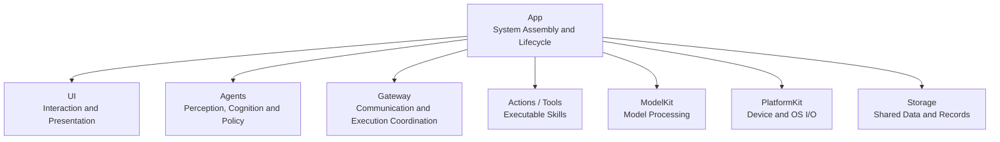
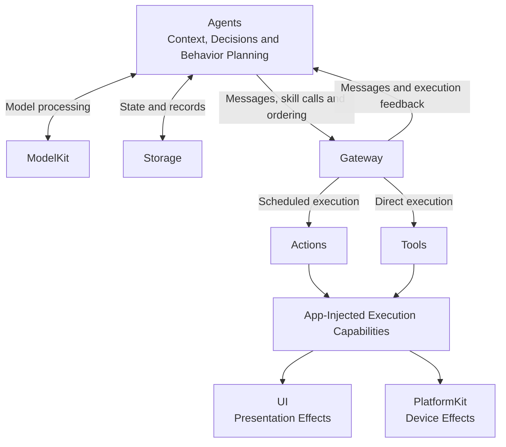
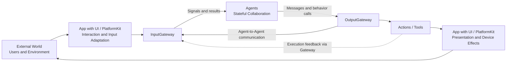
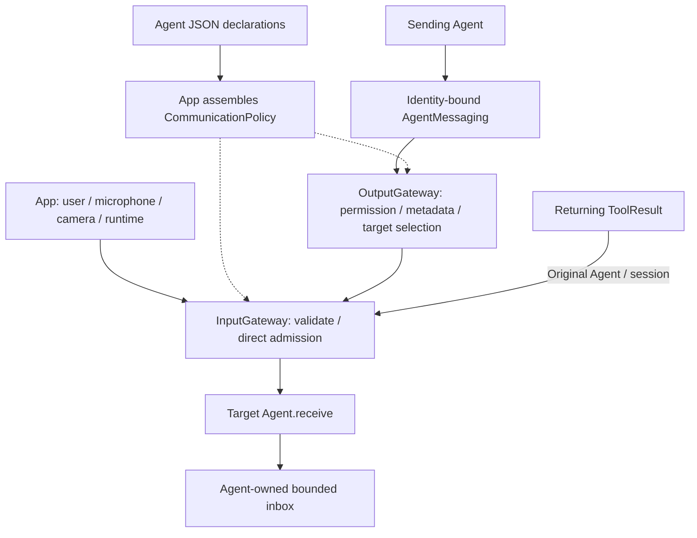
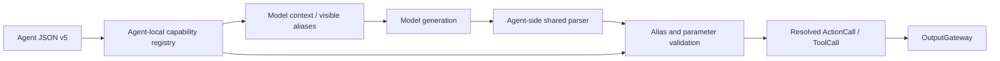
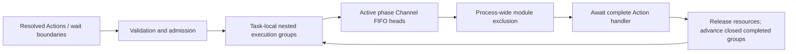
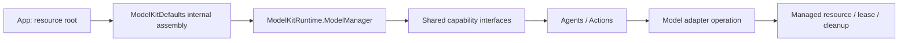

# MobileHarness Technical Design

> Current status (2026-09-30): the user confirmed iPhone LLM conversation control of NexArm. Normal BLE connections now use protocol/gesture validation, discovery includes other BLE devices, and foreground recovery avoids repeated motion. Physical acceptance of the latest discovery/recovery UX is pending.


## Overview

**MobileHarness** is a *multi-modal*, *multi-agent*, *bio-inspired* harness for mobile and embodied AI systems. Its architecture follows a continuous information-processing loop inspired by biological nervous systems: **Signal → Cognition → Action**.

The system supports concurrent, stateful Agents and streaming multimodal processing. Its design separates system assembly, cognitive policy, communication and execution so capabilities can be combined without coupling their implementations.

This is the target technical plan. Module READMEs own detailed algorithms, queue limits and API contracts; the [docs index](../docs/README.md) links requirements, decisions and evidence. [Architecture](../docs/Architecture.md) provides the public overview, and [Roadmap](../docs/Roadmap.md) tracks delivery. The original `docs/Technical_Design.docx` remains preserved.

- [Part I — Architectural Framework](#part-i--architectural-framework): design philosophy, module composition, runtime collaboration and source organization.
  - [Design philosophy](#design-philosophy--a-coordinated-organism): composition and biological analogies.
  - [Architecture](#architecture): system assembly, Agent capability composition and coordination ownership.
  - [Basic data flows](#basic-data-flows): communication and feedback.
  - [Project structure](#project-structure): source layout, target mapping and compilation boundaries.
- [Part II — Module Design](#part-ii--module-design): each top-level source directory and its subdesigns.
- [Part III — Key Techniques](#part-iii--key-techniques): protocols, communication, scheduling, lifecycle and presentation.
  - [TTS synthesis and playback data flow](#tts-synthesis-and-playback-data-flow): parallel synthesis and scheduled playback linked by an audio ID.
- [Summary](#summary): invariants and implemented versus outstanding scope.

## Part I — Architectural Framework

### Design Philosophy — A Coordinated Organism

**MobileHarness is designed through composition.** App assembles a complete running system from independent modules. Agents combine model capabilities, context, messages and executable skills into purposeful behavior. Gateway connects their collaboration through explicit communication and execution contracts.

The biological analogy explains this division of responsibility: signals become observations, observations inform decisions, and actions change an environment that can be sensed again. The software follows that feedback structure without claiming to reproduce a biological brain.

| Role | Module | Biological analogy and responsibility |
| --- | --- | --- |
| Host and interaction | **App** | The host that brings the organism into operation: assembly, application/session lifetime and cleanup. |
| Host and interaction | **UI** | Its face and interaction surface: user controls and presentation state. |
| Cognition and coordination | **Agents** | Specialized brain regions: stateful perception, interpretation, context and behavior selection. |
| Cognition and coordination | **Gateway** | Neural pathways and execution coordination: validated signals, routing, permissions and execution rules. |
| Execution | **Actions / Tools** | Reusable skills: concrete operations with explicit parameters, effects and completion semantics. |
| Foundations | **ModelKit** | Recognition and generation machinery: model-processing capabilities and model resources. |
| Foundations | **PlatformKit** | Access to sensory organs and effectors: device/OS input, output and resource handling. |
| Foundations | **Storage** | A substrate for retained information: shared data and durable records whose meaning is interpreted by Agents. |

An Agent can turn a signal into an observation, an internal state update or a behavior call. Together, Agents form a stateful feedback network rather than a single linear pipeline. They may share model capabilities; an Agent need not have a dedicated model.

### Architecture

The diagrams distinguish system assembly from runtime capability use. Their arrows describe composition and data flow; compilation dependencies are listed under [Project Structure](#project-structure).

#### System composition

App connects the modules through explicit bindings and gives each consumer the interfaces it needs. UI receives state and operations, while long-lived runtime work has owners outside page lifetimes.



#### Agent capability composition

Agents use injected model and storage interfaces directly. They compose behavior by emitting resolved calls and coordination instructions through Gateway. Executable skills use App-bound services to produce presentation or device effects.



Actions participate in Channel/wait scheduling; Tools execute directly with registered value-returning or completion-only semantics. Both may have side effects. A skill is atomic at its exposed call boundary: it may contain multiple steps or control an ongoing activity, and its completion means the acknowledgment promised by its contract.

#### Coordination ownership

| Owner | Question | Responsibility |
| --- | --- | --- |
| **App — lifecycle coordination** | What runs, and for how long? | Assemble, start, stop and clean up runtime scopes and their resources. |
| **Agents — task and behavior planning** | What should happen next, and why? | Interpret signals, choose capabilities and express behavior dependencies. |
| **Gateway — execution coordination** | How can accepted work execute? | Enforce admission, ordering, wait dependencies, exclusion and declared resource rules. |

Semantic fusion belongs to Agents: combining observations to infer meaning is a cognitive policy. Gateway handles the identities, contracts and destinations that let those observations reach the appropriate Agents.

### Basic Data Flows

#### Communication and feedback loop

Execution closes the loop: effects produce new observations, while messages and results inform subsequent Agent processing.



Feedback follows the registered Tool semantics and Action feedback policy. Admission and completion are different milestones; their transport and buffering rules are defined in [Communication Framework](#communication-framework).

This loop covers Agent business communication. App assembly, lifecycle coordination and UI workflows also use their typed host interfaces. Detailed internal paths are documented in [App](App/README.md#internal-composition), [Agents](Agents/README.md#internal-structure-and-data-flow) and [Gateway](Gateway/README.md#internal-flow).

<a id="37-project-structure"></a>

### Project Structure

The layout below maps those roles to source ownership and succeeds the former section 37. Each maintained directory has a README describing its purpose, design and implemented/outstanding scope; downloaded model artifacts are excluded.

```text
MobileHarness/
├── App/                    # Application host and explicit composition
│   ├── Composition/        # AppAssembly and runtime/model assembly
│   │   └── Behaviors/       # Independent BehaviorAssembly target
│   ├── Lifecycle/          # Voice/camera sessions and cleanup
│   ├── Workflows/          # AppWorkflows facade and independent feature targets
│   │   ├── Settings/
│   │   ├── History/
│   │   ├── Bluetooth/
│   │   ├── Speech/
│   │   ├── Presentation/
│   │   └── Diagnostics/
│   └── Adapters/           # Effect endpoints, media and native preview bridges
├── UI/                     # Independent pages, state and interaction target
│   ├── Conversation/
│   ├── Components/
│   ├── Camera/
│   ├── Settings/
│   └── Diagnostics/
├── Agents/                 # Shared core and business Agent source ownership
│   ├── Core/               # Independent AgentCore compilation target
│   │   ├── Runtime/        # Agent registry, manager and lifecycle
│   │   ├── Capability/     # JSON, model catalog and internal permissions
│   │   ├── Generation/     # Function Token, Channel/wait and Tool parsers
│   │   ├── Output/         # Resolved calls and trusted envelopes
│   │   └── Communication/  # Typed messages and routing policy
│   ├── Assistant/          # Conversation generation and interpretation
│   ├── SpeechPerception/   # Shared VAD/ASR and speech observations
│   ├── SpeechSynthesis/    # Directed FIFO text-to-audio synthesis
│   └── VisionPerception/   # Pose inference, gaze and skeleton output
├── Gateway/                # Input/output validation, routing and scheduling
│   ├── Input/
│   └── Output/             # Validation, routing, dispatch, scheduling, results and resources
├── Actions/                # Concrete scheduled behaviors and independent runtime
│   ├── Runtime/            # ActionRuntime target; execution and Contracts/
│   ├── NexArm/             # Agent-used robot actions
│   ├── Speech/             # Audio-ID playback and awaited completion
│   └── UI/                 # Scheduled expression; non-callable Support below
├── Tools/                  # Concrete immediate functions and independent runtime
│   ├── Runtime/            # ToolRuntime target; execution and Contracts/
│   ├── System/             # Fixed runtime information
│   └── UI/                 # Immediate captions, gaze, voice state and skeleton display
├── AudioTypes/             # Shared PCM and microphone values; no dependencies
├── Storage/                # Core cache, persistence and local synchronization
│   ├── Audio/              # StorageAudio: PCM handles
│   └── Chat/               # StorageChat: conversation records and journal
├── ModelKit/               # Independent SDK and separate provider targets
│   ├── Core/
│   ├── Speech/
│   ├── Language/
│   ├── Vision/
│   ├── Defaults/
│   ├── Management/
│   └── Backends/
├── PlatformKit/            # Device/OS I/O and capability validation
│   ├── Audio/
│   ├── Vision/
│   ├── Connectivity/
│   └── Core/
└── Resources/              # Privacy, model profiles and local artifacts

Tests/                      # Root module tests and integration/model evaluations
Config/                     # Shared configuration; local signing is ignored
scripts/                    # Checks, builds and provisioning
MobileHarness.xcodeproj/    # App/framework schemes and source navigation
```

#### Compilation map

Root [Package.swift](../Package.swift) compiles shared sources into independently tested targets. The Xcode application targets compile the host and link those targets. The table combines source mapping and direct project dependencies; tests and system frameworks are omitted from dependency lists.

| Source path | Target | Direct dependencies |
| --- | --- | --- |
| `App/` excluding package-owned subtrees | Xcode App targets | Composition/adapters/lifecycle; see App README |
| `App/Composition/Behaviors/` | BehaviorAssembly | Actions, Tools, ActionRuntime, ToolRuntime |
| `App/Workflows/` facade | AppWorkflows | The six feature workflow targets below |
| `App/Workflows/Settings/` | AppSettingsWorkflow | UI, Storage |
| `App/Workflows/History/` | AppHistoryWorkflow | UI, StorageChat |
| `App/Workflows/Bluetooth/` | AppBluetoothWorkflow | UI, AgentCore, Storage, Actions, ActionRuntime, PlatformKit |
| `App/Workflows/Speech/` | AppSpeechPlayback | ActionRuntime, StorageAudio |
| `App/Workflows/Presentation/` | AppPresentationWorkflow | UI, AgentCore, ActionRuntime, ToolRuntime |
| `App/Workflows/Diagnostics/` | AppDiagnosticWorkflow | UI, ModelKit, PlatformKit |
| `UI/` | UI | AgentCore, StorageChat |
| `Agents/Core/` | AgentCore | None |
| `Agents/` excluding `Core/` | Agents | AgentCore, ModelKit, StorageChat, StorageAudio |
| `Gateway/` | Gateway | AgentCore, ActionRuntime, ToolRuntime |
| `Actions/Runtime/` including `Contracts/` | ActionRuntime | None |
| `Tools/Runtime/` including `Contracts/` | ToolRuntime | None |
| `Actions/` excluding `Runtime/` | Actions | ActionRuntime, PlatformKit, BehaviorDefinitions |
| `Tools/` excluding `Runtime/` | Tools | ToolRuntime, BehaviorDefinitions |
| `AudioTypes/` | AudioTypes | None |
| `Storage/` excluding `Audio/` and `Chat/` | Storage | None |
| `Storage/Chat/` | StorageChat | Storage |
| `Storage/Audio/` | StorageAudio | Storage, AudioTypes |
| `PlatformKit/` | PlatformKit | AudioTypes |
| `ModelKit/` shared capability sources | ModelKit | AudioTypes |
| `ModelKit/Management/` | ModelKitRuntime | ModelKit |
| `ModelKit/Defaults/` | ModelKitDefaults | ModelKit, ModelKitRuntime and registered adapters |
| ModelKit concrete adapters and backends | Separate targets | See ModelKit README |
| `Resources/` | App resource staging | Local weights remain ignored |
| Root `Tests/` | Module and integration tests | Tested targets; no duplicated sources |

#### Layout exceptions and invariants

- **Physical nesting does not imply one target.** AgentCore stays independent inside Agents so shared contracts cannot depend on business policy. AppWorkflows and BehaviorAssembly are separately testable inside App. Model management and concrete adapters remain separate from the ModelKit SDK.
- **Behavior ownership and host bindings are separate.** Actions/Tools include their Runtime APIs; domain modules own implementations. BehaviorAssembly validates their coverage against Agent permissions, and App supplies concrete capabilities. Injected UI/device callbacks do not introduce reverse imports.
- **Platform Core is documentation only.** Current adapters check authorization directly. Unused permission/transport placeholders were removed; shared contracts require real consumers before implementation.
- **Foundations remain independent.** ModelKit and PlatformKit have no dependency on each other or on business Agents. StorageAudio bridges media and storage contracts; it replaced the former SpeechRuntime cache owner ([ADR 0056](../docs/adr/0056-storage-audio-migration.md)). UI accesses shared values, not runtime/model/device services.
- **Compile-time behavior metadata:** root `Macros/BehaviorDefinitions` is a SwiftSyntax-only host plugin. Actions/ActionMacro.swift and Tools/ToolMacro.swift declare `@Action`/`@Tool`; domain entries carry metadata and Support catalogs bind factories explicitly. This is build tooling, not a new runtime business layer (ADR0094).
- **One source has one compilation owner per target.** Do not recreate `Packages/HarnessKit/Sources`, duplicate sources or add empty future-domain implementations. Directory migrations must update Package.swift, Xcode navigation and affected READMEs together. Unimplemented domains stay in the [Roadmap](../docs/Roadmap.md).

Source consolidation and App/UI separation are recorded in [ADR 0063](../docs/adr/0063-module-directory-consolidation.md) and [ADR 0064](../docs/adr/0064-app-ui-boundaries.md). Their dated migration checks are retained in the [Roadmap](../docs/Roadmap.md).

The next part describes module implementations; Part III explains their shared runtime protocols.

## Part II — Module Design

### App

[App](App/README.md) hosts the application and owns the explicit AppAssembly composition root. `AppContainer` prepares capabilities and platform services; `ApplicationRuntime` assembles the shared journal, AgentManager, communication policy and gateways, and constructs Assistant with that journal.

#### Domain-owned behavior assembly

[BehaviorAssembly](App/Composition/Behaviors/README.md) combines domain-owned Action/Tool definitions and catalogs with typed App-injected capabilities. Gateway.BehaviorCoverage validates implementation coverage against assembled Agent permissions before producers start; App does not register individual behavior functions. Model-callable permissions remain in Agent JSON and fixed internal permissions in Agent code. New device capabilities or lifetime changes still require host bindings. Target dependencies are listed in the compilation map; [ADR 0067](../docs/adr/0067-domain-owned-behavior-assembly.md) records the assembly decision.

#### Application lifetimes

VoiceSessionCoordinator and CameraCoordinator own separate voice/camera lifetimes, and VisionSession bridges camera frames through the shared Agent runtime. AppAssembly supplies one ModelKit resource root; consumers receive capability interfaces from the process-wide manager. App/Adapters adapts media, resolves the current chat binding and binds one complete typed voice/camera endpoint. AppWorkflows coordinates settings transactions, history archive/title operations and explicit speech/chat diagnostics. Session owners retain startup, cancellation and cleanup; UI owns page state and controls. The complete source/responsibility inventory lives in the [App README](App/README.md) and [UI README](UI/README.md).

✅ Shared assembly, independent camera/voice sessions and explicit handlers. ❌ Persistent background supervision and independent multi-window Agent namespaces.

### UI

[UI](UI/README.md) contains MainActor pages, observable page state and user interaction interfaces, grouped by feature. `Conversation` owns view/state, `Components` owns reusable visuals, `Camera` accepts an injected native preview, `Settings` owns settings/history views and state, and `Diagnostics` exposes state/control interfaces. UI compiles independently, imports shared record/overlay values only, and never references App coordinators or constructs models, devices or stores. The native preview bridge remains in App/Adapters.

`Actions/UI` and `Tools/UI` remain behavior directories within Actions and Tools. They update UI state through App-bound handlers; the `UI.*` Action/Tool namespace does not imply a dependency on the Swift UI target.

Agent-selected UI changes arrive through registered Actions or Tools. Device audio telemetry and user/OS lifecycle resets are App-owned presentation inputs. Expressions use semantic emotion values mapped to procedural eyes; they are not emoji commands.

✅ Conversation, camera controls, captions, eye expressions and audio spectrum presentation. ❌ Physical-device visual/latency acceptance; Debug simulations must remain labeled.

### Gateway

[Gateway](Gateway/README.md) owns protocol admission and coordinated output. It imports neither model capabilities nor device adapters and performs no perception inference.

- **Input:** validate external inputs, select static subscribers or explicit targets, and validate internal deliveries before `Agent.receive`. Production uses CommunicationPolicy; publish requires configured subscriptions and send requires an explicit target. No default-Agent routing fallback exists.
- **Output/Validation:** recheck resolved executable calls and event permissions.
- **Output/Routing and Dispatch:** classify outputs, dispatch Actions/Tools, and return data Tool results through InputGateway.
- **Output/Scheduling:** bound Action queues, serialize by Channel within task phases, coordinate nested wait dependencies and process-wide module exclusion, completion and cancellation.
- **Output/Results and Resources:** deliver bounded Action feedback and arbitrate declared resources across Action, Tool and host paths; see [execution feedback and resources](#action-feedback-and-resource-ownership).
- **Internal messaging:** bind sender identity, select recipients and directly hand validated events to InputGateway; registered runtime observers do not create implicit Agent subscriptions.

✅ Static publish/send, output validation and execution coordination. ❌ Dynamic subscriptions and model-assisted routing; any future model routing decision belongs in an Agent.

### Agents/Core (AgentCore target)

[AgentCore](Agents/Core/README.md) defines the reusable contracts and mechanisms without business policy. Root contracts describe Agents, identity, descriptors, input payloads and errors. `Runtime` manages instances and lifecycle; `Capability` validates configuration and local names; `Generation` parses generated output; `Output` defines resolved calls and context; `Communication` defines messaging contracts, receipts and shared communication policy.

An Agent is an actor with a descriptor, lifecycle operations, a `receive(_ input: AgentInput) async throws` entry and an output stream. Concrete Agents own their bounded inboxes and domain state. Shared ToolResult, ActionResult, execution-owner and lease values belong here to avoid dependencies on execution implementations; bounded Agent receipt history lives in Core/Runtime.

✅ Actor contracts, lifecycle, configuration, generation and event transport. ❌ Generic AgentContext/AgentRuntime/StateStore, general restart/health supervision and request/reply infrastructure.

### Agents

[Agents](Agents/README.md) implements domain actors. Each versioned `<AgentName>.agent.json` declares model-callable Actions grouped by Channel, native Tools and communication permissions. Fixed internal behavior and text mappings belong to Agent code. Each Agent resolves its own aliases before output and uses only injected model capability protocols. Agents compose skills by emitting resolved calls through OutputGateway, never by directly calling concrete Actions, Tools or other Agents.

| Agent            | Basic design and subdesigns                                                                                                                                                                   |
| ---------------- | --------------------------------------------------------------------------------------------------------------------------------------------------------------------------------------------- |
| Assistant        | Bounded input and durable ten-round context; consumes user text, final speech, phase and Tool results; streams chat through shared generation parsers into resolved calls                                           |
| SpeechPerception | Bounded PCM admission; LiveSpeechInput and VoiceActivitySegmenter own VAD/ASR sessions, segmentation/merging and partial/final observations; explicit UI Actions own recognition presentation |
| VisionPerception | FrameChangeFilter selects frames; shared pose inference feeds independently bounded observation publication and latest skeleton Tool / eye gaze Action output                                                   |
| SpeechSynthesis | Directed serial synthesis into owner-scoped StorageAudio handles; playback remains a separate Action |
| Photographer     | Proposed camera-motion policy in [docs](../docs/Photographer-Proposal.md); no active runtime or display responsibility                                                                                                             |

✅ Shared speech/vision perception and conversational Assistant. ❌ Photographer motion policy, ReflexAgent and additional task Agents. Perception freshness does not establish robot safety or sampling guarantees.

### Actions

[Actions](Actions/README.md) implements behavior that uses Channel scheduling. `Speech.speak(audioID)` consumes shared StorageAudio PCM prepared by the independent SpeechSynthesisAgent, while its scheduled handler still awaits actual playback completion. `UI` implements scheduled expression through App-bound MainActor services; immediate caption, voice-state, gaze and turn updates belong to Tools/UI.

Domain modules own behavior definitions, parameter validation and function bindings; Agent JSON owns available aliases/default Channels. App supplies typed execution capabilities through BehaviorAssembly. Shared physical resources must have coherent ownership across behavior functions.

✅ Speech and UI behaviors, including `UI.express(emotion:)`, and [NexArm supervised USB Actions](Actions/NexArm/README.md), including Assistant base sweeps and gestures. ✅ iPhone BLE settings/workflow binding is implemented. ❌ Photo-capture and media Actions remain pending.

#### Actions/Runtime

[Actions/Runtime](Actions/Runtime/README.md) supplies validated ActionDefinition registration, trusted ActionInvocation values, shared typed argument readers and awaited execution. Each admitted call receives an execution ID; bounded payload-free diagnostics distinguish admission, execution and effect status. ActionExecutor validates typed completion; finite/state handlers can use a Void adapter, while activity start/stop completions identify the service-owned activity. State acceptance does not promise rendered or physical completion.

Gateway owns Channel/wait scheduling, feedback and resource coordination; the executor does not parse markup, resolve aliases or decide policy. [ADR 0065](../docs/adr/0065-action-runtime-contracts.md) and [ADR 0066](../docs/adr/0066-action-results-resource-leases.md) record the contract decisions.

✅ Validated registration, correlated invocation, typed completion and execution diagnostics. ❌ Generic activity supervision, per-Action deadlines and physical completion acceptance remain outstanding; current domain conventions are maintained in [Actions](Actions/README.md).

### Tools

[Tools](Tools/README.md) provides direct callable functions. `runtimeInfo` returns fixed configuration text, not live health. `UI.showPose` validates a bounded skeleton projection and awaits an injected display update; it may have a presentation side effect despite being a Tool.

✅ System information and skeleton display. ❌ Search, storage, network, memory and additional model/device tools.

#### Tools/Runtime

[Tools/Runtime](Tools/Runtime/README.md), compiled within Tools, provides ToolRegistry and ToolExecutor. Domain definitions assembled through BehaviorAssembly select either a data-returning handler or a completion-only Void handler. Tool execution bypasses ChannelScheduler; the registration determines feedback semantics, never model arguments.

Data-returning calls produce correlated ToolResult through Gateway. Void calls complete without feedback; failure propagates to the caller. Awaiting display-state acceptance does not guarantee the screen has rendered a frame.

✅ Both handler modes and correlated data feedback. ❌ General Tool timeout/retry supervision and durable execution.

### Storage

[Storage](Storage/README.md) provides Foundation-only bounded memory streams and single-checkout handles. [StorageAudio](Storage/Audio/README.md) adapts AudioTypes PCM frames and opaque caller identity to those primitives; App injects the shared audio store into synthesis and playback. Storage core remains independent of ModelKit and SwiftUI. LocalDocumentStore synchronizes bounded cached documents with durable files; App settings and the Assistant conversation journal are durable consumers. General reclaimable disk caches and persistent media remain later stages.

✅ Both Storage targets are registered. Production PCM uses the memory cache; user settings use revision-checked local persistence with write-through caching. ❌ Persistent media, disk cache and memory records remain future work.

#### Persistent conversation history

[Assistant](Agents/Assistant/README.md) and App history workflows share one [Storage journal](Storage/README.md#conversation-journal). Logical conversations survive voice sessions and App restarts; the latest ten completed rounds supply model context. Records retain original user input, received model text, actual requests and failures for inspection.

Start New atomically archives the current conversation and creates an empty one. A separate metadata-only request generates the archive title; browsing history never replays Actions. [ADR 0060](../docs/adr/0060-persistent-conversation-history.md) records the boundary. Device performance and live-model title quality remain acceptance work.

### ModelKit

[ModelKit](ModelKit/README.md) is an independent capability SDK for model-driven data processing; general business algorithms remain in their owning modules. `Speech`, `Language` and `Vision` expose typed capabilities; `Core` supplies media/session/resource contracts. Concrete model SDKs live in separate adapter targets, and `Backends` encapsulates engines.

`Defaults` owns internal providers/default bindings. `Management` compiles as ModelKitRuntime and supplies ModelManager lifecycle and acquisition. Production uses one process-wide manager; consumers receive capability protocols only. App provides resources but does not register concrete providers. Construction/registration require ModelAssembly SPI; model management remains independent of Agents and UI.

The default TTS adapter is `Speech/TTS/MossNano` → ModelKitMossNano, backed by `Backends/MossCoreML` → ModelKitMossCoreML. [ADR 0058](../docs/adr/0058-moss-tts-nano.md) records its replacement of the Kokoro default; device evidence and remaining acceptance live in [MOSS validation](../docs/Moss-Validation.md).

✅ ASR/TTS/VAD/chat/pose integration, shared lifecycle, AudioFrame/ImageFrame and separate backend targets. ❌ General video sessions, further model capabilities, cross-model scheduling and independent SDK distribution.

### PlatformKit

[PlatformKit](PlatformKit/README.md) owns device/OS data I/O through public APIs with capability and permission validation. `Audio` owns microphone/speaker lifecycle, conversion and telemetry; `Vision` owns camera sessions, frames and gray sampling; `Connectivity` declares external-device transport; `Core` holds cross-domain contracts.

Small capability domains remain flat until concrete implementations justify subdirectories. App bridges PlatformKit media into AgentCore transport and ModelKit values; the two Kits do not depend on each other.

✅ Foreground audio and camera I/O. ❌ Concrete external-device transports and robot control. Physical safety cannot rely on iOS background execution.

### Resources

[Resources](Resources/README.md) contains privacy declarations, model provisioning profiles and ignored local artifacts. App supplies the resource root; providers load their configured model files. Platform/backend selection is explicit, and unavailable models report errors rather than silently falling back.

✅ Local artifact provisioning and packaged resource selection. ❌ Broader model distribution and physical-device acceptance. Secrets, local signing settings, model weights and user media must not be committed.

## Part III — Key Techniques

This part follows the runtime path: input representation and routing, Agent generation, Action execution, speech playback, session presentation, then model/device boundaries and concurrency rules.

### Signal and Media Representation

Signal is the conceptual input abstraction; `AgentInput` is its implemented type. There is no second parallel Signal type. Payload is separate from source, contract/version, session, turn, sequence, capture time, incarnation, causal root/parent and monotonic admission deadline.

| Payload                | Meaning                                                       |
| ---------------------- | ------------------------------------------------------------- |
| Text / runtime event   | User text or explicit runtime input                           |
| Audio / image          | Bounded PCM or image data / controlled in-process attachment  |
| Perception observation | Typed transcript, speech phase or pose without original media |
| ToolResult             | Result correlated with its originating call and session       |
| ActionResult / ActivityEvent | Runtime execution outcome / ongoing activity observation with trusted ownership |

Media streams are successive typed inputs. JSON v5 configures Agents; it is not the audio/image transport format. App-owned attachments bridge native frames without making AgentCore depend on model/platform frameworks. Remote serialization, compressed video and additional physical sensors remain future work. Bounds and value contracts live in [Input](Gateway/Input/README.md) and [Communication](Agents/Core/Communication/README.md).

<a id="32-internal-agent-communication"></a>

### Communication Framework

Communication covers external input, internal Agent observations and Tool-result return. **Gateways perform intermediate validation, metadata construction and routing. Agent inboxes own pending messages. There is no independent message Bus.**



#### Subscription ownership and target selection

Each Agent JSON declares `inputs` (supported contract/version/kind), `subscriptions` (exact contract/source/topic), `publications` (publishable contracts) and `sends` (allowed contract/target pairs). App validates these into an immutable policy. Agents do not register listeners dynamically. Topic currently equals contract; there are no wildcards or implicit fallback recipients.

External publish/send selects targets in InputGateway. Internal publish/send selects targets in OutputGateway after outbound permission checks. Supporting an input is distinct from subscribing to it: directed sends bypass subscription matching but preserve supported-contract validation.

OutputGateway binds source identity/incarnation, sequence, session, turn and causal parent into the envelope. It resolves live target identities and directly invokes the module-internal InputGateway entry. Public external entry points reject forged internal incarnations. Child deadlines cannot outlive their parent.

#### Direct admission, lifetime and ownership

InputGateway uses structured per-target tasks and a common capacity boundary for external and internal admission. It checks source/target identity, session, supported payload, cancellation and message expiry before `receive`. One rejected destination does not suppress successful peers, but the aggregate report awaits all targets.

Ordinary `receive` must promptly validate and enqueue or reject; it must not await inference or inbox space. Cross-actor calls still use await. Explicit cancellation controls may join cleanup. Neither Gateway has a pending-message queue, persistent worker or independent delivery lifecycle. There is no communication FIFO guarantee across concurrent calls and no automatic duplicate suppression or state replacement.

InputGateway and OutputGateway enforce explicit active-call bounds; full admission rejects immediately and structured calls release their reservations on completion. These are active-call bounds, not queues. Current values and release behavior belong in the [Gateway Input](Gateway/Input/README.md) and [Gateway Output](Gateway/Output/README.md) READMEs.

A message deadline is a freshness check, not a timer racing receive. Cancelling the caller propagates through structured admission calls; already accepted work belongs to the Agent. App stops producers and coordinates Agent/runtime cleanup. No Bus session registry, timeout tasks, retained operation registry or shutdown barrier remains. Action Channels remain separate execution queues.

| Concern | External input | Internal Agent event |
| --- | --- | --- |
| Target selection | InputGateway subscription lookup or explicit target | OutputGateway permission check and target selection |
| Admission | Shared InputGateway bounded task group | Same InputGateway bounded task group |
| Queue / processing | Agent inbox | Agent inbox |
| Lifecycle | Caller, App and Agent/runtime ownership | Same; source incarnation and causal context are also checked |
| Receipt | Per-target admission, not processing completion | Same |

Detailed diagrams: [external input](Gateway/Input/README.md#external-input-admission-and-delivery) and [internal direct delivery](Agents/Core/Communication/README.md#target-selection-and-per-agent-delivery).

#### Current routes and future scope

| Source | Input | Receiver |
| --- | --- | --- |
| phone.microphone | media.audio | SpeechPerception subscription |
| phone.camera | media.image | VisionPerception subscription |
| user | user.text | Assistant subscription; no current text-entry UI |
| speechPerception | speech.final / speech.phase | Assistant subscription |
| speechPerception | speech.partial / final / phase | Registered runtime observer for admission/logging, without UI mutation |
| visionPerception | vision.pose | Declared business subscribers; skeleton output is an independent Tool |
| runtime | ToolResult / assistant.cancel | Original or explicitly selected Agent/session |

Assistant declares directed `speech.synthesize` and `speech.cancel` sends to SpeechSynthesis; the other current Agents have empty sends lists. Zero recipients fails unless a registered publication observer handles the contract. Ordinary discrete events and physical actions must not be silently coalesced; Agent-local latest-state policies are explicit.

✅ Static subscriptions, direct delivery and correlated Tool return. ❌ Dynamic subscriptions, request/reply, remote transport, persistence and retry. Remote Agents may use a transport adapter; they do not inherently require a Bus or broker. See [ADR 0048](../docs/adr/0048-direct-signal-admission.md).

### Capability Declaration and Resolution



Action and Tool aliases are unique within one Agent; different Agents may reuse a name. An alias such as `express` resolves to `UI.express`, not a reflected Swift method. JSON v5 groups model-callable Actions by Channel. Code-owned internal permissions have no model aliases or prompt metadata. Context generation exposes only the callable catalog. App explicitly binds implementations. Invalid configuration propagates without `try!` or fallback registrations.

### Function Token Protocol

Function Token is a streaming mixture of natural text and restricted XML. A parsed FunctionToken is not a model tokenizer token. Shared parsers live in Agents/Core/Generation, while parser instances and alias resolution belong to each Agent.

```xml
<express emotion="smile"/>
Hello.
<wait>
  <express emotion="thinking"/>
  Let me think.
</wait>
```

The four forms are natural text, self-closing Action tags, paired Channel scopes and paired wait groups. FunctionTokenParser handles fragment boundaries; ChannelParser tracks scope; SentenceFunctionBuffer groups text; AgentGenerator resolves calls. Assistant supplies a code-owned text callback for speech and captions; internal playback/initialization permissions are assembled in code. Explicit Action tags do not implicitly duplicate that mapping.

Completed Actions can be emitted before a Channel closes. Tag/scope boundaries flush preceding text; normal completion flushes remaining valid text, while cancellation discards incomplete state. Raw markup and unresolved aliases never reach Gateway; resolved Actions and typed wait boundaries do. Native Tool calls use the separate ToolCallParser; production incremental native Tool deltas are still outstanding.

Syntax, escaping, nesting, bounds and malformed-stream behavior are defined in [Generation](Agents/Core/Generation/README.md).

### ActionCall versus ToolCall

| Dimension         | ActionCall                                                | ToolCall                                                 |
| ----------------- | --------------------------------------------------------- | -------------------------------------------------------- |
| Agent generation  | Function Token interpretation or explicit Agent logic     | Separate native Tool parsing or explicit Agent logic     |
| Resolved identity | ActionPath, parameters and effective Channel              | ToolPath and arguments                                   |
| Execution         | OutputGateway → ChannelScheduler → Actions/Runtime        | OutputGateway → Tools/Runtime directly                    |
| Ordering          | Task-local Channel FIFO; nested wait joins; global module exclusion | Caller awaits handler; no Channel queue                  |
| Completion        | Handler completion and per-input finish barrier           | Value feedback or Void completion, fixed by registration |
| Current examples  | Speech.speak, UI.express                        | runtimeInfo, UI.print, UI.setTranscript, UI.moveEyes, UI.showPose |

Both are validated executable outputs, and either may have side effects. Their distinction is execution/feedback semantics, not simply “write versus read.” Returning Tools re-enter InputGateway with ToolResult; Void Tools do not. Actions can return correlated terminal feedback under the policy described in [Action feedback and resource ownership](#action-feedback-and-resource-ownership). Typed internal observations use a separate messaging port, not either generation protocol.

### Multi-Channel Action Scheduling

A Channel is an ordered Action execution scope. The Agent capability declaration supplies each Action's default Channel; an explicit `<channel.name>` scope overrides it. Closing an inner scope restores the parent; closing the outermost restores each Action's default. Only permitted Channels may be selected. Channel scopes do not themselves create wait groups.

With Assistant's default mapping, natural text produces speech on `Speech` and captions on `Display`. They may progress concurrently. A `<wait>...</wait>` group joins its parent's preceding work, preserves ordinary Channel scheduling internally, and joins all its children before releasing its parent's continuation. Consecutive wait groups express sequential stages; nested waits synchronize only within their parent. Channel closing changes scope without waiting. No channel name, including main, has special semantics; Assistant does not declare main.



Channel queues are task-local; equal names across Agents do not impose cross-task FIFO. Resource exclusion is process-wide. A wait affects one Agent/session/input, never unrelated tasks. finish seals root input and joins accepted work; errors cancel that task's tree and cooperative running work. No queued device action is silently discarded on capacity exhaustion. Speech synthesis remains outside this schedule, with a per-job execution deadline and reply-owned unplayed cache lifetime; pending/ready audio has no expiry timer.

✅ Bounded nested wait groups, streaming execution, local FIFO, global module exclusion and cancellation barriers. ❌ Priority, preemption, rollback and cross-task synchronization. Exact capacities and failure fencing belong in [Scheduling](Gateway/Output/Scheduling/README.md); protocol rules belong in [Generation](Agents/Core/Generation/README.md). ADR 0059 records this change.

<a id="201-channel-lock--exclusive-agent-control"></a>

#### Channel ownership and takeover — planned

Future control takeover must validate permission, atomically gate the channel group, cancel queued work, stop active control and await cleanup before granting a finite owner lease. Signals may communicate observations or advice but never transfer ownership. All alternate Action and Tool routes to protected hardware must share enforcement; uncertain cleanup leaves the domain gated.

Only ownership metadata exists today and Channels remain unlocked. Channel-specific acquire/renew/release and notifications remain unimplemented. This planned Channel ownership is distinct from the implemented physical-resource leases below. See [Channel Lock Design](Gateway/Output/Scheduling/README.md#channel-lock-design).

### Action Feedback and Resource Ownership

Execution feedback and resource ownership complement Channel scheduling; neither changes task-local FIFO or wait semantics.

**Terminal feedback.** Gateway reserves bounded result capacity before admission and returns correlated ActionResult through InputGateway, bound to the originating Agent incarnation and session. The default is failure-only feedback for opted-in Agents; terminal mode also reports success. Delivery retries reuse the result without repeating the effect. Current Agents retain bounded receipts without automatically triggering inference or replanning. An Action result describes its declared handler completion boundary; ActivityEvent describes later ongoing activity.

**Resource ownership.** One App-assembled ResourceCoordinator guards declared Action, Tool and host paths. Transient execution fences and persistent leases are separate from Channel/module exclusion. Group takeover gates affected resources, stops and joins old work, then grants ownership; uncertain cleanup leaves the group faulted. Camera capture is the first production lease integration, with start/stop still owned by App lifecycle rather than a model-callable recording Action.

The [Results](Gateway/Output/Results/README.md) and [Resources](Gateway/Output/Resources/README.md) documents own limits, algorithms and failure rules. Shared values live in Agents/Core/Output and receipt history in Agents/Core/Runtime; [ADR 0066](../docs/adr/0066-action-results-resource-leases.md) records the decision.

✅ Bounded terminal feedback, owner isolation, delivery retry and shared resource leases/fences. ❌ Generic activity registry/event outbox, audio/robot resource migration, device watchdogs, durable delivery, per-Action deadlines and real-device takeover acceptance remain outstanding.

### TTS synthesis and playback data flow

Speech output has two linked paths. The originating Agent chooses the spoken text boundary and creates an `audioID`; Assistant currently does this while interpreting generated text, and another authorized Agent can use the same synthesis service. The directed synthesis request contains `audioID`, `text` and `locale`. The playback Action contains only `audioID`, with the original Channel retained. Both paths carry the originating source, session and input identity so the cache can reject another caller's handle.

```mermaid
sequenceDiagram
    participant A as Originating Agent
    participant OG as OutputGateway
    participant IG as InputGateway
    participant S as SpeechSynthesisAgent
    participant M as ModelKit MOSS-TTS-Nano
    participant C as StorageAudio / Storage
    participant Q as ChannelScheduler
    participant R as ActionExecution
    participant P as SpeechPlayback
    participant H as App / PlatformKit Audio
    A->>OG: directed speech.synthesize(audioID, text, locale)
    OG->>IG: validate and deliver
    IG->>S: receive request
    S->>C: reserve audioID for source / session / input
    S->>S: enqueue in bounded FIFO; start if worker idle
    S-->>IG: admitted
    IG-->>OG: delivery receipt
    OG-->>A: admission receipt
    par Synthesis path
        S->>M: when FIFO worker starts, synthesize with 60 s execution deadline
        loop ordered audio events
            M-->>S: PCM frame or finished
            S->>C: append frame / complete audioID
        end
    and Scheduled playback path
        A->>OG: resolved Speech.speak(audioID)
        OG->>Q: validate and schedule on original Channel
        Q->>R: execute when eligible
        R->>P: invoke registered Speech handler
        P->>C: checkout audioID with same owner
        C-->>P: single-use PCM stream
        loop as frames become available
            P->>C: read next frame
            C-->>P: PCM when available; otherwise await producer / failure / cancellation
            P->>H: play PCM
        end
        H-->>P: playback drained
        P->>C: release audioID
        P-->>R: playback result
        R-->>Q: Action completion
    end
```

The Agent waits for **request admission**, not synthesis completion, before emitting `Speech.speak(audioID)`. SpeechSynthesisAgent processes admitted requests in its own serial FIFO and does not inspect Channels; the Gateway's ChannelScheduler independently decides when Actions/Runtime invokes playback. The worker starts the next request after synthesis completes, without waiting for playback.

App injects the process-wide ModelKit synthesis capability and one shared audio store into synthesis and playback. The current capability uses the MOSS-TTS-Nano adapter over Core ML; `StorageAudio` adapts PCM and owner identity to the general `Storage` memory primitives.

Playback may consume PCM before synthesis finishes, but only as frames arrive: an empty initial or intermediate read waits for the producer, its failure or cancellation. The synthesis Agent owns the 60-second deadline from worker execution start, excluding FIFO queue time. It is neither a cache lifetime nor a total timeout measured from speak checkout; production initial and intermediate PCM reads have no independent deadline. The platform separately bounds scheduled-buffer hardware completion by queued audio duration plus three seconds. MOSS produces native 80 ms audio blocks after prompt prefill; neither block duration nor streaming guarantees a three-second first-audio deadline.

[ADR 0055](../docs/adr/0055-synthesis-agent-audio-handles.md) and [ADR 0056](../docs/adr/0056-storage-audio-migration.md) record the synthesis/playback split. [ADR 0085](../docs/adr/0085-reply-owned-speech-audio.md) and [ADR 0087](../docs/adr/0087-speech-producer-deadline.md) supersede their cache-expiry and PCM-read-timeout policies.

Successful Action completion means the player has drained and the single-use cache lease has been released. Each consumed frame leaves Storage on read; already consumed audio is not preserved for replay. The reply lifetime is one source/input within a voice session, not the full multi-turn session or durable conversation history. Pending/ready audio has no wall-clock expiry; the reply owner retires unused handles after all Actions complete, or during reply error/interruption cleanup. LLM generation completion alone does not release unplayed audio. Synthesis/cache errors, a missing handle or synthesis execution timeout fail playback explicitly; cancellation and dispatch failure release the owning audio. No audio file, re-synthesis or Channel-driven synthesis reorder is involved. [Assistant](Agents/Assistant/README.md) owns current semantic segmentation; [SpeechSynthesis](Agents/SpeechSynthesis/README.md), [StorageAudio](Storage/Audio/README.md), [Speech playback](Actions/Speech/README.md), [MOSS](ModelKit/Speech/TTS/MossNano/README.md) and [PlatformKit Audio](PlatformKit/Audio/README.md) own their detailed limits and implementation contracts.

The synthesis deadline fails the shared audioID; pending or subsequent PCM reads throw, and playback propagates the failure to the Action. This is shared-cache error propagation, not a direct Agent-to-Action callback. See [synthesis timeout propagation](Agents/SpeechSynthesis/README.md#synthesis-timeout-propagation) for timing, cancellation and terminal-error retention.

### Session, Turn and UI Boundaries

Runtime lifecycle is separate from business state. AgentManager controls registration and running instances; each Agent owns domain state and bounded input processing. Voice and camera share infrastructure but close their own sessions independently. Stop first prevents producer admission, cancels and joins perception/transport work, then cancels consumers and Actions. Incarnations fence old instances from replacements.

The current voice stop and interruption chain is coordinated by App: stop producers, send assistant.cancel through InputGateway, then cancel session Actions through OutputGateway. Tool cancellation follows the active dispatch task. See [App lifecycle and completion](App/README.md#lifecycle-and-completion) for cleanup order and implemented boundaries.

Agent-selected presentation uses explicitly permitted, resolved Actions/Tools through OutputGateway. SpeechPerception owns recognition captions and phase presentation; Assistant owns reply captions, expressions and atomic beginReplyTurn; VisionPerception owns UI.showPose and UI.moveEyes. Signal observers only coordinate capture admission/logging. App may reset state for user/OS lifecycle and present actual device telemetry.

ConversationTurn carries an ID and session-local ordinal through input, observations, output and Tool return. A long utterance retains its turn across segments. Trusted output sequences and turn checks reject stale UI updates; model parameters cannot override this identity.

| Boundary                    | Recognition caption               | Reply / expression                                   |
| --------------------------- | --------------------------------- | ---------------------------------------------------- |
| Confirmed new utterance     | Latest partial replaces preview   | Assistant clears once through beginReplyTurn         |
| Endpoint, ASR pending       | Preserve preview                  | Await reply                                          |
| Final or empty recognition  | finishTranscript clears and seals | Reply or return to listening                         |
| Response and playback       | Remains sealed                    | Append reply; speaking state follows actual playback |
| Reply completed             | Empty                             | Retain until next utterance                          |
| Stop / background / failure | Clear and invalidate session      | Clear and invalidate session                         |

Eye gaze reuses pose facial landmarks and emits the code-owned immediate `UI.moveEyes` Tool within the camera session. [ADR 0049](../docs/adr/0049-perception-eye-gaze.md) records the earlier gaze design; ADR0083 migrates it to immediate Tool completion with the same bounded replacement policy; smoothness and crossing-face behavior still require device acceptance.

Vision freshness uses separate bounded inference, publication and display paths, allowing a slow subscriber to coexist with fresh local visualization. The configured maximum refresh interval avoids change-filter starvation when new frames exist; it does not guarantee inference FPS. Details: [App](App/README.md), [ADR 0043](../docs/adr/0043-conversation-turn-presentation.md) and [VisionPerception](Agents/VisionPerception/README.md).

<a id="391-platformkit-versus-modelkit"></a>

### PlatformKit versus ModelKit

| Concern             | PlatformKit: device/OS I/O                                     | ModelKit: model processing                                  |
| ------------------- | -------------------------------------------------------------- | ----------------------------------------------------------- |
| Audio input         | Microphone → PCM                                              | PCM → transcript or VAD score                              |
| Audio output        | Supplied PCM → speaker                                        | Text → synthesized PCM                                     |
| Vision              | Camera → frame and preview                                    | Supplied image → pose/model results                        |
| Adaptation          | Capture format, orientation, compact gray sampling             | Model resize/normalization, tensor decoding and coordinates |
| Resources           | Device sessions, engines, connections and I/O buffers          | Weights, graphs, model instances and operation leases       |
| Policy outside both | App bridges data; Agents choose when and why to process or act | Gateway validates and routes without inference              |

“Processing” means model capability processing, not all computation. VisionPerception compares gray samples as perception policy, asks ModelKit for poses, then emits observations and a display Tool. Model synthesis produces PCM; playback is a separate platform operation owned by the Speech behavior. Neither Kit owns Agent business decisions.

### Shared Model Lifecycle

ModelKitDefaults supplies the process-wide ModelManager and internal provider bindings; conflicting resource roots fail. `ModelManager.get` is the capability acquisition API. Shared construction/loading is coalesced, while each model admits only one active operation and rejects overlap rather than creating an inference queue.



Stopping a conversation cancels work without automatically unloading weights. Explicit unload waits for usage to end; shutdown cancels and joins active work. Residency policy is distinct from capability availability; memory warnings are coalesced and forwarded by App. Registration and construction require assembly SPI, and management uses its designated SPI rather than business access to backend resources.

✅ Shared lifecycle, bounded load/acquisition and explicit memory policy. ❌ Timed idle eviction, measured cross-model budgets and sustained physical-device pressure/retry acceptance. Details: [Management](ModelKit/Management/README.md), [Core](ModelKit/Core/README.md), [ADR 0032](../docs/adr/0032-modelkit-admission-and-memory-policy.md).

### Concurrency and Validation

Swift 6 language mode and Swift 6.4+ tooling are required. SwiftUI presentation is MainActor-isolated; runtime mutable state belongs to actors or explicitly owned synchronization. Every queue has a bound and overflow policy; device actions and discrete events cannot be silently discarded. Admission, handler completion and physical/rendered completion are different milestones.

#### Concurrency documentation standard

Every directory implementing queues, asynchronous workers or producer/consumer processing must describe its current algorithm in its local README. Keep these descriptions synchronized with code; use English for new documentation. Include:

1. Producer, consumer, payload and state owner (actor, MainActor or lock).
2. Queue/buffer capacities and units, whether running work counts, per-item and total limits, and where limits are enforced.
3. Admission and full-buffer behavior: wait, reject or explicit failure; never imply backpressure when the producer actually receives an error.
4. Drain algorithm, FIFO/ordering scope, concurrency, resource exclusion and the meaning of completion.
5. Normal finish, cancellation, timeout, failure propagation, cleanup/join behavior and handling of already executed work.
6. A Mermaid flow/sequence diagram for tooling and nontrivial producer/consumer modules, plus ✅ implemented and ❌ outstanding items.

Distinguish work queues, framing buffers, terminal signals and busy-reject admission. Actor isolation alone does not guarantee FIFO completion across suspension points. Document opaque third-party buffering as a limitation. Documentation changes alone do not alter runtime contracts.

Current detailed contracts: [Agent inbox/output](Agents/Assistant/README.md), [speech perception](Agents/SpeechPerception/README.md), [Action scheduling](Gateway/Output/Scheduling/README.md), [model streams and leases](ModelKit/Core/README.md), [audio capture/playback](PlatformKit/Audio/README.md), and [App task coordination](App/README.md). [Storage](Storage/README.md) owns the shared memory boundary and [StorageAudio](Storage/Audio/README.md) owns the live PCM contract. Model adapters and streaming parsers carry their own local descriptions.

Run `./scripts/check.sh` for format, tests and configuration/boundary validation, and `./scripts/build-ios.sh` when full Xcode is available. Report unavailable checks and distinguish successful builds from physical-device acceptance. No third-party dependency is added without a concrete integration need.

## Summary

MobileHarness composes a stateful **Signal → Cognition → Action** loop: App assembles the system, Agents select behavior, Gateway coordinates communication and execution, and skills execute through bound services. Independent model, storage and platform capabilities support the loop.

✅ Current scope includes shared perception and synthesis, conversation history, explicit Agent communication, streaming generation, scheduled Actions, direct Tools, typed execution feedback and declared resource ownership.

❌ General semantic fusion, fast/slow cognition orchestration, dynamic subscriptions, general request/reply, durable message delivery, native Tool streaming, Channel ownership, broader device/resource integration and sustained physical-device acceptance remain open. Delivery milestones and validation records belong in the [Roadmap](../docs/Roadmap.md); design history belongs in the [ADRs](../docs/adr/README.md).

## Storage core and domains

✅ Outer Storage files implement reusable bounded memory/cache, persistence and local synchronization. Audio and Chat own their business contracts in separate subdirectories/targets; core never depends on domains. Chat moved without data migration. See [Storage layout](Storage/README.md) and [ADR 0069](../docs/adr/0069-storage-core-domain-layout.md).

❌ Image, Video and semantic Memory domains are planned only; no empty directories or placeholder APIs. MemoryLeaseStore is a generic RAM lease primitive, not semantic memory. Cross-device sync and general reclaimable disk cache remain unimplemented.

✅ `PlatformKit/Connectivity/NexArm` owns the shared protocol/controller and macOS-only serial I/O in PlatformKit. Its diagnostic composition lives in root IntegrationTests; Assistant declares the bounded base Action; the iPhone root binds foreground BLE through BluetoothWorkflow, while the Mac diagnostic binds USB. See ADR 0070. ❌ TCP and general robot ownership/watchdog validation remain pending.

## Action source organization

✅ Actions retains the physical Runtime, NexArm, Speech and UI layout; Runtime compiles independently as ActionRuntime. Each domain root groups related callable entries; Support holds registrations, capability interfaces, values and actual services. Runtime holds shared execution contracts; the Actions root owns ActionModules. The unused diagnostic Action is removed; direct device diagnostics remain in controller tests. Production public names, Agent JSON and scheduling/completion contracts are unchanged; see [Action standard](Actions/README.md).

❌ No placeholder domains, generic action factories or new runtime behavior.

## Action and Tool presentation boundary

✅ Immediate UI updates use Tools/UI; Actions/UI now contains only scheduled expression. The Action panel follows the ActionCall/ToolCall boundary rather than module filters. CallArguments lives in Agents/Core/Capability and shared generation preserves mixed Action/Tool events. See ADR0083. ❌ Native model Tool output remains pending; expression intentionally remains an Action.

✅ LLM output streams have no pending-fragment count cap. Cloud response byte/time limits and local generation token limits remain; other queues keep their own policies. See [ADR 0084](../docs/adr/0084-llm-output-buffering.md). ❌ Long-reply device acceptance remains pending.

## Execution metadata and UI observation

✅ Domain registrations declare displayName; scheduler admission copies it into shared ActionExecutionRecord values. Root-owned Workflow forwards versioned snapshots and UI derives generic state wording without importing Actions/Gateway or enumerating paths. Raw Channel names are preserved; UI grouping does not imply shared cross-task FIFO. Agent outputs still cross OutputGateway, while runtime observation uses the independent read-only stream. See [ADR 0086](../docs/adr/0086-action-display-metadata.md).

❌ Localization resources and detailed device progress remain future work.

### Cohesive Tool source organization

✅ Tools follows the domain layout used by Actions: `System/SystemTools.swift` and `UI/UITools.swift` contain callable functions; domain `Support/` contains registration, injected protocols, types and policy. `ToolModules.swift` owns the built-in catalog alongside definition/invocation/registry/executor contracts. See [Tools](Tools/README.md). ❌ Native model Tool transport remains outstanding.

✅ Cartesian NexArm Channel Actions now share the Settings frame factory and nominal cadence, with no motion-time queries or per-waypoint arrival gates. Whole-Action scheduling waits for fresh stable final home; head gestures retain calibrated per-segment control. See [controller contract](PlatformKit/Connectivity/NexArm/README.md#settings-matched-cartesian-channel-playback-current) and ADR0088. ❌ Phone jitter acceptance remains pending.

### NexArm gripper-independent arm output (ADR0090)

✅ PlatformKit prepares device IK before playback and compiles pose intents into bounded synchronous writes listing motors1–5 only. Settings/Channel/reset/connection indication share this arm-only contract; explicit manual motor6 control remains independent. No raw six-axis CMD8/CMD54 fallback. Settings estimates preserve the gripper, and final completion observes only arm axes. See [ADR0090](../docs/adr/0090-nexarm-arm-only-motion-packets.md). ❌ BLE endurance and loaded-arm trajectory acceptance remain separate.

## NexArm feedback execution — 2026-10-01

✅ Actions/NexArm/Support owns NexArmSimpleActions.swift, NexArmCompositeActions.swift and NexArmMotionPlan.swift (migrated out of PlatformKit by ADR0093). Single-motor/composite definitions share the controller feedback executor; explicit reset owns1–5. See ADR0091 for the current contract replacing nominal-duration/final-only progression.

❌ Sustained real-device acceptance remains pending.

## Atomic composition — ADR0092

✅ Added Actions/Runtime/ActionComposition.swift, Agents/Core/Output/ActionReport.swift, domain/adapter NexArmMotorActions.swift; renamed the head definition file NexArmSimpleActions.swift. See ADR0092 for the current source contract.

❌ Sustained real-device acceptance and durable result delivery remain outstanding.

✅ ADR0093: Actions/NexArm/Support owns the gesture catalog, localized names, simple/complex sequences, IK plan preparation and NexArmActionController execution policy. Its explicit PlatformKit dependency consumes link protocols and native command encoding; Actions/Runtime remains platform-independent. AppWorkflows depends on Actions to share the same implementation for Settings and Channel. PlatformKit depends only on shared AudioTypes values.

✅ PlatformKit responsibility audit: NexArm jog/reset policy belongs to Actions/NexArm/Support; structured BLE failures remain in the SDK, while BluetoothPresentation in AppWorkflows owns localization and ordering. App/Adapters chooses camera preview fill. The English Actions/NexArm README is the current consolidated technical design; obsolete implementation prose was removed.
