# MobileHarness Technical Design

The technical design is organized by scope.

1. [Part I — Architecture](#part-i--architecture) — Explains the biomimetic design philosophy, framework and architectural boundaries.
2. [Part II — Module Design](#part-ii--module-responsibilities) — Describes module responsibilities, interfaces and relationships.
3. [Part III — Key Workflows](#part-iii--cross-module-technical-design) — Explains the principal workflows across modules.

Detailed implementation design belongs in the owning module and nested directory READMEs.

## Part I — Architecture

### 1. Biomimetic design

MobileHarness follows a **perception–cognition–action feedback loop**: observations inform decisions, decisions lead to actions, and observed outcomes inform subsequent decisions. This design **separates understanding a goal from carrying it out**, with coordination connecting the two. **Completion and failure feed back into cognition** so subsequent decisions reflect what actually happened.

### 2. Framework

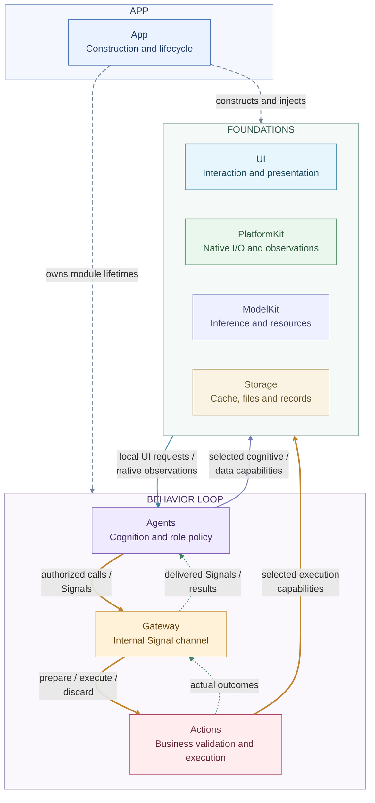

**App constructs the module roots**, connects their public interfaces through **dependency injection** and coordinates startup, foreground transitions, shutdown and replacement. **Each module owns its internal services and long-running work**; cancellation and cleanup follow that owner's lifecycle independently of individual pages.

**UI requests and native observations enter the responsible Agents directly**. **Perception roles** process audio, images and device observations; **cognitive roles** interpret intent, maintain goals and context, manage **Skill/Task scope** and coordinate specialized roles. Agents use deterministic processing or model inference to decide which operations to request. Role categories and their configuration are described in [Agents](Agents/README.md#agent-categories).

**Gateway delivers Agent messages** and validates transport endpoint identity and admission for internal Signals. **Actions owns its execution Shell**, coordinating Channel scheduling, direct calls and shared resources, validating business inputs and preconditions, performing the admitted operations and returning completion or failure through Gateway to the requesting Agent. **Request identity is preserved through execution and feedback** so the Agent can relate each outcome to its goal and decide what to do next.

Agents and Actions use **four independent foundations** through injected capabilities: **ModelKit runs inference**, **Storage provides temporary and durable data facilities**, **PlatformKit supplies native device and operating-system access**, and **UI handles interaction and presentation**. Local rendering stays within UI; each foundation exposes reusable mechanisms that the business modules compose for a particular goal.

### 3. Principles

IoC and module containers form the framework's core design pattern. The following principles define composition, module independence and public contracts.

1. **Use IoC and module containers as the core design pattern.** Containers organize module capabilities, internal services and lifecycle. Explicit dependency injection connects modules through public interfaces. Consumers use injected capabilities without locating a global registry or reaching into another module's implementation.

2. **Let App serve as the application entry point and composition owner.** App constructs, retains and connects all module root containers, selects implementations, injects dependencies and coordinates startup, suspension, shutdown and replacement. Each module owns the construction and management of its child containers and internal services.

3. **Keep the four foundations independent.** UI, PlatformKit, ModelKit and Storage provide interface/presentation, native-platform, model-inference and storage capabilities respectively. They neither depend on other project modules nor receive one another's interfaces or containers. Where external facilities are required, App supplies adapters through ports defined by the receiving foundation, preserving its independence from the supplying module's types and implementation.

4. **Give business modules clear responsibilities and acyclic dependencies.** Agents owns cognition and decisions; Gateway owns the internal Signal channel; Actions owns business execution together with its scheduling, resource and call-result Shell. App explicitly connects their public interfaces and neutral contracts. Dependency and injection directions remain clear and acyclic; results and callbacks do not introduce reverse implementation dependencies.

5. **Use containers for encapsulation and self-description.** Each container manages permissions and admission constraints, dependencies, state machines, asynchronous work and failures within its responsibility. Public contracts describe available capabilities, callable interfaces, current state, usage constraints and failure semantics. Interfaces, function catalogs, validation rules and model-visible descriptions use the owning module's authoritative declarations rather than independent definitions of the same capability. Internal implementation remains encapsulated while consumers can understand how to use and observe the module. Technical documentation describes implemented design and stays aligned with those contracts.

6. **Keep first-level modules and root containers stable.** The existing module boundaries and root-container structure are established. New capabilities belong in an existing module whose responsibilities cover them. Add a first-level module directory or module root container only when necessary, with an explicit ownership boundary, an explanation of why existing modules cannot accommodate it, a clear dependency design and user approval.

7. **Give state and work a single authoritative owner.** Each container owns the authoritative state within its responsibility; other modules read observations or submit requests through public interfaces instead of maintaining competing mutable copies. Asynchronous work belongs to an explicit owner, and module-owned work has a lifecycle independent of individual pages. Cancellation, joined cleanup and scope replacement have explicit boundaries; replacement waits for required cleanup of the previous owner.

Part II applies these principles to module boundaries and composition. Part III describes the key workflows; owning directory READMEs define internal implementation contracts.

<a id="part-ii--module-responsibilities"></a>
<a id="responsibilities-and-boundaries"></a>

## Part II — Module Design

### 1. Directory ownership and logical modules

A first-level source directory identifies an architectural owner. A logical module identifies a responsibility and dependency boundary. A compiled target is a build unit: one architectural module may contain several targets without becoming several peer modules. Shared contracts can compile separately from the business implementation in their owning directory. AgentCore resides under Agents/Support/Core; FunctionContracts, ExecutionRuntime and CallRuntime reside under Actions/Support. Source consolidation does not change these compilation boundaries; their current file maps belong in the owning [Agents Support](Agents/Support/README.md) and [Actions Support](Actions/Support/README.md) documents.

<a id="target-map"></a>

```text
MobileHarness/
├── App/           # Lifecycle host and application composition
├── Agents/        # Cognition and role coordination (Resources/: Agent, Skill, Catalog assets)
├── Gateway/       # Internal Signal communication and admission
├── Actions/       # Business operations and actual execution (Resources/: Action translations)
├── UI/            # Independent interaction and presentation capability
├── PlatformKit/   # Independent native and device capability
├── ModelKit/      # Independent inference and model-resource capability
├── Storage/       # Independent cache, file and database capability
└── Resources/     # App-level assets and privacy declarations
```

| Logical group                         | Owning directory                     | Module responsibility                                                                                                            | Direct relationships                                                                                                                                                       |
| ------------------------------------- | ------------------------------------ | -------------------------------------------------------------------------------------------------------------------------------- | -------------------------------------------------------------------------------------------------------------------------------------------------------------------------- |
| Lifecycle host                        | [App](App/README.md)                 | Construct scoped roots, connect public interfaces and coordinate application lifetime.                                           | Receives OS lifecycle events; assembles module roots and invokes their public lifecycle interfaces.                                                                        |
| Cognition                             | [Agents](Agents/README.md)           | Interpret inputs, own goals and private context, select behavior and coordinate roles.                                           | Consumes required foundation capabilities; submits messages and output to Gateway; receives read-only catalog metadata and App-bound host ports through neutral contracts. |
| Internal Signal communication         | [Gateway](Gateway/README.md)         | Own an App-scoped GatewayContainer for the four internal Signals: Agent messages, events, invocation to Actions and feedback to Agents. | Routes opaque endpoint messages and registered requests, replies and events. |
| Business execution                    | [Actions](Actions/README.md)         | Implement callable domain operations, validate execution preconditions and report actual outcomes.                               | Receives authorized invocations; uses required foundation capabilities and explicit domain ports.                                                                          |
| Foundation                            | [UI](UI/README.md)                   | Own typed interaction requests, presentation state, rendering and display receipts.                                              | Exposes public request sources and presentation capabilities to injected consumers.                                                                                        |
| Foundation                            | [PlatformKit](PlatformKit/README.md) | Own native I/O, platform permissions, device transport and native observations.                                                  | Exposes native operations and factual observations through its own interfaces.                                                                                             |
| Foundation                            | [ModelKit](ModelKit/README.md)       | Own inference, provider integration and model/artifact lifecycle.                                                                | Exposes typed model capabilities and SDK-owned integration ports.                                                                                                          |
| Foundation                            | [Storage](Storage/README.md)         | Own bounded temporary data, controlled files and durable domain repositories.                                                    | Exposes storage contracts and commit results without interpreting application policy.                                                                                      |
| Packaged definitions                  | [Resources](Resources/README.md)     | Own App-level assets and privacy declarations; modules own their packaged resources.                                          | Build tooling packages declarations; owning runtime modules validate and interpret them.                                                                                   |

Resources holds only App-level assets and privacy declarations. Each module owns the static resources it reads and packages them through its own SwiftPM target: [Agents/Resources](Agents/Resources/README.md) (Agent, Skill and Catalog declarations) and [Actions/Resources](Actions/Resources/README.md) (Action translations). Shared opt-in development model artifacts are owned by repository [Models](../Models/README.md), grouped by model and consumed explicitly by tests and experiments; production resource deployment stays with Resources and ModelKit. At repository level, [Package.swift](../Package.swift) and the Xcode project define build units; `Config/`, `Tests/`, `experiments/` and `scripts/` own build configuration, application and SDK regression/acceptance coverage, case/prompt evaluations and performance experiments, and developer checks respectively. [docs](../docs/README.md) owns requirements and evidence. Internal directory maps remain in the linked READMEs.

### 2. Dependency model

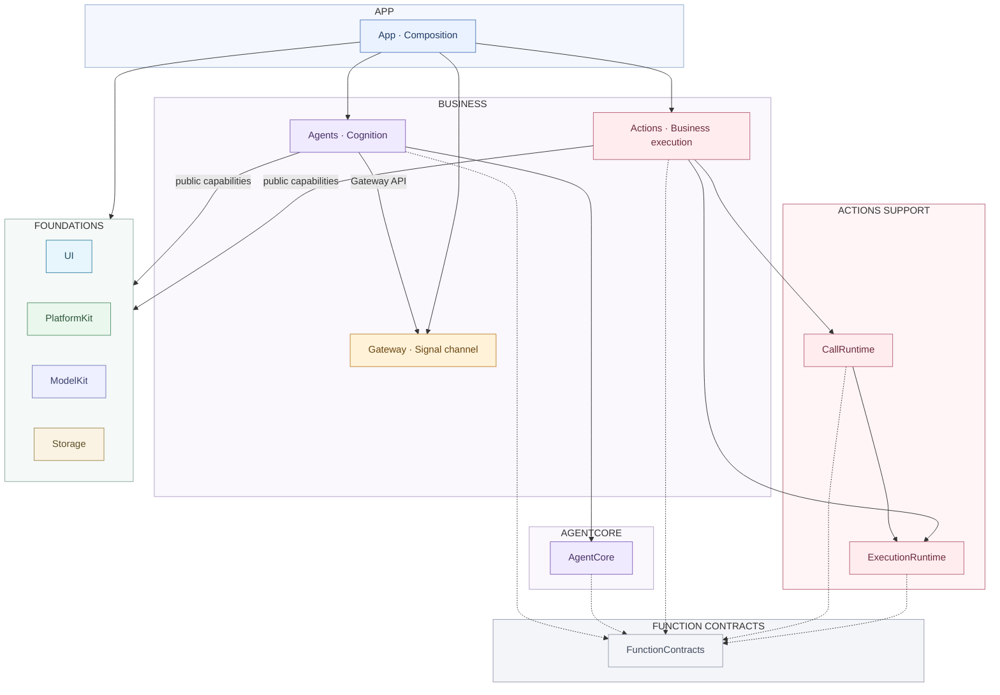

<a id="ownership-and-compilation"></a>
<a id="compilation-dependencies"></a>

The diagram summarizes permitted dependency directions between logical groups. It does not enumerate every target or require every possible dependency.

Every arrow in this figure means **compile-time dependency**. Dashed arrows identify neutral contract imports; solid arrows identify public module or support-mechanism dependencies. Gateway has no project dependencies. App composition connects the Actions endpoint to Gateway and injects the Actions management interface separately. Agents receives immutable descriptors and host ports without importing Actions, CallRuntime or ExecutionRuntime. Foundation-frame edges mean selected public capabilities, not a dependency on every foundation.

System frameworks and approved third-party libraries are external dependencies and are omitted from the graph for readability. Dependencies between targets inside one foundation remain internal to that foundation and must be acyclic. In the current target graph, UI has no package-target dependencies and uses Apple presentation frameworks; PlatformKit has no package-target dependencies; ModelKit and Storage each contain multiple targets within their own SDK boundary. [Package.swift](../Package.swift) defines those exact build units.

**Foundation isolation is mandatory.** UI, PlatformKit, ModelKit and Storage must not import one another or any other project module. Their external dependencies are limited to system frameworks and approved third-party libraries. Targets within the same foundation may depend on that foundation's own contracts and mechanisms. A foundation that needs an external facility defines a neutral port in its own API; an upper-layer adapter supplies the implementation. Injecting an adapter must not introduce foreign project types or a hidden business dependency into the foundation's contract.

**Business dependencies are directional.** Agents imports Gateway public Signal interfaces and neutral function contracts; App injects Actions-owned host capabilities through those contracts. Actions must not import Agents, Gateway orchestration or App. Gateway must not import concrete Agent roles, Actions business implementations, App or foundational implementations. FunctionContracts defines the neutral execution boundary for Agents, Actions and App. Gateway compiles independently. No module may reach through another module's public interface into private implementation.

**Shared targets remain neutral.** FunctionContracts is a leaf target without project dependencies. AgentCore depends only on FunctionContracts and owns cognitive identity, Skill, Task and decision contracts; ExecutionRuntime and CallRuntime own reusable execution and call mechanisms. Their physical placement under Agents or Actions does not authorize a dependency on those directories' business implementations. ExecutionRuntime depends on FunctionContracts; CallRuntime depends on FunctionContracts and ExecutionRuntime. These targets must not accumulate role policy, device logic or application composition. AppLifecycle is another independent target under App; it implements the generic lifecycle graph without importing business modules.

<a id="ioc-and-container-ownership"></a>

#### IoC, composition and container ownership

Inversion of Control (IoC) separates dependency assembly from capability use. App constructs and retains all seven module roots and connects their public capabilities through initializers, configuration interfaces and callbacks. The foundation isolation and directional business dependencies defined above govern injection as well as imports. Each module owns its state and internal work; only App resolves application registrations.

**ApplicationContainer is the application composition registry.** It uses FactoryKit instance-local registration and caching to retain module roots within one application scope. ServiceFactories resolves those roots and connects their public capabilities; ModuleRegistration supplies the lifecycle graph. Cached construction and asynchronous startup are separate operations: resolving a root does not make its capabilities ready. Replacement waits for the previous scope's required cleanup.

**Module containers are capability and lifecycle owners.** They expose related capabilities and retain their internal services. They are not additional FactoryKit registries. Child containers belong to their module root; App's convenience factories project those existing instances rather than constructing independent copies.

| App-owned module root | Containerized capabilities within the root                                                                                                              |
| --------------------- | ------------------------------------------------------------------------------------------------------------------------------------------------------- |
| AgentContainer        | Assistant, ApplicationControl, Writer, Memory, Photographer, SpeechPerception and VisionPerception                             |
| GatewayContainer      | Bound Signal endpoints, event subscriptions, transport admission and reply routing                                                                   |
| ActionsContainer      | Function catalogs, validation and execution services; business domains and individual functions remain library declarations without separate containers |
| UIContainer           | Home, Camera, Settings, ModelResources, Navigation, Album, History, Devices, Diagnostics, Window, Web, Island and RuntimeLog                                                  |
| PlatformContainer     | AudioContainer, VisionContainer and ConnectivityContainer                                                                                               |
| ModelContainer        | ModelLanguageContainer, ModelSpeechContainer, ModelVisionContainer and ModelArtifactsContainer                                                          |
| StorageContainer      | CacheContainer, FilesContainer and the injected DatabaseStorage backend interface                                                                       |

Agents separates root host/execution contracts from Support adapters and role-owned orchestration. App binds those public contracts; the [Agents design](Agents/README.md#root-source-ownership) owns internal source placement and catalog assembly.

The table describes ownership; module READMEs define child interfaces and internal lifecycle. ContainerFailureChannel, executionBindings and ForegroundPreparation are supporting lifecycle services, not additional module roots.

Settings commits invalidate the affected model resources through App composition. The foreground home worker checks the current ModelKit handles, loads missing resources, and projects the active model name to the home Toast. See [App composition](App/Composition/README.md).

The following diagram focuses on the three business roots and their injected runtime ports. Foundation capability use appears in Part I; startup dependencies appear in Part III. These arrows do not represent Swift imports.

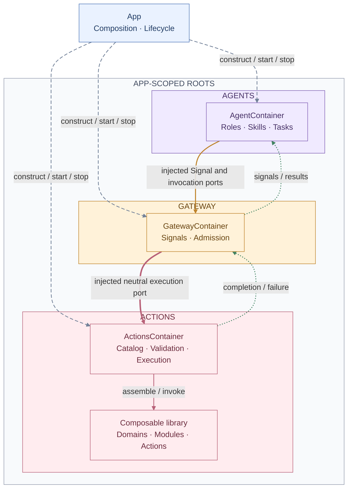

Dashed arrows from App show root construction and lifecycle control. The solid arrow carries Signal and invocation requests, the thick arrow forwards invocations to Actions, and dashed return arrows deliver Signals and outcomes.

Agents uses Gateway Signal ports to reach the Actions execution endpoint registered by App. The Actions Shell returns scheduled Action and direct Tool outcomes through the shared result signal. Agents resolves those outcomes for the original caller. Role authorization, admission and business validation retain separate ownership.

### 3. Ownership at runtime

| Concern | Authority |
| --- | --- |
| Scope and assembly | App creates the roots, injects their interfaces and joins shutdown or replacement. |
| Goal, context and permission | The owning Agent resolves a role, Skill or Task request against its current policy and freezes the effective catalog for inference. |
| Coordination | Gateway validates endpoint identity and envelope metadata and owns Signal delivery and routing. Actions owns execution scope, scheduling, resource arbitration and result retention. |
| Business effects | Actions resolves the canonical handler, validates business conditions and returns actual completion or failure. |
| Native and durable facts | UI owns presentation, PlatformKit owns platform and device facts, ModelKit owns inference, and Storage owns commit and recovery evidence. |
| Packaged declarations | Each module owns the declarations it packages and interprets (Agents: Agent/Skill/Catalog; Actions: translations); Resources owns only App-level assets. |

The individual module designs above identify their public interfaces, direct relationships and internal data flow.

<a id="part-iii--cross-module-technical-design"></a>

<a id="cross-module-flows"></a>

## Part III — Key Workflows

The App persists the application language and supplies the same resolved preference to UI presentation, Agent request assembly and Apple speech selection. UI owns string lookup, Agents owns prompt selection, and ModelKit owns individual recognition sessions. The preference travels through existing composition ports without changing the Gateway or persisted conversation protocol.

| Workflow family | Entry points |
| --- | --- |
| Root scope and observation | [Startup and lifecycle](#1-containerization-dependencies-startup-and-lifecycle) · [State reads](#6-state-ownership-state-machines-and-model-observations) · [Diagnostics](#20-diagnostics-ui-presentation-and-native-rendering) · [Cancellation and completion](#21-cross-module-cancellation-pressure-and-completion) |
| Input and cognition | [Signals and delegation](#2-signals-and-agent-communication) · [UI requests](#3-ui-requests-and-shared-business-execution) · [Navigation](#4-page-navigation-and-visible-page-context) · [Skill, own State and model context](#5-skill-composition-own-state-and-model-context) · [Assistant full duplex](#assistant-full-duplex-interaction) |
| Execution and feedback | [Capability resolution](#7-capability-declaration-resolution-and-execution-routes) · [Function Tokens](#8-function-token-and-action-call-protocol) · [Channel and wait](#9-channel-ordering-wait-and-resource-ownership) · [ReACT feedback](#10-react-continuation-and-execution-feedback-causality) |
| Native interactions | [Listening and ASR](#11-listening-asr-and-sound-source-observations) · [Speech playback](#12-reply-synthesis-playback-and-listening-restoration) · [Vision and tracking](#13-camera-preview-vision-and-tracking) · [Photo, video and album](#14-photovideo-capture-app-album-and-system-export) · [Robot motion](#15-robot-motion-hardware-facts-and-control-handoff) · [Bluetooth](#16-bluetooth-discovery-connection-and-recovery) |
| Durable data and models | [Provider and model resources](#17-settings-provider-and-model-resource-workflows) · [History and restart](#18-history-business-records-and-restart-behavior) · [Inference](#19-model-lifecycle-and-inference-boundaries) |

### 1. Containerization, dependencies, startup and lifecycle

#### Container ownership

App's ApplicationContainer retains one instance of each module root per application scope: StorageContainer, ModelContainer, PlatformContainer, UIContainer, ActionsContainer, GatewayContainer and AgentContainer. Each root owns its child containers, state, workers and resource cleanup. ServiceFactories injects public capabilities; ModuleRegistration declares lifecycle dependencies. Container construction and asynchronous startup are separate phases.

#### Dependencies and startup

Arrows point from a prerequisite to the service that waits for it, matching [ModuleRegistration](App/Composition/ModuleRegistration.swift). App owns diagnostics, execution bindings and home preparation. The four foundation roots each depend on diagnostics; ModelKit owns its model files and downloads independently of Storage.

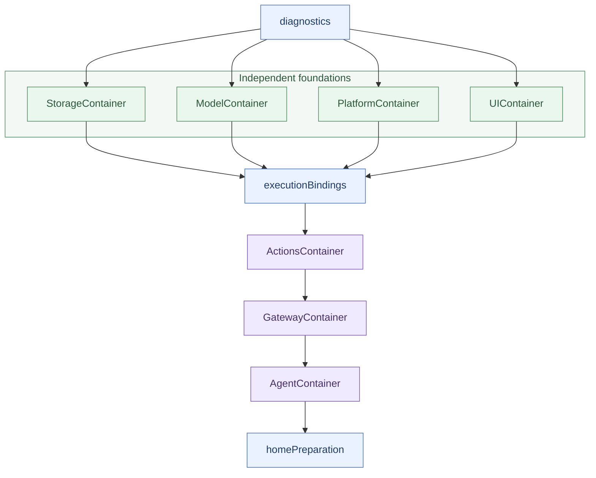

[ApplicationLifecycle](App/Lifecycle/ApplicationLifecycle.swift) selects the first registered service whose prerequisites are ready and starts services serially. With the current registration order, startup is: **diagnostics → storage → model → platform → ui → executionBindings → actions → gateway → agents → homePreparation**. This sequence reflects the current registration order; the readiness prerequisites are the edges above. Storage opens repositories; ModelKit prepares its own artifact management and registers inference capabilities, with weights loaded on demand. executionBindings waits for all four foundation roots before assembling the business execution interfaces.

During `executionBindings`, Agents prepares its requirements, Actions assembles the business services and catalog, and Agents validates catalog coverage. Actions then builds its execution Shell, App registers the Actions endpoint on the Gateway transport and injects the client and management ports into Agents. Actions then starts execution services, Gateway opens admission, and Agents starts its roles. Home preparation follows the foreground barrier and visible-home condition.

Home foreground preparation includes the selected local Decision route alongside the existing conversation/speech and optional vision capabilities. Agents supplies saved selection, App connects the generic preparation worker, and ModelKit checks/warms the resource. An absent local selection performs no load; preparation failures remain visible before home reports ready. Optional installed speech enhancement is also prepared through ModelKit, independently of the listening denoising switch. The ModelKit root independently warms installed Zipformer while foregrounded, without making it a Home readiness requirement. See [foreground preparation](App/Composition/README.md).

#### Lifecycle

| Transition                     | Cross-module contract                                                                                                                                                                                                                                                                                    |
| ------------------------------ | -------------------------------------------------------------------------------------------------------------------------------------------------------------------------------------------------------------------------------------------------------------------------------------------------------- |
| Initial startup                | Wait for an active Scene; validate the static dependency graph before starting services.                                                                                                                                                                                                                 |
| Scene hidden / restored        | Retain model, platform, UI, Actions, Gateway and Agents roots. Owners stop camera/tracking and foreground device work, detach local rendering, and restore visible capabilities on activation. Voice, inference and admitted business work retain their owners under OS execution and permission limits. |
| Startup failure / interruption | Invalidate admission, cancel startup, clean the partially started service, then stop started services in reverse order. Preserve primary and cleanup failures.                                                                                                                                           |
| Root stop / replacement        | Invalidate admission, cancel and join startup/scene workers, then stop services in reverse order. Each root joins its owned work; cleanup must complete before scope replacement.                                                                                                                        |

Shutdown runs **homePreparation → agents → gateway → actions → executionBindings → ui → platform → model → storage → diagnostics**. Execution bindings and cleanup ports remain available until Agents, Gateway and Actions finish draining. Repeated stop requests join the same shutdown; failed cleanup retains the scope and blocks replacement. Reactivation does not replay device effects.

[Container ownership](#ioc-and-container-ownership) · [Composition](App/Composition/README.md) · [Lifecycle](App/Lifecycle/README.md)

### 2. Signals and Agent communication

<a id="native-input-and-internal-signals"></a>
<a id="2-input-signal-and-agent-communication"></a>

#### Signal sources and internal paths

External Signal uses module-owned SignalListener subtypes. Internal Signal includes both Agent–Agent Request/Reply or event communication and Agent–Action invocation/feedback through Gateway. Cross-process IPC has no runtime transport in this design.

1. **External Signal — world and screen IO.** PlatformKit supplies device IO such as microphone PCM, camera frames and device observations. UI supplies screen IO such as clicks, gestures, text and form submissions. The responsible Agent directly consumes injected observation/request ports and owns the subscription, adaptation and freshness checks. Perception roles interpret sensory data; typed screen input enters its responsible role directly. Capability-owner observations use the same local input path. Capture activation and native cleanup remain Actions/PlatformKit responsibilities. Facts that need no cognition skip Agents: App composition consumes the PlatformKit memory-warning listener and calls the ModelKit release entry.

2. **Internal Signal — Agent-to-Agent communication.** An Agent sends typed requests to a peer or publishes events, including perception results and task facts. Agents binds identity, schema and execution authority. Consumers explicitly own event subscriptions; publishers do not discover consumers or wait for readiness. Gateway routes direct requests and filters existing event branches by channel, source and scope/session. The receiving Agent owns interpretation, acknowledgment and subsequent processing.

**Internal execution feedback — call outcomes.** The Actions Shell delivers scheduled outcomes through the Gateway feedback Signal to the owning Agent endpoint. Direct Tool invocations enter the Actions edge through Gateway, and completion returns on the original call. Agents correlates the result with the original session, input, call and Task before deciding whether to continue, update state or report to the user.

Gateway owns concurrent addressed Send with an acknowledgment or typed reply and deadline per request. Pub/Sub preserves each subscriber's order on its channel across publishers, and independent channels can progress in parallel. Producers choose their business channels, and Actions owns execution scheduling and resource waits after admission. [Gateway Signal channels](Gateway/README.md#signal-channel-ordering)

Agents correlates an Action call with its originating input and round. Actions uses a typed scheduling scope to seal or cancel a group and an execution ID to control an admitted instance. Assistant sends round boundaries through the two call contracts and joins both lane settlements. Assistant queues round settlement by round ID independently of the semantic inputs that can be combined into a new model request. [Action contracts](Actions/Support/Contracts/README.md#completion-failure-and-ownership) · [Assistant output](Agents/Assistant/Output/README.md)

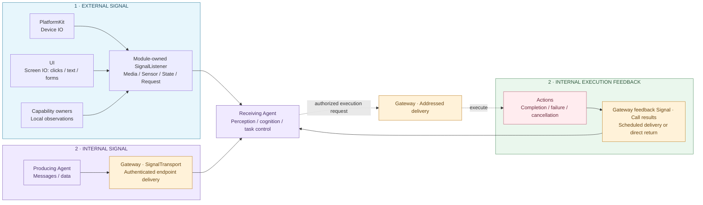

Solid arrows carry the incoming Signal paths; dashed arrows carry outgoing execution requests. Agents process Signals deterministically or through ModelKit and can produce further Internal Signals or execution requests.

#### Delivery and lifecycle

- **Identity and authorization.** Direct inputs retain their source/session/generation. Internal Signals bind the actual producer/incarnation and communication contract; Gateway checks endpoint tokens, envelope version, size, hops, deadline and capacity. Execution Feedback retains the original endpoint and call identity. Retired identities cannot target replacement roles.
- **Admission and completion.** Directed send returns a typed AgentRequestReply without an inbox receipt; publish confirms bounded admission and may have no subscribers. The business owner reports actual completion separately. Processing context carries causality; execution permissions remain owner-bound.
- **Capacity and cleanup.** Native buffers, Agent input queues and Gateway delivery retain owner-defined bounds and overflow policies. Cancellation and endpoint retirement join affected deliveries; root shutdown closes admission and joins owned work. Business owners define deduplication policies; Agent pub/sub publishes once without redelivery.

[Agents communication](Agents/Support/Core/Communication/README.md) · [Signal transport](Gateway/Input/README.md) · [Speech intake](#11-listening-asr-and-sound-source-observations) · [Vision intake](#13-camera-preview-vision-and-tracking)

#### Assistant delegation to other Agents

<a id="assistant-agent-delegation"></a>

Assistant keeps its foreground goal in its own `task` variable (`state.set` / `state.clear`; see [Assistant controls](Agents/Assistant/Controls/README.md#state-writes)). For a goal owned by another Agent, it uses the Agent control `send(agent_id,text)` directly; the two are independent, so Assistant may set `task` to follow a goal while a peer works on it. Writer is the current public destination. The same control carries new goals, follow-ups, answers and stop requests as text.

Assistant persists each addressed `agent.task.v1` with a message ID and originating dialog. For an answer, the runtime can attach the captured delegation and question IDs. Gateway delivers the authenticated message to Writer, which verifies it against the persisted record before admitting it to the bounded inbox. Assistant receives the direct admission Reply and records delivery. Writer then decides whether to start work, apply input, stop or reject the message. For new work, Writer uses the original message ID as the delegation ID and obtains an execution grant before starting. Writer admits one delegation at a time and chooses its workspace independently.

```mermaid
sequenceDiagram
    participant A as Assistant
    participant G as Gateway
    participant S as Storage
    participant W as Writer
    A->>G: At startup, statically subscribe to Writer task channel
    A->>A: Track producer / task ID / session / origin dialog in memory
    A->>G: Send authenticated agent.task.v1
    G->>W: Deliver for verification and inbox admission
    G-->>A: Inbox admission receipt
    W->>W: Decide how to handle the message
    alt New assignment
        W->>G: Obtain execution grant for the original message ID
        W->>S: Admit and own the execution
        W->>G: Publish acceptance, milestones or questions
        G-->>W: Local publication admitted
        G-->>A: Async report if subscribed
    else Update or stop
        W->>S: Associate the message with the active delegation
        W->>W: Apply input or begin cancellation cleanup
    else Decline message
        W->>S: Mark its received request record consumed
        W->>G: Publish rejection once
        G-->>W: Local publication admitted
        G-->>A: Async rejection if subscribed
        A->>S: Write trace record
    end
    opt Accepted delegation reaches a terminal outcome
        W->>W: Join model and file cleanup
        W->>S: Commit terminal outcome in writer_executions (task_state)
        W->>G: Publish agent.task.events.v1 once
        G-->>W: Local publication admitted
        G-->>A: Async report if subscribed
        A->>S: Write trace record
        A->>A: Apply report; remove terminal task tracking; retain static subscription
        W->>G: Retire the execution grant once
        W->>S: Record retirement result (done or failed)
    end
```

The send control completes when the delivery reply confirms Writer admission. Writer separately reports task acceptance and selected progress through `agent.task.events.v1`. Every progress, rejection and terminal report is published once, with no redelivery, retry or fallback; a publication failure is recorded only in Writer's `deliveryFailure` snapshot. Assistant validates and deduplicates reports against the original message or delegation, and writes each received report to agent_messages as a trace record that never decides processing. In full-duplex mode, eligible reports for the active originating dialog enter the semantic input queue directly, bypassing the human-input Decision model. Synchronous mode adds the report to the originating dialog as a completed turn and uses the notification playback path. Writer presents its own progress and results in its Island.

Task event publication is independent of subscription and consumption. Assistant listens to Writer's task channel throughout its role lifetime, and tracks producer/task/session separately before dispatch. Finishing a task removes tracking, while role stop retires the subscription. Writer declares its task-event production capability and publishes on demand without receiver readiness checks or subscription side effects. Startup validates publication/subscription pairs and real code capabilities, without requiring producer or consumer instances to be running. Gateway provides best-effort live events with no late-subscriber replay; direct send returns a typed peer Reply. Task tracking is in memory and is not restored after restart; a missed report is simply missed.

Fixed-task executors implement `agent.task.v1` with submit/update/answer/status/cancel and role-owned typed bodies. Their progress and terminal reports share the `agent.task.events.v1` contract and are distinguished by the signal kind. The Agents output adapter validates the execution grant and coordinates outstanding Gateway work before terminal delivery. Local publication admission retires the fixed-task grant; it does not await consumer acknowledgment.

[Assistant delegation](Agents/Assistant/README.md#delegation-and-peer-facts) · [Agent controls](Agents/Support/Core/Capability/README.md#agent-controls) · [Task message values](Agents/Support/Communication/README.md) · [Independent output consumers](Agents/Support/README.md#lifetime-bounds-and-failures)

### 3. UI requests and shared business execution

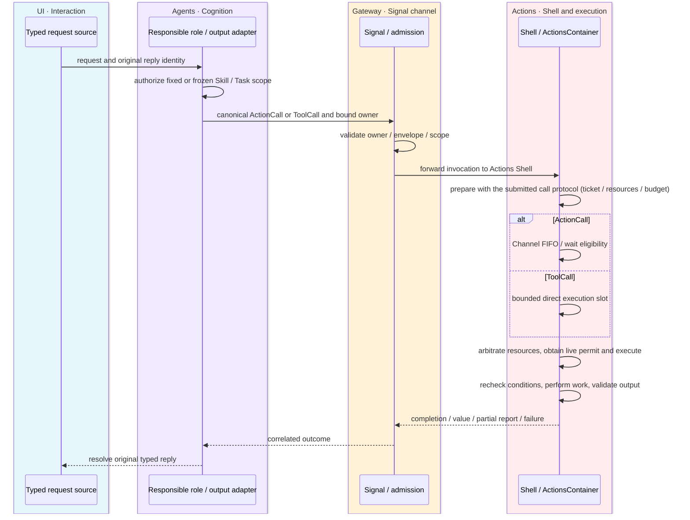

<a id="ui-requests-and-business-execution"></a>

The [Action lifecycle responsibility matrix](#action-lifecycle-responsibilities) defines registration, authorization and validation ownership for both this deterministic UI path and model-generated calls.

After admission, Gateway does not query Skill permission again. Agents revokes authority by explicitly cancelling the corresponding execution scope. The business executor rechecks current conditions after queueing. Preparation has no business effects; its single-use credential is tied to the container catalog revision. Rejection, cancellation and shutdown discard retained preparation. Result delivery retry never reruns business work.

UI request sources, cognitive consumers and business owners are separate. Missing consumers, full capacity, closed roots and stale generations fail explicitly. Replies resolve the original request. Model-selected operations and deterministic UI requests use the same registered business functions and validators. Local navigation does not create an inference round. Full history and media use private typed attachments rather than model parameters. Root-owned mutations, title jobs and observations survive page lifetime. See [Actions](Actions/README.md), [execution Shell](Actions/Support/Shell/README.md) and [Agent adapters](Agents/Support/README.md).

#### Two UI interaction paths

UI interactions are classified by responsibility: **presentation-only interaction** changes local presentation, while **business interaction** requests business data or operations. Touch and voice are input methods, not the classification criterion.

**Business interaction** follows the Agent/Gateway/Actions path and has two input branches. Touch business requests reach their responsible Agent for deterministic handling. Voice input passes through speech perception, then reaches a cognitive Agent for intent interpretation and call selection. Both branches invoke business functions through Gateway and Actions, sharing the same implementation when calling the same function. Agent handling does not always require model inference.

**Presentation-only interaction** responds directly to local presentation interactions such as navigation, dragging and expansion. These interactions update presentation state without entering Agent decision-making or Action execution. A page can use both paths according to the responsibility of each operation.

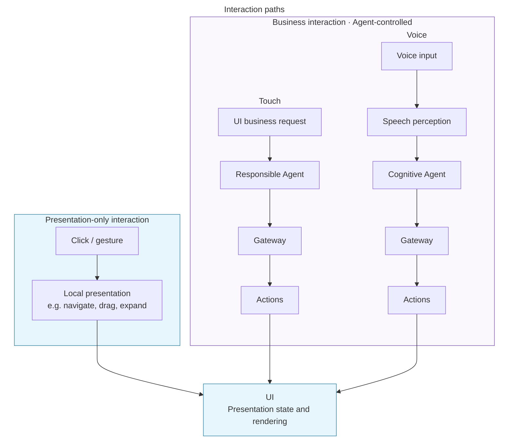

The two Actions nodes represent the same shared execution capability. Actions owns business execution and submits presentation updates through injected UI interfaces; UI owns the resulting state and rendering. Execution feedback returns to the requesting Agent and does not automatically become displayed content. Direct responses remain limited to presentation responsibilities; device effects and domain lifecycle coordination belong to the Agent/Gateway/Actions path.

**Routing rule for development:** keep changes limited to UI presentation state on the direct path. Route business data queries or mutations, persistence, device operations and domain lifecycle coordination through the responsible Agent → Gateway → Actions. Classify by the actual effect, not by whether the input is a click or voice command. A combined interaction may use both paths: opening a page is presentation-only, while loading its business data uses the business path; closing a window that must stop capture requires business lifecycle coordination. UI handlers submit business intent rather than implementing the business operation themselves. Voice-selected presentation commands still enter through Agent execution; presentation-only classification does not bypass that voice decision path.

Execution and completion contracts follow the shared workflow above; local presentation details belong to the [UI module](UI/README.md).

#### Window presentation and domain lifecycle

UIContainer owns WindowState and the `ui.windows` reader. ApplicationControl consumes typed window requests and invokes registered UI.Window functions through Gateway. Actions delegates domain lifecycle to WindowContentLifecycle; CameraCoordinator retains media ownership independently of view mounting. `Camera.Capture.open` combines photo-window presentation with capture readiness and completes without a business value; `Camera.Perception.openVision` enables vision independently of that window.

UI owns geometry, focus, stacking and presentation completion. Camera owns device leases and media disposition. Closing clears temporary photo previews directly. Pending videos require explicit disposition. Windows have independent lifetimes. Task completion, cancellation/replacement and opening another window do not authorize closing Camera or discarding its previews. Photography closes only on explicit close/discard intent, awaits that receipt before confirming closure, and retains the Task/window on a failed close. Closing photography leaves independently enabled vision running. Photography can select five cached images for model review and save all pending photos in the current window session. See [window execution](Actions/UI/Navigation/README.md), [Camera](Actions/Camera/README.md) and [Skill lifecycle](Agents/Support/README.md).

#### Web browsing and artifact presentation

Remote browsing follows Assistant → Gateway → Actions.Web → UI WebKit. Browse, navigation and snapshot replace one scope-bound in-memory image in Actions.Web; receipts carry screenshotID, and App injects readWebScreenshot into Agents as actions.web.screenshot. When the active Skill selects that State, Assistant reads the current image on each request and uses shared Chat for attachment projection. The result's screenshot ID identifies the capture, and the State reader supplies the current bytes. Page text and images remain untrusted observations. UIContainer keeps each remote Web and artifact page in its own window session. Browsing a URL creates a window unless an existing Web window is targeted. WindowState owns the cross-creator `window_N` index and twelve-window limit. WebPageContainer owns page summaries by window identity. BasicInteraction selects `ui.windows`; WebBrowsing selects `ui.web`, `ui.windows` and `actions.web.screenshot` and exposes scheduled page queries. Observing another Agent's page does not expose its source files or private context.

Local creation follows [Agent delegation](#assistant-agent-delegation) into the creative owner, whose authorized direct tools invoke Actions.Artifacts. Artifacts owns deterministic edits, drafts, immutable publication, preview/export business operations and file/SQL compensation; Storage owns confined files, the shared SQLite workspace catalog and version CAS. App injects these ports without owning the workspace index. Raw source flows through a backpressured content port rather than Assistant's XML protocol or history. The role-specific control/content loop belongs to [Writer](Agents/Writer/README.md). Writer accepts a goal without caller-assigned workspace identity, then creates directly for an explicitly new work. An exact ID can be used directly to enter or open a ready workspace. Writer searches the SQLite catalog when it needs to discover the ID by title or keyword. Entry requests a preview window and activates the file-editing Skill and its workspace command schema. Opening works keeps the current phase. Writer selects matching identities and can issue multiple open calls in order, each with its own window result. Editing activates the editing Skill alongside its library dependency. Both Skills select tools through the same catalog. Writer handles workspace entry, switching and delegation control locally. It reuses creation reservations per delegation. Artifacts initializes the entry file with the new draft and returns its status for the editing context. A switch keeps the previous draft and changes the editing target for subsequent messages. In both domains the model calls finish explicitly, and Writer invokes the internal publication capability for edited files. The control request that entered the workspace retains its original history identity; communication authentication and Assistant foreground tasks do not choose the file target.

Writer executes create, enter, ask and finish in its own control loop. Its business tool calls, including edit, preview, render and the publication invoked by finish, use direct execution in the Actions Shell. Edit admission returns a stream identity, validated path and structured editing context from Actions. Writer formats those facts into its own content request. Host-bound append/complete/abort continue the admitted edit under its delegate and stream identity. File completion and task completion have separate boundaries. Writer cancellation or root suspension revokes ordinary continuation admission and joins model and preview work plus Actions release before terminal reporting or resumption. Actions joins its tracked effects and editors on root shutdown. See [Artifacts](Actions/Artifacts/README.md#执行与续写生命周期).

For cloud workspace reads, Writer opts specific range fields into integer compatibility on the tool definition. The [Responses adapter](ModelKit/Language/LLM/OpenAI/README.md) emits decimal strings and [Actions.Artifacts](Actions/Artifacts/README.md) validates the requested range.

Artifacts maps project snapshots into a stable project-scoped WebKit read root. Safe incremental preview disables scripts and uses UI's same-document update; explicit rendering executes the assembled files with viewport restoration. Text uses escaped presentation. Markdown preview, saved-work display and PDF share UI’s offline conversion to static HTML and Mermaid SVG images. Actions carries diagram diagnostics in the workspace observation. The creative role decides when to preview or inspect; UI owns DOM, gestures, zoom and transitions, while Actions/Storage own file rotation and cleanup. A rendering failure does not erase a persisted draft, and a saved file does not establish visual acceptance. Export reads an immutable snapshot and uses a separate UI rendering page for PDF. See [Artifacts](Actions/Artifacts/README.md) and [Web component](UI/Components/Web/README.md).

Content owners submit titles, operation subtitles and optional icons through Actions' existing UI presentation interface. UI validates display values and owns window layout without looking up business resources or interpreting Agent commands. HTML document titles do not rename the business window. Closing/minimizing a window does not terminate its creative task; explicit reopening and task control remain distinct operations. See [Window](UI/Components/Window/README.md) and [Writer window policy](Agents/Writer/README.md#窗口命名操作副标题与场景).

### 4. Page navigation and visible page context

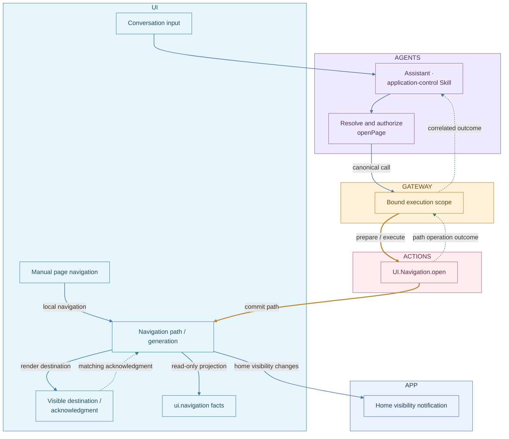

Manual navigation updates UI-owned state through the UI composition path. App receives home-visibility changes separately and forwards them to the runtime. Conversational navigation uses the application-control Skill's `openPage` alias for `UI.Navigation.open`. The call passes Agents authorization and Gateway admission, and Actions commits the same UI path. The Action completes at path submission. The destination acknowledges its own visibility separately.

UI owns NavigationStack and path generations. A path change enters transitioning; a matching visible-page acknowledgment settles it. Settled does not mean data, animation or GPU completion. Details, object IDs, pickers and confirmation sheets remain distinct from the top-level path. Stale callbacks cannot overwrite the current detail.

Face remains a persistent sibling of navigation. WindowHost overlays only the retained home surface, below NavigationStack and the local Island. Navigation pages cover the home windows: UIContainer synchronously projects home visibility into window visibility while retaining window identity. The root-owned local Island stays above all pages in one scene overlay, retaining live updates, status-bar presentation and interactive expansion preferences across navigation. Writer record queries return explicit next-page cursors through UI-owned DTOs; Writer determines pagination from bounded Storage lookahead. Workspace messages and delegations start newest first and load older records as the list reaches its bottom. UI retains loaded pages across child navigation. See [Writer records](UI/Settings/README.md#writer-记录与作品). Settings/history/album preserve Face rendering and listening; the Camera window lifecycle controls capture independently of navigation. Minimize hides window rendering while retaining capture/recording demand; restore confirms current readiness; background clears capture intent and foreground requires an explicit reopen. `useStates` supplies page facts to subsequent decisions; execution checks live conditions. See [UI](UI/README.md) and [navigation](Actions/UI/Navigation/README.md).

### 5. Skill composition, own State and model context

<a id="model-context-composition"></a>

```mermaid
flowchart TB
    subgraph Private["AGENTS · PRIVATE STATE"]
        Repo["AgentContextRepository<br/>Role-owned committed memory"]:::agent
        Snap["One request's private snapshot"]:::agent
        Skills["Effective loaded Skills<br/>Base + recent roots + dependencies"]:::agent
        Task["Own variables<br/>name, value, write time (incl. task)"]:::agent
        Repo --> Snap
        Snap --> Skills
        Snap --> Task
    end
    subgraph Selection["AGENTS · SKILLS"]
        Catalog["useActions<br/>Effective catalog / frozen permissions"]:::agent
        Teaching["useInstructions<br/>Static Skill teaching"]:::agent
        Names["useStates<br/>Selected source names"]:::agent
        Skills --> Catalog
        Skills --> Teaching
        Skills --> Names
    end
    subgraph Assembly["AGENTS · REQUEST"]
        Prefix["System prefix<br/>Role / protocol / controls / state variables / catalog / Skill teaching"]:::agent
        Dynamic["Fresh system data<br/>CURRENT STATE + AGENT STATE"]:::agent
        History["Selected history / actual feedback<br/>Latest input / observation"]:::agent
        Request["Bounded ChatRequest<br/>Preserve native call / result groups"]:::agent
        Prefix --> Request
        Dynamic --> Request
        History --> Request
    end
    Facts["Owner snapshots<br/>Read per actual model request"]:::neutral
    Names -->|"select read capabilities"| Facts
    Facts -.->|"CURRENT STATE"| Dynamic
    Task -->|"AGENT STATE"| Dynamic
    Catalog --> Prefix
    Teaching --> Prefix
    Request -->|"messages / native Tool definitions"| Model["ModelKit · ChatCapability"]:::model
    style Private fill:#faf7fd,stroke:#b1a0c4
    style Selection fill:#faf7fd,stroke:#b1a0c4
    style Assembly fill:#faf7fd,stroke:#b1a0c4
    classDef agent fill:#f0eaff,stroke:#8261b5,color:#463065
    classDef model fill:#eeefff,stroke:#747bb8,color:#3c426d
    classDef neutral fill:#f4f5f8,stroke:#939bad,color:#414b60
    linkStyle 0,1,2,3,4,5 stroke:#5078b8,stroke-width:1.5px
    linkStyle 6,7,8,11,12,13,14,15 stroke:#747bb8,stroke-width:1.5px
    linkStyle 9 stroke:#5078b8,stroke-width:1.5px
    linkStyle 10 stroke:#438463,stroke-width:1.5px,stroke-dasharray:2 3
```

<a id="state-devices-resources-and-faults"></a>
<a id="tasks-model-decisions-and-history"></a>

Skill v3 selects function bindings with `useActions`, read capabilities with `useStates`, and static Markdown with `useInstructions`. The effective loaded set includes base Skills, retained recent roots and dependency expansion; same-named Skills, dependencies, `useStates` and function bindings merge once. One private snapshot supplies the request's selected Skill IDs, catalog, teaching and the Agent's own variables. A load/unload transition changes subsequent requests; it cannot expand a request already sent to the model. The runtime also binds the frozen catalog to output authorization.

The request combines a system prefix, fresh system data and conversation evidence.

| Request content                    | Source and meaning                                                                                                                                                                                                                                            |
| ---------------------------------- | ------------------------------------------------------------------------------------------------------------------------------------------------------------------------------------------------------------------------------------------------------------- |
| Instruction/catalog prefix         | Role identity and protocol, available Skill overview, loaded Skill teaching and effective function metadata. Available Skills describe choices; only the effective catalog permits current calls. The prefix changes when its selected Skills/catalog change. |
| AGENT STATE                        | The Agent's own variables from the same snapshot: name, natural-language write time and quoted value, earliest written first, rendered by one function. The current goal is the `task` variable; moods and styles are free variables. The values are data; they grant no authority. |
| CURRENT STATE                      | Fresh owner-defined facts selected by the loaded Skills' `useStates`, sampled separately through read-only capabilities. These are data, not instructions or execution permits.                                                                               |
| History, feedback and latest input | Bounded conversation evidence, real Action/Tool outcomes and current user input or continuation observation. Current Task evidence remains in the history window; terminal Task history can be projected as a summary.                                        |

The ordinary request order is **instruction/catalog system → selected history → dynamic system data (CURRENT STATE, then AGENT STATE) → latest user input/observation**. If the request ends in native Tool results, the dynamic system message follows the complete call/result group. Previous dynamic system messages are removed before fresh facts are inserted. Native Tool definitions are a separate ChatRequest field. ModelKit receives the finished request; it does not discover containers or assemble Agent Task/Skill state.

Each actual model request, including an internal ReACT continuation, samples again. The private snapshot and the business reads are not a single atomic transaction. Model-visible own State and Skill data is private to the responsible Agent; the production conversational owner is Assistant with one foreground continuing goal (the `task` variable). Generic task registries and delegated-role views support runtime correlation, but are not serialized wholesale into AGENT CONTEXT and do not imply an exposed background-work Skill. Detailed message selection, budgets and continuation rules belong in [Assistant](Agents/Assistant/README.md#request-state-assembly); private transitions belong in [Context](Agents/Support/Context/README.md#container-context-read-path).

#### Prompt ownership and public discovery

Agents combines the shared output protocol, role instructions, effective Skill teaching and the Action catalog. Assistant reads its role-owned input protocol for instructions and timeline formatting. The independent Decision classifier reads its own action definitions and four-section prompt template. AgentCore renders the output protocol supplied by Agents. Agent and Skill assets supply descriptions, while the executable delegation adapter and the requester's communication policy determine which roles appear in the delegation catalog. See [Agent resource contracts](Agents/Resources/Agents/README.md).

### 6. State ownership, state machines and model observations

<a id="container-state-read-path"></a>

Each runtime root exposes exact-path State readers through `stateReaders()`. App registers readers for existing owners. A read resolves one node and returns its own sampled facts and child path references. The sample time and the age of the underlying device observation are separate.

The producing module owns the classification. Business contains domain facts and outcomes. Runtime describes lifecycle, queues, configuration and resource use. Health and issues describe the producer’s local failure evidence. The reader projects current owned state without opening capabilities. Missing nodes and expired owners fail explicitly.

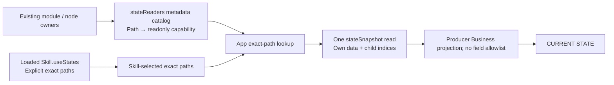

Skill registration is precise: selecting a does not select a.b or a.b.c, and a.b.c requires no ancestor State grant. Assistant sources use actual canonical node paths (`agents.applicationcontrol`, `ui.home.expression`, `platform.system.*`, etc.). RobotInteraction explicitly selects `actions.robot.motion` for active targets, independently from robot connection/tracking facts. There is no model-facing whole-tree health/diagnostic source, wildcard, automatic discovery or loadState. Source indices and engineering metadata do not become Assistant business facts automatically. Other internal consumers choose their own full classified reads without Assistant policy.

[ApplicationStateInspection](App/Composition/README.md#internal-state-inspection) offers a separate explicit `inspectTree(path:depth:)` operation for internal diagnostic callers. It walks indices and materializes its own Tree structure; this is not Container snapshot behavior or a Skill permission. Reads do not execute actions, activate devices, request permissions, prepare models, change Task/Skill state or establish execution authority. Cross-owner sampling remains non-atomic.

State is the default low-cost summary for decisions. Sufficient current facts are answered directly. Specific Actions supply missing details under their own contracts, such as Bluetooth status/device IDs, resource inventory or history records; they may overlap a summary without creating another owner or fact cache. No generic environment-query Action is registered. Fresh collection means a new read, not a forced native observation or an active probe. Actual execution results remain correlated feedback/history, and Actions rechecks live business conditions after queueing.

Observation does not establish authority or successful execution. Actions still checks live business preconditions and permits after Actions Shell queueing; model output cannot directly advance another owner's state machine. Real results update their owning histories and private state, and a later request re-reads the facts. Recovery does not replay effects. Generic runtime contracts belong in [AgentCore Runtime](Agents/Support/Core/Runtime/README.md), execution observations in [function contracts](Actions/Support/Contracts/README.md), and authorization ownership in the [Action lifecycle](#action-lifecycle-responsibilities).

For model requests, the same App-backed resolver serves every `Skill.useStates` selection and returns the complete Business fields of the exact node. Missing or unreadable nodes yield unknown/null with a bounded path/code diagnostic; cancellation, closure and capacity errors remain request failures. Public State is independent of observer identity and does not grant access to another Agent's private context. See [Context read path](Agents/Support/Context/README.md#container-context-read-path).

### 7. Capability declaration, resolution and execution routes

<a id="action-lifecycle-responsibilities"></a>

The following figure covers registration through completion. App owns construction and lifetime; each module owns the checks and state inside its boundary. The startup phase summarizes module ownership through the App-bound collaboration ports; it does not make App a per-function registrar.

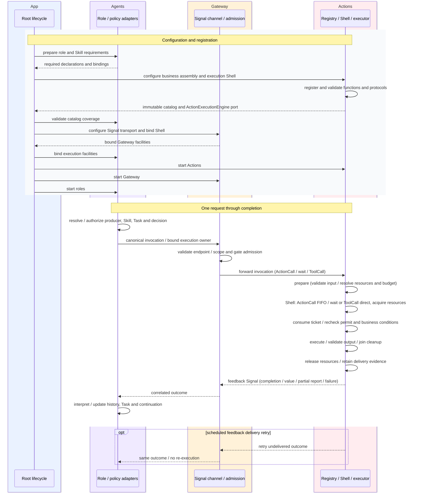

The configuration phase is part of [executionBindings and root startup](#1-containerization-dependencies-startup-and-lifecycle). The execution phase has three distinct validity questions: **Agents decides whether this role may request the function; Gateway decides whether the sender and receiver endpoints are valid for the Signal; Actions decides whether the invocation can be admitted and scheduled and is valid under current business conditions.**

| Owner                                     | Managed responsibility                                                                                                                                                              | Validation and authority                                                                                                                                                                                                                                                                                                                                                                                 |
| ----------------------------------------- | ----------------------------------------------------------------------------------------------------------------------------------------------------------------------------------- | -------------------------------------------------------------------------------------------------------------------------------------------------------------------------------------------------------------------------------------------------------------------------------------------------------------------------------------------------------------------------------------------------------- |
| App                                       | Scoped roots, constructor/configuration injection, readiness order, foreground transitions, reverse joined stop and failed-start rollback.                                          | Keeps required bindings and module lifetimes available through cleanup. Function registration stays inside Actions; Skill/Task permission stays inside Agents.                                                                                                                                                                                                                                           |
| Agents                                    | Role instances, fixed and effective Skill catalogs, private Task/context, call resolution, communication policy, authorization revocation and cognitive interpretation of outcomes. | Checks actual producer/incarnation/session, allowed output/function, frozen decision capabilities and Task grants before submission. Parsing/alias checks use the exposed catalog; authoritative business decoding belongs to Actions. Coverage validation proves registered support, not permission for every future call.                                                                              |
| Gateway                                   | Neutral endpoints, Signal envelopes, bounded transport admission and addressed delivery.                                                             | Checks endpoint identity, envelope structure and transport capacity. It does not resolve roles, schedule Channels, arbitrate resources, query Skills/Tasks or authorize business-function use.                                                                                                                                                                     |
| ActionsContainer and its business library | Compiled canonical definitions, registry/catalog, execution Shell (Channel/wait, direct dispatch, resources, result retention), pure preparation, actual invocation and cleanup. | Rejects duplicate/invalid registration and unsupported functions/protocols; validates arguments, budget/resource resolution and one-use root/catalog-bound preparation. Enforces injected resource policies, lease validity, live permits, current service/session/business preconditions and completion contracts. Functions and domain services implement their own business checks; the module root coordinates them without acquiring role policy. |

Registration, exposure and authorization are different facts. Actions registers an implementation; Agents selects the functions visible/available to a role or decision; only an authorized request is sent through Gateway. A valid authorization does not bypass capacity, ordering, resource conflicts or live business conditions. Required platform permissions remain enforced by the owning foundation APIs invoked by Actions.

**Gateway has no project dependencies.** Agents and Actions own both ends of the execution protocol. AgentManager, Skill/Task checks, InputGateway, OutputGateway and cognitive projections live in Agents. The adapters' names do not change their module owner. Gateway receives endpoint/incarnation/session metadata and opaque payloads. The registered endpoints interpret execution correlation. Callback/result flow does not create a reverse implementation dependency.

Resource authority belongs to the Actions Shell. For example, explicit lease acquisition checks configured allowed endpoint values and takeover checks configured preemption pairs; live permits fence actual use. Agents authors role takeover policy and App binds its neutral values. The Shell enforces those values without interpreting a role name or repeating the Skill/Task/function authorization decision, using an App-bound endpoint-identity check to fence stale incarnations. After admission, revocation is explicit scope cancellation; rechecking current business conditions belongs to Actions.

Gateway transports execution outcomes to Agents, which decides whether to record history, advance a Task or run another decision. The Actions Shell ledger retries scheduled results, and the direct endpoint retries Tool results within the waiting request. Both resend the existing execution outcome. Cancellation joins outstanding work and retains independent failures. The [resource](Actions/Support/Shell/README.md#resources), [result](Actions/Support/Shell/README.md#results-and-feedback) and [Actions](Actions/README.md) documents own their detailed contracts.

Macros and explicit CapabilityModules registration assemble functions compiled into the application. There is no runtime discovery or hot update. Missing required bindings, duplicate protocol definitions and invalid metadata prevent startup. Optional capability presence is reflected in the catalog. Domains, modules and functions do not receive containers, lifecycle nodes or App registrations.

Action and Tool are call views over the same business functions. The catalog retains declared execution and result policies. In the current production adapters, ActionCall enters ChannelScheduler, while ToolCall enters DirectExecutionDispatcher; executionPolicy is not consulted to switch these entry points. A direct descriptor alone therefore does not remove an ActionCall from Channel/wait ordering. Assistant's current Skills expose XML Actions. Writer's workspace and editing Skills expose native Tools. Internal Tools have separate grants. Internal album/full-history Tools do not become Skill capabilities merely by registration. Both routes share Actions-owned input/output validation, preparation and actual implementation. See [protocol bindings](Actions/Composition/BehaviorProtocolBindings.swift) and [execution support](Actions/Support/README.md).

### 8. Function Token and Action Call protocol

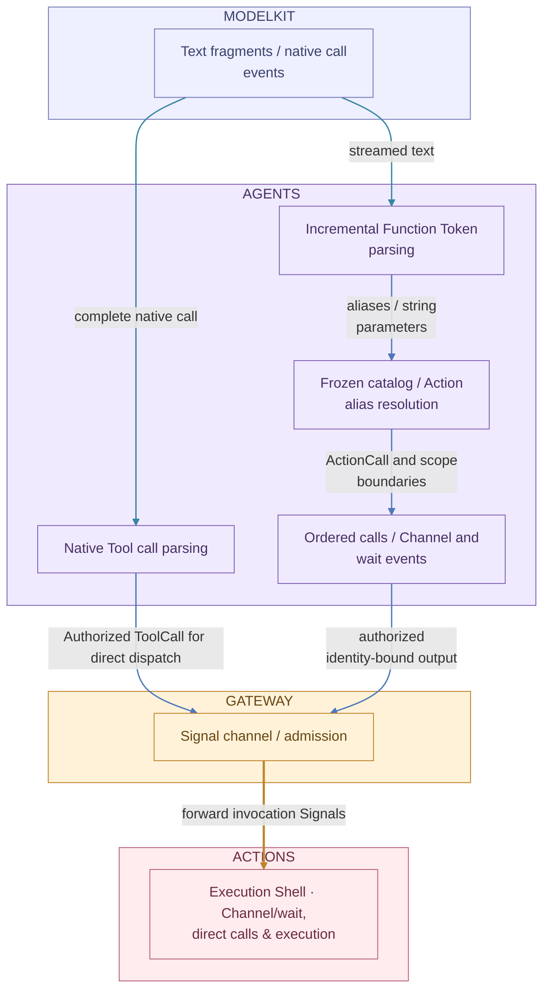

ModelKit supplies output fragments. Agents interprets their protocol using the frozen decision catalog and translates authorized calls for the Actions endpoint.

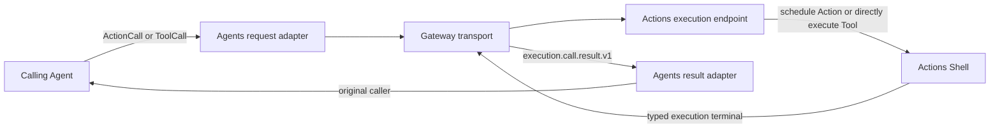

Assistant sends resolved `ActionCall` messages, including scoped Wait calls, through `action.call.v1`. Action and Tool round boundaries travel on their respective call contracts. Assistant joins the two lane settlements. Both call types use the same addressed result exit and authenticated Agents receiving endpoint. Action responses confirm admission and its terminal settles the originating call. Roles receive each Tool outcome through the shared `tool.call.v1` adapter as it completes. Only calls with a round ID participate in that round's settlement. Control commands address an `executionID` through `action.control.v1`, with independent control receipts. Actions sends execution lifecycle events through `action.execution.event.v1`. Agents projects those events and its own round and interruption settlements to the owning role locally.

| Boundary              | Contract                                                                                                                                                                                                                                                       |
| --------------------- | -------------------------------------------------------------------------------------------------------------------------------------------------------------------------------------------------------------------------------------------------------------- |
| Function Token syntax | Natural text mixed with restricted XML, without a document root. Self-closing tags name catalog aliases, which resolve to an Action or to an Agent control; the paired `wait` scope and the self-closing `<wait time="seconds"/>` pause are scheduling events registered by a Skill (Basic Interaction) and executed by the Shell.                |
| Agent control         | A self-closing tag that is a fixed capability of its owning Agent, not granted by Skills; the owner's `Controls.json` declares it and `Controls.md` teaches it (Assistant: `state.set`, `state.clear`, `state.get`, `skill.load`, `skill.unload` with destination `self`; `send` with destination `peer`). It resolves to a ControlCall with no Channel, never reaches Actions, runs in the owning Agent in emission order without waiting for Actions on other Channels, and is rejected inside `<wait>`. Actions (scheduled or direct tool calls) are the only functions that enter Actions through Gateway. |
| FunctionToken         | An Agent-local parsed text, action, boundary or scheduling event. Its boundary is independent of provider tokenizer tokens and network fragments. Incremental parsing handles incomplete UTF-8 and markup across fragments.                                    |
| ActionCall            | A resolved actionPath, channel and string parameter map. Agents resolves aliases and parameters against its effective catalog; text mapping, when configured, produces ordered calls through the same generation pipeline.                                     |
| Scheduling events     | beginWait/endWait travel in order with calls. Each call uses its registered Channel. Dropping wait events changes execution semantics.                                           |
| Execution envelope    | OutputEnvelope supplies producer and processing correlation separately from ActionCall. Agents' Gateway adapter translates authorized intent into neutral execution requests; Gateway checks endpoint scope and forwards the request to the Actions Shell, which schedules execution. |

For example, when the current catalog includes the BasicInteraction Skill's `express` alias, permits the Display Channel and the role configures natural-text mapping:

```xml
<wait>
    <express emotion="happy"/>
</wait>
Hello! How can I help you today?
```

The XML requests a happy expression, and the following sentence is ordinary natural text. The parser emits beginWait, an action token for `express` with `emotion="happy"`, endWait, and text events. Catalog resolution turns the action token into an ActionCall with its canonical path, string parameters and registered Channel. The role's text mapping converts sentence chunks into its configured calls, such as speech or caption presentation; text is not an Action alias and does not execute by itself.

Gateway forwards the resolved calls together with the ordered wait events to the Actions Shell. The Shell's wait group joins the scheduled expression before the following mapped calls proceed; parsing `</wait>` itself does not mean the expression has finished. Wait is a protocol scope, not a business function; its `<wait time="seconds"/>` form only holds later dispatch of the same task for the timer, without joining started Actions. Channel routing is fixed by registration. Exact aliases, parameters, permitted Channels and natural-text behavior come from the current decision catalog and role configuration.

A complete Action tag can emit a call before its enclosing scope closes. Parsing completion does not establish execution completion. Unknown aliases and invalid/missing required arguments produce ordered non-executable CallRejection events. Malformed syntax, capacity violations or cancellation terminate interpretation; failed generations do not flush incomplete syntax or replay already emitted effects. A later parse failure cannot undo an effect already executed.

Native Tool calls use their separate complete-call parser and do not acquire XML aliases or Channel/wait membership. Action/Tool call syntax and direct/scheduled execution policy remain distinct, as defined in the preceding execution-route section. The next section defines how resolved Channels and wait events govern ordering. Exact grammar, bounds and rejection rules belong in [Generation](Agents/Support/Core/Generation/README.md); call and correlation contracts belong in [Output](Agents/Support/Core/Output/README.md).

### 9. Channel ordering, wait and resource ownership

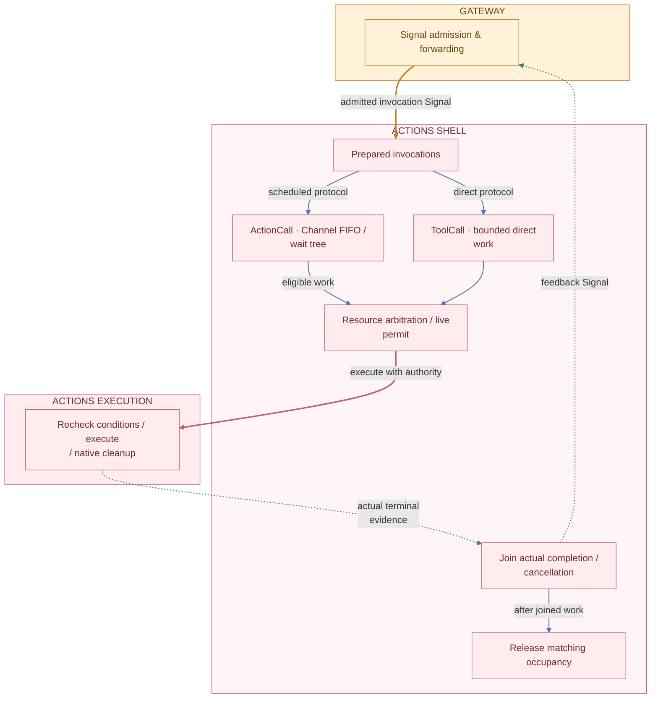

The Actions Shell owns Channel FIFO, wait trees and resource arbitration, and Actions declares required resources and owns actual device operations. Agents selects role takeover policy and App injects opaque policy values and native stop callbacks. The Shell compares neutral endpoint identities without understanding role semantics.

Different Channels may run concurrently subject to live resource permits. A wait group first joins preceding work in its parent phase, then runs its own Channel lanes. The parent continuation becomes eligible once the group is closed and all its work settles. Handler failures retain their outcomes and allow eligible work to advance. Decisions requiring real outcomes wait for feedback. ToolCall direct execution uses the same resource mechanism while remaining outside Channel/wait ordering. ActionCall remains Channel-scheduled even when its catalog descriptor declares direct execution.

A Channel is a concurrency concept, not a module or page name: Actions share one only when they are mutually exclusive or occupy the same surface, device or session, and independent work uses different Channels so it can overlap. Skill resources follow this: `Camera` (capture/recording session), `CameraCancel` (cancelCapture, which must not queue behind the countdown it cancels), `Vision`, `Window`, `Island`, `Web`, `Device`, `ModelResources`, `History`, `Provider`, `Robot` and `ListeningControl`, alongside the runtime-fixed `Speech`, `Display` and `Listening`. See [Skills](Agents/Resources/Skills/README.md).

Owners, leases and revocable permits fence writes. Unconfigured conflicts fail busy without an implicit resource queue. Configured takeover blocks new writes, stops and joins the old owner, then grants authority. A timeout is not completed cleanup; late cleanup cannot grant a revoked request or replay an effect. Occupancy does not become a replacement device-health state. See [Scheduling](Actions/Support/Shell/README.md#scheduling) and [Resources](Actions/Support/Shell/README.md#resources).

### 10. ReACT continuation and execution feedback causality

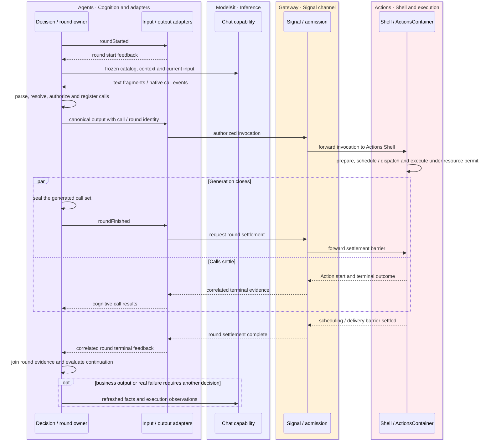

Agents submits a frozen request to ModelKit, resolves streamed output against its catalog, and submits authorized calls through Gateway. A round seal joins related calls and feedback for execution settlement. The full-duplex Assistant buffers incoming signals while execution settles. Before dispatching the next batch, it also finishes the same-session admissions already in progress when settlement started. See [Assistant full-duplex interaction](#assistant-full-duplex-interaction).

Call completion, delivery, round closure and the next inference are separate boundaries. Results retain endpoint/incarnation/session/input/round/execution identity and opaque cognitive correlation; Agents interprets turn/Task semantics. Late results cannot target the latest chat or awaken a replacement owner. Reply barriers also join synthesis and playback before continuation.

Assistant associates each source-bearing reply Action with its call identity and source text. At interruption admission it captures the current candidates. Gateway joins execution and terminal-result delivery across channels before confirming cleanup. Assistant then checkpoints the successful Actions' fragments in submission order through Storage and projects the settled reply into the next model request. Storage retains the raw generation and execution evidence under the original request ID.

Model-generated business values, rejected calls and real call failures can become execution observations. Native Tool continuations preserve complete call/result pairs. A successful Void call or pure cancellation only settles execution. Runtime-generated speech and presentation calls can affect cleanup and diagnostics, while their receipts stay outside model observations. Transport, parsing, lifecycle and cancellation failures do not automatically retry device effects. Partial and unknown effects and cleanup failures retain their evidence. Action deadlines belong to execution; conversation has no hidden universal TTL. See [Assistant continuation](Agents/Assistant/README.md#results-history-and-continuation), [Results](Actions/Support/Shell/README.md#results-and-feedback) and [ExecutionRuntime](Actions/Support/README.md).

### 11. Listening, ASR and sound-source observations

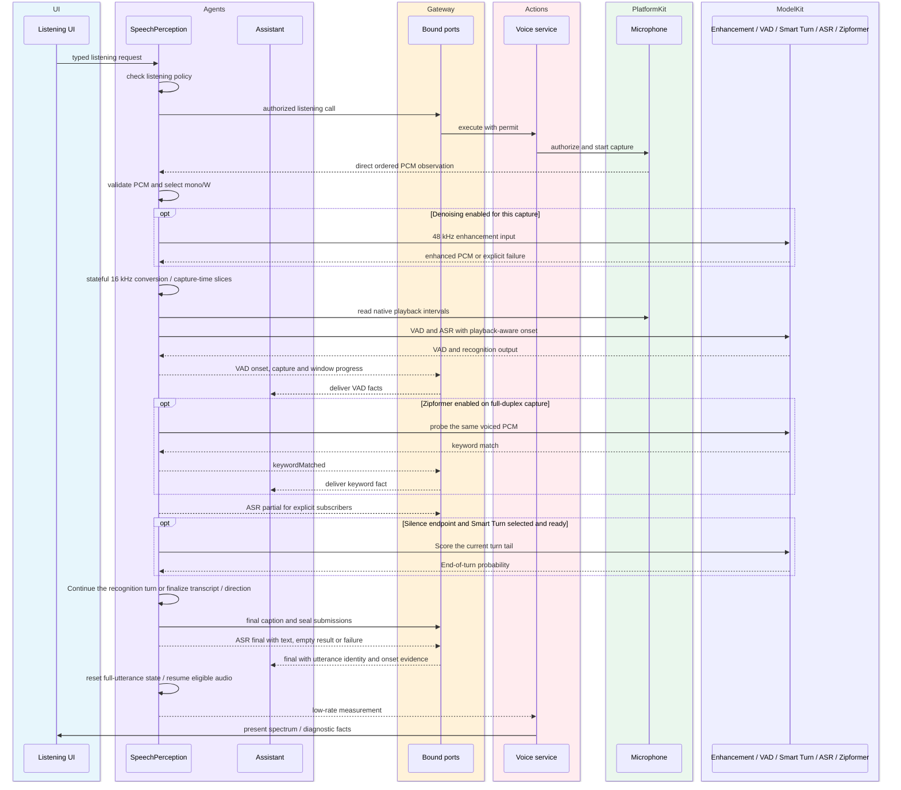

SpeechPerception owns consent, route-aware listening policy and the recognition turn, using ModelKit for VAD, optional end-of-turn scoring and ASR. Actions coordinates microphone permission, capture readiness and shutdown through PlatformKit. PlatformKit owns the native capture generation, which SpeechPerception uses to fence its audio subscription. Read subscriptions alone do not open the microphone. Immutable native PCM reaches the role directly without Signal JSON re-encoding.

SpeechPerception selects mono/W from validated native PCM and owns capture-scoped preprocessing: optional 48 kHz ModelKit enhancement, then stateful conversion to 16 kHz for the shared VAD/ASR path. The durable denoising preference is snapshotted when capture observation starts. PlatformKit retains native Voice Processing and echo cancellation; spatial measurements use the original capture. Processing stays in the single ordered PCM consumer, without a second native queue. Enabled enhancement failure is reported through perception recovery rather than silently bypassed. See [preprocessing](Agents/SpeechPerception/README.md#optional-speech-enhancement) and the [enhancement contract](ModelKit/Speech/Enhancement/README.md).

BasicInteraction also exposes explicit startListening/stopListening Actions through Agent → Gateway → Actions. The voice execution owner calls the neutral perception policy port and directly applies its revision, without recursively scheduling another Action. Stop revokes consent and joins native capture cleanup without cancelling and joining its own reply execution. Reply completion cannot renew consent; a fresh screen hold or explicit user start is required. The owning [Listening design](Actions/Speech/Listening/README.md) defines the local lifecycle and failure details.

SpeechPerception validates capture layout, rate and sequence before preparing model input. It publishes VAD capture, onset and progress, ASR partial and final, and Zipformer keyword matches in the interaction session. Assistant subscribes to VAD, ASR final and keyword matches. A final can carry empty text or a recognition failure. Sound-source observations use their own channel. See [SpeechPerception](Agents/SpeechPerception/README.md).

The speech facts follow PlatformKit → SpeechPerception → Gateway → Assistant. VAD, ASR and keywords use separate channels. UI shows user and reply captions independently. See [Assistant full-duplex interaction](#assistant-full-duplex-interaction) for how the Assistant uses these facts.

Assistant owns the Boolean `state.listening` gate. In quiet, only the selected Decision judges final ASR for wake. The wake agreement can include an exact phrase. A current positive result enables listening and admits the same utterance once. A negative result or failure preserves quiet. Storage records judgments in `listening_dialogs`. See [Assistant input](Agents/Assistant/Input/README.md#listening-and-quiet).

#### Playback-aware speech admission

PlatformKit keeps bounded native playback intervals available to the read-only capture port. SpeechPerception queries the interval for each slice using its original PCM capture time. The onset policy includes a 200 ms tail and the short endpoint uses actual playback. Actions still forwards native audio handle callbacks to AssistantSpeechOutput for reply ownership and cleanup. See [speech admission](Agents/SpeechPerception/README.md#播放状态与连续接纳) and [PlatformKit audio](PlatformKit/Audio/README.md).

Actions retires failed capture and owns one bounded recovery attempt per explicit listening session. PlatformKit rebuilds the stopped audio graph while Agents retains the current decision and listening intent. User stop and root shutdown retain cancellation and join authority. See [Listening recovery](Actions/Speech/Listening/README.md#采集故障隔离与受限恢复).

### 12. Reply synthesis, playback and listening restoration

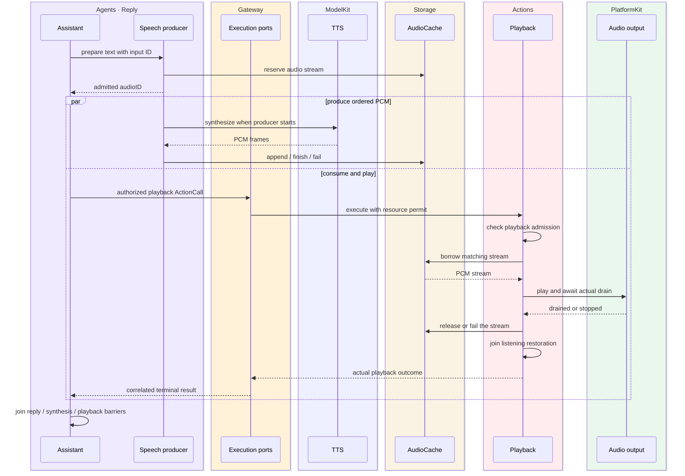

Assistant maps natural text through its injected speech-output interface into an owner-bound AudioCache ID and a playback call. Its private speech producer owns ModelKit TTS, bounded FIFO admission and joined cancellation; it has no separate Agent registration or messaging endpoint. Actions checks out the matching single-use stream and waits for native output drain. Synthesis admission, producer completion, playback drain and listening restoration are joined separately.

SpeechPerception publishes confirmed speech energy independently of playback. Voice activity, ASR, keyword matches and sound location each enter a Gateway-owned FIFO. Each channel preserves its emission order and runs independently. Assistant retains that session’s energy and applies it to the active or next `speak` execution. It sends lifecycle commands through `ActionControl` and uses the independent `Speech.Playback.setVolume` Tool for gain. Actions owns execution lifecycle and playback volume. PlatformKit confirms the player state after the native transition, including a fade before pausing and after resuming. ASR and other Actions continue. An accepted interruption cancels the target reply through the existing cleanup path. Playback control follows the executing instance, and speech energy follows the capture and utterance.

On restricted audio routes, the voice coordinator obtains playback admission after the current utterance finishes and pauses recognition. It joins eligible restoration after playback settles. Phone and headset routes with confirmed combined Voice Processing (echo cancellation and noise suppression) continue recognition during playback; Bluetooth is not a reason to disable duplex. Native mono capture fails explicitly when that processor cannot be enabled. Restoration checks listening consent, capture identity and other audio owners. SpeechPerception controls the recognition lifecycle. Assistant manages model production, reply waiting and cancellation within its own workflow. Writer uses its own Island presentation. Playback and restoration each report their outcomes. See [Assistant speech](Agents/Assistant/README.md#presentation-speech-and-cleanup), [Speech](Actions/Speech/README.md) and [AudioCache](Storage/Cache/Audio/README.md).

### Assistant full-duplex interaction

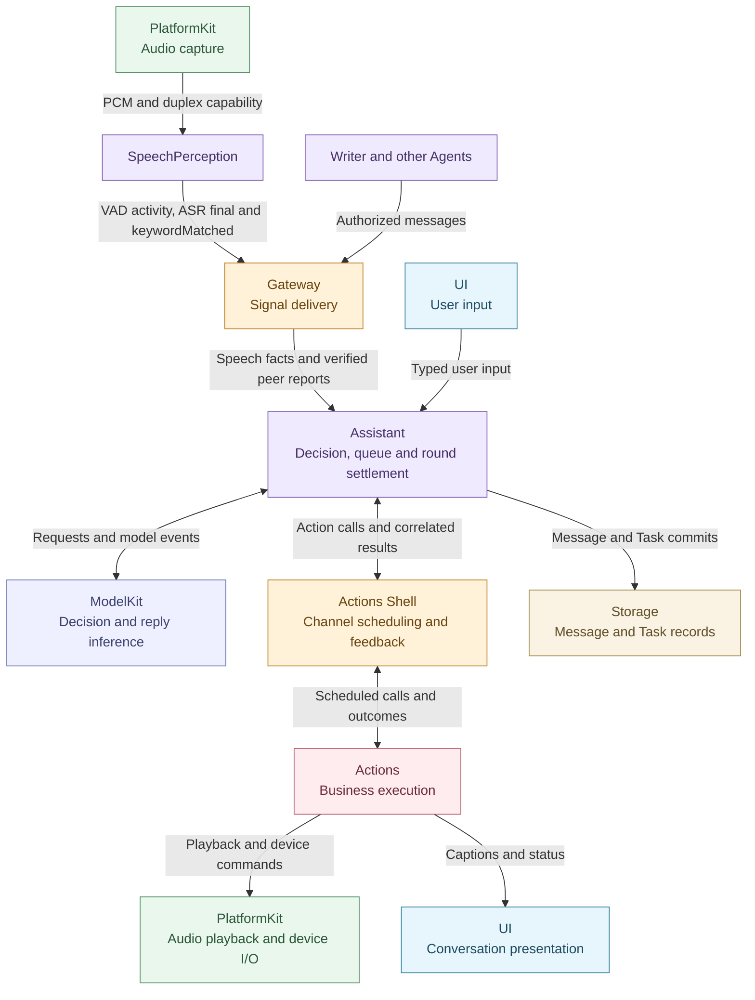

Assistant owns both voice interruption paths. With keyword detection enabled, SpeechPerception publishes a Zipformer match from the same audio it sends to ASR. Assistant checks the configured label and current reply before admitting it. A final can start Decision and a matching keyword can still interrupt the same reply. The first accepted interruption installs the shared cleanup barrier, retires Decision work for that reply and leaves ordinary input admission available. The Decision tab records both the model classification and accepted keyword interruptions. Keyword entries carry the ModelKit model identity and cumulative inference time and SpeechPerception's onset-to-detection time. ApplicationControl sends explicit stop requests through `agent.interruption.v1`. See [Assistant input](Agents/Assistant/Input/README.md#speech-activity-and-listening-signals).

#### Interruption and continuation

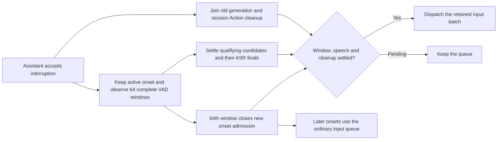

The first 64 complete VAD windows after admission define the continuation interval. An onset already active at admission or starting by window 64 can wait for its complete ASR result beyond that point. A later onset enters ordinary admission and stays outside the retained batch. Cleanup and speech intake run in parallel. A capture replacement restarts window counting, while unconfirmed Action cleanup holds dispatch and surfaces a diagnostic. See [Assistant continuation workflow](Agents/Assistant/Input/README.md#post-interruption-wait).

During ordinary generation, Assistant keeps admitting input while the round's Channels and feedback settle. Actions owns the effect ordering and execution results. Storage records dispatched requests, replies, Action results and Task commits. Independent Writer work may continue through an Assistant interruption. See [Assistant multi-Channel output](Agents/Assistant/README.md#input-timeline-and-channels) and [Actions scheduling](Actions/Support/Shell/README.md#scheduling).

### 13. Camera preview, vision and tracking

```mermaid
sequenceDiagram
    box rgb(240,234,255) Agents
        participant P as Photographer
        participant V as VisionPerception
    end
    box rgb(255,242,217) Gateway
        participant G as Bound ports
    end
    box rgb(255,236,239) Actions
        participant X as Camera and tracking
    end
    box rgb(234,247,237) PlatformKit
        participant C as Native camera
    end
    box rgb(238,239,255) ModelKit
        participant M as Pose capability
    end
    box rgb(231,246,252) UI
        participant UI as Preview and pose
    end
    P->>G: authorized camera call
    G->>X: execute with capture permit
    X->>C: authorize and start capture
    C-->>X: preview frames
    X->>UI: independent native preview
    C-->>V: direct read-only frames
    V->>M: cadence-selected current frame
    M-->>V: pose inference
    V->>G: internal presentation call
    G->>X: prepare / execute presentation
    X->>X: check frame and UI generation
    X->>UI: matched frame / skeleton / gaze
    V->>G: authorized vision.pose Signal
    G-->>P: delivered pose observation
    P->>G: tracking call from fresh pose
    G->>X: execute with motor permit
```

Authorized camera calls reach Actions through the Gateway invocation Signal. CameraCoordinator owns capture demand and leases and requests capture through PlatformKit, which owns the native session and checks platform permission. Preview and inference are independent: native preview and camera-only controls can work before the vision model is ready. Vision retains one inference and a latest candidate instead of queueing old frames.

Camera observations retain gravity-upright source orientation for inference and an independent native sensor-to-portrait reference for preview. Photo and movie capture use the rotation supplied from the active window. Actions forwards that immutable metadata; UI combines it with actual window interface orientation for shared video/skeleton/gaze geometry. Physical rotation does not force a portrait-locked preview into gravity-upright aspect-fill. Native capture ownership and the iPhone portrait interface policy remain unchanged. Detailed geometry belongs in [UI Camera](UI/Camera/README.md#interface-based-preview-geometry) and [Platform Vision](PlatformKit/Vision/README.md#capture-and-preview-orientation).

VisionPerception owns cadence, motion evidence, target association and projection. Agents authorizes protected presentation/tracking calls; Gateway checks generic identity and envelopes. Actions validates frame sequence, freshness, orientation and UI generation. Model/overlay failure preserves valid native preview. Photographer selects tracking from real fresh pose evidence; device output still requires authorization and a live resource permit. See [Camera](Actions/Camera/README.md), [VisionPerception](Agents/VisionPerception/README.md) and [Photographer](Agents/Photographer/README.md).

#### Shared capture and lens authority

Photo and background vision are independent Actions-owned demands over one PlatformKit Camera capability. Either demand keeps capture active; the second consumer reuses the same immutable native stream, and only the last close releases capture. Minimizing retains photo demand but unmounts its renderer. App background clears both demands and joins cleanup; foreground alone does not reopen either. YOLO/tracking is created only for visual demand and never drawn in the photo window.

UI owns actual surface ordering, safe-area geometry and presentation completion. Actions reads the same lensOwner projection as the buttons: the highest visible camera surface can switch; an expanded visible photo window outranks Face, while minimization yields to visible enabled Face vision. Other windows confer no camera rights. Transitions fence new switches and join admitted native work. PlatformKit alone changes input/captures photos; successful switching updates both displays, invalidates the old pose scope and reacquires tracking. Native running/facing/phase facts are published at platform.vision.camera, independently of business intent. Surface layout belongs to [UI Camera](UI/Camera/README.md) and [Window](UI/Components/Window/README.md).

### 14. Photo/video capture, App album and system export

Camera photos enter the session-owned Storage Image cache with memory-only preview_N identities. Each Camera window lifetime starts at1 and keeps the newest20 originals; successful append retires the oldest without renumbering. Camera owns latest/explicit model selections and disposition policy; save publishes independent album media_N, marking and unloading the saved preview while retaining its cached original. Reshooting retains earlier images for explicit loading. Closing joins work and clears the session; minimizing/background retains bytes but pauses model image delivery. Shared Context/Chat merges selected images into the original user input and keeps public metadata in system State. Private resource-scope bindings fence queued operations against reused labels without entering model context. Request logs preserve actual submitted image bytes independently of the Camera session; deleting logs removes those history images with no cache or album fallback. Album persistence receives no preview or camera-session identity; no database mapping is used. UI receives typed catalog/scoped reads for its stack and zoomable gallery, independently of model selection. See [Camera](Actions/Camera/README.md#session-previews-state-and-gallery), [Image cache](Storage/Cache/README.md#session-image-cache) and [UI Camera](UI/Camera/README.md).

```mermaid
flowchart TB
    subgraph Interaction["UI"]
        Request["Typed capture / album<br/>requests"]:::ui
        View["Current preview / album grid<br/>/ detail"]:::ui
    end
    style Interaction fill:#e7f6fc,stroke:#3985a4,color:#1f4c60
    subgraph Cognition["AGENTS"]
        A["Photographer · authorization"]:::agent
        Context["Shared Chat · Skill-selected<br/>fresh multimodal State per request"]:::agent
    end
    style Cognition fill:#f0eaff,stroke:#8261b5,color:#463065
    subgraph Coordination["GATEWAY"]
        G["Bound camera / album calls"]:::gateway
    end
    style Coordination fill:#fff2d9,stroke:#bf842c,color:#694511
    subgraph Execution["ACTIONS"]
        Camera["Capture / savePhoto"]:::action
        Preview["CameraPreviewStore · latest /<br/>explicit selections"]:::action
        Album["PhotoAlbumService · browse /<br/>import / delete / export"]:::action
    end
    style Execution fill:#ffecef,stroke:#b86178,color:#6b2b3d
    subgraph Native["PLATFORMKIT"]
        Capture["Camera capture"]:::platform
        Export["Photos add-only transaction"]:::platform
    end
    style Native fill:#eaf7ed,stroke:#56936a,color:#2c573a
    subgraph Persistence["STORAGE"]
        Store["Photo bytes / metadata / App<br/>album records"]:::storage
        Cache["Bounded preview memory<br/>originals / prepared JPEG"]:::storage
    end
    style Persistence fill:#faf3e4,stroke:#a18a4e,color:#61512a
    subgraph External["SYSTEM PHOTOS"]
        Copy["Independent system copy"]:::neutral
    end
    style External fill:#f4f5f8,stroke:#939bad,color:#414b60
    Request --> A
    A -->|"authorized call /<br/>private attachment"| G
    G ==>|"capture / disposition"| Camera
    G ==>|"private album Tool"| Album
    Camera ==>|"takePhoto"| Capture
    Capture -.->|"photo bytes ready"| Camera
    Camera ==>|"explicit save: publish original /<br/>commit App inclusion"| Store
    Camera ==>|"preview / disposition<br/>presentation"| View
    Album ==>|"read / import / delete"| Store
    Album ==>|"explicit export only"| Export
    Export ==>|"actual system<br/>transaction"| Copy
    Export -.->|"success / permission or<br/>write failure"| Album
    Album ==>|"page / operation<br/>presentation"| View
    Camera -.->|"actual capture result"| G
    Album -.->|"actual album result"| G
    G -.->|"correlated evidence"| A
    Camera --> Preview
    Preview --> Cache
    Preview -.->|"metadata + selected image bytes"| Context
    classDef action fill:#ffecef,stroke:#b86178,color:#6b2b3d
    classDef agent fill:#f0eaff,stroke:#8261b5,color:#463065
    classDef gateway fill:#fff2d9,stroke:#bf842c,color:#694511
    classDef neutral fill:#f4f5f8,stroke:#939bad,color:#414b60
    classDef platform fill:#eaf7ed,stroke:#56936a,color:#2c573a
    classDef storage fill:#faf3e4,stroke:#a18a4e,color:#61512a
    classDef ui fill:#e7f6fc,stroke:#3985a4,color:#1f4c60
    linkStyle 0 stroke:#5078b8,stroke-width:1.5px
    linkStyle 1 stroke:#5078b8,stroke-width:1.5px
    linkStyle 2 stroke:#bf842c,stroke-width:2.5px
    linkStyle 3 stroke:#bf842c,stroke-width:2.5px
    linkStyle 4 stroke:#bf842c,stroke-width:2.5px
    linkStyle 5 stroke:#438463,stroke-width:1.5px,stroke-dasharray:2 3
    linkStyle 6 stroke:#bf842c,stroke-width:2.5px
    linkStyle 7 stroke:#bf842c,stroke-width:2.5px
    linkStyle 8 stroke:#bf842c,stroke-width:2.5px
    linkStyle 9 stroke:#bf842c,stroke-width:2.5px
    linkStyle 10 stroke:#bf842c,stroke-width:2.5px
    linkStyle 11 stroke:#438463,stroke-width:1.5px,stroke-dasharray:2 3
    linkStyle 12 stroke:#bf842c,stroke-width:2.5px
    linkStyle 13 stroke:#438463,stroke-width:1.5px,stroke-dasharray:2 3
    linkStyle 14 stroke:#438463,stroke-width:1.5px,stroke-dasharray:2 3
    linkStyle 15 stroke:#438463,stroke-width:1.5px,stroke-dasharray:2 3
```

Photo bytes ready, current preview, formal App album inclusion and a system Photos copy are four separate facts. `savePhoto` includes the photo in the App album without requesting system-library permission. Existing bytes do not prove user retention; closing the preview session does not delete an included photo.

Album browse/import/export/delete uses UI.album → Photographer authorization → Gateway → the internal album function. Original reads, thumbnails and mutations have separate bounds; imports retain per-item successes. The root owns admitted changes across navigation and joins them at shutdown. The ordinary Photography Skill does not expose system export or album deletion.

System export waits for the actual Photos transaction. Denied permission or write failure preserves the App original. Each explicit click creates a copy without automatic export, retry or synchronization. App deletion commits the logical record before file cleanup and retains recovery evidence; system copies remain independent. Live model media reads retain source/session/input ownership and bounded image preparation. Historical Prompt images come exclusively from captured request logs and disappear when those logs are cleared. See [Camera album](Actions/Camera/README.md), [UI Settings](UI/Settings/README.md), [Media](Storage/Database/MediaFiles/README.md) and [Platform Vision](PlatformKit/Vision/README.md).

#### Recording, microphone handoff and media completion

Camera UI settings/countdown/start-stop/disposition requests flow through Photographer → Gateway → declared Camera.Capture/Video Actions. Assistant's Photography Skill uses the same declarations, selected facts and separate operation receipts. CameraCoordinator keeps photo/video demand independent of background Vision; both consume the same PlatformKit camera session and immutable preview. UI's file player and window activity labels are presentation-only.

openCamera and takePhoto are independent Actions: opening/restoring the unique window waits for ready preview without capturing; takePhoto requires the visible ready camera and accepts a per-shot countdown override. Agents may emit both in one response, and the Actions Shell orders them on the Camera Channel without an intermediate model continuation after open. Capture rechecks business readiness and returns actual media evidence; failures never cause implicit opening or retry. startRecording retains its internal canonical open composition with stop-on-failure. Generic scheduled Action failures advance later eligible work; successful composition child reports never replace the final value in Actions or Gateway.

Before recording, Actions prepares video mode with flash off, preserving lens, zoom and photo delay and applying any per-call duration limit. A configuration failure joins rollback before reporting the failed start. Actions then blocks new voice audio playback, joins VoiceSessionCoordinator's microphone pause and full native audio-owner release, and retains the prior listening generation. AppleCamera then reserves PlatformKit.Audio's native owner, adds microphone/movie output to its existing graph and waits for didStart. didFinish removes/releases native audio; Actions validates/publishes a pending local file through StorageMedia before resuming valid foreground listening intent and offers save/ignore. Model startRecording defaults to awaiting that terminal receipt under the original execution identity; only then does its ready result trigger ReAct with mediaID, fileName and actual duration. Photographer's interactive start Tool explicitly requests startup-only acknowledgement and releases its UI request slot. The UI stop Tool bypasses ChannelScheduler and joins the same recording completion; it does not independently notify the Assistant, so manual stop produces one original-call terminal observation. Cancellation joins matching native stop/finalization rather than leaving an orphan recording. Collection into the App album is a separate commit. Album playback uses a bounded local URL; system export joins a Photos transaction through VisionContainer. No movie is passed into model/history image decoding.

The recording owner survives minimized/hidden content; recording locks lens switching on both surfaces. Close stops/joins before media decisions; background stops/finalizes and preserves the pending clip without automatic foreground recording. Actual native recording facts belong to PlatformKit, business phase/settings to Actions, display/geometry to UI, and durable inclusion to Storage. Detailed limits/failures live in [Camera Actions](Actions/Camera/README.md), [Platform Vision](PlatformKit/Vision/README.md), [Listening](Actions/Speech/Listening/README.md) and [Media](Storage/Database/MediaFiles/README.md).

Camera opening awaits both native running and a fresh UI preview-geometry receipt before the composed capture step can run. Photo/movie execution rechecks that receipt at capture time and freezes the UI camera window’s sensor-to-interface angle and passes it to PlatformKit’s validated output connection. Perception retains independent gravity-upright frame coordinates; encoded photo metadata/movie transforms determine later media display. No Foundation dependency on UI or Actions is introduced.

### 15. Robot motion, hardware facts and control handoff

```mermaid
flowchart TB
    subgraph Interaction["UI"]
        UI["Typed device-control request"]:::ui
    end
    style Interaction fill:#e7f6fc,stroke:#3985a4,color:#1f4c60
    subgraph Cognition["AGENTS"]
        A["Assistant / Photographer /<br/>ApplicationControl"]:::agent
    end
    style Cognition fill:#f0eaff,stroke:#8261b5,color:#463065
    subgraph Coordination["GATEWAY"]
        G["Signal admission / bound scope"]:::gateway
    end
    style Coordination fill:#fff2d9,stroke:#bf842c,color:#694511
    subgraph Execution["ACTIONS"]
        Service["Shell resources &amp; handoff ·<br/>NexArm motion / tracking / validation"]:::action
        Facts["actions.robot · connection /<br/>control availability"]:::action
    end
    style Execution fill:#ffecef,stroke:#b86178,color:#6b2b3d
    subgraph PlatformOwner["PLATFORMKIT"]
        Native["Protocol I/O / USB / BLE /<br/>connection facts"]:::platform
    end
    style PlatformOwner fill:#eaf7ed,stroke:#56936a,color:#2c573a
    subgraph Hardware["DEVICE"]
        Device["Arm / servos"]:::neutral
    end
    style Hardware fill:#f4f5f8,stroke:#939bad,color:#414b60
    UI -->|"ApplicationControl<br/>input"| A
    A -->|"authorized motion /<br/>tracking call"| G
    G ==>|"prepare / live permit /<br/>execute"| Service
    Service ==>|"typed native command"| Native
    Native ==>|"protocol write"| Device
    Device -->|"actual hardware<br/>feedback"| Native
    Native -->|"timestamp / connection<br/>generation"| Service
    Service -.->|"per-motor report /<br/>partial failure"| G
    G -.->|"correlated outcome"| A
    Service -->|"actual business facts"| Facts
    classDef action fill:#ffecef,stroke:#b86178,color:#6b2b3d
    classDef agent fill:#f0eaff,stroke:#8261b5,color:#463065
    classDef gateway fill:#fff2d9,stroke:#bf842c,color:#694511
    classDef neutral fill:#f4f5f8,stroke:#939bad,color:#414b60
    classDef platform fill:#eaf7ed,stroke:#56936a,color:#2c573a
    classDef ui fill:#e7f6fc,stroke:#3985a4,color:#1f4c60
    linkStyle 0 stroke:#5078b8,stroke-width:1.5px
    linkStyle 1 stroke:#5078b8,stroke-width:1.5px
    linkStyle 2 stroke:#bf842c,stroke-width:2.5px
    linkStyle 3 stroke:#bf842c,stroke-width:2.5px
    linkStyle 4 stroke:#bf842c,stroke-width:2.5px
    linkStyle 5 stroke:#3985a4,stroke-width:1.5px
    linkStyle 6 stroke:#3985a4,stroke-width:1.5px
    linkStyle 7 stroke:#438463,stroke-width:1.5px,stroke-dasharray:2 3
    linkStyle 8 stroke:#438463,stroke-width:1.5px,stroke-dasharray:2 3
    linkStyle 9 stroke:#3985a4,stroke-width:1.5px
```

Agents authorizes Assistant/Photographer/device-control intent; Actions Shell arbitrates opaque motor resource policy, and Actions owns motion targets, plans, resources and execution reports, and interprets manual/tracking commands and feedback. PlatformKit owns transport, protocol I/O, connection facts, device limits, feedback tolerances, position observations and travel-time estimates. Some decoded joint/pose caches remain Actions controller state; the platform does not own every servo state. Native motor receipts retain monotonic age and session identity, independently of business-owned targets.

Photographer sends finite position targets through Gateway to Actions/NexArm using PlatformKit's recommended cadence. Photographer and Actions replace pending tracking targets with the latest intent under their own bounded policies; their pacing and queue details belong in [Photographer](Agents/Photographer/README.md) and [NexArm tracking](Actions/NexArm/Tracking/README.md). PlatformKit validates register writes and position ranges before USB/BLE transmission. Runtime tracking does not switch servo mode or issue continuous velocity, and cancellation joins work without adding motion. Device position-mode configuration and hardware limits remain external prerequisites; see [NexArm SDK](PlatformKit/Connectivity/NexArm/README.md).

The Actions Shell joins old writers before transferring motor authority. Manual control and tracking share the resource permit across Channels. Actions evaluates arrival from observed position feedback. Not reached, timeout, feedback loss, disconnection and cancellation preserve distinct outcomes. Joined software stop does not establish physical spatial safety. The model-visible robot summary exposes actual connection/control availability. See [NexArm](Actions/NexArm/README.md) and [native protocol](PlatformKit/Connectivity/NexArm/README.md).

### 16. Bluetooth discovery, connection and recovery

```mermaid
sequenceDiagram
    box rgb(231,246,252) UI
    participant Caller as UI typed request
    end
    box rgb(240,234,255) Agents
    participant Agent as ApplicationControl
    end
    box rgb(255,242,217) Gateway
    participant Gate as Gateway
    end
    box rgb(255,236,239) Actions
    participant Owner as Actions device workflow
    end
    box rgb(234,247,237) Platform
    participant SDK as PlatformKit BLE
    end
    box rgb(250,243,228) Storage
    participant DB as Storage.devices
    end
    Caller->>Agent: original request identity
    Agent->>Gate: authorized control call
    Gate->>Owner: prepare / schedule / execute
    Owner->>SDK: scan / connect using actual ID
    SDK-->>Owner: discovery / connection / feedback
    Owner->>DB: confirmed selection / identity mapping
    Owner-->>Gate: actual command result
    Gate-->>Agent: correlated outcome
    Agent-->>Caller: typed reply
```

ApplicationControl consumes typed device requests and authorizes domain calls through Gateway. Actions connection services use PlatformKit discovery/connection/feedback and Storage device mappings, then present real facts through UI. Scan admission is not discovery; connection admission is not a connection. Connect uses a device ID from the current discovery list or an existing remembered selection. Actions records the confirmed selection after native connection. Control eligibility still depends on the live connection and feedback state.

Disconnection, feedback health, query isolation and recovery remain connection/domain state. Low-rate native observations reach their owners directly without periodic JSON fingerprints or repeated inference. PlatformKit owns native recovery classifications and budgets, and BLE shares transmission pacing and native backpressure across producers. Hardware failures retain their SDK types; Actions adapts them for presentation and execution results, owns device selection and coordinates the business lifecycle. Business policy decides control eligibility and required user intervention; a successful protocol write does not prove compatibility or motion. See [Connection](Actions/NexArm/Connection/README.md), [NexArm SDK](PlatformKit/Connectivity/NexArm/README.md) and [ApplicationControl](Agents/ApplicationControl/README.md).

### 17. Settings, Provider and model-resource workflows

```mermaid
flowchart TB
    subgraph Interaction["UI"]
        UI["Typed settings / resource<br/>request"]:::ui
        Present["Draft revision / resource<br/>presentation"]:::ui
    end
    style Interaction fill:#e7f6fc,stroke:#3985a4,color:#1f4c60
    subgraph Cognition["AGENTS"]
        A["ApplicationControl /<br/>root-owned observer"]:::agent
    end
    style Cognition fill:#f0eaff,stroke:#8261b5,color:#463065
    subgraph Coordination["GATEWAY"]
        G["Signal admission / forwarding"]:::gateway
    end
    style Coordination fill:#fff2d9,stroke:#bf842c,color:#694511
    subgraph Execution["ACTIONS"]
        X["Provider / ModelResources ·<br/>validate / apply / persist"]:::action
    end
    style Execution fill:#ffecef,stroke:#b86178,color:#6b2b3d
    subgraph Inference["MODELKIT"]
        M["Model capabilities /<br/>artifact lifecycle"]:::model
    end
    style Inference fill:#eeefff,stroke:#747bb8,color:#3c426d
    subgraph Persistence["STORAGE"]
        S["Settings / controlled files"]:::storage
    end
    style Persistence fill:#faf3e4,stroke:#a18a4e,color:#61512a
    UI -->|"original request<br/>identity"| A
    A -->|"authorized canonical<br/>call"| G
    G ==>|"prepare / execute"| X
    X ==>|"apply provider / manage<br/>artifacts"| M
    X ==>|"actual persistence"| S
    M -->|"direct artifact<br/>revisions / transfer<br/>facts"| A
    X ==>|"identity-matched result<br/>presentation"| Present
    X -.->|"actual result / failure"| G
    G -.->|"correlated evidence"| A
    classDef action fill:#ffecef,stroke:#b86178,color:#6b2b3d
    classDef agent fill:#f0eaff,stroke:#8261b5,color:#463065
    classDef gateway fill:#fff2d9,stroke:#bf842c,color:#694511
    classDef model fill:#eeefff,stroke:#747bb8,color:#3c426d
    classDef storage fill:#faf3e4,stroke:#a18a4e,color:#61512a
    classDef ui fill:#e7f6fc,stroke:#3985a4,color:#1f4c60
    linkStyle 0 stroke:#5078b8,stroke-width:1.5px
    linkStyle 1 stroke:#5078b8,stroke-width:1.5px
    linkStyle 2 stroke:#bf842c,stroke-width:2.5px
    linkStyle 3 stroke:#bf842c,stroke-width:2.5px
    linkStyle 4 stroke:#bf842c,stroke-width:2.5px
    linkStyle 5 stroke:#3985a4,stroke-width:1.5px
    linkStyle 6 stroke:#bf842c,stroke-width:2.5px
    linkStyle 7 stroke:#438463,stroke-width:1.5px,stroke-dasharray:2 3
    linkStyle 8 stroke:#438463,stroke-width:1.5px,stroke-dasharray:2 3
```

First-run Welcome is composed by UI Root after settings restore confirms an empty Provider list. Its URL/key draft submits through the same settings request chain; Actions persists credentials and configuration, then UI opens independent Assistant/Writer model selection. Restore/save failures remain visible and cannot create a successful onboarding state. See [Settings](UI/Settings/README.md).

UI owns drafts, revisions and typed requests. ApplicationControl authorizes the settings calls. Actions validates and applies changes through injected model and persistence ports. Provider settings persist credential references, with the credential itself stored through the native credential adapter. Failures cannot become empty configuration, an undocumented old-model fallback or fabricated success. Primary and cleanup errors remain distinct.

Download, installation, preference selection and model residency are separate states. Opening a page does not start transfers; pages do not poll to drive downloads. Root observers coalesce artifact revisions and read real state. ModelKit owns its bundled catalog, disk layout, receipts and download implementations; Actions supplies only business preference and interaction policy. Removing an artifact first quiesces actual consumers; background URLSession completion belongs to the artifact owner. Actions also owns UI interaction workers and joins them during shutdown. See [ApplicationControl](Agents/ApplicationControl/README.md), [Provider](Actions/System/Provider/README.md), [ModelResources](Actions/System/ModelResources/README.md) and [Management](ModelKit/Support/Management/README.md).

Agent Models manages shared cloud Providers and local model downloads. ModelKit projects model identity, language capabilities and availability from its registry and artifact state. Actions applies the Assistant, Writer and Decision selection rules and projects typed candidates into UI. ApplicationControl and Gateway carry settings intents to the Actions transaction owner. Writer requires tool-capable Chat, and Decision accepts native Decision or a compatible Chat binding. Selected models resolve through ModelKit by stable ID. Every dispatched Chat request carries the identity of its bound model plus optional execution evidence. Agents persists those values per invocation for history and projects the actual Decision identity to the runtime log. See [ModelKit](ModelKit/README.md#selectable-language-models-and-request-evidence), [Provider](Actions/System/Provider/README.md), [Settings](UI/Settings/README.md) and [Assistant Decision](Agents/Assistant/README.md#full-duplex-input-and-decision).

Speech settings apply saved model choices by capability. App composition supplies SpeechPerception with the detection settings it snapshots at capture. The Settings keyword diagnostic opens an isolated capture and uses the production lexicon to report keyword matches and tail silence. See [Voice models](UI/Settings/README.md#语音模型) and [keyword diagnostics](Agents/SpeechPerception/README.md#流式关键词探测).

### 18. History, business records and restart behavior

```mermaid
flowchart TB
    subgraph Interaction["UI"]
        UI["Typed history request"]:::ui
        View["History projection /<br/>original typed reply"]:::ui
    end
    style Interaction fill:#e7f6fc,stroke:#3985a4,color:#1f4c60
    subgraph Cognition["AGENTS"]
        Decision["Real input / model request /<br/>response evidence"]:::agent
        A["Memory · authorize history<br/>operations"]:::agent
    end
    style Cognition fill:#f0eaff,stroke:#8261b5,color:#463065
    subgraph Coordination["GATEWAY"]
        G["Signal admission / forwarding"]:::gateway
    end
    style Coordination fill:#fff2d9,stroke:#bf842c,color:#694511
    subgraph Execution["ACTIONS"]
        X["Query / mutation / archive /<br/>presentation"]:::action
        Title["Root-owned title worker"]:::action
    end
    style Execution fill:#ffecef,stroke:#b86178,color:#6b2b3d
    subgraph Persistence["STORAGE"]
        Store["Role-specific records /<br/>shared request logs"]:::storage
    end
    style Persistence fill:#faf3e4,stroke:#a18a4e,color:#61512a
    subgraph Inference["MODELKIT"]
        M["Title inference"]:::model
    end
    style Inference fill:#eeefff,stroke:#747bb8,color:#3c426d
    Decision ==>|"record actual boundary<br/>evidence"| Store
    UI --> A
    A -->|"authorized call"| G
    G ==>|"prepare / execute"| X
    X ==>|"read / commit mutation"| Store
    X ==>|"project real results"| View
    X -->|"archive schedules title<br/>job"| Title
    Title -->|"injected title<br/>generation"| M
    M -.->|"title / real inference<br/>failure"| Title
    Title ==>|"commit title or failure<br/>evidence"| Store
    X -.->|"actual operation<br/>outcome"| G
    G -.->|"correlated result"| A
    classDef action fill:#ffecef,stroke:#b86178,color:#6b2b3d
    classDef agent fill:#f0eaff,stroke:#8261b5,color:#463065
    classDef gateway fill:#fff2d9,stroke:#bf842c,color:#694511
    classDef model fill:#eeefff,stroke:#747bb8,color:#3c426d
    classDef storage fill:#faf3e4,stroke:#a18a4e,color:#61512a
    classDef ui fill:#e7f6fc,stroke:#3985a4,color:#1f4c60
    linkStyle 0 stroke:#bf842c,stroke-width:2.5px
    linkStyle 1 stroke:#5078b8,stroke-width:1.5px
    linkStyle 2 stroke:#5078b8,stroke-width:1.5px
    linkStyle 3 stroke:#bf842c,stroke-width:2.5px
    linkStyle 4 stroke:#bf842c,stroke-width:2.5px
    linkStyle 5 stroke:#bf842c,stroke-width:2.5px
    linkStyle 6 stroke:#5078b8,stroke-width:1.5px
    linkStyle 7 stroke:#747bb8,stroke-width:1.5px
    linkStyle 8 stroke:#438463,stroke-width:1.5px,stroke-dasharray:2 3
    linkStyle 9 stroke:#bf842c,stroke-width:2.5px
    linkStyle 10 stroke:#438463,stroke-width:1.5px,stroke-dasharray:2 3
    linkStyle 11 stroke:#438463,stroke-width:1.5px,stroke-dasharray:2 3
```

Agents records input, model context, response, calls, terminal evidence and usage at their respective boundaries. A business Message is committed at actual model dispatch. Generation and execution settlement update that record separately. UI summaries/pages are not the full model request, and private Agent context is not the database. Model-visible queries return bounded previews; UI full reads carry private typed results, without a global attachment table.

Agents bridges ModelKit’s neutral transport callback into the shared `model_request_log`, capturing actual application-level HTTP requests, responses/SSE, images and generation metadata; non-HTTP calls are marked local. Clearing logs removes Prompts, images and generation details while preserving business inputs, replies and tool results. Late callbacks cannot recreate cleared logs. Storage owns persistence without inference scheduling or Agent orchestration. See [request recording](Agents/Support/Chat/README.md) and [Database schema](Storage/Database/README.md).

Memory authorizes history requests; Actions owns queries, mutations and presentation through the injected AssistantHistoryStore. Assistant records the selected State paths with its per-request Task/Skill/Catalog business snapshot; Actions passes that evidence to UI without reading current State. The logged HTTP request can retain the full State facts and images actually sent to the provider. Clearing logs preserves those business selections; Assistant detail hides Prompts/Generation Meta and displays Logs cleared. Archive/delete waits for real commits. Root-owned title generation does not block a new conversation. Title computation and failure-record commit can fail together; cancellation does not undo an archive. Restart marks unfinished records interrupted without resuming native execution or replaying the last action.

| Data                                         | Owner and restart meaning                                                                                      |
| -------------------------------------------- | -------------------------------------------------------------------------------------------------------------- |
| Active Task/Skill, decisions and queues      | Private Agent memory; no guarantee of restoring execution.                                                     |
| Current model facts                          | Actual container memory, sampled per request; no persistent StorageState mirror.                               |
| PCM and temporary buffers                    | Bounded Storage.cache sessions and leases; not durable creations.                                              |
| Conversation, task, media and device records | Storage repositories with actual commit/recovery contracts.                                                    |
| Photos, settings and workspace files | Controlled Storage.files namespaces; pending/ready/compensation rather than cross-backend atomic transactions. |
| Model artifacts and download metadata | ModelKit-owned filesystem, receipts, transfer indexes and background transports; independent of Storage. |

Assistant settles model and keyword interruptions through the shared execution cleanup barrier. Storage retains the confirmed Action fragments, original generated text, and winning decision on the interrupted model request. The Assistant also records an accepted keyword decision on the ASR final for the same capture generation and utterance when that final has text. Actions carries the input, batch and reply evidence to history presentation.

See [Memory](Agents/Memory/README.md), [History](Actions/History/README.md) and [Storage](Storage/README.md).

#### Agent-owned tasks, delegated records and artifacts

Storage separates Assistant conversation themes and foreground tasks from Writer workspaces and delegation executions. Writer stores delegation executions separately from dispatched model Messages. Each Message's optional workspace ownership is fixed at creation, and later workspace selection leaves earlier Messages in their original scope. AgentMessages retains original communication and delivery facts. The stable workspace key is `workspace_N`; completion ends one delegation, not the lifetime of a reusable workspace. Request/event records retain runtime trace identities, while models receive readable workspace/window/editing handles with owner-projected metadata. WindowState owns window mapping independently of the creator. See [Task storage](Storage/Database/README.md) and [artifact identities](Actions/Artifacts/README.md#workspace-and-editing-identities).

Assistant and Writer create business Message rows at inference dispatch. Assistant stores the submitted timeline separately from the original input and batch coordination, and stores one reply for the batch. Actions presents that submitted text in request history. In full-duplex mode, `task.end` is an Agent control that runs inside Assistant at emission, independently of Actions still running. Writer receives stop requests through `agent.task.v1` and owns its execution cleanup and terminal result. Agents commits the foreground task's terminal state and Message summary through Storage before the control returns success. The summary covers dispatched Messages, including the one that issued `task.end`. The existing Message receives the reply at generation completion and Action results at execution settlement. Historical requests remain readable, and older JSON batches are projected into the timeline when replayed as model context. See [Assistant task lifecycle](Agents/Assistant/README.md#task-and-skill-lifecycle) and [Assistant history storage](Storage/Database/AssistantMessages/README.md).

Writer uses its own WriterExecutionRepository and WriterMessageRepository, with WriterRecordStore/WriterHistoryStore owning its private history. Runtime history is scoped to the delegation; Settings queries delegation entries and workspace messages separately. Database message keys define ordering, while revision is a state version. A later delegation may reuse the same workspace while retaining separate execution history. Deleting the requesting Assistant dialog clears provenance without deleting the Writer workspace. App composes Writer's records interface and Actions' preview/export interface for Settings. Model timing flows through ModelKit → role history → Storage evidence → UI detail; Writer projects workspace start/update timestamps, request counts and operation summaries, while UI renders neutral values. Writer projects request overview, the current input, verified prior tool references, model output and host finalization through its Settings detail interface. The business sections survive request-log deletion, which clears prompt and generation diagnostics. Full persisted request/tool evidence is distinct from the Agent's selected model context. See [Writer history](Agents/Writer/README.md#sqlite-历史与设置页).

Writer source lives in the current `writer/workspace_N` filesystem directory; SQLite indexes current files without retaining source bodies or workspace versions. StorageDatabase coordinates sandbox primitives and SQL leases, Actions owns validation/rendering/export, and Agents owns creative decisions. See [workspace storage](Storage/Database/WriterWorkspaces/README.md) and [Artifacts](Actions/Artifacts/README.md).

On restart, Writer marks any leftover `running`/`cancelling` execution `interrupted` and releases unfinished retirements, without republishing reports, replaying creative work or reopening old execution permissions. The report publication policy belongs to [Writer](Agents/Writer/README.md#委托与主动事件), not generic Gateway transport. Before publishing repositories, Storage prepares the current schema. Any database whose version differs from the current one is erased and recreated, including the associated Writer files; stored data is never migrated. Settings, credentials and models are outside that reset. Database root owns connection/lifecycle/schema assembly; Shared owns neutral encoding, identity and paging mechanisms, while table directories own SQL and recovery. Agent consumers use role-specific task and communication ports. See [SQLite lifecycle](Storage/Database/README.md).

### 19. Model lifecycle and inference boundaries

```mermaid
flowchart TB
    subgraph Consumers["CONSUMERS"]
        Caller["Agent cognition / Actions<br/>business owner"]:::neutral
    end
    style Consumers fill:#f4f5f8,stroke:#939bad,color:#414b60
    subgraph Inference["MODELKIT"]
        Capability["Typed inference capability"]:::model
        Manager["Instance-local management /<br/>loading / residency"]:::model
        Provider["Cloud or local provider"]:::model
        Backend["Responses / CoreAI / CoreML<br/>/ engine"]:::model
        Ports["Artifacts / ModelKit-owned<br/>disk storage and download transports"]:::model
    end
    style Inference fill:#eeefff,stroke:#747bb8,color:#3c426d
    subgraph Host["APP"]
        App["ModelContainer lifecycle"]:::host
    end
    style Host fill:#eaf2ff,stroke:#5078b8,color:#203b64
    Caller -->|"typed request"| Capability
    Capability -->|"inference admission"| Manager
    Manager ==>|"selected implementation"| Provider
    Provider ==>|"actual inference"| Backend
    Backend -.->|"native output / failure"| Provider
    Provider -.->|"typed events / usage / failure"| Capability
    Capability -.->|"stream / outcome"| Caller
    App -.->|"start / invalidate /<br/>stop"| Manager
    Ports -->|"owner-defined resource<br/>interfaces"| Manager
    classDef host fill:#eaf2ff,stroke:#5078b8,color:#203b64
    classDef model fill:#eeefff,stroke:#747bb8,color:#3c426d
    classDef neutral fill:#f4f5f8,stroke:#939bad,color:#414b60
    linkStyle 0 stroke:#747bb8,stroke-width:1.5px
    linkStyle 1 stroke:#5078b8,stroke-width:1.5px
    linkStyle 2 stroke:#bf842c,stroke-width:2.5px
    linkStyle 3 stroke:#bf842c,stroke-width:2.5px
    linkStyle 4,5,6 stroke:#438463,stroke-width:1.5px,stroke-dasharray:2 3
    linkStyle 7 stroke:#738299,stroke-width:1.5px,stroke-dasharray:7 4
    linkStyle 8 stroke:#5078b8,stroke-width:1.5px
```

ModelContainer's four capabilities share instance-local management. Preparation, actual loading, inference admission, release and shutdown have distinct meanings. Explicit ModelKit suspension closes inference and joins active tasks; ordinary scene hiding does not request that suspension. Weight residency does not prove device/page readiness. Model-load waiting and ordinary Assistant reply waiting are presented independently.

Agents owns the original request, history selection and decision catalog. Providers own tokenization, context fitting, streaming decode and neutral failures, and may trim/reject context under their contract. Gemma-specific handling remains inside [ModelKit](ModelKit/README.md); cloud prompt experiments do not establish local-model acceptance.

The cloud adapter encodes declared Responses contracts and validates terminal events and call identity. Agents resolves complete native calls and validates them against the active catalog. Inference failures propagate to the owning Agent, which decides recovery under its role policy. See [OpenAI adapter](ModelKit/Language/LLM/OpenAI/README.md).

ModelKit owns Chat execution and resource concurrency. Agents retain fixed model selections and request sessions; configured cloud clients are shared with independent sessions, while local LLM requests use a root-owned bounded FIFO with explicit overflow and joined cancellation. The Responses adapter backpressures streamed deltas without a cumulative generation-size ceiling. These mechanisms do not choose business retries: Writer's private recovery owns retry decisions and actual failure observations, while uncertain commits and cleanup failures stop without replay. See [ModelKit](ModelKit/README.md), [Responses adapter](ModelKit/Language/LLM/OpenAI/README.md) and [Writer recovery](Agents/Writer/README.md#bounded-recovery).

#### Model artifact architecture selection

Default ModelKit assembly resolves optional artifact catalog architecture variants before acquisition; native architecture discovery stays inside ModelKit providers/backends. ModelKitRuntime bundles the single declarative catalog and its parser from [Support/Config](ModelKit/Support/Config/README.md); ModelKitDefaults composes its own disk storage and Hub downloader. The selected source revision and required-file set flow together into download, installation receipts and resource loading. Source packages remain available for architectures without a compiled variant. See [ModelKit management](ModelKit/Support/Management/README.md).

### 20. Diagnostics, UI presentation and native rendering

```mermaid
flowchart TB
    subgraph Sources["FAILURE SOURCES"]
        Failure["Native module / execution /<br/>delivery failures"]:::neutral
    end
    style Sources fill:#f4f5f8,stroke:#939bad,color:#414b60
    subgraph Host["APP"]
        App["Preserve original error /<br/>module identity"]:::host
        Channel["Retained<br/>ContainerFailureChannel"]:::host
        Bootstrap["Bootstrap failure before<br/>roles"]:::host
    end
    style Host fill:#eaf2ff,stroke:#5078b8,color:#203b64
    subgraph Cognition["AGENTS"]
        A["ApplicationControl<br/>classification / authorized<br/>output"]:::agent
    end
    style Cognition fill:#f0eaff,stroke:#8261b5,color:#463065
    subgraph Coordination["GATEWAY"]
        G["Signal admission / forwarding"]:::gateway
    end
    style Coordination fill:#fff2d9,stroke:#bf842c,color:#694511
    subgraph Execution["ACTIONS"]
        X["Shell · conversation /<br/>state functions"]:::action
    end
    style Execution fill:#ffecef,stroke:#b86178,color:#6b2b3d
    subgraph Display["UI"]
        UI["Identity-matched<br/>presentation / native<br/>rendering"]:::ui
    end
    style Display fill:#e7f6fc,stroke:#3985a4,color:#1f4c60
    Failure -->|"original structured<br/>error"| App
    App -->|"bounded retained<br/>evidence"| Channel
    Channel -->|"diagnostic delivery"| A
    A -->|"runtime issue and<br/>optional toast"| UI
    A -->|"authorized state<br/>presentation call"| G
    G ==>|"prepare / execute"| X
    X ==>|"public UI presentation<br/>capability"| UI
    Bootstrap -->|"App-bound bootstrap<br/>fallback"| UI
    classDef action fill:#ffecef,stroke:#b86178,color:#6b2b3d
    classDef agent fill:#f0eaff,stroke:#8261b5,color:#463065
    classDef gateway fill:#fff2d9,stroke:#bf842c,color:#694511
    classDef host fill:#eaf2ff,stroke:#5078b8,color:#203b64
    classDef neutral fill:#f4f5f8,stroke:#939bad,color:#414b60
    classDef ui fill:#e7f6fc,stroke:#3985a4,color:#1f4c60
    linkStyle 0 stroke:#3985a4,stroke-width:1.5px
    linkStyle 1 stroke:#5078b8,stroke-width:1.5px
    linkStyle 2 stroke:#3985a4,stroke-width:1.5px
    linkStyle 3 stroke:#5078b8,stroke-width:1.5px
    linkStyle 4 stroke:#bf842c,stroke-width:2.5px
    linkStyle 5 stroke:#bf842c,stroke-width:2.5px
    linkStyle 6 stroke:#3985a4,stroke-width:1.5px
    linkStyle 7 stroke:#5078b8,stroke-width:1.5px
```

Foundations report their own native Failure types without business wording, Signals or automatic recovery. App preserves original errors and source identity in its bounded ContainerFailureChannel. ApplicationControl classifies the passive failure evidence and sends runtime issues and eligible Toasts through injected UI ports. Authorized device and model presentation calls use the business execution path. Bootstrap failure has an App-owned fallback before roles are available. Reporting failure does not recursively generate more failures.

Runtime log language is supplied by App composition to execution snapshot projection and by AgentRuntime to cognitive log observations. Agents resolves app-owned copy through UI.AppLanguage while retaining raw execution evidence. No language state or UI dependency enters AgentCore; see [Support presentation](Agents/Support/README.md#state-configuration-and-localization).

Pure cancellation is distinct from real or mixed execution/cleanup failure; classification uses structured reports rather than error strings. Display filters do not cancel work or establish released resources. Agents supplies Task, Agent, Decision and Agent-owned control display values. App binds scheduler snapshots to the same UI-owned [RuntimeLog component](UI/Components/RuntimeLog/README.md). The Action tab combines the snapshots with Assistant's local control outcomes and displays a `Control` label on those rows.

UI presentation admission differs from native completion. Finite expressions await their presentation/restoration; persistent base state acknowledges admission. Metal owns window/layer/GPU completion. Photo disappearance/display receipts retain media and generation identity. Updating a UI field cannot prove GPU or physical completion. See [UI](UI/README.md), [ApplicationControl](Agents/ApplicationControl/README.md) and [runtime presentation](Actions/UI/Runtime/README.md).

#### Shared in-app and system Island presentation

Each Agent owns its presentation intent and calls registered UI.Island internal tools through its own Gateway identity. Writer and Assistant own their task islands; Assistant separately owns inference waiting. SpeechPerception owns listening/recognition and captions. Assistant owns synthesis and actual playback presentation through its speech subcomponent; Actions' player returns joined start/end facts through an App-bound neutral callback, without a peer-Agent delegation or UI-state observer. Photographer uses its existing camera fact input and ApplicationControl its connection input for their own presentation. Shared AgentIslandPublication owns only bounded delivery/retry and cleanup, not role policy. Actions executes validated calls, while UI owns arbitration, layout, animation and ActivityKit. Playback spectra use a dedicated data port without Action/ActivityKit updates per frame. System submission failure does not erase local content; iOS controls actual system display.

The producer-bound internal-completion port accepts the registered role’s declared internal native tools outside model rounds. Agents validates the producer and its tool grant, Actions Shell coordinates admission and resources and executes the presentation call, returning real outcomes directly to the presenting workflow without Signal/InputGateway ToolResult feedback. Assistant model Tool calls retain their paired results through local round settlement. Workflows that explicitly consume addressed Tool feedback use `tool.result.v1`. Internal presentation receipts can synchronize execution and playback without becoming cognitive input; ownership and session fences remain unchanged. See [Agents Support](Agents/Support/README.md).

Only explicitly model-generated calls can contribute execution observations to ReACT. The Assistant-owned chat worker records origin per invocation: natural-text speech/caption expansion and code-owned lifecycle/waiting calls are runtime work even when a model can explicitly call the same function. Their successful values, failures and exceptions are handled internally; they may join completion barriers and retain diagnostic evidence but never become model observations or independently request another inference. Unmatched Tool feedback cannot become a fresh Chat input.

Detail activity and live status are selected independently, preserving the user's detail expansion preference while the top indicators change. UI owns layout, animation, thumbnail resources and bounded display admission. Measured spectrum updates remain local presentation data rather than per-frame Actions or ActivityKit submissions. See [Island component](UI/Components/Island/README.md) for these contracts and [Actions Runtime](Actions/UI/Runtime/README.md) for validated execution and producer ownership.

The Assistant briefly expands its in-app Island after completing an interruption. See [Decision feedback](Agents/Assistant/README.md#full-duplex-input-and-decision).

Scene inactivity unmounts local rendering while retaining current activity facts for system presentation. Full root invalidation clears local generations and publishes paused system state; stop joins cleanup. System Island taps restore the existing scene without a navigation destination or device operation. App's native termination callback requests bounded best-effort ActivityKit cleanup; iOS may terminate without that callback, so stale presentation and next-start cleanup cannot guarantee immediate removal. Island presentation does not own Task completion or background device lifetime.

For the in-app system status strip, PlatformKit owns native network/battery facts, App adapts them into UI-owned read-only values, and the Island component controls reads and layout while mounted. UI Root hides/restores the native status bar from actual mount state. Actions and Agents do not modify system status; UI and PlatformKit remain independent foundations. See [composition adapter](App/Composition/README.md) and [Island status](UI/Components/Island/README.md).

### 21. Cross-module cancellation, pressure and completion

```mermaid
sequenceDiagram
    box rgb(234,242,255) App · Lifecycle owner
        participant App as Application lifecycle
    end
    box rgb(240,234,255) Agents · Cognitive work
        participant A as AgentContainer
    end
    box rgb(255,242,217) Gateway · Signal channel
        participant G as GatewayContainer
    end
    box rgb(255,236,239) Actions · Shell and business work
        participant X as ActionsContainer
    end
    box rgb(234,247,237) Foundations · Native capabilities
        participant F as Owned capability services
    end
    App->>A: close requests / stop and join roles
    A->>G: cancel owned execution scopes
    G->>X: forward scope cancellation to Shell
    X->>F: request and join required native cleanup
    F-->>X: cleanup result or retained failure
    X-->>G: joined terminal evidence
    G-->>A: Signal delivery and admission barriers
    A-->>App: cognitive shutdown settled
    App->>G: close admission / stop Signal transport
    G-->>App: transport and Signal delivery joined
    App->>X: stop Shell (scheduling, resources, delivery) and remaining work
    X-->>App: joined cleanup or structured failure
    App->>App: release execution bindings
    App->>F: stop foundation roots in reverse dependency order
```

Assistant interruption stops the current round and retains the active foreground Task and its Skills. Closing releases session-scoped work and capabilities. Resumption uses current state and retained records without replaying effects. Actor isolation, a cancellation flag or a deadline cannot prove another owner has finished. Every queue/slot has an owner-defined bound and explicit rejection, backpressure or latest-value replacement policy.

Agents closes new cognitive work and explicitly cancels its scopes. Gateway joins transport and Signal delivery and closes its admission. Actions then joins direct/scheduled execution, result delivery and remaining business/native work through its Shell; only then does App release execution bindings and stop foundations. Failed startup rolls back completed stages while preserving both primary and cleanup failures.

UI, PlatformKit and ModelKit runtime `stopped` flags describe their admission fences. `cleanupJoined` separately records successful joined shutdown; neither flag establishes physical-device completion or safety.

| Boundary                  | Completion establishes                    | It does not establish                             |
| ------------------------- | ----------------------------------------- | ------------------------------------------------- |
| Request/message admission | Acceptance or explicit rejection          | Business completion or another inference round    |
| Path/UI update            | Identity-matched state commit             | Loaded data or displayed GPU frame                |
| Model operation           | Adapter completion or joined cancellation | Device completion                                 |
| Action/Tool               | Declared business completion and report   | Successful delivery or cognitive consumption      |
| Playback                  | Actual native drain and handle release    | Sound at synthesis admission                      |
| File/database publication | Real commit or explicit partial outcome   | Cross-backend atomicity or Photos synchronization |
| Resource/session stop     | Joined owned work and cleanup             | Cooperative hardware stop or spatial safety       |

Independent fences include UI generation, capture generation, endpoint incarnation/session, input/round, Agent Task grants, media ownership, resource lease/permit, settings revision and paging tickets. One fence cannot substitute for another; replacement owners cannot inherit stale writes. See [Input](Gateway/Input/README.md), [Scheduling](Actions/Support/Shell/README.md#scheduling), [Resources](Actions/Support/Shell/README.md#resources), [Results](Actions/Support/Shell/README.md#results-and-feedback) and [Context](Agents/Support/Context/README.md).

#### Scene visibility versus execution lifetime

Ordinary scene hiding stops/joins visible rendering and vision intake while preserving Assistant and Writer inference, files and messages. Actions retains bounded latest project snapshots; foreground restoration runs in one Actions-owned task and reads current state under the project lock. Explicitly closed or minimized windows retain their state. Preview restore failures are reported at the affected window, and scene admission continues. Background full rendering returns deferred validation evidence, so saving and visual verification remain separate. Explicit root suspension, replacement and stop still cancel and join owned work. iOS process suspension does not imply application-requested cancellation and does not guarantee unlimited background CPU. See [App composition](App/Composition/README.md), [Agents lifecycle](Agents/README.md#lifetime-inputs-and-failures), [Artifacts snapshots](Actions/Artifacts/README.md#标题副标题与后台快照) and [Writer scene policy](Agents/Writer/README.md#窗口命名操作副标题与场景).

App requests iOS continued processing for eligible Writer segments while the scene is active. When iOS grants time, Writer continues its existing model and file loop across scene loss. A native expiration is scoped to that segment and joins Writer cleanup before retiring the run. Terminal work and waiting for user input release the native task. See [Writer scene policy](Agents/Writer/README.md#窗口命名操作副标题与场景).

### 22. End-to-end scenario map

| Scenario | Workflow | Completion boundary |
| --- | --- | --- |
| Album and settings | [UI execution](#3-ui-requests-and-shared-business-execution) · [Photo and album](#14-photovideo-capture-app-album-and-system-export) · [Provider settings](#17-settings-provider-and-model-resource-workflows) | Page path, business reply and media commit have separate receipts. |
| Voice conversation | [ASR](#11-listening-asr-and-sound-source-observations) · [TTS](#12-reply-synthesis-playback-and-listening-restoration) · [Full duplex](#assistant-full-duplex-interaction) | Assistant admits keyword or Decision interruption. The 64-window boundary and confirmed cleanup govern continuation dispatch. |
| Expression and speech sequence | [Function Tokens](#8-function-token-and-action-call-protocol) · [Channel and wait](#9-channel-ordering-wait-and-resource-ownership) | The Actions Shell joins the wait group before the parent phase continues. |
| Vision and tracking | [Camera and vision](#13-camera-preview-vision-and-tracking) · [Robot motion](#15-robot-motion-hardware-facts-and-control-handoff) | Pose freshness and motor authority gate effects. Observed feedback determines motion completion. |
| Device or module change | [Bluetooth](#16-bluetooth-discovery-connection-and-recovery) · [Diagnostics](#20-diagnostics-ui-presentation-and-native-rendering) | Native facts and failures reach their owners and UI projections. |
| Agent collaboration | [Assistant delegation](#assistant-agent-delegation) · [Writer records](#agent-owned-tasks-delegated-records-and-artifacts) | Inbox admission, task acceptance and terminal notification are distinct. |
| Navigation and inactivity | [Navigation](#4-page-navigation-and-visible-page-context) · [Scene lifetime](#scene-visibility-versus-execution-lifetime) | Page acknowledgment and device cleanup follow their own owners. |

Automated checks, iOS builds, real-model samples, native UI and physical-device acceptance are separate evidence categories maintained in [validation](../docs/validation/README.md). Requirements and decisions live in [requirements](../docs/requirements/README.md) and [ADR](../docs/adr/README.md); historical design rationale lives in [documentation history](../docs/history/Documentation-History.md).
