# MobileHarness Technical Design

This document has three parts:

1. [Part I — Architecture](#part-i--architecture) — Explains the biomimetic design philosophy, framework and architectural boundaries.
2. [Part II — Module Design](#part-ii--module-responsibilities) — Describes module responsibilities, interfaces and relationships.
3. [Part III — Key Workflows](#part-iii--cross-module-technical-design) — Explains the principal workflows across modules.

Detailed implementation design belongs in the owning module and nested directory READMEs.

## Part I — Architecture

### 1. Biomimetic design

MobileHarness follows a **perception–cognition–action feedback loop**: observations inform decisions, decisions lead to actions, and observed outcomes inform subsequent decisions. This design **separates understanding a goal from carrying it out**, with coordination connecting the two. **Completion and failure feed back into cognition** so subsequent decisions reflect what actually happened.

### 2. Framework

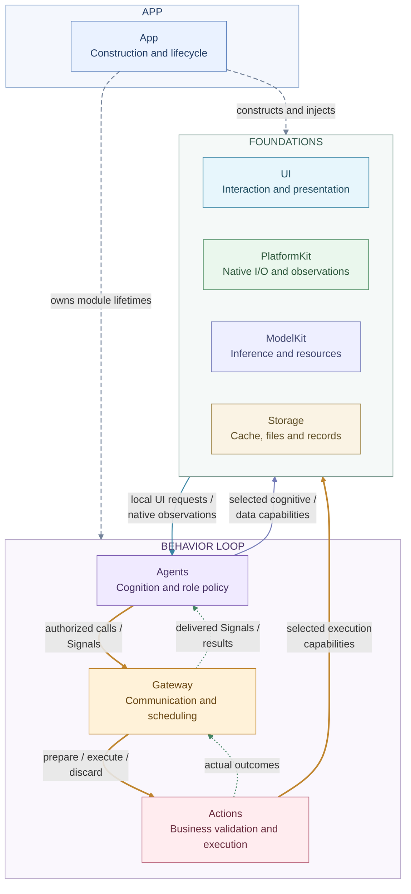

**App constructs the module roots**, connects their public interfaces through **dependency injection** and coordinates startup, foreground transitions, shutdown and replacement. **Each module owns its internal services and long-running work**; cancellation and cleanup follow that owner's lifecycle independently of individual pages.

**UI requests and native observations enter the responsible Agents directly**. **Perception roles** process audio, images and device observations; **cognitive roles** interpret intent, maintain goals and context, manage **Skill/Task scope** and coordinate specialized roles. Agents use deterministic processing or model inference to decide which operations to request.

**Gateway delivers Agent messages**, validates identity and admission, and coordinates execution permissions, scheduling and shared resources. **Actions validates business inputs and preconditions**, performs the admitted operations and returns completion or failure through Gateway to the requesting Agent. **Request identity is preserved through execution and feedback** so the Agent can relate each outcome to its goal and decide what to do next.

Agents and Actions use **four independent foundations** through injected capabilities: **ModelKit runs inference**, **Storage provides temporary and durable data facilities**, **PlatformKit supplies native device and operating-system access**, and **UI handles interaction and presentation**. Local rendering stays within UI; each foundation exposes reusable mechanisms that the business modules compose for a particular goal.

### 3. Principles

IoC and module containers form the framework's core design pattern. The following principles define composition, module independence and public contracts.

1. **Use IoC and module containers as the core design pattern.** Containers organize module capabilities, internal services and lifecycle. Explicit dependency injection connects modules through public interfaces. Consumers use injected capabilities without locating a global registry or reaching into another module's implementation.

2. **Let App serve as the application entry point and composition owner.** App constructs, retains and connects all module root containers, selects implementations, injects dependencies and coordinates startup, suspension, shutdown and replacement. Each module owns the construction and management of its child containers and internal services.

3. **Keep the four foundations independent.** UI, PlatformKit, ModelKit and Storage provide interface/presentation, native-platform, model-inference and storage capabilities respectively. They neither depend on other project modules nor receive one another's interfaces or containers. Where external facilities are required, App supplies adapters through ports defined by the receiving foundation, preserving its independence from the supplying module's types and implementation.

4. **Give business modules clear responsibilities and acyclic dependencies.** Agents owns cognition and decisions; Gateway owns communication and scheduling; Actions owns business execution. App explicitly connects their public interfaces and neutral contracts. Dependency and injection directions remain clear and acyclic; results and callbacks do not introduce reverse implementation dependencies.

5. **Use containers for encapsulation and self-description.** Each container manages permissions and admission constraints, dependencies, state machines, asynchronous work and failures within its responsibility. Public contracts describe available capabilities, callable interfaces, current state, usage constraints and failure semantics. Interfaces, function catalogs, validation rules and model-visible descriptions use the owning module's authoritative declarations rather than independent definitions of the same capability. Internal implementation remains encapsulated while consumers can understand how to use and observe the module. Technical documentation describes implemented design and stays aligned with those contracts.

6. **Keep first-level modules and root containers stable.** The existing module boundaries and root-container structure are established. New capabilities belong in an existing module whose responsibilities cover them. Add a first-level module directory or module root container only when necessary, with an explicit ownership boundary, an explanation of why existing modules cannot accommodate it, a clear dependency design and user approval.

7. **Give state and work a single authoritative owner.** Each container owns the authoritative state within its responsibility; other modules read observations or submit requests through public interfaces instead of maintaining competing mutable copies. Asynchronous work belongs to an explicit owner, and module-owned work has a lifecycle independent of individual pages. Cancellation, joined cleanup and scope replacement have explicit boundaries; replacement waits for required cleanup of the previous owner.

Part II applies these principles to module boundaries and composition. Part III describes the key workflows; owning directory READMEs define internal implementation contracts.

<a id="part-ii--module-responsibilities"></a>
<a id="responsibilities-and-boundaries"></a>

## Part II — Module Design

### 1. Directory ownership and logical modules

A first-level source directory identifies an architectural owner. A logical module identifies a responsibility and dependency boundary. A compiled target is a build unit: one architectural module may contain several targets without becoming several peer modules. Shared contracts can compile separately from the business implementation in their owning directory. AgentCore resides under Agents/Support/Core; FunctionContracts, ExecutionRuntime and CallRuntime reside under Actions/Support. Source consolidation does not change these compilation boundaries; their current file maps belong in the owning [Agents Support](Agents/Support/README.md) and [Actions Support](Actions/Support/README.md) documents.

<a id="target-map"></a>

```text
MobileHarness/
├── App/           # Lifecycle host and application composition
├── Agents/        # Cognition and role coordination
├── Gateway/       # Communication and execution mediation
├── Actions/       # Business operations and actual execution
├── UI/            # Independent interaction and presentation capability
├── PlatformKit/   # Independent native and device capability
├── ModelKit/      # Independent inference and model-resource capability
├── Storage/       # Independent cache, file and database capability
└── Resources/     # Packaged declarations, configuration and assets
```

| Logical group                         | Owning directory                     | Module responsibility                                                                                                            | Direct relationships                                                                                                                                                       |
| ------------------------------------- | ------------------------------------ | -------------------------------------------------------------------------------------------------------------------------------- | -------------------------------------------------------------------------------------------------------------------------------------------------------------------------- |
| Lifecycle host                        | [App](App/README.md)                 | Construct scoped roots, connect public interfaces and coordinate application lifetime.                                           | Receives OS lifecycle events; assembles module roots and invokes their public lifecycle interfaces.                                                                        |
| Cognition                             | [Agents](Agents/README.md)           | Interpret inputs, own goals and private context, select behavior and coordinate roles.                                           | Consumes required foundation capabilities; submits messages and output to Gateway; receives read-only catalog metadata and App-bound host ports through neutral contracts. |
| Communication and execution mediation | [Gateway](Gateway/README.md)         | Own an App-scoped GatewayContainer for neutral endpoint communication, admission, scheduling, resources and correlated feedback. | Receives canonical calls and opaque endpoint messages; invokes ActionsContainer through its injected neutral preparation/execution port.                                   |
| Business execution                    | [Actions](Actions/README.md)         | Implement callable domain operations, validate execution preconditions and report actual outcomes.                               | Receives authorized invocations; uses required foundation capabilities and explicit domain ports.                                                                          |
| Foundation                            | [UI](UI/README.md)                   | Own typed interaction requests, presentation state, rendering and display receipts.                                              | Exposes public request sources and presentation capabilities to injected consumers.                                                                                        |
| Foundation                            | [PlatformKit](PlatformKit/README.md) | Own native I/O, platform permissions, device transport and native observations.                                                  | Exposes native operations and factual observations through its own interfaces.                                                                                             |
| Foundation                            | [ModelKit](ModelKit/README.md)       | Own inference, provider integration and model/artifact lifecycle.                                                                | Exposes typed model capabilities and SDK-owned integration ports.                                                                                                          |
| Foundation                            | [Storage](Storage/README.md)         | Own bounded temporary data, controlled files and durable domain repositories.                                                    | Exposes storage contracts and commit results without interpreting application policy.                                                                                      |
| Packaged definitions                  | [Resources](Resources/README.md)     | Organize declarative Agent/Skill configuration, model metadata, privacy declarations and assets.                                 | Build tooling packages declarations; owning runtime modules validate and interpret them.                                                                                   |

Resources is a packaging owner rather than an executable service. At repository level, [Package.swift](../Package.swift) and the Xcode project define build units; `Config/`, `Tests/` and `scripts/` own build configuration, automated coverage and developer checks respectively. [docs](../docs/README.md) owns requirements and evidence. Internal directory maps remain in the linked READMEs.

### 2. Dependency model

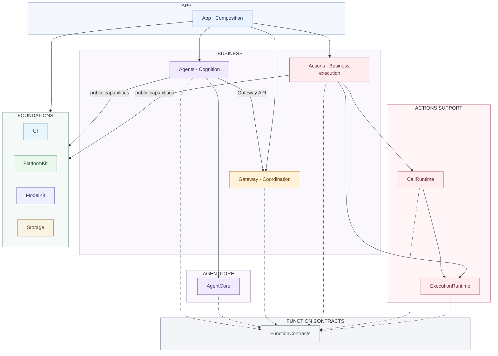

<a id="ownership-and-compilation"></a>
<a id="compilation-dependencies"></a>

The diagram summarizes permitted dependency directions between logical groups. It does not enumerate every target or require every possible dependency.

Every arrow in this figure means **compile-time dependency**. Dashed arrows identify neutral contract imports; solid arrows identify public module or support-mechanism dependencies. Gateway invokes the injected `ActionsExecutionPort` without importing Actions. Agents receives immutable descriptors and host ports without importing Actions, CallRuntime or ExecutionRuntime. Foundation-frame edges mean selected public capabilities, not a dependency on every foundation.

System frameworks and approved third-party libraries are external dependencies and are omitted from the graph for readability. Dependencies between targets inside one foundation remain internal to that foundation and must be acyclic. In the current target graph, UI has no package-target dependencies and uses Apple presentation frameworks; PlatformKit has no package-target dependencies; ModelKit and Storage each contain multiple targets within their own SDK boundary. [Package.swift](../Package.swift) defines those exact build units.

**Foundation isolation is mandatory.** UI, PlatformKit, ModelKit and Storage must not import one another or any other project module. Their external dependencies are limited to system frameworks and approved third-party libraries. Targets within the same foundation may depend on that foundation's own contracts and mechanisms. A foundation that needs an external facility defines a neutral port in its own API; an upper-layer adapter supplies the implementation. Injecting an adapter must not introduce foreign project types or a hidden business dependency into the foundation's contract.

**Business dependencies are directional.** Agents imports Gateway public communication/scheduling interfaces and neutral function contracts; App injects Actions-owned host capabilities through those contracts. Actions must not import Agents, Gateway orchestration or App. Gateway must not import concrete Agent roles, Actions business implementations, App or foundational implementations. FunctionContracts provides its neutral execution boundary; Gateway imports no AgentCore, CallRuntime or ExecutionRuntime implementation. No module may reach through another module's public interface into private implementation.

**Shared targets remain neutral.** FunctionContracts is a leaf target without project dependencies. AgentCore depends only on FunctionContracts and owns cognitive identity, Skill, Task and decision contracts; ExecutionRuntime and CallRuntime own reusable execution and call mechanisms. Their physical placement under Agents or Actions does not authorize a dependency on those directories' business implementations. ExecutionRuntime depends on FunctionContracts; CallRuntime depends on FunctionContracts and ExecutionRuntime. These targets must not accumulate role policy, device logic or application composition. AppLifecycle is another independent target under App; it implements the generic lifecycle graph without importing business modules.

<a id="ioc-and-container-ownership"></a>

#### IoC, composition and container ownership

Inversion of Control (IoC) separates dependency assembly from capability use. App constructs and retains all seven module roots and connects their public capabilities through initializers, configuration interfaces and callbacks. The foundation isolation and directional business dependencies defined above govern injection as well as imports. Each module owns its state and internal work; only App resolves application registrations.

**ApplicationContainer is the application composition registry.** It uses FactoryKit instance-local registration and caching to retain module roots within one application scope. ServiceFactories resolves those roots and connects their public capabilities; ModuleRegistration supplies the lifecycle graph. Cached construction and asynchronous startup are separate operations: resolving a root does not make its capabilities ready. Replacement waits for the previous scope's required cleanup.

**Module containers are capability and lifecycle owners.** They expose related capabilities and retain their internal services. They are not additional FactoryKit registries. Child containers belong to their module root; App's convenience factories project those existing instances rather than constructing independent copies.

| App-owned module root | Containerized capabilities within the root                                                                                                              |
| --------------------- | ------------------------------------------------------------------------------------------------------------------------------------------------------- |
| AgentContainer        | Assistant, ApplicationControl, Memory, Photographer, SpeechPerception, SpeechSynthesis and VisionPerception role containers                             |
| GatewayContainer      | Bound communication endpoints, scheduling, resources and correlated feedback services                                                                   |
| ActionsContainer      | Function catalogs, validation and execution services; business domains and individual functions remain library declarations without separate containers |
| UIContainer           | Home, Camera, Settings, ModelResources, Navigation, Album, History, Devices and Diagnostics containers                                                  |
| PlatformContainer     | AudioContainer, VisionContainer and ConnectivityContainer                                                                                               |
| ModelContainer        | ModelLanguageContainer, ModelSpeechContainer, ModelVisionContainer and ModelArtifactsContainer                                                          |
| StorageContainer      | CacheContainer, FilesContainer and the injected DatabaseStorage backend interface                                                                       |

The table describes ownership; module READMEs define child interfaces and internal lifecycle. ContainerFailureChannel, executionBindings and ForegroundPreparation are supporting lifecycle services, not additional module roots.

The following diagram focuses on the three business roots and their injected runtime ports. Foundation capability use appears in Part I; startup dependencies appear in Part III. These arrows do not represent Swift imports.

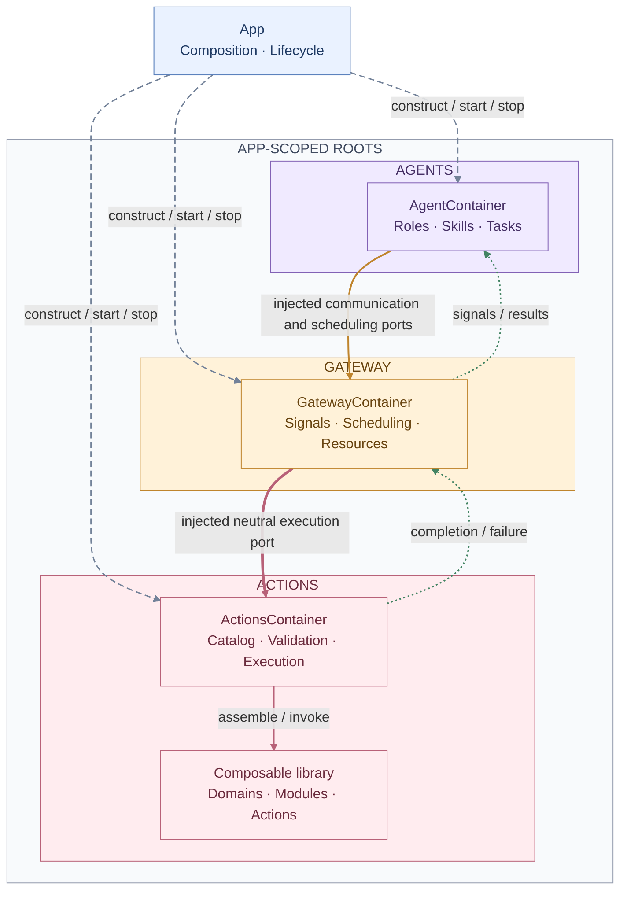

Dashed arrows from App show root construction and lifecycle control. The solid arrow carries communication and scheduling requests, the thick arrow invokes execution, and dashed return arrows deliver Signals and outcomes.

Agents uses Gateway communication and scheduling ports; Gateway invokes the neutral ActionsExecutionPort implemented by ActionsContainer. Results return through values or injected ports. These runtime relationships preserve the compile-time boundaries above. The role and execution rules below define authorization, admission and business validation; injecting a capability does not grant permission or prove an effect.

### 3. Module-specific development rules

The following rules are normative placement and review criteria. A new feature must have one explicit policy owner and one explicit execution owner; the same concern must not acquire competing implementations across modules.

| Module          | Required development rules                                                                                                                                                                                                                                                                                                                                                     | Excluded responsibilities                                                                                                                                                             |
| --------------- | ------------------------------------------------------------------------------------------------------------------------------------------------------------------------------------------------------------------------------------------------------------------------------------------------------------------------------------------------------------------------------ | ------------------------------------------------------------------------------------------------------------------------------------------------------------------------------------- |
| **App**         | Create and retain scoped roots; inject narrow public interfaces; select application backends; order startup and joined shutdown; complete old-owner cleanup before replacement. Keep dependency registration in the composition scope.                                                                                                                                         | Intent interpretation, business request consumption, per-frame forwarding, domain data conversion and per-function business registration.                                             |
| **Agents**      | Keep input interpretation, private goal/context state and role policy with the responsible role. Consume local typed inputs directly; use models only when needed. Submit executable output and role communication through bound Gateway interfaces. Own subscriptions and decision work independently of pages.                                                               | Native device implementations, duplicated Action logic, direct business-effect bypasses, global root lookup and access to another role's private state.                               |
| **Gateway**     | Let App configure, start and stop the unique scoped root; never tie global Gateway lifetime to a role. Preserve real producer identity and causality; validate endpoint identity, execution scope, envelopes and admission; coordinate routing, ordering, resources, cancellation and result delivery through neutral contracts. Keep scheduling distinct from domain success. | Goal selection, semantic interpretation of observations, model inference, device algorithms, UI policy and raw-media forwarding.                                                      |
| **Actions**     | Own canonical business function declarations and implementations. Validate arguments, session/business preconditions and execution permits; use injected public capabilities; return real results and retain partial effects or cleanup failures. Share implementations across supported call protocols.                                                                       | Agent goals, reasoning loops, transport admission policy, application lifetime and duplicate implementations for different call syntaxes.                                             |
| **UI**          | Enforce foundation isolation. Define UI-owned request values and public presentation interfaces; own local interaction, navigation and rendering state. Distinguish request acceptance, state changes and actual display completion.                                                                                                                                           | Calling or importing Agents, choosing domain policy, loading models, writing business repositories or directly controlling devices.                                                   |
| **PlatformKit** | Enforce foundation isolation. Use public platform APIs; validate capabilities and permissions; own native handles, capture/connection generations, bounded observations and native cleanup. Expose actual platform/device facts and failures.                                                                                                                                  | Agent identity, Task/Skill authorization, business motion policy, inferred device success and model-driven recovery.                                                                  |
| **ModelKit**    | Enforce foundation isolation. Own typed inference contracts, providers, artifacts and model lifecycle. Keep model-specific processing with its provider and use SDK-owned ports for external facilities. Make selection, readiness, inference and shutdown outcomes explicit.                                                                                                  | Application Task/Skill management, conversation policy, capture/playback orchestration, page state and silent provider replacement after execution failure.                           |
| **Storage**     | Enforce foundation isolation. Own bounded cache leases, controlled file access, repository contracts and backend consistency. Report actual commit and recovery outcomes; keep backend selection in application composition.                                                                                                                                                   | Mirrors of other containers’ runtime state, model-context generation, application decisions, automatic device-effect replay and fabricated persistence through undocumented fallback. |
| **Resources**   | Keep Agent/Skill declarations catalog-indexed and validated by Agents; keep model metadata, privacy declarations and assets under their respective packaging contracts. Keep declarations consistent with registered capabilities and preserve reproducible packaging.                                                                                                         | Executable business logic, secrets, downloaded model weights, user media and configuration that grants unregistered authority.                                                        |

A model call, a Skill declaration and an available device are separate facts. Resources may describe a capability, Agents may choose it, Gateway may admit and schedule it, Actions may execute it, and a foundation may supply its mechanism. Each owner must preserve its own boundary rather than infer that another stage guarantees success.

### 4. Rules shared by all modules

- **Interfaces and state:** expose only the required public capability; define one authoritative owner for mutable state. Read observations from their actual owner instead of maintaining a second public mirror. Cross-module adapters translate contracts without taking over domain policy.
- **Lifetime and isolation:** identify the owner and isolation of asynchronous work. Define admission, cancellation, cleanup and terminal completion; long-running work must have an owner independent of a page. Construction must not implicitly capture media, run inference or scan devices.
- **Capacity and pressure:** give every queue or active-work slot a documented bound and overflow policy. Reject, backpressure or replace according to that contract; never silently discard failed or rejected device actions.
- **Failures and completion:** propagate configuration and execution errors explicitly. Preserve primary and cleanup failures, partial outcomes and actual identities. Acceptance is not execution completion; cancellation is not proof that native or physical work has stopped.
- **Dependencies and evolution:** keep the graph acyclic and ownership explicit. Add third-party dependencies only for a concrete integration need and document their owner. Existing boundary violations are migration work, not precedent. New directories require explicit user approval under the repository instructions.
- **Documentation and validation:** record intended changes in docs requirements or plans before implementation, then reconcile owning READMEs with the implemented result. Technical documents under MobileHarness describe implemented designs only and use no implementation status markers. Remove superseded implementations unless a documented migration requires them. Validate observable behavior and failure cases; keep automated checks, real models, native UI and physical-device acceptance as distinct evidence categories.

Internal algorithms, role lists, function catalogs, subcontainer layouts and exact queue limits belong in each owning directory README. Part III defines the cross-module operational flows; it does not transfer ownership away from the modules defined here.

<a id="part-iii--cross-module-technical-design"></a>

<a id="cross-module-flows"></a>

## Part III — Key Workflows

### 1. Containerization, dependencies, startup and lifecycle

#### Container ownership

App's ApplicationContainer retains one instance of each module root per application scope: StorageContainer, ModelContainer, PlatformContainer, UIContainer, ActionsContainer, GatewayContainer and AgentContainer. Each root owns its child containers, state, workers and resource cleanup. ServiceFactories injects public capabilities; ModuleRegistration declares lifecycle dependencies. Container construction and asynchronous startup are separate phases.

#### Dependencies and startup

Arrows define readiness dependencies. Diagnostics, executionBindings and homePreparation are App-owned lifecycle services.

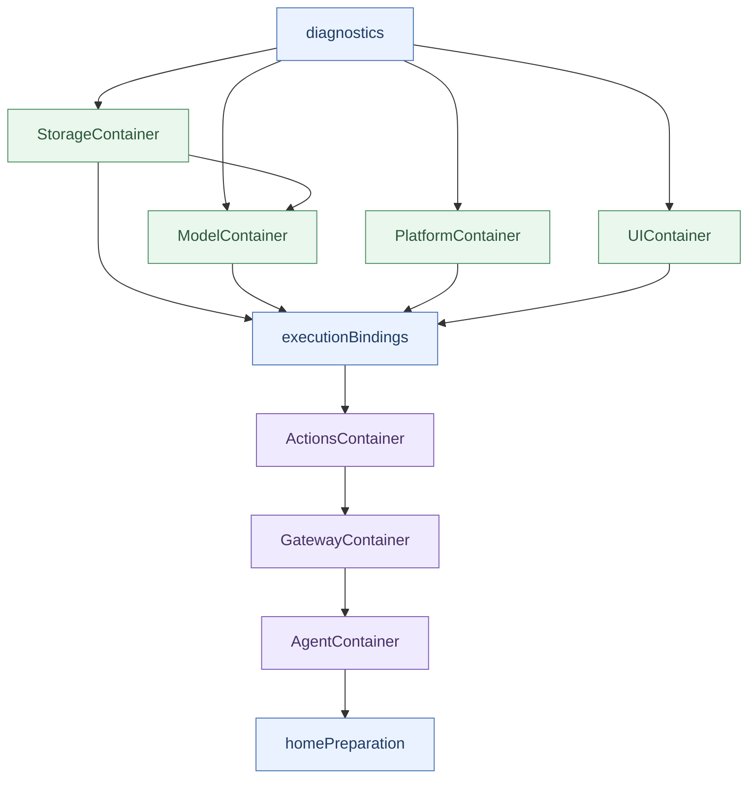

Startup runs serially: **diagnostics → storage → model → platform → ui → executionBindings → actions → gateway → agents → homePreparation**. Storage opens repositories; ModelKit registers inference capabilities, with weights loaded on demand.

At executionBindings, App sequences **Agents preparation → Actions business/catalog configuration → Agents coverage validation → Gateway execution configuration → Agents endpoint binding**. Actions then starts execution services, Gateway opens admission, and Agents starts its roles. Home preparation follows the foreground barrier and visible-home condition.

#### Lifecycle

| Transition                     | Cross-module contract                                                                                                                                                                                                                                                                                    |
| ------------------------------ | -------------------------------------------------------------------------------------------------------------------------------------------------------------------------------------------------------------------------------------------------------------------------------------------------------- |
| Initial startup                | Wait for an active Scene; validate the static dependency graph before starting services.                                                                                                                                                                                                                 |
| Scene hidden / restored        | Retain model, platform, UI, Actions, Gateway and Agents roots. Owners stop camera/tracking and foreground device work, detach local rendering, and restore visible capabilities on activation. Voice, inference and admitted business work retain their owners under OS execution and permission limits. |
| Startup failure / interruption | Invalidate admission, cancel startup, clean the partially started service, then stop started services in reverse order. Preserve primary and cleanup failures.                                                                                                                                           |
| Root stop / replacement        | Invalidate admission, cancel and join startup/scene workers, then stop services in reverse order. Each root joins its owned work; cleanup must complete before scope replacement.                                                                                                                        |

Shutdown runs **homePreparation → agents → gateway → actions → executionBindings → ui → platform → model → storage → diagnostics**. Execution bindings and cleanup ports remain available until Agents, Gateway and Actions finish draining. Repeated stop requests join the same shutdown; failed cleanup retains the scope and blocks replacement. Reactivation does not replay device effects.

[Container ownership](#ioc-and-container-ownership) · [Composition](App/Composition/README.md) · [Lifecycle](App/Lifecycle/README.md)

### 2. Signals and Agent communication

<a id="native-input-and-internal-signals"></a>
<a id="2-input-signal-and-agent-communication"></a>

#### Three classes of Signal

Signal is the common design concept for information entering an Agent. Signals have three source classes; delivery uses direct subscriptions or Gateway coordination according to the source contract.

1. **External Signal — world and screen IO.** PlatformKit supplies device IO such as microphone PCM, camera frames and device observations. UI supplies screen IO such as clicks, gestures, text and form submissions. The responsible Agent directly consumes injected observation/request ports and owns the subscription, adaptation and freshness checks. Perception roles interpret sensory data; typed screen input enters its responsible role directly. Capability-owner observations use the same local input path. Capture activation and native cleanup remain Actions/PlatformKit responsibilities.

2. **Internal Signal — Agent-to-Agent communication.** A producing Agent sends messages or data to another Agent, including perception results, task coordination and requests for input. Agents binds the producer identity, validates the business schema and communication permission, and selects receivers. Gateway SignalTransport validates the envelope and delivers to bound role endpoints. The receiving Agent owns interpretation and subsequent processing.

3. **Execution Feedback — Action outcomes.** Actions returns completion, failure or cancellation evidence through Gateway to the Agent that requested execution. Gateway preserves the original caller, session and call identity; Agents correlates the outcome with its decision and task. The Agent uses that evidence to continue processing, update state or report to the user. A delivery/admission receipt and an execution outcome retain separate completion semantics.

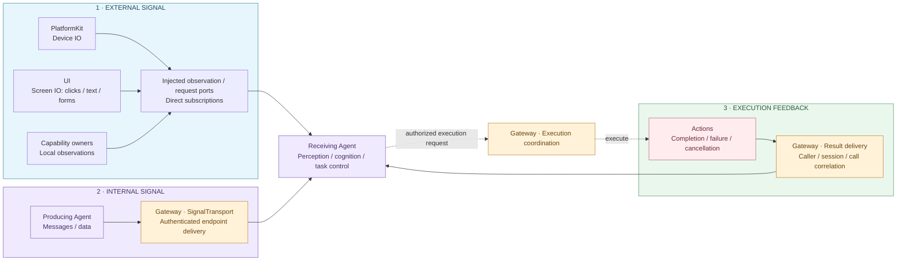

Solid arrows carry the three classes of incoming Signal; dashed arrows carry outgoing execution requests. Agents process Signals deterministically or through ModelKit and can produce further Internal Signals or execution requests.

#### Delivery and lifecycle

- **Identity and authorization.** Direct inputs retain their source/session/generation. Internal Signals bind the actual producer/incarnation and communication contract; Gateway checks endpoint tokens, envelope version, size, hops, deadline and capacity. Execution Feedback retains the original endpoint and call identity. Retired identities cannot target replacement roles.
- **Admission and completion.** Directed send returns a receiver-admission receipt; publish delivers to declared subscriptions and may have no subscribers. The business owner reports actual completion separately. Processing context carries causality; execution permissions remain owner-bound.
- **Capacity and cleanup.** Native buffers, Agent input queues and Gateway delivery retain owner-defined bounds and overflow policies. Cancellation and endpoint retirement join affected deliveries; root shutdown closes admission and joins owned work. Business owners define retry, deduplication and durable-notification policies.

[Agents communication](Agents/Support/Core/Communication/README.md) · [Signal transport](Gateway/Input/README.md) · [Speech intake](#11-listening-asr-and-sound-source-observations) · [Vision intake](#13-camera-preview-vision-and-tracking)

#### Assistant delegation to other Agents

<a id="assistant-agent-delegation"></a>

Assistant owns the user goal and chooses between peer `task.start` and `task.delegate` entries: start retains its own foreground work; writing, drawing, file changes and saved-work search/open/delete go directly to Writer. An unrelated foreground Task and its Skills may coexist with delegation. The selected executor owns admitted business work, progress, cancellation cleanup and terminal evidence.

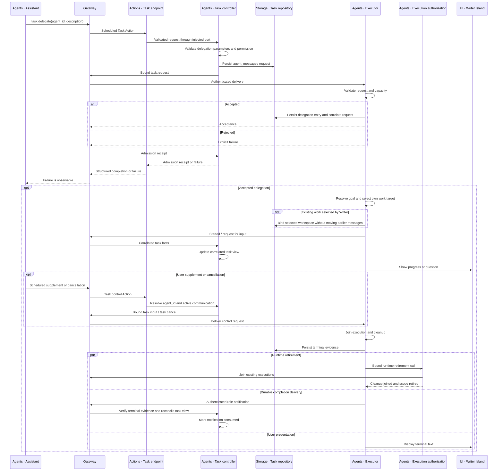

Task Actions validate and forward control through injected Agents ports. Independent communication consumers deliver messages while the scheduled Action waits for admission. Public controls use `agent_id`; runtime resolves the current communication and captured question identity. The caller does not allocate the target role’s local task/workspace. Late events remain fenced to their original execution. Successful Writer transport completes without a model continuation. Writer presents progress on its Island. Assistant reconciles authenticated state and speaks selected events using its existing playback path without triggering inference. Subsequent user requests receive a bounded digest from the originating conversation. Admission, execution cleanup, scope retirement and presentation have separate completion boundaries.

Background delegation requires an implemented route and communication permission. The receiver admits the assignment and its model can execute, ask for clarification or decline with a reason. Writer is the current public creative executor, and `sendMessage` currently adapts Writer input. Writer's artifact-library and file-editing Skills are private to Writer. The role calls Actions' native workspace tool through Gateway: search reads library metadata, open presents saved work, and explicit create initializes an empty directory before subsequent scoped file operations. Its library/workspace domains belong to [Writer](Agents/Writer/README.md#作品库与工作区分域), deterministic file validation/rendering/export to [Artifacts](Actions/Artifacts/README.md), and Island feedback and durable terminal notifications to the [Writer communication contract](Agents/Writer/README.md#委托与主动事件).

[Assistant delegation](Agents/Assistant/README.md#对其他-agent-的委托) · [Task Actions](Actions/System/Task/README.md) · [Task message values](Agents/Support/Communication/README.md) · [Independent output consumers](Agents/Support/README.md#lifetime-bounds-and-failures)

### 3. UI requests and shared business execution

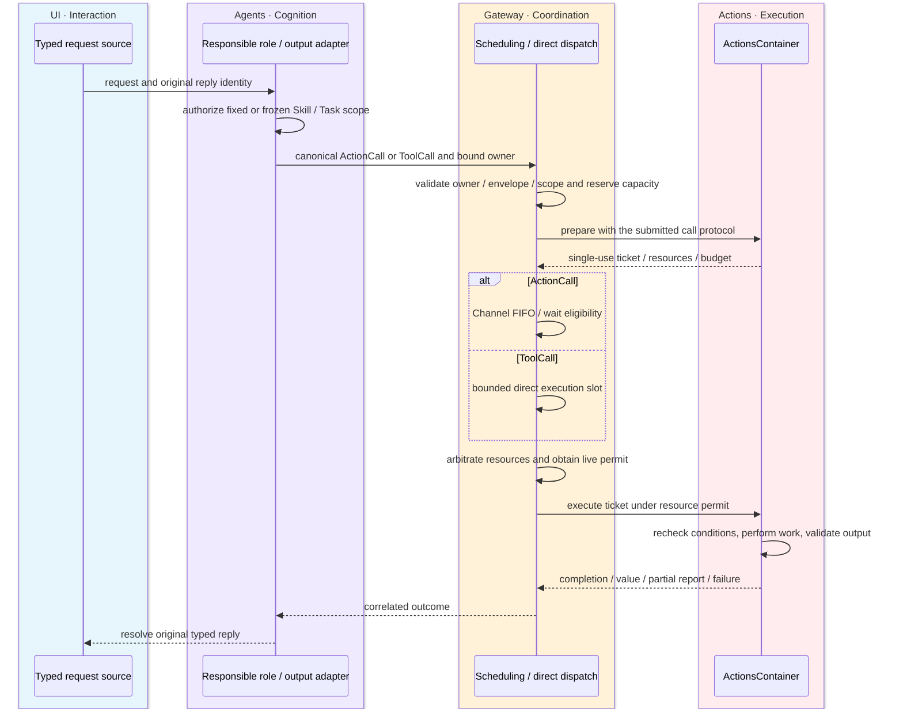

<a id="ui-requests-and-business-execution"></a>

The [Action lifecycle responsibility matrix](#action-lifecycle-responsibilities) defines registration, authorization and validation ownership for both this deterministic UI path and model-generated calls.

After admission, Gateway does not query Skill permission again. Agents revokes authority by explicitly cancelling the corresponding execution scope. The business executor rechecks current conditions after queueing. Preparation has no business effects; its single-use credential is tied to the container catalog revision. Rejection, cancellation and shutdown discard retained preparation. Result delivery retry never reruns business work.

UI request sources, cognitive consumers and business owners are separate. Missing consumers, full capacity, closed roots and stale generations fail explicitly. Replies resolve the original request. Model-selected operations and deterministic UI requests use the same registered business functions and validators. Local navigation does not create an inference round. Full history and media use private typed attachments rather than model parameters. Root-owned mutations, title jobs and observations survive page lifetime. See [Actions](Actions/README.md), [Gateway Output](Gateway/Output/README.md) and [Agent adapters](Agents/Support/README.md).

#### Two UI interaction paths

UI interactions are classified by responsibility: **presentation-only interaction** changes local presentation, while **business interaction** requests business data or operations. Touch and voice are input methods, not the classification criterion.

**Business interaction** follows the Agent/Gateway/Actions path and has two input branches. Touch business requests reach their responsible Agent for deterministic handling. Voice input passes through speech perception, then reaches a cognitive Agent for intent interpretation and call selection. Both branches invoke business functions through Gateway and Actions, sharing the same implementation when calling the same function. Agent handling does not always require model inference.

**Presentation-only interaction** responds directly to local presentation interactions such as navigation, dragging and expansion. These interactions update presentation state without entering Agent decision-making or Action execution. A page can use both paths according to the responsibility of each operation.

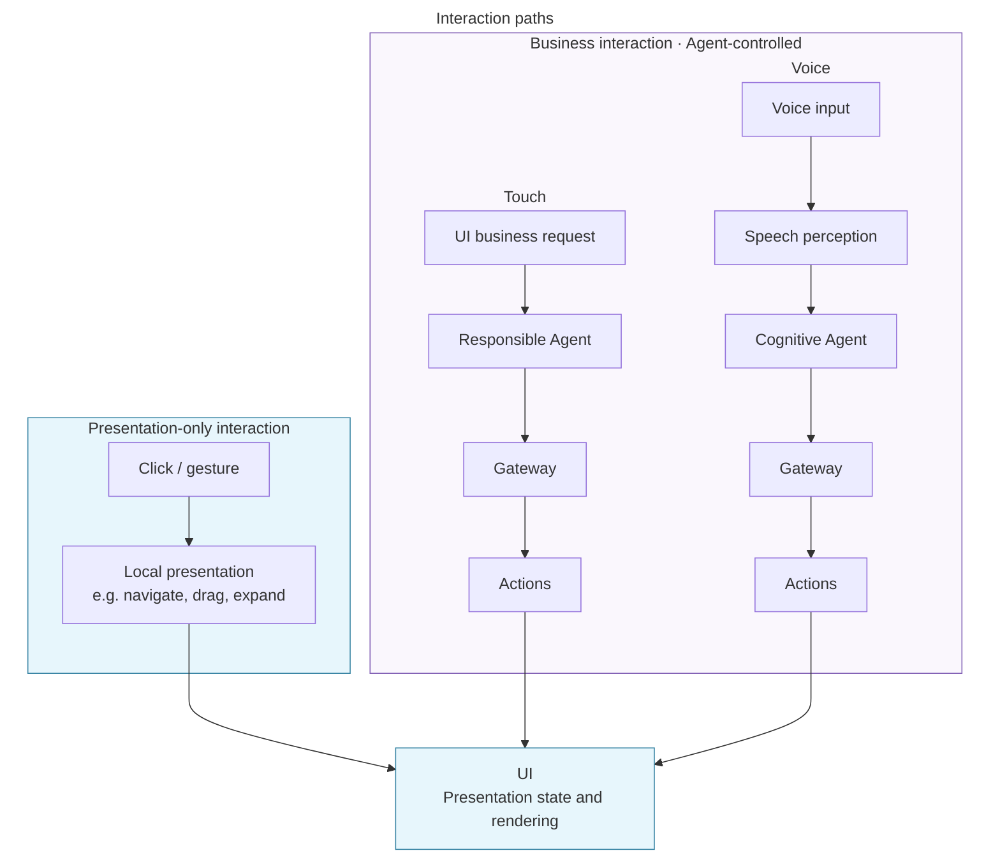

The two Actions nodes represent the same shared execution capability. Actions owns business execution and submits presentation updates through injected UI interfaces; UI owns the resulting state and rendering. Execution feedback returns to the requesting Agent and does not automatically become displayed content. Direct responses remain limited to presentation responsibilities; device effects and domain lifecycle coordination belong to the Agent/Gateway/Actions path.

**Routing rule for development:** keep changes limited to UI presentation state on the direct path. Route business data queries or mutations, persistence, device operations and domain lifecycle coordination through the responsible Agent → Gateway → Actions. Classify by the actual effect, not by whether the input is a click or voice command. A combined interaction may use both paths: opening a page is presentation-only, while loading its business data uses the business path; closing a window that must stop capture requires business lifecycle coordination. UI handlers submit business intent rather than implementing the business operation themselves. Voice-selected presentation commands still enter through Agent execution; presentation-only classification does not bypass that voice decision path.

Execution and completion contracts follow the shared workflow above; local presentation details belong to the [UI module](UI/README.md).

#### Window presentation and domain lifecycle

UIContainer owns WindowState and the `ui.windows` reader. ApplicationControl consumes typed window requests and invokes registered UI.Window functions through Gateway. Actions delegates domain lifecycle to WindowContentLifecycle; CameraCoordinator retains media ownership independently of view mounting. `Camera.Capture.open` combines photo-window presentation with capture readiness and completes without a business value; `Camera.Perception.openVision` enables vision independently of that window.

UI owns geometry, focus, stacking and presentation completion. Camera owns device leases and media disposition. Closing clears temporary photo previews directly. Pending videos require explicit disposition. Photography Skill awaits the close receipt after the matching Task's successful final disposition before Task termination. Completion, cancellation and replacement join that cleanup; failure retains the Task and pending media requires user disposition. Closing photography leaves independently enabled vision running. Photography can select five cached images for model review and save all pending photos in the current window session. See [window execution](Actions/UI/Navigation/README.md), [Camera](Actions/Camera/README.md) and [Skill lifecycle](Agents/Support/README.md).

#### Web browsing and artifact presentation

Remote browsing follows Assistant → Gateway → Actions.Web → UI WebKit. Browse, navigation and snapshot receipts retain source-scoped Storage media references for Assistant image analysis; page text and screenshots are untrusted observations. UIContainer keeps each remote Web and artifact page in its own window session. Browsing a URL creates a window unless an existing Web window is targeted. WindowState owns the cross-creator `window_N` index and twelve-window limit. WebPageContainer owns page summaries by window identity. BasicSkill selects `ui.windows`; WebBrowsing selects `ui.web` and exposes scheduled page queries. Observing another Agent's page does not expose its source files or private context.

Local creation follows [Agent delegation](#assistant-agent-delegation) into the creative owner, whose authorized direct tools invoke Actions.Artifacts. Artifacts owns deterministic edits, drafts, immutable publication, preview/export business operations and file/SQL compensation; Storage owns confined files, the shared SQLite workspace catalog and version CAS. App injects these ports without owning the workspace index. Raw source flows through a backpressured content port rather than Assistant's XML protocol or history. The role-specific control/content loop belongs to [Writer](Agents/Writer/README.md). Writer accepts a goal without caller-assigned workspace identity, then creates directly for an explicitly new work. An exact ID can be used directly to enter or open a ready workspace. Writer searches the SQLite catalog when it needs to discover the ID by title or keyword. Entry requests a preview window and activates the file-editing Skill and its workspace command schema. Opening works keeps the current phase. Writer selects matching identities and can issue multiple open calls in order, each with its own window result. Editing activates the editing Skill alongside its library dependency. Both Skills select tools through the same catalog. Writer handles workspace entry, switching and delegation control locally. It reuses creation reservations per delegation. Artifacts initializes the entry file with the new draft and returns its status for the editing context. A switch keeps the previous draft and changes the editing target for subsequent messages. In both domains the model calls finish explicitly, and Writer invokes the internal publication capability for edited files. The control request that entered the workspace retains its original history identity; communication authentication and Assistant foreground tasks do not choose the file target.

Writer and Assistant share Gateway coordination without sharing a role workflow. Writer start/edit/preview/render/finish commands use Gateway direct execution; edit completion creates a stream, while host-bound append/complete/abort continue that admitted edit under its delegate/stream identity. File completion is distinct from task completion. Writer cancellation or root suspension revokes ordinary continuation admission and joins model/preview work plus Actions release before terminal reporting or resumption. Actions independently joins its tracked effects and editors on root shutdown. Per-chunk data does not create synthetic Gateway calls; details and capacity belong to [Artifacts](Actions/Artifacts/README.md#执行与续写生命周期).

Artifacts maps project snapshots into a stable project-scoped WebKit read root. Safe incremental preview disables scripts and uses UI's same-document update; explicit rendering executes the assembled files with viewport restoration. Text uses escaped presentation. Markdown preview, saved-work display and PDF share UI’s offline conversion to static HTML and Mermaid SVG images. Actions carries diagram diagnostics in the workspace observation. The creative role decides when to preview or inspect; UI owns DOM, gestures, zoom and transitions, while Actions/Storage own file rotation and cleanup. A rendering failure does not erase a persisted draft, and a saved file does not establish visual acceptance. Export reads an immutable snapshot and uses a separate UI rendering page for PDF. See [Artifacts](Actions/Artifacts/README.md) and [Web component](UI/Components/Web/README.md).

Content owners submit titles, operation subtitles and optional icons through Actions' existing UI presentation interface. UI validates display values and owns window layout without looking up business resources or interpreting Agent commands. HTML document titles do not rename the business window. Closing/minimizing a window does not terminate its creative task; explicit reopening and task control remain distinct operations. See [Window](UI/Components/Window/README.md) and [Writer window policy](Agents/Writer/README.md#窗口命名操作副标题与场景).

### 4. Page navigation and visible page context

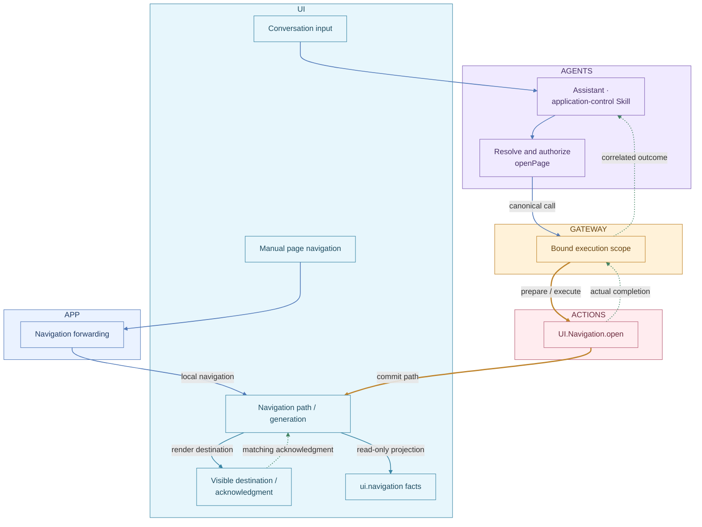

Manual navigation uses App-injected callbacks and AgentContainer forwarding without inference or a function call. Conversational navigation loads the application-control Skill, resolves `openPage` to `UI.Navigation.open`, passes Agents authorization and Gateway admission, and commits the same UI path through Actions.

UI owns NavigationStack and path generations. A path change enters transitioning; a matching visible-page acknowledgment settles it. Settled does not mean data, animation or GPU completion. Details, object IDs, pickers and confirmation sheets remain distinct from the top-level path. Stale callbacks cannot overwrite the current detail.

Face remains a persistent sibling of navigation. WindowHost overlays only the retained home surface, below NavigationStack and the local Island. Navigation pages cover the home windows: UIContainer synchronously projects home visibility into window visibility while retaining window identity. The root-owned local Island stays above all pages in one scene overlay, retaining live updates, status-bar presentation and interactive expansion preferences across navigation. Writer record queries return explicit next-page cursors through UI-owned DTOs; Writer determines pagination from bounded Storage lookahead. Workspace messages and delegations start newest first and load older records as the list reaches its bottom. UI retains loaded pages across child navigation. See [Writer records](UI/Settings/README.md#writer-记录与作品). Settings/history/album preserve Face rendering and listening; the Camera window lifecycle controls capture independently of navigation. Minimize hides window rendering while retaining capture/recording demand; restore confirms current readiness; background clears capture intent and foreground requires an explicit reopen. `useStates` supplies page facts to subsequent decisions; execution checks live conditions. See [UI](UI/README.md) and [navigation](Actions/UI/Navigation/README.md).

### 5. Skill composition, Task and model context

<a id="model-context-composition"></a>

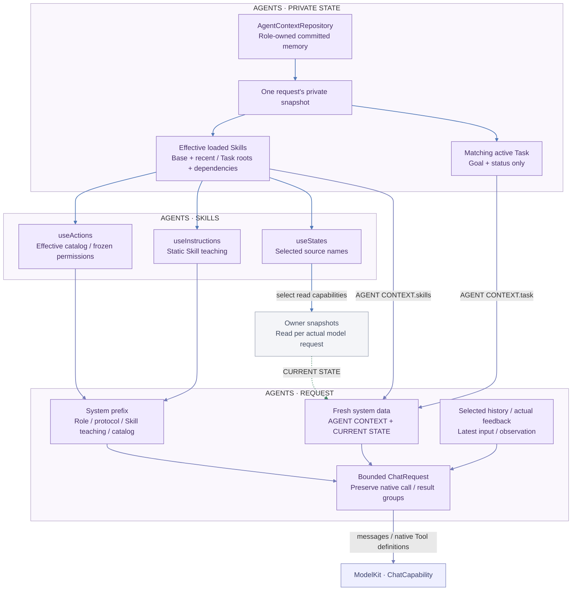

<a id="state-devices-resources-and-faults"></a>
<a id="tasks-model-decisions-and-history"></a>

Skill v3 selects function bindings with `useActions`, read capabilities with `useStates`, and static Markdown with `useInstructions`. The effective loaded set includes base Skills, retained recent/Task-held roots and dependency expansion. One private snapshot supplies the request's selected Skill IDs, catalog, teaching and minimal Task/Skill projection. A load/release transition changes subsequent requests; it cannot expand a request already sent to the model. The runtime also binds the frozen catalog to output authorization.

The model receives two different kinds of system content:

| Request content                    | Source and meaning                                                                                                                                                                                                                                            |
| ---------------------------------- | ------------------------------------------------------------------------------------------------------------------------------------------------------------------------------------------------------------------------------------------------------------- |
| Instruction/catalog prefix         | Role identity and protocol, available Skill overview, loaded Skill teaching and effective function metadata. Available Skills describe choices; only the effective catalog permits current calls. The prefix changes when its selected Skills/catalog change. |
| AGENT CONTEXT                      | The same private snapshot's current loaded Skill IDs and matching active Task's goal/status. No matching Task produces `task: null`; this is not a dump of task records, grants, input bindings or retention counters.                                        |
| CURRENT STATE                      | Fresh owner-defined facts selected by the loaded Skills' `useStates`, sampled separately through read-only capabilities. These are data, not instructions or execution permits.                                                                               |
| History, feedback and latest input | Bounded conversation evidence, real Action/Tool outcomes and current user input or continuation observation. Current Task evidence remains in the history window; terminal Task history can be projected as a summary.                                        |

The ordinary request order is **instruction/catalog system → selected history → dynamic system data (AGENT CONTEXT, then CURRENT STATE) → latest user input/observation**. If the request ends in native Tool results, the dynamic system message follows the complete call/result group. Previous dynamic system messages are removed before fresh facts are inserted. Native Tool definitions are a separate ChatRequest field. ModelKit receives the finished request; it does not discover containers or assemble Agent Task/Skill state.

Each actual model request, including an internal ReACT continuation, samples again. The private snapshot and the business reads are not a single atomic transaction. Model-visible Task/Skill data is private to the responsible Agent; the production conversational owner is Assistant with one foreground continuing goal. Generic task registries and delegated-role views support runtime correlation, but are not serialized wholesale into AGENT CONTEXT and do not imply an exposed background-work Skill. Detailed message selection, budgets and continuation rules belong in [Chat](Agents/Support/Chat/README.md#request-state-assembly); private transitions belong in [Context](Agents/Support/Context/README.md#container-context-read-path).

#### Prompt ownership and public discovery

Each Agent owns its public purpose in its resource description and its private execution instructions separately. Assistant's identity describes only itself; BasicSkill teaches generic Task/Skill choices and TaskActions owns callable contracts. Agents Support assembles descriptions using the actual requester communication policy and the same implemented delegation adapter as execution; metadata never grants authority. Writer privately loads its control and content-format templates. Generic Core protocol remains business-neutral. See [Agent resource contracts](Resources/Agents/README.md).

### 6. State ownership, state machines and model observations

<a id="container-state-read-path"></a>

All seven modules and their concrete child Containers read local state through `stateSnapshot() async throws`. Returned snapshots share the same path/business/runtime/health/issues/children/collectedAt/meanings/units/stateValues wire contract; module-local types preserve foundation independence and use the same Codable scalar, object and array representation. `children` contains path-only Reference indices, never child state values or serialized owner objects. Reflection comes from the already sampled value's `stateDescriptor`, without another Container read. Descriptors expose only the selected node's declared fields, domain meanings, units, child indices and finite state values; they do not enumerate private Swift storage. `collectedAt` records snapshot collection time, independently of native observation age.

State follows its Container/authoritative domain owner's lifetime. Startup seeds externally observable facts after installing observation; notifications/owned source clocks update resident memory, and foreground resume reconciles missed changes. Snapshot reads only project that memory (including pure receipt-age derivation); they never query hardware/OS sources or restore private context. Existing actor-owned software state remains authoritative without duplicate caches. Platform seeds synchronous native sources before opening admission; asynchronous network/device feedback remains explicitly awaiting observation/unknown until an actual receipt. Stop fences callbacks before cancellation and joins observation cleanup. Skill loading controls visibility, independently of collection and device activation.

Business describes owned domain attributes, activities, measurements and outcomes. Backend-routing preferences and root lifecycle failures do not become Business merely because a consumer might use them. Producers publish their full classified schema independently of the caller; visibility selection remains in that caller. Typed commands, domain receipts and effect-time validation retain their own interfaces. Runtime contains lifecycle/configuration, queues, ownership and resource instrumentation. Health/issues describe local engineering evidence and do not automatically aggregate descendants. Declared metadata must refer to actual fields; finite states use raw enums and counters retain exact UInt64 values. Storage shares its own schema through StorageCore within its module.

Each module root exposes `stateReaders() async throws`: a metadata catalog mapping exact node paths to read-only runtime capabilities. The catalog binds existing owners, primarily through weak references, and never samples their snapshots or constructs lazy capabilities. App registers catalog factories rather than copied State values. `inspection.snapshot(path:)` resolves and samples only the requested node; resolving a.b.c reads neither a nor a.b. Unknown/missing paths, cancellation, invalid classification/metadata and byte limits remain explicit. Expired owners cannot be kept alive by ordinary node readers.

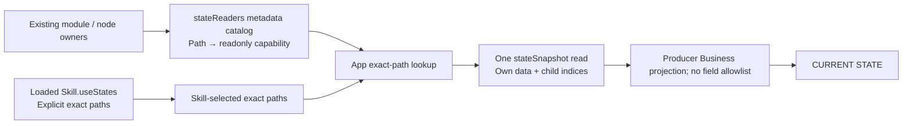

Skill registration is precise: selecting a does not select a.b or a.b.c, and a.b.c requires no ancestor State grant. Assistant sources use actual canonical node paths (`agents.applicationcontrol`, `ui.home.expression`, `platform.system.*`, etc.). RobotInteraction explicitly selects `actions.robot.motion` for active targets, independently from robot connection/tracking facts. There is no model-facing whole-tree health/diagnostic source, wildcard, automatic discovery or loadState. Source indices and engineering metadata do not become Assistant business facts automatically. Other internal consumers choose their own full classified reads without Assistant policy.

[ApplicationStateInspection](App/Composition/README.md#internal-state-inspection) offers a separate explicit `inspectTree(path:depth:)` operation for internal diagnostic callers. It walks indices and materializes its own Tree structure; this is not Container snapshot behavior or a Skill permission. Reads do not execute actions, activate devices, request permissions, prepare models, change Task/Skill state or establish execution authority. Cross-owner sampling remains non-atomic.

State is the default low-cost summary for decisions. Sufficient current facts are answered directly. Specific Actions supply missing details under their own contracts, such as Bluetooth status/device IDs, resource inventory or history records; they may overlap a summary without creating another owner or fact cache. No generic environment-query Action is registered. Fresh collection means a new read, not a forced native observation or an active probe. Actual execution results remain correlated feedback/history, and Actions rechecks live business conditions after queueing.

Observation does not establish authority or successful execution. Actions still checks live business preconditions and permits after Gateway queueing; model output cannot directly advance another owner's state machine. Real results update their owning histories and private state, and a later request re-reads the facts. Recovery does not replay effects. Generic runtime contracts belong in [AgentCore Runtime](Agents/Support/Core/Runtime/README.md), execution observations in [function contracts](Actions/Support/Contracts/README.md), and authorization ownership in the [Action lifecycle](#action-lifecycle-responsibilities).

State observation uses one App-backed resolver; `Skill.useStates` selects exact nodes and their complete Business fields. Missing or unreadable nodes yield unknown/null with a bounded path/code diagnostic; cancellation, closure and capacity errors remain request failures. Public State is independent of observer identity and does not grant access to another Agent's private context. See [Context read path](Agents/Support/Context/README.md#container-context-read-path).

### 7. Capability declaration, resolution and execution routes

<a id="action-lifecycle-responsibilities"></a>

The following figure covers registration through completion. App owns construction and lifetime; each module owns the checks and state inside its boundary. The startup phase summarizes module ownership through the App-bound collaboration ports; it does not make App a per-function registrar.

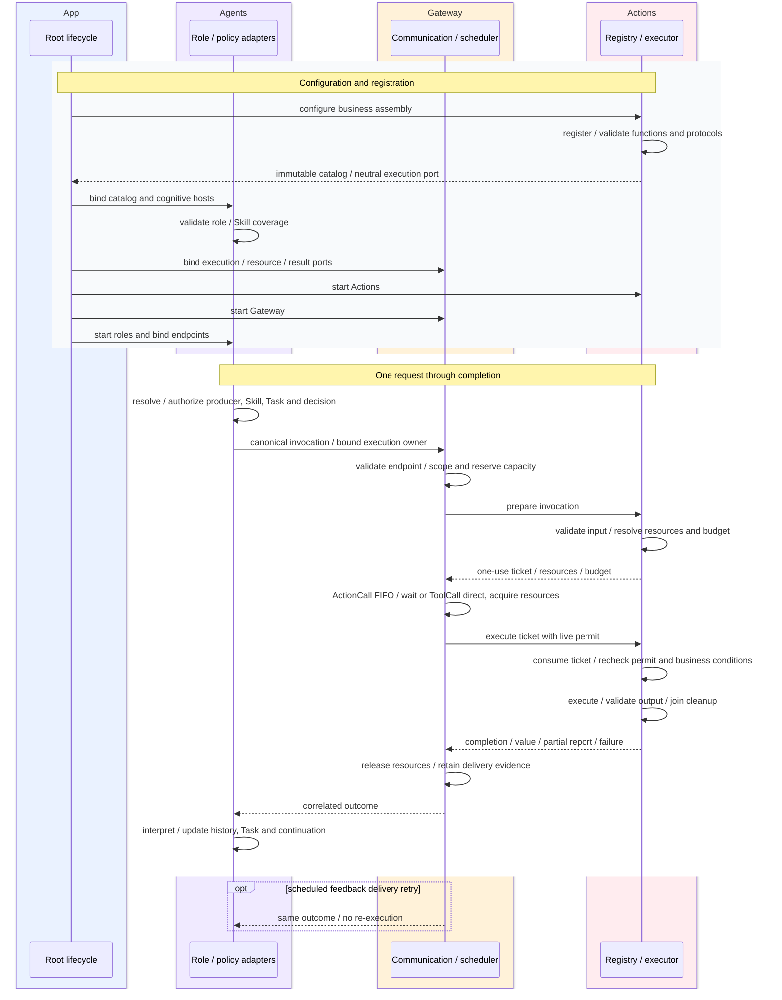

The configuration phase is part of [executionBindings and root startup](#1-containerization-dependencies-startup-and-lifecycle). The execution phase has three distinct validity questions: **Agents decides whether this role may request the function; Gateway decides whether the bound work can be admitted and coordinated; Actions decides whether this invocation is valid and can execute under current business conditions.**

| Owner                                     | Managed responsibility                                                                                                                                                              | Validation and authority                                                                                                                                                                                                                                                                                                                                                                                 |
| ----------------------------------------- | ----------------------------------------------------------------------------------------------------------------------------------------------------------------------------------- | -------------------------------------------------------------------------------------------------------------------------------------------------------------------------------------------------------------------------------------------------------------------------------------------------------------------------------------------------------------------------------------------------------- |
| App                                       | Scoped roots, constructor/configuration injection, readiness order, foreground transitions, reverse joined stop and failed-start rollback.                                          | Keeps required bindings and module lifetimes available through cleanup. Function registration stays inside Actions; Skill/Task permission stays inside Agents.                                                                                                                                                                                                                                           |
| Agents                                    | Role instances, fixed and effective Skill catalogs, private Task/context, call resolution, communication policy, authorization revocation and cognitive interpretation of outcomes. | Checks actual producer/incarnation/session, allowed output/function, frozen decision capabilities and Task grants before submission. Parsing/alias checks use the exposed catalog; authoritative business decoding belongs to Actions. Coverage validation proves registered support, not permission for every future call.                                                                              |
| Gateway                                   | Neutral endpoints and Signal envelopes, execution scopes, bounded admission, Channel/wait, resource arbitration, cancellation/join, execution evidence and result delivery.         | Checks bound endpoint/context/scope, envelope/scheduling structure and capacity. Enforces injected generic resource policies, lease validity and live permits. It does not resolve roles, query Skills/Tasks or authorize business-function use.                                                                                                                                                         |
| ActionsContainer and its business library | Compiled canonical definitions, registry/catalog, pure preparation, resources/budgets, actual invocation, input/output contracts and business/native cleanup.                       | Rejects duplicate/invalid registration and unsupported functions/protocols; validates arguments, budget/resource resolution and one-use root/catalog-bound preparation. Checks live permits, current service/session/business preconditions and completion contracts. Functions and domain services implement their own business checks; the module root coordinates them without acquiring role policy. |

Registration, exposure and authorization are different facts. Actions registers an implementation; Agents selects the functions visible/available to a role or decision; only an authorized request reaches Gateway. A valid authorization does not bypass capacity, ordering, resource conflicts or live business conditions. Required platform permissions remain enforced by the owning foundation APIs invoked by Actions.

**Gateway has no Agent implementation dependency.** Its project dependency is FunctionContracts; imports are system libraries and those neutral contracts. AgentManager, Skill/Task checks, InputGateway, OutputGateway and cognitive projections live in Agents. The adapters' names do not change their module owner. Gateway receives opaque endpoint/incarnation/session values, scheduling correlation and injected callbacks, without retaining an Agent instance or searching an Agent container. Callback/result flow does not create a reverse implementation dependency.

Resource authority is a coordination concern. For example, explicit lease acquisition checks configured allowed endpoint values and takeover checks configured preemption pairs; live permits fence actual use. Agents authors role takeover policy and App binds its neutral values. Gateway enforces those values without interpreting a role name or repeating the Skill/Task/function authorization decision. After admission, revocation is explicit scope cancellation; rechecking current business conditions belongs to Actions.

Gateway delivers real outcomes rather than interpreting them as Task success. Agents decides whether to record history, advance a Task or run another decision. Scheduled feedback retries redeliver terminal evidence; direct calls return through their owned invocation path. Cancellation joins actual work and retains independent failures; it does not undo already committed effects. The [resource](Gateway/Output/Resources/README.md), [result](Gateway/Output/Results/README.md) and [Actions](Actions/README.md) documents own their detailed contracts.

Macros and explicit CapabilityModules registration assemble functions compiled into the application. There is no runtime discovery or hot update. Missing required bindings, duplicate protocol definitions and invalid metadata prevent startup. Optional capability presence is reflected in the catalog. Domains, modules and functions do not receive containers, lifecycle nodes or App registrations.

Action and Tool are call views over the same business functions. The catalog retains declared execution and result policies. In the current production adapters, ActionCall enters ChannelScheduler, while ToolCall enters DirectExecutionDispatcher; executionPolicy is not consulted to switch these entry points. A direct descriptor alone therefore does not remove an ActionCall from Channel/wait ordering. Current model Skills use XML Actions; native and internal Tools remain supported. Internal album/full-history Tools do not become Skill capabilities merely by registration. Both routes share Actions-owned input/output validation, preparation and actual implementation. See [protocol bindings](Actions/BehaviorProtocolBindings.swift) and [execution support](Actions/Support/README.md).

### 8. Function Token and Action Call protocol

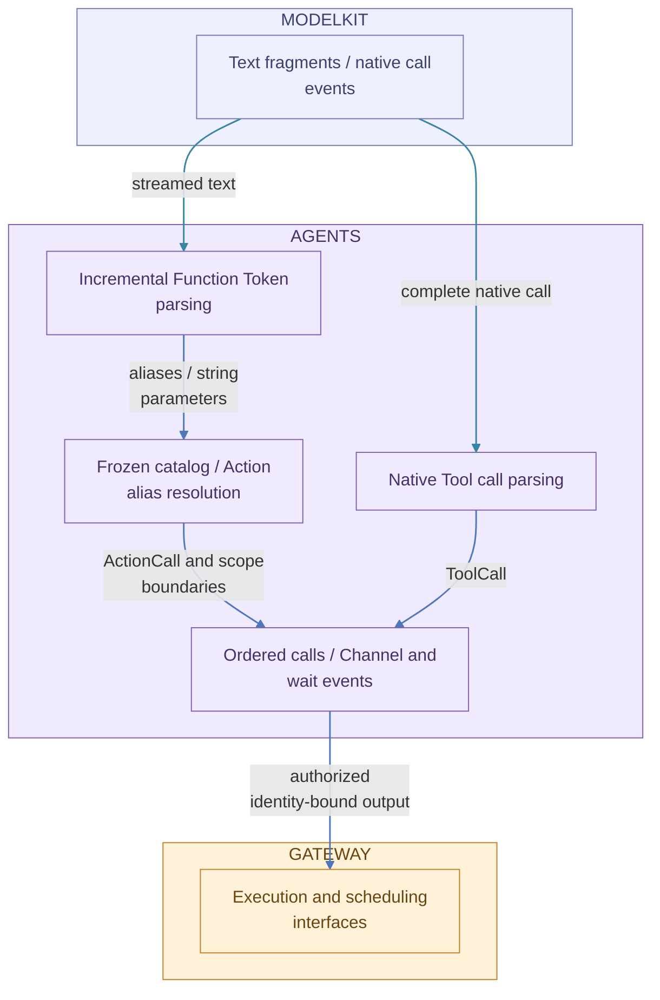

The model-output path is **ModelKit stream → Agents parsing and catalog resolution → ordered call/scheduling events → Gateway admission → Actions execution → correlated results**. ModelKit supplies output fragments; Agents interprets their protocol using the frozen decision catalog. Gateway receives resolved requests and scheduling boundaries, not raw model XML.

| Boundary              | Contract                                                                                                                                                                                                                                                       |
| --------------------- | -------------------------------------------------------------------------------------------------------------------------------------------------------------------------------------------------------------------------------------------------------------- |
| Function Token syntax | Natural text mixed with restricted XML, without a document root. Self-closing Action tags name catalog aliases; paired wait scopes emit scheduling boundaries.                                                           |
| FunctionToken         | An Agent-local parsed text, action, boundary or scheduling event. Its boundary is independent of provider tokenizer tokens and network fragments. Incremental parsing handles incomplete UTF-8 and markup across fragments.                                    |
| ActionCall            | A resolved actionPath, channel and string parameter map. Agents resolves aliases and parameters against its effective catalog; text mapping, when configured, produces ordered calls through the same generation pipeline.                                     |
| Scheduling events     | beginWait/endWait travel in order with calls. Each call uses its registered Channel. Dropping wait events changes execution semantics.                                           |
| Execution envelope    | OutputEnvelope supplies producer and processing correlation separately from ActionCall. Agents' Gateway adapter translates authorized intent into neutral execution requests; Gateway checks admission and coordinates execution through ActionsExecutionPort. |

For example, when the current catalog includes the ExpressionInteraction Skill's `express` alias, permits the Display Channel and the role configures natural-text mapping:

```xml
<wait>
    <express emotion="happy"/>
</wait>
Hello! How can I help you today?
```

The XML requests a happy expression, and the following sentence is ordinary natural text. The parser emits beginWait, an action token for `express` with `emotion="happy"`, endWait, and text events. Catalog resolution turns the action token into an ActionCall with its canonical path, string parameters and registered Channel. The role's text mapping converts sentence chunks into its configured calls, such as speech or caption presentation; text is not an Action alias and does not execute by itself.

Gateway receives the resolved calls together with the ordered wait events. The wait group joins the scheduled expression before the following mapped calls proceed; parsing `</wait>` itself does not mean the expression has finished. Wait is a protocol scope, not a business function. Channel routing is fixed by registration. Exact aliases, parameters, permitted Channels and natural-text behavior come from the current decision catalog and role configuration.

A complete Action tag can emit a call before its enclosing scope closes. Parsing completion does not establish execution completion. Unknown aliases and invalid/missing required arguments produce ordered non-executable CallRejection events. Malformed syntax, capacity violations or cancellation terminate interpretation; failed generations do not flush incomplete syntax or replay already emitted effects. A later parse failure cannot undo an effect already executed.

Native Tool calls use their separate complete-call parser and do not acquire XML aliases or Channel/wait membership. Action/Tool call syntax and direct/scheduled execution policy remain distinct, as defined in the preceding execution-route section. The next section defines how resolved Channels and wait events govern ordering. Exact grammar, bounds and rejection rules belong in [Generation](Agents/Support/Core/Generation/README.md); call and correlation contracts belong in [Output](Agents/Support/Core/Output/README.md).

### 9. Channel ordering, wait and resource ownership

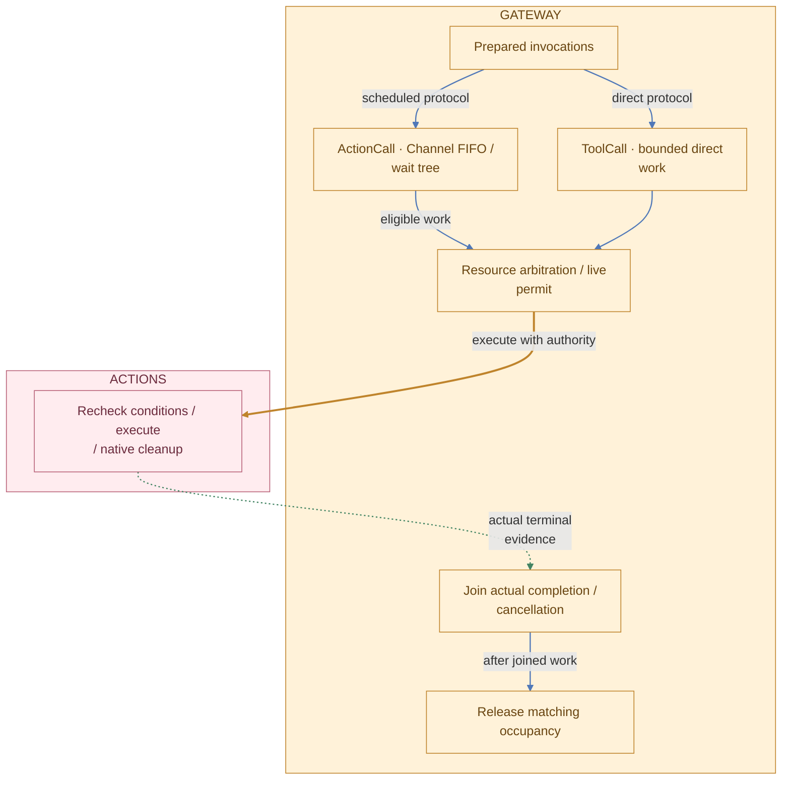

Gateway owns Channel FIFO, wait trees and resource arbitration; Actions declares required resources and owns actual device operations. Agents selects role takeover policy and App injects opaque policy values and native stop callbacks. Gateway compares neutral endpoint identities without understanding role semantics.

Different Channels may run concurrently but cannot bypass resource conflicts. Wait joins only its own scheduling tree, cannot wait on itself or ancestors, and does not branch on business success. Decisions requiring real outcomes wait for feedback. ToolCall direct execution uses the same resource mechanism while remaining outside Channel/wait ordering. ActionCall remains Channel-scheduled even when its catalog descriptor declares direct execution.

Owners, leases and revocable permits fence writes. Unconfigured conflicts fail busy without an implicit resource queue. Configured takeover blocks new writes, stops and joins the old owner, then grants authority. A timeout is not completed cleanup; late cleanup cannot grant a revoked request or replay an effect. Occupancy does not become a replacement device-health state. See [Scheduling](Gateway/Output/Scheduling/README.md) and [Resources](Gateway/Output/Resources/README.md).

### 10. ReACT continuation and execution feedback causality

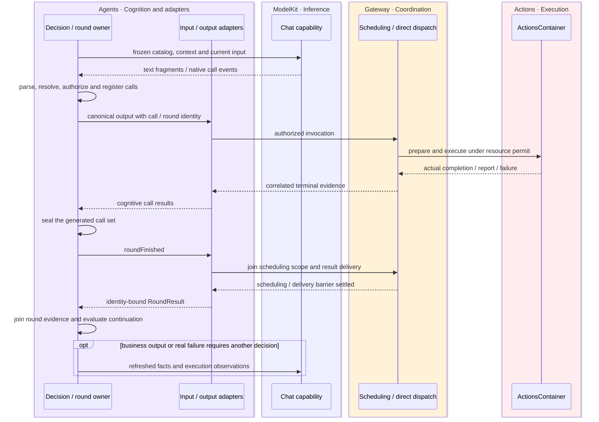

Agents submits a frozen request to ModelKit, resolves streamed output against its catalog, and submits authorized calls through Gateway. A round seal joins related calls and feedback before Agents commits evidence and decides whether to continue with refreshed facts.

Call completion, delivery, round closure and the next inference are separate boundaries. Results retain endpoint/incarnation/session/input/round/execution identity and opaque cognitive correlation; Agents interprets turn/Task semantics. Late results cannot target the latest chat or awaken a replacement owner. Reply barriers also join synthesis and playback before continuation.

Business values and real failures may become execution observations. Effect-only Action handlers return Void, which the execution layer records as a typed completion without starting another inference. Transport, parsing, lifecycle and cancellation failures do not automatically retry device effects. Partial and unknown effects and cleanup failures retain their evidence. Action deadlines belong to execution; conversation has no hidden universal TTL. See [Chat](Agents/Support/Chat/README.md), [Results](Gateway/Output/Results/README.md) and [ExecutionRuntime](Actions/Support/README.md).

### 11. Listening, ASR and sound-source observations

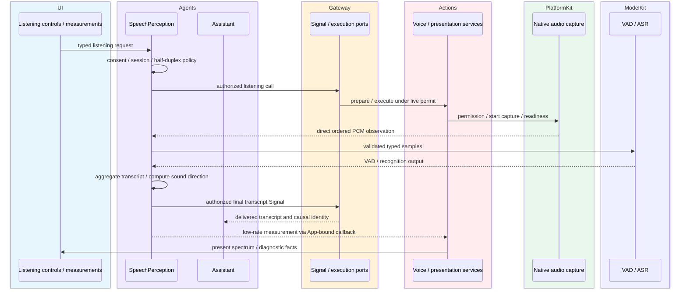

SpeechPerception owns consent, capture generations, half-duplex policy, VAD/ASR and transcript aggregation. Actions-owned voice services own permissions, native capture, readiness, shutdown and playback presentation. Read subscriptions alone do not open the microphone. Immutable native PCM reaches the role directly without Signal JSON re-encoding.

BasicSkill also exposes explicit startListening/stopListening Actions through Agent → Gateway → Actions. The voice execution owner calls the neutral perception policy port and directly applies its revision, without recursively scheduling another Action. Stop revokes consent and joins native capture cleanup without cancelling and joining its own reply execution. Reply completion cannot renew consent; a fresh screen hold or explicit user start is required. The owning [Listening design](Actions/Speech/Listening/README.md) defines the local lifecycle and failure details.

Readiness depends on effective samples and native conditions. The role validates channel layout, rate, sequence and continuity before model adaptation; ordered PCM overflow fails explicitly. Partials do not independently start ordinary conversation. Finals pass through authorized role communication to Assistant. Sound-source estimation and low-rate measurements belong to perception, while Actions presents facts. A declared observation contract does not imply a current subscriber. See [SpeechPerception](Agents/SpeechPerception/README.md), [Listening](Actions/Speech/Listening/README.md) and [Platform Audio](PlatformKit/Audio/README.md).

Recognition and reply captions have separate business owners. SpeechPerception begins recognition presentation at confirmed VAD onset and publishes the speaking-phase control fact. Assistant handles that fact without inference and clears only its own reply through a registered internal Action; final ASR text still enters the formal input FIFO. Actions fences stale request/turn/sequence updates, and UI retains both caption slots independently of reply completion. Session/root cleanup is a separate boundary. See [Assistant captions](Agents/Assistant/README.md#输入开始与自有回复字幕) and [caption execution](Actions/UI/Conversation/README.md).

### 12. Reply synthesis, playback and listening restoration

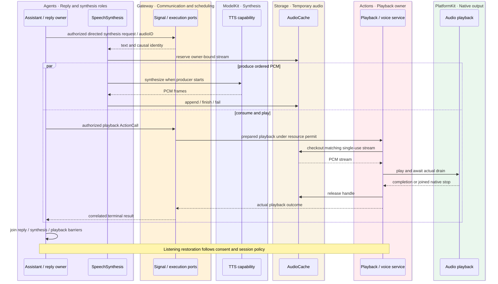

Assistant maps natural text into an authorized directed synthesis request and a playback call. SpeechSynthesis owns the ModelKit TTS producer and reserves an owner-bound AudioCache ID; it does not issue playback itself. Actions checks out the matching single-use stream and waits for native output drain. Synthesis admission, producer completion, playback drain and listening restoration are joined separately.

Explicit role messages coordinate half-duplex reply occupancy. Cancellation requests native stop, joins model production, cached streaming, scheduled playback and cleanup, then restores listening according to consent/session policy. Reply occupancy snapshots remain deliverable while execution cancellation joins playback, including already admitted publications; they retain role/session authorization and receiver revision fencing. A terminal fact releases only its source occupancy and cannot renew explicitly revoked listening consent. Writer feedback uses its own Island presentation and does not enter reply occupancy. Emitted audio cannot be undone; restored listening cannot turn failed playback into success. Model-load waiting and ordinary reply waiting use separate identity and completion conditions. See [SpeechSynthesis](Agents/SpeechSynthesis/README.md), [Speech](Actions/Speech/README.md) and [AudioCache](Storage/Cache/Audio/README.md).

### 13. Camera preview, vision and tracking

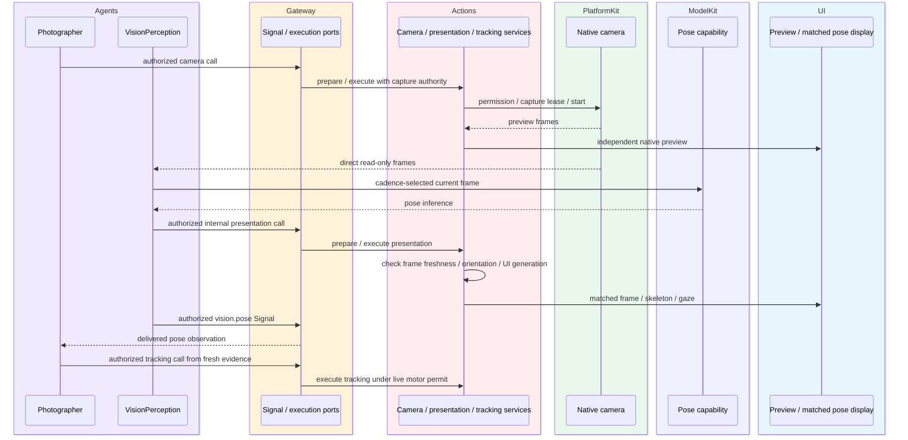

Authorized camera calls pass through Gateway to Actions CameraCoordinator, which owns permission, capture leases and native capture through PlatformKit. Preview and inference are independent: native preview and camera-only controls can work before the vision model is ready. Vision retains one inference and a latest candidate instead of queueing old frames.

Camera observations retain gravity-upright source orientation for inference and photo capture, plus an independent native sensor-to-portrait reference. Actions forwards that immutable metadata; UI combines it with actual window interface orientation for shared video/skeleton/gaze geometry. Physical rotation does not force a portrait-locked preview into gravity-upright aspect-fill. Native capture ownership and the iPhone portrait interface policy remain unchanged. Detailed geometry belongs in [UI Camera](UI/Camera/README.md#interface-based-preview-geometry) and [Platform Vision](PlatformKit/Vision/README.md#capture-and-preview-orientation).

VisionPerception owns cadence, motion evidence, target association and projection. Agents authorizes protected presentation/tracking calls; Gateway checks generic identity, envelopes and scheduling. Actions validates frame sequence, freshness, orientation and UI generation. Model/overlay failure preserves valid native preview. Photographer selects tracking from real fresh pose evidence; device output still requires authorization and a live resource permit. See [Camera](Actions/Camera/README.md), [VisionPerception](Agents/VisionPerception/README.md) and [Photographer](Agents/Photographer/README.md).

#### Shared capture and lens authority

Photo and background vision are independent Actions-owned demands over one PlatformKit Camera capability. Either demand keeps capture active; the second consumer reuses the same immutable native stream, and only the last close releases capture. Minimizing retains photo demand but unmounts its renderer. App background clears both demands and joins cleanup; foreground alone does not reopen either. YOLO/tracking is created only for visual demand and never drawn in the photo window.

UI owns actual surface ordering, safe-area geometry and presentation completion. Actions reads the same lensOwner projection as the buttons: the highest visible camera surface can switch; an expanded visible photo window outranks Face, while minimization yields to visible enabled Face vision. Other windows confer no camera rights. Transitions fence new switches and join admitted native work. PlatformKit alone changes input/captures photos; successful switching updates both displays, invalidates the old pose scope and reacquires tracking. Native running/facing/phase facts are published at platform.vision.camera, independently of business intent. Surface layout belongs to [UI Camera](UI/Camera/README.md) and [Window](UI/Components/Window/README.md).

### 14. Photo/video capture, App album and system export

Camera photos enter the session-owned Storage Image cache with memory-only preview_N identities. Each Camera window lifetime starts at1 and keeps the newest20 originals; successful append retires the oldest without renumbering. Camera owns latest/explicit model selections and disposition policy; save publishes independent album media_N, marking and unloading the saved preview while retaining its cached original. Reshooting retains earlier images for explicit loading. Closing joins work and clears the session; minimizing/background retains bytes but pauses model image delivery. Shared Context/Chat merges selected images into the original user input and keeps public metadata in system State. Private resource-scope bindings fence queued operations against reused labels without entering model context. Request logs preserve actual submitted image bytes independently of the Camera session; deleting logs removes those history images with no cache or album fallback. Album persistence receives no preview or camera-session identity; no database mapping is used. UI receives typed catalog/scoped reads for its stack and zoomable gallery, independently of model selection. See [Camera](Actions/Camera/README.md#session-previews-state-and-gallery), [Image cache](Storage/Cache/Image/README.md) and [UI Camera](UI/Camera/README.md).

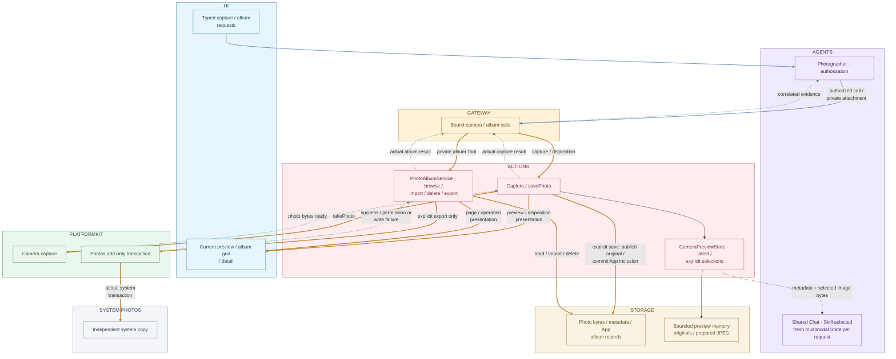

Photo bytes ready, current preview, formal App album inclusion and a system Photos copy are four separate facts. `savePhoto` includes the photo in the App album without requesting system-library permission. Existing bytes do not prove user retention; closing the preview session does not delete an included photo.

Album browse/import/export/delete uses UI.album → Photographer authorization → Gateway → the internal album function. Original reads, thumbnails and mutations have separate bounds; imports retain per-item successes. The root owns admitted changes across navigation and joins them at shutdown. The ordinary Photography Skill does not expose system export or album deletion.

System export waits for the actual Photos transaction. Denied permission or write failure preserves the App original. Each explicit click creates a copy without automatic export, retry or synchronization. App deletion commits the logical record before file cleanup and retains recovery evidence; system copies remain independent. Live model media reads retain source/session/input ownership and bounded image preparation. Historical Prompt images come exclusively from captured request logs and disappear when those logs are cleared. See [Camera album](Actions/Camera/README.md), [UI Settings](UI/Settings/README.md), [Media](Storage/Database/MediaFiles/README.md) and [Platform Vision](PlatformKit/Vision/README.md).

#### Recording, microphone handoff and media completion

Camera UI settings/countdown/start-stop/disposition requests flow through Photographer → Gateway → declared Camera.Capture/Video Actions. Assistant's Photography Skill uses the same declarations, selected facts and separate operation receipts. CameraCoordinator keeps photo/video demand independent of background Vision; both consume the same PlatformKit camera session and immutable preview. UI's file player and window activity labels are presentation-only.

takePhoto/startRecording compose the canonical camera-open step with capture under one invocation. The unique window is opened/restored or reused before mode preparation; failures stop dependent work, and only the final media receipt produces model feedback. openCamera remains available for preview-only use. Generic sequence composition defaults to continuing after failed leaves for existing robot workflows, while camera preparation selects stop-on-failure. Successful child reports never replace the final value in Actions or Gateway.

Before recording, Actions automatically prepares video mode in the Camera window, preserving lens/zoom/photo delay and applying an optional duration limit; configuration failure joins rollback and never starts capture. Actions then blocks new voice audio playback, joins VoiceSessionCoordinator's microphone pause and full native audio-owner release, and retains the prior listening generation. AppleCamera then reserves PlatformKit.Audio's native owner, adds microphone/movie output to its existing graph and waits for didStart. didFinish removes/releases native audio; Actions validates/publishes a pending local file through StorageMedia before resuming valid foreground listening intent and offers save/ignore. Model startRecording defaults to awaiting that terminal receipt under the original execution identity; only then does its ready result trigger ReAct with mediaID, fileName and actual duration. Photographer's interactive start Tool explicitly requests startup-only acknowledgement and releases its UI request slot. The UI stop Tool bypasses ChannelScheduler and joins the same recording completion; it does not independently notify the Assistant, so manual stop produces one original-call terminal observation. Cancellation joins matching native stop/finalization rather than leaving an orphan recording. Collection into the App album is a separate commit. Album playback uses a bounded local URL; system export joins a Photos transaction through VisionContainer. No movie is passed into model/history image decoding.

The recording owner survives minimized/hidden content; recording locks lens switching on both surfaces. Close stops/joins before media decisions; background stops/finalizes and preserves the pending clip without automatic foreground recording. Actual native recording facts belong to PlatformKit, business phase/settings to Actions, display/geometry to UI, and durable inclusion to Storage. Detailed limits/failures live in [Camera Actions](Actions/Camera/README.md), [Platform Vision](PlatformKit/Vision/README.md), [Listening](Actions/Speech/Listening/README.md) and [Media](Storage/Database/MediaFiles/README.md).

Camera opening awaits both native running and a fresh UI preview-geometry receipt before the composed capture step can run. Photo/movie execution rechecks that receipt at capture time and freezes the UI camera window’s sensor-to-interface angle and passes it to PlatformKit’s validated output connection. Perception retains independent gravity-upright frame coordinates; encoded photo metadata/movie transforms determine later media display. No Foundation dependency on UI or Actions is introduced.

### 15. Robot motion, hardware facts and control handoff

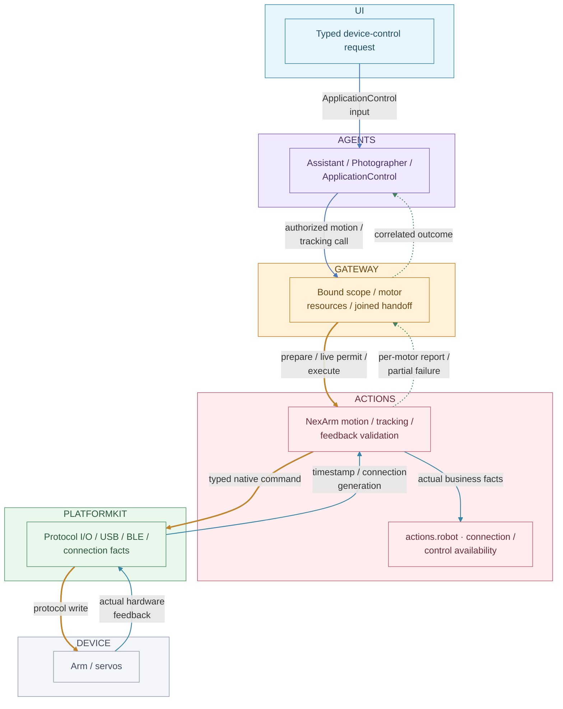

Agents authorizes Assistant/Photographer/device-control intent; Gateway arbitrates opaque motor resource policy; Actions owns motion targets, plans, resources and execution reports, and interprets manual/tracking commands and feedback. PlatformKit owns transport, protocol I/O, connection facts, device limits, feedback tolerances, position observations and travel-time estimates. Some decoded joint/pose caches remain Actions controller state; the platform does not own every servo state. Native motor receipts retain monotonic age and session identity, independently of business-owned targets.

Photographer sends finite position targets through Gateway to Actions/NexArm using PlatformKit's recommended cadence. Photographer and Actions replace pending tracking targets with the latest intent under their own bounded policies; their pacing and queue details belong in [Photographer](Agents/Photographer/README.md) and [NexArm tracking](Actions/NexArm/Tracking/README.md). PlatformKit validates register writes and position ranges before USB/BLE transmission. Runtime tracking does not switch servo mode or issue continuous velocity, and cancellation joins work without adding motion. Device position-mode configuration and hardware limits remain external prerequisites; see [NexArm SDK](PlatformKit/Connectivity/NexArm/README.md).

Handoff joins old writers. Manual control and tracking cannot write the same hardware concurrently merely because they use different Channels. Sending is not arrival: observed feedback, rather than targets, determines results. Not reached, timeout, feedback loss, disconnection and cancellation preserve distinct outcomes. Joined software stop does not establish physical spatial safety. The model-visible robot summary exposes actual connection/control availability. See [NexArm](Actions/NexArm/README.md) and [native protocol](PlatformKit/Connectivity/NexArm/README.md).

### 16. Bluetooth discovery, connection and recovery

```mermaid
sequenceDiagram
    box rgb(231,246,252) UI
    participant Caller as UI typed request
    end
    box rgb(240,234,255) Agents
    participant Agent as ApplicationControl
    end
    box rgb(255,242,217) Gateway
    participant Gate as Gateway
    end
    box rgb(255,236,239) Actions
    participant Owner as Actions device workflow
    end
    box rgb(234,247,237) Platform
    participant SDK as PlatformKit BLE
    end
    box rgb(250,243,228) Storage
    participant DB as Storage.devices
    end
    Caller->>Agent: original request identity
    Agent->>Gate: authorized control call
    Gate->>Owner: prepare / schedule / execute
    Owner->>SDK: scan / connect using actual ID
    SDK-->>Owner: discovery / connection / feedback
    Owner->>DB: confirmed selection / identity mapping
    Owner-->>Gate: actual command result
    Gate-->>Agent: correlated outcome
    Agent-->>Caller: typed reply
```

ApplicationControl consumes typed device requests and authorizes domain calls through Gateway. Actions connection services use PlatformKit discovery/connection/feedback and Storage device mappings, then present real facts through UI. Scan admission is not discovery; connection admission is not a connection. Only actual returned device identity is usable; names and model examples cannot replace IDs. Persisted selections do not prove a current native connection.

Disconnection, feedback health, query isolation and recovery remain connection/domain state. Low-rate native observations reach their owners directly without periodic JSON fingerprints or repeated inference. PlatformKit owns native recovery classifications and budgets, and BLE shares transmission pacing and native backpressure across producers. Hardware failures retain their SDK types; Actions adapts them for presentation and execution results, owns device selection and coordinates the business lifecycle. Business policy decides control eligibility and required user intervention; a successful protocol write does not prove compatibility or motion. See [Connection](Actions/NexArm/Connection/README.md), [NexArm SDK](PlatformKit/Connectivity/NexArm/README.md) and [ApplicationControl](Agents/ApplicationControl/README.md).

### 17. Settings, Provider and model-resource workflows

```mermaid
flowchart TB
    subgraph Interaction["UI"]
        UI["Typed settings / resource<br/>request"]:::ui
        Present["Draft revision / resource<br/>presentation"]:::ui
    end
    style Interaction fill:#e7f6fc,stroke:#3985a4,color:#1f4c60
    subgraph Cognition["AGENTS"]
        A["ApplicationControl /<br/>root-owned observer"]:::agent
    end
    style Cognition fill:#f0eaff,stroke:#8261b5,color:#463065
    subgraph Coordination["GATEWAY"]
        G["Execution coordination"]:::gateway
    end
    style Coordination fill:#fff2d9,stroke:#bf842c,color:#694511
    subgraph Execution["ACTIONS"]
        X["Provider / ModelResources ·<br/>validate / apply / persist"]:::action
    end
    style Execution fill:#ffecef,stroke:#b86178,color:#6b2b3d
    subgraph Inference["MODELKIT"]
        M["Model capabilities /<br/>artifact lifecycle"]:::model
    end
    style Inference fill:#eeefff,stroke:#747bb8,color:#3c426d
    subgraph Persistence["STORAGE"]
        S["Settings / controlled files"]:::storage
    end
    style Persistence fill:#faf3e4,stroke:#a18a4e,color:#61512a
    UI -->|"original request<br/>identity"| A
    A -->|"authorized canonical<br/>call"| G
    G ==>|"prepare / execute"| X
    X ==>|"apply provider / manage<br/>artifacts"| M
    X ==>|"actual persistence"| S
    M -->|"direct artifact<br/>revisions / transfer<br/>facts"| A
    X ==>|"identity-matched result<br/>presentation"| Present
    X -.->|"actual result / failure"| G
    G -.->|"correlated evidence"| A
    classDef action fill:#ffecef,stroke:#b86178,color:#6b2b3d
    classDef agent fill:#f0eaff,stroke:#8261b5,color:#463065
    classDef gateway fill:#fff2d9,stroke:#bf842c,color:#694511
    classDef model fill:#eeefff,stroke:#747bb8,color:#3c426d
    classDef storage fill:#faf3e4,stroke:#a18a4e,color:#61512a
    classDef ui fill:#e7f6fc,stroke:#3985a4,color:#1f4c60
    linkStyle 0 stroke:#5078b8,stroke-width:1.5px
    linkStyle 1 stroke:#5078b8,stroke-width:1.5px
    linkStyle 2 stroke:#bf842c,stroke-width:2.5px
    linkStyle 3 stroke:#bf842c,stroke-width:2.5px
    linkStyle 4 stroke:#bf842c,stroke-width:2.5px
    linkStyle 5 stroke:#3985a4,stroke-width:1.5px
    linkStyle 6 stroke:#bf842c,stroke-width:2.5px
    linkStyle 7 stroke:#438463,stroke-width:1.5px,stroke-dasharray:2 3
    linkStyle 8 stroke:#438463,stroke-width:1.5px,stroke-dasharray:2 3
```

First-run Welcome is composed by UI Root after settings restore confirms an empty Provider list. Its URL/key draft submits through the same settings request chain; Actions persists credentials and configuration, then UI opens independent Assistant/Writer model selection. Restore/save failures remain visible and cannot create a successful onboarding state. See [Settings](UI/Settings/README.md).

UI owns drafts/revisions and typed requests. ApplicationControl owns cognitive admission; Actions Provider/ModelResources services own input validation, application, persistence and result presentation through injected ModelKit/Storage interfaces. Failures cannot become empty configuration, an undocumented old-model fallback or fabricated success. Primary and cleanup errors remain distinct.

Download, installation, preference selection and model residency are separate states. Opening a page does not start transfers; pages do not poll to drive downloads. Root observers coalesce artifact revisions and read real state. Actions supplies application adapters to ModelKit-owned storage/download ports. Removing an artifact first quiesces actual consumers; background URLSession completion belongs to the artifact owner. Actions also owns UI interaction workers and joins them during shutdown. See [ApplicationControl](Agents/ApplicationControl/README.md), [Provider](Actions/System/Provider/README.md), [ModelResources](Actions/System/ModelResources/README.md) and [Management](ModelKit/Support/Management/README.md).

Provider management and role model selection are separate settings. UI retains drafts and per-provider discovery results; ApplicationControl/Gateway carries discovery and save requests; Actions transactionally saves credentials/selections and configures model capabilities. Assistant uses minimum reasoning, while Writer defaults to minimum and permits explicit deeper reasoning. Both can select local models, with unsupported capabilities reported explicitly. New selections do not rewrite an in-flight Writer execution's fixed configuration. See [Provider](Actions/System/Provider/README.md), [Settings](UI/Settings/README.md) and [Writer](Agents/Writer/README.md).

### 18. History, business records and restart behavior

```mermaid
flowchart TB
    subgraph Interaction["UI"]
        UI["Typed history request"]:::ui
        View["History projection /<br/>original typed reply"]:::ui
    end
    style Interaction fill:#e7f6fc,stroke:#3985a4,color:#1f4c60
    subgraph Cognition["AGENTS"]
        Decision["Real input / model request /<br/>response evidence"]:::agent
        A["Memory · authorize history<br/>operations"]:::agent
    end
    style Cognition fill:#f0eaff,stroke:#8261b5,color:#463065
    subgraph Coordination["GATEWAY"]
        G["Execution coordination"]:::gateway
    end
    style Coordination fill:#fff2d9,stroke:#bf842c,color:#694511
    subgraph Execution["ACTIONS"]
        X["Query / mutation / archive /<br/>presentation"]:::action
        Title["Root-owned title worker"]:::action
    end
    style Execution fill:#ffecef,stroke:#b86178,color:#6b2b3d
    subgraph Persistence["STORAGE"]
        Store["Role-specific records /<br/>shared request logs"]:::storage
    end
    style Persistence fill:#faf3e4,stroke:#a18a4e,color:#61512a
    subgraph Inference["MODELKIT"]
        M["Title inference"]:::model
    end
    style Inference fill:#eeefff,stroke:#747bb8,color:#3c426d
    Decision ==>|"record actual boundary<br/>evidence"| Store
    UI --> A
    A -->|"authorized call"| G
    G ==>|"prepare / execute"| X
    X ==>|"read / commit mutation"| Store
    X ==>|"project real results"| View
    X -->|"archive schedules title<br/>job"| Title
    Title -->|"injected title<br/>generation"| M
    M -.->|"title / real inference<br/>failure"| Title
    Title ==>|"commit title or failure<br/>evidence"| Store
    X -.->|"actual operation<br/>outcome"| G
    G -.->|"correlated result"| A
    classDef action fill:#ffecef,stroke:#b86178,color:#6b2b3d
    classDef agent fill:#f0eaff,stroke:#8261b5,color:#463065
    classDef gateway fill:#fff2d9,stroke:#bf842c,color:#694511
    classDef model fill:#eeefff,stroke:#747bb8,color:#3c426d
    classDef storage fill:#faf3e4,stroke:#a18a4e,color:#61512a
    classDef ui fill:#e7f6fc,stroke:#3985a4,color:#1f4c60
    linkStyle 0 stroke:#bf842c,stroke-width:2.5px
    linkStyle 1 stroke:#5078b8,stroke-width:1.5px
    linkStyle 2 stroke:#5078b8,stroke-width:1.5px
    linkStyle 3 stroke:#bf842c,stroke-width:2.5px
    linkStyle 4 stroke:#bf842c,stroke-width:2.5px
    linkStyle 5 stroke:#bf842c,stroke-width:2.5px
    linkStyle 6 stroke:#5078b8,stroke-width:1.5px
    linkStyle 7 stroke:#747bb8,stroke-width:1.5px
    linkStyle 8 stroke:#438463,stroke-width:1.5px,stroke-dasharray:2 3
    linkStyle 9 stroke:#bf842c,stroke-width:2.5px
    linkStyle 10 stroke:#438463,stroke-width:1.5px,stroke-dasharray:2 3
    linkStyle 11 stroke:#438463,stroke-width:1.5px,stroke-dasharray:2 3
```

Agents records real input, model request/context, response, calls, terminal evidence and usage at their own boundaries. UI summaries/pages are not the full model request, and private Agent context is not the database. Model-visible queries return bounded previews; UI full reads carry private typed results, without a global attachment table.

Agents bridges ModelKit’s neutral transport callback into the shared `model_request_log`, capturing actual application-level HTTP requests, responses/SSE, images and generation metadata; non-HTTP calls are marked local. Clearing logs removes Prompts, images and generation details while preserving business inputs, replies and tool results. Late callbacks cannot recreate cleared logs. Storage owns persistence without inference scheduling or Agent orchestration. See [request recording](Agents/Support/Chat/README.md) and [Database schema](Storage/Database/README.md).

Memory authorizes history requests; Actions owns queries, mutations and presentation through the injected AssistantHistoryStore. Assistant records the selected State paths with its per-request Task/Skill/Catalog business snapshot; Actions passes that evidence to UI without reading current State. Full State facts and images remain in deletable request logs. Clearing logs preserves those business selections; Assistant detail hides Prompts/Generation Meta and displays Logs cleared. Archive/delete waits for real commits. Root-owned title generation does not block a new conversation. Title computation and failure-record commit can fail together; cancellation does not undo an archive. Restart marks unfinished records interrupted without resuming native execution or replaying the last action.

| Data                                         | Owner and restart meaning                                                                                      |
| -------------------------------------------- | -------------------------------------------------------------------------------------------------------------- |
| Active Task/Skill, decisions and queues      | Private Agent memory; no guarantee of restoring execution.                                                     |
| Current model facts                          | Actual container memory, sampled per request; no persistent StorageState mirror.                               |
| PCM and temporary buffers                    | Bounded Storage.cache sessions and leases; not durable creations.                                              |
| Conversation, task, media and device records | Storage repositories with actual commit/recovery contracts.                                                    |
| Photos, settings and model artifact files    | Controlled Storage.files namespaces; pending/ready/compensation rather than cross-backend atomic transactions. |

See [Memory](Agents/Memory/README.md), [History](Actions/History/README.md) and [Storage](Storage/README.md).

#### Agent-owned tasks, delegated records and artifacts

Storage separates Assistant conversation themes and foreground tasks from Writer workspaces and delegation executions. Writer messages contain delegation entries and child messages whose optional workspace ownership is fixed at creation; selecting a workspace does not move earlier messages. AgentMessages retains original communication and delivery facts. The stable workspace key is `workspace_N`; completion ends one delegation, not the lifetime of a reusable workspace. Request/event records retain runtime trace identities, while models receive readable workspace/window/editing handles with owner-projected metadata. WindowState owns window mapping independently of the creator. See [Task storage](Storage/Database/README.md) and [artifact identities](Actions/Artifacts/README.md#workspace-and-editing-identities).

Writer uses its own WriterExecutionRepository and WriterMessageRepository, with WriterRecordStore/WriterHistoryStore owning its private history. Runtime history is scoped to the delegation; Settings queries delegation entries and workspace messages separately. Database message keys define ordering, while revision is a state version. A later delegation may reuse the same workspace while retaining separate execution history. Deleting the requesting Assistant dialog clears provenance without deleting the Writer workspace. App composes Writer's records interface and Actions' preview/export interface for Settings. Model timing flows through ModelKit → role history → Storage evidence → UI detail; Writer projects workspace start/update timestamps, request counts and operation summaries, while UI renders neutral values. Writer projects request overview, the current input, verified prior tool references, model output and host finalization through its Settings detail interface. The business sections survive request-log deletion, which clears prompt and generation diagnostics. Full persisted request/tool evidence is distinct from the Agent's selected model context. See [Writer history](Agents/Writer/README.md#sqlite-历史与设置页).

Writer source lives in the current `writer/workspace_N` filesystem directory; SQLite indexes current files without retaining source bodies or workspace versions. StorageDatabase coordinates sandbox primitives and SQL leases, Actions owns validation/rendering/export, and Agents owns creative decisions. See [workspace storage](Storage/Database/WriterWorkspaces/README.md) and [Artifacts](Actions/Artifacts/README.md).

Pending Writer terminal notices can survive restart without replaying creative work or reopening old execution permissions. The notification/outbox policy belongs to [Writer](Agents/Writer/README.md#委托与主动事件), not generic Gateway transport. Before publishing repositories, Storage initializes the current schema and resets older database formats together with Writer workspace/preview files under the approved replacement policy; settings, credentials and models remain outside that reset. Current-format data is preserved and future schema versions are rejected. Database root owns connection/lifecycle/schema assembly; Shared owns neutral encoding, identity and paging mechanisms, while table directories own SQL and recovery. Agent consumers use role-specific task and communication ports. See [SQLite lifecycle](Storage/Database/README.md).

### 19. Model lifecycle and inference boundaries

```mermaid
flowchart TB
    subgraph Consumers["CONSUMERS"]
        Caller["Agent cognition / Actions<br/>business owner"]:::neutral
    end
    style Consumers fill:#f4f5f8,stroke:#939bad,color:#414b60
    subgraph Inference["MODELKIT"]
        Capability["Typed inference capability"]:::model
        Manager["Instance-local management /<br/>loading / residency"]:::model
        Provider["Cloud or local provider"]:::model
        Backend["Responses / CoreAI / CoreML<br/>/ engine"]:::model
        Ports["Artifacts / ModelKit-owned<br/>storage and download ports"]:::model
    end
    style Inference fill:#eeefff,stroke:#747bb8,color:#3c426d
    subgraph Host["APP"]
        App["ModelContainer lifecycle"]:::host
    end
    style Host fill:#eaf2ff,stroke:#5078b8,color:#203b64
    Caller -->|"typed request"| Capability
    Capability -->|"inference admission"| Manager
    Manager ==>|"selected implementation"| Provider
    Provider ==>|"actual inference"| Backend
    Backend -.->|"typed output / usage /<br/>failure"| Caller
    App -.->|"start / invalidate /<br/>stop"| Manager
    Ports -->|"owner-defined resource<br/>interfaces"| Manager
    classDef host fill:#eaf2ff,stroke:#5078b8,color:#203b64
    classDef model fill:#eeefff,stroke:#747bb8,color:#3c426d
    classDef neutral fill:#f4f5f8,stroke:#939bad,color:#414b60
    linkStyle 0 stroke:#747bb8,stroke-width:1.5px
    linkStyle 1 stroke:#5078b8,stroke-width:1.5px
    linkStyle 2 stroke:#bf842c,stroke-width:2.5px
    linkStyle 3 stroke:#bf842c,stroke-width:2.5px
    linkStyle 4 stroke:#438463,stroke-width:1.5px,stroke-dasharray:2 3
    linkStyle 5 stroke:#738299,stroke-width:1.5px,stroke-dasharray:7 4
    linkStyle 6 stroke:#5078b8,stroke-width:1.5px
```

ModelContainer's four capabilities share instance-local management. Preparation, actual loading, inference admission, release and shutdown have distinct meanings. Explicit ModelKit suspension closes inference and joins active tasks; ordinary scene hiding does not request that suspension. Weight residency does not prove device/page readiness. Model-load waiting and ordinary Assistant reply waiting are presented independently.

Agents owns the original request, history selection and decision catalog. Providers own tokenization, context fitting, streaming decode and neutral failures, and may trim/reject context under their contract. Gemma-specific handling remains inside [ModelKit](ModelKit/README.md); cloud prompt experiments do not establish local-model acceptance.

The cloud adapter encodes declared Responses contracts and validates terminal events, call identity and arguments. An arriving fragment is not an executable call. Failure does not silently switch models or retry effects. Generic native Tool support and the current Action-only Skill teaching are maintained separately. See [OpenAI adapter](ModelKit/Language/LLM/OpenAI/README.md).

ModelKit owns Chat execution and resource concurrency. Agents retain fixed model selections and request sessions; configured cloud clients are shared with independent sessions, while local LLM requests use a root-owned bounded FIFO with explicit overflow and joined cancellation. The Responses adapter backpressures streamed deltas without a cumulative generation-size ceiling. These mechanisms do not choose business retries: Writer's private recovery owns retry decisions and actual failure observations, while uncertain commits and cleanup failures stop without replay. See [ModelKit](ModelKit/README.md), [Responses adapter](ModelKit/Language/LLM/OpenAI/README.md) and [Writer recovery](Agents/Writer/README.md#bounded-recovery).

### 20. Diagnostics, UI presentation and native rendering

```mermaid
flowchart TB
    subgraph Sources["FAILURE SOURCES"]
        Failure["Native module / execution /<br/>delivery failures"]:::neutral
    end
    style Sources fill:#f4f5f8,stroke:#939bad,color:#414b60
    subgraph Host["APP"]
        App["Preserve original error /<br/>module identity"]:::host
        Channel["Retained<br/>ContainerFailureChannel"]:::host
        Bootstrap["Bootstrap failure before<br/>roles"]:::host
    end
    style Host fill:#eaf2ff,stroke:#5078b8,color:#203b64
    subgraph Cognition["AGENTS"]
        A["ApplicationControl<br/>classification / authorized<br/>output"]:::agent
    end
    style Cognition fill:#f0eaff,stroke:#8261b5,color:#463065
    subgraph Coordination["GATEWAY"]
        G["Admission / scheduling"]:::gateway
    end
    style Coordination fill:#fff2d9,stroke:#bf842c,color:#694511
    subgraph Execution["ACTIONS"]
        X["Notice / conversation /<br/>diagnostics functions"]:::action
    end
    style Execution fill:#ffecef,stroke:#b86178,color:#6b2b3d
    subgraph Display["UI"]
        UI["Identity-matched<br/>presentation / native<br/>rendering"]:::ui
    end
    style Display fill:#e7f6fc,stroke:#3985a4,color:#1f4c60
    Failure -->|"original structured<br/>error"| App
    App -->|"bounded retained<br/>evidence"| Channel
    Channel -->|"diagnostic delivery"| A
    A -->|"authorized presentation<br/>call"| G
    G ==>|"prepare / execute"| X
    X ==>|"public UI presentation<br/>capability"| UI
    Bootstrap -->|"App-bound bootstrap<br/>fallback"| UI
    classDef action fill:#ffecef,stroke:#b86178,color:#6b2b3d
    classDef agent fill:#f0eaff,stroke:#8261b5,color:#463065
    classDef gateway fill:#fff2d9,stroke:#bf842c,color:#694511
    classDef host fill:#eaf2ff,stroke:#5078b8,color:#203b64
    classDef neutral fill:#f4f5f8,stroke:#939bad,color:#414b60
    classDef ui fill:#e7f6fc,stroke:#3985a4,color:#1f4c60
    linkStyle 0 stroke:#3985a4,stroke-width:1.5px
    linkStyle 1 stroke:#5078b8,stroke-width:1.5px
    linkStyle 2 stroke:#3985a4,stroke-width:1.5px
    linkStyle 3 stroke:#5078b8,stroke-width:1.5px
    linkStyle 4 stroke:#bf842c,stroke-width:2.5px
    linkStyle 5 stroke:#bf842c,stroke-width:2.5px
    linkStyle 6 stroke:#5078b8,stroke-width:1.5px
```

Foundations report their own native Failure types without business wording, Signals or automatic recovery. App preserves original errors and source identity in its bounded ContainerFailureChannel. ApplicationControl owns classification/presentation policy and sends authorized display calls through Gateway to Actions. Bootstrap failure has an App-owned fallback before roles are available. Reporting failure does not recursively generate more failures.

Pure cancellation is distinct from real or mixed execution/cleanup failure; classification uses structured reports rather than error strings. Display filters do not cancel work or establish released resources. Passive Agent activity projection lives with cognitive adapters; callable presentation and effects live in Actions.

UI presentation admission differs from native completion. Finite expressions await their presentation/restoration; persistent base state acknowledges admission. Metal owns window/layer/GPU completion. Photo disappearance/display receipts retain media and generation identity. Updating a UI field cannot prove GPU or physical completion. See [UI](UI/README.md), [ApplicationControl](Agents/ApplicationControl/README.md) and [runtime presentation](Actions/UI/Runtime/README.md).

#### Shared in-app and system Island presentation

Each Agent owns its presentation intent and calls registered UI.Island internal tools through its own Gateway identity. Writer and Assistant own their task islands; Assistant separately owns inference waiting. SpeechPerception owns listening/recognition and captions. SpeechSynthesis owns synthesis and actual playback presentation; Actions' player returns joined start/end facts through an App-bound neutral callback, never through an Assistant delegation or UI-state observer. Photographer uses its existing camera fact input and ApplicationControl its connection input for their own presentation. Shared AgentIslandPublication owns only bounded delivery/retry and cleanup, not role policy. Actions executes validated calls, while UI owns arbitration, layout, animation and ActivityKit. Playback spectra use a dedicated data port without Action/ActivityKit updates per frame. System submission failure does not erase local content; iOS controls actual system display.

The producer-bound internal-completion port accepts only the registered role’s declared internal native tools outside model rounds. Gateway validates permission, resources and execution, returning real outcomes directly to the presenting workflow without Signal/InputGateway ToolResult feedback. Model/native protocol calls retain their paired feedback. Internal presentation receipts can synchronize execution and playback without becoming cognitive input; ownership and session fences remain unchanged. See [Agents Support](Agents/Support/README.md).

Only explicitly model-generated calls can contribute execution observations to ReACT. The shared Chat worker records origin per invocation: natural-text speech/caption expansion and code-owned lifecycle/waiting calls are runtime work even when a model can explicitly call the same function. Their successful values, failures and exceptions are handled internally; they may join completion barriers and retain diagnostic evidence but never become model observations or independently request another inference. Unmatched Tool feedback cannot become a fresh Chat input.

Detail activity and live status are selected independently, preserving the user's detail expansion preference while the top indicators change. UI owns layout, animation, thumbnail resources and bounded display admission. Measured spectrum updates remain local presentation data rather than per-frame Actions or ActivityKit submissions. See [Island component](UI/Components/Island/README.md) for these contracts and [Actions Runtime](Actions/UI/Runtime/README.md) for validated execution and producer ownership.

Scene inactivity unmounts local rendering while retaining current activity facts for system presentation. Full root invalidation clears local generations and publishes paused system state; stop joins cleanup. System Island taps restore the existing scene without a navigation destination or device operation. App's native termination callback requests bounded best-effort ActivityKit cleanup; iOS may terminate without that callback, so stale presentation and next-start cleanup cannot guarantee immediate removal. Island presentation does not own Task completion or background device lifetime.

For the in-app system status strip, PlatformKit owns native network/battery facts, App adapts them into UI-owned read-only values, and the Island component controls reads and layout while mounted. UI Root hides/restores the native status bar from actual mount state. Actions and Agents do not modify system status; UI and PlatformKit remain independent foundations. See [composition adapter](App/Composition/README.md) and [Island status](UI/Components/Island/README.md).

### 21. Cross-module cancellation, pressure and completion

```mermaid
sequenceDiagram
    box rgb(234,242,255) App · Lifecycle owner
        participant App as Application lifecycle
    end
    box rgb(240,234,255) Agents · Cognitive work
        participant A as AgentContainer
    end
    box rgb(255,242,217) Gateway · Coordination
        participant G as GatewayContainer
    end
    box rgb(255,236,239) Actions · Business work
        participant X as ActionsContainer
    end
    box rgb(234,247,237) Foundations · Native capabilities
        participant F as Owned capability services
    end
    App->>A: close requests / stop and join roles
    A->>G: cancel owned execution scopes
    G->>X: cancel actual executing work
    X->>F: request and join required native cleanup
    F-->>X: cleanup result or retained failure
    X-->>G: joined terminal evidence
    G-->>A: scoped results / scheduling and delivery barriers
    A-->>App: cognitive shutdown settled
    App->>G: close admission / stop remaining facilities
    G-->>App: scheduling, resources, delivery and transport joined
    App->>X: stop remaining business / native work
    X-->>App: joined cleanup or structured failure
    App->>App: release execution bindings
    App->>F: stop foundation roots in reverse dependency order
```

Interruption retains Task/Skill while stopping current decisions; resumption does not replay effects. Closing releases session capabilities. Actor isolation, a cancellation flag or a deadline cannot prove another owner has finished. Every queue/slot has an owner-defined bound and explicit rejection, backpressure or latest-value replacement policy.

Agents closes new cognitive work and explicitly cancels its scopes. Gateway joins transport, direct/scheduled execution and result delivery while Actions remains alive for cleanup. Actions joins remaining business/native work; only then does App release execution bindings and stop foundations. Failed startup rolls back completed stages while preserving both primary and cleanup failures.

UI, PlatformKit and ModelKit runtime `stopped` flags describe their admission fences. `cleanupJoined` separately records successful joined shutdown; neither flag establishes physical-device completion or safety.

| Boundary                  | Completion establishes                    | It does not establish                             |
| ------------------------- | ----------------------------------------- | ------------------------------------------------- |
| Request/message admission | Acceptance or explicit rejection          | Business completion or another inference round    |
| Path/UI update            | Identity-matched state commit             | Loaded data or displayed GPU frame                |
| Model operation           | Adapter completion or joined cancellation | Device completion                                 |
| Action/Tool               | Declared business completion and report   | Successful delivery or cognitive consumption      |
| Playback                  | Actual native drain and handle release    | Sound at synthesis admission                      |
| File/database publication | Real commit or explicit partial outcome   | Cross-backend atomicity or Photos synchronization |
| Resource/session stop     | Joined owned work and cleanup             | Cooperative hardware stop or spatial safety       |

Independent fences include UI generation, capture generation, endpoint incarnation/session, input/round, Agent Task grants, media ownership, resource lease/permit, settings revision and paging tickets. One fence cannot substitute for another; replacement owners cannot inherit stale writes. See [Input](Gateway/Input/README.md), [Scheduling](Gateway/Output/Scheduling/README.md), [Resources](Gateway/Output/Resources/README.md), [Results](Gateway/Output/Results/README.md) and [Context](Agents/Support/Context/README.md).

#### Scene visibility versus execution lifetime

Ordinary scene hiding stops/joins visible rendering and vision intake while preserving Assistant and Writer inference, files and messages. Actions retains bounded latest project snapshots; foreground restoration runs in one Actions-owned task and reads current state under the project lock. Explicitly closed or minimized windows retain their state. Preview restore failures are reported at the affected window, and scene admission continues. Background full rendering returns deferred validation evidence, so saving and visual verification remain separate. Explicit root suspension, replacement and stop still cancel and join owned work. iOS process suspension does not imply application-requested cancellation and does not guarantee unlimited background CPU. See [App composition](App/Composition/README.md), [Agents lifecycle](Agents/README.md#lifetime-inputs-and-failures), [Artifacts snapshots](Actions/Artifacts/README.md#标题副标题与后台快照) and [Writer scene policy](Agents/Writer/README.md#窗口命名操作副标题与场景).

App requests iOS continued processing for each foreground user-initiated Writer segment. When iOS grants time, Writer continues its existing model and file loop across scene loss. A native expiration is scoped to that segment and joins Writer cleanup before retiring the run. Terminal work and waiting for user input release the native task. See [Writer scene policy](Agents/Writer/README.md#窗口命名操作副标题与场景).

### 22. End-to-end scenario map

| Scenario                         | Entry and owners                                                                                        | Result boundary                                                |
| -------------------------------- | ------------------------------------------------------------------------------------------------------- | -------------------------------------------------------------- |
| Album/settings click             | Local navigation; business buttons submit typed requests to their role and registered domain functions. | Path commit and business reply remain separate.                |
| Voice conversation               | Native PCM → SpeechPerception → Gateway final → Assistant → ModelKit → authorized calls.                | Actual inference, execution and reply barriers.                |
| Known expression/speech sequence | One resolved sequence → Channel/wait → UI/Speech execution.                                             | Actual group completion, not textual order alone.              |
| Vision without new user input    | Native frame → VisionPerception → protected presentation / Photographer tracking.                       | Freshness, authority and feedback; no automatic ordinary chat. |
| Module/device change             | Native observation → responsible role → state/failure policy.                                           | No automatic effect retry or inferred physical completion.     |
| Agent collaboration              | Policy-authorized message → bound Gateway endpoint → target role.                                       | Admission, progress, result and cancellation remain distinct.  |
| Navigation/inactivity            | UI lifetime or App invalidation → owned cancellation/join.                                              | Committed creations remain; root cleanup outlives pages.       |

Automated checks, iOS builds, real-model samples, native UI and physical-device acceptance are separate evidence categories maintained in [validation](../docs/validation/README.md). Requirements and decisions live in [requirements](../docs/requirements/README.md) and [ADR](../docs/adr/README.md); historical design rationale lives in [documentation history](../docs/history/Documentation-History.md).
