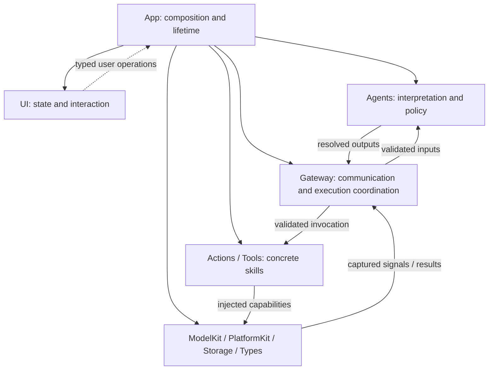
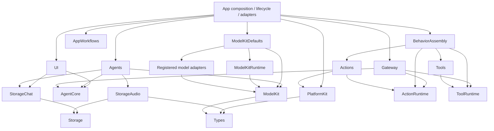
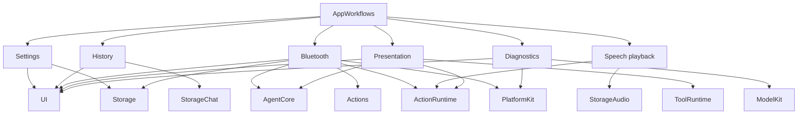
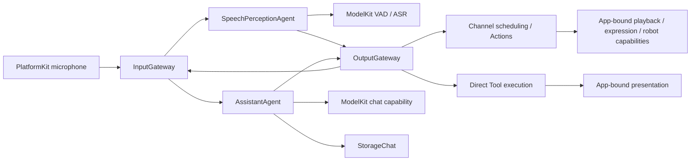
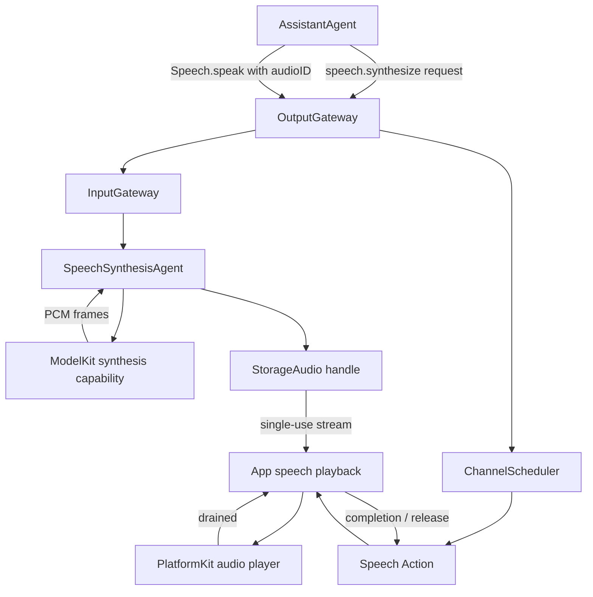

# MobileHarness Technical Design

MobileHarness is an Apple-native multimodal Agent system. Its organizing principle is **Signal → Cognition → Action**: devices supply signals, Agents interpret them using model capabilities, and Actions or Tools produce effects that can be observed again.

This document describes the current architecture, source ownership and core workflows. Module READMEs own API contracts, algorithms and operational limits. [Architecture decisions](../docs/adr/README.md) and the [Roadmap](../docs/Roadmap.md) are maintained separately.

- [Part I — Overall Architecture](#part-i--overall-architecture)
- [Part II — Module Responsibilities](#part-ii--module-responsibilities)
- [Part III — Core Workflows](#part-iii--core-workflows)

## Part I — Overall Architecture

### System organization

The system is composed of four groups. App binds their concrete capabilities and owns the running application's lifetime. Dependencies form an acyclic graph; consumers receive the capabilities they need through explicit initialization and typed operations.

| Group | Modules | Design responsibility |
| --- | --- | --- |
| Host and interaction | App, UI | Assemble services, coordinate application/session lifetime and present state. |
| Cognition and coordination | Agents, AgentCore, Gateway | Interpret observations, select behavior and validate communication/execution. |
| Behavior execution | Actions, Tools, ActionRuntime, ToolRuntime | Implement concrete skills and their execution contracts. |
| Foundations | ModelKit, PlatformKit, Storage, Types | Supply model capabilities, device I/O, retained data and shared values. |



This diagram shows assembly and runtime collaboration. The following diagram shows project compilation dependencies; system frameworks and the BehaviorDefinitions compiler plugin are omitted.

### Core compilation dependencies



The App arrows summarize its assembly entry points; the host also consumes the shared contracts and model/storage services needed by its adapters. Model adapter dependencies are detailed in [ModelKit](ModelKit/README.md).

AgentCore, ActionRuntime, ToolRuntime, Storage and Types have no project dependencies. ModelKit and PlatformKit share Types without depending on each other. Gateway consumes execution contracts rather than concrete behavior domains. Tools currently implements System/UI functions using App-bound endpoints and has no direct PlatformKit or UI dependency. A device Tool domain may consume PlatformKit when its implementation requires native capabilities; ToolRuntime stays independent.

### Host and feature composition

App contains the composition root, lifecycle coordinators, feature workflows and adapters. Composition selects concrete implementations and validates configuration before producers start. Lifecycle owns long-lived work; adapters convert between module contracts and actual host capabilities.

AppWorkflows is a state-free facade over six independent feature targets:



Settings receives provider operations from App. History receives title-generation and output-preview operations from App. Voice and camera coordinators receive role-specific services and Agent factories. UI receives presentation state and typed user operations; pages do not own model or device sessions.

### Coordination and ownership

| Owner | Responsibility |
| --- | --- |
| App | Bind implementations; coordinate session start, interruption and cleanup. |
| Agents | Own cognitive state, model use, behavior selection and Agent-local processing. |
| InputGateway | Validate and deliver external inputs, inter-Agent messages and Tool results. |
| OutputGateway | Authorize resolved Agent outputs and coordinate dispatch, resources and feedback. |
| ActionRuntime / ToolRuntime | Register definitions and execute trusted invocations. |
| ModelKitRuntime | Own process-wide model availability and operation arbitration. |
| PlatformKit | Own device connection, capture/output and native feedback. |
| Storage domains | Own records and bounded media handles. |
| UI | Own MainActor presentation state and views. |

Agent JSON declares model-callable actions, native tools and permissions; Agent code owns fixed internal behavior. Agents resolve aliases before submitting calls to Gateway. BehaviorAssembly constructs concrete registries; Gateway validates their coverage against Agent capabilities.

### Source structure and compilation map

```text
MobileHarness/
├── App/                    # Application host and explicit composition
│   ├── Composition/        # AppAssembly and runtime/model assembly
│   │   └── Behaviors/       # Independent BehaviorAssembly target
│   ├── Lifecycle/          # Voice/camera sessions and cleanup
│   ├── Workflows/          # AppWorkflows facade and independent feature targets
│   │   ├── Settings/
│   │   ├── History/
│   │   ├── Bluetooth/
│   │   ├── Speech/
│   │   ├── Presentation/
│   │   └── Diagnostics/
│   └── Adapters/           # Effect endpoints, media and native preview bridges
├── UI/                     # Independent pages, state and interaction target
│   ├── Conversation/
│   ├── Components/
│   ├── Camera/
│   ├── Settings/
│   └── Diagnostics/
├── Agents/                 # Shared core and business Agent source ownership
│   ├── Core/               # Independent AgentCore compilation target
│   │   ├── Runtime/        # Agent registry, manager and lifecycle
│   │   ├── Capability/     # JSON, model catalog and internal permissions
│   │   ├── Generation/     # Function Token, Channel/wait and Tool parsers
│   │   ├── Output/         # Resolved calls and trusted envelopes
│   │   └── Communication/  # Typed messages and routing policy
│   ├── Assistant/          # Conversation generation and interpretation
│   ├── SpeechPerception/   # Shared VAD/ASR and speech observations
│   ├── SpeechSynthesis/    # Directed FIFO text-to-audio synthesis
│   └── VisionPerception/   # Pose inference, gaze and skeleton output
├── Gateway/                # Input/output validation, routing and scheduling
│   ├── Input/
│   └── Output/             # Validation, routing, dispatch, scheduling, results and resources
├── Actions/                # Concrete scheduled behaviors and independent runtime
│   ├── Runtime/            # ActionRuntime target; execution and Contracts/
│   ├── NexArm/             # Agent-used robot actions
│   ├── Speech/             # Audio-ID playback and awaited completion
│   └── UI/                 # Scheduled expression; non-callable Support below
├── Tools/                  # Concrete immediate functions and independent runtime
│   ├── Runtime/            # ToolRuntime target; execution and Contracts/
│   ├── System/             # Fixed runtime information
│   └── UI/                 # Immediate captions, gaze, voice state and skeleton display
├── Types/                  # Shared values grouped by domain; Types target
│   └── Audio/              # PCM and microphone values; no project dependencies
├── Storage/                # Core cache, persistence and local synchronization
│   ├── Audio/              # StorageAudio: PCM handles
│   └── Chat/               # StorageChat: conversation records and journal
├── ModelKit/               # Independent SDK and separate provider targets
│   ├── Core/
│   ├── Speech/
│   ├── Language/
│   ├── Vision/
│   ├── Defaults/
│   ├── Management/
│   └── Backends/
├── PlatformKit/            # Device/OS I/O and capability validation
│   ├── Audio/
│   ├── Vision/
│   ├── Connectivity/
│   └── Core/
└── Resources/              # Privacy, model profiles and local artifacts

Tests/                      # Root module tests and integration/model evaluations
Config/                     # Shared configuration; local signing is ignored
scripts/                    # Checks, builds and provisioning
MobileHarness.xcodeproj/    # App/framework schemes and source navigation
```

#### Compilation map

Root [Package.swift](../Package.swift) compiles shared sources into independently tested targets. The Xcode application targets compile the host and link those targets. The table combines source mapping and direct project dependencies; tests and system frameworks are omitted from dependency lists.

| Source path | Target | Direct dependencies |
| --- | --- | --- |
| `App/` excluding package-owned subtrees | Xcode App targets | Composition/adapters/lifecycle; see App README |
| `App/Composition/Behaviors/` | BehaviorAssembly | Actions, Tools, ActionRuntime, ToolRuntime |
| `App/Workflows/` facade | AppWorkflows | The six feature workflow targets below |
| `App/Workflows/Settings/` | AppSettingsWorkflow | UI, Storage |
| `App/Workflows/History/` | AppHistoryWorkflow | UI, StorageChat |
| `App/Workflows/Bluetooth/` | AppBluetoothWorkflow | UI, AgentCore, Storage, Actions, ActionRuntime, PlatformKit |
| `App/Workflows/Speech/` | AppSpeechPlayback | ActionRuntime, StorageAudio |
| `App/Workflows/Presentation/` | AppPresentationWorkflow | UI, AgentCore, ActionRuntime, ToolRuntime |
| `App/Workflows/Diagnostics/` | AppDiagnosticWorkflow | UI, ModelKit, PlatformKit |
| `UI/` | UI | AgentCore, StorageChat |
| `Agents/Core/` | AgentCore | None |
| `Agents/` excluding `Core/` | Agents | AgentCore, ModelKit, StorageChat, StorageAudio |
| `Gateway/` | Gateway | AgentCore, ActionRuntime, ToolRuntime |
| `Actions/Runtime/` including `Contracts/` | ActionRuntime | None |
| `Tools/Runtime/` including `Contracts/` | ToolRuntime | None |
| `Actions/` excluding `Runtime/` | Actions | ActionRuntime, PlatformKit, BehaviorDefinitions |
| `Tools/` excluding `Runtime/` | Tools | ToolRuntime, BehaviorDefinitions |
| `Types/` | Types | None |
| `Storage/` excluding `Audio/` and `Chat/` | Storage | None |
| `Storage/Chat/` | StorageChat | Storage |
| `Storage/Audio/` | StorageAudio | Storage, Types |
| `PlatformKit/` | PlatformKit | Types |
| `ModelKit/` shared capability sources | ModelKit | Types |
| `ModelKit/Management/` | ModelKitRuntime | ModelKit |
| `ModelKit/Defaults/` | ModelKitDefaults | ModelKit, ModelKitRuntime and registered adapters |
| ModelKit concrete adapters and backends | Separate targets | See ModelKit README |
| `Resources/` | App resource staging | Local weights remain ignored |
| Root `Tests/` | Module and integration tests | Tested targets; no duplicated sources |

### Architectural boundaries

- Directory nesting expresses ownership; compilation targets enforce independence. AgentCore lives inside Agents, while execution runtimes live inside Actions/Tools.
- Action business behavior belongs to Actions. PlatformKit owns connection, protocol encoding, hardware limits and device feedback.
- UI consumes AgentCore/StorageChat domain values and typed operations. It imports no concrete Agent, Gateway, behavior, model or device service.
- Types groups shared immutable values by category. Audio is implemented under Types/Audio; ImageFrame and NativeImageBuffer currently belong to ModelKit/Core.
- Each source has one compilation owner. Shared targets use the root Package.swift; App host sources compile in Xcode application targets.

## Part II — Module Responsibilities

This section describes purpose and boundaries. The linked module documents contain implementation details.

| Module | Responsibility | Boundary | Biological analogy |
| --- | --- | --- | --- |
| [App](App/README.md) | Assemble the system, bind capabilities and coordinate application/session lifetime. | Host adaptation and workflow coordination; business behavior stays in its owning module. | The organism that brings organs into coordinated operation. |
| [UI](UI/README.md) | Present conversation, settings, camera and diagnostic state; expose user operations. | MainActor presentation; no long-lived runtime services or device/model effects. | Face and interaction surface. |
| [Agents](Agents/README.md) | Interpret observations, call model capabilities and select permitted behavior. | Cognitive policy and Agent-local state; all outputs cross OutputGateway. | Specialized brain regions. |
| [AgentCore](Agents/Core/README.md) | Define shared Agent identity, messages, permissions and lifecycle contracts. | Independent of concrete Agents, UI, model engines and device adapters. | Shared organization of the nervous system. |
| [Gateway](Gateway/README.md) | Validate signals and outputs, route messages, schedule Actions and coordinate resources/results. | Receives resolved calls; does not own domain behavior or model inference. | Neural pathways coordinating signals and motor commands. |
| [Actions](Actions/README.md) | Implement scheduled robot, speech and expression behaviors. | Own business parameters, composition and completion policy; consume native capabilities. | Reusable motor skills. |
| [ActionRuntime](Actions/Runtime/README.md) | Define Action contracts, registries and invocation execution. | No Agent, UI or platform dependencies; Channel policy belongs to Gateway. | The common execution mechanism for motor skills. |
| [Tools](Tools/README.md) | Implement directly callable System/UI functions and their effects/results. | Use explicit capabilities; current functions do not import PlatformKit or UI. | Focused reflexes and immediately available functions. |
| [ToolRuntime](Tools/Runtime/README.md) | Define Tool contracts, registries and direct invocation execution. | Independent of concrete tool domains and hardware; results route through Gateway. | The common execution mechanism for direct functions. |
| [ModelKit](ModelKit/README.md) | Expose language, speech and vision processing capabilities. | Capability SDK; management, defaults and concrete engines compile separately. | Recognition and generation machinery. |
| [PlatformKit](PlatformKit/README.md) | Connect devices, capture signals, produce native output and report feedback. | Foundational device SDK; no business gestures, presentation or application workflow policy. | Sensory organs and effectors. |
| [Storage](Storage/README.md) | Provide persistence, bounded streams and retained data primitives. | StorageChat owns conversation records; StorageAudio owns PCM handles; no inference or routing. | Retained information that cognitive processes can use. |
| [Types](Types/README.md) | Share immutable value contracts across independent SDKs, organized by category. | Values and validation only; no services, queues or runtime lifecycle. | The common vocabulary of signals. |
| Resources | Supply bundled configuration and local model resources through App. | Model resources are staged by the host; modules receive explicit resource access. | Materials required by the organism's processing machinery. |

Within App, Composition is the assembly point, Lifecycle owns running sessions, Workflows owns feature effects, and Adapters binds module contracts to host services. Within ModelKit, the base SDK owns capabilities, ModelKitRuntime owns management, ModelKitDefaults owns provider registration/defaults, and adapter targets own concrete engines.

## Part III — Core Workflows

### Application assembly and session lifetime

App binds presentation, device and storage endpoints, constructs behavior registries and validates Agent permissions before starting producers. ModelKitDefaults configures the process-wide manager from the resource root supplied by App. Voice and camera use shared infrastructure with independent session ownership.

User/OS lifecycle operations are coordinated by App. Stopping a session closes admission, cancels and joins its work, and retires owned Agent activity, Actions and media handles. Page navigation does not determine runtime lifetime. Session/input identities fence stale events and presentation updates.

### Voice conversation and behavior execution



SpeechPerception uses VAD/ASR capabilities to turn microphone signals into observations and caption/phase outputs. Assistant combines recognized input with the conversation journal, generates a response and resolves behavior calls. OutputGateway authorizes those calls before scheduling Actions or directly dispatching Tools.

Actions execute within Channels with explicit completion and resource ownership. Tools bypass Channel FIFO; data-returning Tools deliver correlated results through InputGateway, while completion-only Tools finish after their endpoint accepts the operation. Presentation acceptance and physical completion are distinct contracts.

### Speech synthesis and playback



Synthesis and playback share an audio ID and ownership identity. Synthesis processes its admitted requests in order; Gateway independently schedules playback. Playback can consume frames while synthesis continues and completes after the player drains. Reply completion or interruption coordinates cleanup of unused handles; generation completion alone does not retire unplayed audio. Failures and cancellation propagate explicitly.

### Camera perception and presentation

PlatformKit captures camera frames. App owns camera admission and binds image resolution for VisionPerception. The Agent uses the pose capability, interprets the result and emits permitted gaze/skeleton outputs through OutputGateway. App adapters project accepted state into UI. Frame/session ordering prevents stale presentation updates; the camera session remains owned by lifecycle coordination.

### Robot behavior and feedback

An authorized Action reaches the registered NexArm behavior through Gateway's scheduler and resource coordination. Actions owns gesture composition, motion shaping and completion policy. PlatformKit encodes native commands, owns the device connection and reports hardware feedback. Settings operations and Agent-selected Actions use the same injected Action implementation and resource coordination. Completion is based on the domain's actual execution result rather than command submission alone.

### Settings and conversation history

SettingsWorkflow validates provider operations supplied by App, coordinates active work, persists the requested settings and applies them. Failed application restores persisted state before releasing the change barrier. Provider configuration/discovery belongs to App adapters, so the settings target does not import concrete model providers.

HistoryWorkflow reads the shared StorageChat journal. Starting a new conversation archives the current record and creates a new one before optional title generation. App supplies title-generation and output-preview operations. History displays recorded requests/results; browsing it does not replay behavior.

### Model capability ownership

Consumers request typed capabilities through ModelKitRuntime.ModelManager. Production shares one process-wide manager and one active operation per model. Defaults/provider registration belongs to the internal assembly, while concrete model engines remain in adapter targets. Agents determine how capabilities contribute to cognitive behavior; App coordinates their availability with application/session changes.
