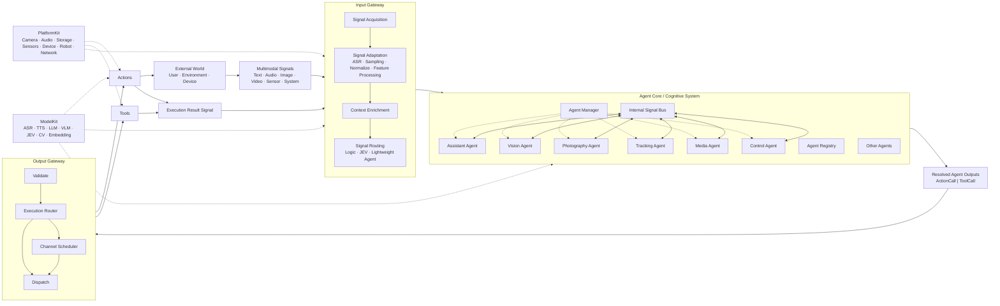
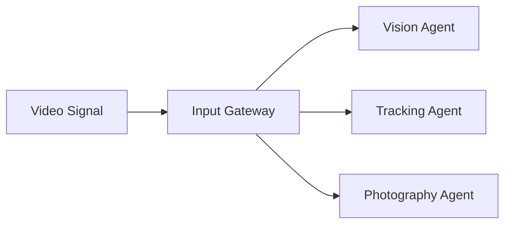
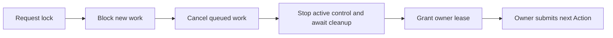
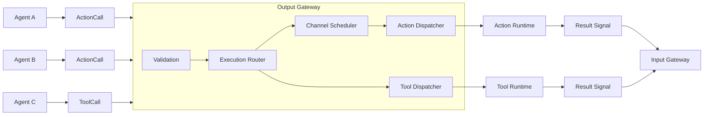
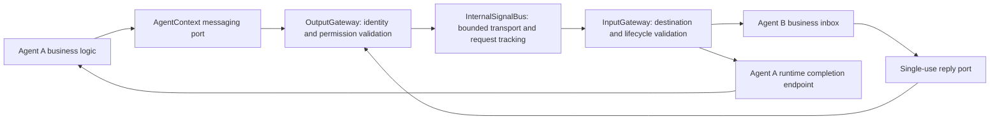
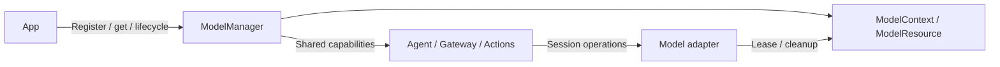
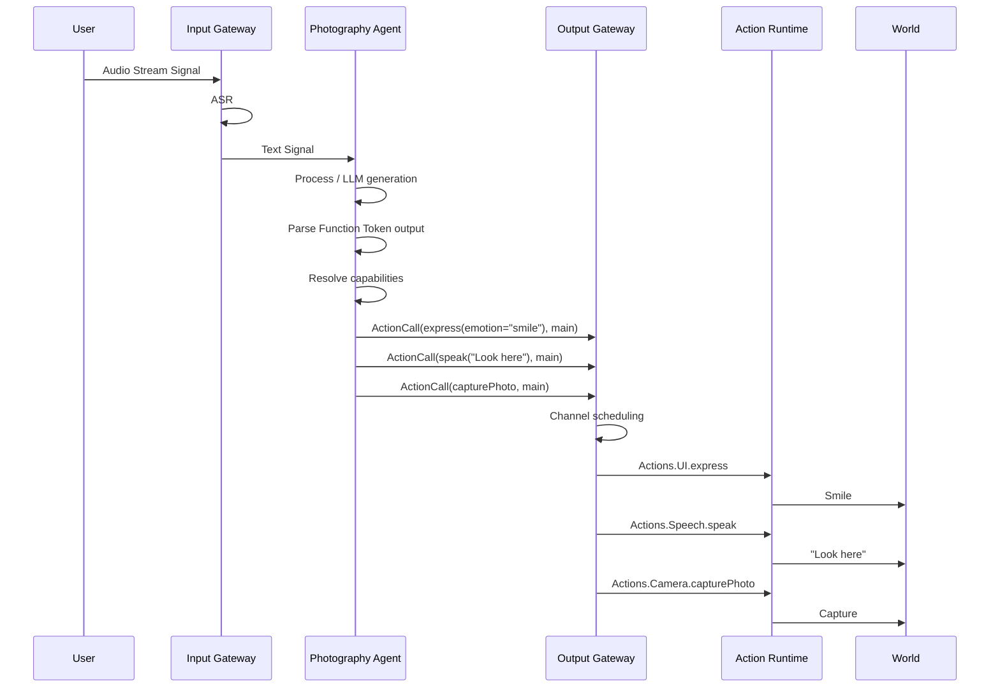

# MobileHarness Technical Architecture

## 1. Overview

**MobileHarness** is a multimodal, multi-agent, bio-inspired harness for mobile and embodied AI systems.

Its architecture follows a continuous information-processing loop inspired by biological nervous systems:

**Signal → Cognition → Action**

The system is organized around three major functional domains:

- **Input Gateway** — receives, adapts, normalizes, enriches, and routes multimodal signals.
- **Agent Core / Agents** — independent, stateful cognitive units that process signals and generate executable outputs.
- **Output Gateway** — schedules and dispatches fully resolved Action Calls and Tool Calls.

The architecture is designed around four core properties:

- **Multimodal** — text, audio, image, video, sensor, physical, and system signals.
- **Multi-Agent** — multiple specialized Agents run independently and concurrently.
- **Bio-inspired** — signal input, specialized cognition, centralized action coordination, and continuous feedback loops.
- **Streaming & Stateful** — signals, model generation, Function Tokens, Tool Calls, and execution may operate continuously instead of following request-response semantics.

---

# 2. Core Architecture



---

# 3. Core Information Model

## 3.1 Signal

`Signal` is the unified input abstraction of MobileHarness.

Everything entering the cognitive system is represented as a Signal regardless of modality or source.

Typical signal types include:

| Signal Type | Examples |
|---|---|
| Text | user text, system text |
| Audio | recorded audio |
| Audio Stream | microphone stream |
| Image | camera image, photo |
| Video Stream | live camera/video |
| Physical | force, temperature, IMU, touch |
| Sensor | proximity, motion, depth |
| System | timer, notification, app event |
| Internal | Agent-generated internal signal |
| Execution Result | Action or Tool execution result |

Conceptual Swift structure:

```swift
struct Signal {
    let id: UUID
    let type: SignalType
    let source: SignalSource
    let timestamp: TimeInterval
    let payload: SignalPayload
    let metadata: SignalMetadata
}
```

```swift
enum SignalPayload {
    case text(String)
    case audio(AudioBuffer)
    case audioStream(AudioStream)
    case image(ImageFrame)
    case videoStream(VideoStream)
    case sensor(SensorData)
    case physical(PhysicalSignal)
    case structured(StructuredData)
}
```

Signals may be discrete or continuous streams.

---

# 4. Input Gateway

The **Input Gateway** is the sensory and input coordination layer of MobileHarness.

Its responsibilities are:

```text
Input Gateway
├── Signal Acquisition
├── Signal Adaptation
├── Signal Normalization
├── Modality Transformation
├── Context Enrichment
└── Signal Routing
```

## 4.1 Signal Acquisition

Typical sources include:

```text
Microphone
Camera
Keyboard
File
Sensors
System Events
Network
External Device
Internal Agent Signal
Execution Result
```

## 4.2 Signal Adaptation

Agents are not required to support every modality directly.

The Input Gateway transforms signals when necessary.

```text
Audio Stream
    ↓
Input Gateway
    ↓
ASR
    ↓
Text Signal
    ↓
Assistant Agent
```

```text
Video Stream
    ↓
Frame Sampling
    ↓
Image Signal
    ↓
Vision Agent
```

```text
Force Sensor
    ↓
Filter / Normalize
    ↓
Physical Signal
    ↓
Control Agent
```

ASR, CV preprocessing, embedding, and model-backed transformations are provided by `ModelKit`.

---

# 5. Signal Routing

The Input Gateway uses a hybrid routing mechanism.

```text
Signal
  ↓
Signal Router
  ├── Logic / State Routing
  ├── JEV / Judge Routing
  └── Lightweight Agent / Small LLM Routing
  ↓
Agent(s)
```

Routing may depend on:

- signal type;
- signal source;
- application context;
- current Agent state;
- Agent accepted input types;
- deterministic rules;
- JEV/Judge classification;
- semantic intent;
- system priority.

One signal may fan out to multiple Agents.



The router determines which Agent receives the signal.

Task planning and execution remain inside the Agent layer.

---

# 6. Agent Core

The **Agent Core** provides common runtime infrastructure for all Agents.

```text
Agent Core
├── Agent Manager
├── Agent Registry
├── Agent Runtime
├── Agent Descriptor
├── Agent State
├── Capability Registry
├── Internal Signal Bus
└── Agent Protocol
```

Each Agent is an independently running, long-lived, stateful runtime unit.

```mermaid
flowchart LR

    INPUT["Signal Stream"] --> QUEUE["Input Queue"]

    QUEUE --> STATE["Domain State Machine"]

    STATE --> PROCESS["Processing Loop<br/>Logic · Model · Tool"]

    PROCESS --> GENERATE["Model / Logic Output"]

    GENERATE --> PARSE["Agent-side Parser"]

    PARSE --> MAP["Capability Mapping"]

    MAP --> OUTPUT["Resolved Output<br/>ActionCall | ToolCall"]

    OUTPUT --> GATEWAY["Output Gateway"]

    RESULT["Execution Result Signal"] --> INPUT
```



An Agent may:

- continuously receive Signals;
- maintain internal state;
- perform model inference;
- use Actions and Tools;
- remain idle;
- proactively produce output;
- run concurrently with other Agents.

---

# 7. Agent Lifecycle

`AgentManager` manages runtime lifecycle.

```text
registered
    ↓
starting
    ↓
running
    ↕
idle
    ↕
paused
    ↓
stopping
    ↓
stopped

failed
```

Typical management operations:

```text
register
create
start
stop
pause
resume
restart
status
health
```

Runtime lifecycle state is separate from business/domain state.

---

# 8. Agent Descriptor

Each Agent declares its runtime contract through an `AgentDescriptor`.

```text
AgentDescriptor
├── Identity
│   ├── id
│   ├── name
│   └── version
│
├── Runtime
│   ├── persistent
│   ├── autoStart
│   ├── priority
│   └── concurrency
│
├── Input
│   └── accepted Signal types
│
├── Output
│   ├── ActionCall
│   └── ToolCall
│
├── Capabilities
│   ├── registered Actions
│   └── registered Tools
│
├── Models
│   └── required model capabilities
│
└── State
    └── observable domain/runtime state
```

Capability registration and alias resolution are encapsulated inside the Agent.

---

# 9. Agent Capability Registry

Every Agent owns its own capability registry.

The registry contains all Actions and Tools available to that Agent.

The names exposed to the model are **Agent-local aliases** and do not need to match implementation paths.

```text
capture
    ↓
Actions.Camera.capturePhoto
```

```text
search
    ↓
Tools.MediaLibrary.semanticSearch
```

The Agent owns the complete capability lifecycle:

```text
Register Capability
       ↓
Expose Alias to Model Context
       ↓
Model Generates Alias
       ↓
Agent Parses Output
       ↓
Resolve Alias
       ↓
Resolved Action / Tool Path
       ↓
Output Gateway
```

---

# 10. Capability Naming Rules

Within one Agent, all registered Action and Tool aliases must be unique.

Example:

```text
capturePhoto → Actions.Camera.capturePhoto
captureVideo → Actions.Video.captureVideo
```

Different Agents may use the same alias.

```text
AssistantAgent:
    speak → Actions.Speech.speak

PhotographyAgent:
    speak → Actions.Speech.speak
```

The alias namespace is local to the Agent.

---

# 11. Agent Capability Mapping

Example capability registry:

```text
PhotographyAgent

Actions
├── speak
│   → Actions.Speech.speak
├── capture
│   → Actions.Camera.capturePhoto
├── focus
│   → Actions.Camera.focus
└── express
    → Actions.UI.express

Tools
├── detectPerson
│   → Tools.Vision.detectPerson
├── detectFace
│   → Tools.Vision.detectFace
└── describeScene
    → Tools.Vision.describeScene
```

The model sees only the compact aliases and their parameter schemas.

---

# 12. Model Context Generation

Each Agent builds its model context from its capability registry.

```text
Agent Capability Registry
      ↓
Context Builder
      ↓
Available Actions
Available Tools
Parameter Schemas
Descriptions
Constraints
      ↓
LLM / VLM
```

This ensures that only permitted capabilities are exposed to the model.

---

# 13. Agent Output Contract

Model-derived executable Agent output has two classes:

```text
AgentOutput
├── ActionCall
└── ToolCall
```

Before emitting an output, the Agent must:

1. parse model output;
2. identify the generated capability alias;
3. validate the alias;
4. resolve it to the real Action or Tool path;
5. attach scheduling metadata where applicable;
6. emit a fully resolved object.

Raw model text, XML, or unresolved aliases never leave the Agent boundary. Typed runtime communication uses the Gateway-mediated InternalSignal path specified in section 32; it is not a third model generation protocol.

---

# 14. Function Token Protocol

Function Token includes natural text characters and restricted XML: self-closing Action tags and paired Channel tags. A parsed FunctionToken is not a model tokenizer token. Agent-side interpretation resolves these events into ActionCalls. See the [protocol reference](AgentCore/Generation/README.md) for syntax, boundaries and limits.

The Function Token protocol provides streaming text/XML output used by Agents for action-oriented generation.

Example:

```xml
<channel.main>
    <express emotion="smile"/>
    hello
</channel.main>
```

Inside the Agent:

```text
LLM Token Stream
      ↓
FunctionTokenParser
      ↓
FunctionToken events: text / action / boundary
      ↓
Agent Action Interpretation
      ↓
Capability Alias Resolution
      ↓
Resolved Action Calls
      ↓
Output Gateway
```

The Output Gateway receives resolved action calls rather than raw markup.

---

# 15. Channel Model

A **Channel** defines an ordered execution sequence.

Actions inside the same Channel execute serially and may block one another.

Different Channels may execute concurrently.

Core rule:

**Serial within a Channel, concurrent across Channels.**

---

# 16. Default Channel

Every registered Action defines its own default Channel.

Example:

```text
Actions.Speech.speak
defaultChannel = speech
```

```text
Actions.UI.express
defaultChannel = expression
```

```text
Actions.Robot.look
defaultChannel = head
```

If the model emits a Function Token without an explicit Channel, the Action uses its registered default Channel.

Example:

```xml
<express emotion="smile"/>
```

may resolve to:

```text
Actions.UI.express
channel = expression
```

---

# 17. Explicit Channel Assignment

The model may explicitly place actions into a Channel.

A common explicit Channel is `main`.

```xml
<channel.main>
    <express emotion="smile"/>
    hello
</channel.main>
```

This explicitly places both actions in `main`.

The Agent may resolve this to:

```text
ActionCall {
    actionPath: Actions.UI.express
    params: { emotion: "smile" }
    channel: main
}

ActionCall {
    actionPath: Actions.Speech.speak
    channel: main
    params: {
        text: "hello"
    }
}
```

Because both belong to `main`, execution is blocking and sequential:

```text
express(emotion="smile")
  ↓
speak("hello")
```

---

# 18. Channel Override

Explicit Channel assignment overrides the Action's registered default Channel.

For example:

```xml
<channel.main>
    <express emotion="smile"/>
</channel.main>
```

may force:

```text
Actions.UI.express

default:
expression

effective:
main
```

This allows the Agent/model to enforce temporal ordering across Actions that normally belong to different Channels.

---

# 19. Multiple Channels

Example:

```xml
<channel.main>
    <express emotion="smile"/>
    hello
</channel.main>

<channel.motion>
    <look target="user"/>
</channel.motion>
```

Execution model:

```text
channel.main:
express(emotion="smile") → speak("hello")

channel.motion:
look(user)
```

Both Channels may run concurrently.

---

# 20. Channel Semantics

Channels may support:

- ordered execution;
- blocking;
- concurrency;
- priority;
- interruption;
- cancellation;
- preemption;
- dependencies;
- synchronization;
- resource ownership.

Typical Channels may include:

```text
main
speech
expression
camera
head
body
motion
media
device
```

Channels are logical scheduling scopes rather than fixed hardware definitions.

---

## 20.1 Channel Lock — Exclusive Agent Control

A channel lock gives one authorized Agent exclusive control of an atomic channel group for a finite lease. **Immediate takeover is the initial contract:**



- **Decision:** Agent B sends observations and optional advice; Agent A decides whether to request takeover. The runtime grants or rejects it. See the [general interaction](AgentCore/Bus/README.md#signals-and-control-takeover).
- **Authority:** App policy controls acquisition. Identity binds Agent, runtime instance, session, lease and monotonic deadline; credentials are never model parameters.
- **Atomicity:** Acquire all requested channels or none. Conflicts fail immediately; no waiting-lock queue or implicit stealing.
- **Enforcement:** Check calls both at admission and before execution. Non-owner calls fail explicitly. Locking does not stop input delivery or Agent reasoning.
- **Device boundary:** Stop old control before granting ownership. Lock does not issue `hold`; the owner chooses and executes its next Action. All routes to the same protected hardware, including other channels and Tools, must share ownership enforcement.
- **Cleanup:** Release, expiry or owner loss cancels work and stops control before reopening. Uncertain cleanup keeps the domain gated. Never replay cancelled Actions or automatically resume motion.
- **Transport:** Runtime control uses OutputGateway, with outcomes through InputGateway; no new XML or native Tool Call syntax.

✅ `Channel.swift` defines ownership metadata; all channels remain immutable `unlocked`.

❌ Runtime lock operations, enforcement, notifications and device control remain unimplemented. Waiting for the current Action to finish as an alternative handoff mode is outside initial scope.

See [Channel Lock Design](Gateway/Output/Scheduling/README.md#channel-lock-design) for the API sketch, lifecycle, bounds and acceptance checks.

---

# 21. Natural Text Handling

For conversational Agents, natural text inside Function Token output may be mapped to a registered Action.

Example:

```xml
<channel.main>
    <express emotion="smile"/>
    hello
</channel.main>
```

The Agent may map:

```text
hello
```

to:

```text
speak → Actions.Speech.speak
```

Result:

```text
ActionCall {
    path: Actions.Speech.speak
    channel: main
    params: {
        text: "hello"
    }
}
```

Whether natural text maps to `speak`, `print`, or another Action is defined by the Agent.

---

# 22. ActionCall

A ActionCall is a fully resolved Action invocation.

Conceptually:

```swift
struct ActionCall {
    let id: UUID
    let actionPath: ActionPath
    let channel: ChannelID
    let params: ActionParameters
    let priority: Int?
    let metadata: ActionMetadata
}
```

Example:

```text
ActionCall {
    actionPath: "Actions.Camera.capturePhoto"
    channel: "main"
    params: {}
}
```

---

# 23. ToolCall

A ToolCall is a fully resolved invocation of a Tool capability.

The Agent resolves the model-visible alias before output.

```text
detectFace
   ↓
Tools.Vision.detectFace
```

Conceptually:

```swift
struct ToolCall {
    let id: UUID
    let toolPath: ToolPath
    let params: ToolParameters
    let metadata: ToolMetadata
}
```

---

# 24. ActionCall and ToolCall Execution Models

Both Action Calls and Tool Calls are valid Agent outputs and both may return results to the Agent through the Signal loop.

Their runtime behavior is different.

## ActionCall

Action Calls use the Channel execution model.

They support:

- Channel assignment;
- serial execution within a Channel;
- parallel execution across Channels;
- synchronization;
- priority;
- interruption;
- cancellation;
- preemption;
- embodied action coordination.

This makes Action Calls especially suitable for:

- multimodal output;
- embodied control;
- synchronized speech and motion;
- camera interaction;
- device control;
- robotic behavior.

```text
Agent
  ↓
ActionCall
  ↓
Output Gateway
  ↓
Channel Scheduler
  ↓
Action Runtime
  ↓
Result Signal
```

## ToolCall

Tool Calls follow the model-native Tool Call protocol.

They are executed directly through the Tool Runtime and do not enter the Channel Scheduler.

```text
Agent
  ↓
ToolCall
  ↓
Output Gateway
  ↓
Tool Runtime
  ↓
Result Signal
```

Tool Calls are primarily suited to discrete capability invocation such as:

```text
search
query
retrieve
detect
read
lookup
calculate
```

Both execution paths may return results as Signals to support subsequent reasoning, chain-of-thought-style execution, and long-horizon tasks.

---

# 25. Output Gateway

The **Output Gateway** is the centralized execution coordination layer.

It receives only fully resolved Action Calls and Tool Calls.

Its responsibilities are:

```text
Output Gateway
├── Receive
├── Validate
├── Route by output type
├── Schedule Action Calls
├── Dispatch Action Calls
├── Dispatch Tool Calls
├── Collect Results
└── Observe Execution
```

It does not:

- inspect Agent capability aliases;
- build Agent prompts;
- parse raw model output;
- resolve aliases to real paths.

---

# 26. Output Gateway Architecture



---

# 27. Channel Scheduler

The Channel scheduler is the Action Call scheduling engine inside Output Gateway.

Input:

```text
ActionCall(express(emotion="smile"), channel=main)
ActionCall(speak("hello"), channel=main)

ActionCall(look(user), channel=motion)
```

Scheduling:

```text
main:
express(emotion="smile") → speak("hello")

motion:
look(user)
```

`main` and `motion` execute concurrently.

---

# 28. Actions

`Actions` is the executable behavior library.

Actions are organized by module.

```text
Actions/
├── Speech/
│   ├── Speak
│   └── StopSpeak
├── UI/
│   ├── Print
│   ├── Express
│   └── Show
├── Camera/
│   ├── Capture
│   ├── Focus
│   └── Zoom
├── Media/
│   ├── Play
│   └── Share
├── Device/
│   ├── Notify
│   └── Open
└── Robot/
    ├── Move
    ├── Turn
    └── Look
```

Each Action should define metadata including:

```text
actionPath
parameterSchema
defaultChannel
executionPolicy
resourceRequirements
```

Example:

```text
Actions.Speech.speak
defaultChannel = speech
```

```text
Actions.Robot.look
defaultChannel = head
```

---

# 29. Action Runtime

The Action Runtime maps resolved Action paths to executable Swift implementations.

```text
Actions.Speech.speak
      ↓
SpeakAction
      ↓
TTS
      ↓
Speaker
```

```text
Actions.Camera.capturePhoto
      ↓
CaptureAction
      ↓
PlatformKit.Camera
      ↓
Camera Hardware
```

```text
Actions.Robot.move
      ↓
MoveAction
      ↓
PlatformKit.ExternalDevice
      ↓
Motor Controller
```

Action execution may produce a result.

The result is converted into a Signal and returned through Input Gateway when required.

---

# 30. Tools

Tools provide callable capabilities exposed through model-native Tool Call protocols.

```text
Tools/
├── Vision/
├── Media/
├── Memory/
├── Search/
├── Storage/
├── Network/
└── System/
```

Typical explicit paths:

```text
Tools.Vision.detectFace
Tools.Media.search
Tools.Memory.retrieve
Tools.Search.web
```

Agents may expose compact local aliases for these paths.

---

# 31. Tool Runtime

Tool Runtime executes resolved Tool Calls directly.

```text
ToolCall
   ↓
Tool Runtime
   ↓
Tool Implementation
   ↓
Tool Result
   ↓
Signal
   ↓
Input Gateway
```

Tool Calls bypass Channel scheduling.

---

# 32. Internal Agent Communication

Agents communicate through typed internal signals, without references to other Agent implementations or shared mutable business state. The transport is process-local and asynchronous. It supports direct requests with one terminal reply and event publication to an explicit Agent or configured topic subscribers. Agent processing may use deterministic logic, models or tools; receiving a signal does not require model inference.

## 32.1 Communication boundary

All Agent-originated messages pass through OutputGateway; all deliveries, replies and transport failures enter the receiving runtime through InputGateway. InternalSignalBus owns bounded transport, correlation, deadlines and delivery state. AgentCore declares transport ports; the App injects Gateway implementations to keep module dependencies acyclic.



Function Token and native Tool Call remain the two model generation protocols. Internal communication is a typed runtime API, not XML syntax, an ActionCall, a ToolCall or a free-form control string. Models cannot provide trusted source identity or transport permissions. Agent logic may translate validated model intent into an authorized message, but no communication syntax is added to prompts by default.

## 32.2 Message model and configuration

An internal signal carries a runtime-issued message ID, trusted source/target Agent identities and incarnation IDs, session scope, causal root/parent IDs, an absolute monotonic deadline, hop count, a versioned event/operation name and a bounded structured payload. Replies correlate with a request ID and are bound to the original callee/caller. Every response has one terminal outcome: success, typed business failure or transport failure.

Each Agent declares outgoing event/request permissions, accepted event/request schemas and static topic subscriptions. App composition validates both ends and creates immutable communication policy. These declarations belong in a future versioned Agent JSON schema; current JSON v3 remains unchanged until implementation. Wildcard addressing, dynamic subscriptions, arbitrary Swift objects and inline media are outside the initial scope.

## 32.3 Routing and execution

Requests require one explicit destination. Events use either one destination or a topic with a bounded immutable recipient snapshot. Topics do not broadcast to every Agent implicitly. SignalRouter resolves authorized recipients deterministically; InternalSignalBus tracks each selected delivery, and InputGateway validates destination capabilities/lifecycle immediately before inbox admission. Fan-out is best-effort with per-recipient acceptance/rejection, not an atomic broadcast.

Sending acknowledges transport admission, not handling or side-effect completion. A request returns a cancellable handle after admission; awaiting its result is separate from sending. Replies enter a reserved runtime completion endpoint, bypassing the ordinary business inbox while still passing through InputGateway. Thus an Agent may await a result without blocking delivery of that result. Causal ancestry rejects cyclic nested requests; replies do not create another business turn automatically.

## 32.4 Bounds, lifecycle and reliability

All queues and tracking tables have explicit count/byte limits and reject new work when full. Delivery is FIFO per source/destination lane; different destinations may progress concurrently. Replies/cancellation/deadline handling have reserved state independent of full business queues. The design does not guarantee global order, reliable publication, persistence or exactly-once side effects.

Within one process incarnation and the documented deduplication window, each delivery key is admitted to the destination inbox at most once. There is no automatic retransmission. Expired, cancelled or stale-incarnation messages are not replayed. Stop/session closure rejects new work, cancels related requests, invalidates reply ports and joins affected work. Cancellation is cooperative and cannot roll back already executed Actions.

## 32.5 Status and implementation ownership

- ✅ AgentManager registration/lifecycle and InputGateway directed/fan-out delivery provide foundations.
- ✅ Detailed contracts, algorithms, capacities, diagrams and acceptance criteria are specified in [AgentCore/Bus](AgentCore/Bus/README.md#inter-agent-communication-design).
- ❌ InternalSignalBus, messaging ports, request tracking, reply completion endpoints and communication configuration are not implemented.
- ❌ Durable messaging, remote transport, dynamic discovery and streaming request replies are outside the initial implementation scope.

The detailed design is authoritative for transport semantics. Create executable files only when implementing their stages; the Bus directory currently contains documentation only.

---

# 33. ModelKit

`ModelKit` provides local model capabilities.

```text
ModelKit/
├── Speech/
│   ├── ASR
│   └── TTS
├── Language/
│   ├── LLM
│   ├── VLM
│   └── JEV
├── Vision/
│   ├── YOLO
│   ├── RetinaFace
│   └── MediaPipe
├── Embedding/
├── Core/
│   ├── AudioFrame / AudioFormat
│   ├── ModelResource / ModelContext
│   └── OperationAdmission
├── Defaults/                    # Internal model selection and default bindings
├── Management/
│   ├── ModelManager
│   └── ModelRegistration
└── Backends/
    ├── CoreML
    ├── CoreAI
    └── MLX
```

ModelKit is responsible for:

- model registration;
- loading/unloading;
- warmup;
- caching;
- memory management;
- inference;
- model scheduling.

Models are converted before integration into MobileHarness.

## 33.1 Shared Model Lifecycle

- App owns one ModelManager created by ModelKitDefaults. Defaults registers factories, stable identities, default capabilities and local resource directories internally.
- `get(id, as: .chat)` returns a shared capability instance and ensures loading; `load: false` supports lightweight composition. Consumers receive only capability protocols.
- Adapters access backend resources through the manager-owned ModelContext/ModelResource. Concurrent get/load is coalesced; inference remains explicitly bounded.
- The manager unifies registry lookup, instance caching, load, warmup, unload, status and terminal shutdown. Development download profiles select fixed upstream revisions; backend SDKs load the packaged files directly.
- Ending a voice turn, XML failure or stopping recording cancels sessions and releases usage, without unloading weights. Explicit unload waits for active usage; shutdown cancels and joins it. Existing handles load again after unload.
- Limits: 32 registrations, four concurrent factories, four concurrent weight loaders, 32 construction/load waiters per model and one inference lease per model, including system speech. Capacity exhaustion rejects without a waiting inference queue.



✅ Shared lifecycle and registry integration are implemented. ❌ Timed idle eviction, measured cross-model memory budgeting and physical-device stability acceptance remain outstanding. Detailed algorithms: [ModelKitRuntime](ModelKit/Management/README.md).


---

# 34. PlatformKit

`PlatformKit` abstracts OS, device, sensors, and external hardware.

```text
PlatformKit/
├── Camera/
├── Audio/
│   ├── Microphone
│   └── Speaker
├── Sensors/
├── Storage/
├── Network/
├── Device/
└── ExternalDevice/
    ├── BLE
    ├── Robot
    └── IoT
```

PlatformKit exposes device primitives without Agent business semantics.

---

# 35. End-to-End Voice Example

User says:

```text
“Look here and take a photo.”
```



Because all three Action Calls use `main`, they execute sequentially.

---

# 36. Default and Explicit Channel Example

Registered Action metadata:

```text
express(emotion="smile")
→ Actions.UI.express
→ defaultChannel = expression

speak
→ Actions.Speech.speak
→ defaultChannel = speech

look
→ Actions.Robot.look
→ defaultChannel = head
```

Model output:

```xml
<express emotion="smile"/>
hello
<look target="user"/>
```

may produce:

```text
expression:
express(emotion="smile")

speech:
speak("hello")

head:
look(user)
```

These Channels may execute concurrently.

Explicit grouping:

```xml
<channel.main>
    <express emotion="smile"/>
    hello
    <look target="user"/>
</channel.main>
```

produces:

```text
main:
express(emotion="smile") → speak("hello") → look(user)
```

The explicit `main` Channel forces serialization across Actions that otherwise have different default Channels.

---

# 37. Project Structure

```text
MobileHarness/
│
├── App/
│   ├── MobileHarnessApp.swift
│   └── AppContainer.swift
│
├── Experience/
│   ├── Conversation/
│   ├── Character/
│   ├── Camera/
│   └── Components/
│
├── Gateway/
│   ├── Input/
│   │   ├── InputGateway.swift
│   │   ├── Signal.swift
│   │   ├── SignalType.swift
│   │   ├── SignalAdapter.swift
│   │   ├── ContextBuilder.swift
│   │   └── Routing/
│   │       ├── SignalRouter.swift
│   │       ├── LogicRouter.swift
│   │       ├── JEVRouter.swift
│   │       └── AgenticRouter.swift
│   │
│   └── Output/
│       ├── OutputGateway.swift
│       ├── Validation/
│       │   └── OutputValidator.swift
│       ├── Routing/
│       │   └── ExecutionRouter.swift
│       ├── Scheduling/
│       │   ├── Channel.swift
│       │   └── ChannelScheduler.swift
│       └── Dispatch/
│           ├── ActionDispatcher.swift
│           └── ToolDispatcher.swift
│
├── AgentCore/
│   ├── Agent.swift
│   ├── AgentDescriptor.swift
│   ├── AgentContext.swift
│   │
│   ├── Runtime/
│   │   ├── AgentRuntime.swift
│   │   ├── AgentManager.swift
│   │   ├── AgentRegistry.swift
│   │   ├── AgentLifecycle.swift
│   │   └── AgentStatus.swift
│   │
│   ├── State/
│   │   ├── AgentState.swift
│   │   └── StateStore.swift
│   │
│   ├── Capability/
│   │   ├── CapabilityRegistry.swift
│   │   ├── ActionRegistration.swift
│   │   ├── ToolRegistration.swift
│   │   ├── CapabilityAlias.swift
│   │   └── CapabilityContextBuilder.swift
│   │
│   ├── Generation/
│   │   ├── AgentGenerator.swift
│   │   ├── FunctionTokenParser.swift
│   │   ├── ToolCallParser.swift
│   │   └── ChannelParser.swift
│   │
│   ├── Output/
│   │   ├── AgentOutput.swift
│   │   ├── ActionCall.swift
│   │   └── ToolCall.swift
│   │
│   └── Bus/
│       └── InternalSignalBus.swift
│
├── Agents/
│   ├── Assistant/
│   ├── Vision/
│   ├── Photography/
│   ├── Tracking/
│   ├── Media/
│   └── Control/
│
├── Actions/
│   ├── Speech/
│   ├── UI/
│   ├── Camera/
│   ├── Media/
│   ├── Device/
│   └── Robot/
│
├── ActionRuntime/
│   ├── ActionRegistry.swift
│   ├── ActionExecutor.swift
│   └── ActionResult.swift
│
├── Tools/
│   ├── Vision/
│   ├── Media/
│   ├── Memory/
│   ├── Search/
│   ├── Storage/
│   ├── Network/
│   └── System/
│
├── ToolRuntime/
│   ├── ToolRegistry.swift
│   ├── ToolExecutor.swift
│   └── ToolResult.swift
│
├── ModelKit/
│   ├── Core/
│   ├── Defaults/
│   ├── Management/
│   ├── Speech/
│   ├── Language/
│   ├── Vision/
│   ├── Embedding/
│   └── Backends/
│       ├── CoreML/
│       ├── CoreAI/
│       └── MLX/
│
├── PlatformKit/
│   ├── Camera/
│   ├── Audio/
│   ├── Sensors/
│   ├── Storage/
│   ├── Network/
│   ├── Device/
│   └── ExternalDevice/
│
├── Resources/
│   ├── Models/
│   ├── Prompts/
│   └── Assets/
│
└── Tests/
    ├── GatewayTests/
    ├── AgentTests/
    ├── CapabilityTests/
    ├── ActionTests/
    ├── ToolTests/
    └── ModelTests/
```

---

# 38. Core Interfaces

```swift
struct Signal {
    let id: UUID
    let type: SignalType
    let source: SignalSource
    let timestamp: TimeInterval
    let payload: SignalPayload
    let metadata: SignalMetadata
}
```

```swift
protocol Agent: Actor {
    var descriptor: AgentDescriptor { get }

    func receive(_ signal: Signal) async

    func start() async throws
    func pause() async
    func resume() async
    func stop() async
}
```

```swift
struct ActionRegistration {
    let alias: String
    let actionPath: ActionPath
    let schema: ParameterSchema
    let defaultChannel: ChannelID
}
```

```swift
struct ToolRegistration {
    let alias: String
    let toolPath: ToolPath
    let schema: ParameterSchema
}
```

```swift
enum AgentOutput {
    case actionCall(ActionCall)
    case toolCall(ToolCall)
}
```

```swift
struct ActionCall {
    let id: UUID
    let actionPath: ActionPath
    let channel: ChannelID
    let params: ActionParameters
    let priority: Int?
}
```

```swift
struct ToolCall {
    let id: UUID
    let toolPath: ToolPath
    let params: ToolParameters
}
```

---

# 39. Responsibility Boundaries

| Component | Responsibilities |
|---|---|
| Input Gateway | Signal acquisition, adaptation, normalization, context, routing |
| Agent | State, reasoning, model execution, capability registration, prompt exposure, parsing, alias resolution |
| Output Gateway | Output validation, Action/Tool routing, Channel scheduling, dispatch, result collection |
| Actions | Executable behaviors |
| Tools | Model-native callable capabilities |
| ModelKit | Model lifecycle, inference, scheduling |
| PlatformKit | OS, sensor, device, hardware APIs |

---

# 40. Architectural Invariants

1. All external and internal inputs enter the cognitive system as `Signal`.
2. Every Agent owns its capability registry.
3. Capability aliases are unique within one Agent.
4. Raw model markup never leaves the Agent boundary.
5. Model-derived executable outputs are fully resolved `ActionCall` or `ToolCall`; runtime internal messages follow section 32 and also cross OutputGateway.
6. Every registered Action has a default Channel.
7. Explicit Channel assignment overrides the Action's default Channel.
8. Action Calls enter the Channel Scheduler.
9. Tool Calls bypass Channel scheduling and execute directly.
10. Actions in the same Channel execute serially.
11. Different Channels may execute concurrently.
12. Action Calls and Tool Calls may both produce Result Signals.
13. Execution results re-enter the cognitive loop through Input Gateway when needed.
14. Agents do not directly depend on other Agent implementations.
15. Agents are long-lived, stateful, independently manageable runtime units.
16. ModelKit and PlatformKit contain infrastructure capabilities without Agent business semantics.

---

# 41. System Summary

```text
External World
      ↓
Multimodal Signal
      ↓
Input Gateway
      ↓
Signal Adaptation / Routing
      ↓
Stateful Agent
      ↓
Model / Logic
      ↓
Agent-side Parsing
      ↓
Capability Resolution
      ↓
ActionCall / ToolCall
      ↓
Output Gateway
      ├── ActionCall → Channel Scheduler → Actions
      └── ToolCall     → Tool Runtime
      ↓
Result Signal
      ↓
Input Gateway
```

The bio-inspired abstraction is:

```text
Signals
   ↓
Sensory Gateway
   ↓
Distributed Cognition
   ↓
Resolved Intent
   ↓
Output Gateway
   ↓
Scheduled Actions / Tool Execution
```

**Signals in. Cognition within. Actions out.**

Implementation rule: facial expressions share `UI.express(emotion:)`; there is no separate smile Action or alias. Supported emotion values are defined by Actions/UI and documented in each Agent configuration.

## Concurrency documentation standard

Every directory implementing queues, asynchronous workers or producer/consumer processing must describe its current algorithm in its local README. Keep these descriptions synchronized with code; use English for new documentation. Include:

1. Producer, consumer, payload and state owner (actor, MainActor or lock).
2. Queue/buffer capacities and units, whether running work counts, per-item and total limits, and where limits are enforced.
3. Admission and full-buffer behavior: wait, reject or explicit failure; never imply backpressure when the producer actually receives an error.
4. Drain algorithm, FIFO/ordering scope, concurrency, resource exclusion and the meaning of completion.
5. Normal finish, cancellation, timeout, failure propagation, cleanup/join behavior and handling of already executed work.
6. A Mermaid flow/sequence diagram for tooling and nontrivial producer/consumer modules, plus ✅ implemented and ❌ outstanding items.

Distinguish work queues, framing buffers, terminal signals and busy-reject admission. Actor isolation alone does not guarantee FIFO completion across suspension points. Document opaque third-party buffering as a limitation. Documentation changes alone do not alter runtime contracts.

Current detailed contracts: [Agent inbox/output](Agents/Assistant/README.md), [voice input](Gateway/Input/README.md), [Action scheduling](Gateway/Output/Scheduling/README.md), [model streams and leases](ModelKit/Core/README.md), [audio capture/playback](PlatformKit/Audio/README.md), and [App task coordination](App/README.md). Model adapters and streaming parsers carry their own local descriptions.

## ModelKit resource policy

✅ ModelManager.get is the sole acquisition API. ModelContext management uses ModelManagement SPI. Residency includes unmanaged and is distinct from capability availability. ModelKitDefaults configures the MLX cache explicitly; App forwards coalesced memory warnings; releaseWhenIdle entries evict only loaded resources without active work. OperationAdmission rejects concurrent backend operations without a queue. See docs/adr/0032-modelkit-admission-and-memory-policy.md for the contract.
❌ Timed eviction, measured cross-model memory budgets and physical-device pressure/retry acceptance.

## ModelKit project boundary

✅ Root Package.swift declares all targets. ModelKit stays inside this project with no nested package and no dependency on business targets. Management and Backends separate lifecycle control from engine execution. All tests live under root Tests; application prompt evaluations are isolated in AgentModelEvaluationTests. scripts/check.sh enforces import/target boundaries and directory READMEs. See ADR 0033 for the contract.
❌ Independent SDK distribution and physical-device acceptance are outside this migration.

Core owns shared media data contracts: AudioFormat/AudioFrame are implemented; image/video values will be added when required by a concrete capability. Device I/O, model-specific tensors and business routing stay outside these value types.

✅ ModelKitDefaults.manager(resources:) returns the process-wide manager. Concurrent calls share assembly and provider instances; conflicting resource roots fail. Construction/registration are assembly SPI. Each model admits one active operation, rejects overlap with inputBusy, and releases admission only after cleanup. Cross-model scheduling is not implemented.

✅ ModelKit/Vision now implements PoseCapability and the independent YOLO adapter. Core/ImageFrame carries bounded upright RGB8 data; `.pose` is a default manager binding. ✅ Photographer integrates the camera and pose capability through both gateways.

✅ PlatformKit/Camera and Experience/Camera provide foreground camera capture and preview: normal launch defaults to front camera, mirrored on the front and natural on the back, with on/off and switch controls above a dimmed full-screen feed. App/CameraCoordinator owns scene intent independently of voice readiness. ✅ Changed camera frames now enter InputGateway and Photographer pose inference.

✅ First camera pipeline: PlatformKit capture → Gateway grayscale filter → Photographer latest-image inbox → shared PoseCapability → Function Token / ActionCall → OutputGateway → UI.showPose → preview skeletons. See ADR 0036 for bounds and phase-one scope.
