# MobileHarness Technical Design

MobileHarness is an Apple-native multimodal Agent system. Its organizing principle is **Signal → Cognition → Action**: devices supply signals, Agents interpret them using model capabilities, and Actions or Tools produce effects that can be observed again.

This document describes the current architecture, source ownership and core workflows. Module READMEs own API contracts, algorithms and operational limits. [Architecture decisions](../docs/adr/README.md) and the [Roadmap](../docs/Roadmap.md) are maintained separately.

- [Part I — Overall Architecture](#part-i--overall-architecture)
- [Part II — Module Responsibilities](#part-ii--module-responsibilities)
- [Part III — Key Techniques](#part-iii--key-techniques)

## Part I — Overall Architecture

### System organization

The system is composed of four groups. App binds their concrete capabilities and owns the running application's lifetime. Dependencies form an acyclic graph; consumers receive the capabilities they need through explicit initialization and typed operations.

| Group | Modules | Design responsibility |
| --- | --- | --- |
| Host and interaction | App, UI | Assemble services, coordinate application/session lifetime and present state. |
| Cognition and coordination | Agents, AgentCore, Gateway | Interpret observations, select behavior and validate communication/execution. |
| Behavior execution | Actions, Tools, ActionRuntime, ToolRuntime | Implement concrete skills and their execution contracts. |
| Foundations | ModelKit, PlatformKit, Storage, Types | Supply model capabilities, device I/O, retained data and shared values. |

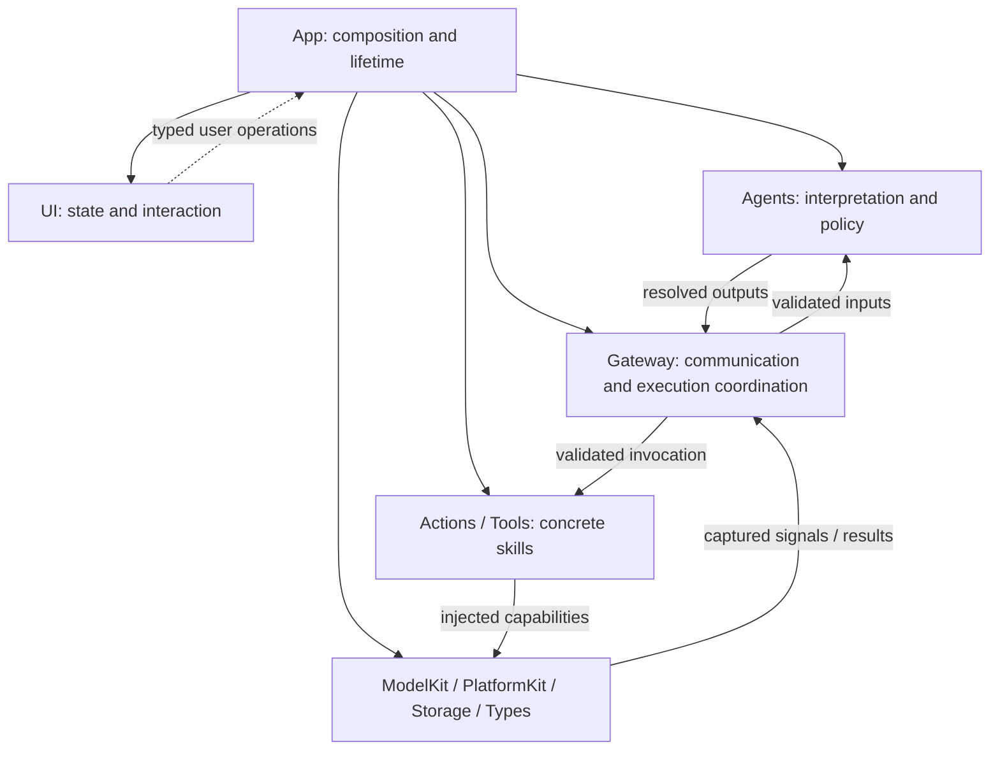

This diagram shows assembly and runtime collaboration. The following diagram shows project compilation dependencies; system frameworks and the BehaviorDefinitions compiler plugin are omitted.

### Core compilation dependencies

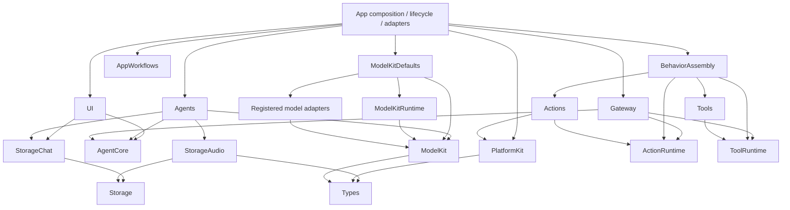

The App arrows summarize its assembly entry points; the host also consumes the shared contracts and model/storage services needed by its adapters. Model adapter dependencies are detailed in [ModelKit](ModelKit/README.md).

AgentCore, ActionRuntime, ToolRuntime, Storage and Types have no project dependencies. ModelKit and PlatformKit share Types without depending on each other. Gateway consumes execution contracts rather than concrete behavior domains. Tools currently implements System/UI functions using App-bound endpoints and has no direct PlatformKit or UI dependency. A device Tool domain may consume PlatformKit when its implementation requires native capabilities; ToolRuntime stays independent.

### Host and feature composition

App contains the composition root, lifecycle coordinators, feature workflows and adapters. Composition selects concrete implementations and validates configuration before producers start. Lifecycle owns long-lived work; adapters convert between module contracts and actual host capabilities.

AppWorkflows is a state-free facade over six independent feature targets:

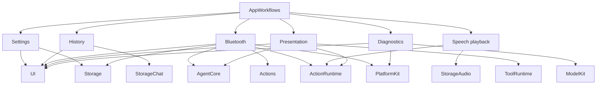

Settings receives provider operations from App. History receives title-generation and output-preview operations from App. Voice and camera coordinators receive role-specific services and Agent factories. UI receives presentation state and typed user operations; pages do not own model or device sessions.

### Coordination and ownership

| Owner | Responsibility |
| --- | --- |
| App | Bind implementations; coordinate session start, interruption and cleanup. |
| Agents | Own cognitive state, model use, behavior selection and Agent-local processing. |
| InputGateway | Validate and deliver external inputs, inter-Agent messages and Tool results. |
| OutputGateway | Authorize resolved Agent outputs and coordinate dispatch, resources and feedback. |
| ActionRuntime / ToolRuntime | Register definitions and execute trusted invocations. |
| ModelKitRuntime | Own process-wide model availability and operation arbitration. |
| PlatformKit | Own device connection, capture/output and native feedback. |
| Storage domains | Own records and bounded media handles. |
| UI | Own MainActor presentation state and views. |

Agent JSON declares model-callable actions, native tools and permissions; Agent code owns fixed internal behavior. Agents resolve aliases before submitting calls to Gateway. BehaviorAssembly constructs concrete registries; Gateway validates their coverage against Agent capabilities.

### Source structure and compilation map

```text
MobileHarness/
├── App/                    # Application host and explicit composition
│   ├── Composition/        # AppAssembly and runtime/model assembly
│   │   └── Behaviors/       # Independent BehaviorAssembly target
│   ├── Lifecycle/          # Voice/camera sessions and cleanup
│   ├── Workflows/          # AppWorkflows facade and independent feature targets
│   │   ├── Settings/
│   │   ├── History/
│   │   ├── Bluetooth/
│   │   ├── Speech/
│   │   ├── Presentation/
│   │   └── Diagnostics/
│   └── Adapters/           # Effect endpoints, media and native preview bridges
├── UI/                     # Independent pages, state and interaction target
│   ├── Conversation/
│   ├── Components/
│   ├── Camera/
│   ├── Settings/
│   └── Diagnostics/
├── Agents/                 # Shared core and business Agent source ownership
│   ├── Core/               # Independent AgentCore compilation target
│   │   ├── Runtime/        # Agent registry, manager and lifecycle
│   │   ├── Capability/     # JSON, model catalog and internal permissions
│   │   ├── Generation/     # Function Token, Channel/wait and Tool parsers
│   │   ├── Output/         # Resolved calls and trusted envelopes
│   │   └── Communication/  # Typed messages and routing policy
│   ├── Assistant/          # Conversation generation and interpretation
│   ├── SpeechPerception/   # Shared VAD/ASR and speech observations
│   ├── SpeechSynthesis/    # Directed FIFO text-to-audio synthesis
│   └── VisionPerception/   # Pose inference, gaze and skeleton output
├── Gateway/                # Input/output validation, routing and scheduling
│   ├── Input/
│   └── Output/             # Validation, routing, dispatch, scheduling, results and resources
├── Actions/                # Concrete scheduled behaviors and independent runtime
│   ├── Runtime/            # ActionRuntime target; execution and Contracts/
│   ├── NexArm/             # Agent-used robot actions
│   ├── Speech/             # Audio-ID playback and awaited completion
│   └── UI/                 # Scheduled expression; non-callable Support below
├── Tools/                  # Concrete immediate functions and independent runtime
│   ├── Runtime/            # ToolRuntime target; execution and Contracts/
│   ├── System/             # Fixed runtime information
│   └── UI/                 # Immediate captions, gaze, voice state and skeleton display
├── Types/                  # Shared values grouped by domain; Types target
│   └── Audio/              # PCM and microphone values; no project dependencies
├── Storage/                # Core cache, persistence and local synchronization
│   ├── Audio/              # StorageAudio: PCM handles
│   └── Chat/               # StorageChat: conversation records and journal
├── ModelKit/               # Independent SDK and separate provider targets
│   ├── Core/
│   ├── Speech/
│   ├── Language/
│   ├── Vision/
│   ├── Defaults/
│   ├── Management/
│   └── Backends/
├── PlatformKit/            # Device/OS I/O and capability validation
│   ├── Audio/
│   ├── Vision/
│   ├── Connectivity/
│   └── Core/
└── Resources/              # Privacy, model profiles and local artifacts

Tests/                      # Root module tests and integration/model evaluations
Config/                     # Shared configuration; local signing is ignored
scripts/                    # Checks, builds and provisioning
MobileHarness.xcodeproj/    # App/framework schemes and source navigation
```

#### Compilation map

Root [Package.swift](../Package.swift) compiles shared sources into independently tested targets. The Xcode application targets compile the host and link those targets. The table combines source mapping and direct project dependencies; tests and system frameworks are omitted from dependency lists.

| Source path | Target | Direct dependencies |
| --- | --- | --- |
| `App/` excluding package-owned subtrees | Xcode App targets | Composition/adapters/lifecycle; see App README |
| `App/Composition/Behaviors/` | BehaviorAssembly | Actions, Tools, ActionRuntime, ToolRuntime |
| `App/Workflows/` facade | AppWorkflows | The six feature workflow targets below |
| `App/Workflows/Settings/` | AppSettingsWorkflow | UI, Storage |
| `App/Workflows/History/` | AppHistoryWorkflow | UI, StorageChat |
| `App/Workflows/Bluetooth/` | AppBluetoothWorkflow | UI, AgentCore, Storage, Actions, ActionRuntime, PlatformKit |
| `App/Workflows/Speech/` | AppSpeechPlayback | ActionRuntime, StorageAudio |
| `App/Workflows/Presentation/` | AppPresentationWorkflow | UI, AgentCore, ActionRuntime, ToolRuntime |
| `App/Workflows/Diagnostics/` | AppDiagnosticWorkflow | UI, ModelKit, PlatformKit |
| `UI/` | UI | AgentCore, StorageChat |
| `Agents/Core/` | AgentCore | None |
| `Agents/` excluding `Core/` | Agents | AgentCore, ModelKit, StorageChat, StorageAudio |
| `Gateway/` | Gateway | AgentCore, ActionRuntime, ToolRuntime |
| `Actions/Runtime/` including `Contracts/` | ActionRuntime | None |
| `Tools/Runtime/` including `Contracts/` | ToolRuntime | None |
| `Actions/` excluding `Runtime/` | Actions | ActionRuntime, PlatformKit, BehaviorDefinitions |
| `Tools/` excluding `Runtime/` | Tools | ToolRuntime, BehaviorDefinitions |
| `Types/` | Types | None |
| `Storage/` excluding `Audio/` and `Chat/` | Storage | None |
| `Storage/Chat/` | StorageChat | Storage |
| `Storage/Audio/` | StorageAudio | Storage, Types |
| `PlatformKit/` | PlatformKit | Types |
| `ModelKit/` shared capability sources | ModelKit | Types |
| `ModelKit/Management/` | ModelKitRuntime | ModelKit |
| `ModelKit/Defaults/` | ModelKitDefaults | ModelKit, ModelKitRuntime and registered adapters |
| ModelKit concrete adapters and backends | Separate targets | See ModelKit README |
| `Resources/` | App resource staging | Local weights remain ignored |
| Root `Tests/` | Module and integration tests | Tested targets; no duplicated sources |

### Architectural boundaries

- Directory nesting expresses ownership; compilation targets enforce independence. AgentCore lives inside Agents, while execution runtimes live inside Actions/Tools.
- Action business behavior belongs to Actions. PlatformKit owns connection, protocol encoding, hardware limits and device feedback.
- UI consumes AgentCore/StorageChat domain values and typed operations. It imports no concrete Agent, Gateway, behavior, model or device service.
- Types groups shared immutable values by category. Audio is implemented under Types/Audio; ImageFrame and NativeImageBuffer currently belong to ModelKit/Core.
- Each source has one compilation owner. Shared targets use the root Package.swift; App host sources compile in Xcode application targets.

## Part II — Module Responsibilities

This section describes purpose and boundaries. The linked module documents contain implementation details.

| Module | Responsibility | Boundary | Biological analogy |
| --- | --- | --- | --- |
| [App](App/README.md) | Assemble the system, bind capabilities and coordinate application/session lifetime. | Host adaptation and workflow coordination; business behavior stays in its owning module. | The organism that brings organs into coordinated operation. |
| [UI](UI/README.md) | Present conversation, settings, camera and diagnostic state; expose user operations. | MainActor presentation; no long-lived runtime services or device/model effects. | Face and interaction surface. |
| [Agents](Agents/README.md) | Interpret observations, call model capabilities and select permitted behavior. | Cognitive policy and Agent-local state; all outputs cross OutputGateway. | Specialized brain regions. |
| [AgentCore](Agents/Core/README.md) | Define shared Agent identity, messages, permissions and lifecycle contracts. | Independent of concrete Agents, UI, model engines and device adapters. | Shared organization of the nervous system. |
| [Gateway](Gateway/README.md) | Validate signals and outputs, route messages, schedule Actions and coordinate resources/results. | Receives resolved calls; does not own domain behavior or model inference. | Neural pathways coordinating signals and motor commands. |
| [Actions](Actions/README.md) | Implement scheduled robot, speech and expression behaviors. | Own business parameters, composition and completion policy; consume native capabilities. | Reusable motor skills. |
| [ActionRuntime](Actions/Runtime/README.md) | Define Action contracts, registries and invocation execution. | No Agent, UI or platform dependencies; Channel policy belongs to Gateway. | The common execution mechanism for motor skills. |
| [Tools](Tools/README.md) | Implement directly callable System/UI functions and their effects/results. | Use explicit capabilities; current functions do not import PlatformKit or UI. | Focused reflexes and immediately available functions. |
| [ToolRuntime](Tools/Runtime/README.md) | Define Tool contracts, registries and direct invocation execution. | Independent of concrete tool domains and hardware; results route through Gateway. | The common execution mechanism for direct functions. |
| [ModelKit](ModelKit/README.md) | Expose language, speech and vision processing capabilities. | Capability SDK; management, defaults and concrete engines compile separately. | Recognition and generation machinery. |
| [PlatformKit](PlatformKit/README.md) | Connect devices, capture signals, produce native output and report feedback. | Foundational device SDK; no business gestures, presentation or application workflow policy. | Sensory organs and effectors. |
| [Storage](Storage/README.md) | Provide persistence, bounded streams and retained data primitives. | StorageChat owns conversation records; StorageAudio owns PCM handles; no inference or routing. | Retained information that cognitive processes can use. |
| [Types](Types/README.md) | Share immutable value contracts across independent SDKs, organized by category. | Values and validation only; no services, queues or runtime lifecycle. | The common vocabulary of signals. |
| Resources | Supply bundled configuration and local model resources through App. | Model resources are staged by the host; modules receive explicit resource access. | Materials required by the organism's processing machinery. |

Within App, Composition is the assembly point, Lifecycle owns running sessions, Workflows owns feature effects, and Adapters binds module contracts to host services. Within ModelKit, the base SDK owns capabilities, ModelKitRuntime owns management, ModelKitDefaults owns provider registration/defaults, and adapter targets own concrete engines.

## Part III — Key Techniques

### Application assembly and session lifetime

App binds presentation, device and storage endpoints, constructs behavior registries and validates Agent permissions before starting producers. ModelKitDefaults configures the process-wide manager from the resource root supplied by App. Voice and camera use shared infrastructure with independent session ownership.

User/OS lifecycle operations are coordinated by App. Stopping a session closes admission, cancels and joins its work, and retires owned Agent activity, Actions and media handles. Page navigation does not determine runtime lifetime. Session/input identities fence stale events and presentation updates.

### Voice Input, Cognition and Output

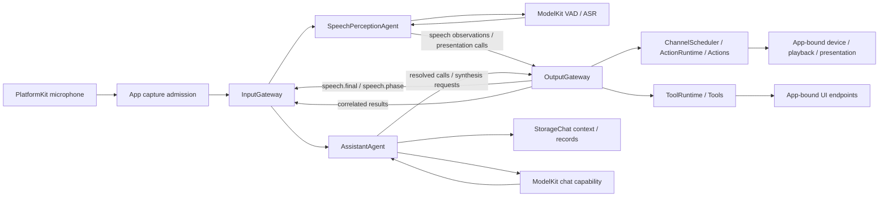

App owns capture admission and the voice session. SpeechPerception turns captured audio into transcript/phase observations using ModelKit capabilities. Assistant uses the conversation journal and chat capability, then emits resolved calls and directed synthesis requests through OutputGateway. Recognition presentation and reply presentation use permitted Tool/Action routes. Returning results are correlated with the original source/session/input before re-entering InputGateway.

### Signal and Media Representation

Signal is the conceptual input abstraction; `AgentInput` is its implemented type. There is no second parallel Signal type. Payload is separate from source, contract/version, session, turn, sequence, capture time, incarnation, causal root/parent and monotonic admission deadline.

| Payload                | Meaning                                                       |
| ---------------------- | ------------------------------------------------------------- |
| Text / runtime event   | User text or explicit runtime input                           |
| Audio / image          | Bounded PCM or image data / controlled in-process attachment  |
| Perception observation | Typed transcript, speech phase or pose without original media |
| ToolResult             | Result correlated with its originating call and session       |
| ActionResult / ActivityEvent | Runtime execution outcome / ongoing activity observation with trusted ownership |

Media streams are successive typed inputs. JSON v5 configures Agents; it is not the audio/image transport format. App-owned attachments bridge native frames without making AgentCore depend on model/platform frameworks. Bounds and value contracts live in [Input](Gateway/Input/README.md) and [Communication](Agents/Core/Communication/README.md).

<a id="32-internal-agent-communication"></a>

### Communication Framework

Communication covers external input, internal Agent observations and Tool-result return. **Gateways perform intermediate validation, metadata construction and routing. Agent inboxes own pending messages. There is no independent message Bus.**

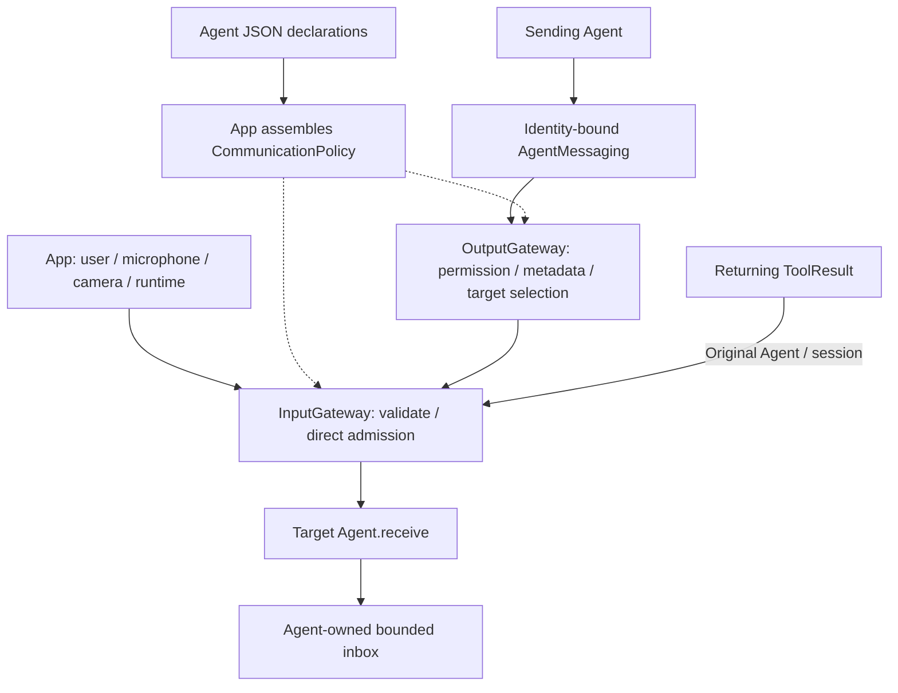

#### Subscription ownership and target selection

Each Agent JSON declares `inputs` (supported contract/version/kind), `subscriptions` (exact contract/source/topic), `publications` (publishable contracts) and `sends` (allowed contract/target pairs). App validates these into an immutable policy. Agents do not register listeners dynamically. Topic currently equals contract; there are no wildcards or implicit fallback recipients.

External publish/send selects targets in InputGateway. Internal publish/send selects targets in OutputGateway after outbound permission checks. Supporting an input is distinct from subscribing to it: directed sends bypass subscription matching but preserve supported-contract validation.

OutputGateway binds source identity/incarnation, sequence, session, turn and causal parent into the envelope. It resolves live target identities and directly invokes the module-internal InputGateway entry. Public external entry points reject forged internal incarnations. Child deadlines cannot outlive their parent.

#### Direct admission, lifetime and ownership

InputGateway uses structured per-target tasks and a common capacity boundary for external and internal admission. It checks source/target identity, session, supported payload, cancellation and message expiry before `receive`. One rejected destination does not suppress successful peers, but the aggregate report awaits all targets.

Ordinary `receive` must promptly validate and enqueue or reject; it must not await inference or inbox space. Cross-actor calls still use await. Explicit cancellation controls may join cleanup. Neither Gateway has a pending-message queue, persistent worker or independent delivery lifecycle. There is no communication FIFO guarantee across concurrent calls and no automatic duplicate suppression or state replacement.

InputGateway and OutputGateway enforce explicit active-call bounds; full admission rejects immediately and structured calls release their reservations on completion. These are active-call bounds, not queues. Current values and release behavior belong in the [Gateway Input](Gateway/Input/README.md) and [Gateway Output](Gateway/Output/README.md) READMEs.

A message deadline is a freshness check, not a timer racing receive. Cancelling the caller propagates through structured admission calls; already accepted work belongs to the Agent. App stops producers and coordinates Agent/runtime cleanup. Gateways do not own a separate communication session registry or shutdown barrier. Action Channels remain separate execution queues.

| Concern | External input | Internal Agent event |
| --- | --- | --- |
| Target selection | InputGateway subscription lookup or explicit target | OutputGateway permission check and target selection |
| Admission | Shared InputGateway bounded task group | Same InputGateway bounded task group |
| Queue / processing | Agent inbox | Agent inbox |
| Lifecycle | Caller, App and Agent/runtime ownership | Same; source incarnation and causal context are also checked |
| Receipt | Per-target admission, not processing completion | Same |

Detailed diagrams: [external input](Gateway/Input/README.md#external-input-admission-and-delivery) and [internal direct delivery](Agents/Core/Communication/README.md#target-selection-and-per-agent-delivery).

#### Signal routes

| Source | Input | Receiver |
| --- | --- | --- |
| phone.microphone | media.audio | SpeechPerception subscription |
| phone.camera | media.image | VisionPerception subscription |
| user | user.text | Assistant subscription; no current text-entry UI |
| speechPerception | speech.final / speech.phase | Assistant subscription |
| speechPerception | speech.partial / final / phase | Registered runtime observer for admission/logging, without UI mutation |
| visionPerception | vision.pose | Declared business subscribers; skeleton output is an independent Tool |
| runtime | ToolResult / assistant.cancel | Original or explicitly selected Agent/session |

Assistant declares directed `speech.synthesize` and `speech.cancel` sends to SpeechSynthesis; the other current Agents have empty sends lists. Zero recipients fails unless a registered publication observer handles the contract. Ordinary discrete events and physical actions must not be silently coalesced; Agent-local latest-state policies are explicit.

### Capability Declaration and Resolution

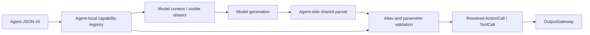

Action and Tool aliases are unique within one Agent; different Agents may reuse a name. An alias such as `express` resolves to `UI.express`, not a reflected Swift method. JSON v5 groups model-callable Actions by Channel. Code-owned internal permissions have no model aliases or prompt metadata. Context generation exposes only the callable catalog. App explicitly binds implementations. Invalid configuration propagates without `try!` or fallback registrations.

### Function Token Protocol

Function Token is a streaming mixture of natural text and restricted XML. A parsed FunctionToken is not a model tokenizer token. Shared parsers live in Agents/Core/Generation, while parser instances and alias resolution belong to each Agent.

```xml
<express emotion="smile"/>
Hello.
<wait>
  <express emotion="thinking"/>
  Let me think.
</wait>
```

The four forms are natural text, self-closing Action tags, paired Channel scopes and paired wait groups. Agent-side generation preserves streaming fragment boundaries, groups text, tracks Channel/wait scopes and resolves calls before Gateway admission. Assistant supplies a code-owned text callback for speech and captions; internal playback/initialization permissions are assembled in code. Explicit Action tags do not implicitly duplicate that mapping.

Completed Actions can be emitted before a Channel closes. Tag/scope boundaries flush preceding text; normal completion flushes remaining valid text, while cancellation discards incomplete state. Raw markup and unresolved aliases never reach Gateway; resolved Actions and typed wait boundaries do. Native Tool calls use the separate ToolCallParser.

Syntax, escaping, nesting, bounds and malformed-stream behavior are defined in [Generation](Agents/Core/Generation/README.md).

### ActionCall versus ToolCall

| Dimension         | ActionCall                                                | ToolCall                                                 |
| ----------------- | --------------------------------------------------------- | -------------------------------------------------------- |
| Agent generation  | Function Token interpretation or explicit Agent logic     | Separate native Tool parsing or explicit Agent logic     |
| Resolved identity | ActionPath, parameters and effective Channel              | ToolPath and arguments                                   |
| Execution         | OutputGateway → ChannelScheduler → ActionRuntime        | OutputGateway → ToolRuntime directly                    |
| Ordering          | Task-local Channel FIFO; nested wait joins; global module exclusion | Caller awaits handler; no Channel queue                  |
| Completion        | Handler completion and per-input finish barrier           | Value feedback or Void completion, fixed by registration |
| Current examples  | Speech.speak, UI.express                        | runtimeInfo, UI.print, UI.setTranscript, UI.moveEyes, UI.showPose |

Both are validated executable outputs, and either may have side effects. Their distinction is execution/feedback semantics, not simply “write versus read.” Returning Tools re-enter InputGateway with ToolResult; Void Tools do not. Actions can return correlated terminal feedback under the policy described in [Action feedback and resource ownership](#action-feedback-and-resource-ownership). Typed internal observations use a separate messaging port, not either generation protocol.

### Multi-Channel Action Scheduling

A Channel is an ordered Action execution scope. The Agent capability declaration supplies each Action's default Channel; an explicit `<channel.name>` scope overrides it. Closing an inner scope restores the parent; closing the outermost restores each Action's default. Only permitted Channels may be selected. Channel scopes do not themselves create wait groups.

With Assistant's default mapping, natural text produces speech on `Speech` and captions on `Display`. They may progress concurrently. A `<wait>...</wait>` group joins its parent's preceding work, preserves ordinary Channel scheduling internally, and joins all its children before releasing its parent's continuation. Consecutive wait groups express sequential stages; nested waits synchronize only within their parent. Channel closing changes scope without waiting. No channel name, including main, has special semantics; Assistant does not declare main.

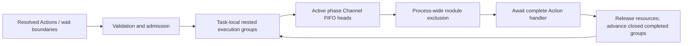

Channel queues are task-local; equal names across Agents do not impose cross-task FIFO. Resource exclusion is process-wide. A wait affects one Agent/session/input, never unrelated tasks. finish seals root input and joins accepted work; errors cancel that task's tree and cooperative running work. No queued device action is silently discarded on capacity exhaustion. Speech synthesis remains outside this schedule, with a per-job execution deadline and reply-owned unplayed cache lifetime; pending/ready audio has no expiry timer.

### Action Feedback and Resource Ownership

Execution feedback and resource ownership complement Channel scheduling; neither changes task-local FIFO or wait semantics.

**Terminal feedback.** Gateway reserves bounded result capacity before admission and returns correlated ActionResult through InputGateway, bound to the originating Agent incarnation and session. The default is failure-only feedback for opted-in Agents; terminal mode also reports success. Delivery retries reuse the result without repeating the effect. Current Agents retain bounded receipts without automatically triggering inference or replanning. An Action result describes its declared handler completion boundary; ActivityEvent describes later ongoing activity.

**Resource ownership.** One App-assembled ResourceCoordinator guards declared Action, Tool and host paths. Transient execution fences and persistent leases are separate from Channel/module exclusion. Group takeover gates affected resources, stops and joins old work, then grants ownership; uncertain cleanup leaves the group faulted. Camera capture uses a persistent lease; start/stop belongs to App lifecycle.

The [Results](Gateway/Output/Results/README.md) and [Resources](Gateway/Output/Resources/README.md) documents own limits, algorithms and failure rules. Shared values live in Agents/Core/Output and receipt history in Agents/Core/Runtime.

### TTS synthesis and playback data flow

Speech output has two linked paths. The originating Agent chooses the spoken text boundary and creates an `audioID`; Assistant currently does this while interpreting generated text, and another authorized Agent can use the same synthesis service. The directed synthesis request contains `audioID`, `text` and `locale`. The playback Action contains only `audioID`, with the original Channel retained. Both paths carry the originating source, session and input identity so the cache can reject another caller's handle.

```mermaid
sequenceDiagram
    participant A as Originating Agent
    participant OG as OutputGateway
    participant IG as InputGateway
    participant S as SpeechSynthesisAgent
    participant M as ModelKit synthesis capability
    participant C as StorageAudio / Storage
    participant Q as ChannelScheduler
    participant R as ActionRuntime / Speech Action
    participant P as SpeechPlayback
    participant H as App / PlatformKit Audio
    A->>OG: directed speech.synthesize(audioID, text, locale)
    OG->>IG: validate and deliver
    IG->>S: receive request
    S->>C: reserve audioID for source / session / input
    S->>S: enqueue in bounded FIFO; start if worker idle
    S-->>IG: admitted
    IG-->>OG: delivery receipt
    OG-->>A: admission receipt
    par Synthesis path
        S->>M: when FIFO worker starts, synthesize with execution deadline
        loop ordered audio events
            M-->>S: PCM frame or finished
            S->>C: append frame / complete audioID
        end
    and Scheduled playback path
        A->>OG: resolved Speech.speak(audioID)
        OG->>Q: validate and schedule on original Channel
        Q->>R: execute when eligible
        R->>P: invoke registered Speech handler
        P->>C: checkout audioID with same owner
        C-->>P: single-use PCM stream
        loop as frames become available
            P->>C: read next frame
            C-->>P: PCM when available; otherwise await producer / failure / cancellation
            P->>H: play PCM
        end
        H-->>P: playback drained
        P->>C: release audioID
        P-->>R: playback result
        R-->>Q: Action completion
    end
```

The Agent waits for **request admission**, not synthesis completion, before emitting `Speech.speak(audioID)`. SpeechSynthesisAgent processes admitted requests in its own serial FIFO and does not inspect Channels; the Gateway's ChannelScheduler independently decides when ActionRuntime invokes playback. The worker starts the next request after synthesis completes, without waiting for playback.

App injects the process-wide ModelKit synthesis capability and one shared audio store into synthesis and playback. StorageAudio adapts Types PCM and owner identity to the general Storage memory primitives.

Playback may consume PCM before synthesis finishes. Empty initial or intermediate reads wait for the producer, failure or cancellation. The synthesis execution deadline begins when its worker starts, excluding queue time; it does not define cache lifetime or playback duration. Production PCM reads have no independent deadline. Platform output has its own hardware-completion boundary, separate from model completion.

Successful Action completion means the player has drained and the single-use cache lease has been released. Each consumed frame leaves Storage on read; already consumed audio is not preserved for replay. The reply lifetime is one source/input within a voice session, not the full multi-turn session or durable conversation history. Pending/ready audio has no wall-clock expiry; the reply owner retires unused handles after all Actions complete, or during reply error/interruption cleanup. LLM generation completion alone does not release unplayed audio. Synthesis/cache errors, a missing handle or synthesis execution timeout fail playback explicitly; cancellation and dispatch failure release the owning audio. No audio file, re-synthesis or Channel-driven synthesis reorder is involved. [Assistant](Agents/Assistant/README.md) owns current semantic segmentation; [SpeechSynthesis](Agents/SpeechSynthesis/README.md), [StorageAudio](Storage/Audio/README.md), [Speech playback](Actions/Speech/README.md), and [PlatformKit Audio](PlatformKit/Audio/README.md) own their detailed limits and implementation contracts.

The synthesis deadline fails the shared audioID; pending or subsequent PCM reads throw, and playback propagates the failure to the Action. This is shared-cache error propagation, not a direct Agent-to-Action callback. See [synthesis timeout propagation](Agents/SpeechSynthesis/README.md#synthesis-timeout-propagation) for timing, cancellation and terminal-error retention.

### Session, Turn and UI Boundaries

Runtime lifecycle is separate from business state. AgentManager controls registration and running instances; each Agent owns domain state and bounded input processing. Voice and camera share infrastructure but close their own sessions independently. Stop first prevents producer admission, cancels and joins perception/transport work, then cancels consumers and Actions. Incarnations fence old instances from replacements.

The current voice stop and interruption chain is coordinated by App: stop producers, send assistant.cancel through InputGateway, then cancel session Actions through OutputGateway. Tool cancellation follows the active dispatch task. See [App lifecycle and completion](App/README.md#lifecycle-and-completion) for cleanup order and implemented boundaries.

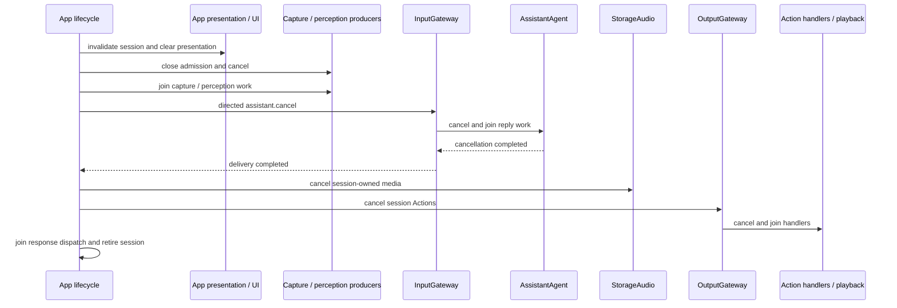

Agent-selected presentation uses explicitly permitted, resolved Actions/Tools through OutputGateway. SpeechPerception owns recognition captions and phase presentation; Assistant owns reply captions, expressions and atomic beginReplyTurn; VisionPerception owns UI.showPose and UI.moveEyes. Signal observers only coordinate capture admission/logging. App may reset state for user/OS lifecycle and present actual device telemetry.

ConversationTurn carries an ID and session-local ordinal through input, observations, output and Tool return. A long utterance retains its turn across segments. Trusted output sequences and turn checks reject stale UI updates; model parameters cannot override this identity.

| Boundary                    | Recognition caption               | Reply / expression                                   |
| --------------------------- | --------------------------------- | ---------------------------------------------------- |
| Confirmed new utterance     | Latest partial replaces preview   | Assistant clears once through beginReplyTurn         |
| Endpoint, ASR pending       | Preserve preview                  | Await reply                                          |
| Final or empty recognition  | finishTranscript clears and seals | Reply or return to listening                         |
| Response and playback       | Remains sealed                    | Append reply; speaking state follows actual playback |
| Reply completed             | Empty                             | Retain until next utterance                          |
| Stop / background / failure | Clear and invalidate session      | Clear and invalidate session                         |

Eye gaze reuses pose facial landmarks and emits the code-owned immediate UI.moveEyes Tool within the camera session. Vision inference, observation publication and local display have distinct ownership, so a slow subscriber does not determine local visualization freshness. App adapters enforce session/frame ordering at presentation admission. See [VisionPerception](Agents/VisionPerception/README.md) for its internal sampling and replacement policies.

<a id="391-platformkit-versus-modelkit"></a>

### PlatformKit versus ModelKit

| Concern             | PlatformKit: device/OS I/O                                     | ModelKit: model processing                                  |
| ------------------- | -------------------------------------------------------------- | ----------------------------------------------------------- |
| Audio input         | Microphone → PCM                                              | PCM → transcript or VAD score                              |
| Audio output        | Supplied PCM → speaker                                        | Text → synthesized PCM                                     |
| Vision              | Camera → frame and preview                                    | Supplied image → pose/model results                        |
| Adaptation          | Capture format, orientation, compact gray sampling             | Model resize/normalization, tensor decoding and coordinates |
| Resources           | Device sessions, engines, connections and I/O buffers          | Weights, graphs, model instances and operation leases       |
| Policy outside both | App bridges data; Agents choose when and why to process or act | Gateway validates and routes without inference              |

“Processing” means model capability processing, not all computation. VisionPerception compares gray samples as perception policy, asks ModelKit for poses, then emits observations and a display Tool. Model synthesis produces PCM; playback is a separate platform operation owned by the Speech behavior. Neither Kit owns Agent business decisions.

### Camera Perception and Presentation

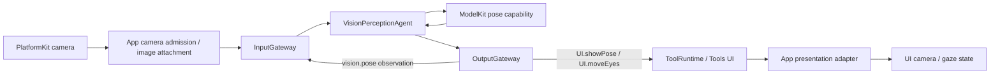

App owns camera capture and its resource lease, and supplies native-image resolution to VisionPerception. InputGateway validates frame admission. VisionPerception calls the model capability and independently emits observations and permitted presentation Tools. App checks session/frame ordering before updating UI. Stopping capture invalidates admission and joins session work before releasing ownership. Native capture, inference and presentation have separate completion boundaries.

### Robot Behavior and Device Feedback

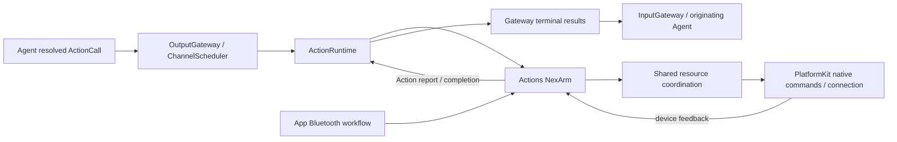

App binds the same Action implementation and resource coordinator for Settings operations and Agent-selected behavior. Actions owns business motion and completion policy; PlatformKit owns native command encoding, connection and device feedback. Gateway's scheduling and result delivery surround the Action's declared execution boundary. Device feedback informs the Action result; successful command submission alone does not imply completed motion. Failure and cancellation return through the existing execution/result path without replaying the effect.

### Settings and Conversation History

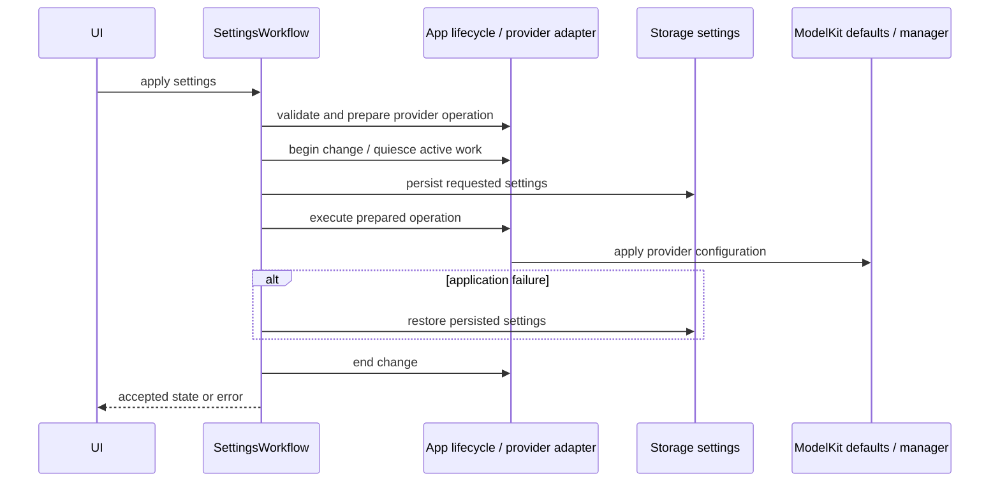

Provider validation precedes the lifecycle change barrier and persistence. App supplies provider preparation/discovery operations; SettingsWorkflow coordinates storage and application, preserving rollback before the barrier is released. UI presents the resulting state/error without owning provider services.

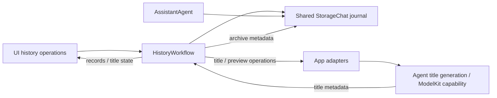

Assistant and HistoryWorkflow share the durable conversation journal. Start New commits the archive and creates the new conversation before title generation. App acquires the title capability under the settings/lifecycle barrier, releases that barrier, then performs title inference. Title updates change metadata rather than conversation execution. Browsing history never replays Actions; cancellation can stop title work while leaving the committed archive available for retry.

### Shared Model Lifecycle

ModelKitDefaults supplies the process-wide ModelManager and internal provider bindings; conflicting resource roots fail. `ModelManager.get` is the capability acquisition API. Shared construction/loading is coalesced, while each model admits only one active operation and rejects overlap rather than creating an inference queue.

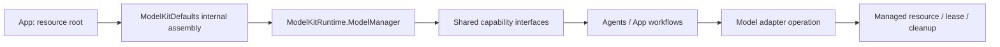

Stopping a conversation cancels work without automatically unloading weights. Explicit unload waits for usage to end; shutdown cancels and joins active work. Residency policy is distinct from capability availability; memory warnings are coalesced and forwarded by App. Registration and construction require assembly SPI, and management uses its designated SPI rather than business access to backend resources.

### Cross-module Concurrency and Completion

SwiftUI presentation is MainActor-isolated. Runtime mutable state belongs to actors or explicitly owned synchronization. Structured calls propagate cancellation across module boundaries; admitted Agent work and long-lived services retain their own owners.

| Boundary | Admission | Completion and cleanup |
| --- | --- | --- |
| Gateway → Agent | Validated input accepted into an Agent-owned bounded inbox | Agent owns processing; App coordinates session stop and joins work. |
| Agent → ModelKit | Capability operation admitted under the model's operation ownership | Model operation returns or cancels; model residency is managed separately. |
| Gateway → ActionRuntime | Authorized Action accepted by its task-local schedule | Handler reaches its declared completion boundary; finish joins all accepted Actions. |
| Gateway → ToolRuntime | Authorized direct invocation | Registered data-returning or completion-only contract determines feedback. |
| Synthesis → StorageAudio → Playback | Owner-scoped audio handle reserved and checked out | Frames are consumed once; playback drains and releases; reply cleanup retires unused handles. |
| App adapter → UI | Session/turn/frame identity accepted | State acceptance does not imply rendering or hardware completion. |

Queue bounds and overflow policies are enforced by the owning modules. Discrete events and device Actions cannot be silently dropped. Explicit latest-state replacement belongs to the producer that declares it. Admission receipts, inference completion, handler completion and physical/rendered completion remain distinct milestones.
