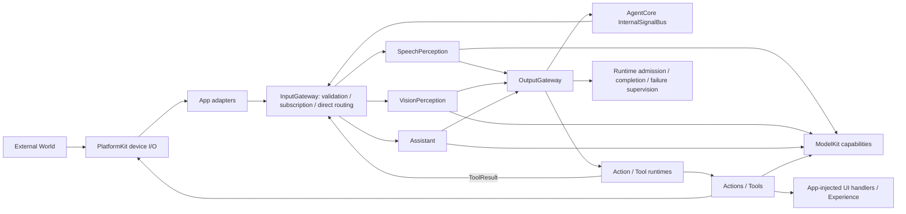
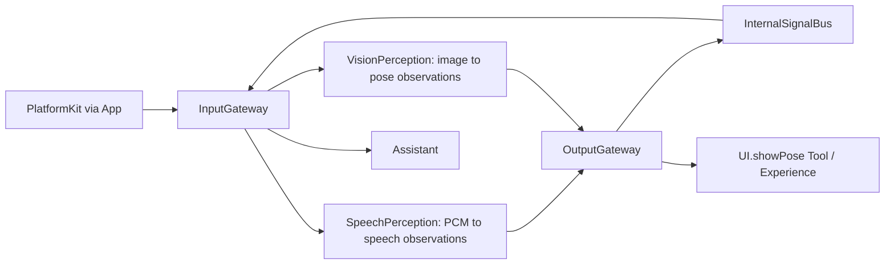
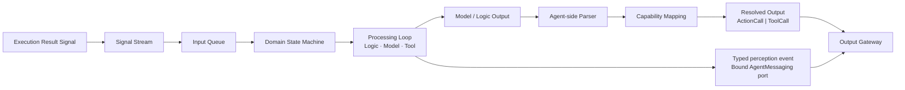
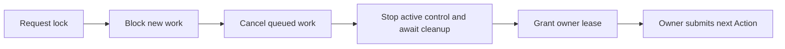
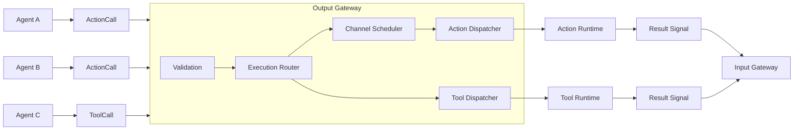
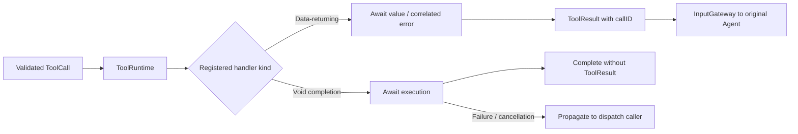
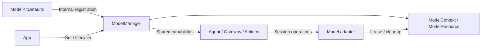
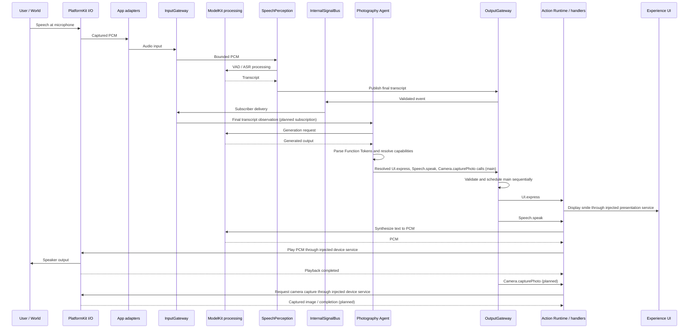
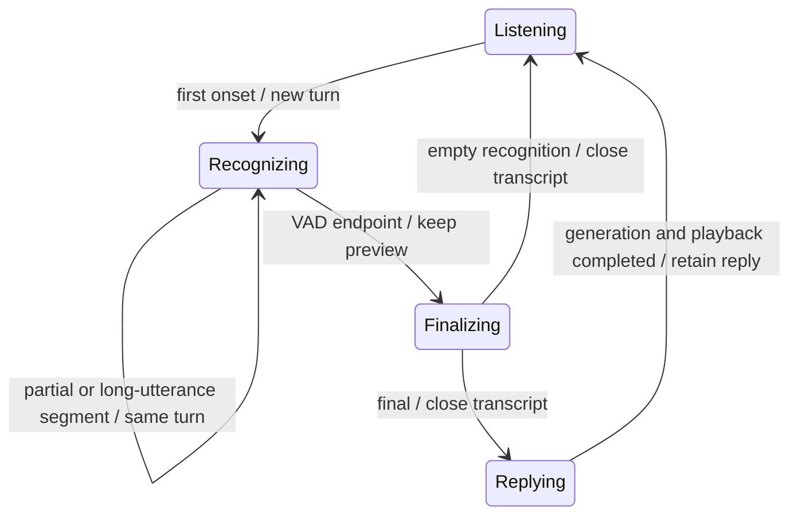

# MobileHarness Technical Architecture

## 1. Overview

**MobileHarness** is a multimodal, multi-agent, bio-inspired harness for mobile and embodied AI systems.

Its architecture follows a continuous information-processing loop inspired by biological nervous systems:

**Signal → Cognition → Action**

The system is organized around three major functional domains:

- **Input Gateway** — validates protocol envelopes and routes multimodal inputs by static subscription or explicit destination.
- **Agent Core / Agents** — independent, stateful cognitive units that process signals and generate executable outputs.
- **Output Gateway** — validates Agent event publication and directed sending, exposes validated runtime observations, and schedules fully resolved Action Calls and Tool Calls.

Two capability layers support this loop: **PlatformKit handles data input/output through devices and operating-system services; ModelKit processes data through models.** Gateway coordinates signals, Agents decide what to do, and Actions/Tools execute the requested behavior. These responsibilities are compared in section 39.

The architecture is designed around four core properties:

- **Multimodal** — text, audio, image, video, sensor, physical, and system signals.
- **Multi-Agent** — multiple specialized Agents run independently and concurrently.
- **Bio-inspired** — signal input, specialized cognition, centralized action coordination, and continuous feedback loops.
- **Streaming & Stateful** — signals, model generation, Function Tokens, Tool Calls, and execution may operate continuously instead of following request-response semantics.

---

# 2. Core Architecture



Other sensor adapters, task Agents and robot control remain planned. ModelKit and PlatformKit are independent; App supplies conversion and service bindings. AgentCore declares transport/runtime contracts and does not depend on concrete Agents.


---

The diagram describes logical coordination, not module imports or a requirement that every input use a device adapter. PlatformKit acquires device data and performs device output; App connects those services to the gateways and executable handlers. ModelKit supplies processing capabilities to Agents and Actions; Gateway neither holds model capabilities nor invokes inference. ModelKit and PlatformKit do not depend on each other. Text/UI input and internal results also enter InputGateway through their own producers.

# 3. Core Information Model

## 3.1 Signal

`Signal` is the conceptual unified input abstraction of MobileHarness, implemented by `AgentInput`; there is no separate parallel Signal type.

Everything entering the cognitive system is represented as a Signal regardless of modality or source.

Typical signal types include:

| Signal Type | Examples |
|---|---|
| Text | user text, system text |
| Audio | recorded audio |
| Audio Stream | microphone stream |
| Image | camera image, photo |
| Video Stream | live camera/video |
| Physical | force, temperature, IMU, touch |
| Sensor | proximity, motion, depth |
| System | timer, notification, app event |
| Internal | Agent-generated internal signal |
| Execution Result | Action or Tool execution result |

Conceptual Swift structure:

```swift
// AgentCore owns the implemented unified input, independent of ModelKit.
struct AgentInput {
    let id: UUID
    let sessionID: UUID
    let payload: InputPayload
    let metadata: InputMetadata
}
```

Implemented payloads are text, runtime event, toolResult, image, audio and typed perception observation. Other sensor/physical payloads remain future work.

Signals may be discrete or continuous streams.

## 3.2 In-process Payloads and Media Streams

`InputGateway.publish` accepts a native Swift `AgentInput`, not a JSON document. Its `Sendable` payload enum carries typed values or bounded media attachments across actors. JSON v4 describes Agent configuration; it is not the media transport format.

| Implemented payload | Representation and current use |
|---|---|
| Text / runtime event | Swift `String`; user text or a runtime event such as `assistant.cancel` |
| Tool result | Typed `ToolResult`, including the originating call identity |
| Audio | `AudioInput.samples: Data`, containing Float32 PCM; the App capture path supplies mono 16 kHz audio in ordered packets with sequence and capture time |
| Image | `ImageInput`: bounded RGB `Data`, or a 64 × 64 grayscale sample plus an opaque `ImageAttachment`; the current camera attachment retains the native frame through an App-owned adapter |
| Perception observation | Typed transcription, speech phase or pose; results carry no original audio/image media |

Audio streams are successive `.audio` publications. Each packet is limited to 64,000 bytes (16,000 Float32 samples); the speech inbox separately allows at most 128 pending packets and 64,000 samples in total, rejecting overflow rather than dropping old audio. Camera streams are successive `.image` publications, with one frame processing and one latest pending frame. This is frame transport, not an implemented compressed-video or remote streaming protocol. Neither path serializes media into JSON or Base64. Attachment lifetime is bounded by the receiving pipeline; AgentCore does not import camera or model framework types.

Structured observations are JSON-encoded during size validation to enforce the 16 KiB default / 256 KiB pose budget, but the in-process bus still passes typed `AgentInput` values. VisionPerception also creates JSON for the existing `UI.showPose` Tool payload; that display format is separate from shared perception transport. Remote serialization and media transport remain unimplemented.

---

# 4. Input Gateway

InputGateway is a model-independent admission and routing boundary. It validates protocol envelopes, payload bounds, source/session/incarnation, deadlines and declared input support. PlatformKit owns capture and basic I/O conversion; App bridges frames into AgentCore transport.

Perceptual transformations belong to Agents: SpeechPerception owns VAD/ASR segmentation and transcription; VisionPerception owns content-change selection and pose inference. Both use injected ModelKit capabilities. Gateway imports neither ModelKit nor PlatformKit.



# 5. Signal Routing

`publish` selects static JSON v4 subscribers by exact contract/source/topic. `send(to:)` selects an explicit Agent without a subscription; input support, authority, incarnation, session, capacity and deadline checks still apply. Tool results remain directed to their original Agent/session.

`AgentInput` is the implemented shared Signal envelope, with content kind separated from source. It carries inputID/sessionID, contract/version, sequence, capture time, source incarnation, causal root/parent and a monotonic admission deadline. It supports raw bounded audio/image input and typed speech/pose observations without importing ModelKit.

One publication can reach at most 16 Agents; each receives an admission result independently. Receiving does not imply processing or physical completion. Latest observations use explicitly coalescible channels; ordinary text/events, Actions and Tool results cannot be silently replaced.

The existing SignalRouter/LogicRouter is only a policy-free compatibility seam. Production always installs CommunicationPolicy; missing subscriptions do not fall back to Assistant. Future JEV or model-assisted routing belongs in a separate Agent whose validated choice is executed by Gateway, not in a model-bearing Gateway router.

## 5.1 Current Production Routes

Gateway executes the routing policy; it is not a subscribing Agent. The four production JSON v4 files declare the following exact subscriptions (each topic equals its contract):

| Producer / source | Contract or runtime input | Receiver | Delivery |
|---|---|---|---|
| App microphone adapter / `phone.microphone` | `media.audio` | SpeechPerception | `InputGateway.publish`, static subscription |
| App camera adapter / `phone.camera` | `media.image` | VisionPerception | `InputGateway.publish`, static subscription |
| User text producer / `user` | `user.text` | Assistant | Static subscription configured; the current voice UI has no text-entry producer |
| SpeechPerception / `speechPerception` | `speech.final` | Assistant | Bound publish → OutputGateway → InternalSignalBus → InputGateway, static subscription |
| VisionPerception / `visionPerception` | `vision.pose` | Future business subscribers | Same Agent event publication path, static subscription |
| Tool runtime / `runtime` | `tool.result` | Original calling Agent/session | Directed InputGateway submission, bypassing subscriptions |
| App voice-stop coordination / `runtime` | `runtime.event`, value `assistant.cancel` | Assistant in the closing voice session | `InputGateway.send(to:)`, bypassing subscriptions |

SpeechPerception also publishes `speech.partial` and `speech.phase`. Partial has no Agent subscribers. Assistant subscribes to phase for onset Actions and to final for chat; partial never triggers chat. OutputGateway also validates and delivers these observations to the registered runtime observer. The observer handles capture admission and final logging only; it never edits presentation. Assistant subscribes to speech.phase and emits UI.beginReplyTurn on speech onset. SpeechPerception emits UI.setVoiceState for recognition presentation. SpeechPerception separately emits JSON-declared `UI.setTranscript` Actions for previews and UI.finishTranscript after recognition completes. This observation endpoint is neither an Agent subscription nor a directed Agent message.

All three production `communication.sends` lists are empty. Bound Agent-to-Agent `send(to:)` is implemented, but no current production Agent uses it. Tool-result return and App cancellation are runtime-directed delivery, not Agent publication permissions. Directed delivery bypasses subscription matching only; it does not bypass validation or guarantee that a full/stopped receiver accepts an input.

AgentManager start/pause/resume/stop and speech listening resumption are runtime lifecycle operations outside business inbox routing. ActionCall, ToolCall and output control notifications use their existing OutputGateway execution/observation path; they are not automatically broadcast as input events.


---

# 6. Agent Core

The **Agent Core** provides common runtime infrastructure for all Agents.

```text
Agent Core
├── Agent Manager
├── Agent Registry
├── Agent Runtime
├── Agent Descriptor
├── Agent State
├── Capability Registry
├── Internal Signal Bus
└── Agent Protocol
```

Each Agent is an independently running, long-lived, stateful runtime unit.



Typed perception events use the bound communication port directly; they do not pass through FunctionTokenParser or become Action/Tool calls. The parser branch applies to generated executable outputs.

An Agent may:

- continuously receive Signals;
- maintain internal state;
- perform model inference;
- use Actions and Tools;
- remain idle;
- proactively produce output;
- run concurrently with other Agents.

---

# 7. Agent Lifecycle

`AgentManager` manages runtime lifecycle.

```text
registered
    ↓
starting
    ↓
running
    ↕
idle
    ↕
paused
    ↓
stopping
    ↓
stopped

failed
```

Typical management operations:

```text
register
create
start
stop
pause
resume
restart
status
health
```

Runtime lifecycle state is separate from business/domain state.

---

# 8. Agent Descriptor

Each Agent declares its runtime contract through an `AgentDescriptor`.

```text
AgentDescriptor
├── Identity
│   ├── id
│   ├── name
│   └── version
│
├── Runtime
│   ├── persistent
│   ├── autoStart
│   ├── priority
│   └── concurrency
│
├── Input
│   └── accepted Signal types
│
├── Output
│   ├── ActionCall
│   └── ToolCall
│
├── Capabilities
│   ├── registered Actions
│   └── registered Tools
│
├── Models
│   └── required model capabilities
│
└── State
    └── observable domain/runtime state
```

Capability registration and alias resolution are encapsulated inside the Agent.

---

# 9. Agent Capability Registry

Every Agent owns its own capability registry.

The registry contains all Actions and Tools available to that Agent.

The names exposed to the model are **Agent-local aliases** and do not need to match implementation paths.

```text
capture
    ↓
Actions.Camera.capturePhoto
```

```text
search
    ↓
Tools.MediaLibrary.semanticSearch
```

The Agent owns the complete capability lifecycle:

```text
Register Capability
       ↓
Expose Alias to Model Context
       ↓
Model Generates Alias
       ↓
Agent Parses Output
       ↓
Resolve Alias
       ↓
Resolved Action / Tool Path
       ↓
Output Gateway
```

---

# 10. Capability Naming Rules

Within one Agent, all registered Action and Tool aliases must be unique.

Example:

```text
capturePhoto → Actions.Camera.capturePhoto
captureVideo → Actions.Video.captureVideo
```

Different Agents may use the same alias.

```text
AssistantAgent:
    speak → Actions.Speech.speak

PhotographyAgent:
    speak → Actions.Speech.speak
```

The alias namespace is local to the Agent.

---

# 11. Agent Capability Mapping

Example capability registry:

```text
PhotographyAgent

Actions
├── speak
│   → Actions.Speech.speak
├── capture
│   → Actions.Camera.capturePhoto
├── focus
│   → Actions.Camera.focus
└── express
    → Actions.UI.express

Tools
├── detectPerson
│   → Tools.Vision.detectPerson
├── detectFace
│   → Tools.Vision.detectFace
└── describeScene
    → Tools.Vision.describeScene
```

The model sees only the compact aliases and their parameter schemas.

---

# 12. Model Context Generation

Each Agent builds its model context from its capability registry.

```text
Agent Capability Registry
      ↓
Context Builder
      ↓
Available Actions
Available Tools
Parameter Schemas
Descriptions
Constraints
      ↓
LLM / VLM
```

This ensures that only permitted capabilities are exposed to the model.

---

# 13. Agent Output Contract

Model-derived executable Agent output has two classes:

```text
AgentOutput
├── ActionCall
└── ToolCall
```

Before emitting an output, the Agent must:

1. parse model output;
2. identify the generated capability alias;
3. validate the alias;
4. resolve it to the real Action or Tool path;
5. attach scheduling metadata where applicable;
6. emit a fully resolved object.

Raw model text, XML, or unresolved aliases never leave the Agent boundary. Typed runtime communication uses the Gateway-mediated InternalSignal path specified in section 32; it is not a third model generation protocol.

---

# 14. Function Token Protocol

Function Token includes natural text characters and restricted XML: self-closing Action tags and paired Channel tags. A parsed FunctionToken is not a model tokenizer token. Agent-side interpretation resolves these events into ActionCalls. See the [protocol reference](AgentCore/Generation/README.md) for syntax, boundaries and limits.

The Function Token protocol provides streaming text/XML output used by Agents for action-oriented generation.

Example:

```xml
<channel.main>
    <express emotion="smile"/>
    hello
</channel.main>
```

Inside the Agent:

```text
LLM Token Stream
      ↓
FunctionTokenParser
      ↓
FunctionToken events: text / action / boundary
      ↓
Agent Action Interpretation
      ↓
Capability Alias Resolution
      ↓
Resolved Action Calls
      ↓
Output Gateway
```

The Output Gateway receives resolved action calls rather than raw markup.

---

# 15. Channel Model

A **Channel** defines an ordered execution sequence.

Actions inside the same Channel execute serially and may block one another.

Different Channels may execute concurrently.

Core rule:

**Serial within a Channel, concurrent across Channels.**

---

# 16. Default Channel

Every registered Action defines its own default Channel.

Example:

```text
Actions.Speech.speak
defaultChannel = speech
```

```text
Actions.UI.express
defaultChannel = expression
```

```text
Actions.Robot.look
defaultChannel = head
```

If the model emits a Function Token without an explicit Channel, the Action uses its registered default Channel.

Example:

```xml
<express emotion="smile"/>
```

may resolve to:

```text
Actions.UI.express
channel = expression
```

---

# 17. Explicit Channel Assignment

The model may explicitly place actions into a Channel.

A common explicit Channel is `main`.

```xml
<channel.main>
    <express emotion="smile"/>
    hello
</channel.main>
```

This explicitly places both actions in `main`.

The Agent may resolve this to:

```text
ActionCall {
    actionPath: Actions.UI.express
    params: { emotion: "smile" }
    channel: main
}

ActionCall {
    actionPath: Actions.Speech.speak
    channel: main
    params: {
        text: "hello"
    }
}
```

Because both belong to `main`, execution is blocking and sequential:

```text
express(emotion="smile")
  ↓
speak("hello")
```

---

# 18. Channel Override

Explicit Channel assignment overrides the Action's registered default Channel.

For example:

```xml
<channel.main>
    <express emotion="smile"/>
</channel.main>
```

may force:

```text
Actions.UI.express

default:
expression

effective:
main
```

This allows the Agent/model to enforce temporal ordering across Actions that normally belong to different Channels.

---

# 19. Multiple Channels

Example:

```xml
<channel.main>
    <express emotion="smile"/>
    hello
</channel.main>

<channel.motion>
    <look target="user"/>
</channel.motion>
```

Execution model:

```text
channel.main:
express(emotion="smile") → speak("hello")

channel.motion:
look(user)
```

Both Channels may run concurrently.

---

# 20. Channel Semantics

Channels may support:

- ordered execution;
- blocking;
- concurrency;
- priority;
- interruption;
- cancellation;
- preemption;
- dependencies;
- synchronization;
- resource ownership.

Typical Channels may include:

```text
main
speech
expression
camera
head
body
motion
media
device
```

Channels are logical scheduling scopes rather than fixed hardware definitions.

---

## 20.1 Channel Lock — Exclusive Agent Control

A channel lock gives one authorized Agent exclusive control of an atomic channel group for a finite lease. **Immediate takeover is the initial contract:**



- **Decision:** Agent B sends observations and optional advice; Agent A decides whether to request takeover. The runtime grants or rejects it. See the [general interaction](AgentCore/Bus/README.md#signals-and-control-takeover).
- **Authority:** App policy controls acquisition. Identity binds Agent, runtime instance, session, lease and monotonic deadline; credentials are never model parameters.
- **Atomicity:** Acquire all requested channels or none. Conflicts fail immediately; no waiting-lock queue or implicit stealing.
- **Enforcement:** Check calls both at admission and before execution. Non-owner calls fail explicitly. Locking does not stop input delivery or Agent reasoning.
- **Device boundary:** Stop old control before granting ownership. Lock does not issue `hold`; the owner chooses and executes its next Action. All routes to the same protected hardware, including other channels and Tools, must share ownership enforcement.
- **Cleanup:** Release, expiry or owner loss cancels work and stops control before reopening. Uncertain cleanup keeps the domain gated. Never replay cancelled Actions or automatically resume motion.
- **Transport:** Runtime control uses OutputGateway, with outcomes through InputGateway; no new XML or native Tool Call syntax.

✅ `Channel.swift` defines ownership metadata; all channels remain immutable `unlocked`.

❌ Runtime lock operations, enforcement, notifications and device control remain unimplemented. Waiting for the current Action to finish as an alternative handoff mode is outside initial scope.

See [Channel Lock Design](Gateway/Output/Scheduling/README.md#channel-lock-design) for the API sketch, lifecycle, bounds and acceptance checks.

---

# 21. Natural Text Handling

For conversational Agents, natural text inside Function Token output may be mapped to a registered Action.

Example:

```xml
<channel.main>
    <express emotion="smile"/>
    hello
</channel.main>
```

The Agent may map:

```text
hello
```

to:

```text
speak → Actions.Speech.speak
```

Result:

```text
ActionCall {
    path: Actions.Speech.speak
    channel: main
    params: {
        text: "hello"
    }
}
```

Whether natural text maps to `speak`, `print`, or another Action is defined by the Agent.

---

# 22. ActionCall

A ActionCall is a fully resolved Action invocation.

Conceptually:

```swift
struct ActionCall {
    let id: UUID
    let actionPath: ActionPath
    let channel: ChannelID
    let params: ActionParameters
    let priority: Int?
    let metadata: ActionMetadata
}
```

Example:

```text
ActionCall {
    actionPath: "Actions.Camera.capturePhoto"
    channel: "main"
    params: {}
}
```

---

# 23. ToolCall

A ToolCall is a fully resolved invocation of a Tool capability.

The Agent resolves the model-visible alias before output.

```text
detectFace
   ↓
Tools.Vision.detectFace
```

Conceptually:

```swift
struct ToolCall {
    let id: UUID
    let toolPath: ToolPath
    let params: ToolParameters
    let metadata: ToolMetadata
}
```

---

# 24. ActionCall and ToolCall Execution Models

Both Action Calls and Tool Calls are valid Agent outputs and both may return results to the Agent through the Signal loop.

Their runtime behavior is different.

## ActionCall

Action Calls use the Channel execution model.

They support:

- Channel assignment;
- serial execution within a Channel;
- parallel execution across Channels;
- synchronization;
- priority;
- interruption;
- cancellation;
- preemption;
- embodied action coordination.

This makes Action Calls especially suitable for:

- multimodal output;
- embodied control;
- synchronized speech and motion;
- camera interaction;
- device control;
- robotic behavior.

```text
Agent
  ↓
ActionCall
  ↓
Output Gateway
  ↓
Channel Scheduler
  ↓
Action Runtime
  ↓
Result Signal
```

## ToolCall

Tool Calls follow the model-native Tool Call protocol.

They are executed directly through the Tool Runtime and do not enter the Channel Scheduler.

```text
Agent
  ↓
ToolCall
  ↓
Output Gateway
  ↓
Tool Runtime
  ↓
Result Signal
```

Tool Calls are primarily suited to discrete capability invocation such as:

```text
search
query
retrieve
detect
read
lookup
calculate
```

Both execution paths may return results as Signals to support subsequent reasoning, chain-of-thought-style execution, and long-horizon tasks.

---

# 25. Output Gateway

The **Output Gateway** is the centralized execution coordination layer.

It receives only fully resolved Action Calls and Tool Calls.

Its responsibilities are:

```text
Output Gateway
├── Receive
├── Validate
├── Route by output type
├── Schedule Action Calls
├── Dispatch Action Calls
├── Dispatch Tool Calls
├── Collect Results
└── Observe Execution
```

It does not:

- inspect Agent capability aliases;
- build Agent prompts;
- parse raw model output;
- resolve aliases to real paths.

---

# 26. Output Gateway Architecture



---

# 27. Channel Scheduler

The Channel scheduler is the Action Call scheduling engine inside Output Gateway.

Input:

```text
ActionCall(express(emotion="smile"), channel=main)
ActionCall(speak("hello"), channel=main)

ActionCall(look(user), channel=motion)
```

Scheduling:

```text
main:
express(emotion="smile") → speak("hello")

motion:
look(user)
```

`main` and `motion` execute concurrently.

---

# 28. Actions

`Actions` is the executable behavior library.

Actions are organized by module.

```text
Actions/
├── Speech/
│   ├── Speak
│   └── StopSpeak
├── UI/
│   ├── Print
│   ├── Express
│   └── Show
├── Camera/
│   ├── Capture
│   ├── Focus
│   └── Zoom
├── Media/
│   ├── Play
│   └── Share
├── Device/
│   ├── Notify
│   └── Open
└── Robot/
    ├── Move
    ├── Turn
    └── Look
```

Each Action should define metadata including:

```text
actionPath
parameterSchema
defaultChannel
executionPolicy
resourceRequirements
```

Example:

```text
Actions.Speech.speak
defaultChannel = speech
```

```text
Actions.Robot.look
defaultChannel = head
```

---

# 29. Action Runtime

The Action Runtime maps resolved Action paths to executable Swift implementations.

```text
Actions.Speech.speak
      ↓
SpeakAction
      ↓
TTS
      ↓
Speaker
```

```text
Actions.Camera.capturePhoto
      ↓
CaptureAction
      ↓
PlatformKit.Vision
      ↓
Camera Hardware
```

```text
Actions.Robot.move
      ↓
MoveAction
      ↓
PlatformKit.Connectivity
      ↓
Motor Controller
```

Action execution may produce a result.

The result is converted into a Signal and returned through Input Gateway when required.

---

# 30. Tools

Tools provide callable capabilities exposed through model-native Tool Call protocols.

```text
Tools/
├── Vision/
├── Media/
├── Memory/
├── Search/
├── Storage/
├── Network/
└── System/
```

Typical explicit paths:

```text
Tools.Vision.detectFace
Tools.Media.search
Tools.Memory.retrieve
Tools.Search.web
```

Agents may expose compact local aliases for these paths.

---

# 31. Tool Runtime

Tool Runtime executes resolved Tool Calls directly, without Channel scheduling. App registers either a data-returning handler or a completion-only Void handler; the caller cannot change this behavior through ToolCall arguments.



UI.showPose uses Void completion: validate the bounded pose payload and await an injected MainActor overlay update. An empty String from a data tool is still a result; Void success produces no feedback event. No per-call detached task, Tool queue or replay is added. A sequential consumer awaits each execution; it can still wait for actor/MainActor access. Native drawing completes through the system rendering pipeline after UI state is accepted.

---

# 32. Internal Agent Communication

✅ Event-only communication is implemented through bound AgentMessaging ports: OutputGateway → InternalSignalBus → InputGateway. Events are not XML, ActionCalls, ToolCalls or free-form control strings. Model text cannot set trusted source identity.

JSON v4 declares inputs, exact static subscriptions, publishable contracts and direct-send permissions. App validates all declarations and provides one shared communication assembly with independently scoped voice/camera sessions. Source and receiver incarnations are checked; old instances are not retargeted.

Discrete events use FIFO admission and a bounded 60-second duplicate window. Partial speech and pose states use per-source/incarnation/session/contract sequence records and latest pending slots. Limits are 128 live operations, 256 branches, 8 MiB retained payloads, 64 workers, 256 state channels and 16 recipients. Pose payloads allow 256 KiB/300 people, other observations 16 KiB. VisionPerception separately selects six people for display.

Default admission deadlines are 10 seconds for discrete events, one second for pose and two seconds for partial speech; children cannot extend their parent deadline and no input lives beyond 60 seconds. Expiry prevents starting stale work; it does not truncate an already-started normal conversation reply. Cancellation closes admission and joins only the affected session.

Receipts report accepted/rejected destinations, not execution completion. There is no automatic retry, persistence or exactly-once guarantee. Runtime speech observers are registered through OutputGateway and do not form a UI callback bypass from Agents.

Detailed algorithms, bounds and diagrams: [AgentCore/Bus](AgentCore/Bus/README.md). Decision: [ADR 0040](../docs/adr/0040-shared-perception-and-event-routing.md).

❌ General request/reply, dynamic subscription, remote transport, channel takeover and ReflexAgent remain deferred. Physical safety cannot depend on the phone or this event transport.

# 33. ModelKit

`ModelKit` is the model-driven **data processing layer**. It accepts data through capability interfaces and returns transformed data or inference results: audio → text, text → PCM, image → pose, or messages → generated text. Processing includes model-specific preprocessing, inference and postprocessing.

It does not capture microphone/camera data, play PCM through a speaker, or command external hardware. Those input/output operations belong to PlatformKit. Agents and Actions choose when to request processing; ModelKit does not own their business policy. Gateway has no ModelKit dependency and performs no ASR, VAD, visual inference or content-change filtering.

```text
ModelKit/
├── Speech/
│   ├── ASR
│   ├── TTS
│   └── VAD
├── Language/
│   ├── LLM
│   ├── VLM
│   └── JEV
├── Vision/
│   ├── YOLO
│   ├── RetinaFace
│   └── MediaPipe
├── Embedding/
├── Core/
│   ├── AudioFrame / AudioFormat / ImageFrame
│   ├── ModelResource / ModelContext
│   └── OperationAdmission
├── Defaults/                    # Internal model selection and default bindings
├── Management/
│   ├── ModelManager
│   └── ModelRegistration
└── Backends/
    ├── CoreML
    ├── CoreAI
    └── MLX
```

The tree includes target capabilities; VLM, RetinaFace, MediaPipe and Embedding are not implemented merely because they appear here. See each module README for current status.

ModelKit is responsible for:

- typed processing capabilities and validated model input/output data;
- model-specific preprocessing, inference, decoding and coordinate restoration;
- internal provider registration and default capability bindings;
- shared model loading/unloading, warmup, caching and memory management;
- bounded inference admission and cancellation/cleanup.

Cross-model scheduling is future work; it is distinct from Gateway Channel scheduling and platform device lifecycle control. Model artifacts are provisioned before runtime, with backend-required local compilation during loading where applicable.

## 33.1 Shared Model Lifecycle

- App owns one ModelManager created by ModelKitDefaults. Defaults registers factories, stable identities, default capabilities and local resource directories internally.
- `get(id, as: .chat)` returns a shared capability instance and ensures loading; `load: false` supports lightweight composition. Consumers receive only capability protocols.
- Adapters access backend resources through the manager-owned ModelContext/ModelResource. Concurrent get/load is coalesced; inference remains explicitly bounded.
- The manager unifies registry lookup, instance caching, load, warmup, unload, status and terminal shutdown. Development download profiles select fixed upstream revisions; backend SDKs load the packaged files directly.
- Ending a voice turn, XML failure or stopping recording cancels sessions and releases usage, without unloading weights. Explicit unload waits for active usage; shutdown cancels and joins it. Existing handles load again after unload.
- Limits: 32 registrations, four concurrent factories, four concurrent weight loaders, 32 construction/load waiters per model and one inference lease per model, including system speech. Capacity exhaustion rejects without a waiting inference queue.



✅ Shared lifecycle and registry integration are implemented. ❌ Timed idle eviction, measured cross-model memory budgeting and physical-device stability acceptance remain outstanding. Detailed algorithms: [ModelKitRuntime](ModelKit/Management/README.md).


---

# 34. PlatformKit

`PlatformKit` is the device and operating-system **data input/output layer**. It brings external data into the app and applies requested output to devices: microphone → PCM, camera → image frames, PCM → speaker, and communication bytes ↔ external hardware.

It owns public platform APIs, permissions, device availability, acquisition/playback lifecycle, bounded delivery and the basic format adaptation needed for I/O. It does not run ASR, TTS synthesis, pose recognition or business decisions. UI presentation belongs to Experience; not every application input or output requires PlatformKit.

```text
PlatformKit/
├── Audio/
│   ├── AppleAudioIO.swift
│   ├── MicrophoneFrame.swift
│   └── StreamingMonoPCMResampler.swift
├── Vision/
│   ├── AppleCamera.swift
│   ├── CameraFrame.swift
│   └── CameraGraySampler.swift
├── Connectivity/
│   └── ExternalDeviceTransport.swift
└── Core/
    └── DeviceCapability.swift
```

PlatformKit and ModelKit organize capabilities by domain. PlatformKit owns hardware/OS input, output and lifecycle; ModelKit owns model-driven data processing. Agents combine these capabilities into business decisions. ModelKit remains independent of PlatformKit, with App adapting data and injecting services.

### 34.1 Input/output responsibilities

| Direction | PlatformKit operation | Boundary |
| --- | --- | --- |
| Input | Acquire microphone PCM and camera frames with format/time/sequence metadata | App adapts data for InputGateway; Gateway chooses admission and routing |
| Output | Play supplied PCM and report completion, cancellation or failure | Actions call an injected playback service after OutputGateway dispatch |
| Bidirectional | Connect to external hardware and exchange command/status bytes | Connectivity currently defines a protocol only; concrete adapters remain outstanding |
| Lifecycle | Check permissions/availability; start, stop and release hardware | App coordinates scene/session intent; adapters own device resources |

Top-level platform domains contain device implementations, not peer device categories. Core is reserved for cross-domain contracts. Keep small domains flat and introduce device subdirectories only when needed. Audio retains a shared audio-session owner for microphone and speaker. Connectivity currently contains a transport protocol only; concrete transports and other domains are added when implemented.

---

# 35. End-to-End Voice Example

User says:

```text
“Look here and take a photo.”
```

This is a target behavior example. Photographer is reserved for future camera-motion policy; photo capture and the voice-driven photography sequence below are not implemented.



All three Action Calls use `main` in this example, so the scheduler waits for each handler to finish. ModelKit synthesis produces audio data; PlatformKit playback produces audible output. Similarly, camera capture obtains image data, while model image analysis is a separate processing request. Arrows represent logical calls through injected services, not new module dependencies.

---

# 36. Default and Explicit Channel Example

Registered Action metadata:

```text
express(emotion="smile")
→ Actions.UI.express
→ defaultChannel = expression

speak
→ Actions.Speech.speak
→ defaultChannel = speech

look
→ Actions.Robot.look
→ defaultChannel = head
```

Model output:

```xml
<express emotion="smile"/>
hello
<look target="user"/>
```

may produce:

```text
expression:
express(emotion="smile")

speech:
speak("hello")

head:
look(user)
```

These Channels may execute concurrently.

Explicit grouping:

```xml
<channel.main>
    <express emotion="smile"/>
    hello
    <look target="user"/>
</channel.main>
```

produces:

```text
main:
express(emotion="smile") → speak("hello") → look(user)
```

The explicit `main` Channel forces serialization across Actions that otherwise have different default Channels.

---

# 37. Project Structure

```text
MobileHarness/
│
├── App/
│   ├── MobileHarnessApp.swift
│   └── AppContainer.swift
│
├── Experience/
│   ├── Conversation/
│   ├── Character/
│   ├── Camera/
│   └── Components/
│
├── Gateway/
│   ├── Input/
│   │   ├── InputGateway.swift
│   │   └── Routing/
│   │       ├── SignalRouter.swift
│   │       └── LogicRouter.swift
│   │
│   └── Output/
│       ├── OutputGateway.swift
│       ├── Validation/
│       │   └── OutputValidator.swift
│       ├── Routing/
│       │   └── ExecutionRouter.swift
│       ├── Scheduling/
│       │   ├── Channel.swift
│       │   └── ChannelScheduler.swift
│       └── Dispatch/
│           ├── ActionDispatcher.swift
│           └── ToolDispatcher.swift
│
├── AgentCore/
│   ├── Agent.swift
│   ├── AgentDescriptor.swift
│   ├── AgentContext.swift
│   │
│   ├── Runtime/
│   │   ├── AgentRuntime.swift
│   │   ├── AgentManager.swift
│   │   ├── AgentRegistry.swift
│   │   ├── AgentLifecycle.swift
│   │   └── AgentStatus.swift
│   │
│   ├── State/
│   │   ├── AgentState.swift
│   │   └── StateStore.swift
│   │
│   ├── Capability/
│   │   ├── CapabilityRegistry.swift
│   │   ├── ActionRegistration.swift
│   │   ├── ToolRegistration.swift
│   │   ├── CapabilityAlias.swift
│   │   └── CapabilityContextBuilder.swift
│   │
│   ├── Generation/
│   │   ├── AgentGenerator.swift
│   │   ├── FunctionTokenParser.swift
│   │   ├── ToolCallParser.swift
│   │   └── ChannelParser.swift
│   │
│   ├── Output/
│   │   ├── AgentOutput.swift
│   │   ├── ActionCall.swift
│   │   └── ToolCall.swift
│   │
│   └── Bus/
│       └── InternalSignalBus.swift
│
├── Agents/
│   ├── Assistant/
│   ├── SpeechPerception/
│   ├── VisionPerception/
│   ├── Photographer/
│   ├── Tracking/
│   ├── Media/
│   └── Control/
│
├── Actions/
│   ├── Speech/
│   ├── UI/
│   ├── Camera/
│   ├── Media/
│   ├── Device/
│   └── Robot/
│
├── ActionRuntime/
│   ├── ActionRegistry.swift
│   ├── ActionExecutor.swift
│   └── ActionResult.swift
│
├── Tools/
│   ├── Vision/
│   ├── Media/
│   ├── Memory/
│   ├── Search/
│   ├── Storage/
│   ├── Network/
│   └── System/
│
├── ToolRuntime/
│   ├── ToolRegistry.swift
│   ├── ToolExecutor.swift
│   └── ToolResult.swift
│
├── ModelKit/
│   ├── Core/
│   ├── Defaults/
│   ├── Management/
│   ├── Speech/
│   ├── Language/
│   ├── Vision/
│   ├── Embedding/
│   └── Backends/
│       ├── CoreML/
│       ├── CoreAI/
│       └── MLX/
│
├── PlatformKit/
│   ├── Audio/
│   ├── Vision/
│   ├── Connectivity/
│   └── Core/
│
├── Resources/
│   ├── Models/
│   ├── Prompts/
│   └── Assets/
│
└── Tests/
    ├── GatewayTests/
    ├── AgentTests/
    ├── CapabilityTests/
    ├── ActionTests/
    ├── ToolTests/
    └── ModelTests/
```

---

# 38. Core Interfaces

```swift
// AgentCore owns the implemented unified input, independent of ModelKit.
struct AgentInput {
    let id: UUID
    let sessionID: UUID
    let payload: InputPayload
    let metadata: InputMetadata
}
```

```swift
protocol Agent: Actor {
    var descriptor: AgentDescriptor { get }

    func receive(_ signal: Signal) async

    func start() async throws
    func pause() async
    func resume() async
    func stop() async
}
```

```swift
struct ActionRegistration {
    let alias: String
    let actionPath: ActionPath
    let schema: ParameterSchema
    let defaultChannel: ChannelID
}
```

```swift
struct ToolRegistration {
    let alias: String
    let toolPath: ToolPath
    let schema: ParameterSchema
}
```

```swift
enum AgentOutput {
    case actionCall(ActionCall)
    case toolCall(ToolCall)
}
```

```swift
struct ActionCall {
    let id: UUID
    let actionPath: ActionPath
    let channel: ChannelID
    let params: ActionParameters
    let priority: Int?
}
```

```swift
struct ToolCall {
    let id: UUID
    let toolPath: ToolPath
    let params: ToolParameters
}
```

---

# 39. Responsibility Boundaries

| Component | Responsibilities |
|---|---|
| Input Gateway | Protocol admission/validation, static subscriptions and directed routing; no model dependencies |
| Agent | Business state and decisions, model capability requests, capability registration, prompt exposure, parsing and alias resolution |
| Output Gateway | Output validation, Action/Tool routing, Channel scheduling, dispatch, result collection |
| Actions | Executable behaviors |
| Tools | Model-native callable capabilities |
| ModelKit | Model-driven data processing: preprocessing, inference, postprocessing; shared model lifecycle and bounded admission |
| PlatformKit | Device/OS data input and output: capture, playback, communication, permissions and device lifecycle |
| App / Experience | App adapts data and injects services; Experience presents UI and forwards user intent |

## 39.1 PlatformKit versus ModelKit

| Comparison | PlatformKit — data input/output | ModelKit — data processing |
| --- | --- | --- |
| Primary question | How does data enter or leave through a device/system service? | How is supplied data transformed or interpreted by a model? |
| Audio input | Microphone capture → PCM | PCM → transcript or voice-activity score |
| Audio output | Supplied PCM → speaker playback | Text → synthesized PCM; synthesis itself does not play audio |
| Vision | Camera → native image frames and preview source | Image → detections, keypoints or other model results |
| Necessary adaptation | Capture format conversion, orientation metadata and compact gray sampling | Model input resize/crop/normalization, tensor decoding and coordinate restoration |
| Owned resources | Capture sessions, audio engines, device connections and bounded I/O buffers | Weights, backend graphs, model instances and inference leases |
| Organization | Audio / Vision / Connectivity, with Core shared contracts | Speech / Language / Vision, with Core and model assembly/runtime/backend support |
| Excludes | Model inference, routing policy and Agent business decisions | Device capture/playback/control, routing policy and Agent business decisions |

“Data processing” here means **model capability processing**, not every computation in the app. For example, PlatformKit samples camera luminance, VisionPerception compares gray samples and calls ModelKit pose inference, then publishes an observation through both gateways; VisionPerception emits the skeleton display Tool. These are separate responsibilities even when each step touches the same image.

## 39.2 Composition and ownership

App connects the layers through data adapters and injected services. ModelKit and PlatformKit remain independent; AgentCore depends on neither. A model result does not directly cause a hardware action: Agent output passes through OutputGateway and the registered Action/Tool handler before a device service is invoked. ModelKit can also process existing in-memory data without any live hardware input.

✅ The current camera flow follows PlatformKit acquisition → App adaptation → InputGateway → VisionPerception filtering/inference → UI Action → OutputGateway → Experience overlay. Current speech similarly separates TTS synthesis from device playback.
❌ Concrete robot/device transports and the planned photo-capture Action are not implemented.

---

# 40. Architectural Invariants

1. All external and internal inputs enter the cognitive system as `Signal`.
2. Every Agent owns its capability registry.
3. Capability aliases are unique within one Agent.
4. Raw model markup never leaves the Agent boundary.
5. Model-derived executable outputs are fully resolved `ActionCall` or `ToolCall`; runtime internal messages follow section 32 and also cross OutputGateway.
6. Every registered Action has a default Channel.
7. Explicit Channel assignment overrides the Action's default Channel.
8. Action Calls enter the Channel Scheduler.
9. Tool Calls bypass Channel scheduling and execute directly.
10. Actions in the same Channel execute serially.
11. Different Channels may execute concurrently.
12. Action Calls and Tool Calls may both produce Result Signals.
13. Execution results re-enter the cognitive loop through Input Gateway when needed.
14. Agents do not directly depend on other Agent implementations.
15. Agents are long-lived, stateful, independently manageable runtime units.
16. PlatformKit owns device/OS data input and output; ModelKit owns model-driven data processing. Neither owns Agent business decisions, and neither depends on the other.
17. App adapts data and injects services across these boundaries. Gateway owns signal admission/routing; Actions and Tools own executable behavior. Basic I/O conversion stays with PlatformKit; model-specific preprocessing/postprocessing stays with ModelKit.

---

# 41. System Summary

```text
External World
      ↓
PlatformKit device / OS input (where applicable)
      ↓
App input adaptation
      ↓
Multimodal Signal
      ↓
Input Gateway
      ↓
Signal Adaptation / Routing
      ↓
Stateful Agent
      ↓
Agent logic / ModelKit processing request
      ↓
Agent-side Parsing
      ↓
Capability Resolution
      ↓
ActionCall / ToolCall
      ↓
Output Gateway
      ├── ActionCall → Channel Scheduler → Actions
      └── ToolCall     → Tool Runtime
      ↓
Handlers → ModelKit processing / PlatformKit I/O / Experience UI as needed
      ↓
Result Signal
      ↓
Input Gateway
```

The bio-inspired abstraction is:

```text
Signals
   ↓
Sensory Gateway
   ↓
Distributed Cognition
   ↓
Resolved Intent
   ↓
Output Gateway
   ↓
Scheduled Actions / Tool Execution
```

**Signals in. Cognition within. Actions out.**

Implementation rule: facial expressions share `UI.express(emotion:)`; there is no separate smile Action or alias. Supported emotion values are defined by Actions/UI and documented in each Agent configuration.

## Concurrency documentation standard

Every directory implementing queues, asynchronous workers or producer/consumer processing must describe its current algorithm in its local README. Keep these descriptions synchronized with code; use English for new documentation. Include:

1. Producer, consumer, payload and state owner (actor, MainActor or lock).
2. Queue/buffer capacities and units, whether running work counts, per-item and total limits, and where limits are enforced.
3. Admission and full-buffer behavior: wait, reject or explicit failure; never imply backpressure when the producer actually receives an error.
4. Drain algorithm, FIFO/ordering scope, concurrency, resource exclusion and the meaning of completion.
5. Normal finish, cancellation, timeout, failure propagation, cleanup/join behavior and handling of already executed work.
6. A Mermaid flow/sequence diagram for tooling and nontrivial producer/consumer modules, plus ✅ implemented and ❌ outstanding items.

Distinguish work queues, framing buffers, terminal signals and busy-reject admission. Actor isolation alone does not guarantee FIFO completion across suspension points. Document opaque third-party buffering as a limitation. Documentation changes alone do not alter runtime contracts.

Current detailed contracts: [Agent inbox/output](Agents/Assistant/README.md), [speech perception](Agents/SpeechPerception/README.md), [Action scheduling](Gateway/Output/Scheduling/README.md), [model streams and leases](ModelKit/Core/README.md), [audio capture/playback](PlatformKit/Audio/README.md), and [App task coordination](App/README.md). Model adapters and streaming parsers carry their own local descriptions.

## ModelKit resource policy

✅ ModelManager.get is the sole acquisition API. ModelContext management uses ModelManagement SPI. Residency includes unmanaged and is distinct from capability availability. ModelKitDefaults configures the MLX cache explicitly; App forwards coalesced memory warnings; releaseWhenIdle entries evict only loaded resources without active work. OperationAdmission rejects concurrent backend operations without a queue. See docs/adr/0032-modelkit-admission-and-memory-policy.md for the contract.
❌ Timed eviction, measured cross-model memory budgets and physical-device pressure/retry acceptance.

## ModelKit project boundary

✅ Root Package.swift declares all targets. ModelKit stays inside this project with no nested package and no dependency on business targets. Management and Backends separate lifecycle control from engine execution. All tests live under root Tests; application prompt evaluations are isolated in AgentModelEvaluationTests. scripts/check.sh enforces import/target boundaries and directory READMEs. See ADR 0033 for the contract.
❌ Independent SDK distribution and physical-device acceptance are outside this migration.

ModelKit Core owns capability media contracts: AudioFormat/AudioFrame and ImageFrame are implemented; general video values remain deferred. These are separate from AgentCore transport payloads and connected through App/perception adapters. Device I/O, model-specific tensors and business routing stay outside these value types.

✅ ModelKitDefaults.manager(resources:) returns the process-wide manager. Concurrent calls share assembly and provider instances; conflicting resource roots fail. Construction/registration are assembly SPI. Each model admits one active operation, rejects overlap with inputBusy, and releases admission only after cleanup. Cross-model scheduling is not implemented.

✅ ModelKit/Vision now implements PoseCapability and the independent YOLO adapter. Core/ImageFrame carries bounded upright RGB8 data or a retained read-only native image buffer; `.pose` is a default manager binding. ✅ VisionPerception owns pose inference and publishes shared observations through both gateways; VisionPerception also produces display Tool calls; Photographer motion policy remains unimplemented.

✅ PlatformKit/Vision and Experience/Camera provide foreground camera capture and preview: normal launch defaults to front camera, mirrored on the front and natural on the back, with on/off and switch controls above a dimmed full-screen feed. App/CameraCoordinator owns scene intent independently of voice readiness. ✅ Camera frames enter InputGateway before VisionPerception performs change filtering and pose inference.

✅ Current camera pipeline: PlatformKit → InputGateway → VisionPerception → UI.showPose Tool → OutputGateway → ToolRuntime → Experience. ADR 0040 supersedes the original ADR 0036 ownership split.


## Current perception migration

✅ ADR 0040 replaces Gateway-owned model adaptation with two shared perception Agents. JSON v4 and event-only transport are implemented. ❌ Request/reply, ReflexAgent and physical-device acceptance remain deferred.

✅ Recognition captions follow SpeechPerception → resolved UI.setTranscript Action → OutputGateway → Action runtime → App UI handler. Shared speech signals retain their perception meaning; their observers do not modify caption text. See ADR 0040 caption-action amendment.

✅ Skeleton Tool ownership: VisionPerception declares and emits UI.showPose itself. Typed vision.pose publication remains available for business subscribers; noRecipients does not prevent visualization. Photographer has no active runtime until camera-motion policy is implemented. See ADR 0041.

## Strict presentation boundary

✅ Agent-originated presentation changes require JSON-declared, resolved ActionCalls or ToolCalls through OutputGateway and the corresponding runtime. SpeechPerception owns UI.setTranscript (with UI.finishTranscript to close and clear) and UI.setVoiceState. Assistant owns UI.express and UI.beginReplyTurn, triggered by its speech.phase subscription on speech onset. UI.print appends Assistant reply captions; UI.showPose renders vision output. Signal observers cannot mutate captions, expressions, hints or orb phase.

Runtime session admission, completion barriers, cancellation and failure supervision are not business UI commands. App may initialize/reset its local view on user/OS lifecycle changes and render device audio-level telemetry; these paths do not grant Agents an alternate UI command mechanism. ModelKit inference and pure input adaptation remain computation, not Actions. No arbitrary signal/control payload is interpreted as a UI operation.

✅ UI.showPose is now a Void Tool owned by VisionPerception. OutputGateway validates and directly awaits ToolRuntime; successful execution updates the overlay without Channel scheduling or ToolResult feedback. Returning tools still re-enter InputGateway; completion-tool errors propagate to dispatch. App selects these semantics through explicit handler registration, not model arguments. ADR 0042 supersedes the Action path in ADR 0041.

## Conversation turn presentation

✅ ConversationTurn (UUID + session-local ordinal) accompanies AgentInput and is preserved through shared observations, OutputEnvelope and ToolResult return. It is runtime context, never a model-supplied Action parameter. Source-monotonic output sequence numbers reject old updates. SpeechPerception allocates one turn per utterance, not per VAD segment. Assistant emits one atomic UI.beginReplyTurn per turn; it clears reply/expression only. UI.finishTranscript prevents late partial resurrection. Presentation state retains one turn and bounded per-component sequence records.

| Conversation boundary | Recognition caption | Reply / expression |
|---|---|---|
| New confirmed utterance | Latest partial replaces preview | Assistant beginReplyTurn clears both once |
| VAD endpoint, ASR pending | Preserve last preview | Remain empty |
| Final or empty recognition completed | finishTranscript clears and seals | Await reply or return to listening |
| Assistant response | Remains closed | Append captions / explicit expressions |
| Reply and playback completed | Empty | Retain until next utterance |
| Stop / background / failure | Clear and invalidate session | Clear and invalidate session |



Speaking visuals follow actual player activity, not UI.print arrival. All Agent-selected presentation remains protocol-validated UI Actions; Signal observers perform no presentation mutation. See ADR 0043.

✅ VisionPerception freshness: inference does not await subscriber delivery; an Agent-local publisher keeps one active and one latest pending observation. UI.showPose output keeps one latest pending state, while terminal errors remain observable. App enables 100 ms maximum refresh admission in addition to its change threshold, without replaying frames. Gateway/Tool protocols are unchanged. See ADR 0044.
