# The Design of MobileHarness

This document has three parts: **Overall Architecture** explains the core biomimetic design philosophy, the framework and its architectural boundaries; **Module Design** describes module responsibilities, interfaces and relationships; **Key Workflows** explains the principal workflows, usually spanning multiple modules. Detailed implementation design belongs in the owning module and nested directory READMEs.

1. [Part I — Overall Architecture](#part-i--overall-architecture)
2. [Part II — Module Design](#part-ii--module-responsibilities)
3. [Part III — Key Workflows](#part-iii--cross-module-technical-design)

All technical documentation under `MobileHarness/`, including this document and module and nested directory documentation, describes implemented designs only. Requirements, proposed designs, implementation plans, outstanding work and validation evidence belong in [docs](../docs/README.md). Implementation status markers are not used in these technical documents.

<a id="part-i--overall-architecture"></a>

## Part I — Architecture

### 1. Biomimetic design

MobileHarness draws on the perception–cognition–action feedback loop: it observes its environment, interprets information, coordinates behavior, acts through available capabilities and uses the observed outcomes to inform subsequent decisions. This biomimetic idea guides the separation of responsibilities and the flow of feedback across the system.

**Agents provide perception and cognition.** Perception roles process native audio, visual observations and other typed inputs into meaningful information. Cognitive roles interpret observations and intent, maintain goals and context, select behavior and coordinate specialized roles. Agents own role policy and Skill/Task scope. They use deterministic processing or model inference as needed; ModelKit supplies inference as a capability within this cognitive process.

**Gateway provides nervous-system coordination.** It relays Agent messages and execution feedback, validates transport identity and admission, and coordinates scheduling and shared resources. It connects decisions to execution while preserving the identity and lifecycle of each request. Business goals and role policy belong to Agents; business operations belong to Actions.

**Actions provide business execution.** Like the effector side of the loop, they turn admitted requests into operations through the available capabilities. They validate business inputs and preconditions, perform the operation and report its actual completion or failure. These outcomes feed back through Gateway so cognition can decide what to do next.

**Four independent foundations supply the underlying capabilities.** UI supports interaction and expression; PlatformKit connects native sensors, devices and operating-system services; ModelKit supplies inference; Storage provides temporary and durable data facilities. Each foundation owns reusable mechanisms and exposes public interfaces; Agents and Actions compose those capabilities for a particular goal.

**App assembles the system and governs its lifetime.** It constructs the module roots, injects their interfaces and orders startup, foreground transitions, shutdown and replacement. Long-running work belongs to explicit module owners, with cancellation and cleanup governed by their lifecycle contracts independently of individual pages.

The biological analogy explains the feedback loop and division of responsibility. The sensory path typically progresses from native data through perception to cognitive decisions and execution, while local typed intents and role-originated messages can enter at later stages; [the input and Signal overview](#native-input-and-internal-signals) distinguishes those routes. Its concrete implementation uses explicit module interfaces: native observations and local UI requests reach their responsible Agents directly, while Gateway carries Agent communication, execution requests and correlated feedback. Intent, admission and observed completion remain separate facts throughout the loop.

### 2. Framework

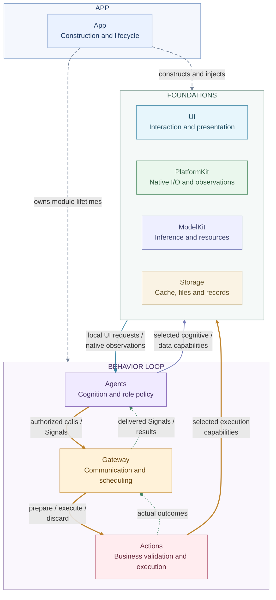

**Reading the diagram.** Modules retain the same colors throughout this document: blue for App, purple for Agents, amber for Gateway, rose for Actions, cyan for UI, green for PlatformKit, indigo for ModelKit and sand for Storage. Outer frames group the application host, coordinated behavior and independent foundations.

| Runtime relationship | Line convention |
| --- | --- |
| Composition and lifecycle | Long-dashed gray arrow |
| Local requests and native observations | Thin blue solid arrow |
| Cognitive capability and data access | Thin indigo solid arrow |
| Execution requests and capability operations | Thick amber solid arrow |
| Execution outcomes and delivered communication | Dotted green arrow |

Across the workflow figures, thin blue arrows carry requests or observations, thick amber arrows invoke execution/capabilities, dotted green arrows return outcomes, and long-dashed gray arrows control lifecycle. Indigo arrows describe model/context data. Sequence figures use solid requests and dashed returns, with colored participant frames defining ownership. The dependency figure in Part II uses its own explicit import convention.

The figure shows runtime relationships. Lifecycle arrows to a frame apply to its module roots. Capability arrows to the foundation frame select only the interfaces needed by that consumer; its return input arrow represents UI requests and native observations, not traffic from every foundation. App owns module-root lifetime; the IoC section in Part II defines container ownership and injected interfaces, and Part III defines startup and shutdown order.

The nervous-system analogy describes coordination, not a universal data funnel. Local UI requests and native observations reach their responsible Agents directly. Gateway carries Agent communication and governs executable output and feedback; raw sensor streams do not need to travel through it. Local presentation mechanics remain within UI.

### 3. Principles

IoC and module containers form the framework's core design pattern. The following principles define composition, module independence and public contracts.

1. **Use IoC and module containers as the core design pattern.** Containers organize module capabilities, internal services and lifecycle. Explicit dependency injection connects modules through public interfaces. Consumers use injected capabilities without locating a global registry or reaching into another module's implementation.

2. **Let App serve as the application entry point and composition owner.** App constructs, retains and connects all module root containers, selects implementations, injects dependencies and coordinates startup, suspension, shutdown and replacement. Each module owns the construction and management of its child containers and internal services.

3. **Keep the four foundations independent.** UI, PlatformKit, ModelKit and Storage provide interface/presentation, native-platform, model-inference and storage capabilities respectively. They neither depend on other project modules nor receive one another's interfaces or containers. Where external facilities are required, App supplies adapters through ports defined by the receiving foundation, preserving its independence from the supplying module's types and implementation.

4. **Give business modules clear responsibilities and acyclic dependencies.** Agents owns cognition and decisions; Gateway owns communication and scheduling; Actions owns business execution. App explicitly connects their public interfaces and neutral contracts. Dependency and injection directions remain clear and acyclic; results and callbacks do not introduce reverse implementation dependencies.

5. **Use containers for encapsulation and self-description.** Each container manages permissions and admission constraints, dependencies, state machines, asynchronous work and failures within its responsibility. Public contracts describe available capabilities, callable interfaces, current state, usage constraints and failure semantics. Interfaces, function catalogs, validation rules and model-visible descriptions use the owning module's authoritative declarations rather than independent definitions of the same capability. Internal implementation remains encapsulated while consumers can understand how to use and observe the module. Technical documentation describes implemented design and stays aligned with those contracts.

6. **Keep first-level modules and root containers stable.** The existing module boundaries and root-container structure are established. New capabilities belong in an existing module whose responsibilities cover them. Add a first-level module directory or module root container only when necessary, with an explicit ownership boundary, an explanation of why existing modules cannot accommodate it, a clear dependency design and user approval.

7. **Give state and work a single authoritative owner.** Each container owns the authoritative state within its responsibility; other modules read observations or submit requests through public interfaces instead of maintaining competing mutable copies. Asynchronous work belongs to an explicit owner, and module-owned work has a lifecycle independent of individual pages. Cancellation, joined cleanup and scope replacement have explicit boundaries; replacement waits for required cleanup of the previous owner.

Part II applies these principles to module boundaries and composition. Part III describes the key workflows; owning directory READMEs define internal implementation contracts.

<a id="part-ii--module-responsibilities"></a>
<a id="responsibilities-and-boundaries"></a>

## Part II — Module Design

### 1. Directory ownership and logical modules

A first-level source directory identifies an architectural owner. A logical module identifies a responsibility and dependency boundary. A compiled target is a build unit: one architectural module may contain several targets without becoming several peer modules. Shared contracts can compile separately from the business implementation in their owning directory. AgentCore resides under Agents/Support/Core; FunctionContracts, ExecutionRuntime and CallRuntime reside under Actions/Support. Source consolidation does not change these compilation boundaries; their current file maps belong in the owning [Agents Support](Agents/Support/README.md) and [Actions Support](Actions/Support/README.md) documents.

<a id="target-map"></a>

```text
MobileHarness/
├── App/           # Lifecycle host and application composition
├── Agents/        # Cognition and role coordination
├── Gateway/       # Communication and execution mediation
├── Actions/       # Business operations and actual execution
├── UI/            # Independent interaction and presentation capability
├── PlatformKit/   # Independent native and device capability
├── ModelKit/      # Independent inference and model-resource capability
├── Storage/       # Independent cache, file and database capability
└── Resources/     # Packaged declarations, configuration and assets
```

| Logical group | Owning directory | Module responsibility | Direct relationships |
| --- | --- | --- | --- |
| Lifecycle host | [App](App/README.md) | Construct scoped roots, connect public interfaces and coordinate application lifetime. | Receives OS lifecycle events; assembles module roots and invokes their public lifecycle interfaces. |
| Cognition | [Agents](Agents/README.md) | Interpret inputs, own goals and private context, select behavior and coordinate roles. | Consumes required foundation capabilities; submits messages and output to Gateway; receives read-only catalog metadata and App-bound host ports through neutral contracts. |
| Communication and execution mediation | [Gateway](Gateway/README.md) | Own an App-scoped GatewayContainer for neutral endpoint communication, admission, scheduling, resources and correlated feedback. | Receives canonical calls and opaque endpoint messages; invokes ActionsContainer through its injected neutral preparation/execution port. |
| Business execution | [Actions](Actions/README.md) | Implement callable domain operations, validate execution preconditions and report actual outcomes. | Receives authorized invocations; uses required foundation capabilities and explicit domain ports. |
| Foundation | [UI](UI/README.md) | Own typed interaction requests, presentation state, rendering and display receipts. | Exposes public request sources and presentation capabilities to injected consumers. |
| Foundation | [PlatformKit](PlatformKit/README.md) | Own native I/O, platform permissions, device transport and native observations. | Exposes native operations and factual observations through its own interfaces. |
| Foundation | [ModelKit](ModelKit/README.md) | Own inference, provider integration and model/artifact lifecycle. | Exposes typed model capabilities and SDK-owned integration ports. |
| Foundation | [Storage](Storage/README.md) | Own bounded temporary data, controlled files and durable domain repositories. | Exposes storage contracts and commit results without interpreting application policy. |
| Packaged definitions | [Resources](Resources/README.md) | Organize declarative Agent/Skill configuration, model metadata, privacy declarations and assets. | Build tooling packages declarations; owning runtime modules validate and interpret them. |

Resources is a packaging owner rather than an executable service. At repository level, [Package.swift](../Package.swift) and the Xcode project define build units; `Config/`, `Tests/` and `scripts/` own build configuration, automated coverage and developer checks respectively. [docs](../docs/README.md) owns requirements and evidence. Internal directory maps remain in the linked READMEs.

### 2. Dependency model

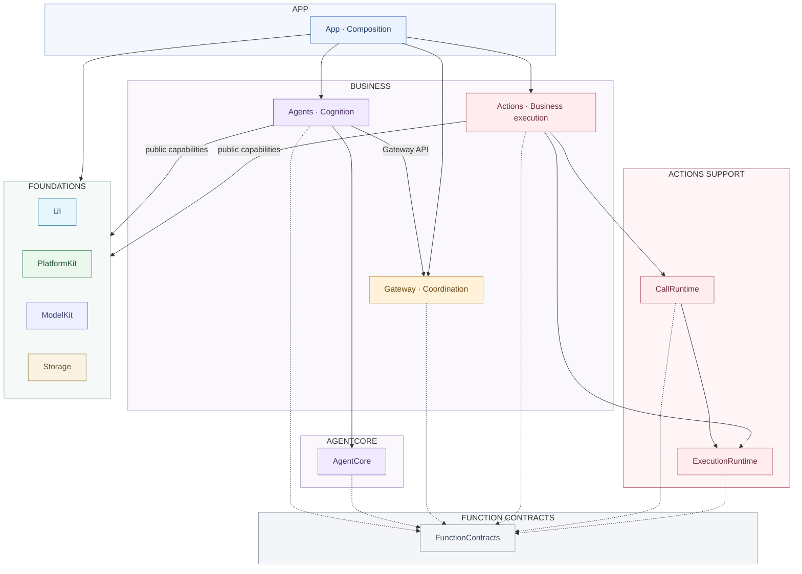

<a id="ownership-and-compilation"></a>
<a id="compilation-dependencies"></a>

The diagram summarizes permitted dependency directions between logical groups. It does not enumerate every target or require every possible dependency.

Every arrow in this figure means **compile-time dependency**. Dashed arrows identify neutral contract imports; solid arrows identify public module or support-mechanism dependencies. Gateway invokes the injected `ActionsExecutionPort` without importing Actions. Agents receives immutable descriptors and host ports without importing Actions, CallRuntime or ExecutionRuntime. Foundation-frame edges mean selected public capabilities, not a dependency on every foundation.

System frameworks and approved third-party libraries are external dependencies and are omitted from the graph for readability. Dependencies between targets inside one foundation remain internal to that foundation and must be acyclic. In the current target graph, UI and PlatformKit have no package-target dependencies; ModelKit and Storage each contain multiple targets within their own SDK boundary. [Package.swift](../Package.swift) defines those exact build units.

**Foundation isolation is mandatory.** UI, PlatformKit, ModelKit and Storage must not import one another or any other project module. Their external dependencies are limited to system frameworks and approved third-party libraries. Targets within the same foundation may depend on that foundation's own contracts and mechanisms. A foundation that needs an external facility defines a neutral port in its own API; an upper-layer adapter supplies the implementation. Injecting an adapter must not introduce foreign project types or a hidden business dependency into the foundation's contract.

**Business dependencies are directional.** Agents imports Gateway public communication/scheduling interfaces and neutral function contracts; App injects Actions-owned host capabilities through those contracts. Actions must not import Agents, Gateway orchestration or App. Gateway must not import concrete Agent roles, Actions business implementations, App or foundational implementations. FunctionContracts provides its neutral execution boundary; Gateway imports no AgentCore, CallRuntime or ExecutionRuntime implementation. No module may reach through another module's public interface into private implementation.

**Shared targets remain neutral.** FunctionContracts is a leaf target without project dependencies. AgentCore depends only on FunctionContracts and owns cognitive identity, Skill, Task and decision contracts; ExecutionRuntime and CallRuntime own reusable execution and call mechanisms. Their physical placement under Agents or Actions does not authorize a dependency on those directories' business implementations. ExecutionRuntime depends on FunctionContracts; CallRuntime depends on FunctionContracts and ExecutionRuntime. These targets must not accumulate role policy, device logic or application composition. AppLifecycle is another independent target under App; it implements the generic lifecycle graph without importing business modules.

<a id="ioc-and-container-ownership"></a>

#### IoC, composition and container ownership

Inversion of Control (IoC) separates dependency assembly from capability use. App constructs and retains all seven module roots and connects their public capabilities through initializers, configuration interfaces and callbacks. The foundation isolation and directional business dependencies defined above govern injection as well as imports. Each module owns its state and internal work; only App resolves application registrations.

**ApplicationContainer is the application composition registry.** It uses FactoryKit instance-local registration and caching to retain module roots within one application scope. ServiceFactories resolves those roots and connects their public capabilities; ModuleRegistration supplies the lifecycle graph. Cached construction and asynchronous startup are separate operations: resolving a root does not make its capabilities ready. Replacement waits for the previous scope's required cleanup.

**Module containers are capability and lifecycle owners.** They expose related capabilities and retain their internal services. They are not additional FactoryKit registries. Child containers belong to their module root; App's convenience factories project those existing instances rather than constructing independent copies.

| App-owned module root | Containerized capabilities within the root |
| --- | --- |
| AgentContainer | Assistant, ApplicationControl, Memory, Photographer, SpeechPerception, SpeechSynthesis and VisionPerception role containers |
| GatewayContainer | Bound communication endpoints, scheduling, resources and correlated feedback services |
| ActionsContainer | Function catalogs, validation and execution services; business domains and individual functions remain library declarations without separate containers |
| UIContainer | Home, Camera, Settings, ModelResources, Navigation, Album, History, Devices and Diagnostics containers |
| PlatformContainer | AudioContainer, VisionContainer and ConnectivityContainer |
| ModelContainer | ModelLanguageContainer, ModelSpeechContainer, ModelVisionContainer and ModelArtifactsContainer |
| StorageContainer | CacheContainer, FilesContainer and the injected DatabaseStorage backend interface |

The table describes ownership; module READMEs define child interfaces and internal lifecycle. ContainerFailureChannel, executionBindings and ForegroundPreparation are supporting lifecycle services, not additional module roots.

The following diagram focuses on the three business roots and their injected runtime ports. Foundation capability use appears in Part I; startup dependencies appear in Part III. These arrows do not represent Swift imports.

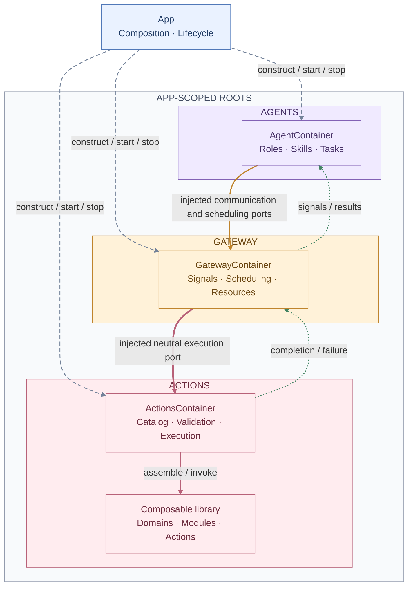

Dashed arrows from App show root construction and lifecycle control. The solid arrow carries communication and scheduling requests, the thick arrow invokes execution, and dashed return arrows deliver Signals and outcomes.

Agents uses Gateway communication and scheduling ports; Gateway invokes the neutral ActionsExecutionPort implemented by ActionsContainer. Results return through values or injected ports. These runtime relationships preserve the compile-time boundaries above. The role and execution rules below define authorization, admission and business validation; injecting a capability does not grant permission or prove an effect.

### 3. Module-specific development rules

The following rules are normative placement and review criteria. A new feature must have one explicit policy owner and one explicit execution owner; the same concern must not acquire competing implementations across modules.

| Module | Required development rules | Excluded responsibilities |
| --- | --- | --- |
| **App** | Create and retain scoped roots; inject narrow public interfaces; select application backends; order startup and joined shutdown; complete old-owner cleanup before replacement. Keep dependency registration in the composition scope. | Intent interpretation, business request consumption, per-frame forwarding, domain data conversion and per-function business registration. |
| **Agents** | Keep input interpretation, private goal/context state and role policy with the responsible role. Consume local typed inputs directly; use models only when needed. Submit executable output and role communication through bound Gateway interfaces. Own subscriptions and decision work independently of pages. | Native device implementations, duplicated Action logic, direct business-effect bypasses, global root lookup and access to another role's private state. |
| **Gateway** | Let App configure, start and stop the unique scoped root; never tie global Gateway lifetime to a role. Preserve real producer identity and causality; validate endpoint identity, execution scope, envelopes and admission; coordinate routing, ordering, resources, cancellation and result delivery through neutral contracts. Keep scheduling distinct from domain success. | Goal selection, semantic interpretation of observations, model inference, device algorithms, UI policy and raw-media forwarding. |
| **Actions** | Own canonical business function declarations and implementations. Validate arguments, session/business preconditions and execution permits; use injected public capabilities; return real results and retain partial effects or cleanup failures. Share implementations across supported call protocols. | Agent goals, reasoning loops, transport admission policy, application lifetime and duplicate implementations for different call syntaxes. |
| **UI** | Enforce foundation isolation. Define UI-owned request values and public presentation interfaces; own local interaction, navigation and rendering state. Distinguish request acceptance, state changes and actual display completion. | Calling or importing Agents, choosing domain policy, loading models, writing business repositories or directly controlling devices. |
| **PlatformKit** | Enforce foundation isolation. Use public platform APIs; validate capabilities and permissions; own native handles, capture/connection generations, bounded observations and native cleanup. Expose actual platform/device facts and failures. | Agent identity, Task/Skill authorization, business motion policy, inferred device success and model-driven recovery. |
| **ModelKit** | Enforce foundation isolation. Own typed inference contracts, providers, artifacts and model lifecycle. Keep model-specific processing with its provider and use SDK-owned ports for external facilities. Make selection, readiness, inference and shutdown outcomes explicit. | Application Task/Skill management, conversation policy, capture/playback orchestration, page state and silent provider replacement after execution failure. |
| **Storage** | Enforce foundation isolation. Own bounded cache leases, controlled file access, repository contracts and backend consistency. Report actual commit and recovery outcomes; keep backend selection in application composition. | Mirrors of other containers’ runtime state, model-context generation, application decisions, automatic device-effect replay and fabricated persistence through undocumented fallback. |
| **Resources** | Keep Agent/Skill declarations catalog-indexed and validated by Agents; keep model metadata, privacy declarations and assets under their respective packaging contracts. Keep declarations consistent with registered capabilities and preserve reproducible packaging. | Executable business logic, secrets, downloaded model weights, user media and configuration that grants unregistered authority. |

A model call, a Skill declaration and an available device are separate facts. Resources may describe a capability, Agents may choose it, Gateway may admit and schedule it, Actions may execute it, and a foundation may supply its mechanism. Each owner must preserve its own boundary rather than infer that another stage guarantees success.

### 4. Rules shared by all modules

- **Interfaces and state:** expose only the required public capability; define one authoritative owner for mutable state. Read observations from their actual owner instead of maintaining a second public mirror. Cross-module adapters translate contracts without taking over domain policy.
- **Lifetime and isolation:** identify the owner and isolation of asynchronous work. Define admission, cancellation, cleanup and terminal completion; long-running work must have an owner independent of a page. Construction must not implicitly capture media, run inference or scan devices.
- **Capacity and pressure:** give every queue or active-work slot a documented bound and overflow policy. Reject, backpressure or replace according to that contract; never silently discard failed or rejected device actions.
- **Failures and completion:** propagate configuration and execution errors explicitly. Preserve primary and cleanup failures, partial outcomes and actual identities. Acceptance is not execution completion; cancellation is not proof that native or physical work has stopped.
- **Dependencies and evolution:** keep the graph acyclic and ownership explicit. Add third-party dependencies only for a concrete integration need and document their owner. Existing boundary violations are migration work, not precedent. New directories require explicit user approval under the repository instructions.
- **Documentation and validation:** record intended changes in docs requirements or plans before implementation, then reconcile owning READMEs with the implemented result. Technical documents under MobileHarness describe implemented designs only and use no implementation status markers. Remove superseded implementations unless a documented migration requires them. Validate observable behavior and failure cases; keep automated checks, real models, native UI and physical-device acceptance as distinct evidence categories.

Internal algorithms, role lists, function catalogs, subcontainer layouts and exact queue limits belong in each owning directory README. Part III defines the cross-module operational flows; it does not transfer ownership away from the modules defined here.

<a id="part-iii--cross-module-technical-design"></a>

<a id="cross-module-flows"></a>

## Part III — Key Workflows

### 1. Composition, startup and lifetime

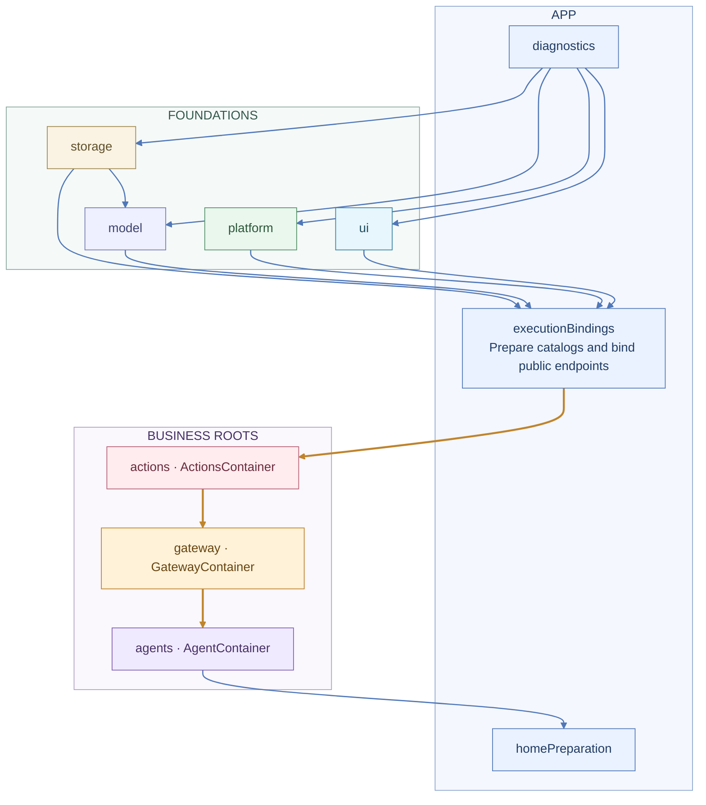

App owns the static dependency graph. An arrow means the predecessor must be ready before its consumer starts. Shutdown joins consumers before dependencies. Role lifetime belongs to Agents; shared communication and scheduling lifetime belongs to Gateway; business execution and joined cleanup belong to Actions. Pages own none of these module roots.

The [IoC and container ownership section](#ioc-and-container-ownership) defines the retained roots and child capabilities. The graph below defines their readiness dependencies and supporting preparation services.

Thin blue arrows show preparation dependencies; thick amber arrows emphasize the executionBindings → Actions → Gateway → Agents readiness boundary. These arrows describe lifecycle order, not Swift imports or message transport.

Construction creates roots and connects ports without capture, inference or device scanning. Storage startup prepares repositories; model startup registers capabilities without requiring weight loading. Once foundations are ready, App's executionBindings node connects the Actions-owned business assembly to Agents-owned cognitive host ports, validates Skill coverage against the immutable catalog, configures Gateway with the neutral execution port, and binds role hosts to the resulting capabilities. Actions starts before Gateway opens admission; Agents then registers and starts roles. Unconfigured execution and repeated configuration fail explicitly.

On inactivity, synchronous invalidation fences new work before asynchronous pause joins existing execution and native cleanup. Terminal feedback and cancellation remain identity-bound and available during draining. Rapid reactivation waits for required suspension; no effect is automatically replayed. Existing bounded feedback retries retain their evidence across pause; terminal shutdown joins delivery workers.

The lifecycle runner currently starts services serially in this order: diagnostics → storage → model → platform → ui → executionBindings → actions → gateway → agents → homePreparation. The graph expresses required dependencies; the order between independent foundation roots follows registration order. executionBindings configures Actions catalogs and cleanup ports and injects its execution port into Gateway before either root starts.

Shutdown orders homePreparation → agents → gateway → actions → executionBindings → ui → platform → model → storage → diagnostics, respecting the graph's other dependencies. Bindings and native stop callbacks remain retained until Gateway and Actions have joined their work. Partial startup failure cleans the current node and its started dependencies; primary and cleanup failures remain visible. Unconfirmed cleanup prevents replacement. See [Composition](App/Composition/README.md), [Gateway](Gateway/README.md) and [Lifecycle](App/Lifecycle/README.md).

### 2. Input, Signal and Agent communication

<a id="native-input-and-internal-signals"></a>

#### Native intake, perception and semantic communication

The principal sensory loop is **raw data → perception → internal semantic Signal → cognition → authorized execution → observed feedback**. Perception and cognition are responsibilities inside Agents, rather than additional modules or mandatory separate model calls. SpeechPerception and VisionPerception interpret native streams; Assistant, Photographer and other responsible roles use meaningful observations to decide the next step.

“External signal” is an informal name for an environmental stimulus. In the implemented interfaces, raw media, UI requests and container observations are **local/native inputs**, not external Signal envelopes. These inputs reach their owning role through injected observation or request interfaces. **Internal Signals** are identity-bound role messages or scoped feedback; role-to-role communication uses Gateway after Agents validates the communication policy. A function invocation is a separate execution request, even when both paths use the same GatewayContainer.

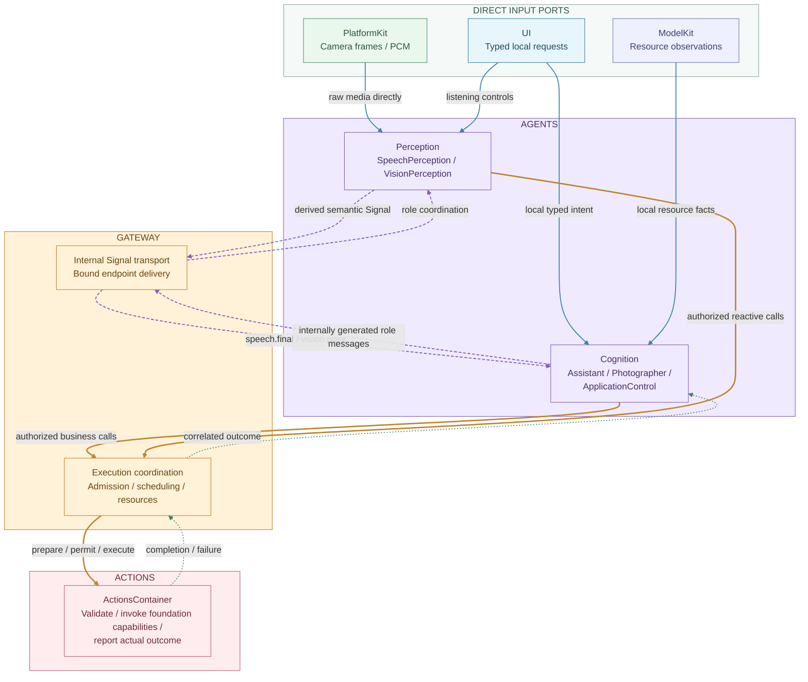

Thin blue lines carry direct local inputs; dashed purple lines carry internal role Signals; thick amber lines invoke execution; dotted green lines return actual execution outcomes. Signal transport and execution coordination are facilities of one GatewayContainer. The source frame shows injected input interfaces, not additional roots. Actions invokes the selected UI, PlatformKit, ModelKit or Storage capabilities; the [framework figure](#2-framework) defines their module boundaries. The green return path illustrates cognitive execution feedback; reactive callers retain their own completion contracts.

| Input or output lane | Producer → consumer | Meaning and boundary |
| --- | --- | --- |
| Native sensory intake | PlatformKit observation ports → SpeechPerception / VisionPerception | Raw ordered PCM or current native frames. The responsible role owns the subscription, local adaptation and processing; media packets do not pass through Gateway Signal transport. |
| Direct local intent or facts | UI requests and device/model/container observations → responsible Agent | Already typed requests or factual changes can reach Assistant, ApplicationControl or another owning role directly; a perception stage is unnecessary when there is no sensory interpretation to perform. |
| Derived semantic Signal | Perception role → Agents communication boundary → Gateway → receiving role | For example, speech.final reaches Assistant and vision.pose reaches Photographer. Agents owns message schemas, role permissions and receiver selection; Gateway validates opaque endpoints/envelopes and delivers to the bound receiver. |
| Role-originated internal Signal | Any authorized Agent → Gateway → permitted peer | Task, reply coordination, synthesis and other role messages can originate without a new sensor sample. Perception roles can also receive coordination messages. Publication does not imply a current subscriber. |
| Execution request and outcome | Requesting Agent → Gateway scheduling/resource facilities → ActionsContainer → selected foundation capabilities; outcome returns to the requesting role | Agents authorizes use, Gateway coordinates execution, and Actions validates business inputs/conditions and produces actual completion or failure. An execution result is distinct from a raw observation or communication receipt. |

This is a feedback graph, not a compulsory pipeline. A typed UI request can enter its cognitive owner directly. A perception role can issue an authorized reactive presentation/listening call without involving Assistant or starting another inference. Cognitive roles can process deterministically or use ModelKit as needed, and can exchange internal Signals repeatedly before any business effect. Actions outcomes feed the requesting role; changed device/environment facts are observed through the original owner ports on subsequent input.

Direct intake keeps sustained raw-media traffic outside inter-role envelope sizing/validation, routing and delivery capacity. Local processing still preserves source/session/generation/freshness and bounded native buffering. Perception publishes meaningful derived observations instead of forwarding each native packet as a Signal. Native input, role work and Gateway delivery retain their independent capacity, lifecycle and failure contracts.

Read-only subscriptions do not open a microphone/camera or grant control authority. Capture permission, startup and native cleanup remain Actions/PlatformKit execution responsibilities under the registered execution path. See [speech intake](#11-listening-asr-and-sound-source-observations), [vision intake](#13-camera-preview-vision-and-tracking), [Agents](Agents/README.md) and [transport](Gateway/Input/README.md) for their respective boundaries.

#### Bound endpoints and role communication

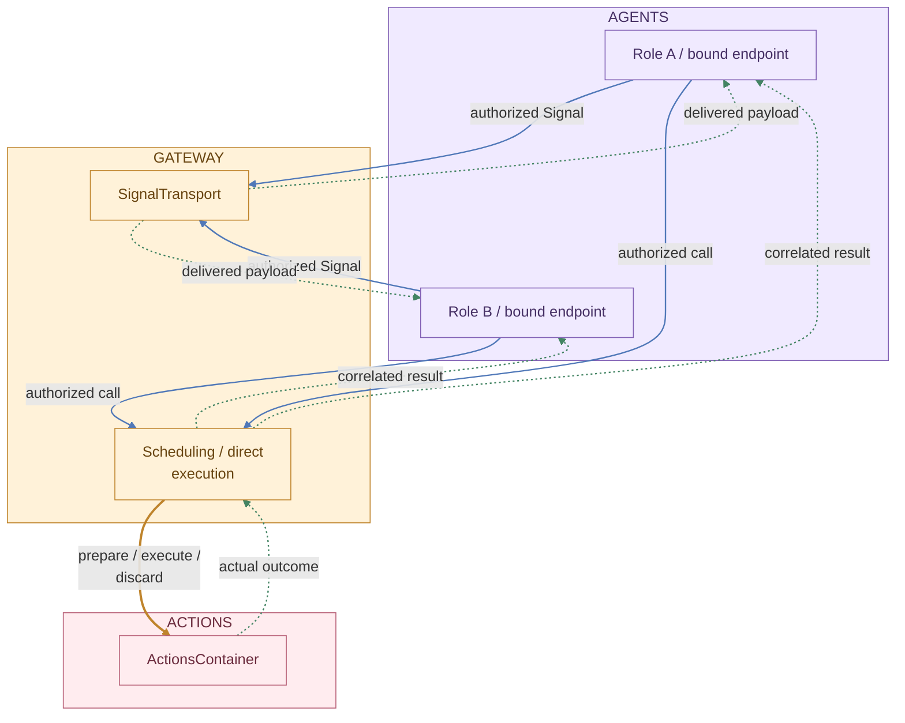

Agent A and Agent B represent independent roles using the same App-scoped GatewayContainer. Thin blue arrows submit authorized Signals or canonical calls; thick amber arrows invoke the injected ActionsExecutionPort; dotted green arrows return delivered payloads and actual execution outcomes. Role messages are routed to their recipient without invoking Actions. Execution requests follow the Gateway → Actions → Gateway → requesting Agent path. App construction and lifecycle ownership are shown in Part II's IoC diagram.

Each role uses a bound endpoint. Agents binds actual role instances, checks publish/send contracts and live-target permissions, and interprets received payloads. Gateway handles opaque Signal payloads and validates endpoint tokens, incarnation, envelope version, size, hops, deadline and capacity. It holds no Agent instance and does not interpret role names, Skills or Tasks. Actions owns function registration, business validation and actual execution; admission or delivery does not establish a successful effect.

UI requests are consumed directly by their responsible roles. PCM and camera frames reach perception through native observation ports; subscriptions do not open devices or grant control. Device, artifact and failure observations reach their responsible owners directly. These local inputs are not trusted inter-role Signals. ProcessingContext carries request/session/generation/turn/causality but does not grant authority. Execution feedback retains original endpoint and call identity, and cannot wake a replacement role. Declared publish capability does not imply a registered subscriber. See [Agents](Agents/README.md), [communication policy](Agents/Support/Core/Communication/README.md) and [transport](Gateway/Input/README.md).

### 3. UI requests and shared business execution

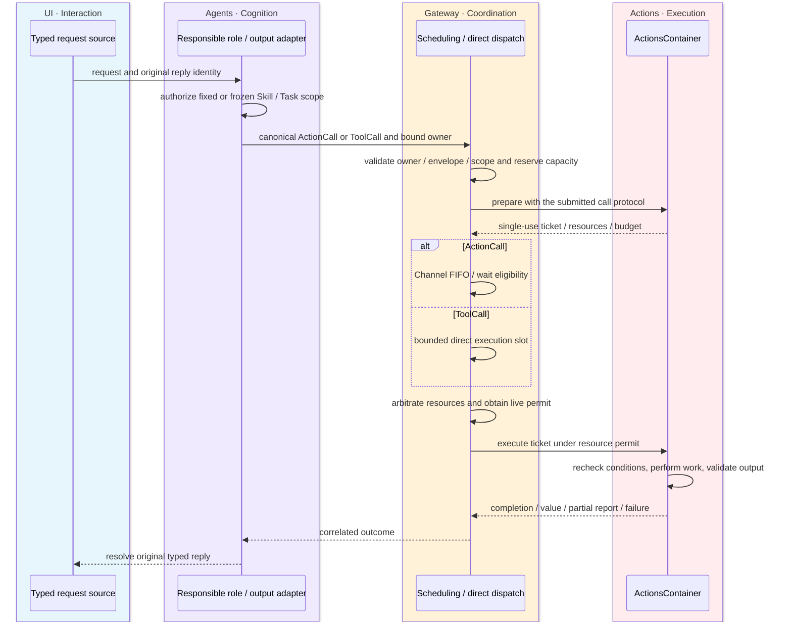

<a id="ui-requests-and-business-execution"></a>

The [Action lifecycle responsibility matrix](#action-lifecycle-responsibilities) defines registration, authorization and validation ownership for both this deterministic UI path and model-generated calls.

After admission, Gateway does not query Skill permission again. Agents revokes authority by explicitly cancelling the corresponding execution scope. The business executor rechecks current conditions after queueing. Preparation has no business effects; its single-use credential is tied to the container catalog revision. Rejection, cancellation and shutdown discard retained preparation. Result delivery retry never reruns business work.

UI request sources, cognitive consumers and business owners are separate. Missing consumers, full capacity, closed roots and stale generations fail explicitly. Replies resolve the original request. Model-selected operations and deterministic UI requests use the same registered business functions and validators. Local navigation does not create an inference round. Full history and media use private typed attachments rather than model parameters. Root-owned mutations, title jobs and observations survive page lifetime. See [Actions](Actions/README.md), [Gateway Output](Gateway/Output/README.md) and [Agent adapters](Agents/Support/README.md).

### 4. Page navigation and visible page context

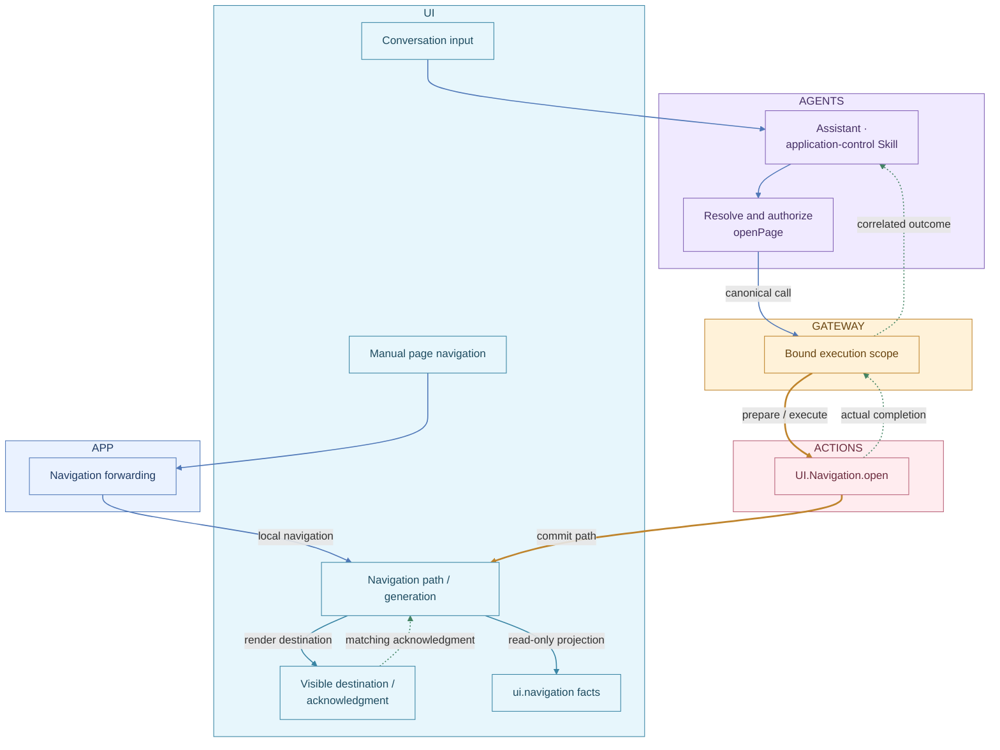

Manual navigation uses App-injected callbacks and AgentContainer forwarding without inference or a function call. Conversational navigation loads the application-control Skill, resolves `openPage` to `UI.Navigation.open`, passes Agents authorization and Gateway admission, and commits the same UI path through Actions.

UI owns NavigationStack and path generations. A path change enters transitioning; a matching visible-page acknowledgment settles it. Settled does not mean data, animation or GPU completion. Details, object IDs, pickers and confirmation sheets remain distinct from the top-level path. Stale callbacks cannot overwrite the current detail.

Home remains a persistent sibling of navigation. Settings/history/album preserve home rendering and root listening; camera capture and pose processing require foreground and uncovered home. Returning home reconciles retained enable intent. `useStates` supplies page facts to subsequent decisions; execution checks live conditions. See [UI](UI/README.md) and [navigation](Actions/UI/Navigation/README.md).

### 5. Skill composition, Task and model context

<a id="model-context-composition"></a>

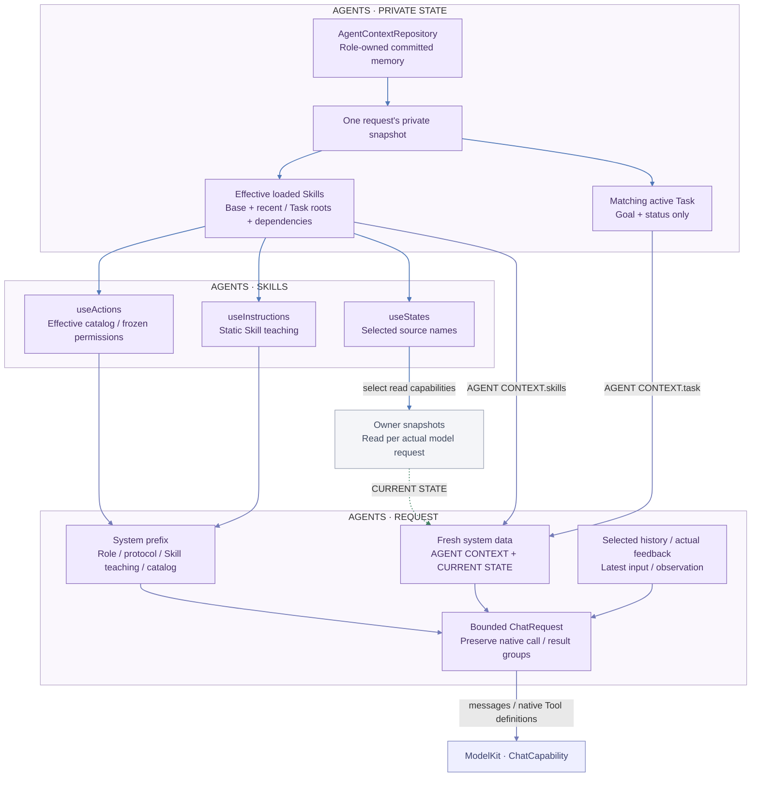

<a id="state-devices-resources-and-faults"></a>
<a id="tasks-model-decisions-and-history"></a>

Skill v3 selects function bindings with `useActions`, read capabilities with `useStates`, and static Markdown with `useInstructions`. The effective loaded set includes base Skills, retained recent/Task-held roots and dependency expansion. One private snapshot supplies the request's selected Skill IDs, catalog, teaching and minimal Task/Skill projection. A load/release transition changes subsequent requests; it cannot expand a request already sent to the model. The runtime also binds the frozen catalog to output authorization.

The model receives two different kinds of system content:

| Request content | Source and meaning |
| --- | --- |
| Instruction/catalog prefix | Role identity and protocol, available Skill overview, loaded Skill teaching and effective function metadata. Available Skills describe choices; only the effective catalog permits current calls. The prefix changes when its selected Skills/catalog change. |
| AGENT CONTEXT | The same private snapshot's current loaded Skill IDs and matching active Task's goal/status. No matching Task produces `task: null`; this is not a dump of task records, grants, input bindings or retention counters. |
| CURRENT STATE | Fresh owner-defined facts selected by the loaded Skills' `useStates`, sampled separately through read-only capabilities. These are data, not instructions or execution permits. |
| History, feedback and latest input | Bounded conversation evidence, real Action/Tool outcomes and current user input or continuation observation. Current Task evidence remains in the history window; terminal Task history can be projected as a summary. |

The ordinary request order is **instruction/catalog system → selected history → dynamic system data (AGENT CONTEXT, then CURRENT STATE) → latest user input/observation**. If the request ends in native Tool results, the dynamic system message follows the complete call/result group. Previous dynamic system messages are removed before fresh facts are inserted. Native Tool definitions are a separate ChatRequest field. ModelKit receives the finished request; it does not discover containers or assemble Agent Task/Skill state.

Each actual model request, including an internal ReACT continuation, samples again. The private snapshot and the business reads are not a single atomic transaction. Model-visible Task/Skill data is private to the responsible Agent; the production conversational owner is Assistant with one foreground continuing goal. Generic task registries and delegated-role views support runtime correlation, but are not serialized wholesale into AGENT CONTEXT and do not imply an exposed background-work Skill. Detailed message selection, budgets and continuation rules belong in [Chat](Agents/Support/Chat/README.md#request-state-assembly); private transitions belong in [Context](Agents/Support/Context/README.md#container-context-read-path).

### 6. State ownership, state machines and model observations

<a id="container-state-read-path"></a>

A State snapshot is a read-only projection of an owner's state machine. It is not a global state machine, a lifecycle manager or a second mutable source of truth. App supplies stable dependencies; Agents registers explicit readers and invokes only those selected for the request.

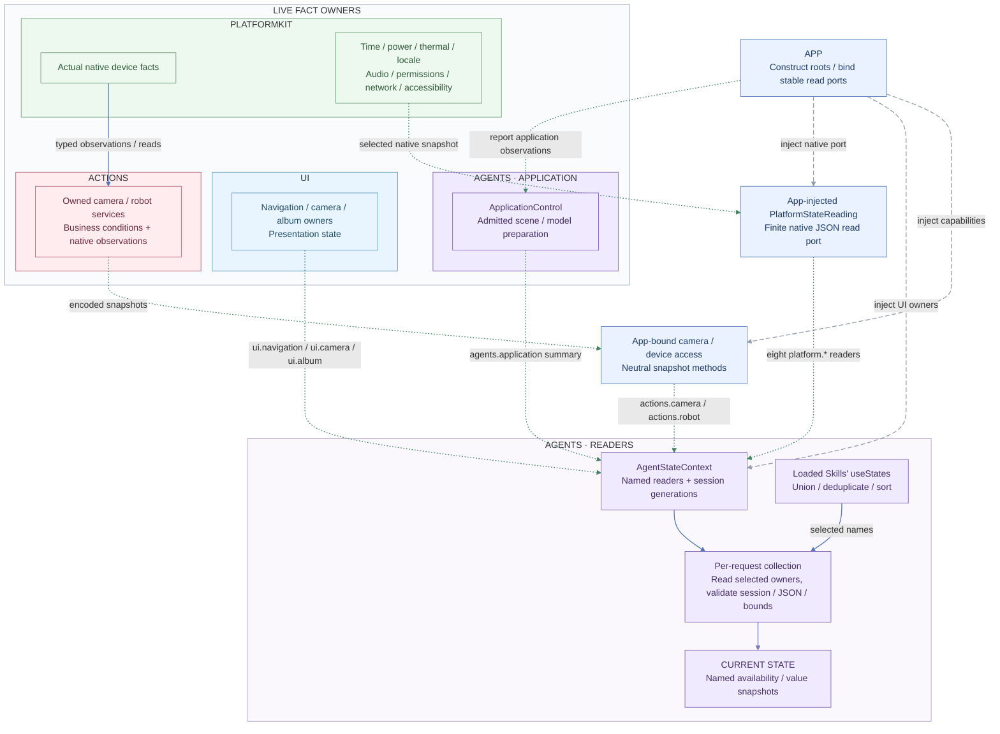

The figure follows snapshot data toward the request. Registration stores callbacks; actual source methods run when collection invokes them. Gateway is not in this read path, and no read sends a Signal or schedules an Action. Reading does not start capture, load a model, scan for a device or mutate a Task. Containerization does not automatically expose every module or all of its internal fields.

| State boundary | Owner and implemented behavior |
| --- | --- |
| Native system facts | Eight `platform.*` sources read the existing Platform root through an App-injected neutral SDK port. Core, Audio, Vision and Connectivity own time, power, thermal, network, authorization, audio, locale and accessibility facts; no model/role or execution policy is added to the SDK. |
| Business facts | `actions.camera` and `actions.robot` read Actions-owned domain services through App-bound neutral access ports. Those services compose actual business/presentation conditions with native observations. They are not generic copies of the Actions root's lifecycle. |
| Presentation facts | `ui.navigation`, `ui.camera` and `ui.album` read the injected UI owners on MainActor, including their presentation-availability checks. UI supplies presentation facts; Actions supplies business execution conditions. |
| Application observations | `agents.application` reads the existing ApplicationControl role's admitted foreground/background and model-preparation summary, with per-field sequences and explicit unknown values. It does not include a last execution result, raw capability strings or a second navigation copy. |
| Agent lifecycle and work | Agent lifecycle uses registered, running, paused, stopped and failed. AgentContext separately tracks queued/running/awaitingFeedback/continuation and terminal work. These private runtime states are not automatically included in CURRENT STATE. |
| Task and Skill transitions | Agents owns private Task/Skill state and its minimal AGENT CONTEXT projection. Waiting for user input retains a Task; finishing/failure/cancellation joins the owned execution/cleanup barriers before terminal evidence. Skill retention follows Task ownership and completed Decision usage. |
| Execution observation | Gateway records queued/running/cancelling/terminal execution and delivers actual results. Passive execution records, result delivery and native telemetry are distinct; cancelling is not proof of completed cleanup. They are not implicitly registered as model State sources. |
| Persistence | Storage owns durable conversation/Task evidence and domain repositories. It is not a shared live State mirror. Persisting a request captures what was sent; it does not make those facts current for a later request or restore active execution. |

AgentStateContext owns read capabilities and session generations, not cached fact values or a Task copy. Collection reads selected names in deterministic order and validates the session again after the reads. Unknown sources, unavailable source errors, invalid encoding, capacity failure and cancellation remain explicit; a closed/replaced session invalidates an in-flight collection. Each source defines its own snapshot consistency; the combined private/business context is not an atomic cross-owner view. The fourteen registered source mappings and schemas belong in [Context](Agents/Support/Context/README.md#container-context-read-path).

BasicSkill selects agents.application, ui.navigation and all eight native sources. Each actual request samples them again, including ReACT continuations. Time carries the sampled local date/time to seconds, weekday and zone/offset; it is not a clock that updates an in-flight request. Permission denial and unknown/null native facts remain data. Network observations describe a path rather than a successful provider connection. Raw route identities, SSIDs, IPs and sensor streams are excluded. Platform start/foreground/stop owns passive observation generations; state reads themselves never activate an audio session, start hardware, request permissions, scan or probe a server. Location/motion/depth/proximity and magnetic attachment are not part of these sources.

State is the default low-cost summary for decisions. Sufficient current facts are answered directly. Specific Actions supply missing details under their own contracts, such as Bluetooth status/device IDs, resource inventory or history records; they may overlap a summary without creating another owner or fact cache. No generic environment-query Action is registered. Fresh collection means a new read, not a forced native observation or an active probe. Actual execution results remain correlated feedback/history, and Actions rechecks live business conditions after queueing.

Observation does not establish authority or successful execution. Actions still checks live business preconditions and permits after Gateway queueing; model output cannot directly advance another owner's state machine. Real results update their owning histories and private state, and a later request re-reads the facts. Recovery does not replay effects. Generic runtime contracts belong in [AgentCore Runtime](Agents/Support/Core/Runtime/README.md), execution observations in [function contracts](Actions/Support/Contracts/README.md), and authorization ownership in the [Action lifecycle](#action-lifecycle-responsibilities).

### 7. Capability declaration, resolution and execution routes

<a id="action-lifecycle-responsibilities"></a>

The following figure covers registration through completion. App owns construction and lifetime; each module owns the checks and state inside its boundary. The startup phase summarizes module ownership through the App-bound collaboration ports; it does not make App a per-function registrar.

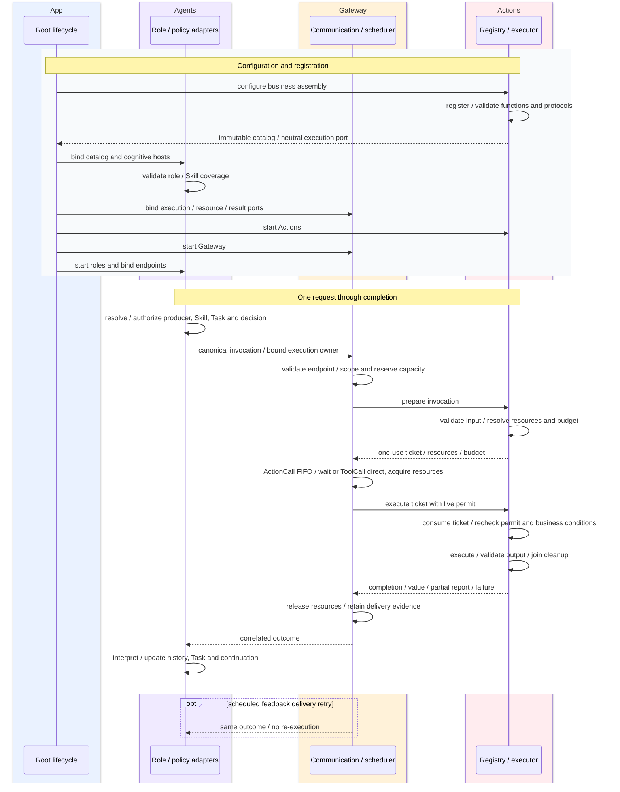

The configuration phase is part of [executionBindings and root startup](#1-composition-startup-and-lifetime). The execution phase has three distinct validity questions: **Agents decides whether this role may request the function; Gateway decides whether the bound work can be admitted and coordinated; Actions decides whether this invocation is valid and can execute under current business conditions.**

| Owner | Managed responsibility | Validation and authority |
| --- | --- | --- |
| App | Scoped roots, constructor/configuration injection, readiness order, foreground transitions, reverse joined stop and failed-start rollback. | Keeps required bindings and module lifetimes available through cleanup. Function registration stays inside Actions; Skill/Task permission stays inside Agents. |
| Agents | Role instances, fixed and effective Skill catalogs, private Task/context, call resolution, communication policy, authorization revocation and cognitive interpretation of outcomes. | Checks actual producer/incarnation/session, allowed output/function, frozen decision capabilities and Task grants before submission. Parsing/alias checks use the exposed catalog; authoritative business decoding belongs to Actions. Coverage validation proves registered support, not permission for every future call. |
| Gateway | Neutral endpoints and Signal envelopes, execution scopes, bounded admission, Channel/wait, resource arbitration, cancellation/join, execution evidence and result delivery. | Checks bound endpoint/context/scope, envelope/scheduling structure and capacity. Enforces injected generic resource policies, lease validity and live permits. It does not resolve roles, query Skills/Tasks or authorize business-function use. |
| ActionsContainer and its business library | Compiled canonical definitions, registry/catalog, pure preparation, resources/budgets, actual invocation, input/output contracts and business/native cleanup. | Rejects duplicate/invalid registration and unsupported functions/protocols; validates arguments, budget/resource resolution and one-use root/catalog-bound preparation. Checks live permits, current service/session/business preconditions and completion contracts. Functions and domain services implement their own business checks; the module root coordinates them without acquiring role policy. |

Registration, exposure and authorization are different facts. Actions registers an implementation; Agents selects the functions visible/available to a role or decision; only an authorized request reaches Gateway. A valid authorization does not bypass capacity, ordering, resource conflicts or live business conditions. Required platform permissions remain enforced by the owning foundation APIs invoked by Actions.

**Gateway has no Agent implementation dependency.** Its project dependency is FunctionContracts; imports are system libraries and those neutral contracts. AgentManager, Skill/Task checks, InputGateway, OutputGateway and cognitive projections live in Agents. The adapters' names do not change their module owner. Gateway receives opaque endpoint/incarnation/session values, scheduling correlation and injected callbacks, without retaining an Agent instance or searching an Agent container. Callback/result flow does not create a reverse implementation dependency.

Resource authority is a coordination concern. For example, explicit lease acquisition checks configured allowed endpoint values and takeover checks configured preemption pairs; live permits fence actual use. Agents authors role takeover policy and App binds its neutral values. Gateway enforces those values without interpreting a role name or repeating the Skill/Task/function authorization decision. After admission, revocation is explicit scope cancellation; rechecking current business conditions belongs to Actions.

Gateway delivers real outcomes rather than interpreting them as Task success. Agents decides whether to record history, advance a Task or run another decision. Scheduled feedback retries redeliver terminal evidence; direct calls return through their owned invocation path. Cancellation joins actual work and retains independent failures; it does not undo already committed effects. The [resource](Gateway/Output/Resources/README.md), [result](Gateway/Output/Results/README.md) and [Actions](Actions/README.md) documents own their detailed contracts.

Macros and explicit CapabilityModules registration assemble functions compiled into the application. There is no runtime discovery or hot update. Missing required bindings, duplicate protocol definitions and invalid metadata prevent startup. Optional capability presence is reflected in the catalog. Domains, modules and functions do not receive containers, lifecycle nodes or App registrations.

Action and Tool are call views over the same business functions. The catalog retains declared execution and result policies. In the current production adapters, ActionCall enters ChannelScheduler, while ToolCall enters DirectExecutionDispatcher; executionPolicy is not consulted to switch these entry points. A direct descriptor alone therefore does not remove an ActionCall from Channel/wait ordering. Current model Skills use XML Actions; native and internal Tools remain supported. Internal album/full-history Tools do not become Skill capabilities merely by registration. Both routes share Actions-owned input/output validation, preparation and actual implementation. See [protocol bindings](Actions/BehaviorProtocolBindings.swift) and [execution support](Actions/Support/README.md).

### 8. Function Token and Action Call protocol

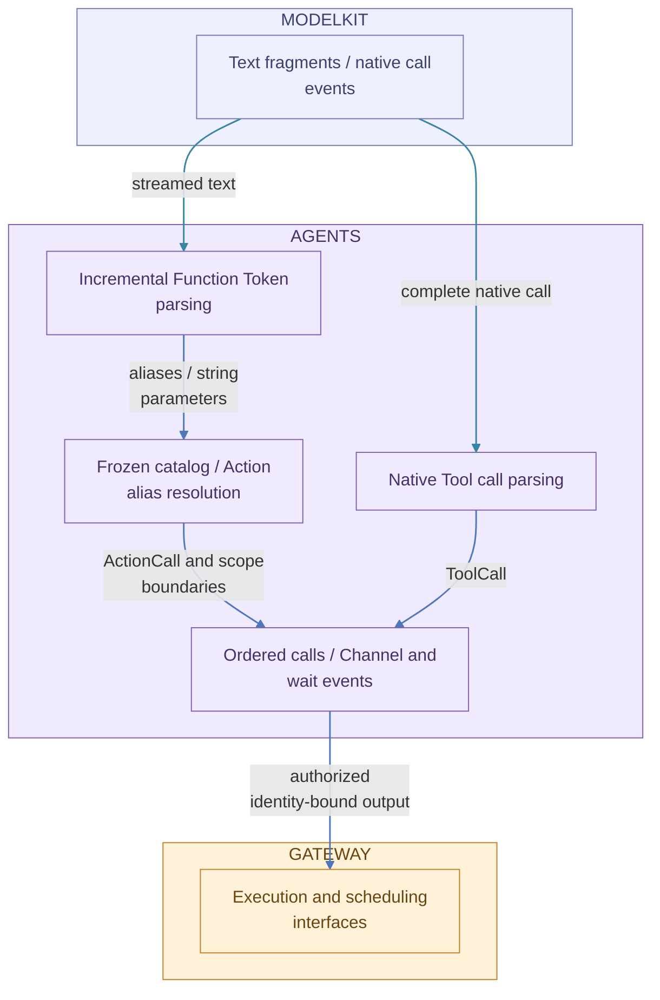

The model-output path is **ModelKit stream → Agents parsing and catalog resolution → ordered call/scheduling events → Gateway admission → Actions execution → correlated results**. ModelKit supplies output fragments; Agents interprets their protocol using the frozen decision catalog. Gateway receives resolved requests and scheduling boundaries, not raw model XML.

| Boundary | Contract |
| --- | --- |
| Function Token syntax | Natural text mixed with restricted XML, without a document root. Self-closing Action tags name catalog aliases; paired channel scopes select routing; paired wait scopes emit scheduling boundaries. |
| FunctionToken | An Agent-local parsed text, action, boundary or scheduling event. Its boundary is independent of provider tokenizer tokens and network fragments. Incremental parsing handles incomplete UTF-8 and markup across fragments. |
| ActionCall | A resolved actionPath, channel and string parameter map. Agents resolves aliases and parameters against its effective catalog; text mapping, when configured, produces ordered calls through the same generation pipeline. |
| Scheduling events | beginWait/endWait travel in order with calls. Channel scope changes resolve each call's effective Channel; closing a scope restores its enclosing/default routing. Dropping wait events changes execution semantics. |
| Execution envelope | OutputEnvelope supplies producer and processing correlation separately from ActionCall. Agents' Gateway adapter translates authorized intent into neutral execution requests; Gateway checks admission and coordinates execution through ActionsExecutionPort. |

For example, when the current catalog includes the ExpressionInteraction Skill's `express` alias, permits the Display Channel and the role configures natural-text mapping:

```xml
<wait>
  <channel.Display>
    <express emotion="happy"/>
  </channel.Display>
</wait>
Hello! How can I help you today?
```

The XML requests a happy expression, and the following sentence is ordinary natural text. The parser emits beginWait, an action token for `express` with `emotion="happy"` and Channel `Display`, scope boundaries, endWait, and text events. Catalog resolution turns the action token into an ActionCall with its canonical path, string parameters and effective Channel. The role's text mapping converts sentence chunks into its configured calls, such as speech or caption presentation; text is not an Action alias and does not execute by itself.

Gateway receives the resolved calls together with the ordered wait events. The wait group joins the scheduled expression before the following mapped calls proceed; parsing `</wait>` itself does not mean the expression has finished. Channel and wait are protocol scopes, not business functions. Exact aliases, parameters, permitted Channels and natural-text behavior come from the current decision catalog and role configuration.

A complete Action tag can emit a call before its enclosing scope closes. Parsing completion does not establish execution completion. Unknown aliases and invalid/missing required arguments produce ordered non-executable CallRejection events. Malformed syntax, forbidden Channels, capacity violations or cancellation terminate interpretation; failed generations do not flush incomplete syntax or replay already emitted effects. A later parse failure cannot undo an effect already executed.

Native Tool calls use their separate complete-call parser and do not acquire XML aliases or Channel/wait membership. Action/Tool call syntax and direct/scheduled execution policy remain distinct, as defined in the preceding execution-route section. The next section defines how resolved Channels and wait events govern ordering. Exact grammar, bounds and rejection rules belong in [Generation](Agents/Support/Core/Generation/README.md); call and correlation contracts belong in [Output](Agents/Support/Core/Output/README.md).

### 9. Channel ordering, wait and resource ownership

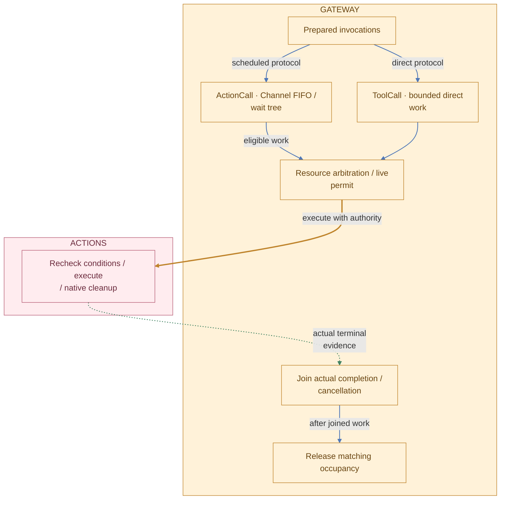

Gateway owns Channel FIFO, wait trees and resource arbitration; Actions declares required resources and owns actual device operations. Agents selects role takeover policy and App injects opaque policy values and native stop callbacks. Gateway compares neutral endpoint identities without understanding role semantics.

Different Channels may run concurrently but cannot bypass resource conflicts. Wait joins only its own scheduling tree, cannot wait on itself or ancestors, and does not branch on business success. Decisions requiring real outcomes wait for feedback. ToolCall direct execution uses the same resource mechanism while remaining outside Channel/wait ordering. ActionCall remains Channel-scheduled even when its catalog descriptor declares direct execution.

Owners, leases and revocable permits fence writes. Unconfigured conflicts fail busy without an implicit resource queue. Configured takeover blocks new writes, stops and joins the old owner, then grants authority. A timeout is not completed cleanup; late cleanup cannot grant a revoked request or replay an effect. Occupancy does not become a replacement device-health state. See [Scheduling](Gateway/Output/Scheduling/README.md) and [Resources](Gateway/Output/Resources/README.md).

### 10. ReACT continuation and execution feedback causality

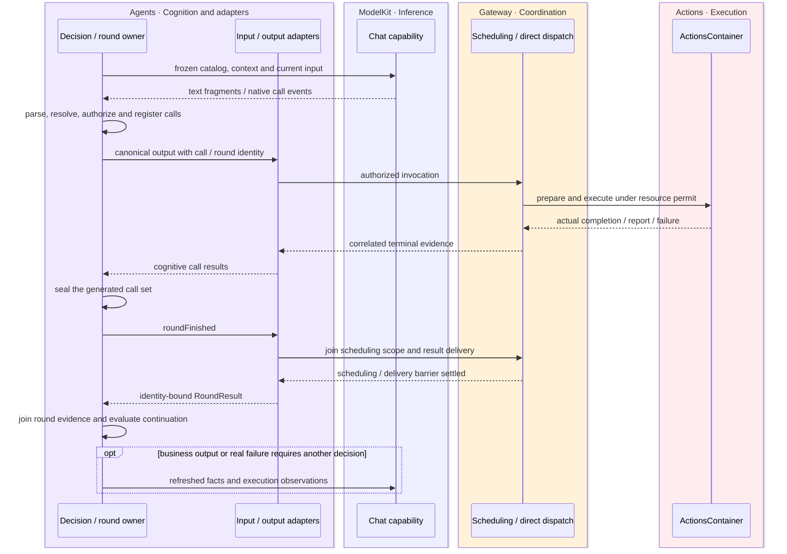

Agents submits a frozen request to ModelKit, resolves streamed output against its catalog, and submits authorized calls through Gateway. A round seal joins related calls and feedback before Agents commits evidence and decides whether to continue with refreshed facts.

Call completion, delivery, round closure and the next inference are separate boundaries. Results retain endpoint/incarnation/session/input/round/execution identity and opaque cognitive correlation; Agents interprets turn/Task semantics. Late results cannot target the latest chat or awaken a replacement owner. Reply barriers also join synthesis and playback before continuation.

Business values and real failures may become execution observations. Ordinary acknowledgments do not automatically create new rounds. Transport, parsing, lifecycle and cancellation failures do not automatically retry device effects. Partial and unknown effects and cleanup failures retain their evidence. Action deadlines belong to execution; conversation has no hidden universal TTL. See [Chat](Agents/Support/Chat/README.md), [Results](Gateway/Output/Results/README.md) and [ExecutionRuntime](Actions/Support/README.md).

### 11. Listening, ASR and sound-source observations

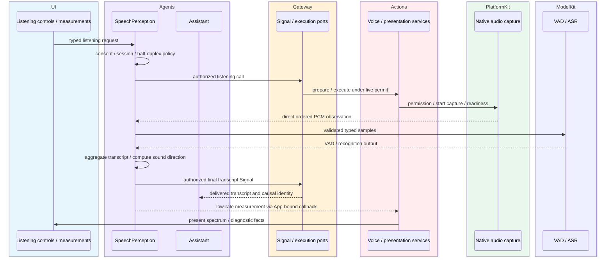

SpeechPerception owns consent, capture generations, half-duplex policy, VAD/ASR and transcript aggregation. Actions-owned voice services own permissions, native capture, readiness, shutdown and playback presentation. Read subscriptions alone do not open the microphone. Immutable native PCM reaches the role directly without Signal JSON re-encoding.

Readiness depends on effective samples and native conditions. The role validates channel layout, rate, sequence and continuity before model adaptation; ordered PCM overflow fails explicitly. Partials do not independently start ordinary conversation. Finals pass through authorized role communication to Assistant. Sound-source estimation and low-rate measurements belong to perception, while Actions presents facts. A declared observation contract does not imply a current subscriber. See [SpeechPerception](Agents/SpeechPerception/README.md), [Listening](Actions/Speech/Listening/README.md) and [Platform Audio](PlatformKit/Audio/README.md).

### 12. Reply synthesis, playback and listening restoration

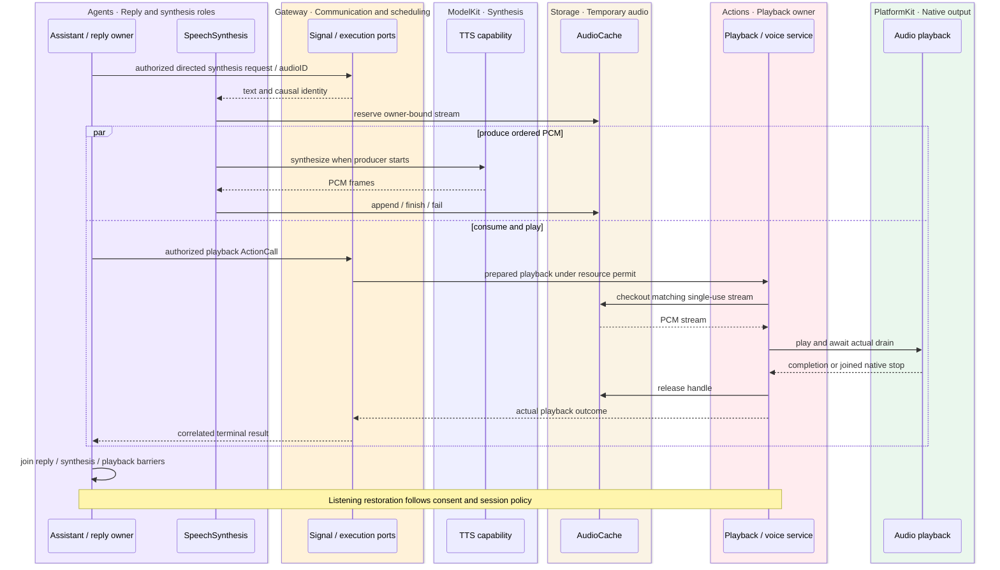

Assistant maps natural text into an authorized directed synthesis request and a playback call. SpeechSynthesis owns the ModelKit TTS producer and reserves an owner-bound AudioCache ID; it does not issue playback itself. Actions checks out the matching single-use stream and waits for native output drain. Synthesis admission, producer completion, playback drain and listening restoration are joined separately.

Explicit role messages coordinate half-duplex reply occupancy. Cancellation requests native stop, joins model production, cached streaming, scheduled playback and cleanup, then restores listening according to consent/session policy. Emitted audio cannot be undone; restored listening cannot turn failed playback into success. Model-load waiting and ordinary reply waiting use separate identity and completion conditions. See [SpeechSynthesis](Agents/SpeechSynthesis/README.md), [Speech](Actions/Speech/README.md) and [AudioCache](Storage/Cache/Audio/README.md).

### 13. Camera preview, vision and tracking

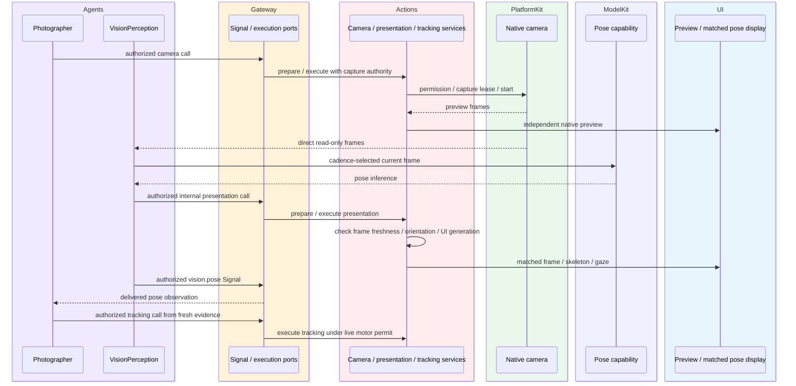

Authorized camera calls pass through Gateway to Actions CameraCoordinator, which owns permission, capture leases and native capture through PlatformKit. Preview and inference are independent: native preview and camera-only controls can work before the vision model is ready. Vision retains one inference and a latest candidate instead of queueing old frames.

VisionPerception owns cadence, motion evidence, target association and projection. Agents authorizes protected presentation/tracking calls; Gateway checks generic identity, envelopes and scheduling. Actions validates frame sequence, freshness, orientation and UI generation. Model/overlay failure preserves valid native preview. Photographer selects tracking from real fresh pose evidence; device output still requires authorization and a live resource permit. See [Camera](Actions/Camera/README.md), [VisionPerception](Agents/VisionPerception/README.md) and [Photographer](Agents/Photographer/README.md).

### 14. Photo capture, App album and system export

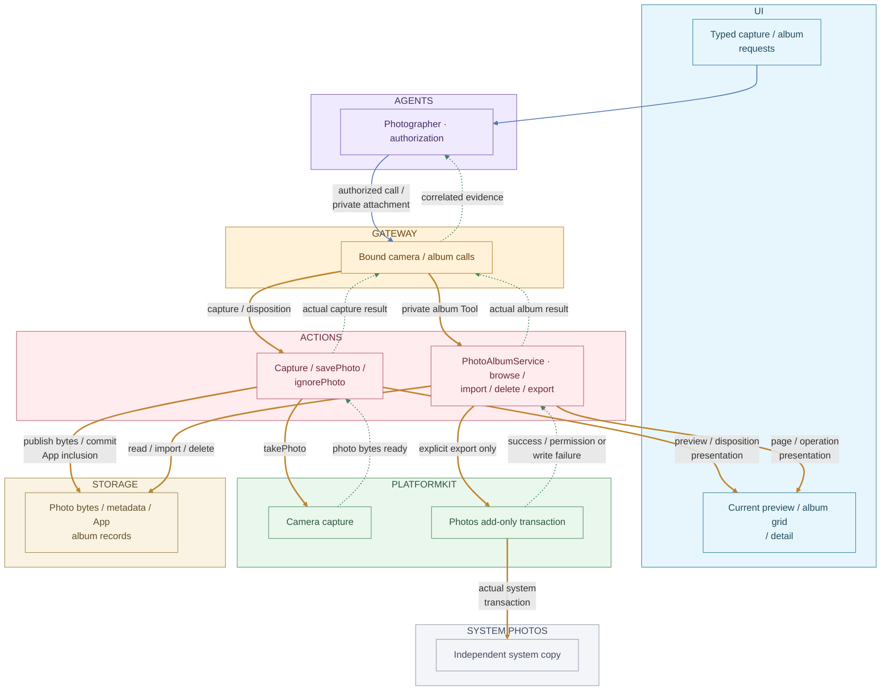

Photo bytes ready, current preview, formal App album inclusion and a system Photos copy are four separate facts. `savePhoto` includes the photo in the App album without requesting system-library permission. Existing bytes do not prove user retention; ignoring preview does not delete an included photo.

Album browse/import/export/delete uses UI.album → Photographer authorization → Gateway → the internal album function. Original reads, thumbnails and mutations have separate bounds; imports retain per-item successes. The root owns admitted changes across navigation and joins them at shutdown. The ordinary Photography Skill does not expose system export or album deletion.

System export waits for the actual Photos transaction. Denied permission or write failure preserves the App original. Each explicit click creates a copy without automatic export, retry or synchronization. App deletion commits the logical record before file cleanup and retains recovery evidence; system copies remain independent. Chat originals may become unavailable. Model/history media reads retain source/session/input ownership and bounded image preparation. See [Camera album](Actions/Camera/README.md), [UI Settings](UI/Settings/README.md), [Media](Storage/Database/Media/README.md) and [Platform Vision](PlatformKit/Vision/README.md).

### 15. Robot motion, hardware facts and control handoff

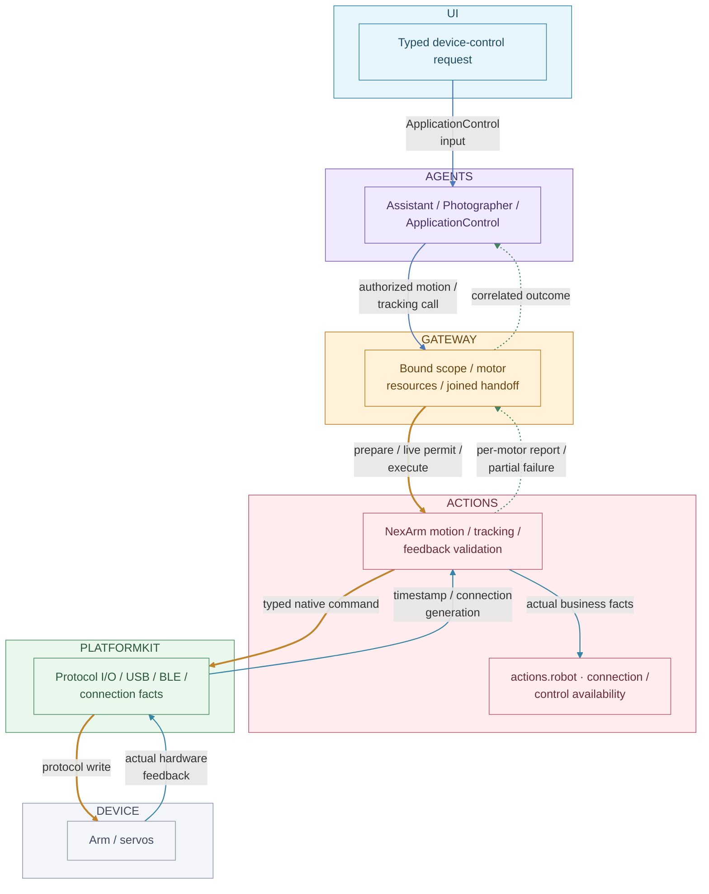

Agents authorizes Assistant/Photographer/device-control intent; Gateway arbitrates opaque motor resource policy; Actions interprets motion plans, manual/tracking commands and feedback. PlatformKit owns transport, protocol I/O and connection facts. Some decoded joint/pose caches remain Actions controller state; the platform does not own every servo state.

Handoff joins old writers. Manual control and tracking cannot write the same hardware concurrently merely because they use different Channels. Sending is not arrival: observed feedback, rather than targets, determines results. Not reached, timeout, feedback loss, disconnection and cancellation preserve distinct outcomes. Joined software stop does not establish physical spatial safety. The model-visible robot summary exposes actual connection/control availability. See [NexArm](Actions/NexArm/README.md) and [native protocol](PlatformKit/Connectivity/NexArm/README.md).

### 16. Bluetooth discovery, connection and recovery

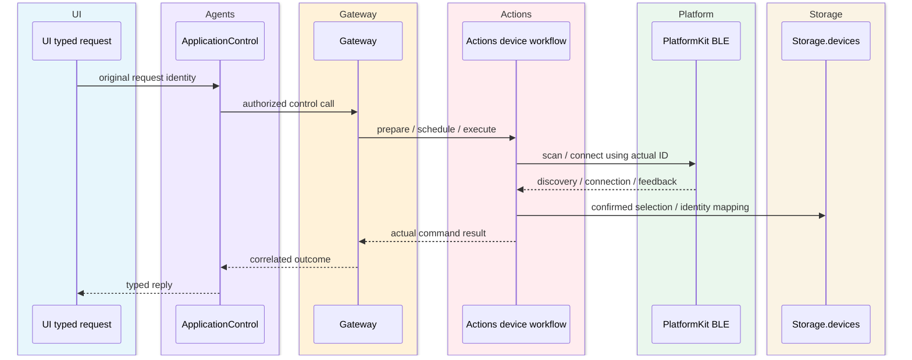

ApplicationControl consumes typed device requests and authorizes domain calls through Gateway. Actions connection services use PlatformKit discovery/connection/feedback and Storage device mappings, then present real facts through UI. Scan admission is not discovery; connection admission is not a connection. Only actual returned device identity is usable; names and model examples cannot replace IDs. Persisted selections do not prove a current native connection.

Disconnection, feedback health, query isolation and recovery remain connection/domain state. Low-rate native observations reach their owners directly without periodic JSON fingerprints or repeated inference. Business policy decides control eligibility and required user intervention; a successful protocol write does not prove compatibility or motion. See [Connection](Actions/NexArm/Connection/README.md) and [ApplicationControl](Agents/ApplicationControl/README.md).

### 17. Settings, Provider and model-resource workflows

```mermaid
flowchart TB
    subgraph Interaction["UI"]
        UI["Typed settings / resource<br/>request"]:::ui
        Present["Draft revision / resource<br/>presentation"]:::ui
    end
    style Interaction fill:#e7f6fc,stroke:#3985a4,color:#1f4c60
    subgraph Cognition["AGENTS"]
        A["ApplicationControl /<br/>root-owned observer"]:::agent
    end
    style Cognition fill:#f0eaff,stroke:#8261b5,color:#463065
    subgraph Coordination["GATEWAY"]
        G["Execution coordination"]:::gateway
    end
    style Coordination fill:#fff2d9,stroke:#bf842c,color:#694511
    subgraph Execution["ACTIONS"]
        X["Provider / ModelResources ·<br/>validate / apply / persist"]:::action
    end
    style Execution fill:#ffecef,stroke:#b86178,color:#6b2b3d
    subgraph Inference["MODELKIT"]
        M["Model capabilities /<br/>artifact lifecycle"]:::model
    end
    style Inference fill:#eeefff,stroke:#747bb8,color:#3c426d
    subgraph Persistence["STORAGE"]
        S["Settings / controlled files"]:::storage
    end
    style Persistence fill:#faf3e4,stroke:#a18a4e,color:#61512a
    UI -->|"original request<br/>identity"| A
    A -->|"authorized canonical<br/>call"| G
    G ==>|"prepare / execute"| X
    X ==>|"apply provider / manage<br/>artifacts"| M
    X ==>|"actual persistence"| S
    M -->|"direct artifact<br/>revisions / transfer<br/>facts"| A
    X ==>|"identity-matched result<br/>presentation"| Present
    X -.->|"actual result / failure"| G
    G -.->|"correlated evidence"| A
    classDef action fill:#ffecef,stroke:#b86178,color:#6b2b3d
    classDef agent fill:#f0eaff,stroke:#8261b5,color:#463065
    classDef gateway fill:#fff2d9,stroke:#bf842c,color:#694511
    classDef model fill:#eeefff,stroke:#747bb8,color:#3c426d
    classDef storage fill:#faf3e4,stroke:#a18a4e,color:#61512a
    classDef ui fill:#e7f6fc,stroke:#3985a4,color:#1f4c60
    linkStyle 0 stroke:#5078b8,stroke-width:1.5px
    linkStyle 1 stroke:#5078b8,stroke-width:1.5px
    linkStyle 2 stroke:#bf842c,stroke-width:2.5px
    linkStyle 3 stroke:#bf842c,stroke-width:2.5px
    linkStyle 4 stroke:#bf842c,stroke-width:2.5px
    linkStyle 5 stroke:#3985a4,stroke-width:1.5px
    linkStyle 6 stroke:#bf842c,stroke-width:2.5px
    linkStyle 7 stroke:#438463,stroke-width:1.5px,stroke-dasharray:2 3
    linkStyle 8 stroke:#438463,stroke-width:1.5px,stroke-dasharray:2 3
```

UI owns drafts/revisions and typed requests. ApplicationControl owns cognitive admission; Actions Provider/ModelResources services own input validation, application, persistence and result presentation through injected ModelKit/Storage interfaces. Failures cannot become empty configuration, an undocumented old-model fallback or fabricated success. Primary and cleanup errors remain distinct.

Download, installation, preference selection and model residency are separate states. Opening a page does not start transfers; pages do not poll to drive downloads. Root observers coalesce artifact revisions and read real state. Actions supplies application adapters to ModelKit-owned storage/download ports. Removing an artifact first quiesces actual consumers; background URLSession completion belongs to the artifact owner. Actions also owns UI interaction workers and joins them during shutdown. See [ApplicationControl](Agents/ApplicationControl/README.md), [Provider](Actions/System/Provider/README.md), [ModelResources](Actions/System/ModelResources/README.md) and [Management](ModelKit/Support/Management/README.md).

### 18. History, business records and restart behavior

```mermaid
flowchart TB
    subgraph Interaction["UI"]
        UI["Typed history request"]:::ui
        View["History projection /<br/>original typed reply"]:::ui
    end
    style Interaction fill:#e7f6fc,stroke:#3985a4,color:#1f4c60
    subgraph Cognition["AGENTS"]
        Decision["Real input / model request /<br/>response evidence"]:::agent
        A["Memory · authorize history<br/>operations"]:::agent
    end
    style Cognition fill:#f0eaff,stroke:#8261b5,color:#463065
    subgraph Coordination["GATEWAY"]
        G["Execution coordination"]:::gateway
    end
    style Coordination fill:#fff2d9,stroke:#bf842c,color:#694511
    subgraph Execution["ACTIONS"]
        X["Query / mutation / archive /<br/>presentation"]:::action
        Title["Root-owned title worker"]:::action
    end
    style Execution fill:#ffecef,stroke:#b86178,color:#6b2b3d
    subgraph Persistence["STORAGE"]
        Store["ConversationHistoryStore /<br/>chat / task repositories"]:::storage
    end
    style Persistence fill:#faf3e4,stroke:#a18a4e,color:#61512a
    subgraph Inference["MODELKIT"]
        M["Title inference"]:::model
    end
    style Inference fill:#eeefff,stroke:#747bb8,color:#3c426d
    Decision ==>|"record actual boundary<br/>evidence"| Store
    UI --> A
    A -->|"authorized call"| G
    G ==>|"prepare / execute"| X
    X ==>|"read / commit mutation"| Store
    X ==>|"project real results"| View
    X -->|"archive schedules title<br/>job"| Title
    Title -->|"injected title<br/>generation"| M
    M -.->|"title / real inference<br/>failure"| Title
    Title ==>|"commit title or failure<br/>evidence"| Store
    X -.->|"actual operation<br/>outcome"| G
    G -.->|"correlated result"| A
    classDef action fill:#ffecef,stroke:#b86178,color:#6b2b3d
    classDef agent fill:#f0eaff,stroke:#8261b5,color:#463065
    classDef gateway fill:#fff2d9,stroke:#bf842c,color:#694511
    classDef model fill:#eeefff,stroke:#747bb8,color:#3c426d
    classDef storage fill:#faf3e4,stroke:#a18a4e,color:#61512a
    classDef ui fill:#e7f6fc,stroke:#3985a4,color:#1f4c60
    linkStyle 0 stroke:#bf842c,stroke-width:2.5px
    linkStyle 1 stroke:#5078b8,stroke-width:1.5px
    linkStyle 2 stroke:#5078b8,stroke-width:1.5px
    linkStyle 3 stroke:#bf842c,stroke-width:2.5px
    linkStyle 4 stroke:#bf842c,stroke-width:2.5px
    linkStyle 5 stroke:#bf842c,stroke-width:2.5px
    linkStyle 6 stroke:#5078b8,stroke-width:1.5px
    linkStyle 7 stroke:#747bb8,stroke-width:1.5px
    linkStyle 8 stroke:#438463,stroke-width:1.5px,stroke-dasharray:2 3
    linkStyle 9 stroke:#bf842c,stroke-width:2.5px
    linkStyle 10 stroke:#438463,stroke-width:1.5px,stroke-dasharray:2 3
    linkStyle 11 stroke:#438463,stroke-width:1.5px,stroke-dasharray:2 3
```

Agents records real input, model request/context, response, calls, terminal evidence and usage at their own boundaries. UI summaries/pages are not the full model request, and private Agent context is not the database. Model-visible queries return bounded previews; UI full reads carry private typed results, without a global attachment table.

Memory authorizes history requests; Actions owns queries, mutations and presentation through the injected ConversationHistoryStore. Archive/delete waits for real commits. Root-owned title generation does not block a new conversation. Title computation and failure-record commit can fail together; cancellation does not undo an archive. Restart marks unfinished records interrupted without resuming native execution or replaying the last action.

| Data | Owner and restart meaning |
| --- | --- |
| Active Task/Skill, decisions and queues | Private Agent memory; no guarantee of restoring execution. |
| Current model facts | Actual container memory, sampled per request; no persistent StorageState mirror. |
| PCM and temporary buffers | Bounded Storage.cache sessions and leases; not durable creations. |
| Conversation, task, media and device records | Storage repositories with actual commit/recovery contracts. |
| Photos, settings and model artifact files | Controlled Storage.files namespaces; pending/ready/compensation rather than cross-backend atomic transactions. |

See [Memory](Agents/Memory/README.md), [History](Actions/History/README.md) and [Storage](Storage/README.md).

### 19. Model lifecycle and inference boundaries

```mermaid
flowchart TB
    subgraph Consumers["CONSUMERS"]
        Caller["Agent cognition / Actions<br/>business owner"]:::neutral
    end
    style Consumers fill:#f4f5f8,stroke:#939bad,color:#414b60
    subgraph Inference["MODELKIT"]
        Capability["Typed inference capability"]:::model
        Manager["Instance-local management /<br/>loading / residency"]:::model
        Provider["Cloud or local provider"]:::model
        Backend["Responses / CoreAI / CoreML<br/>/ engine"]:::model
        Ports["Artifacts / ModelKit-owned<br/>storage and download ports"]:::model
    end
    style Inference fill:#eeefff,stroke:#747bb8,color:#3c426d
    subgraph Host["APP"]
        App["ModelContainer lifecycle"]:::host
    end
    style Host fill:#eaf2ff,stroke:#5078b8,color:#203b64
    Caller -->|"typed request"| Capability
    Capability -->|"inference admission"| Manager
    Manager ==>|"selected implementation"| Provider
    Provider ==>|"actual inference"| Backend
    Backend -.->|"typed output / usage /<br/>failure"| Caller
    App -.->|"start / invalidate /<br/>stop"| Manager
    Ports -->|"owner-defined resource<br/>interfaces"| Manager
    classDef host fill:#eaf2ff,stroke:#5078b8,color:#203b64
    classDef model fill:#eeefff,stroke:#747bb8,color:#3c426d
    classDef neutral fill:#f4f5f8,stroke:#939bad,color:#414b60
    linkStyle 0 stroke:#747bb8,stroke-width:1.5px
    linkStyle 1 stroke:#5078b8,stroke-width:1.5px
    linkStyle 2 stroke:#bf842c,stroke-width:2.5px
    linkStyle 3 stroke:#bf842c,stroke-width:2.5px
    linkStyle 4 stroke:#438463,stroke-width:1.5px,stroke-dasharray:2 3
    linkStyle 5 stroke:#738299,stroke-width:1.5px,stroke-dasharray:7 4
    linkStyle 6 stroke:#5078b8,stroke-width:1.5px
```

ModelContainer's four capabilities share instance-local management. Preparation, actual loading, inference admission, release and shutdown have distinct meanings. Foreground transitions close inference and join active tasks; weight residency does not prove device/page readiness. Model-load waiting and ordinary Assistant reply waiting are presented independently.

Agents owns the original request, history selection and decision catalog. Providers own tokenization, context fitting, streaming decode and neutral failures, and may trim/reject context under their contract. Gemma-specific handling remains inside [ModelKit](ModelKit/README.md); cloud prompt experiments do not establish local-model acceptance.

The cloud adapter encodes declared Responses contracts and validates terminal events, call identity and arguments. An arriving fragment is not an executable call. Failure does not silently switch models or retry effects. Generic native Tool support and the current Action-only Skill teaching are maintained separately. See [OpenAI adapter](ModelKit/Language/LLM/OpenAI/README.md).

### 20. Diagnostics, UI presentation and native rendering

```mermaid
flowchart TB
    subgraph Sources["FAILURE SOURCES"]
        Failure["Native module / execution /<br/>delivery failures"]:::neutral
    end
    style Sources fill:#f4f5f8,stroke:#939bad,color:#414b60
    subgraph Host["APP"]
        App["Preserve original error /<br/>module identity"]:::host
        Channel["Retained<br/>ContainerFailureChannel"]:::host
        Bootstrap["Bootstrap failure before<br/>roles"]:::host
    end
    style Host fill:#eaf2ff,stroke:#5078b8,color:#203b64
    subgraph Cognition["AGENTS"]
        A["ApplicationControl<br/>classification / authorized<br/>output"]:::agent
    end
    style Cognition fill:#f0eaff,stroke:#8261b5,color:#463065
    subgraph Coordination["GATEWAY"]
        G["Admission / scheduling"]:::gateway
    end
    style Coordination fill:#fff2d9,stroke:#bf842c,color:#694511
    subgraph Execution["ACTIONS"]
        X["Notice / conversation /<br/>diagnostics functions"]:::action
    end
    style Execution fill:#ffecef,stroke:#b86178,color:#6b2b3d
    subgraph Display["UI"]
        UI["Identity-matched<br/>presentation / native<br/>rendering"]:::ui
    end
    style Display fill:#e7f6fc,stroke:#3985a4,color:#1f4c60
    Failure -->|"original structured<br/>error"| App
    App -->|"bounded retained<br/>evidence"| Channel
    Channel -->|"diagnostic delivery"| A
    A -->|"authorized presentation<br/>call"| G
    G ==>|"prepare / execute"| X
    X ==>|"public UI presentation<br/>capability"| UI
    Bootstrap -->|"App-bound bootstrap<br/>fallback"| UI
    classDef action fill:#ffecef,stroke:#b86178,color:#6b2b3d
    classDef agent fill:#f0eaff,stroke:#8261b5,color:#463065
    classDef gateway fill:#fff2d9,stroke:#bf842c,color:#694511
    classDef host fill:#eaf2ff,stroke:#5078b8,color:#203b64
    classDef neutral fill:#f4f5f8,stroke:#939bad,color:#414b60
    classDef ui fill:#e7f6fc,stroke:#3985a4,color:#1f4c60
    linkStyle 0 stroke:#3985a4,stroke-width:1.5px
    linkStyle 1 stroke:#5078b8,stroke-width:1.5px
    linkStyle 2 stroke:#3985a4,stroke-width:1.5px
    linkStyle 3 stroke:#5078b8,stroke-width:1.5px
    linkStyle 4 stroke:#bf842c,stroke-width:2.5px
    linkStyle 5 stroke:#bf842c,stroke-width:2.5px
    linkStyle 6 stroke:#5078b8,stroke-width:1.5px
```

Foundations report their own native Failure types without business wording, Signals or automatic recovery. App preserves original errors and source identity in its bounded ContainerFailureChannel. ApplicationControl owns classification/presentation policy and sends authorized display calls through Gateway to Actions. Bootstrap failure has an App-owned fallback before roles are available. Reporting failure does not recursively generate more failures.

Pure cancellation is distinct from real or mixed execution/cleanup failure; classification uses structured reports rather than error strings. Display filters do not cancel work or establish released resources. Passive Agent activity projection lives with cognitive adapters; callable presentation and effects live in Actions.

UI presentation admission differs from native completion. Finite expressions await their presentation/restoration; persistent base state acknowledges admission. Metal owns window/layer/GPU completion. Photo disappearance/display receipts retain media and generation identity. Updating a UI field cannot prove GPU or physical completion. See [UI](UI/README.md), [ApplicationControl](Agents/ApplicationControl/README.md) and [runtime presentation](Actions/UI/Runtime/README.md).

### 21. Cross-module cancellation, pressure and completion

```mermaid
sequenceDiagram
    box rgb(234,242,255) App · Lifecycle owner
        participant App as Application lifecycle
    end
    box rgb(240,234,255) Agents · Cognitive work
        participant A as AgentContainer
    end
    box rgb(255,242,217) Gateway · Coordination
        participant G as GatewayContainer
    end
    box rgb(255,236,239) Actions · Business work
        participant X as ActionsContainer
    end
    box rgb(234,247,237) Foundations · Native capabilities
        participant F as Owned capability services
    end
    App->>A: close requests / stop and join roles
    A->>G: cancel owned execution scopes
    G->>X: cancel actual executing work
    X->>F: request and join required native cleanup
    F-->>X: cleanup result or retained failure
    X-->>G: joined terminal evidence
    G-->>A: scoped results / scheduling and delivery barriers
    A-->>App: cognitive shutdown settled
    App->>G: close admission / stop remaining facilities
    G-->>App: scheduling, resources, delivery and transport joined
    App->>X: stop remaining business / native work
    X-->>App: joined cleanup or structured failure
    App->>App: release execution bindings
    App->>F: stop foundation roots in reverse dependency order
```

Interruption retains Task/Skill while stopping current decisions; resumption does not replay effects. Closing releases session capabilities. Actor isolation, a cancellation flag or a deadline cannot prove another owner has finished. Every queue/slot has an owner-defined bound and explicit rejection, backpressure or latest-value replacement policy.

Agents closes new cognitive work and explicitly cancels its scopes. Gateway joins transport, direct/scheduled execution and result delivery while Actions remains alive for cleanup. Actions joins remaining business/native work; only then does App release execution bindings and stop foundations. Failed startup rolls back completed stages while preserving both primary and cleanup failures.

| Boundary | Completion establishes | It does not establish |
| --- | --- | --- |
| Request/message admission | Acceptance or explicit rejection | Business completion or another inference round |
| Path/UI update | Identity-matched state commit | Loaded data or displayed GPU frame |
| Model operation | Adapter completion or joined cancellation | Device completion |
| Action/Tool | Declared business completion and report | Successful delivery or cognitive consumption |
| Playback | Actual native drain and handle release | Sound at synthesis admission |
| File/database publication | Real commit or explicit partial outcome | Cross-backend atomicity or Photos synchronization |
| Resource/session stop | Joined owned work and cleanup | Cooperative hardware stop or spatial safety |

Independent fences include UI generation, capture generation, endpoint incarnation/session, input/round, Agent Task grants, media ownership, resource lease/permit, settings revision and paging tickets. One fence cannot substitute for another; replacement owners cannot inherit stale writes. See [Input](Gateway/Input/README.md), [Scheduling](Gateway/Output/Scheduling/README.md), [Resources](Gateway/Output/Resources/README.md), [Results](Gateway/Output/Results/README.md) and [Context](Agents/Support/Context/README.md).

### 22. End-to-end scenario map

| Scenario | Entry and owners | Result boundary |
| --- | --- | --- |
| Album/settings click | Local navigation; business buttons submit typed requests to their role and registered domain functions. | Path commit and business reply remain separate. |
| Voice conversation | Native PCM → SpeechPerception → Gateway final → Assistant → ModelKit → authorized calls. | Actual inference, execution and reply barriers. |
| Known expression/speech sequence | One resolved sequence → Channel/wait → UI/Speech execution. | Actual group completion, not textual order alone. |
| Vision without new user input | Native frame → VisionPerception → protected presentation / Photographer tracking. | Freshness, authority and feedback; no automatic ordinary chat. |
| Module/device change | Native observation → responsible role → state/failure policy. | No automatic effect retry or inferred physical completion. |
| Agent collaboration | Policy-authorized message → bound Gateway endpoint → target role. | Admission, progress, result and cancellation remain distinct. |
| Navigation/inactivity | UI lifetime or App invalidation → owned cancellation/join. | Committed creations remain; root cleanup outlives pages. |

Automated checks, iOS builds, real-model samples, native UI and physical-device acceptance are separate evidence categories maintained in [validation](../docs/validation/README.md). Requirements and decisions live in [requirements](../docs/requirements/README.md) and [ADR](../docs/adr/README.md); historical design rationale lives in [documentation history](../docs/history/Documentation-History.md).

Photographer → Gateway → Actions/NexArm 跟踪链仅传递有限角度/位置目标；Photographer 按 PlatformKit 推荐节奏生成目标，派发保留正在执行一个和待执行最新一个并记录替换计数，Actions 保留最新目标并编译有界位置包。设备位置/运行参数限制及通信上限统一由 PlatformKit 提供，USB/BLE 在发包前验证寄存器写和位置范围，BLE 对所有生产者共享发送预算及原生背压。运行时不切换舵机模式或发送持续速度，取消加入不附加运动。设备硬件限位与位置模式配置不由该链写入，详见 [NexArm SDK](PlatformKit/Connectivity/NexArm/README.md)。

NexArm通用设备参数、允许误差、位置反馈观察、经验行程估算与原生恢复分类/预算由 PlatformKit 拥有；Actions 仅消费这些能力并拥有动作目标、资源、执行报告、设备选择及业务生命周期协调。硬件错误保持SDK类型，上层仅适配展示与动作结果，基础模块不依赖业务模块。
