# MobileHarness Technical Design

本文是应用的**总体技术设计**：维护完整框架、模块分布、编译边界和重要跨模块技术链路。阅读一条链路应能明确输入、决策者、执行者、数据去向、完成边界以及取消与失败的归属。

1. [Part I — Overall Architecture](#part-i--overall-architecture)：系统分层、运行关系、编译依赖与源码地图。
2. [Part II — Module Responsibilities](#part-ii--module-responsibilities)：各模块职责、内部能力组、直接协作及边界。
3. [Part III — Cross-module Technical Design](#part-iii--cross-module-technical-design)：启动、输入、模型决策、授权执行、媒体、设备、存储和生命周期的完整链路。

✅ 下文描述已实现架构；❌ 明确标示未完成能力。具体函数清单、算法、字段、队列数值和局部状态机由所属目录 README 维护；需求、演进和验证证据归 [docs](../docs/README.md)。本文不以实验或构建结果代替当前设计，也不因拆分局部细节而移除总体链路。

<a id="part-i--overall-architecture"></a>

## Part I — Overall Architecture

### 1. System architecture

Agents 负责输入解释、目标、推理策略和角色协调；Gateway 负责通信与执行授权、路由、调度和结果围栏；Actions 负责可调用业务操作及其真实执行。UI、PlatformKit、ModelKit、Storage 是四个独立基础模块。App 创建实例根、注入窄接口并管理生命周期，不实现领域决策。

下图实线表示运行期调用或数据流，虚线表示实例装配；**不能把运行期数据流当作反向编译依赖**。

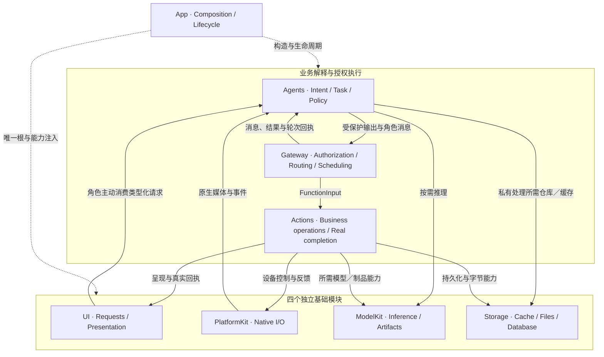

本地 UI 请求、PCM、相机帧和容器观察由负责的角色直接消费，不包装成外部 Signal。Agent 间消息和执行反馈经过 Gateway。页面局部展开、焦点、导航回写等 UI 机制不需要模型推理；设备操作、业务函数和模型产生的可执行输出遵循实际注册与授权链路。

### 2. Coordination and ownership

| 问题 | 唯一职责归属 | 其他层的职责 |
| --- | --- | --- |
| 用户想做什么、是否需要持续 Task | 所属 Agent；普通对话由 Assistant | UI 只提交类型化数据，App 不解释意图 |
| 本轮能调用哪些函数 | Agent 的不可变决策目录与 Skill 组合 | Gateway 按真实生产者和轮次校验，不用历史调用授予权限 |
| 谁能写设备、何时接管资源 | Gateway 资源仲裁与注入的领域策略 | Actions 验证执行许可；PlatformKit 不认识 Agent 授权 |
| 相机、播放、蓝牙实际发生了什么 | 原生能力与所属执行服务 | 模型生成调用不证明完成，UI 接纳也不证明物理完成 |
| 页面、详情、弹层及显示状态 | UI Container | 上层只经公开呈现／请求能力访问 |
| Task／Skill 私有状态 | Agent 内存及其事务机制 | 不写入另一个公共 State 仓库 |
| 哪些事实进入模型上下文 | Skill 的 useStates 与 Agent 读取注册表 | 数据由原有 Container 维护，适配器不缓存镜像 |
| 哪些数据需要跨重启保留 | 领域仓库与文件契约 | Storage 不接管推理、页面或任务决策 |
| 启动、失活、停止及根替换 | App 生命周期图和各模块的加入清理 | 页面不拥有长期设备／模型会话 |

<a id="ownership-and-compilation"></a>

### 3. Compilation dependencies

下图箭头表示**编译依赖**。四基础模块之间没有互引；模块内部可以拆为多个 SDK 目标。注入 ModelKit 自有存储协议的实现，不使 ModelKit 依赖 Storage。

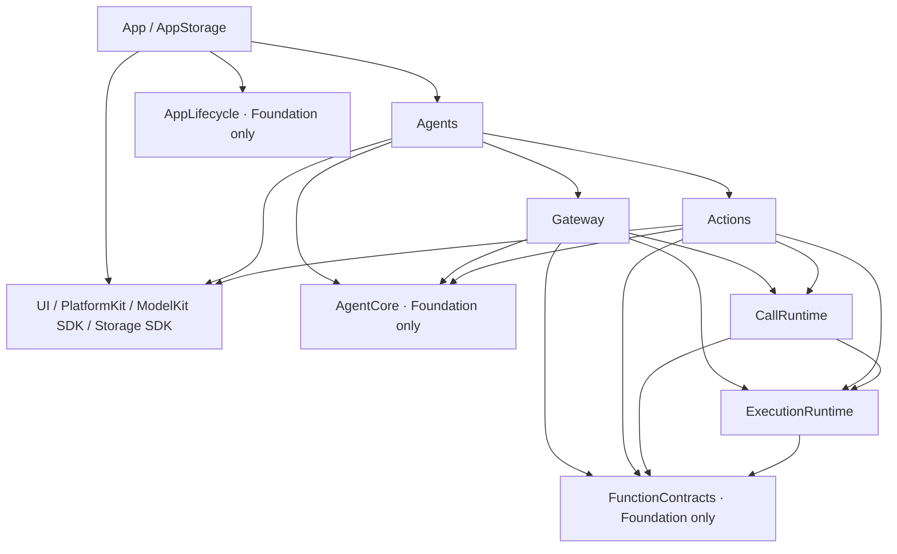

AgentCore 与 FunctionContracts 是独立叶子契约；虽然物理目录分别位于 Agents 和 Actions 内，并不编译进其业务实现。Gateway 不导入 UI、PlatformKit 或模型实现。Actions 不导入 Agents、Gateway 实现或 App。FactoryKit 只在 App 的实例注册作用域使用，消费者不通过 IoC 查找能力。

<a id="target-map"></a>

### 4. Source structure and target map

```text
MobileHarness/
├── App/                         # Entry、Composition、Lifecycle
│   ├── Composition/             # 唯一根注册、服务工厂、展示端口装配
│   └── Lifecycle/               # 独立 AppLifecycle 与 OS 回调入口
├── Agents/                      # 七个角色容器、输入消费和领域策略
│   ├── Assistant/               # 普通 Chat、前台目标与照片对话
│   ├── ApplicationControl/      # 设置、资源、设备与故障策略
│   ├── Memory/                  # 历史查询、修改和标题工作流
│   ├── Photographer/            # 相机／相册 UI 请求、姿态跟踪策略
│   ├── SpeechPerception/        # PCM 消费、聆听、VAD／ASR
│   ├── SpeechSynthesis/         # 定向 TTS 与音频 producer
│   ├── VisionPerception/        # 相机帧消费、姿态与视线
│   └── Support/                 # Core、Chat、Context、Communication 等共享机制
├── Gateway/                     # Input 与 Output 授权／路由
│   ├── Runtime/                 # ExecutionRuntime 独立目标
│   └── Output/                  # 注册、协议、调度、资源、结果
├── Actions/                     # Camera、History、NexArm、Speech、System、UI
│   └── Support/Contracts/       # FunctionContracts 独立目标
├── UI/                          # Container、页面、渲染器、请求与回执
├── PlatformKit/                 # Audio、Vision、Connectivity 原生能力
├── ModelKit/                    # Language、Speech、Vision、Support 与根容器
├── Storage/                     # Cache、Files、Database、Support；无公共 State 模块
└── Resources/                   # Agent / Skill、模型配置、隐私和资源

Package.swift                    # 实际共享源码编译边界
MobileHarness.xcodeproj/         # App、Simulator 与 SDK schemes
Config/                          # 构建配置；本地签名不入库
Tests/                           # 模块、应用流程、集成与模型评估
scripts/                         # 边界检查、构建与显式实验入口
```

| 源码归属 | 编译目标／范围 | 关键边界 |
| --- | --- | --- |
| App executable 与 Composition | App；ApplicationContainer 单独归 AppStorage | 选择后端和唯一实例，不定义业务函数 |
| App/Lifecycle/ApplicationLifecycle.swift | AppLifecycle | Foundation 独立服务图 |
| Agents/Support/Core | AgentCore | 身份、通信、通用上下文、生成解析与输出契约 |
| Agents 除 Core | Agents | 七角色和实际运行装配，无第二套 binding 目标 |
| Actions 除 Contracts | Actions | 领域函数、服务与目录装配；宏属于 BehaviorDefinitions |
| Actions/Support/Contracts | FunctionContracts | 协议中立函数元数据、输入与结果 |
| Gateway/Runtime | ExecutionRuntime | 规范函数执行、取消、期限和报告 |
| Gateway/Output/Registration 与 Protocols | CallRuntime | Action／Tool 注册和调用适配 |
| Gateway 其余源码 | Gateway | 真实生产者、路由、调度、资源与反馈 |
| UI；PlatformKit | 各自独立目标 | 无其他项目模块依赖 |
| ModelKit 能力与 Provider／Backend | ModelKit、Runtime、Defaults、Hub 及模型 SDK 目标 | ModelContainer 编译归 Defaults；SDK 内部依赖，不反向依赖业务 |
| Storage 根与公共机制 | Storage、StorageCore | 根组合生命周期；Core 只有公共机制 |
| Storage/Cache、Files、Database 各领域 | StorageCache、StorageFiles、StorageDatabase、Chat／Tasks／Media／Devices | 领域契约与后端分离；只有 StorageSQLite 依赖 GRDB |

具体 SDK 目标、第三方依赖和源码排除项以 [Package.swift](../Package.swift) 为准；模块内部细分见 [ModelKit](ModelKit/README.md)、[Storage](Storage/README.md)。目录树不赋予额外依赖或执行权限，同一源码只拥有一个编译目标。

### 5. Stable foundation roots and business root

| 根 | 稳定子能力 | 根错误类型 |
| --- | --- | --- |
| ModelContainer | language、speech、vision、artifacts | ModelFailure |
| PlatformContainer | audio、vision、connectivity | PlatformFailure |
| StorageContainer | cache、files、database | StorageFailure |
| UIContainer | home、camera、settings、modelResources、navigation、history、album、devices、diagnostics | UIFailure |

根构造和 start 不隐式打开相机／麦克风、扫描设备或运行模型推理。消费者只拿所需接口；每个 Agent 不必接收四个基础根。业务运行状态内聚于实际 Container，Storage 只承担缓存、文件和数据库能力。

App 每个注册作用域缓存一个 AgentContainer，公开 assistant、applicationControl、memory、photographer、speechPerception、speechSynthesis、visionPerception 七个稳定角色子容器。角色拥有会话和订阅；AgentRuntime 组合共享通信／执行设施。App 只管理一个 agents 生命周期节点，角色内部顺序由业务根负责。

<a id="part-ii--module-responsibilities"></a>
<a id="responsibilities-and-boundaries"></a>

## Part II — Module Responsibilities

### 1. Module responsibilities and direct relationships

| 模块 | 当前职责与内部组 | 直接协作和职责边界 |
| --- | --- | --- |
| [App](App/README.md) | 入口、Composition、服务注册、Lifecycle、首页准备 | 创建四基础根和 Agent 根，绑定公开端口；不消费业务请求或转换领域数据 |
| [Agents](Agents/README.md) | 七角色、AgentContainer／Runtime、Support 的 Chat／Context／Communication | 从所需基础能力消费输入；向 Gateway 输出；使用 Actions 公开服务契约 |
| [AgentCore](Agents/Support/Core/README.md) | Input、Capability、Generation、Communication、Runtime、Output 与只读上下文协议 | 独立中立契约；不创建具体角色或持有基础根 |
| [Gateway](Gateway/README.md) | 输入投递、实例绑定、协议解析后的调用授权、调度、资源、结果 | 接受真实 Agent 输出并调用注册的执行器；不推理或实现设备业务 |
| [Actions](Actions/README.md) | Camera、History、NexArm、Speech、System、UI 六域及显式目录组合 | 接受 FunctionInput，调用注入能力，返回真实结果；不维护 Agent 目标 |
| [UI](UI/README.md) | 类型化请求、九个子容器、首页／设置／相册、原生渲染与回执 | UI 主动提交值；负责角色消费请求。UI 不调用 Agent 或实现业务策略 |
| [PlatformKit](PlatformKit/README.md) | Audio、Vision、Connectivity，权限与原生观察／控制 | 提供 OS／设备事实；不认识 Skill、Task、Signal 或动作目录 |
| [ModelKit](ModelKit/README.md) | Language、Speech、Vision、管理、Provider 和 Backend | 提供推理与制品接口；不管理应用 Task、设备采集、播放或页面 |
| [Storage](Storage/README.md) | 有界 Cache、Files、领域 Database 与 SQLite 后端 | 只持有字节和领域记录；不保存公共运行状态或生成模型上下文 |
| [Resources](Resources/README.md) | Agent 配置、Skill 教学／声明、模型配置及隐私资源 | 资源不是执行代码，不提供未注册能力；配置和函数声明须验证 |

### 2. Agent roles and internal cooperation

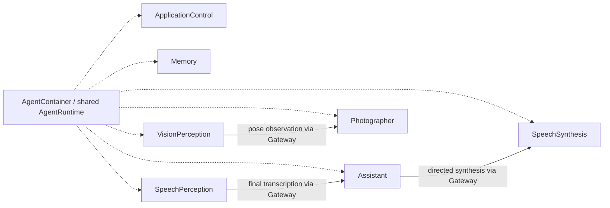

上图角色连线是 Gateway 递送的消息，不是角色之间的绕行调用。容器根内的服务装配和生命周期连接通过明确接口完成。

| 角色 | 主要输入与处理 | 长期工作和完成所有者 |
| --- | --- | --- |
| Assistant | 用户／语音输入、执行结果、照片观察；Chat／ReACT、前台 Task 和动态 Skill | 决策、输出／回复屏障及实际对话证据 |
| ApplicationControl | 设置、模型资源、设备、诊断请求及容器故障 | 配置／资源策略、观察与故障呈现决策 |
| Memory | 历史页面的类型化查询、归档、删除及标题请求 | 历史请求、真实查询结果和标题 worker；不是完整产品记忆系统 |
| Photographer | 相机／相册 UI 请求、视觉姿态观察 | 相机命令、相册请求和跟踪策略；不接管普通摄影对话 |
| SpeechPerception | 直接 PCM、聆听控制、回复占用事件 | 聆听同意、采集代、VAD／ASR、半双工与转写 |
| SpeechSynthesis | 授权定向文本／取消消息 | TTS producer、音频句柄和合成终态；不发起原生播放 |
| VisionPerception | 直接原生相机帧 | 单推理／最新候选、节奏、姿态／视线和帧代际 |

### 3. Domain execution and shared contracts

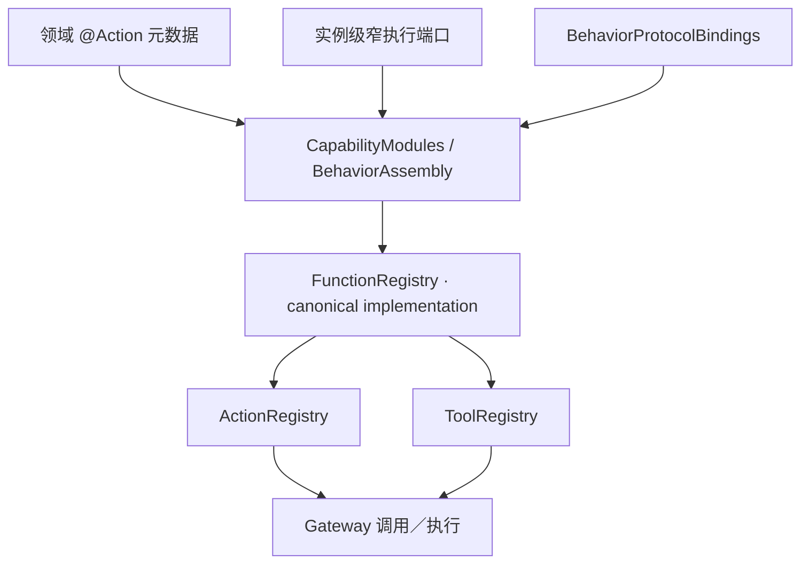

| 领域 | 领域完成的含义 | 下游能力 |
| --- | --- | --- |
| Camera | 启停／镜头、单次采集、App 收录、预览处置、相册读写 | Platform.vision、UI.camera／album、Storage.media／files |
| Speech | 聆听和检测采集、音频播放、呈现及停止加入 | Platform.audio、UI.home、音频缓存和注入的角色生命周期 |
| NexArm | 连接、有限运动、手动／跟踪、反馈验证及控制交接 | Platform.connectivity、设备记录和 UI 事实呈现 |
| History | 预览／完整读取、归档修改、标题结果与呈现 | 领域历史仓库和 UI.history |
| System | Provider、模型资源、设备控制与环境查询 | 所需 ModelKit、Storage 和明确领域端口 |
| UI | 表情、会话、反馈、骨架、导航和业务结果呈现 | UI 公开 Presenting 接口，必要的原生反馈能力 |

FunctionContracts 定义业务函数输入、元数据、结果与报告；ExecutionRuntime 执行规范函数；CallRuntime 适配调用协议。Actions 的同一实现可以支持多个调用视图，不复制业务逻辑。注册存在、Skill 声明和设备就绪是三个不同事实。

### 4. Foundation capability distribution

| 基础模块 | 内部能力分布 | 向上提供的结果 |
| --- | --- | --- |
| UI | 会话／表情／相机／设置／历史／相册／诊断，各有状态和请求接口 | 呈现接纳、请求回执及有身份的原生显示完成 |
| PlatformKit | 音频输入输出、相机采集／预览、Photos 导出、NexArm 链路 | PCM、图像、设备反馈、原生事务或错误 |
| ModelKit | Chat、ASR、TTS、VAD、Pose；工厂／制品／驻留与 Provider | 类型化事件、推理结果、用量、实际生命周期状态 |
| Storage | 音频／缓冲区缓存、受控文件命名空间、chat/tasks/media/devices 仓库 | 有界字节租约、文件及数据库真实提交结果 |

原始媒体、完整私有 Context、执行队列、密钥和文件路径不因公开上下文接口而全部暴露。基础能力协议由所属模块定义；调用者提供的适配器不改变模块依赖方向。

<a id="part-iii--cross-module-technical-design"></a>

<a id="cross-module-flows"></a>

## Part III — Cross-module Technical Design

### 1. Composition, startup and lifetime

App 注册静态服务图，依赖箭头表示“下游开始前，上游必须就绪”；停止按逆依赖顺序加入。业务根管理内部角色和原生会话，页面不承担这些长期工作。

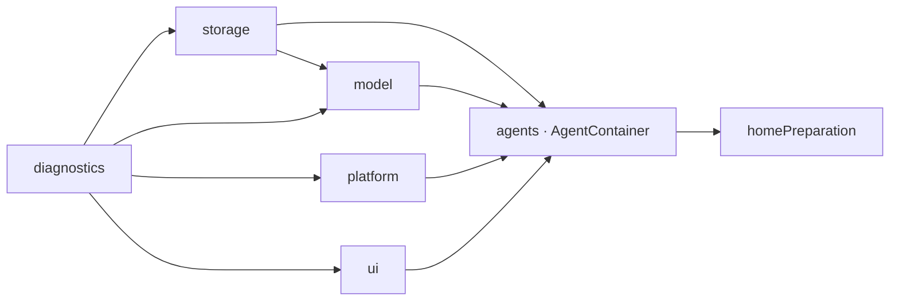

构造阶段只创建对象和连接端口。Storage start 打开／迁移／恢复后才允许使用仓库；模型根注册工厂和制品元数据，实际加载按需发生。角色注册、输出消费者与请求接纳按所属容器顺序建立。

失活时同步 invalidate，先撤销原生／UI 接纳，再取消并加入异步工作。快速返回 active 不能跳过必须完成的非前台清理；启动失败清理部分启动的当前节点及已启动依赖。清理未确认时保留旧作用域和错误，不创建竞争的新原生拥有者。详见 [Composition](App/Composition/README.md)、[Lifecycle](App/Lifecycle/README.md)。

### 2. Input, Signal and Agent communication

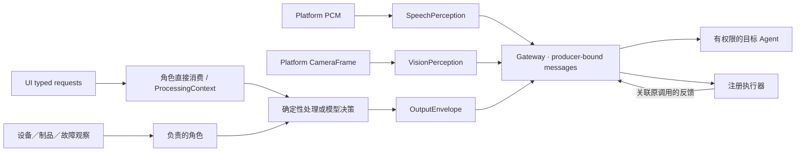

| 输入／消息 | 入口 | 不能据此推导的权限 |
| --- | --- | --- |
| 点击、表单、相机／相册操作 | UI 自有 requests，由负责角色订阅 | 不包含可伪造的 Agent 身份、函数地址或 Task grant |
| PCM、图像帧 | 感知角色的只读原生观察端口 | 订阅不请求权限、不打开设备、不授予控制权 |
| 设备、模型资源、容器异常 | 原生／模块观察，直接交给所属角色 | 不是任意可执行 Signal，也不自动唤醒模型 |
| Agent 间发布／定向消息 | 实例绑定的 OutputGateway → InputGateway | 内容不是执行证据；消息接纳不等于业务消费 |
| Action／Tool 结果、轮次和取消 | Gateway 按真实生产者及原调用归属递送 | 旧结果不能进入新会话、任务或角色实例 |

ProcessingContext 保存 request/session/generation/turn/causality 等本地关联，不能授予执行权。AgentInput 的 local 来源是私有处理值，Gateway 不把它当作受信 Signal。真实 Agent 间通信保留源身份、消息契约和定向权限。

声明“可以发布”也不表示已有消费者；例如部分语音观察契约保留了发布能力，但没有静态订阅者。角色的处理选择和发送契约见 [Agents](Agents/README.md)、[Communication](Agents/Support/Core/Communication/README.md)。

<a id="ui-requests-and-business-execution"></a>

### 3. UI requests and shared business execution

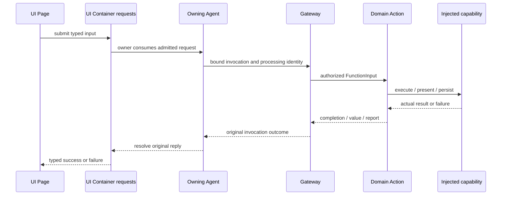

请求源、消费者和实际工作拥有者分离。没有可用消费者、容量已满、根关闭或代际过期时明确拒绝；不能静默丢弃已接纳离散操作。UI 回执必须绑定原请求，不因一个晚到结果而更新新页面。

模型选择的操作和直接业务请求复用领域函数及执行权限。纯页面本地状态和手动页面导航使用 UI 机制，不为每次点击构造模型轮次。根持有的相册变更、标题和观察不会因页面 `.task` 结束而丢弃结果。完整读取与媒体请求使用类型化私有附件，不把大数据拼入模型参数。

### 4. Page navigation and visible page context

手动导航通过 App 注入回调和 AgentContainer 简单转发；不触发模型推理或 Action。对话导航由 Assistant 加载 application-control Skill，解析 openPage → UI.Navigation.open，经 Gateway 和导航端点校验后提交同一个 UI 路径。

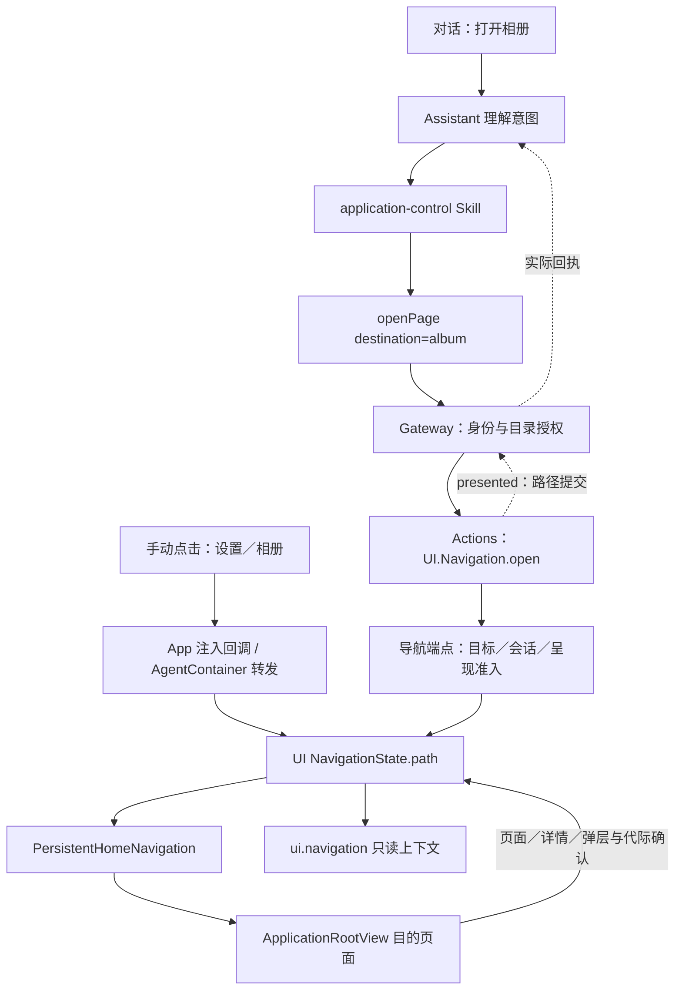

NavigationStack 返回／侧滑和 Action 提交收敛到 UI 路径。path 变化进入 transitioning，匹配代际的页面出现回报后进入 settled；settled 不是动画或 GPU 完成。详情、对象 ID、照片选择器和删除确认框与顶层路径分别表达；父页内容变化和旧页面回调不能覆盖当前详情。

首页是导航层之外的常驻兄弟视图。设置／历史／相册覆盖保留首页渲染和根聆听；相机采集与姿态处理要求前台且当前路径为首页，切页保留启用意图。返回首页按该意图恢复。页面事实经 useStates 进入下一模型请求，操作仍在执行时校验真实状态。

接口和状态见 [UI](UI/README.md)、[Navigation Actions](Actions/UI/Navigation/README.md)。❌ 通用可最小化／最大化的 component window 框架未实现。

<a id="state-devices-resources-and-faults"></a>
<a id="tasks-model-decisions-and-history"></a>

### 5. Skill composition, Task and model context

Skill v3 的 useActions 选择函数绑定，useStates 选择 Container 来源，useInstructions 选择静态 Markdown。加载只改变后续请求的能力／教学范围，不启动设备、不创建 Task，也不证明某项业务已完成。

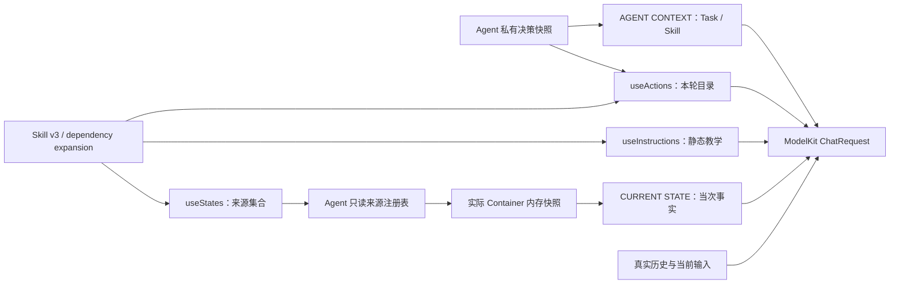

Container 显式维护可编码 ContextSnapshot，上层以 AgentCore 的只读协议和类型擦除适配。基础模块不依赖 AgentCore；注册表只保存读取能力，不保存业务值副本。当前绑定 actions.camera、actions.robot、ui.navigation、ui.camera、ui.album；BasicSkill 常驻读取页面事实。

每次实际模型请求冻结私有决策／Skill 目录并重新采集事实，保留稳定首条 system；动态 AGENT CONTEXT 与 CURRENT STATE 放在历史之后、最新输入之前，不能拆开完整 native 调用／结果组。旧事实不追加进后续对话历史。来源各自自洽，**不承诺跨 Container 原子一致**；关闭或重建会话后旧采集失效，未知来源、编码／容量／取消失败明确传播。

Task／Skill 是 Agent 的私有业务结构和纯转换逻辑；公开给模型的目标／阶段来自同一决策快照，没有独立公共 task 寄存器。近期 Skill 回收和 Task 持有关系由运行时维护。Assistant 维护一个前台持续目标；框架的委派契约不等于当前 Skill 已开放后台业务。

详见 [Context](Agents/Support/Context/README.md)、[Skill schema](Resources/Skills/README.md)、[Chat](Agents/Support/Chat/README.md)。

### 6. Capability declaration, resolution and execution routes

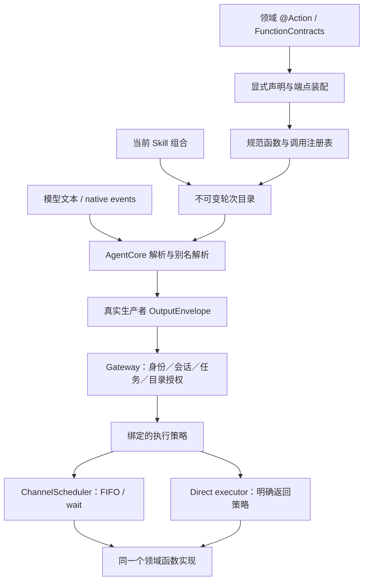

当前模型 Skill 函数使用 XML Actions；框架仍支持 native Tool 和内部直接调用。**Action／Tool 是调用视图，direct／scheduled 是执行策略**，不能画成“所有 XML 都经过 Channel 队列”。相机、导航、Task 控制、若干查询等按现行绑定直接执行；语音／表情等遵循各自调度策略。相册及完整历史读取的内部 Tool 不因此向 Skill 开放。

Gateway 从实际注册实例绑定生产者／incarnation，并校验有效轮次目录、会话和任务授权；模型参数不能伪造来源。注册不等于授权，缺少函数实现或非法参数必须拒绝。共享实现、元数据和结果转换见 [Actions](Actions/README.md)、[BehaviorProtocolBindings](Actions/BehaviorProtocolBindings.swift)、[Gateway Output](Gateway/Output/README.md)。

### 7. Channel ordering, wait and resource ownership

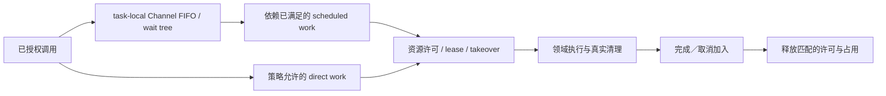

Channel 管顺序，ResourceCoordinator 管占用，设备服务管原生执行和健康。不同 Channel 可以并行，但不能越过资源冲突；wait 只等待所属任务树，不等待自身／祖先，也不能作为执行成功的条件分支。依赖真实结果的下一步须等待反馈后再决策。

资源通过实际 owner、租约与可撤销 permit 围栏。未配置接管的冲突直接 busy，没有隐式资源等待队列。接管先阻止新写入，再停止并加入旧拥有者；请求已超时不表示清理已完成。迟到清理不能把资源授给已撤销请求，更不能重放动作。资源占用没有“设备故障即资源 faulted”的替代健康状态。

详见 [Scheduling](Gateway/Output/Scheduling/README.md)、[Resources](Gateway/Output/Resources/README.md)。

### 8. ReACT continuation and execution feedback causality

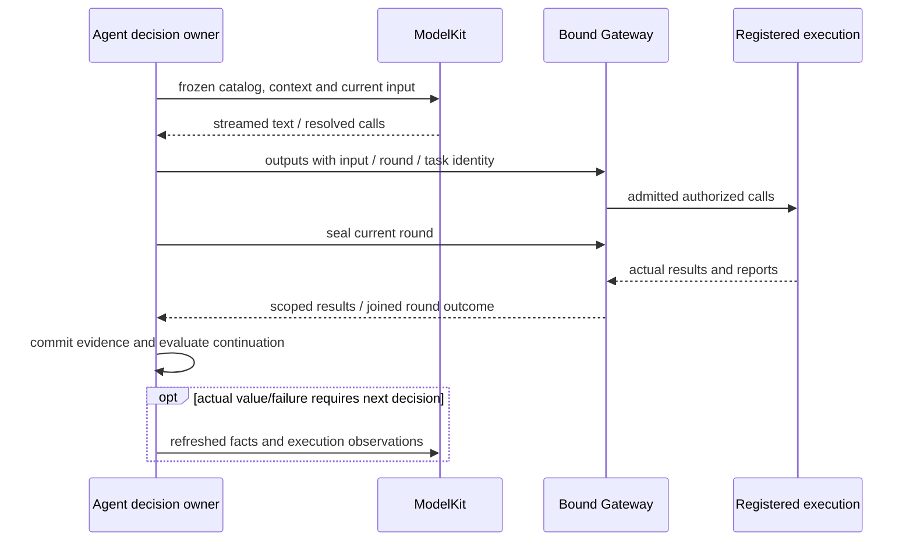

调用完成、反馈投递、轮次封闭和下一次模型请求是不同边界。结果保留原 source/incarnation/session/input/round/task/execution 归属；不能按“最近一条聊天”投递，也不能用迟到结果唤醒替换后的拥有者。轮次屏障加入相关执行和回复工作，避免上一轮仍产生声音／效果时过早继续。

实际业务值和失败可以形成执行观察；普通完成确认不自动创造更多模型轮次。模型传输、解析、生命周期和取消失败不触发设备自动重试。部分效果、未知效果与清理失败保留原始证据，不伪造回滚或成功。调用期限由执行端报告，对话没有隐式统一 TTL。

故障分类、继续条件和容量见 [Chat](Agents/Support/Chat/README.md)、[Results](Gateway/Output/Results/README.md)、[ExecutionRuntime](Gateway/Runtime/README.md)。

### 9. Listening, ASR and sound-source observations

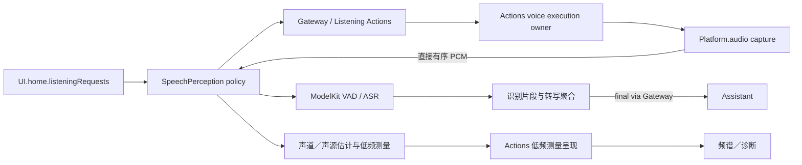

SpeechPerception 拥有聆听同意、采集代、半双工、VAD／ASR 和转写策略；Actions 的语音执行服务拥有权限、原生采集、就绪／停机与播放呈现。只读订阅不会开启麦克风。PCM 通过原生不可变存储直接交角色，不经 Signal JSON 或中转者反复编码。

就绪依赖实际有效采样和原生就绪条件。角色验证声道布局、采样率、序号和连续性，再进行模型输入转换；有序 PCM 满载明确失败。partial 不独立触发普通对话，final 通过 Gateway 交给 Assistant。声源估计属于角色计算，不能把协议中已声明的观察误画成已有业务消费者。

见 [SpeechPerception](Agents/SpeechPerception/README.md)、[Listening execution](Actions/Speech/Listening/README.md)、[Platform Audio](PlatformKit/Audio/README.md)。

### 10. Reply synthesis, playback and listening restoration

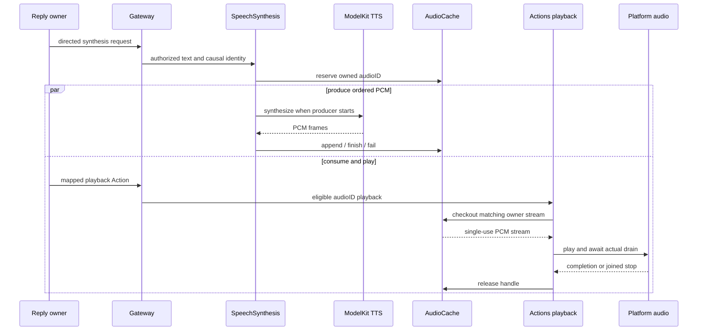

Assistant 自然文本经当前角色映射生成合成请求和播放调用。SpeechSynthesis 只拥有 TTS producer，不发起 Playback Action。合成接纳、producer 结束、音频排空和聆听恢复分别加入；音频 ID 不是可跨来源复用的裸缓存键。

回复占用经明确角色消息协调半双工。取消先请求原生停止，再加入模型生产、缓存流、调度播放和清理，最后按同意／会话政策恢复聆听。已经发声的部分不能撤回，恢复聆听也不能把播放错误改判成功。模型加载等待和普通回复等待使用不同身份及结束条件。

见 [SpeechSynthesis](Agents/SpeechSynthesis/README.md)、[Speech execution](Actions/Speech/Support/README.md)、[AudioCache](Storage/Cache/Audio/README.md)。

### 11. Camera preview, vision and tracking

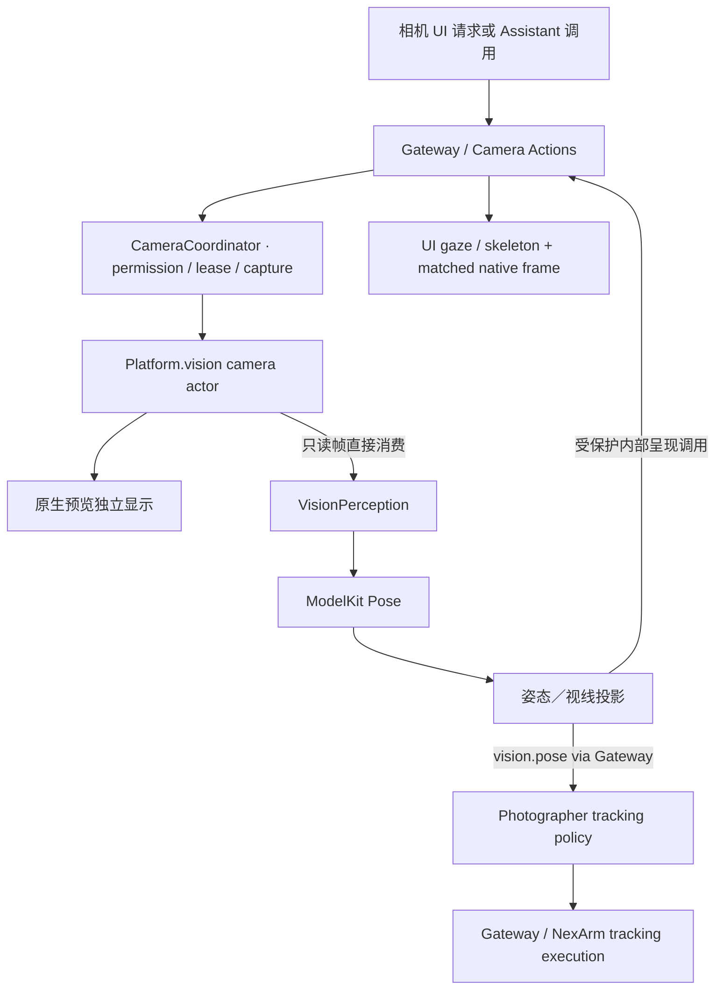

采集生命周期、预览和推理独立。相机已运行时，即使视觉模型未准备好，原生预览和只依赖相机的控制仍可工作；模型准备不能成为所有相机按钮的共同门。视觉处理保留一个活跃推理与最新候选，旧帧替换而不是排成长队。

VisionPerception 管节奏、运动证据、目标关联和投影；Gateway 校验通用附件与身份，领域端点校验帧序号、新鲜度、方向及 UI 代际。骨架／模型失败不应抹掉仍有效的原生预览。Photographer 根据实际姿态新鲜度决定跟踪；设备输出仍需控制授权和资源许可。

见 [Camera](Actions/Camera/README.md)、[VisionPerception](Agents/VisionPerception/README.md)、[Photographer](Agents/Photographer/README.md)。

### 12. Photo capture, App album and system export

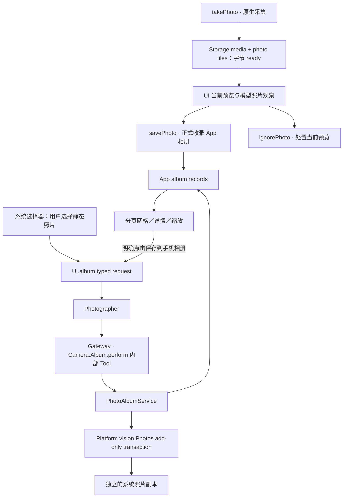

字节 ready、当前预览、App 正式收录和系统副本是四个独立事实。savePhoto 只收录 App 相册，不请求系统照片库权限；旧文件不能因存在就推定曾被用户保留。忽略预览不等于删除已收录照片。

浏览／导入／导出／删除走 UI.album → Photographer → Gateway → 内部相册函数。原图读取、缩略图和变更有独立界限；导入逐项保留成功结果。已接纳变更由根拥有，离页不丢结果，停止服务时取消并加入。普通 Photography Skill 不开放系统导出或相册删除。

系统导出等待 Photos 事务真实完成；拒绝权限或写入失败不删除 App 原片。每次明确点击创建副本，不自动导出、重试或同步。App 删除先提交逻辑删除，再清理文件并保留恢复状态；系统副本不受影响，关联聊天原图可能不可用。

模型／历史照片读取另有 source/session/input 所有权校验和有界图片准备，不从相册 UI 读取接口推导任意媒体访问权。见 [Camera album](Actions/Camera/README.md)、[UI Settings](UI/Settings/README.md)、[Media](Storage/Database/Media/README.md)、[Platform Vision](PlatformKit/Vision/README.md)。

### 13. Robot motion, hardware facts and control handoff

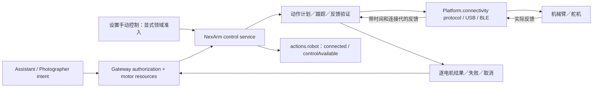

PlatformKit 拥有链路、协议、最新反馈和连接事实；动作解释、反馈到位判定、控制器状态、手动／跟踪策略和恢复归业务层。当前部分解码关节／姿态缓存仍由 Actions 控制器持有，不能宣称所有舵机状态都已内聚于平台容器。

资源交接加入旧写入者；手动控制与跟踪不能因 Channel 不同就同时写同一硬件。发送完成不是到位；只依据实际反馈判断运动结果，不能把目标位置当作测量值。未到位、超时、反馈丢失、断连和取消分别保留结果；软件停止加入不证明物理空间安全。

当前模型只读 robot 摘要包含连接和控制可用性；❌ 完整舵机遥测上下文尚未开放。物理反馈的完整范围、运动边界和数值归 [NexArm execution](Actions/NexArm/README.md)、[native protocol](PlatformKit/Connectivity/NexArm/README.md)。

### 14. Bluetooth discovery, connection and recovery

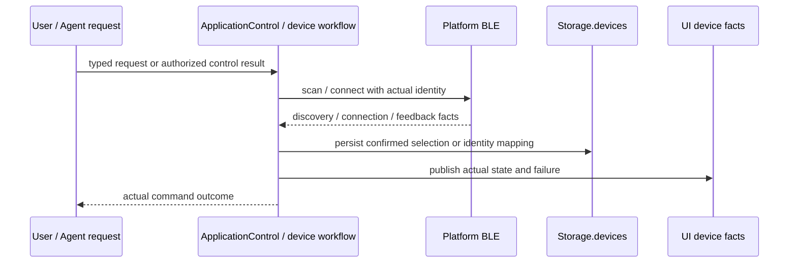

扫描接纳不代表已发现目标；连接请求接纳不代表已连接。只用实际状态返回的设备身份，不能用显示名称或模型示例替代 ID。设备记录跨重启保留映射／选择，不证明此刻原生连接可用。

断连、反馈健康、查询隔离和恢复属于连接／领域状态；低频观察直接交给拥有者，不能通过周期 JSON 指纹或反复模型调用推断健康。恢复是否允许控制和是否需要用户动作由业务策略明确决定，不用一次协议写入推定兼容或运动成功。详见 [Connection](Actions/NexArm/Connection/README.md)、[ApplicationControl](Agents/ApplicationControl/README.md)。

### 15. Settings, Provider and model-resource workflows

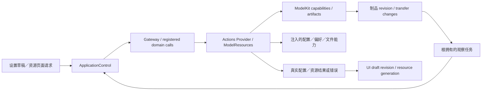

UI 展示草稿和版本，不直接绑定模型或写仓库。Provider／偏好服务分别拥有验证、实际应用和持久化的完成边界；失败不能用空配置、旧模型或虚构成功掩盖。并存的主要错误和清理错误保留，不通过重复呈现抹掉真实状态。

资源下载、安装、偏好与模型驻留是不同状态。页面不轮询驱动下载，不在打开页面时自动发起传输；根观察者按 revision 合并变化后重读真实状态。模型文件经注入的 ModelKit 自有存储／下载协议使用，Actions 负责应用侧适配；删除制品先静默化实际消费者再删除，后台 URLSession 回调仍由实际制品拥有者收尾。

见 [ApplicationControl](Agents/ApplicationControl/README.md)、[Provider](Actions/System/Provider/README.md)、[ModelResources](Actions/System/ModelResources/README.md)、[Management](ModelKit/Support/Management/README.md)。

### 16. History, business records and restart behavior

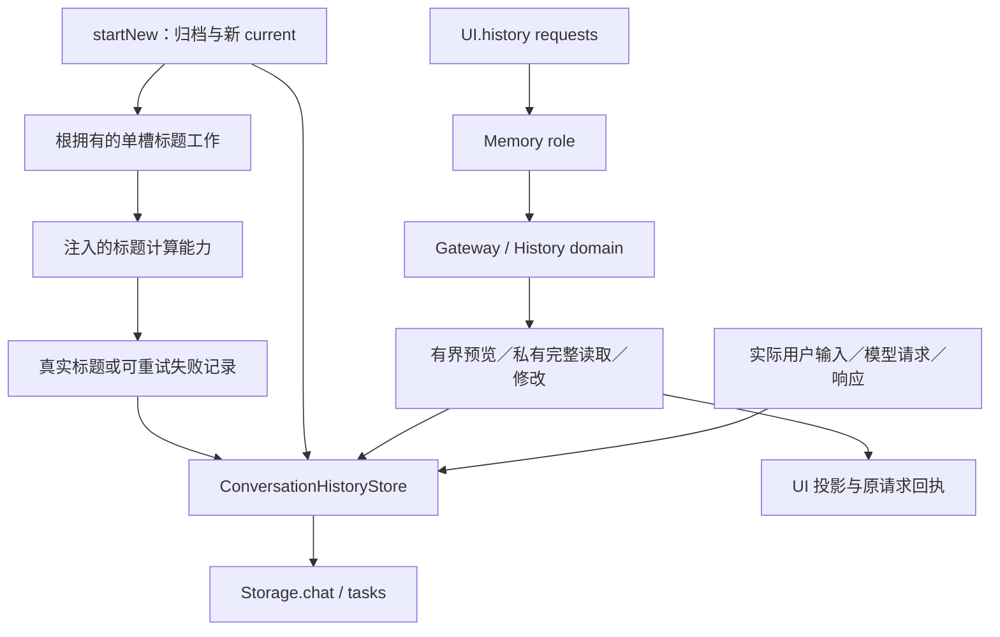

模型请求、动态上下文、响应、调用、实际终态与用量在各自边界记录。UI 展示摘要／分页不是模型收到的完整请求；Agent 私有 Context 也不等于历史数据库。模型可见查询返回有界预览，UI 完整读取使用请求私有类型化结果，不创建一个全局附件表。

归档／删除等待仓库实际提交，标题任务不阻塞新会话。标题计算失败与失败记录提交可以同时保留；取消不撤销已提交归档。重启恢复把未完成记录标为 interrupted，不恢复原生执行或重放上一条动作。

| 数据 | 拥有者／位置 | 跨重启含义 |
| --- | --- | --- |
| 当前 Task／Skill、决策集合、队列 | Agent 私有隔离内存 | 不承诺恢复活跃执行 |
| 模型当前事实 | 实际 Container 内存；每请求采集 | 不存在另一份 StorageState 持久镜像 |
| PCM／临时缓冲区 | Storage.cache 的会话与租约 | 有界临时数据，不是作品备份 |
| 对话／任务／媒体／设备记录 | Storage 数据库领域仓库 | 以真实提交结果和恢复契约为准 |
| 照片、配置、模型制品文件 | Storage.files 受控命名空间 | 与数据库无跨后端事务，遵循 pending／ready／补偿 |

详见 [Memory](Agents/Memory/README.md)、[History](Actions/History/README.md)、[Storage](Storage/README.md)。❌ 影像／聊天生成记忆、标签评分和语义搜索未实现；Memory 角色不等于这些未来产品能力。

### 17. Model lifecycle and inference boundaries

```mermaid
flowchart LR
    Caller["Agent / authorized model operation"] --> Capability["ModelKit typed capability"]
    Capability --> Manager["instance-local registry / load gate / residency"]
    Manager --> Provider["Cloud or local provider"]
    Provider --> Backend["Responses / CoreAI / CoreML / model engine"]
    Backend --> Events["typed events / results / usage / neutral failure"]
    Events --> Caller
    Host["App-owned ModelContainer lifecycle"] -.-> Manager
    Artifacts["Artifacts / injected storage and download ports"] --> Manager
```

ModelContainer 的四子能力共享实例级管理。准备、真实加载、推理接纳、释放和 shutdown 有独立含义；前后台关闭推理并加入活动任务，不用模型权重驻留推断设备或页面就绪。实际加载等待与 Assistant 普通回复等待分别呈现，不能靠单一 loading 标记阻塞所有能力。

Agent 拥有原始请求、历史选择和决策目录；具体 Provider 负责 tokenization、上下文拟合、流式解码和中立错误。后端可能按其契约裁剪／拒绝上下文；当前 Gemma 的特殊上下文处理见 [ModelKit](ModelKit/README.md)，不能把云端提示词实验结果直接当成本地模型验收。

云端适配器按实际声明编码 Responses，验证流终态、调用身份和参数；分片到达不等于调用已可执行，失败不静默替换模型或重试效果。通用 native Tool 支持与当前 Skill 的 Action-only 教学分别维护。见 [OpenAI adapter](ModelKit/Language/LLM/OpenAI/README.md)。

### 18. Diagnostics, UI presentation and native rendering

```mermaid
flowchart LR
    Modules["独立模块原生 Failure"] --> App["App：保留原始错误并归一化来源"]
    Runtime["实际执行／结果投递失败"] --> Channel["ContainerFailureChannel / bounded evidence"]
    App --> Channel
    Channel --> Control["ApplicationControl 分类与呈现策略"]
    Control --> Gate["Gateway / Actions presentation"]
    Gate --> UI["UI diagnostics / notice / conversation"]
    Bootstrap["角色未就绪的启动失败"] --> Fallback["App bootstrap failure port"] --> UI
```

基础模块只定义自己的 Failure，不生成业务话术、Signal 或自动恢复。上层保留原始 Error、主要／清理错误及关联身份；纯取消与真实失败分开，混合失败不按错误字符串过滤。报告链自身失败不递归制造更多故障。详情和过滤只影响展示，不取消任务或确认资源已释放。

UI Presenting 接纳与原生完成分离。表情的有限操作等待自身呈现及覆盖恢复；持续基础状态只确认接纳。Metal 渲染器拥有窗口／层／GPU 完成，照片离场及显示确认保留具体媒体和代际；UI 字段更新不能伪造 GPU 或物理完成。详见 [UI](UI/README.md)、[ApplicationControl](Agents/ApplicationControl/README.md)、[Runtime presentation](Actions/UI/Runtime/README.md)。

### 19. Cross-module cancellation, pressure and completion

```mermaid
sequenceDiagram
    participant Owner as Request / session owner
    participant Gate as Gateway / execution
    participant Work as Actual producer or device worker
    participant Resource as Lease / native owner
    Owner->>Gate: close admission and cancel matching work
    Gate->>Work: cancellation / revoke request
    Work->>Resource: actual native stop / producer cleanup
    Resource-->>Work: confirmed cleanup or retained failure
    Work-->>Gate: joined terminal report
    Gate-->>Owner: result delivery and ownership cleanup
```

会话中断和会话关闭不同：中断保留 Task／Skill 并停止当前决策，恢复不自动重放；关闭释放所属会话能力。Actor 隔离、任务取消标记或 deadline 到期都不能证明另一个 owner 已结束。每个队列或活跃槽由实际拥有者声明上限及拒绝、背压或最新值替换策略，精确数值不在总体设计重复维护。

| 边界 | 完成意味着什么 | 不意味着什么 |
| --- | --- | --- |
| 请求／消息接纳 | 对方已接纳或明确拒绝 | 业务执行完成、一定发生下一轮推理 |
| 路径／UI 更新 | 当前身份的状态已提交 | 页面数据加载完、GPU 已显示 |
| 模型操作 | 适配器结束或已加入取消清理 | 对应设备操作已完成 |
| Action／Tool | 实现达到声明的完成边界并保留报告 | 返回值一定投递成功或业务已消费 |
| 播放 | 原生输出实际排空并释放句柄 | 合成接纳时已发声 |
| 文件／数据库发布 | 对应提交或明确部分结果 | 跨后端原子事务、系统图库同步 |
| 资源释放／会话停止 | 所属工作和清理已加入 | 非合作硬件已物理停止、空间已安全 |

关键独立围栏包括 UI 根／呈现代、相机采集代、Agent incarnation／session、input／round、Task grant、媒体所有权、资源 lease／permit、配置 revision 和分页 ticket。一个围栏不能替代其他围栏；新拥有者不能继承旧任务的迟到写入。

权威容量及取消契约见 [Input](Gateway/Input/README.md)、[Scheduling](Gateway/Output/Scheduling/README.md)、[Resources](Gateway/Output/Resources/README.md)、[Results](Gateway/Output/Results/README.md)、[Context](Agents/Support/Context/README.md)。

### 20. End-to-end scenario map and outstanding capabilities

| 场景 | 全链路入口与拥有者 | 结果边界 |
| --- | --- | --- |
| 用户点击相册／设置 | 本地导航；业务按钮提交所属 UI 请求，由角色消费并执行领域函数 | 路径提交与业务回执分别表达 |
| 用户语音对话 | 原生 PCM → SpeechPerception → Gateway final → Assistant → ModelKit → 授权输出 | 实际模型结果、执行与回复屏障 |
| 已知连续表情／语音 | Assistant 的一次完整序列 → Channel／wait → UI／Speech 执行 | 按每组实际完成推进，不靠文本顺序假定同步 |
| 无新用户输入的视觉观察 | 原生帧 → VisionPerception → 姿态呈现／Photographer 跟踪 | 新鲜度、授权和真实反馈；不自动创建普通 Chat |
| 模块／设备变化 | 原生观察 → 负责角色 → 状态／故障策略 | 不自动重试副作用或推断物理完成 |
| Agent 协作 | 定向消息与真实目标身份 → Gateway → 目标角色 | 接纳／进度／结果／取消按契约分开 |
| 页面关闭／应用失活 | UI 生命周期或 App 同步失效 → 所属 owner 取消／加入 | 已提交作品保留，根拥有的收尾不被页面丢弃 |

✅ 当前已实现的架构包括独立基础容器、角色容器、直接原生输入、身份绑定执行、Container 事实上下文、App 相册及对应跨模块完成契约。

❌ 通用浮窗／多窗口、视频录制、相册分析／标签／评分／语义搜索、完整产品记忆与完整硬件遥测上下文仍属后续能力。非合作依赖强制停止、无人值守硬件安全与完整设备验收不因已有契约而自动成立。

自动化检查、iOS 构建、真实模型样本、原生 UI 和物理设备验收是不同证据类别，统一由 [validation 索引](../docs/validation/README.md) 持有。需求与边界决策见 [requirements](../docs/requirements/README.md)、[ADR](../docs/adr/README.md)；总体设计的结构和追溯说明见 [文档历史](../docs/history/Documentation-History.md)。
