# MobileHarness Technical Design

This document defines the current framework architecture, module responsibilities, cross-module flows and key technical contracts.

This technical document has three parts:

1. [Overall Architecture](#part-i--overall-architecture)
2. [Module Responsibilities](#part-ii--module-responsibilities)
3. [Cross-module Technical Design](#part-iii--cross-module-technical-design)

## Part I — Overall Architecture

### System architecture

Agents own input interpretation, business decisions and task coordination. Human intent, physical observations, system events, Agent messages and declared execution feedback enter as Signals through InputGateway. App adapts external inputs; Agent communication and execution feedback use identity-bound Gateway paths.

Direct interaction and model decisions share Agent-owned business flows and registered functions. An Agent handles typed intent deterministically or uses a model, emits calls through OutputGateway, and uses declared feedback to continue, complete or cancel work.

App assembles the system and owns application lifetime and immediate native safety/cleanup. UI, ModelKit, PlatformKit and Storage provide independent presentation, inference, native I/O and persistence capabilities. Submitted history, settings, resource, provider, device and camera requests reach their owning Agents; local UI state stays in UI. [Implementation coverage](#implementation-coverage) distinguishes current routes from absent integration.

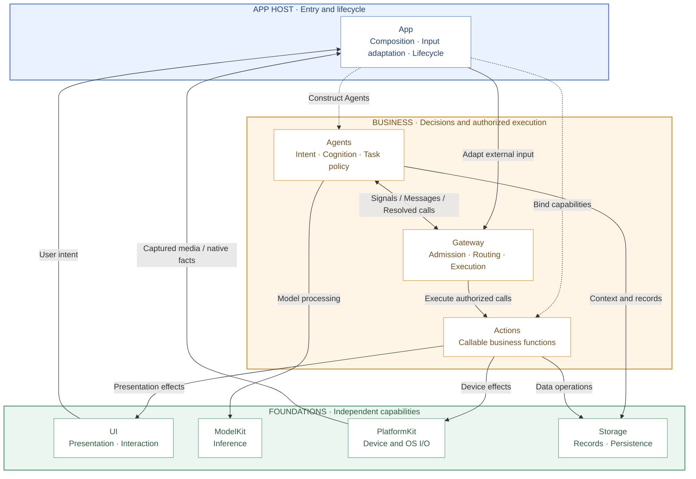

Read top to bottom: App Host → business modules → foundational capabilities. Nodes represent first-level modules under MobileHarness; Resources is packaging input and is shown in the source map rather than the runtime layers. Solid arrows show input, business communication or capability use; dashed arrows show host assembly. These are module relationships, not Swift import dependencies. App also supplies foundation instances and forwards UI/native input through its adapters; the detailed flows below show those paths.

Gateway contains InputGateway, OutputGateway and shared execution. ActionCall and ToolCall are call protocols over the same Actions functions, not separate top-level modules. UI captures intent and presents state; ModelKit, PlatformKit and Storage supply processing, native I/O and persistence.

### Coordination ownership

| Owner | Governing question | Responsibility |
| --- | --- | --- |
| App | What runs, and for how long? | Assemble, start, stop and clean up application/session scopes and their resources. |
| Agents | What should happen next, and why? | Interpret signals, retain cognitive state and express messages or permitted behavior. |
| Gateway | How may accepted work communicate and execute? | Enforce identity, permission, admission, ordering, wait, feedback and resource rules. |

Semantic fusion belongs to Agents. Gateway carries identities, contracts and destinations without interpreting observations or choosing business behavior.

### Composition and mediation boundaries

This diagram shows assembly, runtime communication and allowed capability use. The [compilation graph](#compilation-dependencies) separately records actual target dependencies.

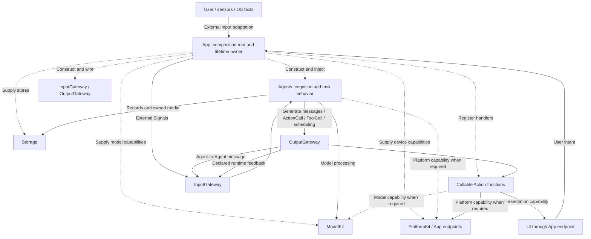

- **App** constructs the graph and injects scoped interfaces; consumers do not query a global container.
- **Agents** interpret inputs and emit resolved messages, ActionCall/ToolCall and scheduling controls through OutputGateway.
- **Actions** implements canonical functions using foundational capabilities and App-bound endpoints.
- **Gateway** validates Agent transport and executable outputs; ordinary capability calls remain local to their owner.
- **Effects and host mechanisms** have distinct boundaries, defined [below](#computation-effects-and-host-mechanisms).

### Computation, effects and host mechanisms

Agents choose business policy; Actions implements the callable operations selected by that policy. Using a foundational capability does not by itself create a Signal or authorize a business effect.

| Work | Boundary | Current rule |
| --- | --- | --- |
| Internal inference, context selection and scoped cache/journal access | Agent → injected ModelKit/Storage capability | Local computation/data access; communicate results as Signals only when a declared consumer needs them. |
| Exposed history operations, presentation or device commands | Agent → OutputGateway → Action function → capability | Explicit registered business effect with authorization and completion policy, shared by human and model entry points. |
| Capture admission, immediate stop, permission enforcement and cleanup | App lifetime owner → scoped native/runtime capability | Immediate host mechanisms must not await inference; business-relevant facts use declared Signals in live scopes. |
| Scrolling, focus and unsubmitted drafts | UI-local presentation | No business Signal until a submitted operation or declared business gesture. |

The target does not permit Agents to import UI or mutate its state. App supplies presentation endpoints to Actions. Local frontend interactions and immediate native lifecycle cleanup are intentional host/UI routes; backend data requests subscribe directly at the owning Agent.

### Compilation dependencies

The graph below shows the principal project targets. System frameworks, concrete model backends and the `BehaviorDefinitions` compiler plugin are condensed for readability.

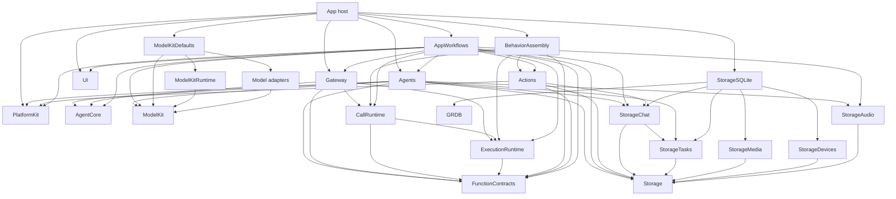

The `AppWorkflows` node is a facade over six independent feature targets; its summarized arrows are the union of those targets. `FunctionContracts`, `Storage` and `AgentCore` have no cross-module dependencies. FunctionContracts is the independent function-contract leaf; ExecutionRuntime owns shared execution, and CallRuntime owns registration and call adapters. Gateway depends on execution contracts, never concrete Actions or Tools. Base ModelKit and PlatformKit have no cross-module dependencies and own their input/output types. Agents adapts across their boundaries. The complete ModelKit SDK, including Runtime, Defaults, download adapters and concrete providers, may depend only on its own targets, approved third-party SDKs and system frameworks. Its direct and transitive target dependencies must never reach another project module; host adapters implement ModelKit-owned protocols.

<a id="37-project-structure"></a>
<a id="project-structure"></a>

### Source structure and compilation map

```text
MobileHarness/
├── App/                         # Host composition, lifecycle and adaptation
│   ├── Composition/             # AppAssembly and runtime/model assembly
│   │   └── Behaviors/           # Independent BehaviorAssembly target
│   ├── Lifecycle/               # Voice/camera/application lifetime owners
│   ├── Workflows/               # State-free facade plus feature workflow targets
│   │   ├── Settings/
│   │   ├── History/
│   │   ├── Bluetooth/
│   │   ├── Speech/
│   │   ├── Presentation/
│   │   └── Diagnostics/
│   └── Adapters/                # Presentation, media and native preview bridges
├── UI/                          # Independent MainActor state, pages and controls
├── Agents/
│   ├── ApplicationControl/       # Root application operations and configuration
│   ├── Support/
│   │   ├── Core/                # Independent AgentCore target
│   │   │   ├── Input/           # Generic audio/image input transport
│   │   │   ├── Runtime/         # Registry, manager and lifecycle contracts
│   │   │   ├── Capability/      # JSON declarations and permissions
│   │   │   ├── Generation/      # Function Token, Channel/wait and Tool parsers
│   │   │   ├── Output/          # Resolved calls and trusted envelopes
│   │   │   └── Communication/   # Typed messages and routing contracts
│   │   ├── Communication/      # Domain schemas and built-in identities
│   │   ├── Chat/               # Shared bounded decision mechanics
│   │   └── Context/            # Atomic role repositories and recovery
│   ├── Memory/                  # History workflow and title computation; richer memory pending
│   ├── Assistant/
│   ├── SpeechPerception/
│   ├── SpeechSynthesis/
│   ├── VisionPerception/
│   └── Photographer/
├── Gateway/
│   ├── Runtime/                 # ExecutionRuntime: common function execution
│   ├── Input/                   # External/internal admission and delivery
│   └── Output/                  # Validation, routing, scheduling, results/resources
├── Actions/
│   ├── Support/                 # Shared macro declarations and production catalog composition
│   │   └── Contracts/           # FunctionContracts: independent protocol-neutral interfaces
│   ├── NexArm/
│   ├── Speech/
│   ├── History/
│   ├── System/
│   ├── Camera/
│   └── UI/
├── Storage/
│   ├── Audio/                   # Transient PCM ownership
│   ├── Chat/                    # Message contracts/windows and domain SQL
│   ├── Tasks/                   # Task records and lifecycle persistence
│   ├── Media/                   # Media records and JPEG delivery
│   ├── Devices/                 # Native/business identity mapping
│   └── Support/                 # Contracts, Memory and File/SQLite mechanisms
├── ModelKit/
│   ├── Support/
│   │   ├── Core/                # Capability/media/concurrency mechanisms
│   │   ├── Backends/            # Generic CoreAI/CoreML graph execution
│   │   ├── Management/          # Separate Runtime/Defaults source ownership
│   │   │   └── HuggingFace/     # ModelKitHub: injected artifact transfer
│   │   └── Speech/Apple/        # Shared Apple ASR/TTS PCM conversion
│   ├── Language/                # Capability contracts and model-owned engines
│   ├── Speech/                  # ASR/TTS/VAD contracts and model implementations
│   └── Vision/                  # Capability contracts and YOLO image/pose pipeline
├── PlatformKit/
│   ├── Core/                    # Boundary documentation; no compiled placeholder
│   ├── Audio/                   # OS audio capture and output
│   ├── Vision/                  # Camera capture and native preview
│   └── Connectivity/            # Links, protocols and device feedback
└── Resources/                   # Agent/Skill configuration, privacy, assets and model profiles

Tests/                           # Root module and integration tests
Package.swift                    # Shared-source target map
Config/                          # Shared build configuration
scripts/                         # Checks, builds and provisioning
MobileHarness.xcodeproj/         # App/framework schemes and navigation
```

Directory nesting expresses ownership; `Package.swift` defines the actual compilation boundaries. Shared source has one owner and is not duplicated into another package tree.

### Target map

| Source path | Target | Direct dependencies |
| --- | --- | --- |
| `App/` excluding package-owned subtrees | Xcode App targets | Host composition, adapters and lifecycle dependencies |
| `App/Composition/Behaviors/` | BehaviorAssembly | Actions, FunctionContracts, ExecutionRuntime, CallRuntime |
| `App/Workflows/` facade | AppWorkflows | Six feature workflow targets |
| `App/Workflows/Settings/` | AppSettingsWorkflow | UI, AgentCore, Agents, Gateway, AppPresentationWorkflow |
| `App/Workflows/History/` | AppHistoryWorkflow | UI, StorageChat, AgentCore, Agents, Gateway, Actions, AppPresentationWorkflow, FunctionContracts, ExecutionRuntime, CallRuntime |
| `App/Workflows/Bluetooth/` | AppBluetoothWorkflow | UI, AgentCore, Storage, Actions, FunctionContracts, ExecutionRuntime, CallRuntime, PlatformKit, StorageDevices |
| `App/Workflows/Speech/` | AppSpeechPlayback | FunctionContracts, StorageAudio, Actions, ExecutionRuntime |
| `App/Workflows/Presentation/` | AppPresentationWorkflow | UI, AgentCore, FunctionContracts |
| `App/Workflows/Diagnostics/` | AppDiagnosticWorkflow | UI, ModelKit, PlatformKit |
| `UI/` | UI | None |
| `Agents/Support/Core/` | AgentCore | None |
| `Agents/` excluding `Support/Core/` | Agents | AgentCore, ModelKit, PlatformKit, Storage, StorageChat, StorageAudio, StorageTasks, FunctionContracts |
| `Gateway/` excluding Runtime/Registration/Protocols | Gateway | AgentCore, FunctionContracts, ExecutionRuntime, CallRuntime |
| `Actions/Support/Contracts/` | FunctionContracts | None |
| `Gateway/Runtime/` | ExecutionRuntime | FunctionContracts |
| `Gateway/Output/Registration/` and `Protocols/` | CallRuntime | FunctionContracts, ExecutionRuntime |
| `Actions/` excluding `Support/Contracts/` | Actions | FunctionContracts, PlatformKit, BehaviorDefinitions, StorageChat, Storage |
| `Storage/Support/` excluding SQLite | Storage | None |
| `Storage/Chat/` excluding SQLite adapter | StorageChat | Storage, StorageTasks |
| `Storage/Audio/` | StorageAudio | Storage |
| `Storage/Tasks/` excluding SQLite adapter | StorageTasks | Storage |
| `Storage/Media/` excluding SQLite adapter | StorageMedia | Storage |
| `Storage/Devices/` excluding SQLite adapter | StorageDevices | Storage |
| Domain SQLite files + `Support/Persistence/SQLite/` + construction owner | StorageSQLite | Storage, StorageChat, StorageTasks, StorageMedia, StorageDevices, GRDB.swift |
| `PlatformKit/` | PlatformKit | None |
| ModelKit shared capability sources | ModelKit | None |
| `ModelKit/Support/Management/` (runtime source list) | ModelKitRuntime | ModelKit |
| `ModelKit/Support/Management/` (assembly source list) | ModelKitDefaults | ModelKit, ModelKitRuntime, registered adapters |
| `ModelKit/Speech/VAD/Energy/` | ModelKitEnergy | ModelKit |
| `ModelKit/Support/Management/HuggingFace/` | ModelKitHub | ModelKitRuntime, HuggingFace product |
| `Macros/BehaviorDefinitions/` | BehaviorDefinitions | SwiftCompilerPlugin, SwiftSyntax, SwiftSyntaxBuilder, SwiftSyntaxMacros products |
| `ModelKit/Language/LLM/OpenAI/` | ModelKitOpenAI | ModelKit |
| `ModelKit/Speech/ASR/Apple/`, `TTS/Apple/`, `ModelKit/Support/Speech/Apple/` | ModelKitAppleSpeech | ModelKit |
| `ModelKit/Vision/YOLO/` | ModelKitYOLOPose | ModelKit, ModelKitCoreML |
| `ModelKit/Support/Backends/CoreML/` | ModelKitCoreML | None |
| `ModelKit/Speech/VAD/Silero/` | ModelKitSilero | ModelKit, ModelKitCoreML |
| `ModelKit/Support/Backends/CoreAI/` | ModelKitCoreAI | None |
| `ModelKit/Speech/ASR/Nemotron/` | ModelKitNemotron | ModelKit, FluidAudio product |
| `ModelKit/Speech/TTS/MossNano/` | ModelKitMossNano | ModelKit |
| `ModelKit/Speech/TTS/Kokoro/` | ModelKitKokoro | ModelKit, FluidAudio product |
| `ModelKit/Language/LLM/Gemma4/` | ModelKitGemma4 | ModelKit, CoreAILM and Tokenizers products |

### Module README contract

Module READMEs define responsibility, boundaries, direct external data flow and internal submodule relationships. Diagrams distinguish runtime flow, injection and compilation dependencies. Nested READMEs own detailed interfaces, algorithms, state/lifetime, ordering, capacity/overflow, completion, failure and cancellation contracts.

Current designs use ✅ for implemented behavior, ❗ for confirmed bugs and ❌ for absent implementation. History and validation evidence belong in [docs](../docs/README.md).

### Architectural boundaries

- App owns concrete assembly, adaptation and application/session lifetime. Feature workflows expose typed operations and retain no global container access.
- UI owns presentation values. The compilation target has no cross-module dependencies; App adapts storage records into UI-owned view values. It does not import App, Agents, Gateway, Actions, Tools, ModelKit or PlatformKit.
- AgentCore is independent of concrete Agents, UI, model engines and device adapters.
- All Agent-driven external inputs and declared execution feedback enter through InputGateway; all Agent messages and executable outputs leave through OutputGateway. Submitted business routes use their owning Agents; immediate host mechanisms retain their explicit scopes.
- Actions owns business behavior, motion shaping, composition and completion policy. PlatformKit owns native I/O, protocol encoding, hardware limits and device feedback.
- FunctionContracts owns standard callable input/output and ActionFunction metadata only. Gateway/Runtime (ExecutionRuntime) owns shared function registration/execution; Gateway/Output registration/protocol adapters (CallRuntime) own ActionBinding and calling policies. Gateway orchestration owns scheduling, admission, feedback and shared resource coordination.
- ModelKit is a capability SDK. Provider registration/default selection belongs to ModelKitDefaults; process-wide model ownership belongs to ModelKitRuntime.
- AgentCore/Input owns generic input transport; UI owns presentation values. Storage owns lifetime and retention, not inference or business policy.

AgentCore, FunctionContracts, base ModelKit, PlatformKit and Storage are independent targets. Execution, call adaptation and feature workflows have the compilation boundaries shown above.

Current route coverage and remaining product extensions are listed under [implementation coverage](#implementation-coverage); delivery priorities and acceptance work live in the [Roadmap](../docs/Roadmap.md).

<a id="responsibilities-and-boundaries"></a>

## Part II — Module Responsibilities

This section is an architectural directory. It describes why each module exists and where its responsibility ends; linked module documents contain local structure and implementation details.

| Module | Responsibility | Boundary | Biological analogy |
| --- | --- | --- | --- |
| [App](App/README.md) | Assemble concrete capabilities and coordinate application, voice and camera lifetime. | Adapts modules and owns workflows; does not absorb Agent, Action or device business rules. | The organism coordinating its organs. |
| [UI](UI/README.md) | Render conversation, camera, settings and diagnostics; convert gestures into typed operations. | MainActor presentation only; pages do not own long-lived model/device sessions. | Face and interaction surface. |
| [Agents](Agents/README.md) | Interpret observations, use processing/storage capabilities and select permitted outputs. | Cognitive state and policy; executable effects always cross OutputGateway. | Specialized brain regions. |
| [AgentCore](Agents/Support/Core/README.md) | Define Agent identity, input/output, capability, communication and lifecycle contracts. | Stable independent vocabulary; no concrete cognition or host services. | Organization of the nervous system. |
| [Gateway](Gateway/README.md) | Validate input/output, route messages, schedule Actions and coordinate results/resources. | Coordination only; no inference or domain behavior implementation. | Neural pathways and motor coordination. |
| [Actions](Actions/README.md) | Implement callable UI, speech, camera, history, system and NexArm behavior. | Owns business parameters and completion policy; knows no calling protocol and consumes foundational/injected capabilities. | Learned behavior. |
| [FunctionContracts](Actions/Support/Contracts/README.md) | Define standard function inputs, outputs and constraints. | No runtime, Channel or calling protocol dependency. | Shared function contracts. |
| [ExecutionRuntime](Gateway/Runtime/README.md) | Store and execute canonical functions. | Depends only on FunctionContracts; joined deadlines and cancellation. | Shared execution machinery. |
| [CallRuntime](Gateway/Output/Registration/README.md) | Bind and adapt scheduled/native calls. | Depends on FunctionContracts and ExecutionRuntime; no AgentCore. | Calling protocol views. |
| [ModelKit](ModelKit/README.md) | Expose typed speech, language and vision processing capabilities. | Base SDK knows neither Agent policy nor device I/O; engines live in adapters/backends. | Recognition and generation machinery. |
| [PlatformKit](PlatformKit/README.md) | Capture/output media, manage links and expose native commands/feedback. | Device SDK only; no gestures, model inference, localization or workflow policy. | Sensory organs and effectors. |
| [Storage](Storage/README.md) | Provide bounded transient storage and durable local records. | Domains own PCM, messages, Tasks, media and device records; Support owns common mechanisms and backend adapters stay separate. No routing or inference. | Short- and long-term retained material. |
| [Resources](Resources/README.md) | Hold privacy declarations, assets and local model profiles/artifacts. | Packaging input supplied by App; no runtime ownership. | Materials consumed by the organism. |

### Key internal module groups

**App.** [Composition](App/Composition/README.md) builds the graph and validates registrations. [Lifecycle](App/Lifecycle/README.md) owns long-running voice/camera work and cleanup. [Workflows](App/Workflows/README.md) is a state-free facade over independent Settings, History, Bluetooth, Speech, Presentation and Diagnostics targets. [Adapters](App/Adapters/README.md) translate module contracts to host capabilities.

**Agents.** Assistant owns all user conversation, dynamic bundled Skills, one foreground goal-based Task and ReACT. Photographer owns deterministic camera/tracking workflows; Memory owns history/title transactions; ApplicationControl owns configuration/device/environment transactions. Media Agents retain VAD/ASR, synthesis and visual inference. Resources catalog contains v7 Agent fixed-function declarations and v1 Skill configuration. Functions remain in Actions; neutral metadata is supplied through FunctionContracts. Effective catalogs are frozen per model request and checked by Gateway. Independent background work can still use directed send; ordinary photography stays in Assistant.

**Behavior.** Actions owns protocol-neutral callable functions. ✅ Shared contracts live in Actions/Support/Contracts; ActionMacro and CapabilityModules live directly in Actions/Support. FunctionContracts remains an independent target, while the macro declarations and catalog composition compile in Actions. FunctionContracts defines their inputs/outcomes; Gateway owns independent ExecutionRuntime and CallRuntime. ActionCall follows Channel scheduling; ToolCall executes directly outside Channel/wait. BehaviorAssembly freezes one canonical function store and explicit host bindings without importing AgentCore. [Protocol routing](Gateway/Output/Protocols/README.md) explains registration, Agent transport/parsing and shared execution/feedback.

**Foundations.** ModelKit separates capability contracts, process-wide management, default assembly and engine adapters. PlatformKit separates native I/O from business behavior. Storage separates Support mechanisms from Chat, Tasks, Media, Devices and Audio domains; SQLite adapters compile separately. ModelKit, PlatformKit and StorageAudio own their separate capability/storage contracts.

<a id="part-iii--key-techniques"></a>

**Shared Agent mechanisms.** Support/Core remains the independent AgentCore target; Support root owns immutable resource/catalog helpers; Support/Communication owns application message schemas, Support/Chat owns role-neutral bounded decisions and Support/Context owns task/Skill state, fixed-task coordination and atomic role repositories. Each role supplies State, SignalPreprocessor, ContextBuilder, grants and completion policy; conversational prompts/Skills belong to MobileHarness/Resources.

MobileHarness/Resources owns pure Agent identity, Skill workflows and conversation template assets; Memory has separate title-only templates. AgentCore owns reusable Function Token grammar and Channel/wait rules. Protocol rendering precedes identity, Skill overview, background Agent capabilities, mode and loaded instructions, then the effective Action catalog; native Tools use the same immutable catalog. Runtime/user facts are data messages, never trusted policy. Strict single-pass rendering rejects missing variables and oversized output.

## Part III — Cross-module Technical Design

This part owns interactions between modules: data and call paths, injected interfaces, authority, ownership, completion and failure propagation. Module-internal algorithms, state machines, complete function inventories and local limits live in their owning directory READMEs. Links below identify those contracts without maintaining duplicate parameter tables here.

### Composition, startup and lifetime

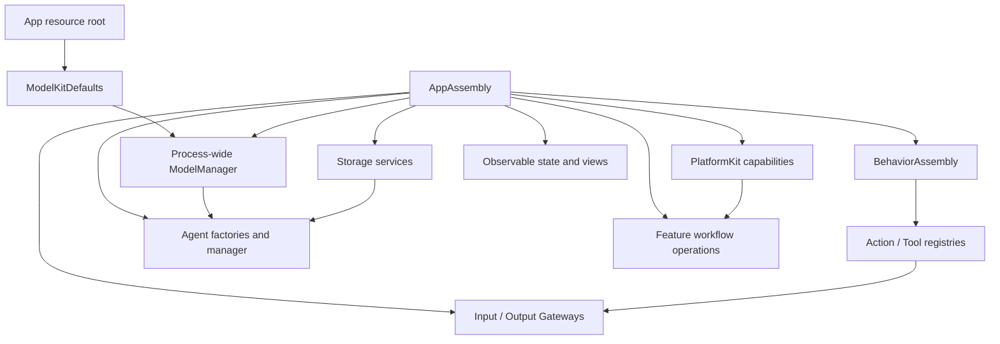

App composes model capabilities, Storage repositories, native endpoints, canonical functions, Gateways and Agent instances before producers start. Invalid configuration, missing implementations or failed startup recovery blocks admission explicitly. UI pages consume root-owned services; navigation does not own their lifetime.

All Agents start with validated process-memory contexts. App constructs the SQLite business repositories, marks unfinished identities interrupted and injects their interfaces before admitting new work. Agents commit business evidence before dependent outputs; runtime-state mutation and durable record transactions have separate owners. Restart reconciles records without replaying effects.

Voice, camera and diagnostics have independent App-owned scopes. Shutdown closes admission, cancels and joins owned producers, processing, dispatch and native cleanup before releasing resources. Session/incarnation/turn identities fence late feedback and presentation; changing display focus never transfers execution authority.

Assembly and scope implementations: [Composition](App/Composition/README.md), [Lifecycle](App/Lifecycle/README.md). Role processing: [Agents](Agents/README.md). Generic work-state transitions: [AgentCore Runtime](Agents/Support/Core/Runtime/README.md#processing-work-state). Atomic state: [Context](Agents/Support/Context/README.md).

<a id="canonical-functions-and-protocol-bindings"></a>

### Unified Signal Contract

A Signal is immutable information admitted to an Agent. AgentCore supplies the common AgentInput envelope; Agents owns domain payload schemas; App converts native/UI facts; Gateway validates and routes trusted provenance. An OutputEnvelope requests execution, and actual execution feedback re-enters as a Signal. Model computation and local UI draft changes do not automatically create Signals.

#### External and internal origin

| Origin | Producer and authority boundary |
| --- | --- |
| External | App binds human/native/OS sources and adapts values before Gateway admission. |
| Internal / Agent | Output consumers bind the actual Agent incarnation; send/publish use declared communication rights. |
| Internal / Runtime | The real execution owner supplies correlated results and terminal facts through dedicated feedback admission. |

A source string never grants Runtime authority. Payload meaning and origin are independent: an observation container may carry a typed intent, while runtime feedback must use the execution-owned path.

#### Envelope and payload

Identity, session, causality, ordering and declared freshness travel with the payload across adapters, Agents and Gateways. Forwarding cannot extend producer freshness or change the execution owner. The field-level interface and payload cases are owned by [AgentCore](Agents/Support/Core/README.md#signal-envelope-and-payloads); native media values by [Core Input](Agents/Support/Core/Input/README.md).

#### Payload meaning

Domain schemas distinguish intent, observed fact, admission receipt and execution outcome. App and Agents construct typed values; the receiving role interprets business meaning. [Communication schemas](Agents/Support/Communication/README.md) owns validation, units and content bounds.

#### Implemented payload types and origins

Text/audio/image/domain messages and correlated receipt/call/round feedback use the same admission framework. Declared video/binary kinds have no production payload codec. The [current routes](#current-signal-routes) describe actual producers and receivers; a kind declaration alone creates neither an adapter nor a subscription.

#### User clicks and business intent

Submitted business intent follows UI → App adapter → InputGateway → owning Agent. History, resources/provider/device and camera commands target their respective deterministic roles; scrolling, expansion and unsubmitted drafts stay in UI. Permission dialogs and immediate native safety/lifecycle fences remain App responsibilities.

#### Activity feedback and its producer

Invocation completion and continuing activity lifecycle are separate contracts. The lifecycle owner must explicitly produce and route an ActivityEvent; Gateway does not infer it from images or UI state. CameraCoordinator retains local activity records, but does not currently deliver them to Agents. Generic activity producers/subscriptions remain outstanding; completion-only presentation calls do not manufacture ToolResult Signals.

Interfaces: [Core Output](Agents/Support/Core/Output/README.md), [feedback admission](Gateway/Input/README.md), [camera lifecycle](App/Lifecycle/README.md).

<a id="32-internal-agent-communication"></a>

<a id="communication-framework"></a>

### Input and Agent communication

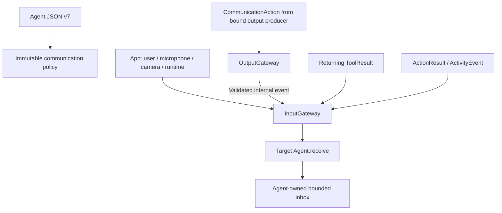

Agent.json declares inputs, subscriptions, publications and directed sends. A supported contract is not automatically subscribed. Gateway selects exact recipients and validates source, target, live identity, session and schema. publish is one-way submission; no recipient or subscriber rejection does not become an acknowledgment. send returns admission, separately from business completion.

Agents own interpretation and inbox policy. Gateway owns bounded transport admission and reports failures; it does not select the next business operation or silently replay an effect.

#### Current signal routes

| Source | Origin | Contract | Receiver or observer |
| --- | --- | --- | --- |
| `phone.microphone` | External | `media.audio` | SpeechPerception subscription |
| `user` | External | `speech.listening/1` | Resident SpeechPerception listening-consent input |
| `phone.microphone` | External | `speech.captureEnded/1` | SpeechPerception current-revision capture-termination fact |
| `phone.camera` | External | `media.image` | VisionPerception subscription |
| `phone.camera` | External | `camera.state/1` | Assistant and Photographer passive camera/native state |
| `user` | External | `user.text` | Assistant subscription; the current production UI has no text-entry field |
| `user` | External | `agent.userInput/1` | Assistant scoped answer/confirmation input; forwarded as task input where applicable |
| `speechPerception` | Agent | `speech.final`, `speech.phase` | Assistant subscription |
| `speechPerception` | Agent | `speech.partial`, `speech.final`, `speech.phase` | Runtime observer for admission/lifecycle coordination, without business UI mutation |
| `visionPerception` | Agent | `vision.pose` | Photographer subscription; independent native presentation calls carry gaze/skeleton updates |
| `user` / trusted host `runtime` | External | `history.intent/1` | Direct Memory subscription; host cancellation retains the same owner |
| `speechPerception` | Agent | `sound.source/1` | Declared Agent subscribers or registered runtime observers; source facts are Agent-generated |
| `assistant` | Agent | `speech.synthesize/1`, `speech.cancel/1` | SpeechSynthesis directed input under actual reply owner |
| `assistant` | Agent | `interaction.replyActivity/1` | SpeechPerception source/incarnation-fenced reply occupancy |
| `user` / trusted host `runtime` | External | `model.resource.intent/1` | Direct ApplicationControl subscription; host retirement retains the same owner |
| `model.resources` | External | `model.resource.state/1` | ApplicationControl sampled native resource invalidations |
| `app.resources` | External | `model.resource.hostFailure/1` | ApplicationControl host admission/dispatch failure facts |
| `user` | External | `provider.discovery/1`, `provider.settings/1`, `app.interaction/1` | Direct ApplicationControl subscription |
| `app.environment` | External | `app.environment/1` | ApplicationControl sequenced scene/device/navigation/capability facts |
| `user` / trusted host `runtime` | External | `photography.camera/1` | Direct Photographer subscription; host cancellation retains the same owner |
| `assistant` | Agent | `task.request/1`, `task.input/1`, `task.cancel/1` | Explicit Photographer/Memory/ApplicationControl scoped task |
| `photographer`, `memory`, `applicationControl` | Agent | `task.progress/1`, `task.result/1` | Requesting Assistant and matching task scope |
| `runtime` | External host command | `assistant.control/1` (`cancelSession`) | Selected Assistant/session; typed host control |
| `runtime` | Runtime feedback | `communication.receipt`, `tool.result`, `action.result`, `generation.round.result` | Bound send/execution owner through dedicated feedback admission |
| `runtime` | Runtime feedback API | `activity.event` | Supported owner-fenced admission; production camera currently retains local activity records |

The table separates declared transport from production execution: task request/progress/result paths have schema and routing support, but production backgroundTasks declarations are empty. They do not imply an available generic background business executor. Only Assistant currently declares conversational synthesis and reply-occupancy output.

Delegation keeps requester and executor identities distinct. Progress, questions, answers, cancellation and terminal results retain their task/session scope; presentation of a question is not an answer.

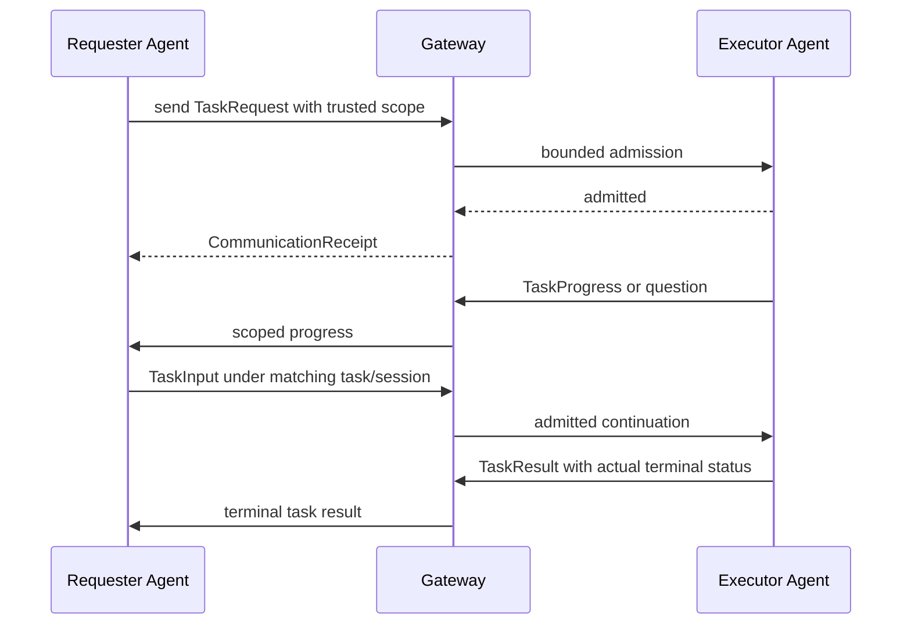

Fixed role transactions and foreground conversational Task state remain separate. Details: [communication schemas](Agents/Support/Communication/README.md), [Core communication registry](Agents/Support/Core/Communication/README.md), [Context lifecycle](Agents/Support/Context/README.md#task-and-skill-lifecycle), [InputGateway](Gateway/Input/README.md).

### Communication and execution contract ownership

| Owner | Cross-module contract |
| --- | --- |
| AgentCore | Neutral envelope, runtime identity, causal scope and admission/round contracts. |
| Agents | Domain schemas, role interpretation, effective Skill catalogs and task decisions. |
| Gateway | Live-owner authorization, transport, call scheduling, resource arbitration and feedback routing. |
| FunctionContracts / Actions | Neutral callable metadata and domain-specific execution/result semantics. |
| App | Native conversion, concrete resource policy, capability injection and root lifetime. |
| UI / ModelKit / PlatformKit / Storage | Independent presentation, inference, native I/O and storage capabilities through explicit interfaces. |

Field/schema details: [Communication](Agents/Support/Communication/README.md). Native adaptation: [App Adapters](App/Adapters/README.md).

### Routing, Authorization and Feedback

#### Routing and authorization

External inputs use App → InputGateway; Agent messages use bound output consumers → OutputGateway → InputGateway. Business effects use resolved Agent calls → OutputGateway → registered Actions → injected capability endpoints. Runtime results return to their actual execution owner.

Authorization validates declared contracts and function exposure, live incarnation/session, causal scope, explicit freshness and available capacity. Model aliases resolve inside Agents; App binds implementations; Gateway never accepts model-supplied authority. Unknown contracts, invalid provenance and unavailable implementations reject explicitly.

There is no implicit Signal TTL. Forwarded facts retain declared freshness; provider and function execution deadlines remain owned by their respective layers. Cancellation joins the matching owner and cannot undo a committed effect. The [Gateway](Gateway/README.md) and [validation](Gateway/Output/Validation/README.md) READMEs own the local checks.

#### Result semantics and presentation

Admission, business consumption, handler completion, UI-state acceptance, rendered acknowledgment and physical effect completion are distinct. Agents choose follow-up from actual outcomes; App fences presentation by identity; UI only renders supplied values. Delivery failure remains separate from execution failure, and retrying result delivery never repeats the effect.

Typed assistant.control cancellation uses trusted App → InputGateway → Assistant routing and joins the selected session without terminating unrelated roles. UI state changes do not themselves produce new business input. Completion-only presentation preserves an execution outcome without injecting returning feedback.

### Capability declaration and output resolution

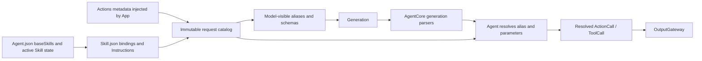

Resources/Catalog.json explicitly indexes Agent/Skill assets. Agent.json supplies baseSkills and communication declarations; active Skill state selects Skill.json function bindings and instructions. Actions owns canonical descriptions/parameters. Agents composes an immutable request catalog, system text and optional native definitions from those inputs.

ModelKit emits text or complete native-call data; AgentCore parses and resolves against that request's catalog. Only resolved calls reach Gateway. Loading or releasing a Skill changes later requests, while historical requests retain their original catalog. Parser completion does not mean effects completed; malformed structure ends generation without replaying emitted prefixes.

Syntax, escaping and parser limits: [Generation](Agents/Support/Core/Generation/README.md). Resolution: [Capability](Agents/Support/Core/Capability/README.md). Resources: [Skills](Resources/Skills/README.md). System assembly: [Assistant diagram](Agents/Assistant/README.md#system-提示词结构与来源).

### Canonical Functions and Protocol Bindings

Actions defines one protocol-neutral implementation and completion contract for each canonical function. App freezes the catalog and selects host Action/Tool bindings; Agents selects narrower model exposure through Skills. A compiled or host-registered function is not automatically model-callable.

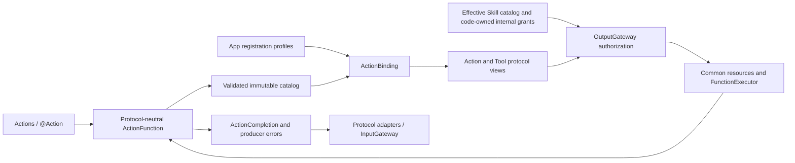

FunctionContracts defines neutral input, resources, reports and budgets. ExecutionRuntime invokes canonical handlers; CallRuntime adapts protocol semantics; Gateway adds Agent authorization, ordering, resource ownership and causal feedback. Host dual-protocol support cannot weaken intrinsic constraints or expose the same function twice in one model catalog.

Complete function interfaces live with the six [Actions domains](Actions/README.md#内部模块关系). Host registration profiles and the current binding matrix live in [Behavior assembly](App/Composition/Behaviors/README.md#host-protocol-binding-matrix). Agent.Task controls are implemented in Actions/System but owned semantically by Agents; internal communication declarations remain Agent-owned.

### Action and Tool execution

| Contract | ActionCall | ToolCall |
| --- | --- | --- |
| Path | Gateway → scheduled call adapter → canonical execution | Gateway → direct Tool adapter → canonical execution |
| Ordering | Task-local Channel and wait scope | Outside Channel/wait, with host-owned dispatch admission |
| Result | Declared effect outcome and round barrier | Returning ToolResult or registered completion-only outcome |

Both protocols preserve the same intrinsic resources, execution budget and joined cleanup. Channels do not create global ordering across Tasks; native calls do not acquire XML wait semantics. Resource conflicts follow the explicit App policy.

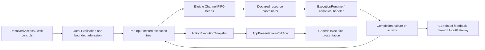

App drains Action/control and native output independently, then joins both branches and required result delivery before sealing the Agent round. Input cancellation joins only that input's accepted work. Rejection and failure are explicit; no accepted device effect is silently evicted. Passive execution snapshots feed App/UI diagnostics without becoming executable calls.

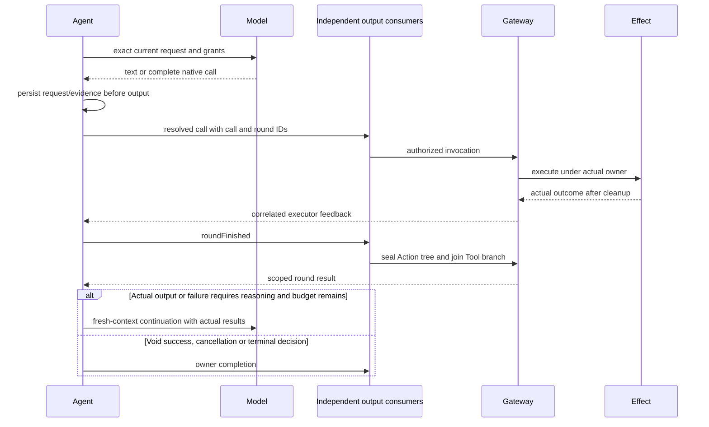

The Agent continues only from actual business values or real call failures after a reliable barrier. Provider termination does not declare functions or the Task successful. Local mechanisms: [scheduling](Gateway/Output/Scheduling/README.md), [dispatch](Gateway/Output/Dispatch/README.md), [App output consumption](App/Workflows/Presentation/README.md), [execution](Gateway/Runtime/README.md).

### ReACT continuation and Agent recovery

Agents builds a fresh request from immutable Skill/Task state and recorded history. ModelKit supplies provider events; Gateway executes and joins accepted calls/results; Agents validates and checkpoints the combined evidence before deciding whether to request another model response.

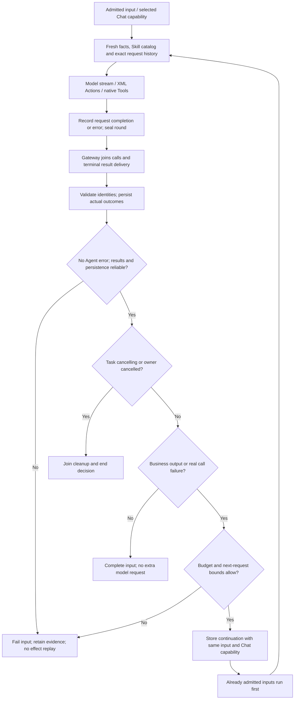

#### All continuation triggers

Explicit business values, including empty values, and real invocation failures may continue a sealed, fully joined round. Successful reports, activity handles, admission receipts and void completion are completion evidence only. Pure cancellation ends the chain; mixed reports retain independent real failures. Call rejection can be model evidence without execution; malformed generation/provider/observation errors terminate the Decision without automatic retry.

The complete outcome matrix and model-observation projection are owned by [Chat](Agents/Support/Chat/README.md#continuation-outcome-matrix); neutral classification is owned by [Core Output](Agents/Support/Core/Output/README.md).

#### Context, evidence and Task boundaries

Agents owns hot Task/Skill state and request selection; Storage domain repositories own committed messages and Task sources; App injects those repositories. Terminal Task summaries project over indexed sources while original evidence remains queryable. ReACT retains exact native pairing and the current input; Skill changes only affect later requests. Task closure waits for execution/reply cleanup before admitting remaining goals in the same input.

Details: [Chat history](Agents/Support/Chat/README.md#多轮历史与持久化), [Task/Skill lifecycle](Agents/Support/Context/README.md#task-and-skill-lifecycle), [Storage Chat](Storage/Chat/README.md).

#### ReACT limits and time ownership

Decision lifetime is governed by completion, cancellation and real failure. Production supplies no cumulative model-request/native-call cap or Agent-wide timer. Local parser, request, queue and per-round limits reject explicitly; they are not whole-Task deadlines. Provider transport, Action execution and sensor freshness retain their own owners. Limits belong to [Chat](Agents/Support/Chat/README.md#bounds-and-overflow), [Generation](Agents/Support/Core/Generation/README.md#bounds-and-errors), [ModelKit chat](ModelKit/Language/LLM/README.md#public-interfaces) and the actual [provider](ModelKit/Language/LLM/OpenAI/README.md).

#### Recovery stop conditions and current limits

Unsafe/missing feedback, stale ownership, failed checkpoint or an invalid next request terminates processing with retained evidence. HTTP/provider retries, provider switching, automatic request shrinking and generic activity/progress-driven continuation are not implemented. Transport retry only redelivers a result; it never replays effects or starts inference independently. Actual-model/device validation remains separate from this architecture.

### Call failure and deadline semantics

Failure crosses the same ownership boundary as its operation. Ordinary handler errors remain invocation-local; identity/scheduling violations close the owning Action tree; owner/session cancellation joins only that scope. Agents preserves real results and partial effects before choosing a follow-up. No failure rewrites an already committed effect as rolled back.

Actions/FunctionContracts declares intrinsic execution budgets, Gateway applies them and joins timeout cleanup, and App/native endpoints retain physical ownership checks. Provider transport and explicit sensor freshness are independent. Function timeout does not prove hardware stop; feedback delivery failure cannot erase execution outcome.

Local exception mapping and budget validation: [ExecutionRuntime](Gateway/Runtime/README.md), [protocol adapters](Gateway/Output/Protocols/README.md), [result evidence](Gateway/Output/Results/README.md#effect-and-failure-evidence), [FunctionContracts](Actions/Support/Contracts/README.md).

### Execution Feedback Causality

The initiating OutputEnvelope supplies immutable causal scope. Execution captures the actual owner; InputGateway returns results to that live Agent/session while preserving the causal root and advancing the parent/hop relationship. A source string, result body or historical ID cannot grant execution authority.

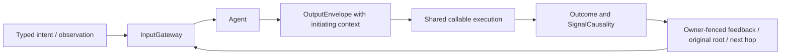

Execution and delivery have separate outcomes. Action feedback reserves capacity before effects and may redeliver the same terminal result until admission or scope closure. Returning Tools make one feedback-admission attempt and retain any separate delivery failure. Completion-only Tools retain outcomes without a ToolResult Signal. Generic ActivityEvent production and retry integration remain absent.

Delivery policies select transport evidence, not model ReACT. Local policies, ledger capacity/backoff and effect certainty are owned by [Results](Gateway/Output/Results/README.md); causal admission is owned by [InputGateway](Gateway/Input/README.md).

### Resource control ownership and cleanup

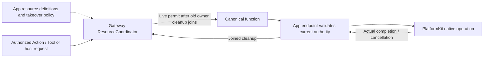

Gateway owns resource occupancy and live permits; App declares concrete resources, authorized takeover and native stop callbacks. Action/Tool/host work shares the same authority boundary. New execution cannot use an ended or revoked permit, and a completed finite call does not automatically release a persistent capture lease.

Takeover joins old writers before granting the new owner. Uncooperative cleanup keeps the resource occupied; cancellation cannot fabricate unlock or physical stop. Camera leases, robot writer groups, Channel ordering and Bluetooth health remain distinct contracts. Settings manual control is an explicitly declared host bypass.

Internal handoff state machine, token matching, lease limits and overflow: [Gateway Resources](Gateway/Output/Resources/README.md#handoff-and-cleanup). Concrete policy: [App Behaviors](App/Composition/Behaviors/README.md), [Bluetooth workflow](App/Workflows/Bluetooth/README.md).

### Voice, cognition and presentation

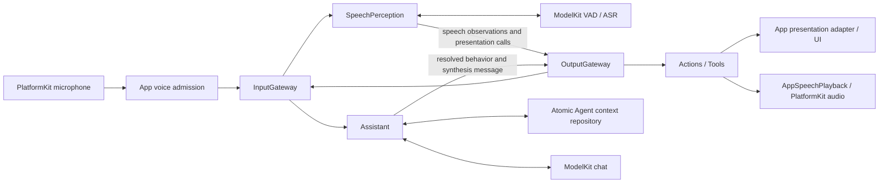

PlatformKit captures PCM; App owns native admission and scope; Gateway delivers it to SpeechPerception; ModelKit supplies VAD/ASR; Assistant interprets final text and emits resolved outputs. App adapts permitted presentation calls into UI values. Recognition, model completion, captions and actual playback remain separate facts.

✅ Listening admission validates capabilities/permission and starts native capture before loading model weights. First PCM enables the listening animation and canonical cue/haptic. SpeechPerception buffers ordered PCM while its VAD/ASR resource acquisition loads the selected models; App does not prewarm recognition, VAD or synthesis before recording. Queue limits and overflow belong to [SpeechPerception](Agents/SpeechPerception/README.md#input-and-processing); cue/recording coexistence still requires physical-device acceptance.

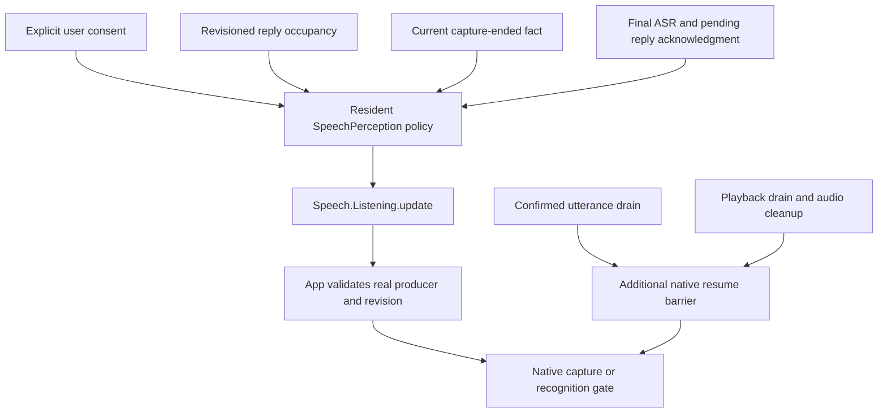

SpeechPerception owns explicit listening consent and Assistant's revisioned reply occupancy. App applies those decisions to native capture and joins confirmed-utterance/playback cleanup before resuming. User-off stops capture and cancels the current Assistant reply; policy pause preserves consent. Restart does not restore consent or replay speech.

Role algorithms: [SpeechPerception](Agents/SpeechPerception/README.md). Native barriers: [Lifecycle](App/Lifecycle/README.md). Caption state: [Conversation UI](UI/Conversation/README.md).

### Speech capability selection and recognition

App restores independent speech preferences and passes them through ModelKit Defaults before admitting voice. ModelKit selects the installed/available custom or system capability; SpeechPerception consumes typed VAD/ASR interfaces rather than concrete engines. App joins voice shutdown before changing bindings; failed active inference does not silently switch provider.

SpeechPerception owns utterance boundaries and transcript revisions; ModelKit adapters own model windows/native analyzers and leases; App owns capture. A model-sized segment is not a user-turn or latency guarantee. Apple language assets remain system-managed.

Segmentation algorithm and thresholds: [SpeechPerception](Agents/SpeechPerception/README.md#segmentation-algorithm). Current selection: [Model Management](ModelKit/Support/Management/README.md#default-assembly-and-provider-selection). Adapters: [Nemotron](ModelKit/Speech/ASR/Nemotron/README.md), [Apple ASR](ModelKit/Speech/ASR/Apple/README.md).

### Sound source direction and capture readiness

PlatformKit captures native channel layout/timing; App preserves it in AgentCore audio input; SpeechPerception interprets spatial evidence and separately extracts recognition audio. Sound direction returns through both Gateways as a declared latest-state observation. Mono supports recognition but cannot provide FOA direction. Direction is sensor evidence, not robot coordinates or motion authority; Photographer has no sound-source subscription.

Native capture becomes ready only after validated PCM delivery. A failed spatial startup closes its backend before mono fallback; an admitted stream cannot change layout silently. App reflects actual readiness/failure and owns cancellation of pending native work.

PCM extraction and readiness: [Platform Audio](PlatformKit/Audio/README.md#capture-and-startup). Correlation/window/threshold algorithm: [SpeechPerception](Agents/SpeechPerception/README.md#sound-source-algorithm).

### Session, turn and UI boundaries

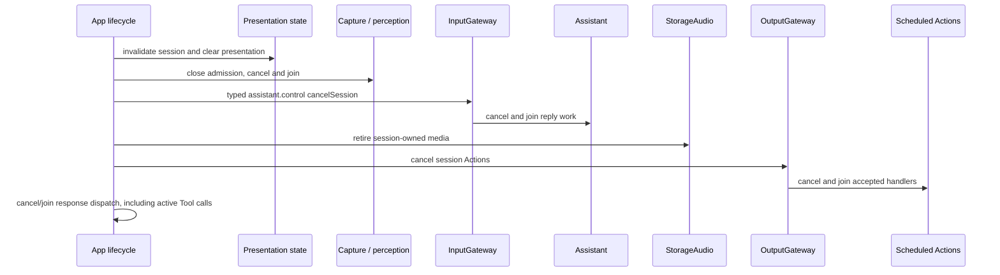

App separates stable interaction identity, native capture generations, recognized turns and the actual reply execution owner. Late captions, callbacks and results must match their intended scope. Display focus does not cancel another valid producer's speech; user/OS lifecycle cancellation is explicit.

SpeechPerception selects recognition-caption/phase calls, Assistant selects reply/expression calls, and VisionPerception selects pose/gaze calls. Registered Actions pass through App adapters into independent UI values; only declared renderer callbacks acknowledge visual completion. Actual playback telemetry owns speaking state.

Caption placement/transitions: [Conversation UI](UI/Conversation/README.md#caption-state-transitions). Session/turn fences: [App Lifecycle](App/Lifecycle/README.md), [Presentation](App/Workflows/Presentation/README.md).

### Expression transactions

Actions/UI defines finite expression performance versus persistent base state. App supplies identity-fenced continuations; UI renders the request and acknowledges the declared transition. Cancellation, new-turn teardown or renderer disappearance invalidates only the matching acknowledgment.

Function completion/restore semantics: [UI Actions](Actions/UI/README.md#接口与完成语义). Native geometry, interpolation and timing: [UI Components](UI/Components/README.md). App continuation ownership: [Presentation](App/Workflows/Presentation/README.md).

### Synthesis and playback ownership

Assistant sends directed synthesis input through Gateway to SpeechSynthesis and separately schedules Speech.Playback for the same owned audio identity. ModelKit produces PCM; StorageAudio carries a single-checkout stream; App/PlatformKit plays and drains it. Synthesis admission, producer completion and player completion are distinct.

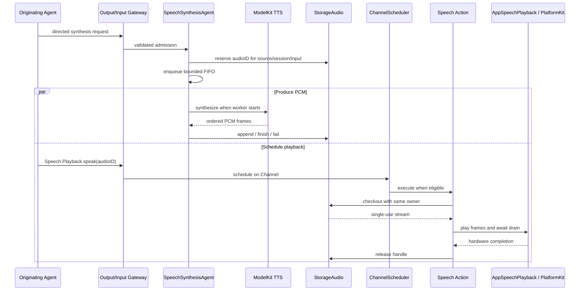

The original reply owner scopes both production and playback. Cleanup retires unused handles, joins synthesis/player work and preserves actual failures. Successful playback means native drain and lease release; App then joins listening restoration when consent/session/policy permit. Restoration cannot invent playback success or withdraw a committed audible effect.

Text segmentation: [Chat](Agents/Support/Chat/README.md#reply-text-segmentation). Synthesis validation/queue: [SpeechSynthesis](Agents/SpeechSynthesis/README.md). PCM handle/buffer contract: [StorageAudio](Storage/Audio/README.md). Native buffers: [Platform Audio](PlatformKit/Audio/README.md#playback-and-completion). Resume ownership: [Lifecycle](App/Lifecycle/README.md#streaming-tts-latency).

### Camera perception and UI projection

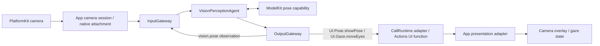

App owns native capture, persistent camera authority, retained images and Photos export. VisionPerception owns model admission/interpretation; ModelKit owns pose inference; UI renders only App-adapted values. Capture, inference, publication and presentation acceptance have separate completion boundaries.

Camera intents from UI target Photographer through App/Gateway; Assistant's photography Skill emits registered camera Actions. Both reuse the same native endpoints under their actual execution authority. Camera facts are passive inputs and never independently start a model or shutter.

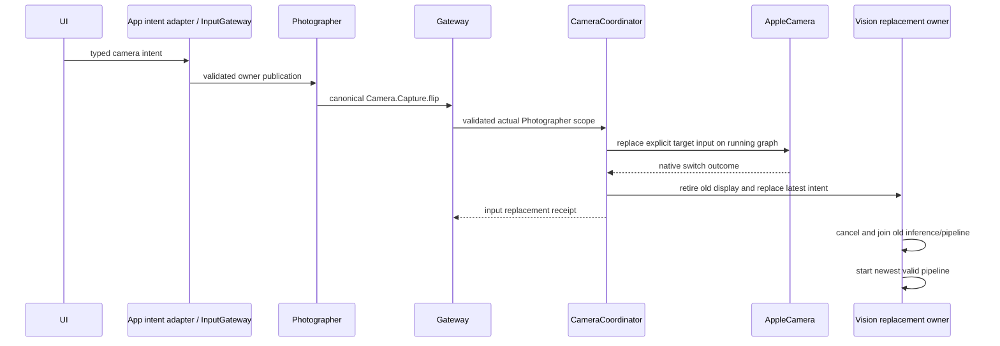

A healthy lens switch retains capture ownership while replacing native input. Native acknowledgment and joined vision replacement are distinct; off/background/model maintenance closes and joins both. A failed switch requires explicit retry.

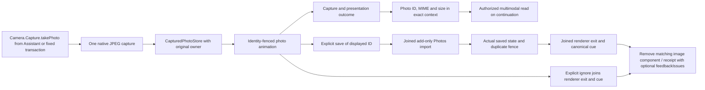

Capture stores the original before model preparation or later presentation. Save joins add-only Photos import before declaring saved; ignore disposes of the matching preview without deleting album data. Later feedback/presentation failure retains the committed disposition and original evidence. Model context uses authorized references/prepared attachments; no error automatically repeats capture.

Native capture/export and renderer coordination: [Lifecycle](App/Lifecycle/README.md#camera-perception-and-photo-ownership). Native graph: [Platform Vision](PlatformKit/Vision/README.md). Retention: [StorageMedia](Storage/Media/README.md). Composition policy: [App Composition](App/Composition/README.md). Model-image policy: [Assistant](Agents/Assistant/README.md#model-photo-preparation-policy).

### Adaptive vision cadence and projection

App supplies native frames and clock metadata; VisionPerception owns selection and adaptive inference cadence; ModelKit performs pose inference. Results carry actual timing and statistics through registered presentation calls. App maps them into independently validated UI/Camera values and fences stale sessions before display.

Cadence is Agent policy, not a PlatformKit capture rule, ModelKit scheduling service or UI decision. Camera closure joins inference and clears the corresponding overlay/statistics. Frame selection, motion analysis, ROI, cadence formulas and local bounds live in [VisionPerception](Agents/VisionPerception/README.md); display values live in [UI Camera](UI/Camera/README.md).

### Photographer tracking and control handoff

Photographer consumes vision.pose through InputGateway and issues internal NexArm.Tracking.aim through OutputGateway. Actions maps the target; App owns the tracking worker and concrete resource authority; PlatformKit encodes native commands. The command receipt reports target admission, not physical arrival. The first admitted tracking packet prepares the calibrated shoulder/elbow rest; later targets use one motors 1/4 synchronous packet; Actions owns shaping while App retains latest-target replacement, native sessions and the existing motors 1–4 resource fence.

App groups robot writers and declares when Assistant/manual interaction may take over Photographer. Takeover joins the previous writer without cancelling unrelated scheduler trees or triggering Bluetooth recovery. Missing/stale pose ends owned tracking; camera closure detaches its scope without stopping resident Photographer. Offline tracking suppression does not stop vision presentation.

Role policy: [Photographer](Agents/Photographer/README.md). Aim/motion algorithms: [NexArm Support](Actions/NexArm/Support/README.md). Native tracking owner: [Bluetooth workflow](App/Workflows/Bluetooth/README.md#foreground-and-manual-ownership).

### Robot behavior and device feedback

```mermaid
flowchart LR
    Agent[Agent ActionCall] --> Gateway[OutputGateway / scheduler]
    Gateway --> AgentFence[Shared resource guard]
    AgentFence --> Runtime[ExecutionRuntime]
    Runtime --> Actions
    Settings[Bluetooth workflow user operation] --> Manual[Cancel prior writer / manual submission]
    Manual --> Actions[Shared Actions NexArm recipes]
    Actions --> Platform[PlatformKit connection / native commands]
    Platform -->|telemetry and acknowledgment| Actions
    Actions -->|Agent-path completion / failure| Runtime
    Actions -->|Settings result| Settings
    Runtime --> Results[Gateway ActionResult]
    Results --> Input[InputGateway / originating Agent]
```

Agent-selected and Settings-initiated motion reuse canonical Actions recipes. Agent calls retain Gateway authorization and resource arbitration. Settings publishes typed intent through ApplicationControl, whose injected native endpoint applies the declared manual takeover policy and reports acceptance plus independent later failure.

Actions owns recipe semantics and arrival interpretation; PlatformKit owns connection/native protocol and feedback; App owns preferred device, recovery and foreground lifetime. Native write success, valid position feedback and physical arrival are different facts. Background joins software control and reconciles the link on return without replaying old motion. Physical safety cannot depend on iOS background execution.

Recipes/limits: [NexArm Actions](Actions/NexArm/README.md). Link/session policy: [Bluetooth workflow](App/Workflows/Bluetooth/README.md). Native I/O: [Platform NexArm](PlatformKit/Connectivity/NexArm/README.md).

### Robot motion admission and home selection

Settings and Agent calls share Actions' motor validation, reset/home selection, plan resources and feedback completion contract. Gateway supplies authorized resource ownership; App/native endpoints validate the live permit and current connection. A configured home is planning data, not measured telemetry.

Finite movement completes from fresh post-send evidence according to its Action contract; tracking admission does not promise arrival. Missing feedback, timeout and cancellation preserve partial effects and stop future writes according to the owning layer. Native transport acknowledgment never substitutes for those semantics.

Motor ranges, home arrays, plan/composition bounds and dynamic estimates: [NexArm](Actions/NexArm/README.md), [planning/execution algorithms](Actions/NexArm/Support/README.md). Packet formats/pacing: [Platform NexArm](PlatformKit/Connectivity/NexArm/README.md).

### Bluetooth connection, recovery and presentation

PlatformKit supplies native connection/write/feedback facts. App owns connection selection, recovery, manual worker lifetime and Settings projection. Actions owns recipe/arrival logic. Connection/subscription completion enables controls, but is not motion validation; silence alone is not a reason to invent telemetry or move hardware.

Recovery closes/confirms old native ownership before replacement and never cancels/replays Gateway queues on behalf of the scheduler. Current operations return actual failures; later queued work uses state available at execution. Background gates new writes and joins prior motion/tracking; foreground reconciles the link before reuse. Manual stop/page teardown remains an immediate host lifecycle fence.

Recovery attempts, backoff, local queues and reconnect state: [Bluetooth workflow](App/Workflows/Bluetooth/README.md). Native pacing and control window: [Platform NexArm](PlatformKit/Connectivity/NexArm/README.md). Device-row presentation: [Settings UI](UI/Settings/README.md).

### Settings, history and feature workflows

```mermaid
flowchart TB
    UI[UI state and typed submitted operation] --> Facade[AppWorkflows facade]
    Facade --> Input[InputGateway]
    Input --> Control[ApplicationControl: settings, resources, provider and device]
    Input --> Memory[Memory: confirmed history transaction]
    Input --> Photographer[Photographer: camera transaction]
    Control --> Output[OutputGateway]
    Memory --> Output
    Photographer --> Output
    Output --> Functions[Registered canonical functions]
    Functions --> Native[Injected model, storage and native capabilities]
    Functions --> Present[Identity-fenced App presentation adapter]
    Present --> UI
    Output -->|Actual executor feedback| Input
    Repositories[Injected Assistant conversation repository] --> Reads[HistoryPresentationAdapter: immutable reads]
    Reads --> UI
```

UI owns editable drafts and submits typed intent; App keeps page-independent transport and native/presentation adapters; the owning Agent selects business calls; Actions invokes injected storage/model/device capabilities. Publication admission, business completion and presentation acceptance are separately correlated. Transport failure never authorizes command replay.

All role hot contexts are independent process-memory state. Durable business records use injected domain repositories; configuration documents use their own file-backed contract; secrets stay in private staging/Keychain. A saved preference can survive later binding failure, and uncertain delivery requires explicit reconciliation rather than repeating save.

Download return means admission, not installed state. Native inventory/receipts provide installation facts; cancellation joins the original admission before retiring bookkeeping. Agent Records exposes Assistant conversations, including indexed foreground Task sources; runtime/background diagnostics stay in the execution view.

Per-feature transport/call budgets and failure presentation: [Settings workflow](App/Workflows/Settings/README.md), [ApplicationControl](Agents/ApplicationControl/README.md), [System services](Actions/System/Support/README.md). Record projection: [History workflow](App/Workflows/History/README.md).

<a id="deterministic-history-mutation-contract"></a>

### Deterministic History Mutation Contract

UI confirmation becomes history.intent through App/InputGateway. Memory deterministically selects History.Conversation operations; Actions validates the archive-only mutation and uses the same injected Assistant conversation repository. Assistant's conversational history-query Skill shares read functions, while title inference is independently owned by Memory.

Archival/deletion commits before dependent presentation. A committed mutation survives cancellation or later display/title failure; no automatic deletion retry occurs. App transports correlated calls/results and maps immutable history into UI state without selecting the next business function. Returning-handler failure permits Agent follow-up; completion-only presentation failure remains a distinct terminal transport outcome.

Transaction/call/cancellation algorithms: [Memory](Agents/Memory/README.md), [History Actions Support](Actions/History/Support/README.md), [History transport](App/Workflows/History/README.md). Durable schema: [StorageChat](Storage/Chat/README.md).

<a id="391-platformkit-versus-modelkit"></a>

### Conversation Tool diagnostics

Agents records exact requests, provider completion, resolved calls and actual runtime results separately. Storage commits complete messages/checkpoints; App converts selected immutable records into UI values; UI displays and exports that evidence. Late call outcomes stay associated with their original request, including archived conversations.

Provider timing originates at the model interface and remains absent when unavailable; record arrival, ASR, playback and UI timing cannot invent TTFT. Parser previews use the recorded catalog without executing anything. Historical image reads validate the original producing input and selected record before loading retained bytes; missing media remains absent.

History projection and limits: [Chat](Agents/Support/Chat/README.md). Image/page reads and preview: [App History](App/Workflows/History/README.md). UI layout/export: [Settings UI](UI/Settings/README.md). Stored records: [StorageChat](Storage/Chat/README.md).

### Settings audio detection

The explicit audio diagnostic runs UI → App diagnostic workflow → isolated Lifecycle scope → PlatformKit capture → dedicated Gateway/SpeechPerception scope → App/UI result. It performs source perception without conversation, model warmup or robot control. Restricted communication removes conversational occupancy dependencies.

The workflow owns attempt duration/freshness; Lifecycle owns native capture and joined cleanup; UI displays actual received layout and failures. Retry is admitted only after cleanup releases the slot. Details: [Diagnostics](App/Workflows/Diagnostics/README.md), [isolated Lifecycle scope](App/Lifecycle/README.md#isolated-audio-detection-communication), [SpeechPerception](Agents/SpeechPerception/README.md).

### PlatformKit versus ModelKit

| Concern | PlatformKit: device and OS I/O | ModelKit: model processing |
| --- | --- | --- |
| Audio input | Microphone → PCM | PCM → VAD score or transcript |
| Audio output | Supplied PCM → speaker | Text → synthesized PCM |
| Vision | Camera → native frame and preview | Supplied image → pose/model result |
| Adaptation | Capture format and device orientation | Model resize, normalization and result decoding |
| Owned resources | Device sessions, links and I/O buffers | Weights, graphs, providers and operation leases |

App packages device output for input transport; the calling Agent converts it into ModelKit processing input. Agents decide when and why to process or act; Gateway validates and routes without performing inference. Neither SDK owns Agent policy, presentation or conversation state.

### Model lifecycle and processing boundary

```mermaid
flowchart LR
    App[App configuration and root lifetime] --> Defaults[ModelKit provider selection and manager]
    Agents[Agents / App diagnostic consumer] -->|Typed capability request| Defaults
    Defaults -->|Validated events / result / failure| Agents
    App -->|Memory pressure / unload / shutdown| Defaults
    Defaults -->|Owned operation joins before release| App
```

ModelKit owns providers, weights and operation leases; consumers own when and why to invoke capabilities. App injects root/artifact protocols and forwards pressure/shutdown. Consumers depend on typed capabilities rather than backend engines. Availability, residency and successful inference are separate facts.

Operation cancellation joins the matching worker without automatically unloading weights. Explicit unload drains active use; shutdown is terminal. App must drain or cancel an owned stream before awaiting unload; a cancelled consumer does not silently cancel another consumer's shared load. These boundaries apply equally to Agent and diagnostic callers.

Manager factories/waiters/selection: [Management](ModelKit/Support/Management/README.md). Stream/backpressure/lease mechanisms: [ModelKit Core](ModelKit/Support/Core/README.md). Provider-specific queues and wire/native bounds belong to each adapter.

<a id="local-model-resource-acquisition-and-removal"></a>

### Local chat capability

App restores the configured chat binding; ModelKit exposes ChatCapability; Agents selects current context and interprets the response. Explicit cloud configuration changes the chat binding only. Local inference never downloads weights implicitly or silently switches providers after failure.

The current local adapter is Gemma; it rejects unsupported image/native-call requests explicitly. Agents must respect the selected capability's advertised support. Backend OS/hardware/artifact availability is not a model-ready UI guarantee.

Current provider matrix and singleton/replacement policy: [Model Management](ModelKit/Support/Management/README.md#default-assembly-and-provider-selection). Local resource revision, stream limits and backend constraints: [Gemma adapter](ModelKit/Language/LLM/Gemma4/README.md).

### Local model resource acquisition and removal

Resources bundles metadata/licenses; App supplies storage roots and downloader endpoints; ApplicationControl selects resource operations through registered System functions; ModelKit Management owns acquisition/install/delete; Storage adapters publish bytes/receipts atomically.

```mermaid
flowchart LR
    UI[Settings] --> Workflow[Settings workflow]
    Workflow --> App[App adapters]
    App --> Input[InputGateway]
    Input --> Agent[ApplicationControl]
    Agent --> Output[OutputGateway]
    Output --> Function[System.ModelResources function]
    Function --> Manager[ModelKit Management]
    Manager --> HF[Injected ModelKitHub]
    HF --> Hub[HubClient: selected snapshot]
    Hub --> Verify[Management: required files and bounds]
    Verify --> Bridge[App storage adapter]
    Bridge --> Storage[Storage: receipt and atomic publish]
    Manager --> Barrier[Core maintenance]
    Barrier --> Lifecycle[App voice/vision stop and join]
```

Installing resources does not register executable providers or start inference. Settled receipts establish installed state, separately from download admission and availability. A valid publication survives later bookkeeping failure as a warning. Cancellation joins the owned transfer; cancellation after installation does not remove installed files.

Delete gates referring capabilities, joins App use and ModelKit unload/transfer cleanup, then removes files. Native background transfer and OS reassociation belong to the downloader, without promises of background inference or force-quit/server-resume support.

Catalog/tree/ZIP limits and state: [Management](ModelKit/Support/Management/README.md#artifact-contracts-and-operations). HF concurrency/relaunch: [HuggingFace](ModelKit/Support/Management/HuggingFace/README.md). Publication adapter: [App Adapters](App/Adapters/README.md). Pure declarations: [Resources Models](Resources/Models/README.md).

### Cross-module concurrency and completion

Cross-module completion is defined at the owning boundary. Actor isolation or MainActor display acceptance alone does not prove another owner's work finished.

| Boundary | Completion means |
| --- | --- |
| Input delivery | Target Agent accepted or rejected the input. |
| Model operation | Adapter finished or cancellation cleanup joined. |
| Tool call | Handler reached its terminal outcome after joined cleanup; feedback delivery is a separate outcome. |
| Feedback admission | Receiver accepted the result Signal; this does not establish business consumption or a further model turn. |
| Action call | Registered handler reached its declared effect/acknowledgment boundary. |
| Speech playback | Platform output drained and the audio lease was released. |
| Session stop | Producers, Agent work, response dispatch, owned media and scheduled Actions were cancelled and joined. |
| UI update | App accepted state for the active identity; rendered-frame acknowledgment is not implied. |

Every owner bounds its own queue/active work and declares reject, suspend or latest-state replacement behavior. Accepted discrete effects cannot disappear silently. Cooperative cancellation joins cleanup before ownership release; retained permits prevent stale writers, but cannot force uncooperative native work to stop.

| Local pressure point | Authoritative contract |
| --- | --- |
| Input admission / fan-out | [InputGateway](Gateway/Input/README.md) |
| Model requests / round feedback / context projection | [Chat](Agents/Support/Chat/README.md#bounds-and-overflow) |
| Channel/wait scheduling | [Scheduling](Gateway/Output/Scheduling/README.md) |
| Resource leases and takeover | [Resources](Gateway/Output/Resources/README.md) |
| Terminal result reservation/redelivery | [Results](Gateway/Output/Results/README.md) |
| Hot state transactions | [Context](Agents/Support/Context/README.md) |
| Synthesis / PCM / native playback | [SpeechSynthesis](Agents/SpeechSynthesis/README.md), [StorageAudio](Storage/Audio/README.md), [Platform Audio](PlatformKit/Audio/README.md) |
| Camera/media / resource/model lifecycle | [Lifecycle](App/Lifecycle/README.md), [StorageMedia](Storage/Media/README.md), [Management](ModelKit/Support/Management/README.md) |
| Feature requests / manual control | [Settings](App/Workflows/Settings/README.md), [Bluetooth](App/Workflows/Bluetooth/README.md) |

App samples bounded execution/lifecycle snapshots into UI-owned logs. Display filters, dismissal and counted eviction do not cancel execution, acknowledge results or prove physical arrival. Record-retention and display limits belong to [Presentation](App/Workflows/Presentation/README.md), [Conversation UI](UI/Conversation/README.md) and [Settings UI](UI/Settings/README.md).

### Cloud native Tool generation

ModelKit's OpenAI-compatible adapter converts ChatRequest history/images/current definitions into Responses wire data and emits validated neutral ChatEvents. Agents resolves complete native calls against the immutable request catalog; Gateway performs authorized execution and returns actual outcomes. Provider output data never grants execution authority.

History keeps original native pairing even after the corresponding Skill is released. Current definitions alone determine newly callable functions; local Gemma rejects native/image input. App joins Action and native output branches before Agent continuation. Provider errors terminate the Decision without protocol fallback, effect replay or automatic provider switching.

Encoding, SSE validation, HTTP lifetime and provider-name mapping: [OpenAI adapter](ModelKit/Language/LLM/OpenAI/README.md). Neutral request/pairing bounds: [Chat contract](ModelKit/Language/LLM/README.md).

### Signal and Effect Scenarios

These flows apply the common contracts above. A task can cross several scenarios; the categories are not separate Signal types. App adapts input and forwards output without selecting business operations. Diagrams describe the architecture; actual coverage and remaining integration boundaries are recorded under [implementation coverage](#implementation-coverage).

#### Scenario coverage

Six categories cover human intent, Agent collaboration, independent observations, host facts and execution feedback:

| Scenario | Input / origin | Business processing and effects |
| --- | --- | --- |
| 1. Direct UI interaction | External intent | Agent selects an operation and presentation; local drafts/scroll remain in UI. |
| 2. Conversation | External text/audio, followed by internal perception messages | Business Agent interprets intent and handles actual results; inference itself is local computation. |
| 3. Agent collaboration | Internal Agent message | Receiver processes content, optionally replies or emits registered effects. |
| 4. Physical-world observation | External capture/native fact, optionally followed by internal perception messages | Agent may react without a new human request, within an enabled task and declared permissions. |
| 5. System and capability event | External lifecycle, permission, route or availability fact | Host handles immediate lifecycle mechanisms; Agents decide scoped business reactions. |
| 6. Execution lifecycle | Internal runtime feedback | Agent interprets progress, actual completion, failure or cancellation and chooses continuation/presentation. |

#### 1. Human interaction with UI

Taps, gestures, submitted forms, navigation and confirmation produce typed business intent. The owning Agent handles it deterministically or through a model, calls registered functions and processes declared feedback. UI retains local interaction/rendering state. The implemented archive-deletion flow below shows confirmation, execution and presentation.

```mermaid
sequenceDiagram
    actor Human
    participant UI
    participant App as App input adapter
    participant Input as InputGateway
    participant Agent as Memory
    participant Output as OutputGateway
    participant Effects as Registered Tools / capabilities
    Human->>UI: Confirm archive deletion
    UI->>App: Delete intent + archive ID
    App->>Input: Signal with request/session identity
    Input->>Agent: Validated input
    Agent->>Output: Resolved History.Conversation.delete call
    Output->>Effects: Authorized Tool executes Storage transaction
    Effects-->>Output: Actual success or failure + call ID
    Output->>Input: Correlated ToolResult Signal
    Input->>Agent: Scoped feedback
    alt Deletion succeeded
        Agent->>Output: Resolved UI.HistoryPresentation.showHistory call
        Output->>Effects: Invoke registered presentation Tool
        Effects->>UI: Apply scoped actual snapshot on MainActor
        UI-->>Human: Updated history
    else Deletion failed
        Agent->>Output: Failure control / execution outcome
        Note over App,UI: Root workflow presents the correlated failure.<br/>No registered history error-presentation function exists
    end
```

History mutation failure currently terminates the fixed operation with an owner-correlated failure control; the root history workflow presents that actual failure. A general registered history error-presentation function remains absent.

UI-local scrolling, expansion, focus and unsubmitted drafts stay in UI. Business gestures and submitted forms emit intent; continuous controls require explicit cadence and overflow policy.

#### 2. Conversation

After InputGateway admission, typed text reaches the business Agent; speech reaches a perception Agent first. Recognized content becomes a typed Agent message through both Gateways. Model inference remains an injected computation inside the Agent's decision process.

```mermaid
flowchart TB
    Human[Human] -->|Typed text| App[App input adapters]
    Human -->|Speech| World[Microphone capture]
    World --> App
    App -->|Audio Signal| Input[InputGateway]
    App -->|Text intent Signal| Input
    Input -->|Captured media| Perception[Perception Agent]
    Perception <-->|Recognition / perception capability| Model[ModelKit]
    Perception -->|Typed observation via CommunicationAction| Output[OutputGateway]
    Output -->|Validated transcript / observation Signal| Input
    Input -->|Intent / recognized content / feedback| Business[Business Agent]
    Business <-->|Context and decision computation| Model
    Business -->|Resolved calls| Output
    Output -->|Authorize and execute| Execute[Actions / Tools]
    Execute --> Native[Platform / Storage capabilities]
    Native -->|Declared native observations| App
    Execute -->|Presentation / speech behavior| UI[UI / playback endpoints]
    Execute -->|Actual execution outcome| Output
    Output -->|Correlated feedback Signal| Input
    Business -->|Next operation or final presentation| Output
```

For Bluetooth discovery, ApplicationControl can call `System.Device.control(operation: scan)` and read `System.Device.readStatus`. The control result reports accepted submission, not scan completion or a complete device list. Current device facts enter through App environment sampling; status reads return the current native snapshot. The Bluetooth workflow independently renders actual discovery snapshots. There is no generic scan-progress/scan-completed Signal contract or registered discovery-specific display function.

[Owned request and round limits](Agents/Support/Chat/README.md#bounds-and-overflow) bound each step of result-driven continuation. Predicted behavior is never evidence of device completion.

#### 3. Agent-to-Agent collaboration

Agents exchange domain messages through both Gateways. They do not call each other's business methods or use UI updates as a communication channel. A receiver decides whether a message requires further processing, a reply or a registered effect.

```mermaid
sequenceDiagram
    participant A as Producer Agent
    participant Output as OutputGateway
    participant Input as InputGateway
    participant B as Consumer Agent
    participant Effects as Actions / Tools
    participant UI
    A->>Output: CommunicationAction send / publish + causal parent
    Output->>Output: Validate source, schema and communication permission
    Output->>Input: Signal with bound source and causal metadata
    Input->>B: Validate target/session and admit
    alt Directed send
        Input-->>Output: Target admission report
        Output-->>A: Correlated receipt Signal, not processing completion
    else One-way publish
        Note over A,B: No recipient acknowledgment or publisher result
    end
    B->>B: Process typed content
    opt Explicit domain reply is declared
        B->>Output: Send typed result message to A
        Output->>Input: Result Signal with declared correlation
        Input->>A: Validate and process reply
    end
    opt Consumer requests a UI effect
        B->>Output: Registered presentation Action / Tool call
        Output->>Effects: Validate and execute
        Effects->>UI: Update scoped presentation on MainActor
    end
```

`send` chooses one permitted target; `publish` selects declared subscribers. The root and parent identify causality, not a generic request/reply service. A domain needing a reply must declare its payload, request correlation, pending-work bound, timeout and cancellation behavior before implementation. Such a reply is a new message with its own permission checks. A directed message alone does not create an automatic request/reply service.

#### 4. Physical-world observation without a new user request

An enabled camera/tracking task, device discovery or sensor monitor can receive new facts independently of a click or conversation. App adapts capture/native events into Signals; a perception Agent is optional for already-structured device facts.

```mermaid
flowchart LR
    World[Physical change] --> Capture[Platform capture / native feedback]
    Capture --> App[App input adapter]
    App --> Input[InputGateway]
    Input --> Agent[Perception / business Agents]
    Agent -->|Messages / resolved calls| Output[OutputGateway]
    Output --> Effect[Actions / Tools]
    Effect --> UI[UI presentation]
    Effect --> Platform[Platform effect]
    Platform -->|Changes subsequently observed| World
    Effect -->|Actual outcome via runtime| Output
    Output -->|Messages / feedback Signals| Input
```

Observation is evidence, not authorization to start arbitrary behavior. The enabled task owns its scope, cadence, freshness and resource use. Only declared latest-state observations may coalesce; discrete device facts need an explicit delivery policy. Issuing a command does not prove the resulting physical state.

#### 5. System and capability events

Foreground/background changes, permission changes, audio-route interruption and model/device availability changes can alter what a task may do. The target business path is **OS/native fact → App adapter → InputGateway → responsible Agent → OutputGateway → registered reaction**.

App remains responsible for immediate lifecycle mechanisms: suspending capture, joining owned execution, releasing resources and starting/stopping runtime scopes. Those mechanisms cannot depend on a delayed Agent response or inference. Publish business-relevant lifecycle facts only into valid scopes; an unavailable Agent/session cannot be assumed to receive a shutdown event. Permission denial and unavailable capability must not become fabricated success.

Foreground return does not automatically replay prior device effects.

#### 6. Execution lifecycle and long-running work

A returning Tool can finish in one result; discovery, downloads, playback or motion may have separate admission, progress and terminal outcomes. Declare each operation's feedback channel, owner, correlation and completion semantics before implementation.

```mermaid
sequenceDiagram
    participant Agent
    participant Output as OutputGateway / execution runtime
    participant Operation as Action / Tool and capability
    participant Input as InputGateway
    Agent->>Output: Authorized operation call
    Output->>Operation: Start under execution ownership
    opt Declared bounded progress feedback
        Operation-->>Output: Actual progress + operation identity
        Output->>Input: Runtime feedback Signal
        Input->>Agent: Validate owner/session and interpret
    end
    alt Completed or failed
        Operation-->>Output: Actual terminal outcome
        Output->>Input: Declared correlated result Signal
        Input->>Agent: Choose continuation or status presentation
    else Cancellation requested
        Note over Agent,Input: Human cancellation first enters through App and InputGateway
        Agent->>Output: Registered cancellation behavior, if supported
        Output->>Operation: Cancel and join owned cleanup
        Operation-->>Output: Actual terminal cancellation / partial effects
        Output->>Input: Declared correlated feedback Signal
        Input->>Agent: Reconcile committed effects and finish
    end
```

This is a target lifecycle pattern for contracts that return feedback, not a generic progress/cancellation API implemented by every Tool. Native asynchronous facts still use the external adapter paths in scenarios 4 and 5. Completion-only Tools retain execution outcomes without a new ToolResult. Runtime control notices cannot encode unregistered business cancellation.

### Cross-cutting Task Contracts

| Case | Required contract |
| --- | --- |
| User decision during a task | Picker selection, confirmation or clarification returns as a scoped external Signal through App → InputGateway, distinct from successful prompt presentation. Declare pending-task bounds, response correlation, timeout and cancellation; opening the prompt is not the user's decision. |
| Concurrent inputs / multiple views | Define explicit task/session ownership, overlap rejection/queueing and resource arbitration. Human and model requests share authorization; manual priority exists only where policy declares it. Fence late presentation by its intended scope. |
| Scheduled or periodic trigger | Declare whether an OS trigger is external or an owned runtime timer is internal. Bound timers/work, supply scope and deadlines, and prevent feedback-driven recurrence. Do not imply background execution guarantees. |
| Restart / reconnect / recovery | Restore durable records through Storage capabilities, reconcile actual native state and create fresh live scopes. Persisted data is not automatically a Signal; never replay stale requests or completed effects by default. |
| Future remote integration | Reuse the envelope concept only through an explicit adapter with authentication, codecs, version and replay policy. Authentication/admission alone does not grant internal execution authority; remote transport remains unimplemented. |

System permission prompts still require user interaction. Presenting a picker does not grant unrestricted library access. Physical robot safety cannot depend on iOS background execution.

The Task transport path is defined under [Input and Agent communication](#input-and-agent-communication); registry bounds and scoped question routing belong to [Core communication](Agents/Support/Core/Communication/README.md) and [Chat](Agents/Support/Chat/README.md). Durable work recovery is defined under [startup and lifetime](#composition-startup-and-lifetime).

### Implementation Coverage

✅ marks implemented contracts; ❌ marks absent implementation. Detailed delivery priorities and acceptance evidence belong in docs/.

| Area | Implemented | Outstanding |
| --- | --- | --- |
| Signal and host facts | ✅ Unified envelope/origins, schemas, causal results, typed history/resource/provider/device/navigation/camera input, sequenced scene/navigation/device facts | ❌ Additional sensor adapters and video/binary payload codecs |
| Executable capabilities | ✅ Protocol-neutral Actions, shared execution, three-level addresses, explicit Action/Tool bindings and isolated errors | ❌ General activity producers/subscriptions |
| UI and history | ✅ Agent-selected queries/mutations, registered resource/provider error presentation, shared navigation and camera/device functions | ❌ General system pickers, movie capture and background camera execution |
| Conversation | ✅ Completion-owned result-driven Action/Tool continuation and terminal Agent failures, correlated results, exact history and scoped specialist task replies | ❌ Automatic request/reply for arbitrary domain contracts and local-model native Tool support |
| Execution lifecycle | ✅ Owned cancellation/join, causal ActionResult, independent manual-worker failure feedback and bounded result retention | ❌ General long-task progress/activity subscriptions |
| Model/provider resources | ✅ Agent-routed commands/preferences/inventory/observations/errors and private provider transactions/presentation; ApplicationControl current facts are model-readable | ❌ Model-initiated provider configuration changes with safe session handoff |
| Decision context | ✅ Bounded root environment facts plus registered current inventory/provider/device reads | ❌ Full resource-state-store plan and push adapters |
| Foundational independence | ✅ UI, ModelKit, PlatformKit and Storage have no cross-module dependencies | None |
| Transport evolution | ✅ Process-local admission and bounded domain content | ❌ Remote authentication/codecs, version migration, durable replay and dynamic subscriptions |

[Cross-module concurrency](#cross-module-concurrency-and-completion) links each capacity owner; [InputGateway](Gateway/Input/README.md) and [communication policy](Agents/Support/Core/Communication/README.md) define admission and the eight-hop limit. AgentMessage encoding is not a wire format for the whole Signal envelope.

Implementation coverage is separate from real-model, native UI and physical-device acceptance. Those results remain in [validation history](../docs/validation/Validation-History.md).

### Resource refresh presentation

ApplicationControl selects inventory presentation; Actions reads validated neutral facts; App commits them to revision/session-fenced UI state. Presentation completion means state acceptance. Failed query/presentation selects an explicit error route before terminal failure, preserving both original and secondary outcomes.

```mermaid
sequenceDiagram
    participant UI as Resource page / passive revision
    participant App as Input adapter
    participant Input as InputGateway
    participant Agent as ApplicationControl
    participant Output as OutputGateway
    participant Action as UI.ResourcePresentation
    participant Native as Injected neutral inventory
    UI->>App: Refresh with current revision
    App->>Input: refreshPresentation Signal
    Input->>Agent: Validate and admit
    Agent->>Output: showResources call
    Output->>Action: Invoke standard function
    Action->>Native: Read facts once / validate inventory
    alt Valid current snapshot
        Action->>UI: Adapter commits items and supplied groups
        Action-->>Output: Canonical inventory value
        Output->>Input: Owner-correlated ToolResult
        Input->>Agent: Success feedback
        Agent->>Output: application.control.finished
    else Query or presentation failed
        Action-->>Output: Invocation failure
        Output->>Input: Owner-correlated failure
        Input->>Agent: Failure feedback
        Agent->>Output: showResourceFailure call
        Output->>Action: Invoke bounded failure presentation
        Action->>UI: Adapter rejects stale revision or commits error
        Action-->>Output: Actual completion / failure
        Output->>Input: Returning feedback
        Input->>Agent: Final presentation outcome
        Agent->>Output: application.control.failed
    end
```

App's foreground resource observation publishes changed/failed native facts through InputGateway. ApplicationControl chooses current inventory or error presentation. Sampling/publication, Agent admission and UI acceptance are separate: a later rejection or display failure cannot become a publisher acknowledgment or automatic command retry.

```mermaid
flowchart LR
    Native[Native resource facts] --> App[Root foreground observation]
    App -->|model.resource.state Signal| Input[InputGateway]
    Human[Manual refresh] -->|model.resource.intent Signal| Input
    Input --> Agent[ApplicationControl]
    Agent --> Output[OutputGateway]
    Output --> Action[UI.ResourcePresentation functions]
    Action --> UI[Revision fenced passive UI state]
    Action -->|ToolResult feedback| Input
```

Operation and preference errors use registered presentation functions. Durable preference save precedes binding; later binding failure preserves the committed preference and last-confirmed display facts. Error presentation is not recursive and grants no model configuration authority.

```mermaid
sequenceDiagram
    participant Agent as ApplicationControl
    participant Gateway as OutputGateway
    participant Preference as Preference function
    participant Binding as Speech binding
    participant UI as Registered preference presentation
    Agent->>Gateway: Restore or save preference call
    Gateway->>Preference: Validate and read or commit
    Preference-->>Agent: Correlated value or producer failure code via both Gateways
    alt Preference succeeded
        Agent->>Gateway: configureSpeech
        Gateway->>Binding: Apply native binding
        Binding-->>Agent: Correlated success or failure via both Gateways
    end
    opt Preference or binding failed
        Agent->>Gateway: showResourcePreferenceFailure with selected reason
        Gateway->>UI: Await root-session notice or error commitment
        UI-->>Agent: Correlated acknowledgment or failure via both Gateways
        Agent-->>Gateway: Failed termination and release preference gate
    end
```

Fingerprint transitions, sample cadence, hostFailure admission and per-transaction call budgets belong to [Settings workflow](App/Workflows/Settings/README.md#resource-observation-state), [ApplicationControl](Agents/ApplicationControl/README.md) and [System services](Actions/System/Support/README.md). Cross-layer publication loss remains explicit; a shared push resource-state store is not implemented.

### Task and Skill ownership

Resources describes reusable Skills; Actions supplies canonical metadata; Agents owns activation/Task state; App injects implementations; Gateway validates the frozen request catalog. Skill loading does not create a Task or grant native device permission. The [system assembly diagram](Agents/Assistant/README.md#system-提示词结构与来源) shows prompt sources.

One foreground Task may adopt the specified/loaded/actually-used Skill roots and keeps them while waiting. Terminal cleanup releases that ownership. Outside a Task, recent retention and capacity policy belong to Context; existing requests/history remain immutable. New conversations, scoped closure and restart use explicit cleanup boundaries.

The combined [Task/Skill lifecycle](Agents/Support/Context/README.md#task-and-skill-lifecycle) owns counters, LRU, dependencies and atomic failure. [Chat](Agents/Support/Chat/README.md#taskskill-控制与执行边界) owns request/round barriers. [Skill instructions](Resources/Skills/README.md#当前流程规则) owns model teaching for completion and goal transfer. Camera access itself does not require a Task.

### Business records and repository boundaries

App alone constructs concrete Storage backends and injects domain repository interfaces. Agents holds hot runtime state; Storage owns committed dialog/message/Task/media/device facts; App adapts records into UI values. Runtime UUID correlations and database business references have distinct ownership.

Complete messages and real terminal facts commit at declared boundaries; delta fragments, Skill counters and runtime queues remain memory-only. Media bytes publish outside SQL transactions; configuration documents and Keychain retain separate contracts. Current-dialog rotation commits durable archive/new-current state before memory publication, and a failure fence prevents silent loss or unsafe admission.

Backend/schema/CAS/page details: [Storage](Storage/README.md), [Chat records](Storage/Chat/README.md), [App composition](App/Composition/README.md). Task source selection and compression: [Chat](Agents/Support/Chat/README.md#多轮历史与持久化).

### Model photo and presentation boundaries

Assistant selects and authorizes model photos; App injects original-read/preparation capabilities; PlatformKit owns codecs; Storage retains originals. ReACT reuses prepared attachments without changing original Photos/media data. Policy and failure handling: [Assistant](Agents/Assistant/README.md#model-photo-preparation-policy), [Platform Vision](PlatformKit/Vision/README.md#native-image-compression).

SpeechPerception owns consent/occupancy, SpeechSynthesis produces PCM, App joins native microphone/playback barriers and UI renders supplied captions/eyes/light. Cue/haptic/notice functions reuse canonical Actions; Skill exposure and physical completion remain separate. Rendering details belong to [UI Components](UI/Components/README.md); root presentation ownership to [App Presentation](App/Workflows/Presentation/README.md).

## 待实现

- Generic remote authentication/codecs, durable active-worker resumption and activity/progress-driven Chat continuation.
- Unified foreground Task preservation/final checkpoint across scene suspension, and generic business background contracts.
- Push-based shared resource-state integration and the remaining absent routes identified in [implementation coverage](#implementation-coverage).
- Real-model instruction following, microphone/camera/Photos, native navigation/accessibility, sustained load and physical device acceptance.
