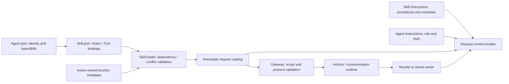

# Agent 配置与撰写规范

## 职责与边界

本目录保存随 App 打包的 Agent 身份、基础 Skill、通信声明及必要的运行时提示词。加载与组合由 [AgentConfigurations](../../Agents/Support/AgentConfigurations.swift)、[AgentSkillLoader](../../Agents/Support/AgentSkillLoader.swift) 负责，业务实现与生命周期由 [Agents](../../Agents/README.md) 负责。

Assistant 是唯一面向用户的对话 Agent；摄影、历史查询、应用控制的对话流程通过 Skill 执行。Photographer、Memory、ApplicationControl 保留确定性事务，Memory 可在独立标题事务中调用模型。感知 Agent 不因此变成对话 Agent。

开发必须遵循本规范。各角色资源子目录不放 README；代码目录的 README 继续说明职责、状态、队列、取消、恢复及具体函数。资源中不得放 Swift、脚本、函数实现、凭据、模型权重或用户数据。

## 文件组织

Use the unsuffixed resource for English and a `.zh-Hans` sibling for Simplified Chinese. Localized prose uses the same template keys, variables and protocol identifiers. `Descriptions.zh-Hans.json` and `FunctionCopy.zh-Hans.json` supplement the canonical Agent, Skill and Action declarations with translated model-facing descriptions.

| 文件 | 作用与要求 |
| --- | --- |
| `../Catalog.json` | 唯一显式资源索引。`version` 为 1；`agents` 的键为代码使用的配置名，如 `Assistant`，值为相对 Resources 的 `Agents/Assistant/Agent.json`；`skills` 由 [Skill 规范](../Skills/README.md) 定义。不得靠目录扫描或第二套配置生效。 |
| `Assistant/InputProtocol.json` | Assistant 主模型的输入规则、时间线标签和排版、历史格式识别。 |
| `Shared/OutputProtocol.md` | 跨角色通用输出协议。 |
| `Shared/SkillCatalog.json`、`Shared/AgentCatalog.json`、`Shared/ActionCatalog.json` | 目录标题及条目排版。Swift 填入公开 Skill、获准委派的 Agent 和本轮有效 Action。 |
| `Shared/RequestContext.json` | Task／Skill／State 快照和图片清单在独立 system 消息中的事实框架。 |
| `<AgentName>/Agent.json` | 必需。v10 身份、角色自有公开 description、通信权限和基础 Skill。 |
| `Assistant/Instructions.md` | Assistant 自身的身份、用户沟通和如实汇报责任。业务流程归 Skill，共用协议提示词归 `Shared/`。 |
| `Assistant/Prompts.json` | Assistant 主请求的执行证据、任务历史摘要及 Writer 协作事实模板。 |
| `Assistant/InputDecision.json` and its Simplified Chinese sibling | Localized Decision action definitions and templates for history, buffered user input and the latest-input question, plus cloud tool prose. Dialog text retains its original language. |
| `Writer/Instructions.md` | Writer 私有共用身份，仅供自己的控制请求。 |
| `Writer/Prompts.json` | Writer 作品库及编辑控制请求、补充输入和轮次模板。 |
| `Writer/ContentPrompts.json` | 无工具内容请求的输出规则、文件格式、编辑上下文与重试模板。 |
| `Writer/Recovery.json` | 失败修正、工具恢复与历史回放模板。 |
| `Writer/WorkspaceFeedback.json` | 工作区操作的模型反馈模板。 |
| `Memory/TitlePrompts.json` | 标题生成事务的专用模板，不生成普通历史记录。其他确定性 Agent 不添加普通对话模板。 |

目录和固定资源文件采用 UpperCamelCase；配置名与 Swift 角色一致，运行时 `id` 使用既有 lowerCamelCase。重命名目录不能顺带修改身份、历史键或通信源。资源路径必须相对 Resources，不得含绝对路径、反斜杠或 `.` / `..` 路径段。加载器以 Bundle 中的 `Catalog.json` 定位资源根，不再次追加 Resources。

## Agent.json 字段

所有下列顶层字段应显式填写；空集合写 `[]`，不得用缺失或 null 表示。配置不接受 `actions` / `tools`、函数文档或未实现字段；加载器展开 baseSkills，并从 Skill 函数绑定和 canonical 元数据生成目录；Agent.json 出现 functions/actions/tools 会明确拒绝。

| 字段 | 类型 | 作用 |
| --- | --- | --- |
| `version` | integer | 资源 Schema 版本，当前固定为 10；不是角色发布版本。加载器投影为 AgentCore v8 函数/通信契约。 |
| `id` | string | 实际 Agent 身份，用于执行所有权、通信和上下文隔离；必须与代码创建的身份一致且全局唯一。 |
| `category` | string | 必填的静态类别，只接受 `perception` 或 `cognition`；缺失、null、错误类型及未知值拒绝加载。加载后进入 AgentConfiguration 和 AgentDescriptor。 |
| `description` | string | 角色自己维护的公开用途、输入要求与对外约束；非空，最多 2048 UTF-8 字节。不包含私有执行指令，不授予权限。 |
| `communication` | object | 输入接纳协议、广播订阅、发布权限和定向发送权限，见下表。 |
| `baseSkills` | string array | 基础 Skill ID，无重复、最多 16 个；对支持 Skill 的角色用于初始化有效目录。确定性角色通常为空，不会因填写而自动获得 Skill worker。 |

### communication 字段

| 字段 / 条目字段 | 作用与校验 |
| --- | --- |
| `inputs` | 可接纳的定向消息和运行时反馈，最多 32 项。 |
| `inputs[].contract` | 已在通信契约注册表中存在的协议名，如 `camera.state`。新增业务协议必须同时实现 Schema 和验证器。 |
| `inputs[].version` | 当前为 1，指 Signal 协议版本，不是 Agent 配置版本。 |
| `inputs[].kind` | 必须与契约注册的 InputKind 一致，如 `text`、`observation`、`audio`、`actionResult`、`toolResult`、`roundResult`、`communicationReceipt`。不得仅为通过校验而随意改 kind。 |
| `subscriptions` | 独立授权广播接纳，最多 16 项。 |
| `subscriptions[].contract` | 订阅的协议。 |
| `subscriptions[].source` | 真实发布者的运行时 Agent ID 或已授权外部来源，如 `speechPerception`、`phone.camera`。不是配置名 `SpeechPerception`。 |
| `subscriptions[].topic` | 必须匹配契约注册表定义的主题。 |
| `publications` | 可发布的 observation 协议名数组，最多 64 项。 |
| `sends` | 定向发送权限，最多 64 项。每项为 `contract` 和 `target`，目标用运行时 Agent ID；协议必须是 observation，且目标声明相应 input。 |

Assistant 订阅 SpeechPerception 在 user.input 主题发布的 user.input.asr.final。SpeechPerception 还在同主题发布 user.input.asr.partial。Assistant 向 Writer 定向发送 agent.task.request。Writer 和固定任务执行方使用 agent.task.response 回报。运行时反馈使用 runtime.action.result、runtime.tool.result、runtime.round.result 和 runtime.message.receipt，各 Agent 仅声明其消费的反馈。

各数组不得有重复条目。来源如果是 Agent，必须由该 Agent 声明相应 publication；外部来源必须在运行时外部来源集合中授权。全局最多 64 个主题，每个主题最多 16 个订阅者。

publish 是单向广播，不等目标接纳回包；目标失败不影响发布者，但发送者自身的协议、权限及资源错误仍可报错。send 有投递接纳回执，接纳不代表业务完成，任务结果需另行报告。外部输入按 publish / subscribe 路由。ActionResult 使用运行时捕获的实际执行所有者定向返回，不通过任意订阅或父任务身份猜测接收者。具体通信设计见 [Communication](../../Agents/Support/Communication/README.md)。

## 函数注册来源

Agent.json 不注册函数。baseSkills 指向 Catalog.json 中的 Skill ID；加载器按角色身份展开依赖、合并函数绑定、验证冲突和容量后生成角色基础目录。动态 Skill 使用同一组合器，每轮请求冻结目录。Writer 的 baseSkills 指向作品库 Skill，进入编辑域后由 Writer 自动选择文件编辑 Skill。

Skill.json 声明 path、callType、alias，以及 Action 的 channel。具体字段与撰写规范见 [Skills](../Skills/README.md)。参数、doc 和完成语义由函数实现维护；通信函数由 Agents 的通信适配器维护协议声明。通信权限不能代替 Skill 注册，也不能自动向模型开放 send。

可信代码内部调用仍单独绑定，不能被模型解析为函数；无模型轮次的固定调用按角色基础 Skill 目录及内部绑定校验。

## 提示词与模板字段

`Instructions.md` 是 UTF-8 的可信静态指令，说明自身身份、职责与交互约束。其他角色用途读取各自的 Agent.json.description。用户目标、历史任务、设备状态和执行结果由 Context Builder 作为数据组装。共用协议和业务流程分别引用 Shared 与 Skill 的指令。

`Shared/OutputProtocol.md` 固定描述 XML Action、Channel／wait 调度和 Skill 加载后的目录更新时机。`Shared/ActionCatalog.json` 定义有效目录中的具体 Channel 标题、Action 别名和参数行排版。`Assistant/InputProtocol.json` 将模型读取规则与时间线的标签、排版及历史格式识别放在同一资源中。共享提示词随 Agents Bundle 分发。Agents 加载资源，AgentCore 读取输出协议并渲染当前 Action 目录。`Assistant/Instructions.md` 维护角色职责、回应风格与语音、字幕、表情呈现。Task、Skill、聆听控制和执行反馈由 BasicSkill 教学维护。Photography 维护自己的业务流程与分轮示例。

单段提示词使用 UTF-8 Markdown 或 TXT，加载为 `body`。多个具名模板共用一个 JSON 文件，包含 `version` 和 `templates`，版本为 1，最多 64 项，每项最多 16 KiB。三种格式都使用 `{{name}}` 插入变量，变量集合须与该模板完全一致。插入值按字面输出。资源、单段正文、单次渲染和 Assistant system 输出均最多 64 KiB。加载与卸载见 [AgentPrompts](../../Agents/Support/Chat/README.md#templates-and-localization)。

Assistant 当前模板契约：

| 模板 | 用途 | 变量 |
| --- | --- | --- |
| `executionObservations` | 当前执行观察数据 | `data` |
| `historicalExecution` | 历史动作证据 | `name`、`state`、`arguments`、`result`、`error` |
| `toolFailure` | 真实执行错误及输出 | `error`、`output` |
| `taskHistory` | 已结算任务摘要的历史数据前缀 | 无 |

Assistant 先拼接 Shared 的输出协议和 Assistant 的输入协议，再读取带角色标题的 `Instructions.md`。三个目录模板提供标题与排版。Swift 从索引、当前授权及本轮 Skill 快照取值，并按本轮有效 Action 生成目录。独立 system 消息由 `RequestContext.json` 提供事实框架，`Assistant/Prompts.json` 提供 Writer 追问、近期事件与请求中的执行证据模板。Memory 模板 `title.system`、`title.excerpt` 和 `title.user` 供标题事务读取。

## 新增与修改 Agent 的开发标准

1. 先确定 Agent 是否必要。用户对话流程优先作为 Skill；独立感知、设备状态机、事务或后台流程才由独立 Agent 承担。先更新代码目录设计，说明上下文所有权、输入预处理、容量、取消、清理、失败和重启行为。
2. 新目录必须按仓库规则取得批准。角色代码放 Agents，纯资源放本目录，索引登记到 Catalog；不新增顶层模块或第二套加载路径。
3. 创建 v10 Agent.json，维护自身公开介绍并声明已实现的通信契约和基础 Skill；不创建 Permissions.json，不复制 Skill 的业务函数。配置名、运行时 id、代码身份、通信 source / target 分别核对，不能混用。
4. 需要对话时遵守 Assistant + Skill 边界；确定性 Agent 不复制 Assistant Chat worker。需要标题等模型事务时使用事务专用模板，不创建普通历史记录。
5. 能力变更更新 canonical 元数据、拥有者代码 README 和对应 Skills；同一函数绑定保持一致。身份和协议不兼容变更必须设计迁移，不能用改文件名隐式迁移持久化数据。
6. 新增可委派角色需要实现接收、执行、取消和终态，并在通信中声明消息权限。投递接纳与终态分别确认。角色的私有上下文由自己持有。
7. 验证完整目录加载、身份匹配、通信授权、错误配置及必要行为回归；代码/配置行为变更运行 `./scripts/check.sh`，完整 Xcode 可用时运行 `./scripts/build-ios.sh`，并验证最终 App 资源打包。真实模型和设备另行验收。

## 当前约束与相关设计

Catalog 最多 32 个 Agent / 64 个 Skill；单资源最多 64 KiB；资产缓存最多 256 项。无远程下载或热更新，错误明确传播，不以空配置兜底。Skill / 目录快照与任务历史由 Agent Context 保存，资源文件不保存运行时状态。

[Resources 总览](../README.md) · [Skill 规范](../Skills/README.md) · [Support](../../Agents/Support/README.md) · [Task / Context](../../Agents/Support/Context/README.md)

## Action-owned documentation and Skill instruction contract

Agent.json 保留身份、基础 Skill 与通信契约。App 安装各 Action 编译生成的中立目录后，加载器解析 canonical path 并生成模型目录。Assistant Instructions 不包含函数示例；其示例由加载 Skill 注入。Writer 私有工具操作教学归 Writer 自己。

## Task controls through Action Calls

BasicSkill 的 Task/Skill 控制函数使用 Control Channel Action Call；运行集成通过 ChannelScheduler 返回已提交状态。task.start/loadSkills/releaseSkills 返回的已提交业务状态在结果屏障后重建目录并 ReACT，task.end 按任务来源提交终态与摘要，Writer 通过 agent.task.request 接收用户要求的转述，并解释正文。新目录仅影响后续请求，不允许加载轮提前调用新函数。可信固定调用复用同一实现。

## Agent → Skill → Function registration

Agent.json references baseSkills; Skill.json alone registers model Actions/Tools. BasicSkill owns Task/Skill orchestration and automatic State selection; ExpressionInteraction owns expression Actions. Role instructions retain identity/responsibility/style. Business roles reuse existing Skills; internal trusted bindings remain separate. Historical snapshots are preserved.

## 提示词职责与失败

角色与风格定义在 Instructions.md；Assistant Prompts.json 提供请求/结果/异常等模板，不包含 system 角色正文。

Assistant 的 Agent/Provider 异常终止当前 Decision 并保留历史/效果证据；真实业务失败通过 executionObservations 提供给后续推理。

每轮状态数据由 CURRENT STATE 统一注入，删除独立 activeTask/taskReports/taskReport 模板；保留执行观察、历史证据及 Tool 失败模板。

## 统一容器异常通道

Assistant 配置显式声明 container.failure 标准输入及 runtime 来源订阅；不添加模型函数或 Skill 暴露。其他 Agent 可按能力声明订阅，不强制向不支持的角色投递。

## ApplicationControl 异常展示

ApplicationControl 的配置声明 container.failure/runtime.failure observation 输入和 runtime 来源订阅。Assistant 保留容器异常的被动订阅；异常呈现使用角色代码中的内部权限，不向模型扩展函数目录。

通信注册表描述 Agent 消息和执行反馈。本地 UI、媒体、环境及故障输入使用各自的类型化接口。

Writer 是面向作品的独立生成角色。Writer 接收 agent.task.request，由私有工作流决定接纳、补充、停止或拒绝。agent.task.response 将接纳、精选里程碑、追问、消息拒绝及终态送回 Assistant。普通进度由 Writer 自有灵动岛呈现。接纳、首次草稿保存、首次异常、追问和终态进入 Assistant 的统一 Q，由下一批模型选择性呈现，并保留后续对话事实。工作流与原生工具目录由 Writer 代码拥有。

Writer 的公开 description 说明独立执行、委托生命周期和回馈。

Writer 在明确创建工作区时分配 workspace_N。发送端生成消息 UUID，Writer 接纳新目标时使用该身份申请内部执行授权。追问关联由运行时附带。

BasicSkill 统一教 start/send 平级与按目标所有者选择，不维护具体角色用途。Writer 自己的公开 description 拥有作品职责与委派条件。Catalog 不注册 writing，Assistant 无法加载作品库技能。Writer 工具与私有循环由 [Writer](../../Agents/Writer/README.md) 实现。

## 公开目录装配与失败

AgentConfigurations 按 Catalog 读取 v10 资源并校验必填字段、身份、通信声明与容量；缺失、未知字段、错误类型、旧版本和超限均明确失败，不用旧介绍兜底。最多 32 个角色，每条介绍最多 2048 UTF-8 字节，最终目录最多 8192 字节，超限不截断。

Assistant 用当前实例的通信权限和 AgentTaskMessaging 组装公开目录。有效函数目录包含 task.send 时展示获准接收 agent.task.request 的角色，目前为 Writer。

Writer 控制请求组合 Instructions.md 与 Prompts.json 的 control.library 或 control.workspace。内容请求读取 ContentPrompts.json 的 instructions、format 字段、编辑事实模板和可选 retry。Writer 根据实际文件路径选格式，并拥有请求顺序、工具参数 Schema、恢复和校验。公开目录读取 Agent.json 的自描述。

语音合成属于 Assistant 的内部能力，没有独立角色资源或 speech.synthesize/speech.cancel 通信授权。Assistant 的实际播放与呈现继续使用其运行时内部 Action/Tool 声明。

BasicSkill 的 Lifetime and completion 独占通用窗口生命周期教学：窗口独立于 Task/Skill，操作一个窗口不隐式关闭其他窗口，关闭/丢弃需要明确意图。Assistant 身份不承载窗口流程；Photography、ApplicationControl、WebBrowsing 只说明各自操作与完成语义，不复制通用规则或嵌入跨业务场景。资源 revision 随教学更新。

## 目录与格式的所有权

`Shared/` 保存跨角色协议、目录排版和通用执行/通信框架，不能放入 Assistant 或 Writer 的业务政策。每个 cognition 角色目录拥有自己的模型请求内容。Agent.json.category 仍是 perception/cognition 分类唯一来源；perception 不配置提示词，cognition 按实际模型事务配置，分类本身不强制每个 cognition 角色运行 LLM。

独立的单段固定指令使用 `.md`。同一职责的多个具名字段放在一个 `.json` 中，固定规则正文也可作为其中一个字段，动态字段使用 `{{variable}}`。角色通用模板使用 `Prompts.json`，细分业务按职责命名，如 InputProtocol、InputDecision 和 ContentPrompts。角色标识、工具 Schema、执行限制和动态事实由各自运行时契约定义。

提示词资源只供 cognition Agent 使用。Actions 的函数契约与 ModelKit 的内部推理文本由各自代码拥有。

## 共享提示词与模板

[`Shared/`](Shared/)

[OutputProtocol.md](Shared/OutputProtocol.md) 定义固定 Action 输出协议。[ActionCatalog.json](Shared/ActionCatalog.json)、[SkillCatalog.json](Shared/SkillCatalog.json) 和 [AgentCatalog.json](Shared/AgentCatalog.json) 定义目录排版。[RequestContext.json](Shared/RequestContext.json) 提供请求事实框架，[ExecutionFeedback.json](Shared/ExecutionFeedback.json) 和 [CommunicationContext.json](Shared/CommunicationContext.json) 定义回馈及通信模板。加载器按本轮协议、权限及实际数据选择资源。角色身份、输入策略和任务流程由各自配置拥有。
