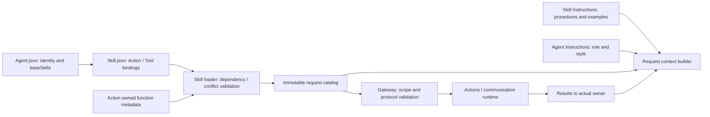

# Agent 配置与撰写规范

## 职责与边界

本目录保存随 App 打包的 Agent 身份、基础 Skill、通信声明及必要的运行时提示词。加载与组合由 [AgentConfigurations](../../Agents/Support/AgentConfigurations.swift)、[AgentSkillLoader](../../Agents/Support/AgentSkillLoader.swift) 负责，业务实现与生命周期由 [Agents](../../Agents/README.md) 负责。

Assistant 是唯一面向用户的对话 Agent；摄影、历史查询、应用控制的对话流程通过 Skill 执行。Photographer、Memory、ApplicationControl 保留确定性事务，Memory 可在独立标题事务中调用模型。感知、合成 Agent 不因此变成对话 Agent。

开发必须遵循本规范。各角色资源子目录不放 README；代码目录的 README 继续说明职责、状态、队列、取消、恢复及具体函数。资源中不得放 Swift、脚本、函数实现、凭据、模型权重或用户数据。

## 文件组织

| 文件 | 作用与要求 |
| --- | --- |
| `../Catalog.json` | 唯一显式资源索引。`version` 为 1；`agents` 的键为代码使用的配置名，如 `Assistant`，值为相对 Resources 的 `Agents/Assistant/Agent.json`；`skills` 由 [Skill 规范](../Skills/README.md) 定义。不得靠目录扫描或第二套配置生效。 |
| `<AgentName>/Agent.json` | 必需。v7 身份、通信权限、基础 Skill 和后台执行契约声明。 |
| `Assistant/Instructions.md` | Assistant 的身份、任务边界、前后台关系等基础指令。普通业务流程放 Skill，通用函数协议放 AgentCore。 |
| `Assistant/Prompts.json` | Assistant 请求与历史适配使用的命名模板，不是另一套函数注册。 |
| `Memory/TitlePrompts.json` | 标题生成事务的专用模板，不生成普通历史记录。其他确定性 Agent 不添加普通对话模板。 |

目录和固定资源文件采用 UpperCamelCase；配置名与 Swift 角色一致，运行时 `id` 使用既有 lowerCamelCase。重命名目录不能顺带修改身份、历史键或通信源。资源路径必须相对 Resources，不得含绝对路径、反斜杠或 `.` / `..` 路径段。加载器以 Bundle 中的 `Catalog.json` 定位资源根，不再次追加 Resources。

## Agent.json 字段

所有下列顶层字段应显式填写；空集合写 `[]`，不得用缺失或 null 表示。配置不接受 `actions` / `tools`、函数文档或未实现字段；加载器展开 baseSkills，并从 Skill 函数绑定和 canonical 元数据生成目录；Agent.json 出现 functions/actions/tools 会明确拒绝。

| 字段 | 类型 | 作用 |
| --- | --- | --- |
| `version` | integer | 资源 Schema 版本，当前固定为 7；不是角色发布版本。 |
| `id` | string | 实际 Agent 身份，用于执行所有权、通信和上下文隔离；必须与代码创建的身份一致且全局唯一。 |
| `communication` | object | 输入接纳协议、广播订阅、发布权限和定向发送权限，见下表。 |
| `baseSkills` | string array | 基础 Skill ID，无重复、最多 16 个；对支持 Skill 的角色用于初始化有效目录。确定性角色通常为空，不会因填写而自动获得 Skill worker。 |
| `backgroundTasks` | object array | 该角色实际支持的后台业务契约，每项含 `contract` 和 `skills`；最多 32 项。当前生产配置均为空。 |

`backgroundTasks[].contract` 是目标执行器支持的业务契约标识，`skills` 是该契约允许请求的 Skill ID 集合。后台请求必须匹配契约，请求的 Skill 集合必须是声明集合的子集；展开依赖后仍须通过 canonical 函数与组合冲突校验。它不会创建执行器、生命周期或调度能力。只有代码已实现相应后台业务，才能填写非空声明。

### communication 字段

| 字段 / 条目字段 | 作用与校验 |
| --- | --- |
| `inputs` | 可接纳的 Signal 协议集合，最多 32 项；接纳能力不等于广播订阅。 |
| `inputs[].contract` | 已在通信契约注册表中存在的协议名，如 `camera.state`。新增业务协议必须同时实现 Schema 和验证器。 |
| `inputs[].version` | 当前为 1，指 Signal 协议版本，不是 Agent 配置版本。 |
| `inputs[].kind` | 必须与契约注册的 InputKind 一致，如 `text`、`observation`、`audio`、`actionResult`、`toolResult`、`roundResult`、`communicationReceipt`。不得仅为通过校验而随意改 kind。 |
| `subscriptions` | 广播订阅，最多 16 项。每项必须有对应 inputs。 |
| `subscriptions[].contract` | 订阅的协议。 |
| `subscriptions[].source` | 真实发布者的运行时 Agent ID 或已授权外部来源，如 `speechPerception`、`phone.camera`。不是配置名 `SpeechPerception`。 |
| `subscriptions[].topic` | 当前必须等于该项 contract；不能自定义不同的路由主题。 |
| `publications` | 可发布的 observation 协议名数组，最多 64 项。 |
| `sends` | 定向发送权限，最多 64 项。每项为 `contract` 和 `target`，目标用运行时 Agent ID；协议必须是 observation，且目标声明相应 input。 |

各数组不得有重复条目。来源如果是 Agent，必须由该 Agent 声明相应 publication；外部来源必须在运行时外部来源集合中授权。全局最多 64 个主题，每个主题最多 16 个订阅者。

publish 是单向广播，不等目标接纳回包；目标失败不影响发布者，但发送者自身的协议、权限及资源错误仍可报错。send 有投递接纳回执，接纳不代表业务完成，任务结果需另行报告。外部输入按 publish / subscribe 路由。ActionResult 使用运行时捕获的实际执行所有者定向返回，不通过任意订阅或父任务身份猜测接收者。具体通信设计见 [Communication](../../Agents/Support/Communication/README.md)。

## 函数注册来源

Agent.json 不注册函数。baseSkills 指向 Catalog.json 中的 Skill ID；加载器展开依赖、合并函数绑定、验证冲突和容量后生成角色基础目录。动态 Skill 使用同一组合器，每轮请求冻结目录。

Skill.json 声明 path、callType、alias，以及 Action 的 channel。具体字段与撰写规范见 [Skills](../Skills/README.md)。参数、doc 和完成语义由函数实现维护；通信函数由 Agents 的通信适配器维护协议声明。通信权限不能代替 Skill 注册，也不能自动向模型开放 send。

可信代码内部调用仍单独绑定，不能被模型解析为函数；无模型轮次的固定调用按角色基础 Skill 目录及内部绑定校验。

## 提示词与模板字段

`Instructions.md` 是 UTF-8 的可信静态指令。应说明身份、职责、交互约束及与 Skill / 独立 Agent 的关系；不要写具体用户目标、历史任务、设备当前状态或执行结果。那些内容由结构化 Context Builder 作为数据组装。不要复制 Core 协议或 Skill 流程，避免重复指令和 token 膨胀。

Assistant/Instructions.md 已明确：无最少回复句数，遵守 Skill 要求的纯 Action 输出；已发送上下文中的重复话术不是新回复范例。Task 入口和 wait 的具体约束继续由 BasicSkill 拥有，业务分轮示例由 Photography 拥有，不增加结果去重或输出改写器。

模板 JSON 只有 `version` 和 `templates`：version 为 1，templates 为名称到字符串的映射，1–64 项；每段最多 16 KiB。变量写作 `{{name}}`，渲染调用提供的变量集合必须与模板完全一致；插入值不会再次作为模板解析。修改变量名必须同步修改调用点。单次模板渲染及 Assistant system 输出均最多 64 KiB。

Assistant 当前模板契约：

| 模板 | 用途 | 变量 |
| --- | --- | --- |
| `delegation` | 独立 Agent 的职责概述 | 无 |
| `executionObservations` | 当前执行观察数据 | `data` |
| `historicalExecution` | 历史动作证据 | `name`、`state`、`arguments`、`result`、`error` |
| `toolFailure` | 真实执行错误及输出 | `error`、`output` |

当前 Builder 从 Instructions.md 注入唯一角色/风格说明，单独组合 Core 协议和 delegation；Prompts.json 不再包含 system 模板。任务报告模板渲染的是请求相关数据，不应把全部任务日志拼到 system。Memory 模板为 `title.system`（无变量）、`title.excerpt`（user / assistant）、`title.user`（excerpts）；仅供标题事务。

## 新增与修改 Agent 的开发标准

1. 先确定 Agent 是否必要。用户对话流程优先作为 Skill；独立感知、设备状态机、事务或后台流程才由独立 Agent 承担。先更新代码目录设计，说明上下文所有权、输入预处理、容量、取消、清理、失败和重启行为。
2. 新目录必须按仓库规则取得批准。角色代码放 Agents，纯资源放本目录，索引登记到 Catalog；不新增顶层模块或第二套加载路径。
3. 创建 v7 Agent.json，列出已实现的通信契约和固定函数；不创建 Permissions.json，不复制 Skill 的业务函数。配置名、运行时 id、代码身份、通信 source / target 分别核对，不能混用。
4. 需要对话时遵守 Assistant + Skill 边界；确定性 Agent 不复制 Assistant Chat worker。需要标题等模型事务时使用事务专用模板，不创建普通历史记录。
5. 能力变更更新 canonical 元数据、拥有者代码 README 和对应 Skills；同一函数绑定保持一致。身份和协议不兼容变更必须设计迁移，不能用改文件名隐式迁移持久化数据。
6. 后台契约只有在执行器、权限、任务报告、取消和终态已实现后才能声明。不得把 send 接纳当完成，不得读取其他 Agent 私有上下文。
7. 验证完整目录加载、身份匹配、通信授权、错误配置及必要行为回归；代码/配置行为变更运行 `./scripts/check.sh`，完整 Xcode 可用时运行 `./scripts/build-ios.sh`，并验证最终 App 资源打包。真实模型和设备另行验收。

## 当前约束与相关设计

Catalog 最多 32 个 Agent / 64 个 Skill；单资源最多 64 KiB；资产缓存最多 256 项。无远程下载或热更新，错误明确传播，不以空配置兜底。Skill / 目录快照与任务历史由 Agent Context 保存，资源文件不保存运行时状态。

[Resources 总览](../README.md) · [Skill 规范](../Skills/README.md) · [Support](../../Agents/Support/README.md) · [Task / Context](../../Agents/Support/Context/README.md)

## Action-owned documentation and Skill instruction contract

Agent.json 保留身份、基础 Skill 与通信契约。App 安装各 Action 编译生成的中立目录后，加载器解析 canonical path 并生成模型目录。角色 Instructions 不包含函数示例；示例由加载 Skill 注入。

## Task controls through Action Calls

BasicSkill 的五个 Task/Skill 控制函数使用 Control Channel Action Call；运行集成通过 ChannelScheduler 返回已提交状态。startTask/loadSkills/releaseSkills 返回的已提交业务状态在结果屏障后重建目录并 ReACT，finishTask/cancelTask 加入回复及清理屏障后恢复默认。新目录仅影响后续请求，不允许加载轮提前调用新函数。可信固定调用复用同一实现。

## Agent → Skill → Function registration

Agent.json references baseSkills; Skill.json alone registers model Actions/Tools. BasicSkill owns Task/Skill orchestration and automatic State selection; ExpressionInteraction owns expression Actions. Role instructions retain identity/responsibility/style. Business roles reuse existing Skills; internal trusted bindings remain separate. Historical snapshots are preserved.

## 提示词职责与失败

角色与风格定义在 Instructions.md；Assistant Prompts.json 提供请求/结果/异常等模板，不包含 system 角色正文。

Assistant 的 Agent/Provider 异常终止当前 Decision 并保留历史/效果证据；真实业务失败通过 executionObservations 提供给后续推理。

## 待实现

- 生产后台任务契约仍为空；远程资源更新和多前台任务栈未实现。

✅ 每轮状态数据由 CURRENT STATE 统一注入，删除独立 activeTask/taskReports/taskReport 模板；保留执行观察、历史证据及 Tool 失败模板。

## 统一容器异常通道

✅ Assistant 配置显式声明 container.failure 标准输入及 runtime 来源订阅；不添加模型函数或 Skill 暴露。其他 Agent 可按能力声明订阅，不强制向不支持的角色投递。

## ApplicationControl 异常展示

✅ ApplicationControl 的配置声明 container.failure/runtime.failure observation 输入和 runtime 来源订阅。Assistant 保留容器异常的被动订阅；异常呈现使用角色代码中的内部权限，不向模型扩展函数目录。

✅ 通信注册表只保留 Agent 消息与执行反馈；删除本地 UI／媒体／环境／故障的历史 schema 和仅供外部来源的测试声明，本地类型自身继续验证。
