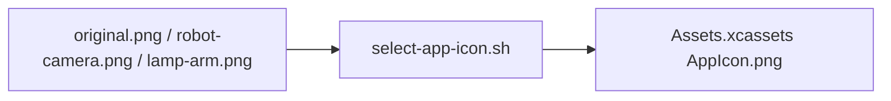

# Preserved App Icon Artwork

## Summary

Source artwork for reproducible build-time icon selection.

## Ownership and boundaries

Preserves original.png, robot-camera.png and the selected lamp-arm.png source. The app bundle consumes the selected AppIcon asset, not a runtime gallery of these files.

## External relationships and data flow

Arrows show build-time asset/metadata movement; runtime acquisition is owned outside this directory.

## Selection contract

The [existing selector](../../../scripts/select-app-icon.sh) copies the explicitly selected 1024×1024 artwork into the current asset catalog. Previous sources remain preserved for subsequent builds. The project README references the selected asset-catalog image so its logo follows icon selection. There is no Swift implementation, runtime state or alternate-icon entitlement here.

✅ lamp-arm.png uses the centered composition of the user's chosen first expression-refinement design. It retains the phone's tilt, cyan open/winking eyes and white arm while balancing opposing canvas margins. The existing selector and opaque 1024×1024 contract remain unchanged; full-resolution prior and revised artwork remain in [icon concepts](../../../output/icon-concepts/README.md).

✅ Preserved artwork and build-time selection.

## Related design

[Parent design](../README.md)
