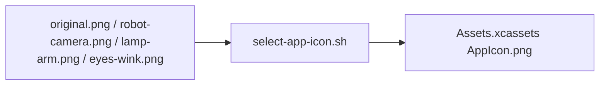

# Preserved App Icon Artwork

## Summary

Source artwork for reproducible build-time icon selection.

## Ownership and boundaries

Preserves original.png, robot-camera.png, lamp-arm.png and the selected eyes-wink.png source. The app bundle consumes the selected AppIcon asset, not a runtime gallery of these files.

## External relationships and data flow

Arrows show build-time asset/metadata movement; runtime acquisition is owned outside this directory.

## Selection contract

The [existing selector](../../../scripts/select-app-icon.sh) copies the explicitly selected 1024×1024 artwork into the current asset catalog. Previous sources remain preserved for subsequent builds. The project README's [generated banner](../../../output/README.md) independently uses the blue-eye concept artwork; icon selection does not automatically update that image. There is no Swift implementation, runtime state or alternate-icon entitlement here.

eyes-wink.png 为深色背景上收拢、留有充足左右边距的蓝色双眼，左侧睁眼、右侧圆润 `<` 形眨眼；选择器要求不透明 1024×1024 图像。构图原稿见 [icon concepts](../../../output/icon-concepts/README.md)。

Preserved artwork and build-time selection.

## Related design

[Parent design](../README.md)

## 待实现

- 暂无本目录独立的实现待办；跨模块及实际模型/设备验收见所属模块说明。
