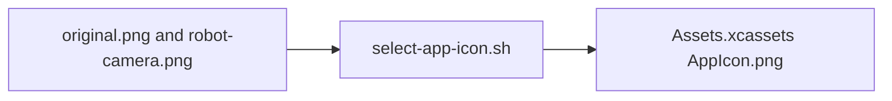

# Preserved App Icon Artwork

## Summary

Source artwork for reproducible build-time icon selection.

## Ownership and boundaries

Preserves original.png and robot-camera.png. The app bundle consumes the selected AppIcon asset, not a runtime gallery of these files.

## External relationships and data flow

Arrows show build-time asset/metadata movement; runtime acquisition is owned outside this directory.

## Selection contract

The [existing selector](../../../scripts/select-app-icon.sh) copies the explicitly selected artwork into the current asset catalog. Both sources remain preserved for subsequent builds. There is no Swift implementation, runtime state or alternate-icon entitlement here.

✅ Preserved artwork and build-time selection.

## Related design

[Parent design](../README.md)
