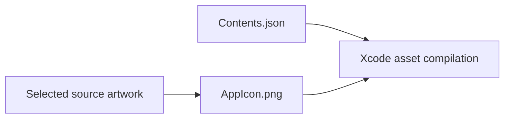

# Universal App Icon

## Summary

One selected 1024×1024 iOS app-icon image.

## Ownership and boundaries

Owns only AppIcon.png and its asset declaration. Icon choice is build-time, without runtime alternate-icon APIs.

## External relationships and data flow

Arrows show build-time asset/metadata movement; runtime acquisition is owned outside this directory.

## Asset declaration

`Contents.json` references `AppIcon.png` with universal idiom, iOS platform and 1024×1024 size. Asset-catalog version is 1. The selected image must remain square and compatible with Xcode app-icon compilation.

✅ AppIcon.png is refreshed from the centered lamp-arm.png composition through the existing selector. It retains the selected first expression-refinement design's white articulated arm, tilted iPhone face, cyan open/winking eyes, hidden rear magnetic mount and clean dark display. The root README uses this same AppIcon.png; the declaration remains unchanged. Native home-screen appearance requires a rebuilt/installed app.

✅ Universal icon image and metadata.

❌ Separate dark/tinted appearance entries.

## Related design

[Parent design](../README.md)
